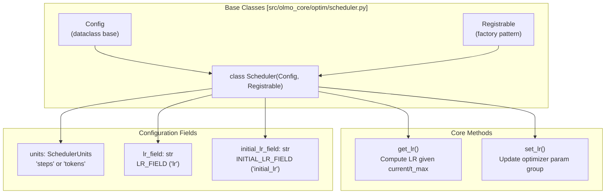
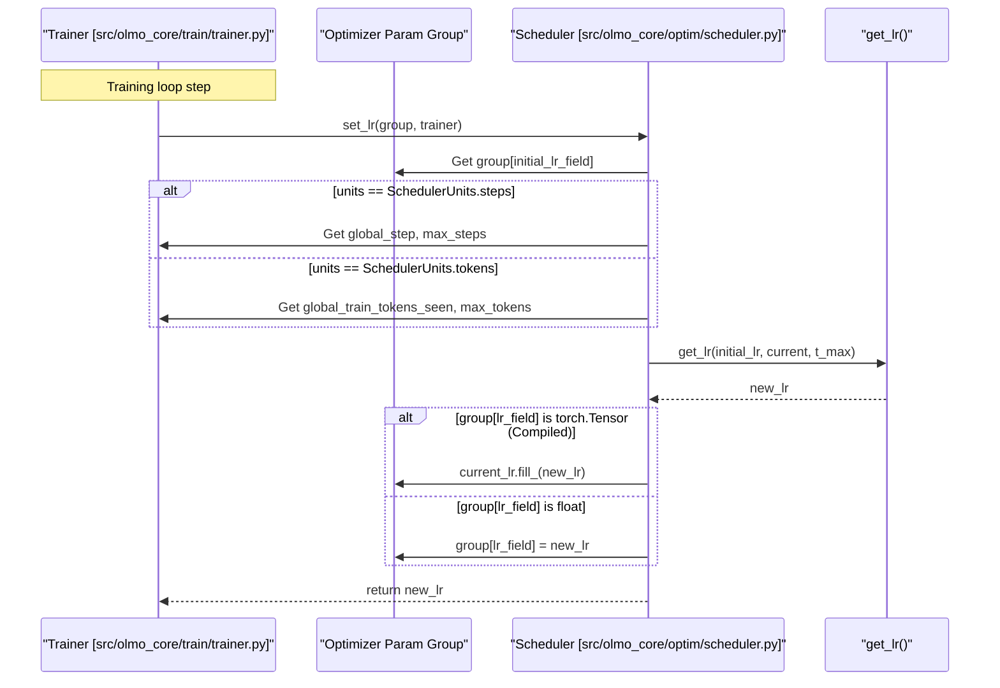
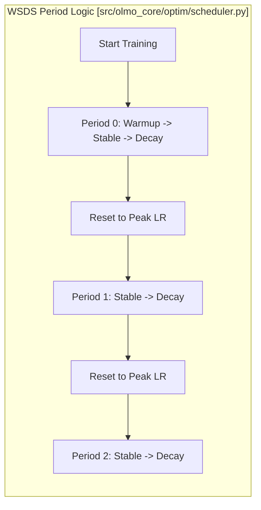

<!-- source: DeepWiki mcp.deepwiki.com · repo allenai/OLMo-core · page 6.3 Learning Rate Schedulers · fetched 2026-10-26 -->

# Learning Rate Schedulers

Relevant source files

The following files were used as context for generating this wiki page:

- [src/olmo_core/optim/__init__.py](src/olmo_core/optim/__init__.py)
- [src/olmo_core/optim/scheduler.py](src/olmo_core/optim/scheduler.py)
- [src/olmo_core/train/callbacks/list_checkpointer.py](src/olmo_core/train/callbacks/list_checkpointer.py)
- [src/test/optim/scheduler_test.py](src/test/optim/scheduler_test.py)

## Overview

This page documents the learning rate scheduling system in OLMo-core. Schedulers compute and update the learning rate dynamically during training based on either the number of training steps or tokens processed. The system supports various scheduling strategies including warmup phases, stable training periods, and decay schedules, as well as specialized schedulers for multi-period training and learning rate range tests.

For information about optimizer configuration and construction, see [6.1 Optimizer Configuration](). For specific optimizer implementations, see [6.2 Optimizer Implementations]().

**Sources:** [src/olmo_core/optim/scheduler.py:1-745]()

## Scheduler Architecture

### Base Components

The scheduling system is built around the abstract `Scheduler` class, which defines the interface for all learning rate schedulers. All schedulers inherit from both `Config` and `Registrable`, enabling them to be configured via dataclasses and registered for factory-based instantiation [src/olmo_core/optim/scheduler.py:27-35]().

#### Code Entity Space Mapping
The following diagram maps the conceptual scheduler components to their specific class and field definitions in the codebase.

**Sources:** [src/olmo_core/optim/scheduler.py:21-97](), [src/olmo_core/optim/config.py:13-13]()

### Step-Based vs Token-Based Scheduling

Schedulers can operate in two modes, defined by the `SchedulerUnits` enum [src/olmo_core/optim/scheduler.py:21-24]():

| Unit Type | Description | Internal State Used |
|-----------|-------------|---------------------|
| `steps` | Schedule based on training step count | `trainer.global_step` and `trainer.max_steps` [src/olmo_core/optim/scheduler.py:68-77]() |
| `tokens` | Schedule based on total tokens seen | `trainer.global_train_tokens_seen` and `trainer.max_tokens` [src/olmo_core/optim/scheduler.py:78-87]() |

**Sources:** [src/olmo_core/optim/scheduler.py:21-24](), [src/olmo_core/optim/scheduler.py:68-89]()

### Scheduler-Optimizer Integration Flow

The `set_lr` method handles the logic of reading the initial learning rate from the optimizer's parameter group and applying the newly calculated rate.

**Sources:** [src/olmo_core/optim/scheduler.py:46-96]()

## Scheduler Implementations

### Constant Schedulers

#### ConstantScheduler
A basic scheduler that returns the `initial_lr` regardless of the current step [src/olmo_core/optim/scheduler.py:99-111]().

#### ConstantWithWarmup
Maintains a constant learning rate after a linear warmup phase. It requires either `warmup` (absolute) or `warmup_fraction` (relative to `t_max`) [src/olmo_core/optim/scheduler.py:113-156]().

### WSD: Warmup-Stable-Decay
The `WSD` scheduler implements the three-phase schedule popularized for LLM pretraining:
1.  **Warmup**: Linear increase from `warmup_min_lr` to peak.
2.  **Stable**: Constant peak LR.
3.  **Decay**: Linear decrease to `decay_min_lr` [src/olmo_core/optim/scheduler.py:158-230]().

**Sources:** [src/olmo_core/optim/scheduler.py:158-230]()

### Decay Schedulers

#### LinearWithWarmup
Linear decay from peak LR to `alpha_f * initial_lr` after warmup [src/olmo_core/optim/scheduler.py:232-284]().

#### InvSqrtWithWarmup
Inverse square root decay after warmup, commonly used for Transformer models where the LR decays as $1/\sqrt{t}$ [src/olmo_core/optim/scheduler.py:286-331]().

#### CosWithWarmup
Cosine annealing schedule that smoothly decays the learning rate to a minimum value defined by `alpha_f` [src/olmo_core/optim/scheduler.py:333-385]().

#### HalfCosWithWarmup
Uses only the second half of a cosine curve (from peak to trough) after the warmup phase [src/olmo_core/optim/scheduler.py:387-443]().

#### CosWithWarmupAndLinearDecay
Combines a cosine decay with a final linear decay phase at the very end of training [src/olmo_core/optim/scheduler.py:445-489]().

### Advanced and Composite Schedulers

#### SequentialScheduler
Chains multiple `Scheduler` instances. It uses a `schedulers_max` list to determine when to switch to the next scheduler in the sequence [src/olmo_core/optim/scheduler.py:511-573]().

#### WSDS: Warmup-Stable-Decay-Simplified
A specialized scheduler for multi-period training (e.g., curriculum or continual pretraining). It resets the LR to peak at the start of each period defined in `period_lengths`, but only performs warmup in the very first period [src/olmo_core/optim/scheduler.py:575-710]().

**Sources:** [src/olmo_core/optim/scheduler.py:575-710](), [src/test/optim/scheduler_test.py:102-151]()

#### ExponentialScheduler
Primarily used for learning rate range tests (LR Finders). It exponentially increases the learning rate from `lr_min` to `initial_lr` [src/olmo_core/optim/scheduler.py:712-745]().

## Implementation Details

### Warmup and Decay Helpers
Internal functions provide the mathematical logic for linear transitions:
*   `_linear_warmup`: [src/olmo_core/optim/scheduler.py:491-499]()
*   `_linear_decay`: [src/olmo_core/optim/scheduler.py:501-509]()

### Checkpointing Integration
When using `WSDS` or other periodic schedules, it is common to save checkpoints at phase boundaries. The `ListCheckpointerCallback` can be configured with specific steps (e.g., period ends) to ensure model states are captured when the LR reaches its minimum [src/olmo_core/train/callbacks/list_checkpointer.py:11-59]().

### Optimizer Compilation Support
If the optimizer is compiled, the learning rate in the parameter group may be a `torch.Tensor`. Schedulers detect this in `set_lr` and use `fill_` to update the value in-place, which is required for PyTorch's graph capture [src/olmo_core/optim/scheduler.py:91-95]().

**Sources:** [src/olmo_core/optim/scheduler.py:1-745](), [src/olmo_core/train/callbacks/list_checkpointer.py:11-59]()

---

