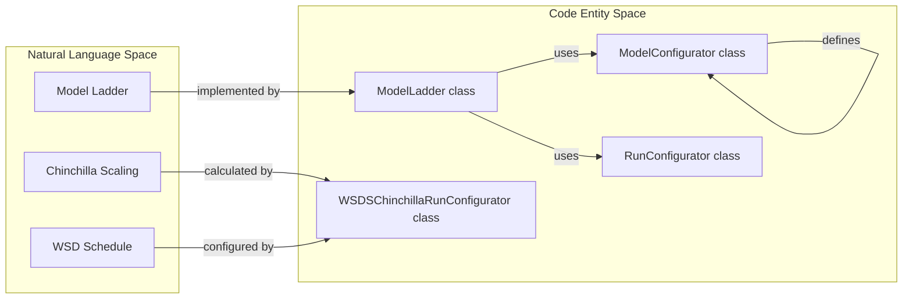
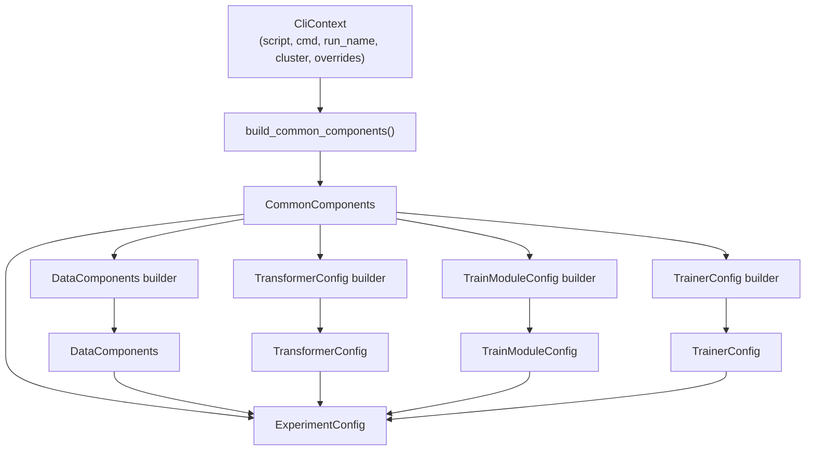

<!-- source: DeepWiki mcp.deepwiki.com · repo allenai/OLMo-core · page 7 Experiment Management · fetched 2026-10-26 -->

# Experiment Management

<details>
<summary>Relevant source files</summary>

The following files were used as context for generating this wiki page:

- [src/olmo_core/internal/common.py](src/olmo_core/internal/common.py)
- [src/olmo_core/internal/experiment.py](src/olmo_core/internal/experiment.py)
- [src/olmo_core/internal/ladder.py](src/olmo_core/internal/ladder.py)
- [src/olmo_core/launch/beaker.py](src/olmo_core/launch/beaker.py)
- [src/olmo_core/model_ladder/__init__.py](src/olmo_core/model_ladder/__init__.py)
- [src/olmo_core/model_ladder/base.py](src/olmo_core/model_ladder/base.py)
- [src/olmo_core/model_ladder/transformer_model_configurator.py](src/olmo_core/model_ladder/transformer_model_configurator.py)
- [src/olmo_core/model_ladder/wsds_chinchilla_run_configurator.py](src/olmo_core/model_ladder/wsds_chinchilla_run_configurator.py)
- [src/scripts/train/ladder/2026Q1/init_style_ladder.py](src/scripts/train/ladder/2026Q1/init_style_ladder.py)
- [src/scripts/train/ladder/2026Q1/more_norms_ladder.py](src/scripts/train/ladder/2026Q1/more_norms_ladder.py)
- [src/scripts/train/ladder/olmo3_ladder.py](src/scripts/train/ladder/olmo3_ladder.py)

</details>


This page provides an overview of the experiment management system in OLMo-core, which handles the configuration, launching, and orchestration of training runs. Experiment management sits at the top of the system architecture, bridging user-defined training scripts with the underlying training infrastructure, supporting both the Beaker platform and Lambda/SLURM clusters.

For details on the Beaker platform integration, see [Beaker Launch System](#7.1). For information on experiment configuration structures, see [Experiment Configuration](#7.2). For official training script examples, see [Official Training Scripts](#7.3). For execution workflows and command dispatch, see [Launch Workflows and Environment Setup](#7.4). For monitoring and logging, see [Metric Logging and Notifications](#7.5).

## Overview

The experiment management system provides a unified interface for:
- Defining complete experiment configurations with reproducible parameters.
- Launching jobs on the Beaker compute platform or SLURM-based clusters (e.g., Lambda).
- Managing different execution modes (launch, train, prep, dry-run) via a standardized CLI.
- Composing configurations from modular components using a factory pattern.

The system uses a configuration-driven approach where all experiment parameters are captured in structured dataclasses that can be serialized, versioned, and overridden via command-line arguments.

**Sources:** [src/olmo_core/internal/experiment.py:1-52](), [src/olmo_core/launch/beaker.py:1-58]()

## Core Components

### ExperimentConfig

`ExperimentConfig` is the top-level configuration dataclass that encapsulates all parameters needed to run a training experiment:

```mermaid
classDiagram
    class ExperimentConfig {
        +str run_name
        +BeakerLaunchConfig launch
        +TransformerConfig model
        +NumpyDatasetConfig dataset
        +DataLoaderConfig data_loader
        +TrainModuleConfig train_module
        +TrainerConfig trainer
        +int init_seed
        +str backend
    }
    
    class BeakerLaunchConfig {
        +str name
        +List~str~ cmd
        +str budget
        +int num_nodes
        +int num_gpus
        +List~str~ clusters
        +launch()
    }
    
    class CommonComponents {
        +str run_name
        +str root_dir
        +str work_dir
        +str save_folder
        +TokenizerConfig tokenizer
        +int max_sequence_length
        +int global_batch_size
    }
    
    class DataComponents {
        +NumpyDatasetConfig dataset
        +DataLoaderConfig data_loader
    }
    
    ExperimentConfig --> BeakerLaunchConfig : [src/olmo_core/internal/experiment.py:98]()
    ExperimentConfig --> TransformerConfig : [src/olmo_core/internal/experiment.py:99]()
    ExperimentConfig --> TrainModuleConfig : [src/olmo_core/internal/experiment.py:102]()
    ExperimentConfig --> TrainerConfig : [src/olmo_core/internal/experiment.py:103]()
    
    CommonComponents ..> BeakerLaunchConfig : builds via build_launch_config()
    CommonComponents ..> DataComponents : used to derive
```

**Sources:** [src/olmo_core/internal/experiment.py:96-106](), [src/olmo_core/launch/beaker.py:211-310](), [src/olmo_core/internal/experiment.py:75-88]()

### BeakerLaunchConfig

`BeakerLaunchConfig` handles job submission to the Beaker platform. It specifies resources, environment variables, clusters, and setup steps:

| Field | Type | Description |
|-------|------|-------------|
| `name` | `str` | Name for the Beaker experiment [src/olmo_core/launch/beaker.py:216]() |
| `cmd` | `List[str]` | Command to execute in the container [src/olmo_core/launch/beaker.py:221]() |
| `budget` | `str` | Budget group for resource allocation [src/olmo_core/launch/beaker.py:231]() |
| `num_nodes` | `int` | Number of nodes to allocate [src/olmo_core/launch/beaker.py:246]() |
| `num_gpus` | `int` | Number of GPUs per node [src/olmo_core/launch/beaker.py:251]() |
| `clusters` | `List[str]` | Allowed clusters (e.g., `["ai2/jupiter"]`) [src/olmo_core/launch/beaker.py:241]() |
| `beaker_image` | `str` | Docker image to use (see `OLMoCoreBeakerImage`) [src/olmo_core/launch/beaker.py:236]() |
| `shared_filesystem` | `bool` | Whether using shared storage (weka/NFS) [src/olmo_core/launch/beaker.py:261]() |

**Sources:** [src/olmo_core/launch/beaker.py:211-310]()

### OLMoCoreBeakerImage Enumeration

The `OLMoCoreBeakerImage` enum provides official Docker images with pre-compiled GPU libraries and specialized kernels (e.g., Quack):

```python
# Available images
OLMoCoreBeakerImage.stable          # Latest stable PyTorch (2.9.1) [src/olmo_core/launch/beaker.py:141]()
OLMoCoreBeakerImage.tch291_cu129    # Torch 2.9.1 + CUDA 12.9 + FA4 + Quack [src/olmo_core/launch/beaker.py:157]()
OLMoCoreBeakerImage.tch270_cu128    # Battle tested for OLMo3 7B/32B [src/olmo_core/launch/beaker.py:181]()
```

**Sources:** [src/olmo_core/launch/beaker.py:131-189]()

### SubCmd Dispatch System

The `SubCmd` enum defines execution modes for experiment scripts, handling environment setup and logic dispatch:

| Mode | Purpose |
|------|---------|
| `launch` | Submit experiment to Beaker with `train` subcommand [src/olmo_core/internal/experiment.py:109]() |
| `train` | Execute distributed training (multi-GPU/multi-node) [src/olmo_core/internal/experiment.py:110]() |
| `train_single` | Execute training on single device, disabling DP/TP [src/olmo_core/internal/experiment.py:111]() |
| `prep` | Prepare dataset cache ahead of training [src/olmo_core/internal/experiment.py:112]() |
| `launch_prep` | Submit dataset preparation job to Beaker [src/olmo_core/internal/experiment.py:113]() |
| `dry_run` | Print configuration and param counts without execution [src/olmo_core/internal/experiment.py:114]() |

**Sources:** [src/olmo_core/internal/experiment.py:108-168]()

## Model Ladders and Scaling Laws

For systematic scaling studies, OLMo-core provides a "Model Ladder" system. This automates the calculation of hyperparameters across model sizes (from 60M to 13B+) using Chinchilla scaling laws and WSD-S learning rate schedules.

### Ladder Components



- **`ModelConfigurator`**: Defines how to build a model architecture (e.g., `Olmo3ModelConfigurator`) and determine micro-batch sizes for a given size spec [src/olmo_core/model_ladder/base.py:96-149]().
- **`RunConfigurator`**: Calculates training duration, batch sizes, and optimizer settings based on parameter counts [src/olmo_core/model_ladder/base.py:152-202]().
- **`WSDSChinchillaRunConfigurator`**: A concrete implementation that uses `tokens_per_param` (default 20) and `chinchilla_multiple` to derive schedules [src/olmo_core/model_ladder/wsds_chinchilla_run_configurator.py:23-41]().

**Sources:** [src/olmo_core/model_ladder/base.py:1-205](), [src/olmo_core/model_ladder/wsds_chinchilla_run_configurator.py:23-132](), [src/olmo_core/model_ladder/transformer_model_configurator.py:26-75]()

## Configuration Building Pattern

The system uses a modular builder pattern to compose `ExperimentConfig` from sub-components.



The `build_common_components()` function establishes the `root_dir` (e.g., `/weka/...` or `gs://...`) and `save_folder` based on the target cluster and user [src/olmo_core/internal/experiment.py:177-219]().

**Sources:** [src/olmo_core/internal/experiment.py:177-251](), [src/olmo_core/internal/common.py:34-53]()

## Execution Workflows

### Launch Workflow

The `launch()` function in `experiment.py` triggers the Beaker submission process. It validates that the local git state is clean (unless `allow_dirty` is set) and uses `Gantry` to create the experiment spec [src/olmo_core/internal/experiment.py:420-438]().

### Training Workflow

The `train()` function handles the actual model instantiation and loop:
1. Seeds all RNGs via `seed_all()` [src/olmo_core/internal/experiment.py:457]().
2. Builds the `TrainModule` and `Trainer` [src/olmo_core/internal/experiment.py:460-464]().
3. Injects the serialized config into the `ConfigSaverCallback` [src/olmo_core/internal/experiment.py:467-468]().
4. Starts the training loop via `trainer.fit()` [src/olmo_core/internal/experiment.py:470]().

**Sources:** [src/olmo_core/internal/experiment.py:455-471]()

## Environment and Credentials

The `build_launch_config()` helper in `internal/common.py` automatically injects necessary secrets into the job environment:
- **Beaker/W&B**: `BEAKER_TOKEN`, `WANDB_API_KEY` [src/olmo_core/internal/common.py:94-103]().
- **Storage**: `GOOGLE_CREDENTIALS`, `AWS_CONFIG`, `AWS_CREDENTIALS` [src/olmo_core/internal/common.py:156-158]().
- **Networking**: `NCCL_DEBUG` and flight recorder settings for debugging hangs [src/olmo_core/internal/common.py:127-138]().

**Sources:** [src/olmo_core/internal/common.py:56-163]()

---

