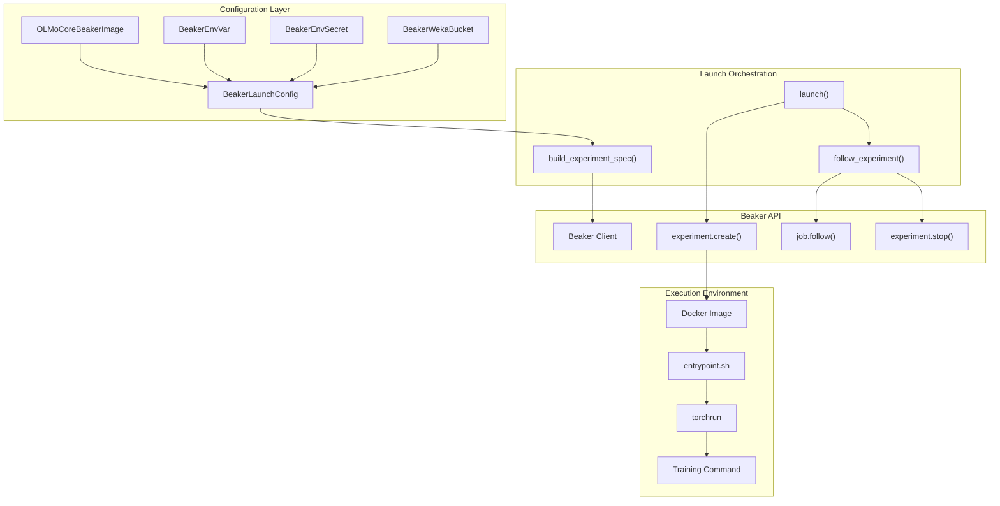
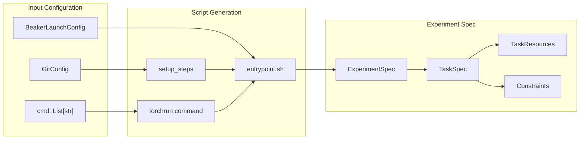
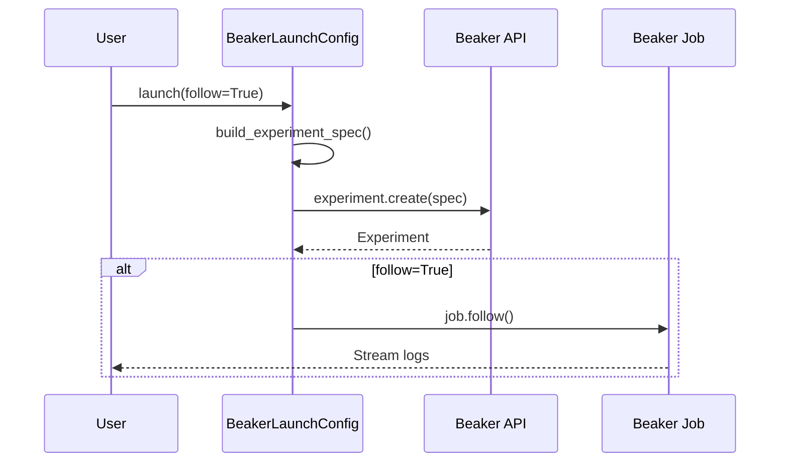

<!-- source: DeepWiki mcp.deepwiki.com · repo allenai/OLMo-core · page 7.1 Beaker Launch System · fetched 2026-10-26 -->

# Beaker Launch System

<details>
<summary>Relevant source files</summary>

The following files were used as context for generating this wiki page:

- [src/olmo_core/exceptions.py](src/olmo_core/exceptions.py)
- [src/olmo_core/internal/common.py](src/olmo_core/internal/common.py)
- [src/olmo_core/internal/experiment.py](src/olmo_core/internal/experiment.py)
- [src/olmo_core/launch/beaker.py](src/olmo_core/launch/beaker.py)
- [src/olmo_core/launch/select_beaker_hosts.py](src/olmo_core/launch/select_beaker_hosts.py)
- [src/olmo_core/launch/utils.py](src/olmo_core/launch/utils.py)
- [src/test/launch/utils_test.py](src/test/launch/utils_test.py)

</details>


This document describes the Beaker launch system in OLMo-core, which enables submission and execution of training jobs on the [Beaker](https://beaker.org) platform. The system provides programmatic job submission, resource allocation, environment configuration, and job monitoring capabilities.

For information about the broader experiment management framework that uses this system, see [Experiment Management](#7). For details on the experiment configuration structure, see [Experiment Configuration](#7.2). For information about official training scripts that use this system, see [Official Training Scripts](#7.3).

## Purpose and Scope

The Beaker launch system provides:

- **Job Submission**: Programmatic creation and submission of Beaker experiments via the Beaker Python API.
- **Resource Specification**: Declaration of compute resources including GPUs, nodes, memory, and specific clusters (e.g., `ai2/jupiter`, `ai2/titan`).
- **Environment Setup**: Configuration of Docker images, environment variables, secrets, and filesystem mounts (Weka, S3, GCS).
- **Distributed Training Support**: Multi-node job orchestration with `torchrun` integration and topology-aware host selection.
- **Monitoring**: Log streaming, experiment status tracking, and Slack notifications.
- **Error Handling**: Timeout detection (soft and hard), failure notifications, and automated job cancellation.

Sources: [src/olmo_core/launch/beaker.py:1-68](), [src/olmo_core/internal/common.py:56-163]()

## Architecture Overview

The Beaker launch system consists of configuration classes, a launch orchestrator, and monitoring utilities. The system translates high-level training configurations into Beaker-specific experiment specifications.



**Diagram: Beaker Launch System Architecture**

The launch process flows from configuration definition through experiment spec building to Beaker API submission and monitoring.

Sources: [src/olmo_core/launch/beaker.py:120-673](), [src/olmo_core/internal/experiment.py:177-208]()

## Core Configuration Classes

### BeakerLaunchConfig

`BeakerLaunchConfig` is the primary configuration class for defining Beaker experiments. It specifies all parameters needed to submit and execute a job.

| Field | Type | Description |
|-------|------|-------------|
| `name` | `str` | Experiment name in Beaker. |
| `cmd` | `list[str]` | Command to execute in the container. |
| `budget` | `str \| None` | Budget group for resource accounting. |
| `task_name` | `str` | Name for the Beaker task (default: "train"). |
| `workspace` | `str \| None` | Beaker workspace to use. |
| `beaker_image` | `str` | Docker image reference. |
| `num_nodes` | `int` | Number of nodes/replicas. |
| `num_gpus` | `int` | GPUs per node. |
| `clusters` | `list[str]` | Allowed clusters (e.g., ["ai2/jupiter"]). |
| `shared_filesystem` | `bool` | Whether nodes share a filesystem. |
| `priority` | `Priority` | Job priority level. |
| `preemptible` | `bool` | Allow preemption. |
| `retries` | `int \| None` | Retry count on failure. |
| `env_vars` | `list[BeakerEnvVar]` | Environment variables. |
| `env_secrets` | `list[BeakerEnvSecret]` | Secrets as environment variables. |
| `weka_buckets` | `list[BeakerWekaBucket]` | Weka filesystem mounts. |
| `setup_steps` | `list[str]` | Shell commands for setup. |

Sources: [src/olmo_core/launch/beaker.py:211-329]()

### OLMoCoreBeakerImage

`OLMoCoreBeakerImage` is a `StrEnum` providing pre-built Docker images with PyTorch, CUDA, and GPU libraries (flash-attn 4, transformer-engine) pre-compiled.

```python
class OLMoCoreBeakerImage(StrEnum):
    stable = f"tylerr/olmo-core-tch{_DEFAULT_TORCH}cu{_DEFAULT_CUDA}-2025-11-25"
    tch291_cu129 = "petew/olmo-core-tch291cu129-2026-01-24"
    tch291_cu128 = "petew/olmo-core-tch291cu128-FA4"
    tch2100_cu128 = "petew/olmo-core-tch2100cu128-2026-01-23"
```

Images are versioned by PyTorch (`tch`) and CUDA (`cu`) versions. Newer images include the AWS CLI, Google Cloud SDK, and advanced kernels like Quack.

Sources: [src/olmo_core/launch/beaker.py:131-189]()

### Supporting Configuration Classes

**BeakerEnvVar** - Defines an environment variable to inject into the job. [src/olmo_core/launch/beaker.py:192-195]()

**BeakerEnvSecret** - Defines an environment variable sourced from a Beaker secret. [src/olmo_core/launch/beaker.py:198-202]()

**BeakerWekaBucket** - Defines a Weka filesystem mount. [src/olmo_core/launch/beaker.py:205-208]()

## Experiment Spec Building

The `build_experiment_spec()` method translates `BeakerLaunchConfig` into a Beaker `ExperimentSpec`.



**Diagram: Experiment Spec Building Process**

### Entrypoint Script Generation

The system generates an `entrypoint.sh` script that:
1. Configures environment variables (e.g., `PYTHONPATH`, `TORCH_HOME`). [src/olmo_core/launch/beaker.py:441-450]()
2. Executes custom `setup_steps` (e.g., `pip install`). [src/olmo_core/launch/beaker.py:461-464]()
3. Handles multi-node rank reordering for specific clusters like `augusta`. [src/olmo_core/launch/beaker.py:466-484]()
4. Wraps the command in `torchrun` if multiple GPUs or nodes are requested. [src/olmo_core/launch/beaker.py:486-500]()

Sources: [src/olmo_core/launch/beaker.py:441-500]()

### Host Selection (Augusta)

For clusters like `ai2/augusta`, host selection is critical for performance. The `get_hostname_constraints` function in `olmo_core.launch.select_beaker_hosts` selects nodes based on physical topology (blocks and subblocks) to minimize network latency.

| Concept | Description |
|---------|-------------|
| **Block** | Instances within the same block have low latency. |
| **Sub-block** | Instances within the same sub-block have even lower latency. |
| **Machine** | Instances on the same physical host have the lowest possible latency. |

The system queries GCP metadata via `get_hosts_metadata_from_gcp` to determine the physical topology of running nodes. [src/olmo_core/launch/select_beaker_hosts.py:40-64]()

Sources: [src/olmo_core/launch/select_beaker_hosts.py:20-64](), [src/olmo_core/launch/select_beaker_hosts.py:132-205]()

## Launch Workflow

The `launch()` method submits the experiment to Beaker and optionally follows the job until completion.



**Diagram: Launch and Follow Workflow**

### Timeout Management

The launch system manages three types of timeouts:

1. **Launch Timeout** (`launch_timeout`): Maximum time to wait for the job to transition from "created" to "running". [src/olmo_core/launch/beaker.py:585-610]()
2. **Step Timeout** (`step_timeout`): Hard timeout. If no training progress (step logs) is detected for this duration, the job is killed. [src/olmo_core/launch/beaker.py:734-848]()
3. **Step Soft Timeout** (`step_soft_timeout`): If no progress is detected for this duration, a warning is sent (e.g., via Slack) but the job continues. [src/olmo_core/launch/beaker.py:734-848]()

Sources: [src/olmo_core/launch/beaker.py:585-673](), [src/olmo_core/launch/beaker.py:734-848]()

## Callbacks and Notifications

### GantryMonitorCallback (BeakerCallback)

The `BeakerCallback` (often referred to as the Gantry monitor) adds metadata to the Beaker experiment description while the job is running.

- **Pre-train**: Saves the `config.json` and `requirements.txt` to the Beaker results directory (`/results/olmo-core`). [src/olmo_core/train/callbacks/beaker.py:91-96]()
- **Post-step**: Periodically updates the Beaker experiment description with current training progress (e.g., `[step=1000/10000]`). [src/olmo_core/train/callbacks/beaker.py:116-127]()
- **Integration**: Links the Beaker experiment URL to W&B and Comet.ml logs. [src/olmo_core/train/callbacks/beaker.py:133-143]()

Sources: [src/olmo_core/train/callbacks/beaker.py:25-143]()

### Slack Notifications

The launch system can send Slack notifications when jobs start, succeed, fail, or become inactive (hit a soft timeout). This requires the `SLACK_WEBHOOK_URL` secret to be configured. [src/olmo_core/launch/beaker.py:850-873]()

Sources: [src/olmo_core/launch/beaker.py:850-873](), [src/olmo_core/internal/common.py:120-123]()

### Metric and Config Saving

- **MetricSaverCallback**: Captures metrics on rank 0 and saves them to JSON files in the trainer's save folder. [src/olmo_core/train/callbacks/metric_saver.py:17-40]()
- **ConfigSaverCallback**: Saves the full `ExperimentConfig` to the results directory to ensure reproducibility. [src/olmo_core/train/callbacks/beaker.py:91-96]()

Sources: [src/olmo_core/train/callbacks/metric_saver.py:17-40](), [src/olmo_core/train/callbacks/beaker.py:91-96]()

## Default Environment Variables

The `BeakerLaunchConfig.default_env_vars` property provides standard environment variables injected into all jobs:

- `NCCL_DEBUG`: Set to `INFO` for communication debugging. [src/olmo_core/launch/beaker.py:331-332]()
- `OMP_NUM_THREADS`: Defaults to `8`. [src/olmo_core/launch/beaker.py:333]()
- `OLMO_SHARED_FS_ENV_VAR`: Set to `1` if a shared filesystem (like Weka) is used. [src/olmo_core/launch/beaker.py:335-336]()
- `TORCH_LOGS`: Configured for `recompiles,graph_breaks` to assist in debugging `torch.compile`. [src/olmo_core/launch/beaker.py:338-341]()

Sources: [src/olmo_core/launch/beaker.py:331-350]()

---

