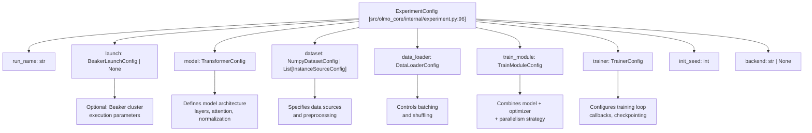
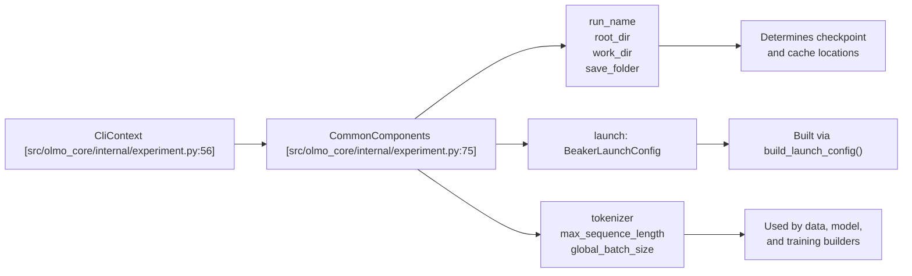
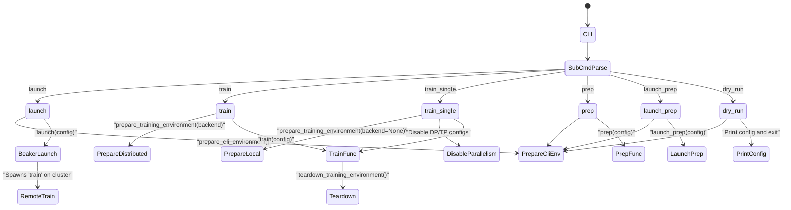
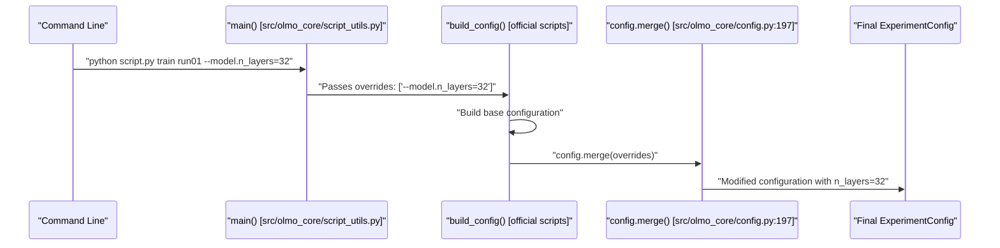
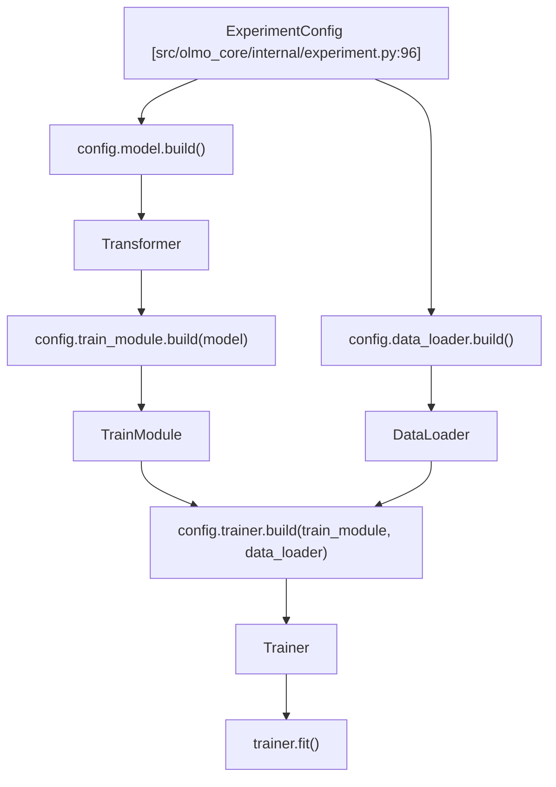

<!-- source: DeepWiki mcp.deepwiki.com · repo allenai/OLMo-core · page 7.2 Experiment Configuration · fetched 2026-10-26 -->

# Experiment Configuration

Relevant source files

The following files were used as context for generating this wiki page:

- [src/olmo_core/config.py](src/olmo_core/config.py)
- [src/olmo_core/data/mixes/OLMo-longmino-mix-0625.txt](src/olmo_core/data/mixes/OLMo-longmino-mix-0625.txt)
- [src/olmo_core/data/mixes/OLMo-longmino-mix-0925.txt](src/olmo_core/data/mixes/OLMo-longmino-mix-0925.txt)
- [src/olmo_core/internal/common.py](src/olmo_core/internal/common.py)
- [src/olmo_core/internal/cookbook.py](src/olmo_core/internal/cookbook.py)
- [src/olmo_core/internal/experiment.py](src/olmo_core/internal/experiment.py)
- [src/olmo_core/launch/beaker.py](src/olmo_core/launch/beaker.py)
- [src/scripts/official/OLMo3/OLMo-3-1025-32B-long-context.py](src/scripts/official/OLMo3/OLMo-3-1025-32B-long-context.py)
- [src/scripts/official/OLMo3/OLMo-3-1025-7B-long-context.py](src/scripts/official/OLMo3/OLMo-3-1025-7B-long-context.py)
- [src/test/config_test.py](src/test/config_test.py)

## Purpose and Scope

This page documents the experiment configuration system used to define, build, and orchestrate training runs in OLMo-core. The configuration system provides a unified interface for specifying all aspects of a training experiment, from model architecture to data loading to distributed training settings.

The core abstraction is `ExperimentConfig`, which aggregates individual component configurations into a complete experiment specification. This page covers the configuration structure, builder patterns, and execution workflows. For details about launching experiments on Beaker clusters, see [Beaker Launch System (7.1)](). For information about the training execution itself, see [Training System (3)]().

**Sources**: [src/olmo_core/internal/experiment.py:1-52]()

## ExperimentConfig Structure

The `ExperimentConfig` dataclass serves as the top-level configuration container that brings together all components needed for a training run. It is defined in [src/olmo_core/internal/experiment.py:96-106]().

### Core Components

**Figure 1**: Structure of `ExperimentConfig` showing the main configuration components and their roles.

The configuration fields are:

| Field | Type | Purpose |
|-------|------|---------|
| `run_name` | `str` | Unique identifier for the experiment |
| `launch` | `BeakerLaunchConfig \| None` | Beaker cluster execution settings (optional for local runs) |
| `model` | `TransformerConfig` | Model architecture specification [src/olmo_core/nn/transformer.py:29]() |
| `dataset` | `NumpyDatasetConfig \| List[InstanceSourceConfig]` | Training data configuration [src/olmo_core/data/numpy_dataset.py:26]() |
| `data_loader` | `DataLoaderConfig` | Data loading and batching settings [src/olmo_core/data/composable.py:22]() |
| `train_module` | `TrainModuleConfig` | Combined model, optimizer, and parallelism configuration [src/olmo_core/train/train_module.py:47]() |
| `trainer` | `TrainerConfig` | Training loop configuration including callbacks [src/olmo_core/train/trainer.py:31]() |
| `init_seed` | `int` | Random seed for initialization (default: 12536) |
| `backend` | `str \| None` | PyTorch distributed backend string (default: "cpu:gloo,cuda:nccl") |

**Sources**: [src/olmo_core/internal/experiment.py:96-106]()

## Configuration Component Builders

The experiment configuration system uses helper dataclasses to organize related configuration parameters into logical groups. These components are built separately and then combined into the final `ExperimentConfig`.

### CommonComponents

The `CommonComponents` dataclass [src/olmo_core/internal/experiment.py:75-87]() groups parameters that are shared across multiple configuration builders:

**Figure 2**: The `CommonComponents` dataclass aggregates shared parameters derived from the CLI context.

The `build_common_components()` function [src/olmo_core/internal/experiment.py:177-223]() constructs this component:

- Determines `root_dir` based on cluster via `get_root_dir()` [src/olmo_core/internal/common.py:34-44]().
- Constructs `work_dir` for dataset caches via `get_work_dir()` [src/olmo_core/internal/common.py:47-53]().  
- Builds `save_folder` path with username when running on Beaker [src/olmo_core/internal/experiment.py:209-212]().
- Optionally creates `BeakerLaunchConfig` if Beaker credentials are available via `build_launch_config()` [src/olmo_core/internal/common.py:56-163]().

**Sources**: [src/olmo_core/internal/experiment.py:75-223](), [src/olmo_core/internal/common.py:34-54]()

### DataComponents

The `DataComponents` dataclass [src/olmo_core/internal/experiment.py:90-92]() encapsulates data-related configuration:

| Field | Type | Description |
|-------|------|-------------|
| `dataset` | `NumpyDatasetConfig \| List[InstanceSourceConfig]` | Dataset configuration (FSL, VSL, packed, or composable) |
| `data_loader` | `DataLoaderConfig` | Data loader configuration (batching, workers, shuffling) |

The default builder `build_default_data_components()` [src/olmo_core/internal/experiment.py:226-255]() creates a standard FSL (Fixed Sequence Length) dataset configuration from a data mix, with configurable options for sequence length and caching.

**Sources**: [src/olmo_core/internal/experiment.py:90-255]()

## Subcommand Workflow

The `SubCmd` enum [src/olmo_core/internal/experiment.py:108-169]() defines different execution modes for experiment scripts.

**Figure 3**: Subcommand routing for different execution paths in `SubCmd.run()` [src/olmo_core/internal/experiment.py:132-169]().

### Subcommand Descriptions

| Subcommand | Purpose | Environment Setup | Execution |
|------------|---------|-------------------|-----------|
| `launch` | Submit experiment to Beaker | `prepare_cli_environment()` | Calls `launch(config)` which submits job to Beaker [src/olmo_core/internal/experiment.py:141-142]() |
| `train` | Run training (on cluster) | `prepare_training_environment(backend)` | Executes `train(config)` function [src/olmo_core/internal/experiment.py:145-147]() |
| `train_single` | Run training on single device | `prepare_training_environment(None)` | Disables DP/TP, executes `train(config)` [src/olmo_core/internal/experiment.py:148-162]() |
| `prep` | Prepare dataset locally | `prepare_cli_environment()` | Calls `prep(config)` to pre-cache indices [src/olmo_core/internal/experiment.py:163-164]() |
| `launch_prep` | Prepare dataset on cluster | `prepare_cli_environment()` | Launches `prep` subcommand on cluster [src/olmo_core/internal/experiment.py:165-166]() |
| `dry_run` | Validate configuration | `prepare_cli_environment()` | Prints configuration, exits without execution [src/olmo_core/internal/experiment.py:143-144]() |

The `post_launch_subcmd()` method [src/olmo_core/internal/experiment.py:116-120]() determines which subcommand to run after launching on Beaker.

**Sources**: [src/olmo_core/internal/experiment.py:108-169]()

## Configuration Build Orchestration

The `build_config()` function [src/scripts/official/OLMo3/OLMo-3-1025-7B-long-context.py:42-146]() orchestrates the construction of a complete `ExperimentConfig`. In official scripts, this typically involves defining model, dataset, data loader, train module, and trainer configs in sequence.

### Required Callbacks

The orchestration often adds standard callbacks to the trainer configuration:

| Callback | Purpose | File Reference |
|----------|---------|----------------|
| `ConfigSaverCallback` | Records experiment config to W&B/Comet and checkpoint dirs | [src/olmo_core/train/callbacks/config_saver.py]() |
| `BeakerCallback` | Adds metadata to Beaker experiment and saves `config.json` | [src/olmo_core/train/callbacks/beaker.py:25]() |
| `WandBCallback` | Logs metrics to Weights & Biases | [src/olmo_core/train/callbacks/wandb.py:21]() |
| `CometCallback` | Logs metrics to Comet.ml | [src/olmo_core/train/callbacks/comet.py:48]() |

**Sources**: [src/scripts/official/OLMo3/OLMo-3-1025-7B-long-context.py:111-137](), [src/olmo_core/internal/cookbook.py:119-156]()

## Cookbook Helpers

The `olmo_core.internal.cookbook` module provides high-level helpers for users migrating from `olmo-cookbook`.

- `configure_train_module()`: Simplifies creation of a `TransformerTrainModuleConfig` with defaults for AdamW, HSDP, and activation checkpointing [src/olmo_core/internal/cookbook.py:44-90]().
- `configure_trainer()`: Handles logic for checkpoint directories and load strategies [src/olmo_core/internal/cookbook.py:93-116]().
- `configure_default_callbacks()`: Sets up a standard suite of callbacks including `WandBCallback` and `CheckpointerCallback` [src/olmo_core/internal/cookbook.py:135-156]().

**Sources**: [src/olmo_core/internal/cookbook.py:44-156]()

## Configuration Merging and Overrides

The configuration system supports runtime overrides through the CLI. Overrides are applied via the `merge()` method inherited from the `Config` base class.

**Figure 4**: Configuration override flow from command-line arguments to final merged configuration.

The `Config.merge()` method allows overriding nested attributes using dot notation (e.g., `model.n_layers=32`) [src/olmo_core/config.py:197-221](). It can also filter overrides by a specific prefix [src/olmo_core/config.py:207-212]().

**Sources**: [src/olmo_core/config.py:197-221](), [src/scripts/official/OLMo3/OLMo-3-1025-7B-long-context.py:145-149]()

## Integration with Training

After configuration is built, the script's entry point instantiates the runtime components.

**Figure 5**: Component instantiation flow from configuration to runtime.

**Sources**: [src/olmo_core/internal/experiment.py:141-168](), [src/scripts/official/OLMo3/OLMo-3-1025-7B-long-context.py:149-150]()

---

