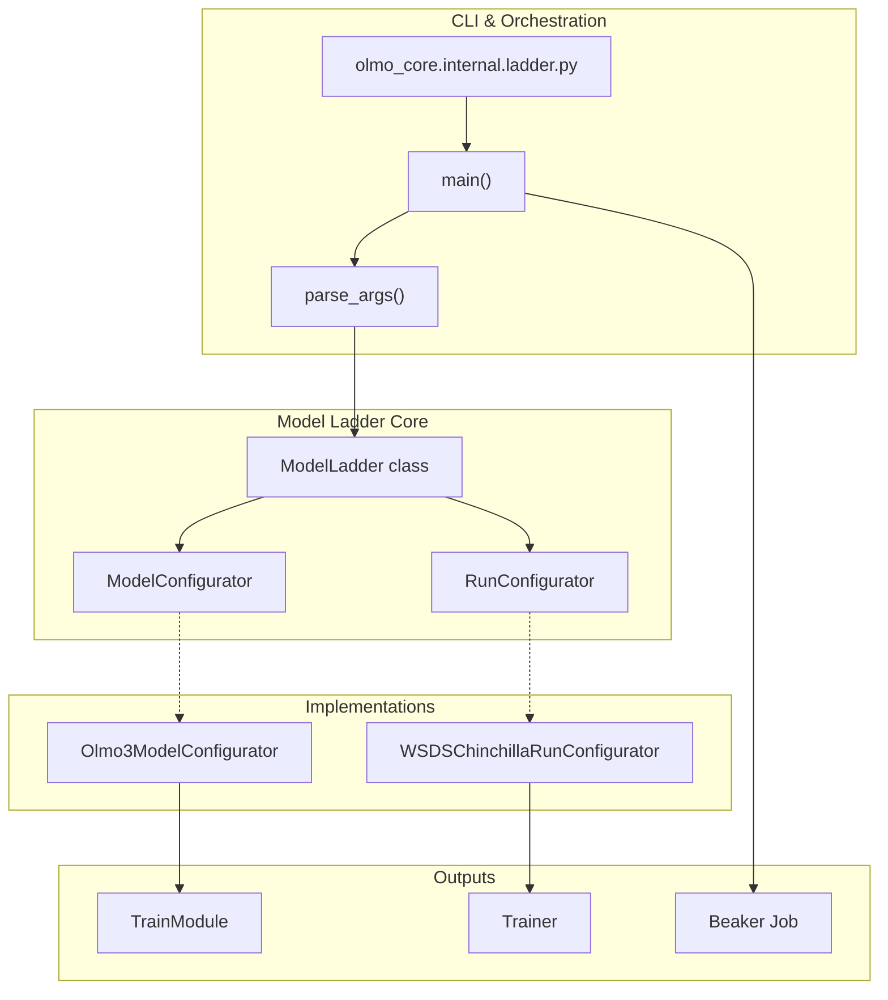
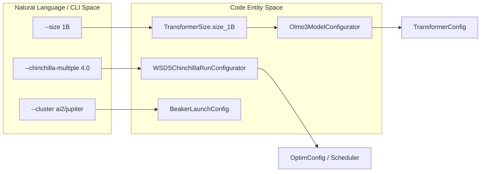

<!-- source: DeepWiki mcp.deepwiki.com · repo allenai/OLMo-core · page 7.3 Official Training Scripts · fetched 2026-10-26 -->

# Official Training Scripts

Relevant source files

The following files were used as context for generating this wiki page:

- [src/examples/moe/train.py](src/examples/moe/train.py)
- [src/examples/ngpt/__init__.py](src/examples/ngpt/__init__.py)
- [src/examples/ngpt/train.py](src/examples/ngpt/train.py)
- [src/olmo_core/internal/ladder.py](src/olmo_core/internal/ladder.py)
- [src/olmo_core/model_ladder/__init__.py](src/olmo_core/model_ladder/__init__.py)
- [src/olmo_core/model_ladder/base.py](src/olmo_core/model_ladder/base.py)
- [src/olmo_core/model_ladder/transformer_model_configurator.py](src/olmo_core/model_ladder/transformer_model_configurator.py)
- [src/olmo_core/model_ladder/wsds_chinchilla_run_configurator.py](src/olmo_core/model_ladder/wsds_chinchilla_run_configurator.py)
- [src/scripts/train/Llama3-8B.py](src/scripts/train/Llama3-8B.py)
- [src/scripts/train/OLMo2/anneal/OLMo2-32B-anneal.py](src/scripts/train/OLMo2/anneal/OLMo2-32B-anneal.py)
- [src/scripts/train/OLMoE-1B-7B.py](src/scripts/train/OLMoE-1B-7B.py)
- [src/scripts/train/all_reduce_bench.py](src/scripts/train/all_reduce_bench.py)
- [src/scripts/train/ladder/2026Q1/init_style_ladder.py](src/scripts/train/ladder/2026Q1/init_style_ladder.py)
- [src/scripts/train/ladder/2026Q1/more_norms_ladder.py](src/scripts/train/ladder/2026Q1/more_norms_ladder.py)
- [src/scripts/train/ladder/olmo3_ladder.py](src/scripts/train/ladder/olmo3_ladder.py)
- [src/scripts/train/nGPT-1B.py](src/scripts/train/nGPT-1B.py)
- [src/scripts/train/sft/Olmo-2-7B-SFT.py](src/scripts/train/sft/Olmo-2-7B-SFT.py)
- [src/scripts/train/sft/Olmo-3-32B-SFT.py](src/scripts/train/sft/Olmo-3-32B-SFT.py)
- [src/scripts/train/sft/Olmo-3-7B-SFT.py](src/scripts/train/sft/Olmo-3-7B-SFT.py)
- [src/scripts/train/template.py](src/scripts/train/template.py)

This document describes the official ladder training scripts and model configurators in OLMo-core. These scripts implement automatic hyperparameter calculation based on scaling laws, Chinchilla optimality, and provide standardized training configurations for model families like OLMo2 and OLMo3.

For information about the underlying training system, see [Training System](). For details about the configuration pattern, see [Configuration System]().

## Overview

Ladder scripts are specialized training scripts that automatically compute optimal hyperparameters (Learning Rate, Batch Size, Duration) based on model size and scaling laws. They are primarily located in `src/scripts/train/ladder/` and utilize the `ModelLadder` and `RunConfigurator` abstractions.

Key features:
- **Automatic hyperparameter calculation**: Learning rate and batch size computed from scaling laws based on parameter counts [olmo_core/model_ladder/wsds_chinchilla_run_configurator.py:60-91]().
- **Model size variants**: Pre-defined configurations for multiple model sizes from 60M to 13B [olmo_core/model_ladder/transformer_model_configurator.py:26-37]().
- **WSDS Scheduling**: Support for Warmup-Stable-Decay-Short (WSDS) schedules with Chinchilla-optimal decay points [olmo_core/model_ladder/wsds_chinchilla_run_configurator.py:107-132]().
- **Beaker Integration**: Specialized CLI for launching multi-node jobs on AI2 infrastructure [olmo_core/internal/ladder.py:130-177]().

Sources: [src/olmo_core/model_ladder/base.py:205-219](), [src/olmo_core/model_ladder/wsds_chinchilla_run_configurator.py:22-49]()

## Architecture and Components

The ladder system bridges the gap between high-level scaling research and executable training code. It uses a `ModelLadder` object to manage a collection of runs across different sizes.

**Diagram: Ladder Script Component Hierarchy**

Sources: [src/olmo_core/model_ladder/base.py:205-225](), [src/olmo_core/internal/ladder.py:33-130]()

### RunConfigurator
The `RunConfigurator` defines how to calculate training dynamics for a specific parameter count. The primary implementation is `WSDSChinchillaRunConfigurator`.

- **Batch Size**: Calculated as `round(2048 * 160 * (num_params / 108,000,000) ** (2 / 3))` [olmo_core/model_ladder/wsds_chinchilla_run_configurator.py:60-63]().
- **Learning Rate**: Derived from `0.0047 * (num_params / 108,000,000) ** (-1 / 3)`, often divided by 2 for stability in OLMo models [olmo_core/model_ladder/wsds_chinchilla_run_configurator.py:73-81]().
- **WSDS Schedule**: Configures decay periods at power-of-2 multiples of Chinchilla (e.g., 0.5xC, 1xC, 2xC, 4xC) [olmo_core/model_ladder/wsds_chinchilla_run_configurator.py:97-105]().

Sources: [src/olmo_core/model_ladder/wsds_chinchilla_run_configurator.py:22-132]()

### ModelConfigurator
The `ModelConfigurator` handles the structural setup of the transformer and the distributed strategy.
- **Micro-batch Size**: Automatically scaled based on GPU memory (H100 vs B200) and model size to maximize throughput [olmo_core/model_ladder/transformer_model_configurator.py:89-133]().
- **Device Mesh**: Determines the minimum world size (e.g., 8 GPUs for <13B, 32 GPUs for >=13B) [olmo_core/model_ladder/transformer_model_configurator.py:135-152]().
- **Train Module**: Builds the `TransformerTrainModule` with FSDP wrapping and mixed-precision settings [olmo_core/model_ladder/transformer_model_configurator.py:154-196]().

Sources: [src/olmo_core/model_ladder/transformer_model_configurator.py:78-196]()

## Model Size Variants

The `TransformerSize` enum provides standard descriptors for the OLMo family.

| Descriptor | Approx Params | Use Case |
| :--- | :--- | :--- |
| `60M` | 60,000,000 | Debugging / Unit Tests |
| `1B` | 1,000,000,000 | Small scale experiments |
| `7B` | 7,000,000,000 | Standard foundation model |
| `13B` | 13,000,000,000 | Large scale training |

Sources: [src/olmo_core/model_ladder/transformer_model_configurator.py:26-46]()

## Command-Line Interface

The internal ladder CLI (`olmo_core.internal.ladder`) provides several subcommands to manage the lifecycle of a ladder experiment.

### Primary Subcommands
- `dry-run`: Simulates the run for a given size, showing the calculated hyperparameters and plotting the LR schedule [olmo_core/internal/ladder.py:191-195]().
- `launch`: Submits a multi-node training job to Beaker [olmo_core/internal/ladder.py:220-224]().
- `run`: Executes the training loop locally (usually via `torchrun`) [olmo_core/internal/ladder.py:212-218]().
- `benchmark`: Runs a short throughput benchmark for a specific model size [olmo_core/internal/ladder.py:197-203]().

### Common Arguments
| Argument | Default | Description |
| :--- | :--- | :--- |
| `--chinchilla-multiple` | `4.0` | Total training duration as a multiple of Chinchilla-optimal [olmo_core/internal/ladder.py:93-97](). |
| `--sequence-length` | `8192` | Context length for the model [olmo_core/internal/ladder.py:87-91](). |
| `--stepped-schedule` | `False` | Scales peak LR by `1/sqrt(D)` for each stage `D` [olmo_core/model_ladder/wsds_chinchilla_run_configurator.py:42-48](). |
| `--lr-multiplier` | `1.0` | Global multiplier for the calculated LR [olmo_core/internal/ladder.py:99-103](). |

Sources: [src/olmo_core/internal/ladder.py:72-128]()

## Official Scripts Gallery

### OLMo3 Ladder
The `olmo3_ladder.py` script is the standard entry point for training the OLMo3 family. It uses the `Olmo3ModelConfigurator` which defaults to the latest architectural improvements (e.g., specific normalization and initialization) [scripts/train/ladder/olmo3_ladder.py:14-23]().

### Supervised Fine-Tuning (SFT)
SFT scripts provide specialized logic for training on instruction data, including sequence length scaling and context parallelism (CP) configuration.
- **Batch Size Logic**: The `BatchSizeConfig` class in SFT scripts automatically calculates `grad_accum_steps` and `cp_degree` based on the GPU type (H100/B200) and target `global_batch_size_tokens` [scripts/train/sft/Olmo-3-7B-SFT.py:74-151]().
- **Context Parallelism**: If the sequence length exceeds the rank micro-batch limit (e.g., 16k on H100), the script automatically enables CP [scripts/train/sft/Olmo-3-7B-SFT.py:98-109]().
- **Checkpoints**: SFT scripts support loading from base model checkpoints using `LoadStrategy` [scripts/train/sft/Olmo-3-7B-SFT.py:39-44]().

### Specialized Variants
- **More Norms**: `more_norms_ladder.py` allows experimenting with `Peri-LN` (equivalent to Gemma 3) and embedding normalization [scripts/train/ladder/2026Q1/more_norms_ladder.py:16-57]().
- **Benchmarking**: `all_reduce_bench.py` is used to measure NCCL bus bandwidth (`busbw`) and algorithmic bandwidth (`algbw`) on a cluster [scripts/train/all_reduce_bench.py:58-85]().
- **nGPT**: Example script for training normalized GPT models using `TransformerConfig.ngpt_271M()` [examples/ngpt/train.py:73-75]().

Sources: [src/scripts/train/ladder/olmo3_ladder.py:1-23](), [src/scripts/train/sft/Olmo-3-7B-SFT.py:74-151](), [src/scripts/train/all_reduce_bench.py:1-171](), [src/scripts/train/ladder/2026Q1/more_norms_ladder.py:1-62]()

## Data Flow: CLI to Model

The following diagram maps CLI inputs to the internal code entities that process them.

**Diagram: Mapping CLI to Code Entities**

Sources: [src/olmo_core/internal/ladder.py:33-130](), [src/olmo_core/model_ladder/transformer_model_configurator.py:26-76]()

---

