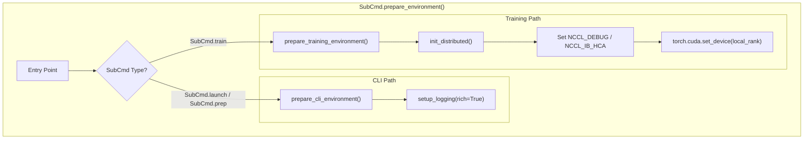
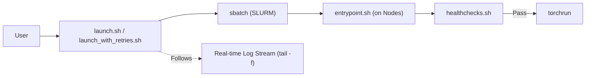

<!-- source: DeepWiki mcp.deepwiki.com · repo allenai/OLMo-core · page 7.4 Launch Workflows and Environment Setup · fetched 2026-10-26 -->

# Launch Workflows and Environment Setup

Relevant source files

The following files were used as context for generating this wiki page:

- [src/olmo_core/internal/common.py](src/olmo_core/internal/common.py)
- [src/olmo_core/internal/experiment.py](src/olmo_core/internal/experiment.py)
- [src/olmo_core/launch/beaker.py](src/olmo_core/launch/beaker.py)
- [src/scripts/lambda/README.md](src/scripts/lambda/README.md)
- [src/scripts/lambda/distributed_test.py](src/scripts/lambda/distributed_test.py)
- [src/scripts/lambda/entrypoint.sh](src/scripts/lambda/entrypoint.sh)
- [src/scripts/lambda/healthchecks.sh](src/scripts/lambda/healthchecks.sh)
- [src/scripts/lambda/launch.sh](src/scripts/lambda/launch.sh)
- [src/scripts/lambda/launch_with_retries.sh](src/scripts/lambda/launch_with_retries.sh)
- [src/scripts/lambda/slurm-1B-test.sbatch](src/scripts/lambda/slurm-1B-test.sbatch)
- [src/scripts/lambda/slurm-test-job.sbatch](src/scripts/lambda/slurm-test-job.sbatch)
- [src/scripts/lambda/utils.sh](src/scripts/lambda/utils.sh)
- [src/scripts/lambda/watch.sh](src/scripts/lambda/watch.sh)

This page provides a technical deep dive into the environment initialization, directory resolution, and launch orchestration systems in OLMo-core. It covers the `prepare_environment()` dispatch, storage resolution for Weka and GCS, and the alternative Lambda/SLURM launch workflow.

## Environment Initialization

OLMo-core uses a tiered approach to environment setup, distinguishing between CLI-only tasks (like launching or dataset preparation) and full training tasks.

### SubCmd Dispatch Logic

The `SubCmd` enum in `src/olmo_core/internal/experiment.py` serves as the primary dispatcher for environment setup.

| SubCmd | Environment Function | Purpose |
| :--- | :--- | :--- |
| `launch`, `prep`, `dry_run` | `prepare_cli_environment()` | Basic logging, rich formatting, and CLI utilities. |
| `train` | `prepare_training_environment(backend)` | Full distributed init, NCCL setup, and device allocation. |
| `train_single` | `prepare_training_environment(backend=None)` | Local single-device setup without distributed backends. |

Sources: [src/olmo_core/internal/experiment.py:108-130]()

### prepare_environment() Flow

The initialization sequence follows a specific data flow to ensure rank-aware logging and proper resource allocation.

**Environment Setup Flow**

Sources: [src/olmo_core/internal/experiment.py:122-130](), [src/olmo_core/train/__init__.py:11-25]()

## Storage and Directory Resolution

OLMo-core automatically resolves root and working directories based on the execution cluster and user identity.

### Root Directory Resolution

The `get_root_dir(cluster)` function determines the primary storage bucket or mount point. It prioritizes high-performance Weka storage on supported AI2 clusters by checking cluster tags.

| Cluster Condition | Resolved Path | Storage Type |
| :--- | :--- | :--- |
| Beaker Cluster with `storage:weka` tag | `/weka/oe-training-default/ai2-llm` | Weka (Parallel FS) |
| Other AI2 Beaker Clusters | `gs://ai2-llm` | Google Cloud Storage |
| Non-AI2 / External | `gs://ai2-llm` (Default) | Google Cloud Storage |

Sources: [src/olmo_core/internal/common.py:34-44]()

### Working Directory Resolution

The `get_work_dir(root_dir)` function calculates the local or shared cache directory for datasets.

1. If `root_dir` is a URL (determined via `is_url()`), it defaults to a local `./dataset-cache`.
2. If `root_dir` is a filesystem path, it appends a user-specific path: `{root_dir}/checkpoints/{beaker_username}/dataset-cache`.

Sources: [src/olmo_core/internal/common.py:47-53](), [src/olmo_core/io.py:10-10]()

## Beaker Launch and Credential Injection

When launching via Beaker, the system injects necessary credentials and environment secrets into the job specification.

### Credential Injection Logic

The `build_launch_config` function in `src/olmo_core/internal/common.py` populates `BeakerEnvSecret` objects. It dynamically identifies the current user via `get_beaker_username()` to pull user-specific secrets from the Beaker workspace.

| Secret Name | Source Secret (Pattern) | Required |
| :--- | :--- | :--- |
| `BEAKER_TOKEN` | `{USER}_BEAKER_TOKEN` | Yes |
| `WANDB_API_KEY` | `{USER}_WANDB_API_KEY` | Yes |
| `COMET_API_KEY` | `{USER}_COMET_API_KEY` | No |
| `AWS_CONFIG` | `{USER}_AWS_CONFIG` | Yes (Internal) |
| `GOOGLE_CREDENTIALS` | `GOOGLE_CREDENTIALS` | Yes (Internal) |
| `SLACK_WEBHOOK_URL` | `SLACK_WEBHOOK_URL` | No |

Sources: [src/olmo_core/internal/common.py:86-124](), [src/olmo_core/internal/common.py:156-158]()

## Lambda and SLURM Workflows

As an alternative to the Beaker-centric launch system, OLMo-core provides a set of scripts for running on Lambda Labs or other SLURM-managed clusters.

### Launch Orchestration

The Lambda workflow utilizes a set of bash scripts to manage job submission, retries, and log streaming.

**SLURM/Lambda Launch Architecture**

Sources: [src/scripts/lambda/launch.sh:28-80](), [src/scripts/lambda/entrypoint.sh:54-74](), [src/scripts/lambda/launch_with_retries.sh:28-80]()

### Node Healthchecks

The `healthchecks.sh` script is executed on every node before `torchrun` begins. This prevents "zombie" or degraded nodes from slowing down the entire distributed job.

**Key Checks:**
- **GPU Temperature:** Fails if any GPU is $\ge 55^\circ C$ (idle) to avoid throttled hardware. Sources: [src/scripts/lambda/healthchecks.sh:41-66]()
- **GPU Memory/Process:** Ensures no unexpected compute processes are running and memory is idle ($< 500MiB$ used). Sources: [src/scripts/lambda/healthchecks.sh:91-136]()

### Environment Variables for SLURM

The `entrypoint.sh` script bridges the SLURM environment to PyTorch Distributed:

- **`MASTER_ADDR`**: Resolved via `scontrol show hostname "$SLURM_JOB_NODELIST" | head -n 1`.
- **`MASTER_PORT`**: Calculated as `60000 + SLURM_JOB_ID % 5000` to avoid collisions between concurrent jobs.
- **`OLMO_SHARED_FS`**: Explicitly set to `1` for shared filesystems (like NFS/Weka).
- **`GOOGLE_APPLICATION_CREDENTIALS`**: Set to a standard path on the Lambda cluster.

Sources: [src/scripts/lambda/entrypoint.sh:24-37](), [src/scripts/lambda/entrypoint.sh:71-74]()

---

