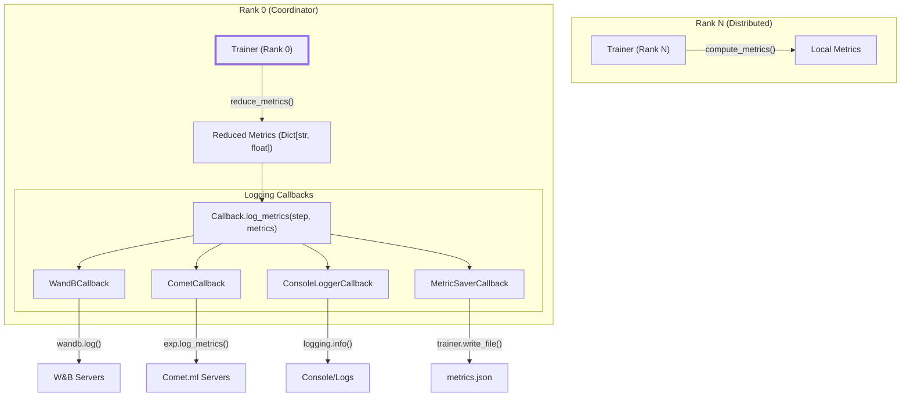
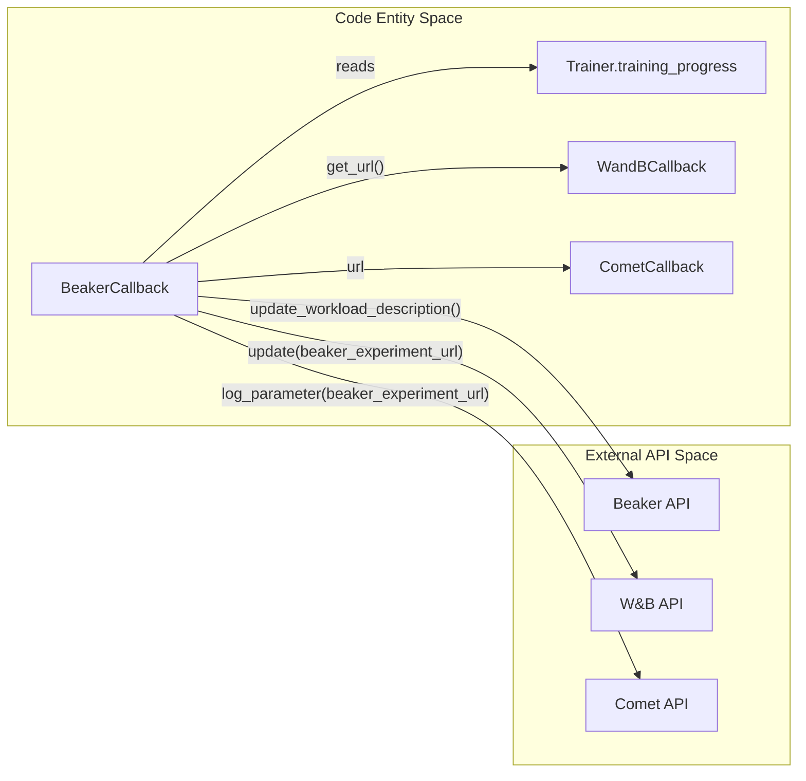

<!-- source: DeepWiki mcp.deepwiki.com · repo allenai/OLMo-core · page 7.5 Metric Logging and Notifications · fetched 2026-10-26 -->

# Metric Logging and Notifications

Relevant source files

The following files were used as context for generating this wiki page:

- [src/olmo_core/train/callbacks/beaker.py](src/olmo_core/train/callbacks/beaker.py)
- [src/olmo_core/train/callbacks/comet.py](src/olmo_core/train/callbacks/comet.py)
- [src/olmo_core/train/callbacks/console_logger.py](src/olmo_core/train/callbacks/console_logger.py)
- [src/olmo_core/train/callbacks/metric_saver.py](src/olmo_core/train/callbacks/metric_saver.py)
- [src/olmo_core/train/callbacks/slack_notifier.py](src/olmo_core/train/callbacks/slack_notifier.py)
- [src/olmo_core/train/callbacks/wandb.py](src/olmo_core/train/callbacks/wandb.py)
- [src/test/launch/beaker_test.py](src/test/launch/beaker_test.py)

OLMo-core provides a robust suite of callbacks for monitoring training progress, logging metrics to external platforms, and sending notifications. These components integrate with the `Trainer` lifecycle to ensure that performance data is captured from rank 0 and distributed across relevant dashboards or messaging services.

## Metric Logging Architecture

The metric logging system follows a "Collect and Reduce" pattern. While training metrics (like loss or throughput) are generated across all ranks, the `Trainer` performs reduction operations and passes the aggregated results to the `log_metrics` hook of registered callbacks.

### Data Flow and Code Entity Mapping

The following diagram illustrates how training metrics flow from the `Trainer` to various logging backends.

**Metric Distribution Pipeline**

**Sources:** [src/olmo_core/train/callbacks/wandb.py:140-142](), [src/olmo_core/train/callbacks/comet.py:196-198](), [src/olmo_core/train/callbacks/console_logger.py:62-76](), [src/olmo_core/train/callbacks/metric_saver.py:48-71]()

---

## Core Logging Callbacks

### Weights & Biases (`WandBCallback`)
The `WandBCallback` is the primary tool for experiment tracking. It initializes a W&B run on rank 0 and logs metrics at every step, bypassing the standard `metrics_collect_interval` if necessary to ensure high-fidelity tracking [src/olmo_core/train/callbacks/wandb.py:21-31]().

*   **Key Features**:
    *   **Remote Cancellation**: Checks for specific tags (e.g., "cancel") on the W&B web UI to gracefully terminate the run. It re-initializes the API client during checks to avoid cached data [src/olmo_core/train/callbacks/wandb.py:73-85](), [src/olmo_core/train/callbacks/wandb.py:162-178]().
    *   **Configuration Logging**: Automatically uploads the experiment configuration to the W&B dashboard [src/olmo_core/train/callbacks/wandb.py:128-137]().
    *   **Error Handling**: Finalizes the run with a failure status (`exit_code=1`) if an exception occurs during training [src/olmo_core/train/callbacks/wandb.py:153-156]().

### Comet.ml (`CometCallback`)
Similar to W&B, the `CometCallback` provides integration with Comet.ml. It supports experiment resumption via `auto_resume`, which uses the `experiment_key` stored in the callback's state dict to continue logging to the same experiment after a restart [src/olmo_core/train/callbacks/comet.py:114-118](), [src/olmo_core/train/callbacks/comet.py:136-142](). It also includes a `CometNotificationSetting` enum to control when Comet sends automated notifications (e.g., `failure_only`, `end_only`) [src/olmo_core/train/callbacks/comet.py:21-46]().

### Console Logger (`ConsoleLoggerCallback`)
This callback is added automatically by the `Trainer` if no other console logger is present. It provides human-readable progress markers and filters metrics using glob patterns (e.g., `train/CE loss`, `optim/LR*`) to avoid flooding the stdout [src/olmo_core/train/callbacks/console_logger.py:13-21](), [src/olmo_core/train/callbacks/console_logger.py:33-50](). It also calculates and displays ETA and hard-stop information if available [src/olmo_core/train/callbacks/console_logger.py:78-85]().

### Metric Saver (`MetricSaverCallback`)
For programmatic analysis, the `MetricSaverCallback` captures the latest metrics and writes them to a JSON file in the trainer's `save_folder`. It can be configured to save at specific intervals or fixed steps, and supports glob patterns to filter which metrics are persisted [src/olmo_core/train/callbacks/metric_saver.py:17-35](), [src/olmo_core/train/callbacks/metric_saver.py:56-61]().

---

## Notifications and External Metadata

OLMo-core includes specialized callbacks for notifying users of training status and synchronizing metadata with infrastructure providers like Beaker.

### Slack Notifier (`SlackNotifierCallback`)
The `SlackNotifierCallback` sends messages to a Slack channel via webhooks. It supports different notification levels defined by `SlackNotificationSetting` [src/olmo_core/train/callbacks/slack_notifier.py:22-46]().

| Event | Trigger |
| :--- | :--- |
| `pre_train` | Sent when training starts if setting is `all` [src/olmo_core/train/callbacks/slack_notifier.py:77-82]() |
| `post_checkpoint_saved` | Sent after every checkpoint if setting is `all` [src/olmo_core/train/callbacks/slack_notifier.py:84-90]() |
| `post_train` | Sent on successful completion or manual cancellation [src/olmo_core/train/callbacks/slack_notifier.py:98-109]() |
| `on_error` | Sent on failure with a truncated stack trace (limited to 30 lines) [src/olmo_core/train/callbacks/slack_notifier.py:111-126]() |

### Beaker Integration (`BeakerCallback`)
When running on AI2's Beaker platform, this callback synchronizes the training progress with the Beaker experiment description.

**Beaker Metadata Synchronization**

**Sources:** [src/olmo_core/train/callbacks/beaker.py:68-86](), [src/olmo_core/train/callbacks/beaker.py:146-162]()

The `BeakerCallback` performs several critical tasks:
1.  **URL Cross-Linking**: It retrieves the W&B or Comet URL and adds it to the Beaker experiment description, while simultaneously adding the Beaker experiment URL to the W&B/Comet configs [src/olmo_core/train/callbacks/beaker.py:68-86]().
2.  **Environment Capture**: It saves `config.json` and a `requirements.txt` (via `pip freeze`) to the Beaker results directory (default `/results/olmo-core`) for reproducibility [src/olmo_core/train/callbacks/beaker.py:88-112]().
3.  **Live Progress**: It periodically updates the Beaker workload description with the current step, epoch, and experiment URL [src/olmo_core/train/callbacks/beaker.py:152-162]().

---

## Summary of Configuration Options

| Callback | Primary Config | Env Var Required |
| :--- | :--- | :--- |
| `WandBCallback` | `project`, `entity`, `group` | `WANDB_API_KEY` [src/olmo_core/train/callbacks/wandb.py:17]() |
| `CometCallback` | `project`, `workspace`, `notifications` | `COMET_API_KEY` [src/olmo_core/train/callbacks/comet.py:18]() |
| `SlackNotifierCallback` | `webhook_url`, `notifications` | `SLACK_WEBHOOK_URL` [src/olmo_core/train/callbacks/slack_notifier.py:17]() |
| `BeakerCallback` | `update_interval`, `result_dir` | `BEAKER_EXPERIMENT_ID` [src/olmo_core/train/callbacks/beaker.py:20]() |

**Sources:** [src/olmo_core/train/callbacks/wandb.py:17-56](), [src/olmo_core/train/callbacks/comet.py:18-104](), [src/olmo_core/train/callbacks/slack_notifier.py:17-58](), [src/olmo_core/train/callbacks/beaker.py:20-42]()

---

