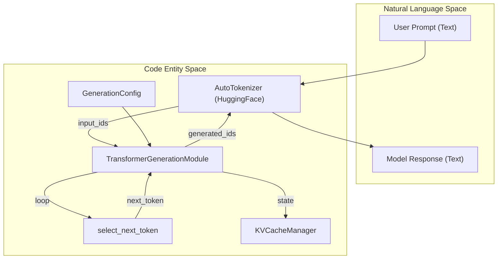

<!-- source: DeepWiki mcp.deepwiki.com · repo allenai/OLMo-core · page 8 Inference and Generation · fetched 2026-10-26 -->

# Inference and Generation

Relevant source files

The following files were used as context for generating this wiki page:

- [docs/source/generate/generation_module.rst](docs/source/generate/generation_module.rst)
- [docs/source/generate/index.rst](docs/source/generate/index.rst)
- [docs/source/generate/sampling.rst](docs/source/generate/sampling.rst)
- [docs/source/generate/utils.rst](docs/source/generate/utils.rst)
- [docs/source/guides/generation.rst](docs/source/guides/generation.rst)
- [src/olmo_core/generate/chat.py](src/olmo_core/generate/chat.py)
- [src/olmo_core/generate/generation_module/transformer/config.py](src/olmo_core/generate/generation_module/transformer/config.py)
- [src/olmo_core/generate/generation_module/transformer/generation_module.py](src/olmo_core/generate/generation_module/transformer/generation_module.py)
- [src/scripts/merge_core_checkpoints.py](src/scripts/merge_core_checkpoints.py)
- [src/scripts/merge_hf_checkpoints.py](src/scripts/merge_hf_checkpoints.py)
- [src/test/scripts/merge_core_checkpoints_test.py](src/test/scripts/merge_core_checkpoints_test.py)
- [src/test/scripts/merge_hf_checkpoints_test.py](src/test/scripts/merge_hf_checkpoints_test.py)

The `olmo_core.generate` module provides a high-level system for autoregressive text generation using transformer models. It is designed to bridge the gap between trained model checkpoints and interactive or programmatic inference, supporting features like KV caching, distributed generation, and various sampling strategies.

### System Architecture

The generation system is centered around the `GenerationModule` abstraction, which manages the model state, inference-specific optimizations (like KV caches), and the decoding loop.

**Natural Language to Code Entity Mapping**

| Concept | Code Entity | Role |
| :--- | :--- | :--- |
| **Generation Engine** | `TransformerGenerationModule` | Orchestrates the forward pass and autoregressive loop [src/olmo_core/generate/generation_module/transformer/generation_module.py:46-47]() |
| **Inference Config** | `GenerationConfig` | Defines parameters like `max_new_tokens`, `temperature`, and `top_p` [src/olmo_core/generate/generation_module/config.py:13-13]() |
| **KV Cache Logic** | `KVCacheManager` | Manages memory for attention keys and values during decoding [src/olmo_core/generate/generation_module/transformer/generation_module.py:115-118]() |
| **Sampling Logic** | `select_next_token` | Implements Top-P, Top-K, and Temperature-based selection [src/olmo_core/generate/sampling.py:1-6]() |
| **Chat Loop** | `olmo_core.generate.chat` | CLI interface for interactive multi-turn conversation [src/olmo_core/generate/chat.py:1-16]() |

**Inference Flow Diagram**

**Sources:** [src/olmo_core/generate/generation_module/transformer/generation_module.py:142-162](), [src/olmo_core/generate/chat.py:158-163](), [docs/source/guides/generation.rst:62-83]()

---

## Submodules

### [TransformerGenerationModule](#8.1)
The primary entry point for inference is the `TransformerGenerationModule`. It wraps a `Transformer` model and provides a `generate_batch` method that handles the complexities of autoregressive decoding.

Key features include:
*   **Checkpoint Loading**: Support for loading from single or multiple averaged checkpoints via `from_checkpoint` and `from_checkpoints` [src/olmo_core/generate/generation_module/transformer/generation_module.py:228-245]().
*   **KV Cache Management**: Automatic initialization and resetting of inference caches to speed up generation [src/olmo_core/generate/generation_module/transformer/generation_module.py:108-119]().
*   **Distributed Support**: Ability to run inference across multiple GPUs using the same parallelism configurations used during training [src/olmo_core/generate/generation_module/transformer/generation_module.py:66-81]().
*   **Factory Config**: The `TransformerGenerationModuleConfig` class allows for structured building of generation modules, including compilation and Float8 support [src/olmo_core/generate/generation_module/transformer/config.py:28-46]().

For details, see [TransformerGenerationModule](#8.1).

### [Sampling and Chat](#8.2)
This module covers how the next token is selected from the model's output distribution and how the generation system is exposed to users.

*   **Sampling Strategies**: Implementation of `selective_log_softmax` and `select_next_token` to support greedy decoding, temperature scaling, Top-K, and Nucleus (Top-P) sampling [src/olmo_core/generate/sampling.py:1-6](), [src/olmo_core/generate/utils.py:1-6]().
*   **Chat Interface**: A CLI-based chatbot that uses `AutoTokenizer` and `GenerationConfig` to provide a rich interactive experience, including support for chat templates [src/olmo_core/generate/chat.py:18-30]().
*   **Checkpoint Utilities**: Tools for merging OLMo-core checkpoints (`merge_core_checkpoints.py`) or HuggingFace checkpoints (`merge_hf_checkpoints.py`) to create ensemble or averaged models for better inference performance [src/scripts/merge_core_checkpoints.py:24-28](), [src/scripts/merge_hf_checkpoints.py:30-35]().

For details, see [Sampling and Chat](#8.2).

**Sources:** [src/olmo_core/generate/generation_module/transformer/generation_module.py:46-60](), [src/olmo_core/generate/chat.py:1-16](), [docs/source/guides/generation.rst:1-7](), [src/olmo_core/generate/generation_module/transformer/config.py:28-46]()

---

