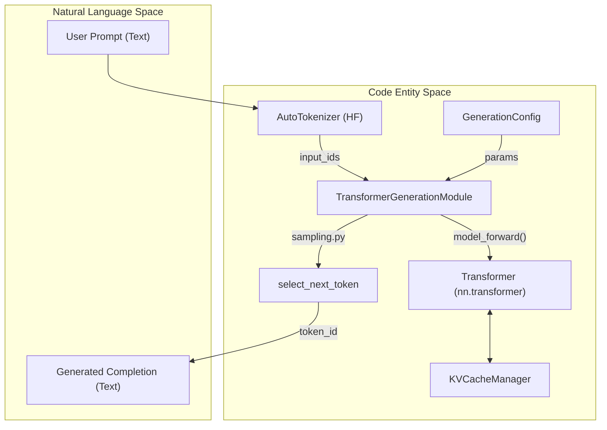
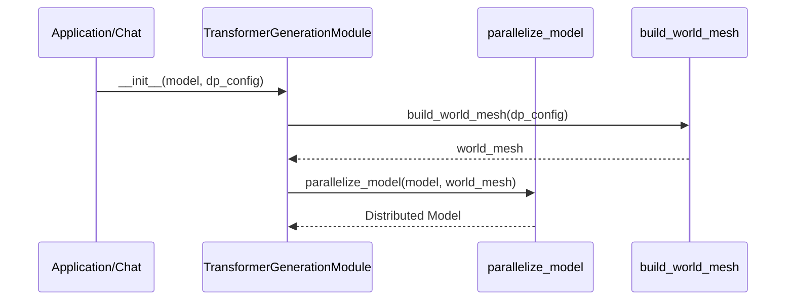

<!-- source: DeepWiki mcp.deepwiki.com · repo allenai/OLMo-core · page 8.1 TransformerGenerationModule · fetched 2026-10-26 -->

# TransformerGenerationModule

Relevant source files

The following files were used as context for generating this wiki page:

- [docs/source/generate/generation_module.rst](docs/source/generate/generation_module.rst)
- [docs/source/generate/index.rst](docs/source/generate/index.rst)
- [docs/source/generate/sampling.rst](docs/source/generate/sampling.rst)
- [docs/source/generate/utils.rst](docs/source/generate/utils.rst)
- [docs/source/guides/generation.rst](docs/source/guides/generation.rst)
- [src/olmo_core/generate/chat.py](src/olmo_core/generate/chat.py)
- [src/olmo_core/generate/generation_module/transformer/config.py](src/olmo_core/generate/generation_module/transformer/config.py)
- [src/olmo_core/generate/generation_module/transformer/generation_module.py](src/olmo_core/generate/generation_module/transformer/generation_module.py)
- [src/scripts/merge_core_checkpoints.py](src/scripts/merge_core_checkpoints.py)
- [src/scripts/merge_hf_checkpoints.py](src/scripts/merge_hf_checkpoints.py)
- [src/test/scripts/merge_core_checkpoints_test.py](src/test/scripts/merge_core_checkpoints_test.py)
- [src/test/scripts/merge_hf_checkpoints_test.py](src/test/scripts/merge_hf_checkpoints_test.py)

The `TransformerGenerationModule` is the primary interface for performing autoregressive text generation with transformer models in OLMo-core. It extends the base `GenerationModule` to provide a high-level API for distributed inference, KV cache management, and sampling.

## Overview

The generation system is designed to be decoupled from the training logic while sharing the underlying model architecture. It handles the complexities of:
*   **Distributed Inference**: Supporting models partitioned across multiple GPUs using Tensor Parallelism (TP) or Fully Sharded Data Parallelism (FSDP) [src/olmo_core/generate/generation_module/transformer/generation_module.py:66-81]().
*   **KV Cache Management**: Efficiently storing and updating key-value states to avoid redundant computations during decoding [src/olmo_core/generate/generation_module/transformer/generation_module.py:108-119]().
*   **Sampling Strategies**: Implementing various decoding methods like top-k, top-p, and temperature scaling [src/olmo_core/generate/sampling.py:1-6]().
*   **Checkpoint Merging**: Support for loading and averaging multiple checkpoints for model soups or ensemble-like generation [src/olmo_core/generate/generation_module/transformer/generation_module.py:228-236]().

### Core Classes

| Class | Responsibility |
| :--- | :--- |
| `TransformerGenerationModule` | Orchestrates the model forward pass, cache updates, and token selection loop [src/olmo_core/generate/generation_module/transformer/generation_module.py:46-47](). |
| `GenerationConfig` | Dataclass containing parameters for decoding (e.g., `max_new_tokens`, `temperature`, `do_sample`) [src/olmo_core/generate/generation_module/transformer/generation_module.py:31-31](). |
| `TransformerGenerationModuleConfig` | Configuration factory for building generation modules from checkpoints [src/olmo_core/generate/generation_module/transformer/config.py:27-31](). |

**Sources:** [src/olmo_core/generate/generation_module/transformer/generation_module.py](), [src/olmo_core/generate/generation_module/transformer/config.py]()

## Architecture and Data Flow

The following diagram illustrates the relationship between the generation module, the underlying transformer model, and the KV cache integration.

### System Entity Map: Generation Components

**Sources:** [src/olmo_core/generate/generation_module/transformer/generation_module.py:136-164](), [src/olmo_core/generate/chat.py:158-162](), [src/olmo_core/generate/sampling.py:1-6]()

## KV Cache Integration

Efficient inference requires caching the Key and Value activations of previous tokens. In OLMo-core, this is handled by the `KVCacheManager` which is initialized within each `Attention` block [src/olmo_core/generate/generation_module/transformer/generation_module.py:112-119]().

### Cache Lifecycle
1.  **Preparation**: `prepare_inference_cache` is called with the expected `batch_size` and `max_seq_len`. This allocates (or reuses) buffers on the device [src/olmo_core/generate/generation_module/transformer/generation_module.py:108-119]().
2.  **Left-Padding Support**: For batched generation with varying prompt lengths, the module uses `attention_mask_to_cache_leftpad` to correctly align the KV cache with the attention mask [src/olmo_core/generate/generation_module/transformer/generation_module.py:19-19](), [src/olmo_core/generate/generation_module/transformer/generation_module.py:177-183]().
3.  **Freeing**: Once generation is complete, `free_inference_cache` is called to deallocate the manager [src/olmo_core/generate/generation_module/transformer/generation_module.py:120-123]().

### Paged KV Cache
The system supports advanced attention backends. While standard caching is the default, the architecture allows for integration with paged attention mechanisms through the `Attention` block's `kv_cache_manager` abstraction [src/olmo_core/generate/generation_module/transformer/generation_module.py:115-119]().

**Sources:** [src/olmo_core/generate/generation_module/transformer/generation_module.py](), [src/olmo_core/nn/attention/attention.py]()

## Distributed Generation

`TransformerGenerationModule` supports distributed inference by wrapping the model with parallelism strategies defined in `TransformerDataParallelConfig` [src/olmo_core/generate/generation_module/transformer/generation_module.py:55-81]().

### Initialization Flow

**Sources:** [src/olmo_core/generate/generation_module/transformer/generation_module.py:65-81]()

### Key Distributed Features
*   **Mesh Construction**: Uses `build_world_mesh` to set up device meshes for TP or DP during inference [src/olmo_core/generate/generation_module/transformer/generation_module.py:67-67]().
*   **State Dict Handling**: Uses `dist_cp_sd` (Distributed Checkpoint State Dict) to load and save sharded checkpoints correctly [src/olmo_core/generate/generation_module/transformer/generation_module.py:98-107]().
*   **Distributed Loading**: The `from_checkpoints` method supports loading from remote storage (S3/GCS) and distributed checkpoint formats [src/olmo_core/generate/generation_module/transformer/generation_module.py:228-250]().

**Sources:** [src/olmo_core/generate/generation_module/transformer/generation_module.py](), [src/olmo_core/distributed/parallel/utils.py]()

## Checkpoint Merging and Averaging

OLMo-core provides utilities to average weights from multiple checkpoints, which can improve performance (Model Soups).

*   **Core Checkpoints**: `merge_core_checkpoints.py` averages OLMo-core formatted checkpoints, handling both model and optimizer states [src/scripts/merge_core_checkpoints.py:24-28](). It processes tensor keys in batches for memory efficiency [src/scripts/merge_core_checkpoints.py:98-128]().
*   **HuggingFace Checkpoints**: `merge_hf_checkpoints.py` provides similar functionality for models in the HuggingFace format, performing accumulation in `float32` for numerical stability [src/scripts/merge_hf_checkpoints.py:30-44]().

**Sources:** [src/scripts/merge_core_checkpoints.py](), [src/scripts/merge_hf_checkpoints.py]()

## Usage and Configuration

### GenerationConfig
The behavior of `generate_batch` is controlled by the `GenerationConfig`. Key parameters include:
*   `max_new_tokens`: Limit on the number of tokens to generate [src/olmo_core/generate/chat.py:136-136]().
*   `do_sample`: Whether to use stochastic sampling or greedy decoding [src/olmo_core/generate/chat.py:139-141]().
*   `temperature`: Scales the logits before softmax to control randomness [src/olmo_core/generate/chat.py:141-141]().
*   `top_k` / `top_p`: Nucleus and top-k filtering for sampling [src/olmo_core/generate/chat.py:142-144]().

### Chat Interface
The module is commonly utilized via the `olmo_core.generate.chat` script, which provides a CLI for interacting with checkpoints. It handles tokenizer loading from HuggingFace identifiers and manages the chat loop with `rich`-based UI components [src/olmo_core/generate/chat.py:1-16](), [src/olmo_core/generate/chat.py:41-70]().

**Sources:** [src/olmo_core/generate/chat.py](), [src/olmo_core/generate/generation_module/transformer/generation_module.py]()

---

