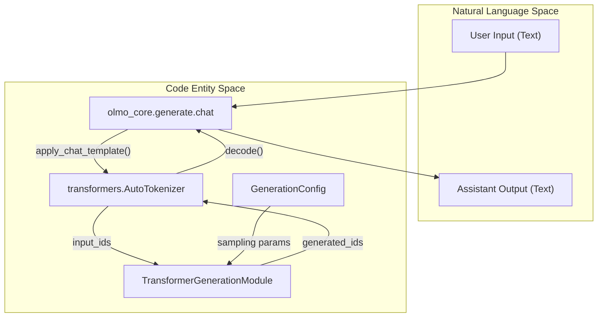
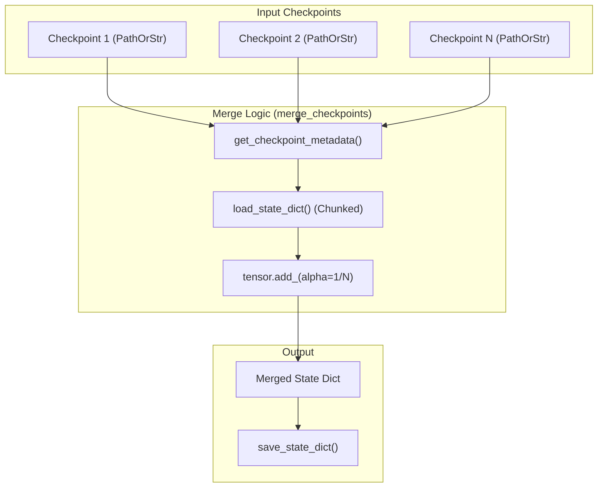

<!-- source: DeepWiki mcp.deepwiki.com · repo allenai/OLMo-core · page 8.2 Sampling and Chat · fetched 2026-10-26 -->

# Sampling and Chat

Relevant source files

The following files were used as context for generating this wiki page:

- [docs/source/generate/generation_module.rst](docs/source/generate/generation_module.rst)
- [docs/source/generate/index.rst](docs/source/generate/index.rst)
- [docs/source/generate/sampling.rst](docs/source/generate/sampling.rst)
- [docs/source/generate/utils.rst](docs/source/generate/utils.rst)
- [docs/source/guides/generation.rst](docs/source/guides/generation.rst)
- [src/olmo_core/generate/chat.py](src/olmo_core/generate/chat.py)
- [src/olmo_core/generate/generation_module/transformer/config.py](src/olmo_core/generate/generation_module/transformer/config.py)
- [src/olmo_core/generate/generation_module/transformer/generation_module.py](src/olmo_core/generate/generation_module/transformer/generation_module.py)
- [src/scripts/merge_core_checkpoints.py](src/scripts/merge_core_checkpoints.py)
- [src/scripts/merge_hf_checkpoints.py](src/scripts/merge_hf_checkpoints.py)
- [src/test/scripts/merge_core_checkpoints_test.py](src/test/scripts/merge_core_checkpoints_test.py)
- [src/test/scripts/merge_hf_checkpoints_test.py](src/test/scripts/merge_hf_checkpoints_test.py)

This section covers the mechanisms for autoregressive text generation, including token sampling strategies, the interactive chat interface, and utilities for merging model checkpoints. OLMo-core provides a native generation pipeline that integrates directly with the transformer architecture and distributed checkpointing system.

## Token Sampling and Probabilities

OLMo-core implements standard autoregressive sampling strategies to convert model logits into the next token selection. The primary entry point for these operations is `select_next_token` [src/olmo_core/generate/sampling.py:32-61]().

### Sampling Strategies

The generation process is governed by `GenerationConfig` [src/olmo_core/generate/generation_module/transformer/config.py:13-13](), which supports the following parameters:

*   **Temperature**: Scales the logits before softmax. A temperature of `0.0` results in greedy decoding [docs/source/guides/generation.rst:123-123]().
*   **Top-k**: Restricts sampling to the $k$ most likely tokens. Setting this to `-1` disables the filter [docs/source/guides/generation.rst:124-124]().
*   **Top-p (Nucleus Sampling)**: Filters tokens such that the cumulative probability mass exceeds threshold $p$ [docs/source/guides/generation.rst:125-125]().
*   **Stop Tokens**: A list of token IDs (in addition to EOS) that terminate generation [docs/source/guides/generation.rst:127-127]().

### Selective Log Softmax

For memory efficiency during generation, OLMo-core provides `selective_log_softmax` [src/olmo_core/generate/utils.py:33-33](). This utility allows calculating log probabilities only for specific tokens (e.g., the tokens actually sampled) rather than the entire vocabulary, which significantly reduces GPU memory overhead when `return_logprobs=True` is set in `generate_batch` [src/olmo_core/generate/generation_module/transformer/generation_module.py:161-162]().

**Sources:**
- [src/olmo_core/generate/sampling.py:32-61]()
- [src/olmo_core/generate/generation_module/transformer/generation_module.py:161-162]()
- [docs/source/guides/generation.rst:119-128]()

---

## Chat Interface

The `olmo_core.generate.chat` module provides a CLI-based interactive environment for testing models. It wraps the `TransformerGenerationModule` and manages conversation history using chat templates.

### Implementation Architecture

The chat interface bridges the gap between raw model inference and human-readable interaction by utilizing HuggingFace tokenizers and Jinja2-based chat templates.

**Chat System Data Flow:**

### Key Features
- **Template Support**: Uses a default template that concatenates messages [src/olmo_core/generate/chat.py:44-44]() but supports custom templates via `--chat-template` [src/olmo_core/generate/chat.py:8-9]().
- **Rich Visualization**: Uses the `rich` library to render "Assistant", "System", and "Tokenizer Info" panels [src/olmo_core/generate/chat.py:47-155]().
- **Hardware Compatibility**: Allows disabling Flash Attention and KV-cache for local execution on non-CUDA hardware (e.g., Apple Silicon) using `--attention-backend torch --no-use-cache` [src/olmo_core/generate/chat.py:14-15]().

**Sources:**
- [src/olmo_core/generate/chat.py:1-155]()
- [docs/source/guides/generation.rst:180-217]()

---

## Checkpoint Merging Utilities

OLMo-core includes scripts for merging multiple checkpoints, which is often used for weight averaging (SWA) or combining models from different training stages.

### Core Checkpoint Merging
The `merge_core_checkpoints.py` script averages weights from native OLMo-core distributed checkpoints.

| Feature | Implementation Detail |
| :--- | :--- |
| **Averaging Logic** | Tensors are loaded in batches (default 128) and averaged in-place using `.add_(..., alpha=1/N)` [src/scripts/merge_core_checkpoints.py:98-114]() |
| **Optimizer State** | Can be included or skipped using `--skip-optimizer-state` [src/scripts/merge_core_checkpoints.py:27-27]() |
| **Metadata Handling** | Validates that all checkpoints have identical keys before merging [src/scripts/merge_core_checkpoints.py:40-58]() |
| **Format Correction** | Fixes state dict keys (mapping `model.prefix` to nested dicts) so the result is compatible with the unsharder [src/scripts/merge_core_checkpoints.py:151-162]() |

### HuggingFace Checkpoint Merging
The `merge_hf_checkpoints.py` script performs similar averaging for models already converted to the HuggingFace format. It performs accumulation in `float32` for numerical stability before casting back to the original `dtype` [src/scripts/merge_hf_checkpoints.py:91-111]().

**Checkpoint Merging Process:**

### Programmatic Averaging
The `TransformerGenerationModule` supports loading and averaging multiple checkpoints directly via the `from_checkpoints` class method [src/olmo_core/generate/generation_module/transformer/generation_module.py:246-278](). This internally utilizes the same averaging logic during the model initialization phase. The `TransformerGenerationModuleConfig` also provides a `build()` method that can handle multiple checkpoint directories for automated averaging [src/olmo_core/generate/generation_module/transformer/config.py:48-96]().

**Sources:**
- [src/scripts/merge_core_checkpoints.py:24-176]()
- [src/scripts/merge_hf_checkpoints.py:30-154]()
- [src/olmo_core/generate/generation_module/transformer/generation_module.py:246-278]()
- [src/olmo_core/generate/generation_module/transformer/config.py:48-96]()
- [src/test/scripts/merge_core_checkpoints_test.py:172-209]()

---

