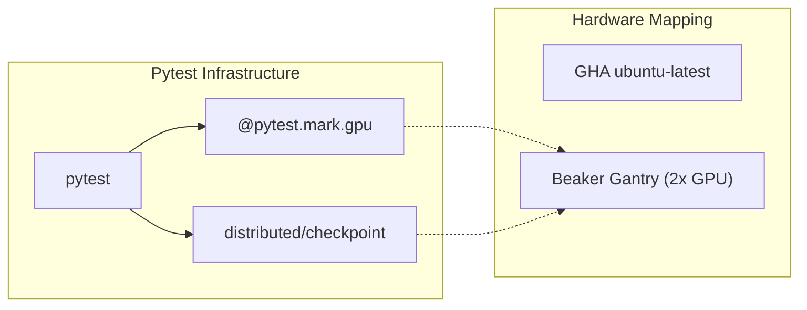

<!-- source: DeepWiki mcp.deepwiki.com · repo allenai/OLMo-core · page 9 Development and CI/CD · fetched 2026-10-26 -->

# Development and CI/CD

<details>
<summary>Relevant source files</summary>

The following files were used as context for generating this wiki page:

- [.github/workflows/docker.yml](.github/workflows/docker.yml)
- [.github/workflows/main.yml](.github/workflows/main.yml)
- [CLAUDE.md](CLAUDE.md)
- [Makefile](Makefile)
- [pyproject.toml](pyproject.toml)
- [src/Dockerfile](src/Dockerfile)

</details>


This document covers the development workflow, testing infrastructure, and continuous integration/deployment pipelines for OLMo-core. It explains how to set up a local development environment, run tests, build Docker images, and how the automated CI/CD system validates and releases code.

For information about experiment configuration and launching training runs on Beaker clusters, see [Experiment Management](#7).

---

## Development Workflow Overview

The OLMo-core development workflow integrates local development tools with automated GitHub Actions pipelines. The system supports both CPU-based development and GPU-accelerated testing through Beaker/Gantry integration.

```mermaid
graph TB
    subgraph "Local Development"
        Dev["Developer"]
        Makefile["Makefile targets"]
        LocalTests["Local test execution"]
        Linting["Code quality checks"]
    end
    
    subgraph "CI Pipeline - CPU Tests"
        PRTrigger["Pull Request / Push"]
        CPUMatrix["Test matrix (Python 3.10, 3.11)"]
        Checks["Parallel check jobs"]
        
        Lint["Lint check"]
        TypeCheck["Type check (mypy)"]
        StyleCheck["Style check"]
        UnitTests["Unit tests (CPU)"]
        TransformerTests["Transformer tests"]
        AttentionTests["Attention tests"]
        CheckpointTests["Checkpoint tests"]
        IntegrationTests["Integration tests"]
        ExampleTests["Example tests"]
        LadderTests["Ladder script validation"]
        Docs["Documentation build"]
        Build["Package build"]
    end
    
    subgraph "CI Pipeline - GPU Tests"
        GPUTrigger["Pull Request / Push"]
        Gantry["Beaker Gantry launcher"]
        GPUMatrix["GPU test matrix (2x GPUs)"]
        GPUImage["Docker image:<br/>tylerr/olmo-core-tch291cu128"]
        
        GPUUnit["Unit tests (GPU)"]
        GPUTransformer["Transformer tests (GPU)"]
        GPUAttention["Attention tests (GPU)"]
        GPUCheckpoint["GPU checkpoint tests"]
        GPUMoE["GPU MoE tests"]
        GPUOptim["GPU optimizer tests"]
        GPUIntegration["Integration tests (GPU)"]
    end
    
    subgraph "Release Pipeline"
        Tag["Version tag (v*.*.*)"]
        DownloadArtifacts["Download built package"]
        ReleaseNotes["Generate release notes"]
        PyPI["Publish to PyPI"]
        GitHubRelease["Create GitHub release"]
        PRComments["Add PR comments"]
        SlackNotify["Slack notifications"]
    end
    
    Dev --> Makefile
    Makefile --> LocalTests
    Makefile --> Linting
    
    Dev --> PRTrigger
    PRTrigger --> CPUMatrix
    CPUMatrix --> Checks
    Checks --> Lint
    Checks --> TypeCheck
    Checks --> StyleCheck
    Checks --> UnitTests
    Checks --> TransformerTests
    Checks --> AttentionTests
    Checks --> CheckpointTests
    Checks --> IntegrationTests
    Checks --> ExampleTests
    Checks --> LadderTests
    Checks --> Docs
    Checks --> Build
    
    Build --> DownloadArtifacts
    
    Dev --> GPUTrigger
    GPUTrigger --> Gantry
    Gantry --> GPUImage
    GPUImage --> GPUMatrix
    GPUMatrix --> GPUUnit
    GPUMatrix --> GPUTransformer
    GPUMatrix --> GPUAttention
    GPUMatrix --> GPUCheckpoint
    GPUMatrix --> GPUMoE
    GPUMatrix --> GPUOptim
    GPUMatrix --> GPUIntegration
    
    Dev --> Tag
    Tag --> DownloadArtifacts
    DownloadArtifacts --> ReleaseNotes
    ReleaseNotes --> PyPI
    PyPI --> GitHubRelease
    GitHubRelease --> PRComments
    PRComments --> SlackNotify
```



**Sources:** [.github/workflows/main.yml:1-323](), [Makefile:1-126](), [CLAUDE.md:1-153]()

---

## Local Development Setup

For details, see [Development Setup](#9.1).

### Installing Dependencies

The project uses `uv` for fast dependency management and environment isolation [pyproject.toml:72-76](). Install the package with all optional dependencies for a full development environment:

```bash
# Install with all extras (recommended for development)
pip install -e '.[all]'
```

The `[all]` extra includes development tools (`dev`), Beaker integration (`beaker`), high-performance kernels (`fa4`, `fla`), and various monitoring integrations [pyproject.toml:37-70]().

**Sources:** [pyproject.toml:37-70](), [CLAUDE.md:11-13]()

### Makefile Targets

The `Makefile` provides standardized targets for code quality and local builds:

| Target | Description | Code Command |
|--------|-------------|--------------|
| `make style` | Format code | `isort .` + `black .` |
| `make style-check` | Verify formatting | `isort --check .` + `black --check .` |
| `make lint-check` | Static analysis | `ruff check .` |
| `make type-check` | Type verification | `mypy src/` |
| `make checks` | Run all checks | `style-check` + `lint-check` + `type-check` |
| `make build` | Build package | `python -m build` |

**Sources:** [Makefile:1-37](), [CLAUDE.md:24-32]()

---

## CI/CD Pipeline

For details, see [CI/CD Pipeline](#9.2).

### Automated Workflows

The main workflow is defined in `.github/workflows/main.yml` and triggers on pull requests and pushes to `main` [.github/workflows/main.yml:7-15]().

- **CPU Checks**: Executes across Python 3.10 and 3.11 matrices [.github/workflows/main.yml:33-34](). It includes dry-runs for `olmo3_ladder.py` to ensure architectural configurations remain valid [.github/workflows/main.yml:84-89]().
- **GPU Checks**: Leverages `beaker-gantry` to run tests on nodes with 2 GPUs [.github/workflows/main.yml:155-207](). This covers `MoE` modules, `optim` (GPU-specific), and distributed `checkpoint` logic.
- **Docker Workflow**: Managed separately in `docker.yml`, this workflow builds images for multiple CUDA (12.8.1, 12.9.1) and Torch (2.7.1, 2.9.0) versions [.github/workflows/docker.yml:39-50]().

**Sources:** [.github/workflows/main.yml:1-207](), [.github/workflows/docker.yml:1-102]()

### Testing Infrastructure

Tests are organized under `src/test/` and utilize `pytest` markers to differentiate hardware requirements [.github/workflows/main.yml:179]().



**Sources:** [pyproject.toml:172-188](), [.github/workflows/main.yml:145-207]()

---

## Docker Images and Testing

For details, see [Docker Images and Testing](#9.3).

### Build System

The `src/Dockerfile` uses a multi-stage approach to balance build-time dependencies with a clean runtime environment.

- **Build Stage**: Uses `nvidia/cuda:devel` to compile performance-critical kernels including `grouped_gemm`, `flash-attn` (v2 and v3), `transformer-engine`, and `liger-kernel` [src/Dockerfile:13-95]().
- **Release Stage**: Copies the pre-compiled `/opt/conda` environment into a fresh Ubuntu base, adding system utilities like `awscli`, `google-cloud-sdk`, and `gh` [src/Dockerfile:114-162]().
- **Networking**: Installs `MLNX OFED` user-space drivers to support high-speed RDMA networking on InfiniBand-equipped clusters [src/Dockerfile:150-159]().

**Sources:** [src/Dockerfile:1-171](), [Makefile:42-66]()

### Flash Attention Integration

The Dockerfile contains specific logic to install `flash-attn` and restructure the package so that `TransformerEngine` can find the Flash Attention 3 interface at the expected path.

```mermaid
graph TD
    "flash-attention/hopper" -- "setup.py install" --> "site-packages/flash_attn_3-*.egg"
    "site-packages/flash_attn_3-*.egg" -- "mv" --> "site-packages/flash_attn_3/"
    "site-packages/flash_attn_3/" -- "import" --> "transformer_engine.pytorch"
```

**Sources:** [src/Dockerfile:61-83](), [Makefile:57-59]()

---

