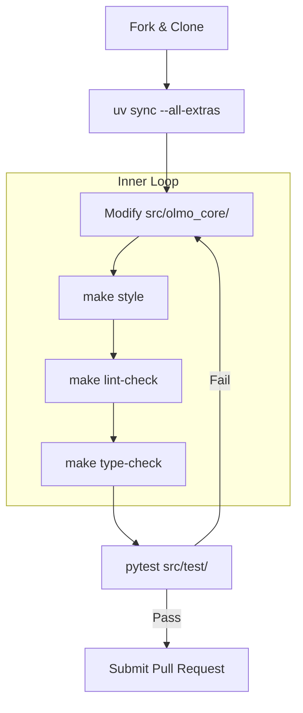
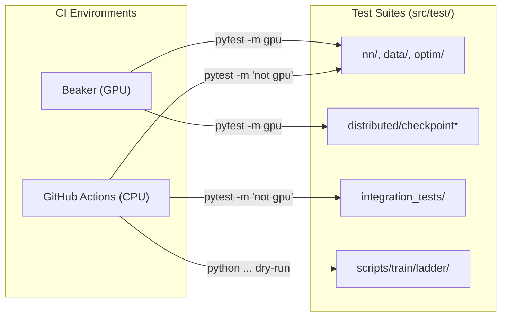

<!-- source: DeepWiki mcp.deepwiki.com · repo allenai/OLMo-core · page 9.1 Development Setup · fetched 2026-10-26 -->

# Development Setup

<details>
<summary>Relevant source files</summary>

The following files were used as context for generating this wiki page:

- [.github/workflows/docker.yml](.github/workflows/docker.yml)
- [.github/workflows/main.yml](.github/workflows/main.yml)
- [CONTRIBUTING.md](CONTRIBUTING.md)
- [Makefile](Makefile)
- [pyproject.toml](pyproject.toml)
- [src/Dockerfile](src/Dockerfile)

</details>


This document describes how to set up a local development environment for OLMo-core, install dependencies, configure development tools, and run tests. For information about the CI/CD pipeline and automated testing infrastructure, see [CI/CD Pipeline](#9.2). For details about Docker images used in production and CI, see [Docker Images and Testing](#9.3).

---

## Prerequisites

OLMo-core requires Python 3.10 or higher [pyproject.toml:13](). The CI pipeline tests against Python 3.10 (minimum) and 3.11 (primary) [.github/workflows/main.yml:34-107](). Python 3.12 is used for GPU tests and Docker builds [Makefile:52](), [.github/workflows/main.yml:215]().

### System Requirements

| Requirement | Purpose | Notes |
|------------|---------|-------|
| Python 3.10+ | Runtime environment | 3.11 or 3.12 recommended for development |
| CUDA 12.x | GPU acceleration | Required for GPU-dependent tests (Flash Attention, MoE) |
| Git | Version control | For cloning the repository |
| [uv](https://docs.astral.sh/uv/) | Package management | Recommended for high-performance dependency resolution |

For GPU-accelerated features, CUDA 12.8+ is recommended. The Docker builds target CUDA 12.8.1 or 12.9.1 [Makefile:50](), [.github/workflows/docker.yml:40]().

**Sources:** [pyproject.toml:13](), [.github/workflows/main.yml:34-107](), [.github/workflows/docker.yml:40](), [Makefile:50-52]()

---

## Installation

### Basic Installation

OLMo-core uses `uv` for high-performance package management. It is recommended to fork the repository for rapid experimentation [CONTRIBUTING.md:7]().

```bash
# Clone the repository
git clone https://github.com/allenai/OLMo-core
cd OLMo-core

# Create a virtual environment (recommended)
uv venv --python 3.11
source .venv/bin/activate

# Install in editable mode
uv pip install -e .
```

The `-e` flag installs in editable mode, allowing you to modify source code in `src/olmo_core/` and see changes immediately without reinstalling [CONTRIBUTING.md:9-13]().

### Installation with Extras

The project defines several dependency groups in `pyproject.toml`. The standard development and CI environments use the `[all]` extra, which includes development tools, cloud providers, and specialized model kernels [pyproject.toml:70]().

```bash
# Install all optional dependencies (recommended for full feature set)
uv sync --all-extras

# Or with pip
pip install -e '.[all]'
```

Key extras defined in `pyproject.toml` [pyproject.toml:36-70]():
*   `dev`: Linting, formatting, and testing tools (`black`, `ruff`, `mypy`, `pytest`).
*   `beaker`: Integration with AI2's Beaker platform.
*   `fa4`: Flash Attention 4 support.
*   `torchao`: Support for Float8 and quantization features.
*   `eval`: Integration with `ai2-olmo-eval`.

**Sources:** [pyproject.toml:36-70](), [CONTRIBUTING.md:5-21]()

---

## Development Tools

The `Makefile` provides convenient commands for common development tasks and quality enforcement.

### Code Quality Checks

```bash
# Run all checks (style, lint, type)
make checks

# Individual checks
make style-check    # Verifies isort and black formatting
make lint-check     # Runs ruff for static analysis
make type-check     # Runs mypy for type validation
```

### Code Formatting

```bash
# Format code automatically to match project standards
make style
```

### Building Distribution and Docs

```bash
# Build package distribution files (.whl and .tar.gz)
make build

# Build and serve documentation with auto-reload
make docs
```

### Development Workflow Diagram

This diagram maps the natural language development workflow to the specific `Makefile` targets and code entities.



**Sources:** [Makefile:1-37](), [CONTRIBUTING.md:68-74]()

---

## Running Tests

OLMo-core uses `pytest` for its test suite. Tests are organized to mirror the `src/olmo_core` directory structure [CONTRIBUTING.md:59]().

### Basic Test Execution

```bash
# Run all tests locally
pytest -v src/test/

# Run a specific subset (e.g., Rotary Embeddings)
pytest src/test/nn/rope_test.py
```

### Test Categories and Markers

The CI pipeline splits tests into logical segments to optimize runtime [.github/workflows/main.yml:39-83]().

| Category | Target Path | Marker / Ignore |
|----------|-------------|-----------------|
| **Core Logic** | `src/test/` | Ignores heavy modules (transformer, attention) |
| **Checkpoints** | `src/test/distributed/checkpoint*` | Tests sharded and remote I/O |
| **Transformer** | `src/test/nn/transformer/` | Architecture and forward pass validation |
| **GPU Tests** | `src/test/` | Filtered via `-m gpu` |
| **Integration** | `src/integration_tests/` | End-to-end training (excludes GPU in standard CI) |

### GPU and Multi-GPU Testing

GPU tests use the `@requires_gpu` or `@requires_multi_gpu` markers [CONTRIBUTING.md:63-67]().

```bash
# Run only GPU-specific tests
pytest -m gpu

# Run multi-GPU tests (requires at least 2 GPUs)
CUDA_VISIBLE_DEVICES=0,1 pytest -m gpu src/test/nn/transformer/model_test.py
```

### Testing Architecture Diagram

This diagram bridges the conceptual test categories to the actual directory structure and CI execution logic.



**Sources:** [.github/workflows/main.yml:39-207](), [CONTRIBUTING.md:46-67]()

---

## UV Workflow and Dependency Management

The project relies on `uv` for environment isolation and caching.

### Key `uv` Commands

*   **Environment Sync**: `uv sync --all-extras` ensures the local `.venv` matches `pyproject.toml` exactly.
*   **Ad-hoc Execution**: `uv run python src/scripts/train/ladder/olmo3_ladder.py` runs scripts without needing to manually activate the environment.
*   **Tooling**: `uv tool install 'beaker-gantry>=3.4.5,<4.0'` is used in CI to manage external CLI dependencies [.github/workflows/main.yml:220]().

### Dependency Configuration

Dependencies are strictly versioned in `pyproject.toml` to ensure reproducibility.
*   **Core**: `torch>=2.6.0`, `numpy`, `dataclass-extensions>=0.3.0` [pyproject.toml:15-29]().
*   **Build System**: Uses `setuptools.build_meta` [pyproject.toml:1-3]().
*   **Versioning**: Dynamic versioning is pulled from `olmo_core.version.VERSION` [pyproject.toml:85]().

**Sources:** [pyproject.toml:1-85](), [.github/workflows/main.yml:213-220]()

---

