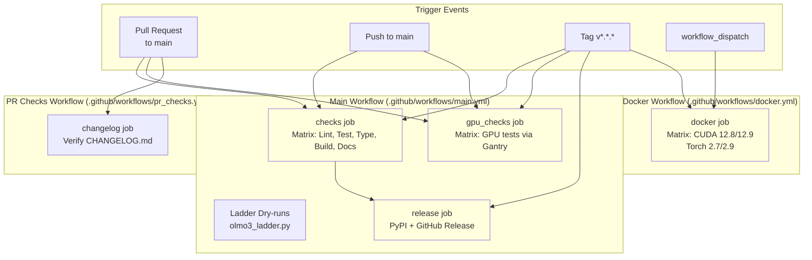
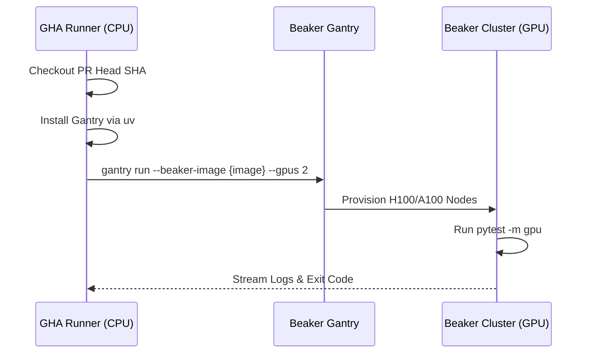
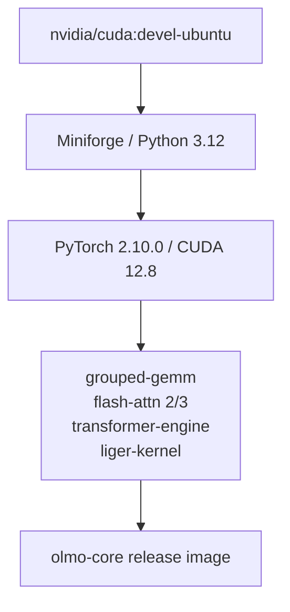

<!-- source: DeepWiki mcp.deepwiki.com · repo allenai/OLMo-core · page 9.2 CI/CD Pipeline · fetched 2026-10-26 -->

# CI/CD Pipeline

Relevant source files

The following files were used as context for generating this wiki page:

- [.github/RELEASE_PROCESS.md](.github/RELEASE_PROCESS.md)
- [.github/workflows/docker.yml](.github/workflows/docker.yml)
- [.github/workflows/main.yml](.github/workflows/main.yml)
- [.github/workflows/pr_checks.yml](.github/workflows/pr_checks.yml)
- [Makefile](Makefile)
- [pyproject.toml](pyproject.toml)
- [src/Dockerfile](src/Dockerfile)
- [src/olmo_core/train/callbacks/__init__.py](src/olmo_core/train/callbacks/__init__.py)
- [src/olmo_core/train/callbacks/checkpointer.py](src/olmo_core/train/callbacks/checkpointer.py)
- [src/olmo_core/train/config.py](src/olmo_core/train/config.py)
- [src/scripts/release/add_pr_comments_on_release.sh](src/scripts/release/add_pr_comments_on_release.sh)
- [src/scripts/release/prepare_changelog.py](src/scripts/release/prepare_changelog.py)
- [src/scripts/release/release.sh](src/scripts/release/release.sh)
- [src/scripts/release/release_notes.py](src/scripts/release/release_notes.py)

## Purpose and Scope

This document describes the continuous integration and continuous deployment (CI/CD) infrastructure for OLMo-core. The CI/CD system automates code quality checks, testing (both CPU and GPU), ladder dry-runs, Docker image building, and package releases through GitHub Actions. It ensures that changes to the core training framework do not break existing model architectures, distributed checkpointing, or optimization logic.

---

## Overview

The CI/CD system consists of three primary GitHub Actions workflows that coordinate automated testing, building, and deployment:

**Sources:** [.github/workflows/main.yml:1-278](), [.github/workflows/docker.yml:1-102](), [.github/workflows/pr_checks.yml:1-36]()

### Workflow Trigger Matrix

| Workflow | Triggers | Purpose |
|----------|----------|---------|
| **Main** | PR to `main`, push to `main`, version tags (`v*.*.*`) | Primary CI: Lint, Type check, CPU/GPU tests, OLMo3 ladder dry-runs, and PyPI/GitHub releases. |
| **Docker** | Manual dispatch (`workflow_dispatch`) | Build and publish multi-variant Docker images (CUDA/Torch matrix). |
| **PR Checks** | PR to `main` (path-filtered) | Enforce `CHANGELOG.md` updates for source changes. |

**Sources:** [.github/workflows/main.yml:7-15](), [.github/workflows/docker.yml:7-27](), [.github/workflows/pr_checks.yml:7-14]()

---

## Workflow Architecture

The following diagram maps the relationship between GitHub Action triggers and the internal scripts or Makefile targets they execute.

### CI/CD Workflow Orchestration

**Sources:** [.github/workflows/main.yml:26-278](), [.github/workflows/docker.yml:28-102](), [.github/workflows/pr_checks.yml:15-36]()

---

## CPU Testing and Static Analysis

### Checks Job Matrix

The `checks` job runs on `ubuntu-latest` and uses a matrix to parallelize different types of validation. It utilizes the `setup-python-env` local action for environment preparation.

| Task Name | Command / Script | Purpose |
|-----------|------------------|---------|
| **Lint** | `make lint-check` | Runs `ruff` to ensure code quality via `lint-check` target. |
| **Test** | `pytest` (filtered) | Runs core tests, ignoring resource-intensive modules like `distributed/checkpoint`. |
| **Test checkpoint** | `pytest src/test/distributed/checkpoint*` | Validates distributed checkpointing logic. |
| **Test transformer**| `pytest src/test/nn/transformer/` | Validates model architecture implementations. |
| **Test attention** | `pytest -k 'not tensor_parallel'` | Validates attention mechanisms on CPU. |
| **Test olmo3 ladder**| `olmo3_ladder.py dry-run` | Verifies config generation for all OLMo3 sizes (190M to 13B). |
| **Type check** | `make type-check` | Runs `mypy` with caching enabled. |
| **Build** | `make build` | Verifies the package can be built via `setuptools` and `python -m build`. |

**Sources:** [.github/workflows/main.yml:35-102](), [.github/workflows/main.yml:113-117](), [Makefile:11-19](), [Makefile:33-36]()

### OLMo3 Ladder Dry-runs
A critical part of the CI is ensuring that the scaling scripts remain functional. The CI iterates through model sizes (190M, 370M, 600M, 760M, 1B, 3B, 7B, 13B) and executes `olmo3_ladder.py dry-run` to validate the `ExperimentConfig` construction for each size.

**Sources:** [.github/workflows/main.yml:84-88]()

---

## GPU Testing Pipeline

GPU tests are executed on remote Beaker clusters using **Gantry**. This allows the CI to run tests requiring CUDA and multiple GPUs (typically 2) which are not available on standard GitHub runners.

### Gantry Integration Flow

**Sources:** [.github/workflows/main.yml:145-217]()

### GPU Test Matrix
The GPU pipeline is partitioned to prevent timeouts and provide granular failure reporting. Each task runs with `gpus: 2` and a specific `image` (e.g., `tylerr/olmo-core-tch291cu128-2025-11-25`).
*   **General GPU:** `src/test/` (excluding specific modules like `nn/transformer`).
*   **Checkpoint GPU:** `src/test/distributed/checkpoint*`.
*   **Transformer GPU:** `src/test/nn/transformer*`.
*   **MoE GPU:** `src/test/nn/moe*`.
*   **Optim GPU:** `src/test/optim*`.

**Sources:** [.github/workflows/main.yml:153-207]()

---

## Docker Infrastructure

The Docker workflow builds images for a matrix of CUDA and PyTorch versions to support various hardware environments. The `Dockerfile` uses a multi-stage build (`build` and `release` targets).

### Build Matrix
*   **CUDA Versions:** `12.8.1`, `12.9.1`.
*   **PyTorch Versions:** `2.7.1`, `2.9.0`.
*   **Channels:** `whl/test`.

### Docker Image Composition
The `Dockerfile` handles complex dependencies including `grouped-gemm`, `flash-attn` (v2 and v3), `transformer-engine`, and `ring-flash-attn`.

**Sources:** [src/Dockerfile:1-171](), [Makefile:76-94](), [.github/workflows/docker.yml:37-102]()

---

## Release Process and Automation

Releases are semi-automated. A developer initiates the process locally, and GitHub Actions completes the distribution.

### Manual Initiation
1.  Update `VERSION` in `src/olmo_core/version.py`.
2.  Execute `./src/scripts/release/release.sh`.
    *   This script runs `prepare_changelog.py` to move "Unreleased" items to a versioned section.
    *   It commits changes and creates a git tag (e.g., `v2.1.0`).

**Sources:** [src/olmo_core/version.py:1-2](), [.github/RELEASE_PROCESS.md:1-18]()

### Automated Release Job
When a tag is pushed, the `release` job in `main.yml` triggers:
1.  **Generate Notes:** Uses `release_notes.py` to extract the relevant section from `CHANGELOG.md` and collect commit history since the last tag.
2.  **PyPI:** Uploads the built distribution using `twine`.
3.  **GitHub Release:** Creates a release entry with the generated notes and attached `.whl`/`.tar.gz` files.
4.  **PR Notifications:** Runs `add_pr_comments_on_release.sh` which uses the GitHub CLI (`gh`) to find merged PRs since the last release and comment on each one with the new release link.
5.  **Slack:** Sends a notification to the internal Slack channel.

**Sources:** [.github/workflows/main.yml:219-278](), [src/scripts/release/release_notes.py:20-72](), [src/scripts/release/add_pr_comments_on_release.sh:21-30]()

---

## PR Checks and Notifications

The `pr_checks.yml` workflow enforces repository standards.

*   **Changelog Verification:** Checks that `CHANGELOG.md` has been modified if any source code under `src/olmo_core/` (excluding `internal/`) has changed. This is implemented via a `git diff` against the merge base of `origin/main`.
*   **Slack Notifications:** The `main.yml` workflow includes a `SlackNotifierCallback` integration (via `SlackNotifierCallback` in code) and a direct `slack-notify` step in the release job to keep the team informed of build failures or successful releases.

**Sources:** [.github/workflows/pr_checks.yml:15-36](), [.github/workflows/main.yml:273-277](), [src/olmo_core/train/callbacks/slack_notifier.py:27-28]()

---

