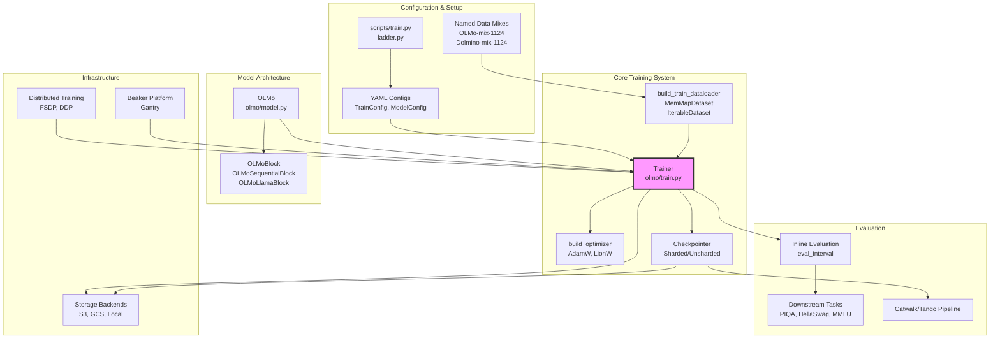
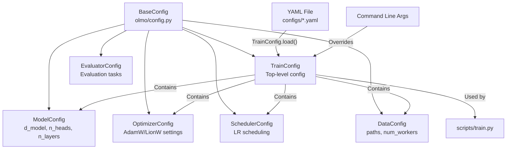
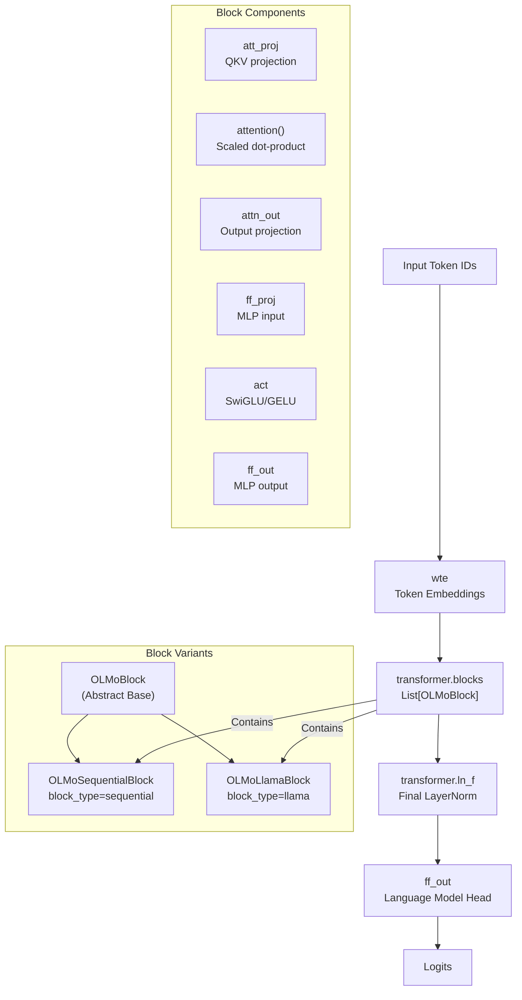
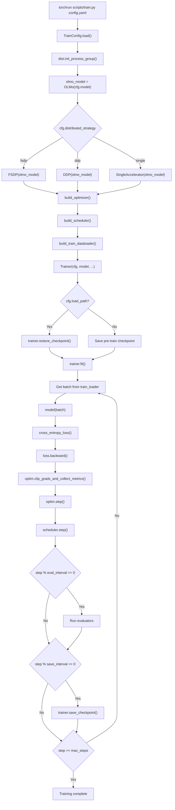
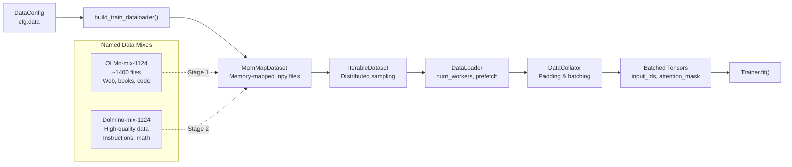
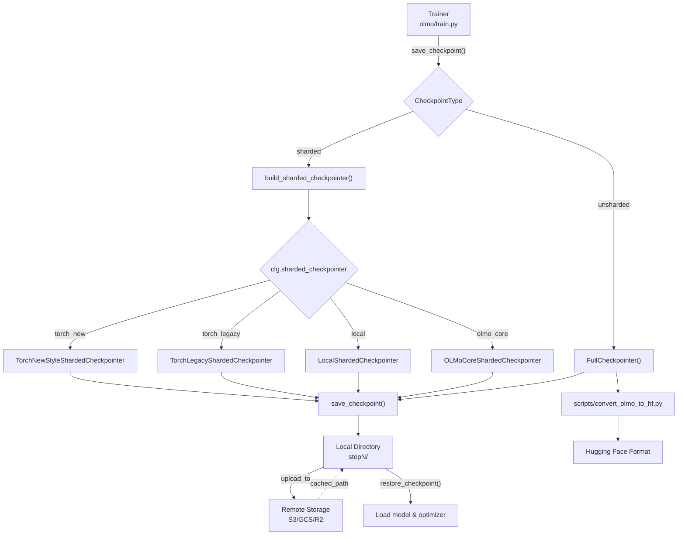
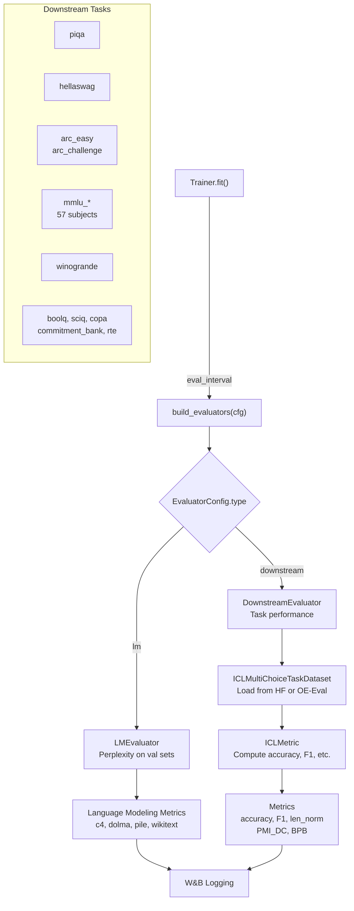
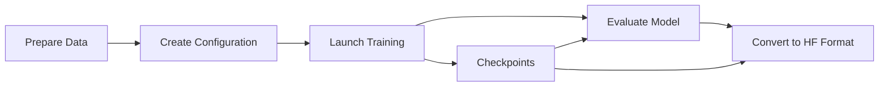

<!-- source: DeepWiki mcp.deepwiki.com · repo allenai/OLMo · page 1 Overview · fetched 2026-10-26 -->

# Overview

<details>
<summary>Relevant source files</summary>

The following files were used as context for generating this wiki page:

- [README.md](README.md)
- [configs/official-0425/OLMo2-1B-stage1.yaml](configs/official-0425/OLMo2-1B-stage1.yaml)
- [configs/official-0425/OLMo2-1B-stage2-seed42.yaml](configs/official-0425/OLMo2-1B-stage2-seed42.yaml)
- [configs/official-0425/OLMo2-1B-stage2-seed42069.yaml](configs/official-0425/OLMo2-1B-stage2-seed42069.yaml)
- [configs/official-0425/OLMo2-1B-stage2-seed666.yaml](configs/official-0425/OLMo2-1B-stage2-seed666.yaml)
- [configs/official-1124/OLMo2-13B-stage1.yaml](configs/official-1124/OLMo2-13B-stage1.yaml)
- [configs/official-1124/OLMo2-13B-stage2-seed1110-100B.yaml](configs/official-1124/OLMo2-13B-stage2-seed1110-100B.yaml)
- [configs/official-1124/OLMo2-13B-stage2-seed2662-100B.yaml](configs/official-1124/OLMo2-13B-stage2-seed2662-100B.yaml)
- [configs/official-1124/OLMo2-13B-stage2-seed2662-300B.yaml](configs/official-1124/OLMo2-13B-stage2-seed2662-300B.yaml)
- [configs/official-1124/OLMo2-13B-stage2-seed6209-100B.yaml](configs/official-1124/OLMo2-13B-stage2-seed6209-100B.yaml)
- [configs/official-1124/OLMo2-7B-stage1.yaml](configs/official-1124/OLMo2-7B-stage1.yaml)
- [configs/official-1124/OLMo2-7B-stage2-seed42.yaml](configs/official-1124/OLMo2-7B-stage2-seed42.yaml)
- [configs/official-1124/OLMo2-7B-stage2-seed42069.yaml](configs/official-1124/OLMo2-7B-stage2-seed42069.yaml)
- [configs/official-1124/OLMo2-7B-stage2-seed666.yaml](configs/official-1124/OLMo2-7B-stage2-seed666.yaml)
- [olmo/beam_search.py](olmo/beam_search.py)
- [olmo/checkpoint.py](olmo/checkpoint.py)
- [olmo/config.py](olmo/config.py)
- [olmo/initialization.py](olmo/initialization.py)
- [olmo/model.py](olmo/model.py)
- [olmo/optim.py](olmo/optim.py)
- [olmo/torch_util.py](olmo/torch_util.py)
- [olmo/train.py](olmo/train.py)
- [olmo/util.py](olmo/util.py)
- [scripts/olmo2_modal_openai.py](scripts/olmo2_modal_openai.py)
- [scripts/train.py](scripts/train.py)
- [tests/grad_norm_test.py](tests/grad_norm_test.py)
- [tests/initialization_test.py](tests/initialization_test.py)
- [tests/optim_test.py](tests/optim_test.py)

</details>


The OLMo (Open Language Model) repository is a state-of-the-art open language model training framework developed by the Allen Institute for AI (AI2). OLMo is designed by scientists, for scientists, providing a complete, transparent system for training transformer-based language models at scale.

The framework supports:
- **Full transparency**: Complete access to training data, model weights, training code, evaluation tools, and intermediate checkpoints
- **Production-scale training**: Multi-billion parameter models trained on trillions of tokens
- **Two-stage training procedure**: Web-based pretraining followed by high-quality data refinement
- **Flexible deployment**: Integration with Hugging Face transformers and custom inference solutions
- **Comprehensive evaluation**: Built-in downstream task evaluation and external evaluation pipelines

This page provides a high-level overview of the OLMo system. For detailed information about specific components, refer to their dedicated documentation pages:
- [Model Architecture](#2) - Transformer architecture, attention mechanisms, and model variants
- [Training Pipeline](#3) - Training loop orchestration and distributed training strategies
- [Data Processing](#3.1) - Data loading, preprocessing, and batching
- [Checkpoint Management](#4) - Saving, loading, and managing model checkpoints
- [Evaluation System](#5) - Inline evaluation, downstream tasks, and external evaluation

Sources: [README.md:1-27](README.md:1-27), [README.md:44-61](README.md:44-61)

## Two-Stage Training Approach

OLMo models follow a two-stage training procedure designed to balance scale with quality:

| Stage | Data Source | Token Count | Learning Rate Schedule | Purpose |
|-------|-------------|-------------|------------------------|---------|
| **Stage 1** | OLMo-mix-1124 (web-based) | 4-5 Trillion | Cosine with warmup | Large-scale pretraining on diverse web data |
| **Stage 2** | Dolmino-mix-1124 (high-quality) | 50-300 Billion | Linear warmup | Refinement on curated, high-quality data |

### Stage 1: Web-Based Pretraining

Stage 1 trains on 4-5 trillion tokens from **OLMo-mix-1124**, a large web-based dataset containing:
- Books (Dolma books)
- Academic papers (PES2O)
- Wikipedia content
- Code repositories
- Web crawl data
- Social media content

Training uses a cosine learning rate schedule with warmup, optimizing for broad language understanding across diverse domains.

### Stage 2: High-Quality Refinement

Stage 2 continues training on 50-300 billion tokens from **Dolmino-mix-1124**, focusing on:
- Higher-quality instruction data
- Curated domain-specific content
- Mathematical reasoning
- Code generation

Training uses linear warmup scheduling to fine-tune the model on this refined dataset.

### Model Souping

For 7B and 13B models, OLMo employs **model souping**: training multiple checkpoints with different random seeds and averaging their weights to improve robustness and performance.

| Model Size | Stage 2 Strategy |
|------------|------------------|
| 1B | Single best seed (seed 42) |
| 7B | Average of 3 seeds (42, 42069, 666) |
| 13B | Average of 4 seeds (1110, 2662, 6209, and one 300B run) |

Sources: [README.md:96-147](README.md:96-147), [configs/official-1124/OLMo2-7B-stage1.yaml](configs/official-1124/OLMo2-7B-stage1.yaml), [configs/official-0425/OLMo2-1B-stage2-seed42.yaml](configs/official-0425/OLMo2-1B-stage2-seed42.yaml)

## System Architecture

**High-Level System Architecture Diagram**



The OLMo system consists of five major subsystems:

1. **Configuration & Setup**: YAML-based configuration system (`TrainConfig`, `ModelConfig`) with CLI tools (`scripts/train.py`, `ladder.py`) for launching training jobs
2. **Core Training System**: `Trainer` class orchestrates data loading (`build_train_dataloader`), optimization (`build_optimizer`), and checkpointing
3. **Model Architecture**: `OLMo` model with modular transformer blocks (`OLMoSequentialBlock`, `OLMoLlamaBlock`)
4. **Evaluation**: Three-tier evaluation including inline evaluation during training, built-in downstream tasks, and external Catwalk pipeline
5. **Infrastructure**: Distributed training support (FSDP/DDP), Beaker platform integration, and multi-backend storage (S3, GCS, local)

Sources: [scripts/train.py:54-238](scripts/train.py:54-238), [olmo/train.py:209-280](olmo/train.py:209-280), [olmo/model.py:1-76](olmo/model.py:1-76), [olmo/config.py:1-65](olmo/config.py:1-65)

## Key Components

### Configuration System

The configuration system (`olmo/config.py`) provides a hierarchical YAML-based configuration structure:

**Configuration Hierarchy Diagram**



Configuration files define all aspects of training, from model architecture to distributed strategy. See [Configuration System](#2.1) for details.

Sources: [olmo/config.py:67-167](olmo/config.py:67-167), [scripts/train.py:422-426](scripts/train.py:422-426)

### Model Architecture

The `OLMo` class (`olmo/model.py`) implements a modular transformer architecture with support for multiple block types and configurations.

**OLMo Model Structure Diagram**



Key architectural features:
- **Transformer blocks**: Choice between `OLMoSequentialBlock` (standard) and `OLMoLlamaBlock` (Llama-style)
- **Attention mechanisms**: Multi-head attention with optional flash attention, RoPE, and grouped query attention (GQA)
- **Normalization**: RMSLayerNorm or standard LayerNorm with configurable affine parameters
- **Activations**: SwiGLU (default), GELU, or ReLU
- **Memory optimization**: Activation checkpointing support for reducing memory footprint

See [Model Architecture](#2) for comprehensive details.

Sources: [olmo/model.py:59-73](olmo/model.py:59-73), [olmo/model.py:411-476](olmo/model.py:411-476), [olmo/model.py:678-823](olmo/model.py:678-823)

### Training Pipeline

The `Trainer` class (`olmo/train.py`) orchestrates the complete training loop with support for distributed training, checkpointing, and evaluation.

**Training Execution Flow Diagram**



Key training components:
- **scripts/train.py**: Entry point that initializes distributed environment and creates `Trainer`
- **Trainer class**: Manages training loop with gradient accumulation, checkpointing, and evaluation
- **Distributed strategies**: FSDP (≥7B models), DDP (<7B models), or single-device training
- **Optimizers**: `AdamW` (default) or `LionW` with weight decay and gradient clipping
- **Schedulers**: Cosine (Stage 1) or linear (Stage 2) warmup schedules

See [Training Pipeline](#3) for comprehensive details.

Sources: [scripts/train.py:54-376](scripts/train.py:54-376), [olmo/train.py:209-303](olmo/train.py:209-303), [olmo/train.py:596-980](olmo/train.py:596-980)

### Data Processing

The data pipeline (`olmo/data/`) provides efficient loading and preprocessing of training data with support for memory-mapped datasets and distributed sampling.

**Data Pipeline Architecture Diagram**



Key data components:
- **MemMapDataset**: Reads tokenized data from memory-mapped `.npy` files for efficient access
- **IterableDataset**: Wraps datasets with deterministic shuffling, distributed sampling, and restartability
- **DataCollator**: Batches examples with padding, generates attention masks, and handles label masking
- **build_train_dataloader**: Factory function that constructs the complete data pipeline

The pipeline supports efficient streaming from large datasets with proper sharding across distributed ranks. See [Data Processing](#3.1) for details.

Sources: [olmo/data/__init__.py:85-157](olmo/data/__init__.py:85-157), [olmo/data/__init__.py:22-84](olmo/data/__init__.py:22-84)

### Checkpoint Management

The checkpointing system (`olmo/checkpoint.py`) handles saving and loading model and optimizer states with support for both sharded (FSDP) and unsharded formats.

**Checkpoint Management Flow Diagram**



Key checkpoint features:
- **Sharded checkpoints**: FSDP-compatible distributed checkpoints split across ranks
- **Unsharded checkpoints**: Single-file checkpoints for DDP or single-device training
- **Remote storage**: Automatic upload to S3, GCS, or R2 cloud storage
- **Checkpoint rotation**: Configurable retention policy to manage disk space
- **Hugging Face conversion**: `convert_olmo_to_hf.py` script for transformers integration

Checkpoints are saved at regular intervals (`save_interval`) and can be restored for resuming training or evaluation. See [Checkpoint Management](#4) for details.

Sources: [olmo/checkpoint.py:76-91](olmo/checkpoint.py:76-91), [olmo/train.py:446-576](olmo/train.py:446-576)

### Evaluation System

The evaluation system (`olmo/eval/`) provides inline evaluation during training and comprehensive downstream task assessment.

**Evaluation System Architecture Diagram**



Key evaluation features:
- **Inline evaluation**: Runs every `eval_interval` steps (typically 1000) during training
- **Language modeling**: Perplexity on validation sets (C4, Dolma, Pile, WikiText)
- **Downstream tasks**: PIQA, HellaSwag, ARC, MMLU (57 subjects), WinoGrande, and more
- **ICLMetric**: Computes accuracy, F1, length-normalized accuracy, PMI with domain-conditional normalization, and bits-per-byte
- **Task datasets**: `ICLMultiChoiceTaskDataset` loads tasks from HuggingFace or OE-Eval format

Results are logged to Weights & Biases for tracking model performance throughout training. See [Evaluation System](#5) for comprehensive details.

Sources: [olmo/eval/__init__.py:24-91](olmo/eval/__init__.py:24-91), [olmo/eval/downstream.py:28-81](olmo/eval/downstream.py:28-81)

## Getting Started

### Installation

Install OLMo from source for training and fine-tuning:

```bash
git clone https://github.com/allenai/OLMo.git
cd OLMo
pip install -e .[all]
```

Or install from PyPI for inference:

```bash
pip install ai2-olmo
```

Sources: [README.md:28-42](README.md:28-42)

### Quick Start: Training

Launch training with a configuration file:

```bash
torchrun --nproc_per_node=8 scripts/train.py configs/official-1124/OLMo2-7B-stage1.yaml
```

Override configuration settings from the command line:

```bash
torchrun --nproc_per_node=8 scripts/train.py configs/my_config.yaml \
  --global_train_batch_size=1024 \
  --save_interval=2000 \
  --max_grad_norm=1.0
```

Sources: [README.md:62-80](README.md:62-80)

### Quick Start: Inference

Use OLMo models with Hugging Face transformers:

```python
from transformers import AutoModelForCausalLM, AutoTokenizer

# Load model and tokenizer
model = AutoModelForCausalLM.from_pretrained("allenai/OLMo-2-1124-7B")
tokenizer = AutoTokenizer.from_pretrained("allenai/OLMo-2-1124-7B")

# Generate text
inputs = tokenizer("Language modeling is", return_tensors='pt')
outputs = model.generate(**inputs, max_new_tokens=100)
print(tokenizer.decode(outputs[0]))
```

Sources: [README.md:158-173](README.md:158-173)

## Training Workflow

The typical workflow for training an OLMo model is:

1. **Prepare Data**: Tokenized data is prepared as memory-mapped files
2. **Create Configuration**: Define model architecture and training parameters in YAML
3. **Launch Training**: Use `torchrun` to start distributed training with the configuration
4. **Monitor Progress**: Track metrics through WandB or logs
5. **Evaluate Model**: Evaluate checkpoints on downstream tasks
6. **Convert Format**: Convert checkpoints to Hugging Face format for broader use



Example training command:
```
torchrun --nproc_per_node=8 scripts/train.py configs/official-1124/OLMo-2-7B-stage1.yaml
```

Sources:
- [README.md:66-79](README.md:66-79)
- [scripts/train.py:382-436](scripts/train.py:382-436)

---

