<!-- source: DeepWiki mcp.deepwiki.com · repo allenai/OLMo · page 2 Model Architecture · fetched 2026-10-26 -->

# Model Architecture

Relevant source files

The following files were used as context for generating this wiki page:

- [olmo/beam_search.py](olmo/beam_search.py)
- [olmo/checkpoint.py](olmo/checkpoint.py)
- [olmo/config.py](olmo/config.py)
- [olmo/initialization.py](olmo/initialization.py)
- [olmo/model.py](olmo/model.py)
- [olmo/optim.py](olmo/optim.py)
- [olmo/torch_util.py](olmo/torch_util.py)
- [olmo/train.py](olmo/train.py)
- [olmo/util.py](olmo/util.py)
- [scripts/train.py](scripts/train.py)
- [tests/config_test.py](tests/config_test.py)
- [tests/grad_norm_test.py](tests/grad_norm_test.py)
- [tests/initialization_test.py](tests/initialization_test.py)
- [tests/model_test.py](tests/model_test.py)
- [tests/optim_test.py](tests/optim_test.py)

This page documents the neural network architecture of OLMo (Open Language Model), a decoder-only transformer language model. It covers the core model components, their interactions, and the configurable aspects of the architecture. For information about training the model, see [Training Pipeline](#3).

## Overview

OLMo is a decoder-only transformer language model that builds on recent advances in transformer architecture design. It supports various architectural choices, including different block types, attention mechanisms, and activation functions. The model architecture is highly configurable, allowing for experimentation with different design choices.

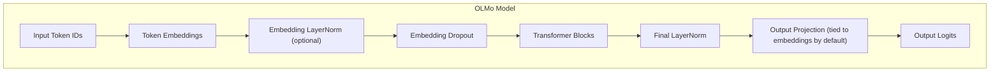

Sources: [olmo/model.py:4740-4996](). The main `OLMo` class implementation contains the high-level architecture.

## Components in Detail

### Transformer Block Architecture

OLMo implements two main transformer block types:

1. **Sequential Block** (`OLMoSequentialBlock`): A standard transformer block with a sequence of attention and feed-forward layers.
2. **Llama Block** (`OLMoLlamaBlock`): A block similar to the Sequential Block but with implementation differences to match the behavior of Llama models.

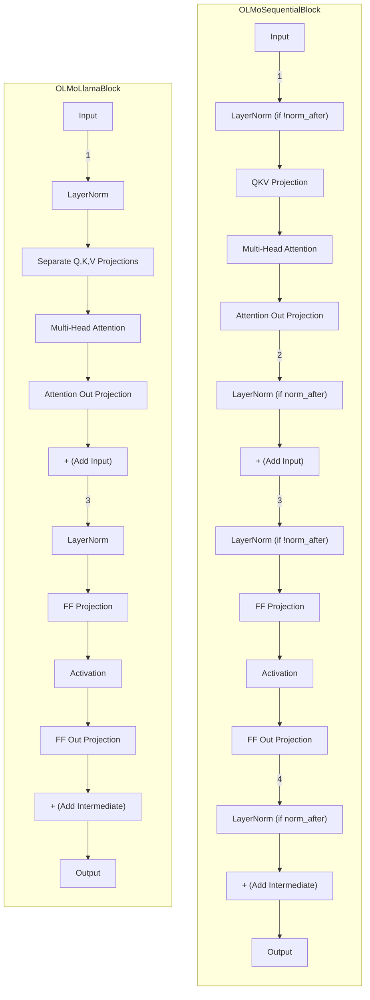

Sources: 
- Sequential Block: [olmo/model.py:678-823]()
- Llama Block: [olmo/model.py:826-1058]()

### Attention Mechanism

OLMo supports several attention variations:

1. **Multi-Head Attention (MHA)**: Standard multi-head attention where number of key-value heads equals number of query heads.
2. **Multi-Query Attention (MQA)**: A variation where all query heads share a single key-value head.
3. **Grouped-Query Attention (GQA)**: A middle ground where groups of query heads share key-value heads.

The attention mechanism is implemented in the `attention` method of the `OLMoBlock` class:

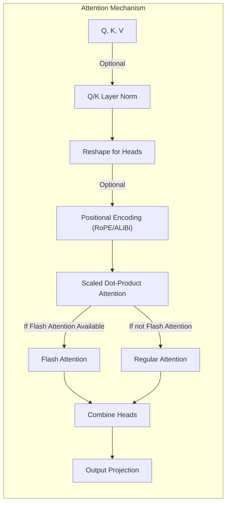

Sources: [olmo/model.py:588-654]()

### Positional Encodings

OLMo supports two types of positional encodings:

1. **Rotary Position Embeddings (RoPE)**: Applies rotation to the keys and queries based on their positions.
2. **ALiBi**: Adds a bias to the attention scores based on the relative positions of tokens.

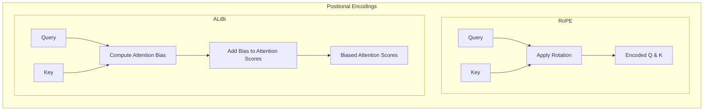

Sources: 
- RoPE: [olmo/model.py:258-306]()
- ALiBi: [olmo/model.py:396-408]()

### Feed-Forward Network

The feed-forward network consists of:
1. A projection to a higher dimension
2. An activation function
3. A projection back to the model dimension

OLMo supports several activation functions:
- GELU
- ReLU
- SwiGLU (Swish-Gated Linear Unit)

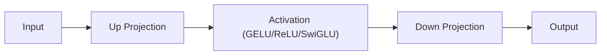

Sources:
- Activation functions: [olmo/model.py:327-372]()
- Implementation in blocks: [olmo/model.py:699-822]() for Sequential Block, [olmo/model.py:834-1057]() for Llama Block

## Layer Normalization Variants

OLMo implements multiple layer normalization variants:

1. **Default LayerNorm**: Standard implementation equivalent to PyTorch's built-in version
2. **Low Precision LayerNorm**: A variant optimized for lower precision computation
3. **RMSLayerNorm**: A simplified layer norm that only normalizes by the root mean square

```mermaid
flowchart TD
    subgraph "LayerNorm Variants"
        direction TB
        
        subgraph "Default LayerNorm"
            inputN1["Input"] --> meanVar1["Compute Mean & Variance"]
            meanVar1 --> norm1["Normalize"]
            norm1 --> scale1["Apply Scale & Bias"]
            scale1 --> outputN1["Output"]
        end
        
        subgraph "Low Precision LayerNorm"
            inputN2["Input"] --> cast["Cast to Low Precision"]
            cast --> meanVar2["Compute Mean & Variance"]
            meanVar2 --> norm2["Normalize"]
            norm2 --> scale2["Apply Scale & Bias"]
            scale2 --> outputN2["Output"]
        end
        
        subgraph "RMSLayerNorm"
            inputN3["Input"] --> var["Compute Variance"]
            var --> normRMS["Normalize by RMS"]
            normRMS --> scale3["Apply Scale & Bias"]
            scale3 --> outputN3["Output"]
        end
    end
```

Sources: [olmo/model.py:139-255]()

## OLMo Model

The main `OLMo` class ties all components together:

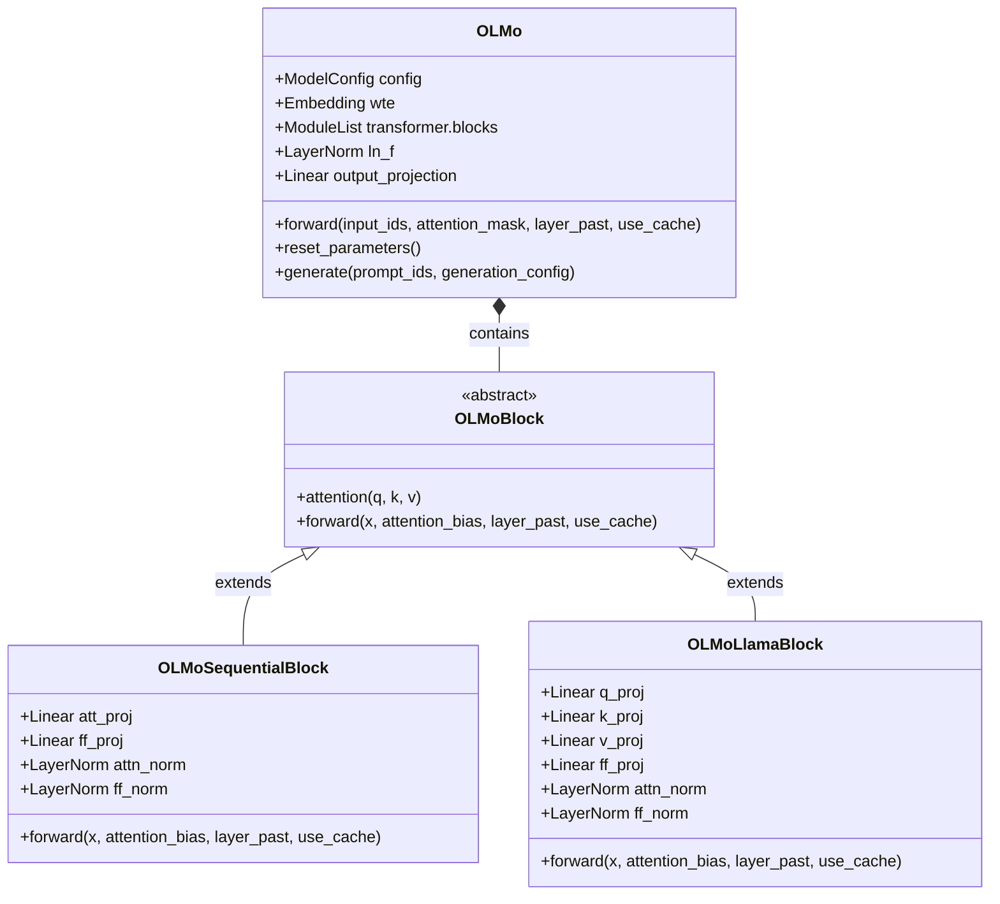

Sources: [olmo/model.py:4740-6039]() for the `OLMo` class, [olmo/model.py:411-673]() for the `OLMoBlock` base class, [olmo/model.py:678-823]() for `OLMoSequentialBlock`, and [olmo/model.py:826-1058]() for `OLMoLlamaBlock`.

## Forward Pass

The forward pass through the OLMo model follows these steps:

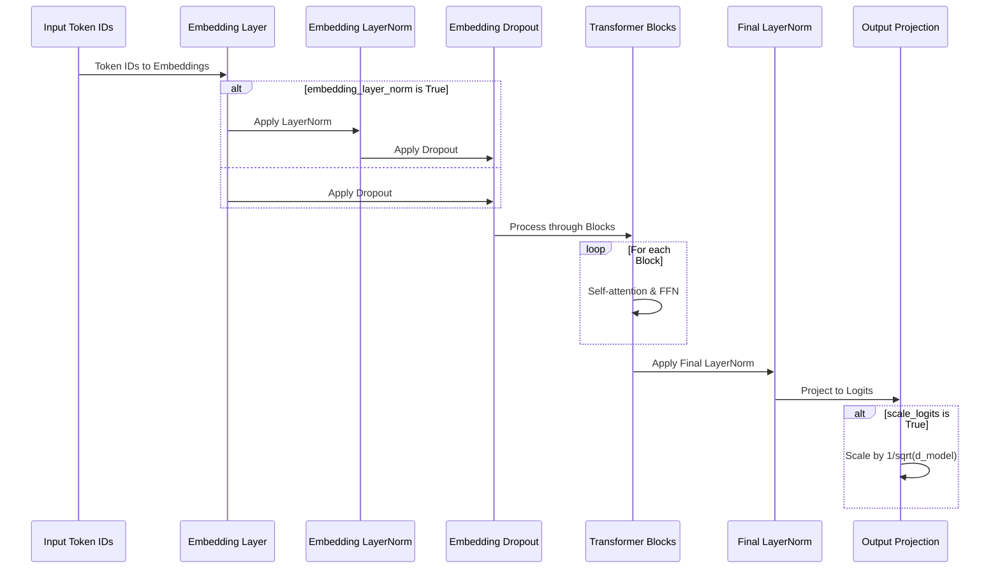

Sources: [olmo/model.py:4898-4996]()

## Generation Capabilities

OLMo supports text generation with various strategies:

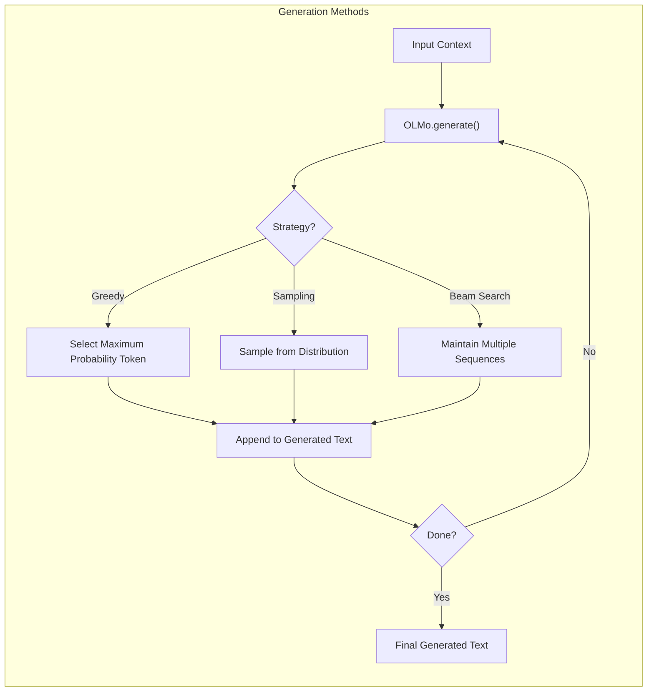

Sources: [olmo/model.py:5001-5285]()

## Model Initialization

OLMo supports several initialization strategies:

1. **Normal**: All weights are initialized from a normal distribution with a fixed standard deviation.
2. **Mitchell**: Weights are initialized with an adaptive standard deviation that depends on the layer depth.
3. **Full Megatron**: The initialization strategy used in Megatron-LM and Llama 2.

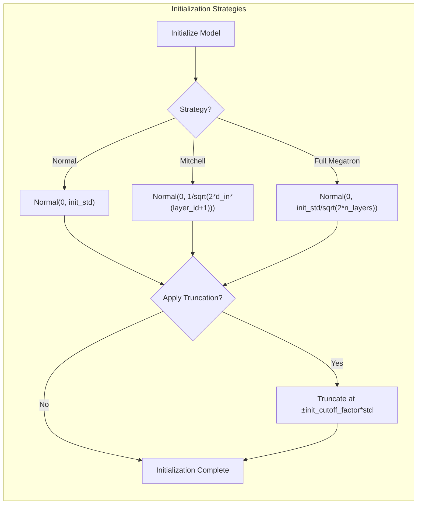

Sources: [olmo/model.py:482-506]() for transformer block initialization, [olmo/initialization.py:8-23]() for the `init_normal` function.

## Key Configuration Options

OLMo's architecture is highly configurable through the `ModelConfig` class. Here's a table of key architectural parameters:

| Parameter | Description | Default |
|-----------|-------------|---------|
| `d_model` | Hidden size of the model | 768 |
| `n_heads` | Number of attention heads | 12 |
| `n_kv_heads` | Number of key-value heads (for GQA/MQA) | Same as `n_heads` |
| `n_layers` | Number of transformer layers | 12 |
| `mlp_ratio` | Ratio of FFN hidden dim to model dim | 4 |
| `activation_type` | Activation function type | `swiglu` |
| `block_type` | Transformer block type | `sequential` |
| `rope` | Use rotary positional embeddings | `False` |
| `alibi` | Use ALiBi positional embeddings | `False` |
| `flash_attention` | Use Flash Attention if available | `False` |
| `attention_dropout` | Dropout rate in attention | 0.1 |
| `residual_dropout` | Dropout rate in residual connections | 0.1 |
| `embedding_dropout` | Dropout rate for embeddings | 0.1 |
| `layer_norm_type` | Type of layer normalization | `default` |
| `max_sequence_length` | Maximum input sequence length | 1024 |
| `vocab_size` | Size of the vocabulary | 50257 |
| `weight_tying` | Tie embedding and output weights | `True` |
| `init_fn` | Weight initialization strategy | `normal` |

Sources: [olmo/config.py:234-496]()

## Instantiating the Model

The OLMo model is typically instantiated in the training script:

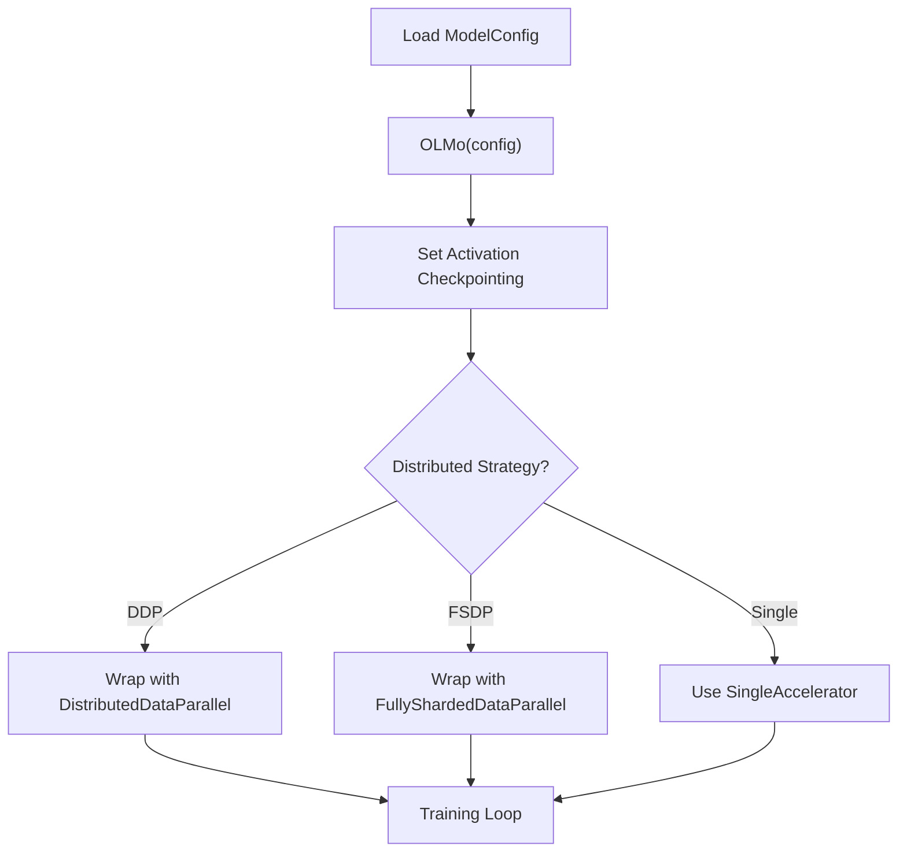

Sources: [scripts/train.py:139-226]()

## Differences Between Block Types

The main differences between the two block types are:

| Feature | OLMoSequentialBlock | OLMoLlamaBlock |
|---------|---------------------|----------------|
| Q,K,V Projection | Single fused projection | Separate projections |
| Layer Norm Position | Configurable (before or after) | Always before |
| Implementation Style | Standard transformer | Mimics Llama architecture |

Sources: [olmo/model.py:678-823]() for `OLMoSequentialBlock`, [olmo/model.py:826-1058]() for `OLMoLlamaBlock`

## Attention Implementation Details

The attention mechanism in OLMo supports various features:

1. **Flash Attention**: For efficient attention computation when available
2. **Attention Layer Norm**: Optional layer normalization for queries and keys
3. **Attention Bias**: Support for causal masking and ALiBi biases
4. **QKV Clipping**: Optional clipping of query, key, and value projections

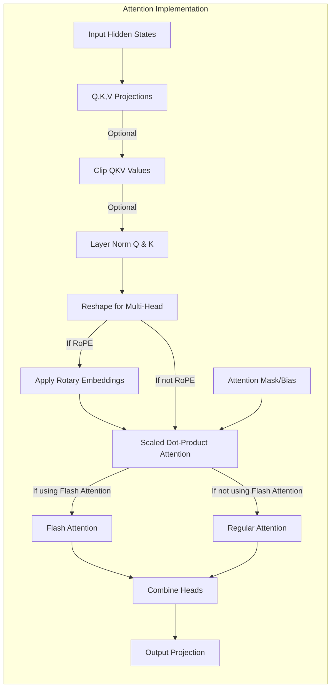

Sources: [olmo/model.py:588-654]()

---

