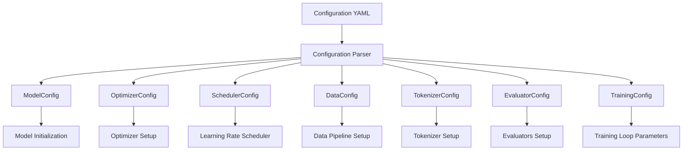
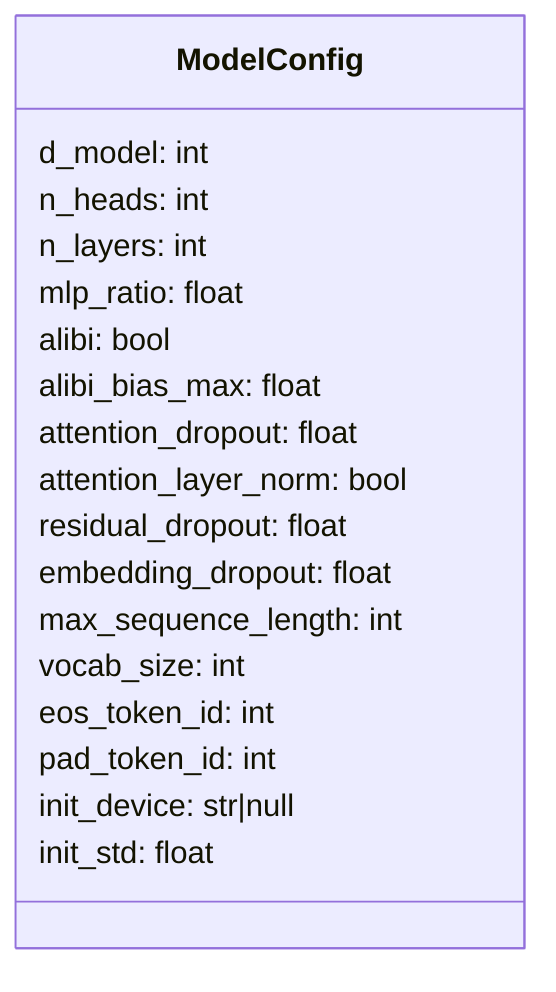
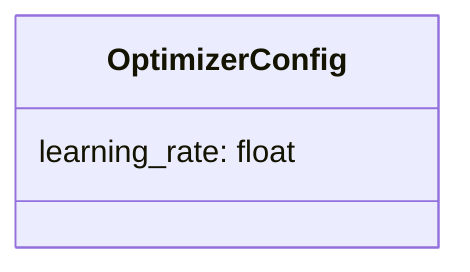
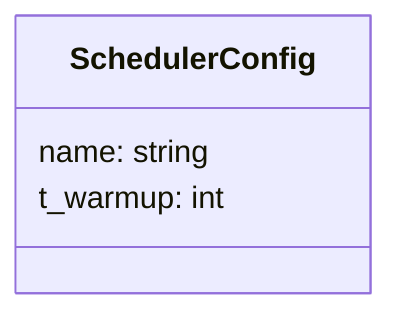
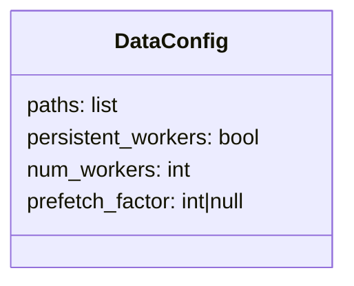
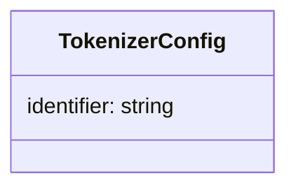
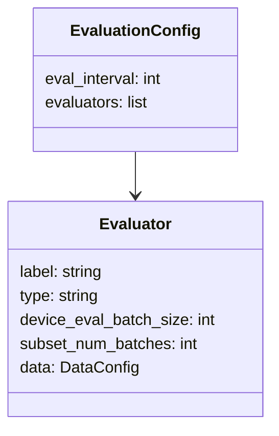
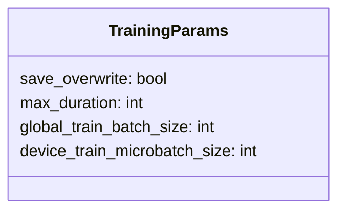
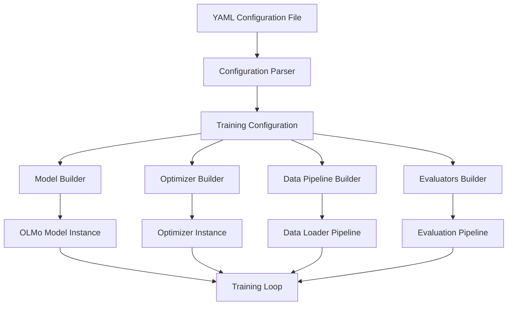
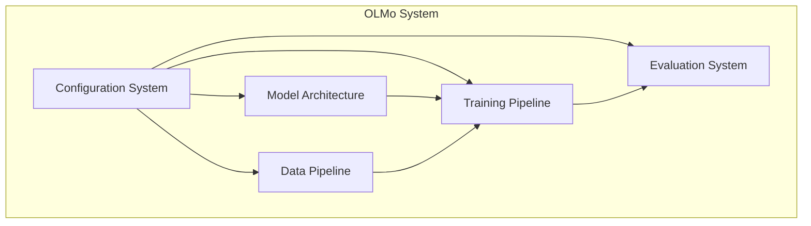

<!-- source: DeepWiki mcp.deepwiki.com · repo allenai/OLMo · page 2.1 Configuration System · fetched 2026-10-26 -->

# Configuration System

<details>
<summary>Relevant source files</summary>

The following files were used as context for generating this wiki page:

- [olmo/beam_search.py](olmo/beam_search.py)
- [olmo/checkpoint.py](olmo/checkpoint.py)
- [olmo/config.py](olmo/config.py)
- [olmo/data/named_data_mixes.py](olmo/data/named_data_mixes.py)
- [olmo/initialization.py](olmo/initialization.py)
- [olmo/model.py](olmo/model.py)
- [olmo/optim.py](olmo/optim.py)
- [olmo/torch_util.py](olmo/torch_util.py)
- [olmo/train.py](olmo/train.py)
- [olmo/util.py](olmo/util.py)
- [scripts/compare_wandb_configs.py](scripts/compare_wandb_configs.py)
- [scripts/ladder.py](scripts/ladder.py)
- [scripts/train.py](scripts/train.py)
- [tests/grad_norm_test.py](tests/grad_norm_test.py)
- [tests/initialization_test.py](tests/initialization_test.py)
- [tests/optim_test.py](tests/optim_test.py)
- [tests/util_test.py](tests/util_test.py)

</details>


## Purpose and Scope

The OLMo Configuration System provides a flexible, hierarchical approach to configuring all aspects of model architecture, training, and evaluation. This system uses YAML files to define parameters that control model behavior, training processes, data loading, and evaluation strategies. This page documents the structure of configuration files, available parameters, and how they integrate with the rest of the OLMo framework.

For information about the specific model architecture implementation, see [Model Architecture](#2).

## Configuration Overview

The configuration system uses YAML files to define all settings required for training and using OLMo models. It supports hierarchical organization of settings, parameter interpolation, and specialized configuration for different components of the system.



Sources: [test_fixtures/train_tiny_with_evaluator.yaml]()

## Configuration File Structure

A typical OLMo configuration file is organized into the following main sections:

| Section | Purpose |
|---------|---------|
| `save_folder` | Directory path where checkpoints and artifacts will be saved |
| `model` | Model architecture parameters (hidden size, layers, heads, etc.) |
| `optimizer` | Optimizer settings (learning rate, etc.) |
| `scheduler` | Learning rate scheduler configuration |
| `data` | Training data configuration (paths, workers, etc.) |
| `tokenizer` | Tokenizer settings |
| `evaluators` | List of evaluation configurations |
| Training parameters | Batch sizes, training duration, etc. |

### Parameter Interpolation

The configuration system supports variable interpolation within the YAML file, where one parameter can reference another using `${parameter_name}` syntax.

Example:
```yaml
device_eval_batch_size: ${device_train_microbatch_size}
```

Sources: [test_fixtures/train_tiny_with_evaluator.yaml:35-35]()

## Model Configuration

The `model` section defines the architecture and properties of the OLMo model.



| Parameter | Description | Default Example |
|-----------|-------------|----------------|
| `d_model` | Hidden state dimension | 128 |
| `n_heads` | Number of attention heads | 4 |
| `n_layers` | Number of transformer layers | 4 |
| `mlp_ratio` | Ratio for MLP hidden dimension relative to `d_model` | 4 |
| `alibi` | Whether to use ALiBi positional embeddings | false |
| `alibi_bias_max` | Maximum ALiBi bias value | 8.0 |
| `attention_dropout` | Dropout probability in attention layers | 0.1 |
| `attention_layer_norm` | Whether to use layer normalization in attention | false |
| `residual_dropout` | Dropout probability for residual connections | 0.1 |
| `embedding_dropout` | Dropout probability for token embeddings | 0.1 |
| `max_sequence_length` | Maximum sequence length the model supports | 512 |
| `vocab_size` | Size of the vocabulary | 50257 |
| `eos_token_id` | End of sequence token ID | 50256 |
| `pad_token_id` | Padding token ID | 50256 |
| `init_device` | Device for model initialization (null for default) | null |
| `init_std` | Standard deviation for weight initialization | 0.02 |

Sources: [test_fixtures/train_tiny_with_evaluator.yaml:2-18]()

## Optimizer Configuration

The `optimizer` section configures the optimization algorithm used during training.



| Parameter | Description | Default Example |
|-----------|-------------|----------------|
| `learning_rate` | Base learning rate | 0.001 |

Sources: [test_fixtures/train_tiny_with_evaluator.yaml:19-20]()

## Scheduler Configuration

The `scheduler` section defines how the learning rate changes throughout training.



| Parameter | Description | Default Example |
|-----------|-------------|----------------|
| `name` | Type of learning rate scheduler | "cosine_with_warmup" |
| `t_warmup` | Number of warmup steps | 10 |

Sources: [test_fixtures/train_tiny_with_evaluator.yaml:21-23]()

## Data Configuration

The `data` section configures how training data is loaded and processed.



| Parameter | Description | Default Example |
|-----------|-------------|----------------|
| `paths` | List of data file paths | ["/tmp/c4-sample.npy"] |
| `persistent_workers` | Whether to keep worker processes alive between iterations | false |
| `num_workers` | Number of subprocesses for data loading | 0 |
| `prefetch_factor` | Number of samples loaded in advance by each worker | null |

Sources: [test_fixtures/train_tiny_with_evaluator.yaml:24-29]()

## Tokenizer Configuration

The `tokenizer` section specifies which tokenizer to use.



| Parameter | Description | Default Example |
|-----------|-------------|----------------|
| `identifier` | Identifier for the tokenizer to use | "gpt2" |

Sources: [test_fixtures/train_tiny_with_evaluator.yaml:30-31]()

## Evaluation Configuration

The evaluation configuration consists of the `eval_interval` parameter and a list of `evaluators`.



| Parameter | Description | Default Example |
|-----------|-------------|----------------|
| `eval_interval` | Number of training steps between evaluations | 50 |

Each entry in the `evaluators` list can have the following properties:

| Parameter | Description | Example |
|-----------|-------------|---------|
| `label` | Identifier for the evaluator | "c4-validation" |
| `type` | Type of evaluation (optional) | "downstream" |
| `device_eval_batch_size` | Batch size per device for evaluation | (referenced value) |
| `subset_num_batches` | Number of batches to use for evaluation | 5 |
| `data` | Configuration for evaluation data | (nested config) |

Sources: [test_fixtures/train_tiny_with_evaluator.yaml:32-50]()

## Training Parameters

Various training parameters are specified at the top level of the configuration file:



| Parameter | Description | Default Example |
|-----------|-------------|----------------|
| `save_overwrite` | Whether to overwrite existing checkpoints | true |
| `max_duration` | Maximum training duration (units depend on implementation) | 4 |
| `global_train_batch_size` | Total batch size across all devices | 8 |
| `device_train_microbatch_size` | Batch size per device | 4 |

Sources: [test_fixtures/train_tiny_with_evaluator.yaml:51-54]()

## Configuration Usage Flow

The following diagram illustrates how configuration parameters flow through the OLMo system:



Sources: [test_fixtures/train_tiny_with_evaluator.yaml]()

## Example Configuration

Here's a minimal example configuration for training a small OLMo model:

```yaml
save_folder: "/tmp/olmo-train-tiny"
model:
  d_model: 128
  n_heads: 4
  n_layers: 4
  mlp_ratio: 4
  attention_dropout: 0.1
  residual_dropout: 0.1
  embedding_dropout: 0.1
  max_sequence_length: 512
  vocab_size: 50257
optimizer:
  learning_rate: 0.001
scheduler:
  name: "cosine_with_warmup"
  t_warmup: 10
data:
  paths:
    - "/tmp/c4-sample.npy"
tokenizer:
  identifier: "gpt2"
eval_interval: 50
evaluators:
  - label: c4-validation
    device_eval_batch_size: ${device_train_microbatch_size}
    subset_num_batches: 5
save_overwrite: true
max_duration: 4
global_train_batch_size: 8
device_train_microbatch_size: 4
```

Sources: [test_fixtures/train_tiny_with_evaluator.yaml]()

## Configuration System in the OLMo Architecture

The configuration system plays a central role in the OLMo architecture, serving as the foundation for initializing all components of the training and evaluation pipeline.



Sources: [test_fixtures/train_tiny_with_evaluator.yaml]()

## Summary

The OLMo Configuration System provides a flexible and comprehensive approach to controlling all aspects of model architecture, training, and evaluation. Through a hierarchical YAML structure, it enables detailed specification of model parameters, optimization settings, data sources, and evaluation strategies.

---

