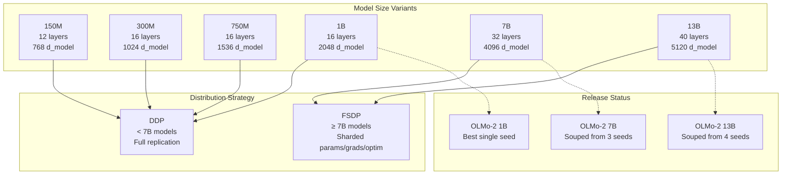
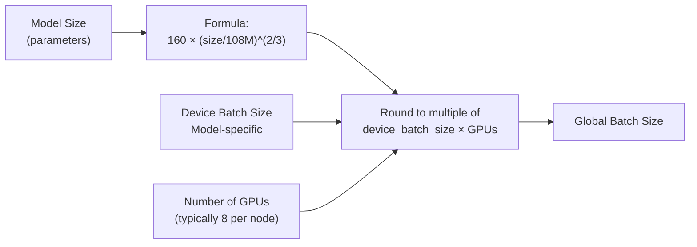
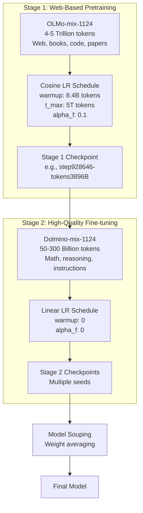
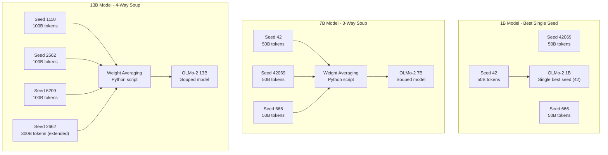
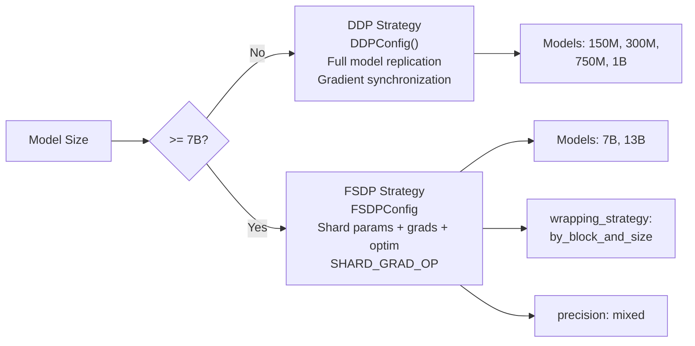

<!-- source: DeepWiki mcp.deepwiki.com · repo allenai/OLMo · page 2.2 Model Variants and Scaling · fetched 2026-10-26 -->

# Model Variants and Scaling

<details>
<summary>Relevant source files</summary>

The following files were used as context for generating this wiki page:

- [README.md](README.md)
- [configs/official-0425/OLMo2-1B-stage1.yaml](configs/official-0425/OLMo2-1B-stage1.yaml)
- [configs/official-0425/OLMo2-1B-stage2-seed42.yaml](configs/official-0425/OLMo2-1B-stage2-seed42.yaml)
- [configs/official-0425/OLMo2-1B-stage2-seed42069.yaml](configs/official-0425/OLMo2-1B-stage2-seed42069.yaml)
- [configs/official-0425/OLMo2-1B-stage2-seed666.yaml](configs/official-0425/OLMo2-1B-stage2-seed666.yaml)
- [configs/official-1124/OLMo2-13B-stage1.yaml](configs/official-1124/OLMo2-13B-stage1.yaml)
- [configs/official-1124/OLMo2-13B-stage2-seed1110-100B.yaml](configs/official-1124/OLMo2-13B-stage2-seed1110-100B.yaml)
- [configs/official-1124/OLMo2-13B-stage2-seed2662-100B.yaml](configs/official-1124/OLMo2-13B-stage2-seed2662-100B.yaml)
- [configs/official-1124/OLMo2-13B-stage2-seed2662-300B.yaml](configs/official-1124/OLMo2-13B-stage2-seed2662-300B.yaml)
- [configs/official-1124/OLMo2-13B-stage2-seed6209-100B.yaml](configs/official-1124/OLMo2-13B-stage2-seed6209-100B.yaml)
- [configs/official-1124/OLMo2-7B-stage1.yaml](configs/official-1124/OLMo2-7B-stage1.yaml)
- [configs/official-1124/OLMo2-7B-stage2-seed42.yaml](configs/official-1124/OLMo2-7B-stage2-seed42.yaml)
- [configs/official-1124/OLMo2-7B-stage2-seed42069.yaml](configs/official-1124/OLMo2-7B-stage2-seed42069.yaml)
- [configs/official-1124/OLMo2-7B-stage2-seed666.yaml](configs/official-1124/OLMo2-7B-stage2-seed666.yaml)
- [olmo/data/named_data_mixes.py](olmo/data/named_data_mixes.py)
- [scripts/compare_wandb_configs.py](scripts/compare_wandb_configs.py)
- [scripts/ladder.py](scripts/ladder.py)
- [scripts/olmo2_modal_openai.py](scripts/olmo2_modal_openai.py)
- [tests/util_test.py](tests/util_test.py)

</details>


This page documents the different OLMo model sizes, their architectural configurations, scaling laws for hyperparameters, and the model souping strategy used to produce final checkpoints. For information about the overall model architecture and transformer components, see [Model Architecture](#2). For training configuration details, see [Configuration System](#2.1).

## Purpose and Scope

OLMo provides several pre-configured model variants ranging from 150M to 13B parameters (with 32B available in OLMo-core). This page covers:

- Available model sizes and their architectural parameters
- Scaling laws for batch size and learning rate
- Two-stage training procedure
- Model souping approach for combining multiple training runs
- Distribution strategy selection (DDP vs FSDP)

## Model Variant Overview

The repository supports six primary model configurations defined in [scripts/ladder.py:79-87]() through the `MODEL_CONFIGS` dictionary. The official released models are OLMo-2 1B, 7B, and 13B.



**Sources:** [scripts/ladder.py:79-87](), [README.md:53-59](), [scripts/ladder.py:177]()

## Model Architecture Configurations

All model variants share the same base architecture with different scaling parameters. The base configuration is defined in [scripts/ladder.py:48-77]() as `MODEL_CONFIG_150M`.

| Model Size | d_model | n_heads | n_layers | mlp_ratio | mlp_hidden_size | Parameters | Init Device |
|------------|---------|---------|----------|-----------|-----------------|------------|-------------|
| 150M       | 768     | 12      | 12       | 8         | -               | ~150M      | cuda        |
| 300M       | 1024    | 16      | 16       | 8         | -               | ~300M      | cuda        |
| 750M       | 1536    | 16      | 16       | 8         | -               | ~750M      | cuda        |
| 1B         | 2048    | 16      | 16       | 8         | -               | ~1B        | cuda        |
| 7B         | 4096    | 32      | 32       | 0         | 22016           | ~7B        | meta        |
| 13B        | 5120    | 40      | 40       | 0         | 27648           | ~13B       | meta        |

### Common Architecture Features

All variants share these architectural characteristics:
- **Positional Encoding**: RoPE (Rotary Position Embedding) with `rope_theta=500000`
- **Attention**: Flash attention enabled, no attention dropout
- **Normalization**: RMS LayerNorm with affine parameters (`layer_norm_eps=1e-6`)
- **Activation**: SwiGLU activation function
- **Weight Tying**: Disabled (`weight_tying=false`)
- **Bias**: No bias terms (`include_bias=false`)
- **Sequence Length**: 4096 tokens (Stage 1 and Stage 2 both use 4096)
- **Vocabulary**: 100278 tokens, embedding size 100352

**Sources:** [scripts/ladder.py:48-77](), [configs/official-0425/OLMo2-1B-stage1.yaml:10-41](), [configs/official-1124/OLMo2-7B-stage1.yaml:5-36](), [configs/official-1124/OLMo2-13B-stage1.yaml:5-36]()

## Scaling Laws

The ladder.py script implements scaling laws from [this paper](https://www.semanticscholar.org/reader/5585191b1b479346ecf173be3b35c8313b77d457) to automatically compute batch size and learning rate based on model size.

### Batch Size Scaling

Global batch size scales with model size according to:

```
global_batch_size = 160 × (model_size / 108000000)^(2/3)
```

The implementation rounds to multiples of `device_batch_size × num_gpus`:



Device-specific batch sizes are configured per model size to fit in GPU memory:

| Model Size | Device Batch Size | Typical Global Batch Size |
|------------|-------------------|---------------------------|
| 150M       | 32                | ~256                      |
| 300M       | 10                | ~320                      |
| 750M       | 8                 | ~512                      |
| 1B         | 4 (Stage 1)       | 512                       |
| 1B         | 4 (Stage 2)       | 512                       |
| 7B         | 2                 | 1024                      |
| 13B        | 2                 | 2048                      |

**Sources:** [scripts/ladder.py:148-167](), [configs/official-0425/OLMo2-1B-stage1.yaml:87-88](), [configs/official-1124/OLMo2-7B-stage1.yaml:81-82](), [configs/official-1124/OLMo2-13B-stage1.yaml:81-82]()

### Learning Rate Scaling

Learning rate scales inversely with the cube root of model size:

```
learning_rate = 0.0047 × (model_size / 108000000)^(-1/3)
```

Example learning rates:

| Model Size | Stage 1 LR | Stage 2 LR    |
|------------|------------|---------------|
| 1B         | 4.0e-4     | 7.4487e-5     |
| 7B         | 3.0e-4     | 6.1499e-5     |
| 13B        | 3.0e-4     | 9.0e-5        |

Stage 2 uses lower learning rates since it's fine-tuning on high-quality data.

**Sources:** [scripts/ladder.py:170](), [configs/official-0425/OLMo2-1B-stage1.yaml:51](), [configs/official-0425/OLMo2-1B-stage2-seed42.yaml:51](), [configs/official-1124/OLMo2-7B-stage1.yaml:46]()

### Warmup Steps Scaling

Warmup duration is calculated based on model size and batch size:

```python
t_warmup = round(model_size / (global_batch_size * max_sequence_length))
```

This ensures warmup is proportional to model capacity relative to batch throughput.

**Sources:** [scripts/ladder.py:204]()

## Two-Stage Training Procedure

OLMo training follows a two-stage approach with different data distributions and learning rate schedules for each stage.



### Stage 1: Web-Based Pretraining

- **Dataset**: OLMo-mix-1124 (4-5 trillion tokens)
- **Scheduler**: Cosine with warmup ([configs/official-0425/OLMo2-1B-stage1.yaml:62-67]())
  - `t_warmup`: 8,388,608,000 tokens
  - `t_max`: 5e12 tokens  
  - `alpha_f`: 0.1 (decay to 10% of peak LR)
- **Duration**: 
  - 1B: 4 trillion tokens
  - 7B: 4 trillion tokens
  - 13B: 5 trillion tokens

### Stage 2: High-Quality Fine-tuning  

- **Dataset**: Dolmino-mix-1124 (high-quality math, reasoning, instructions)
- **Scheduler**: Linear with warmup ([configs/official-0425/OLMo2-1B-stage2-seed42.yaml:61-64]())
  - `t_warmup`: 0 (no warmup)
  - `alpha_f`: 0 (decay to 0)
- **Duration**:
  - 1B: 50 billion tokens per seed (3 seeds)
  - 7B: 50 billion tokens per seed (3 seeds)
  - 13B: 100 billion tokens per seed (3 seeds) + 300 billion (1 extended seed)
- **Load Path**: Stage 2 configs load from Stage 1 final checkpoint
- **Setting**: `restore_dataloader: false`, `no_pre_train_checkpoint: true`

**Sources:** [README.md:96-148](), [configs/official-0425/OLMo2-1B-stage1.yaml:62-67](), [configs/official-0425/OLMo2-1B-stage2-seed42.yaml:61-64](), [configs/official-1124/OLMo2-7B-stage1.yaml:57-62]()

## Model Souping Strategy

Model souping combines multiple independently trained checkpoints through weight averaging to improve robustness and performance.



### Souping Configurations

**1B Model**: Trains 3 seeds but uses **only the best single seed** (seed 42) as the final model:
- Seed 42069: [configs/official-0425/OLMo2-1B-stage2-seed42069.yaml]()
- Seed 666: [configs/official-0425/OLMo2-1B-stage2-seed666.yaml]()  
- **Seed 42** (selected): [configs/official-0425/OLMo2-1B-stage2-seed42.yaml]()

**7B Model**: Averages 3 seeds with identical training configurations:
- Seed 42: [configs/official-1124/OLMo2-7B-stage2-seed42.yaml]()
- Seed 42069: [configs/official-1124/OLMo2-7B-stage2-seed42069.yaml]()
- Seed 666: [configs/official-1124/OLMo2-7B-stage2-seed666.yaml]()
- Each trained for 50B tokens (`stop_at: 11931` steps)

**13B Model**: Averages 4 checkpoints including one extended run:
- Seed 1110 (100B): [configs/official-1124/OLMo2-13B-stage2-seed1110-100B.yaml]()
- Seed 2662 (100B): [configs/official-1124/OLMo2-13B-stage2-seed2662-100B.yaml]()
- Seed 6209 (100B): [configs/official-1124/OLMo2-13B-stage2-seed6209-100B.yaml]()
- Seed 2662 (300B): [configs/official-1124/OLMo2-13B-stage2-seed2662-300B.yaml]()
- First 3 stop at step 11931 (100B tokens)
- Extended run stops at step 35773 (300B tokens)

### Implementation Details

The weight averaging is performed outside the main training loop using Python scripts (not part of the TrainConfig). The README notes:

> "no config, we just averaged the weights in Python"

This approach provides diversity through different random seeds while maintaining identical hyperparameters and data ordering differences.

**Sources:** [README.md:109-148](), [configs/official-0425/OLMo2-1B-stage2-seed42.yaml](), [configs/official-1124/OLMo2-7B-stage2-seed42.yaml](), [configs/official-1124/OLMo2-13B-stage2-seed1110-100B.yaml]()

## Distribution Strategy Selection

The choice between DDP (Distributed Data Parallel) and FSDP (Fully Sharded Data Parallel) is model-size dependent:



The selection logic is implemented in [scripts/ladder.py:177]():

```python
distributed_strategy = {"7B": DistributedStrategy.fsdp}.get(args.model, DistributedStrategy.ddp)
```

### DDP Configuration (< 7B models)

- Uses `DDPConfig()` with default parameters
- Full model replication on each GPU
- Gradient synchronization across processes
- Example: [configs/official-0425/OLMo2-1B-stage1.yaml:90-96]()

### FSDP Configuration (≥ 7B models)

- `sharding_strategy`: `SHARD_GRAD_OP` - shards gradients and optimizer states
- `wrapping_strategy`: `by_block_and_size` - wraps transformer blocks
- `precision`: `mixed` - uses mixed precision training
- Example: [configs/official-1124/OLMo2-7B-stage1.yaml:86-88]()

This strategy balance allows smaller models to train efficiently with DDP while larger models use FSDP to fit in GPU memory.

**Sources:** [scripts/ladder.py:177-220](), [configs/official-0425/OLMo2-1B-stage1.yaml:90-96](), [configs/official-1124/OLMo2-7B-stage1.yaml:86-88]()

## Checkpoint Availability

All model checkpoints are saved every 1000 training steps during both stages:

| Model | Stage 1 Checkpoint | Stage 2 Checkpoints | Hugging Face |
|-------|-------------------|---------------------|--------------|
| 1B    | step1907359-tokens4001B | 3 seeds at step23852-tokens51B | [allenai/OLMo-2-0425-1B](https://huggingface.co/allenai/OLMo-2-0425-1B) |
| 7B    | step928646-tokens3896B | 3 seeds at step11931-tokens50B | [allenai/OLMo-2-1124-7B](https://huggingface.co/allenai/OLMo-2-1124-7B) |
| 13B   | step596057-tokens5001B | 4 ingredients (100B/300B) | [allenai/OLMo-2-1124-13B](https://huggingface.co/allenai/OLMo-2-1124-13B) |

Checkpoint configurations:
- `save_interval`: 1000 steps (both stages)
- `save_interval_unsharded`: 1000 steps
- `save_num_unsharded_checkpoints_to_keep`: -1 (keep all)
- `sharded_checkpointer`: `olmo_core`

**Sources:** [README.md:50-59](), [configs/official-0425/OLMo2-1B-stage1.yaml:76-82](), [configs/official-1124/OLMo2-7B-stage1.yaml:70-76]()

---

