<!-- source: DeepWiki mcp.deepwiki.com · repo allenai/OLMo · page 3 Training Pipeline · fetched 2026-10-26 -->

# Training Pipeline

<details>
<summary>Relevant source files</summary>

The following files were used as context for generating this wiki page:

- [olmo/beam_search.py](olmo/beam_search.py)
- [olmo/checkpoint.py](olmo/checkpoint.py)
- [olmo/config.py](olmo/config.py)
- [olmo/initialization.py](olmo/initialization.py)
- [olmo/model.py](olmo/model.py)
- [olmo/optim.py](olmo/optim.py)
- [olmo/torch_util.py](olmo/torch_util.py)
- [olmo/train.py](olmo/train.py)
- [olmo/util.py](olmo/util.py)
- [scripts/train.py](scripts/train.py)
- [tests/grad_norm_test.py](tests/grad_norm_test.py)
- [tests/initialization_test.py](tests/initialization_test.py)
- [tests/optim_test.py](tests/optim_test.py)

</details>


This document covers the OLMo model training pipeline, which encompasses the components, workflow, and processes for training OLMo models from initialization to completion. This includes model creation, data loading, optimization, distributed training strategies, checkpointing, and evaluation during training. For specific information about data processing prior to training, see [Data Processing](#3.1), and for details about checkpoint management separate from the training pipeline, see [Checkpoint Management](#4).

## Training Pipeline Overview

The OLMo training pipeline is designed for efficient training of large language models across different distributed computing environments. It supports various distributed strategies, including DDP (DistributedDataParallel) and FSDP (FullyShardedDataParallel), and is optimized for memory efficiency, throughput, and reproducibility.

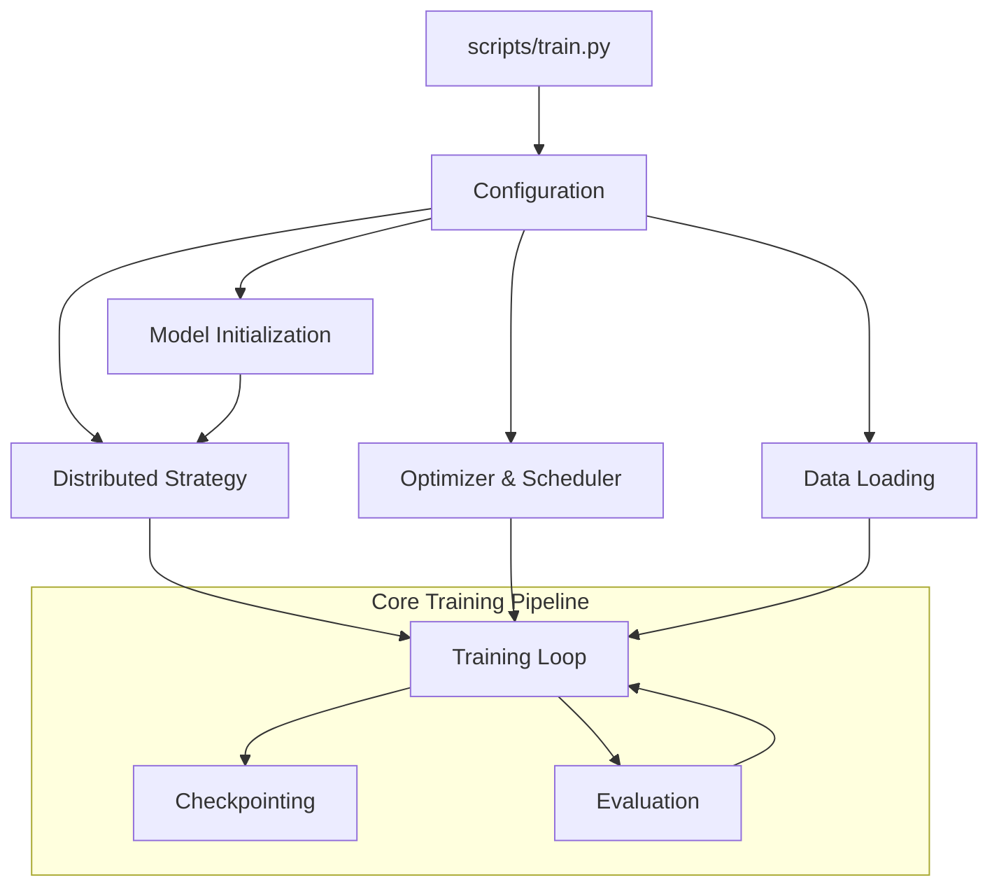

Sources:
- [scripts/train.py:1-437]()
- [olmo/train.py:1-446]()
- [olmo/config.py:1-62]()

## Training Script Entry Point

The main entry point for OLMo training is the `scripts/train.py` script, which is designed to be run with `torchrun` for distributed training. This script:

1. Processes configuration from a YAML file
2. Sets up distributed training environment
3. Initializes the model
4. Configures data loading
5. Wraps the model with the appropriate distributed strategy (DDP/FSDP)
6. Initializes optimizer and scheduler
7. Creates the trainer object to manage the training loop

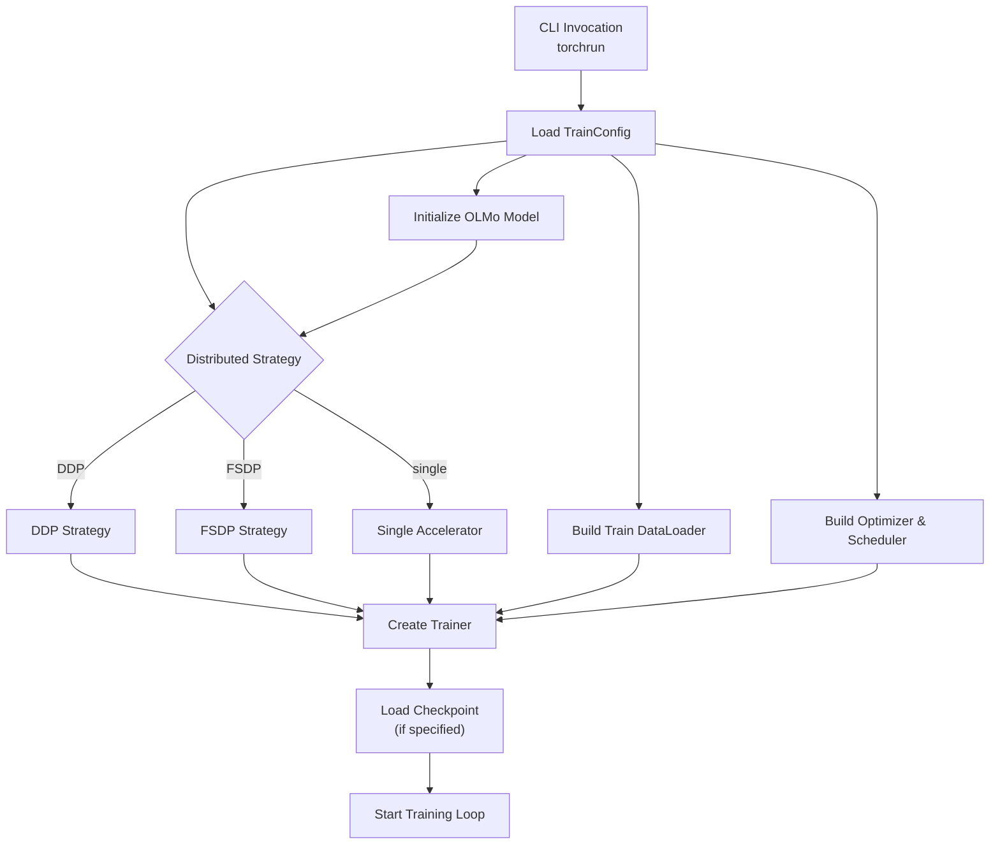

Sources:
- [scripts/train.py:51-109]() - Main function
- [scripts/train.py:138-234]() - Model initialization and distributed strategy setup
- [scripts/train.py:236-244]() - Optimizer and scheduler creation
- [scripts/train.py:250-378]() - Trainer creation and checkpoint loading

## Configuration System

The training pipeline is controlled by the `TrainConfig` class which encapsulates all settings needed for training:

- Model architecture configuration (`ModelConfig`)
- Optimizer settings (`OptimizerConfig`) 
- Learning rate scheduler settings (`SchedulerConfig`)
- Data configuration (`DataConfig`)
- Distributed training strategy (DDP/FSDP)
- Checkpoint settings
- Evaluation configuration

The config is loaded from a YAML file and can be overridden with command-line arguments.

Sources:
- [olmo/config.py:63-895]() - Config class definitions
- [scripts/train.py:426-436]() - Config loading

## Model Initialization

The OLMo model is initialized with the specified configuration:

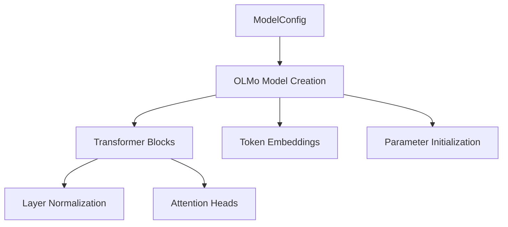

Key initialization steps include:
1. Creating the model with the specified architecture
2. Initializing parameters with the configured method (normal, mitchell, etc.)
3. Setting up activation checkpointing for memory efficiency
4. Moving the model to the appropriate device (CPU, CUDA, or meta device)

Sources:
- [scripts/train.py:138-143]() - Model creation
- [olmo/model.py:138-195]() - LayerNorm implementation
- [olmo/model.py:411-826]() - OLMoBlock implementations
- [olmo/model.py:76-142]() - Activation checkpointing

## Distributed Training Strategies

The OLMo training pipeline supports three distributed strategies:

| Strategy | Description | When to Use |
|----------|-------------|------------|
| DDP | DistributedDataParallel - Replicates model on all GPUs | Smaller models that fit on a single GPU |
| FSDP | FullyShardedDataParallel - Shards model across GPUs | Large models that need to be distributed |
| single | Single GPU/CPU - No distribution | Testing and debugging |

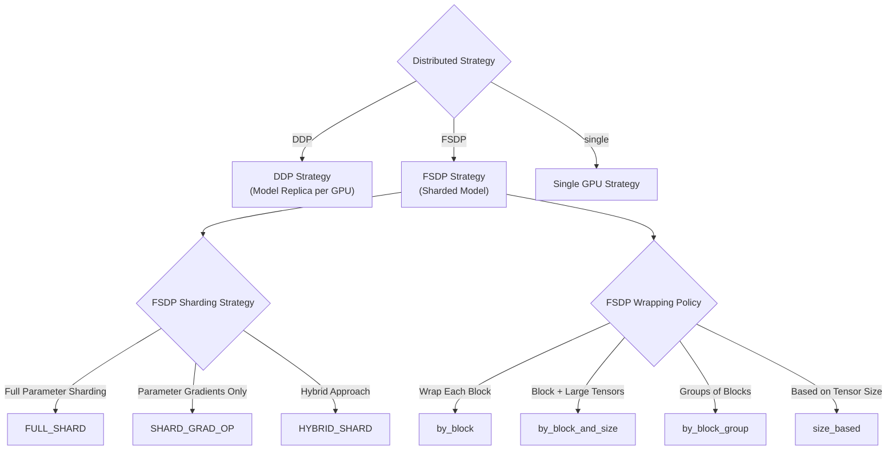

The specific strategy selected impacts memory usage, communication overhead, and throughput.

Sources:
- [scripts/train.py:154-226]() - Distributed strategy implementation
- [olmo/config.py:741-776]() - DistributedStrategy enum
- [olmo/config.py:796-866]() - FSDP configuration

## Data Pipeline

The data pipeline is responsible for loading and batching the training data:

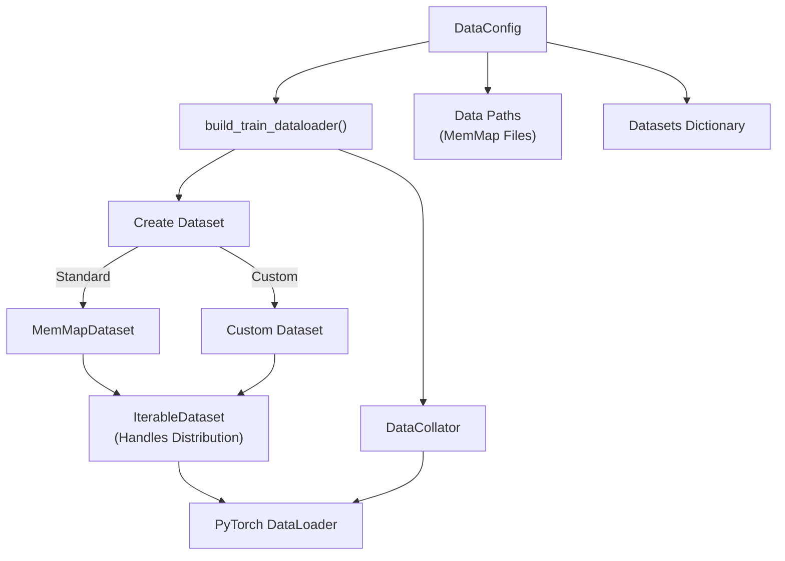

Key components include:

1. `build_train_dataloader()` function that orchestrates data loading
2. `MemMapDataset` which efficiently loads data from memory-mapped files
3. `IterableDataset` which handles distribution across processes and workers
4. `DataCollator` which creates batches with appropriate padding

Sources:
- [olmo/data/__init__.py:127-180]() - Data loader creation
- [olmo/data/iterable_dataset.py:20-198]() - Iterable dataset implementation

## Optimizer and Learning Rate Scheduler

The OLMo training pipeline supports multiple optimizer and scheduler configurations:

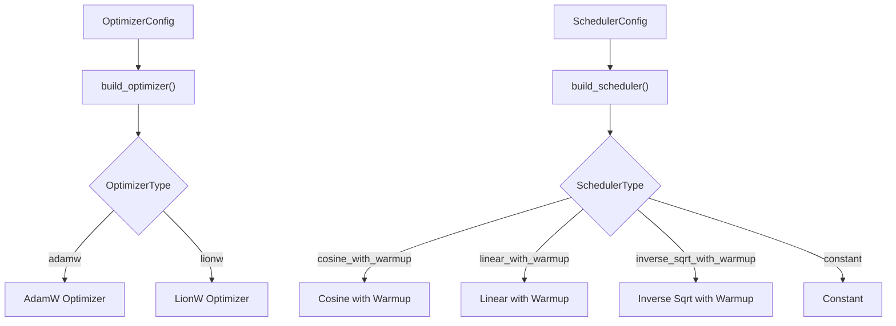

The optimizer includes specialized features:
- Weight decay configuration for different parameter types
- Gradient clipping based on global norm
- Metrics collection for parameter and gradient norms

Sources:
- [scripts/train.py:236-244]() - Optimizer and scheduler creation
- [olmo/optim.py:38-254]() - Optimizer implementation
- [olmo/optim.py:333-591]() - Scheduler implementations

## Training Loop

The core training loop is implemented in the `Trainer` class, which handles:

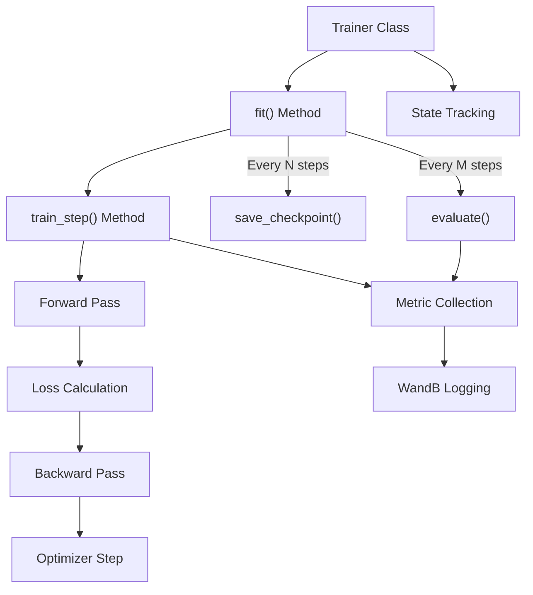

Key aspects:
1. The `fit()` method orchestrates the entire training process
2. `train_step()` performs forward and backward passes
3. Loss calculation for autoregressive language modeling
4. Periodic checkpointing and evaluation
5. Comprehensive logging of metrics

Sources:
- [olmo/train.py:209-1215]() - Trainer class definition
- [olmo/train.py:607-687]() - Training loop implementation
- [olmo/train.py:807-950]() - Training step implementation

## Loss Calculation

The training pipeline uses cross-entropy loss for language modeling, with options for different implementations:

```python
def cross_entropy_loss(
    logits,
    labels,
    ignore_index: int = -100,
    reduction: str = "mean",
    compute_z_loss: bool = False,
    z_loss_multiplier: float = 1e-4,
):
    loss = F.cross_entropy(logits, labels, ignore_index=ignore_index, reduction=reduction)
    
    if not compute_z_loss:
        return loss, None

    z_squared = logits.logsumexp(-1).pow(2)
    if reduction == "mean":
        z_squared = (z_squared * (labels != ignore_index)).mean()
    elif reduction == "sum":
        z_squared = (z_squared * (labels != ignore_index)).sum()

    z_loss = z_loss_multiplier * z_squared
    return loss, z_loss
```

For better performance, a fused implementation using FlashAttention can be used when available.

Sources:
- [olmo/train.py:124-205]() - Loss function implementations

## Checkpointing

The training pipeline includes comprehensive checkpointing capabilities:

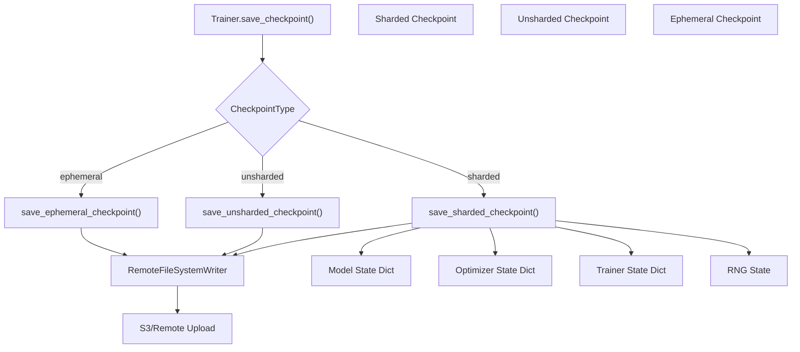

Different checkpoint types:
- **Sharded checkpoints**: Each rank saves its model shard (FSDP)
- **Unsharded checkpoints**: Complete model from all ranks (used for DDP)
- **Ephemeral checkpoints**: Temporary checkpoints for saving training state

Checkpoints store:
- Model state
- Optimizer state
- Trainer state (step, epoch, RNG state, etc.)

Sources:
- [olmo/train.py:446-587]() - Checkpoint saving functions
- [olmo/checkpoint.py:99-217]() - Checkpoint utilities

## Evaluation During Training

The training pipeline includes evaluation capabilities that can be triggered at specified intervals:

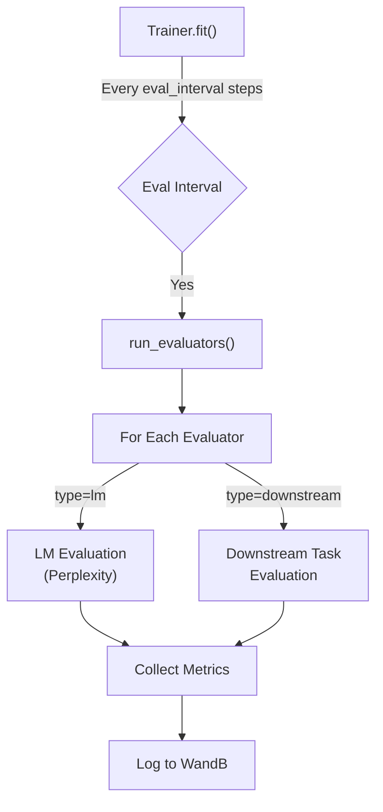

The training pipeline supports multiple types of evaluators:
- Language modeling evaluators (calculate perplexity)
- Downstream task evaluators (evaluate on specific tasks)

Sources:
- [olmo/train.py:1045-1091]() - Evaluation functions
- [olmo/config.py:666-678]() - Evaluator configurations

## Distributed Communication

The training pipeline includes utilities for distributed communication between processes:

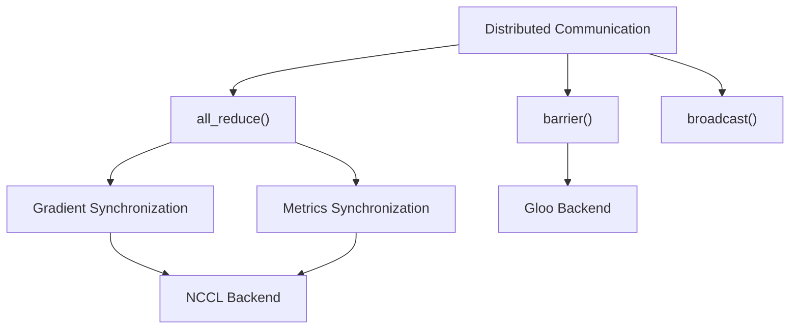

Key distributed utilities:
- `barrier()` for synchronization points
- `get_world_size()`, `get_global_rank()`, etc. for process information
- Gradient synchronization through the distributed strategy

Sources:
- [olmo/torch_util.py:27-104]() - Distributed utilities
- [scripts/train.py:382-414]() - Process group initialization

## Complete Training Pipeline Flow

This diagram shows the complete flow of the OLMo training pipeline:

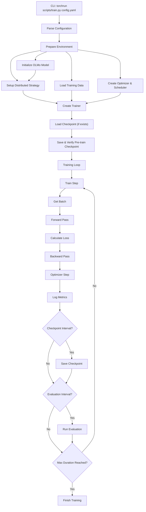

Sources:
- [scripts/train.py:51-109]() - Main function
- [scripts/train.py:250-380]() - Trainer setup and initialization
- [olmo/train.py:607-687]() - Training loop implementation

## Conclusion

The OLMo training pipeline provides a flexible and efficient system for training large language models. It offers:

1. Support for different distributed strategies (DDP and FSDP)
2. Flexible configuration through YAML files and command-line arguments
3. Comprehensive checkpointing for training resumption
4. Built-in evaluation during training
5. Efficient data loading with memory-mapped files
6. Optimized performance through various techniques (activation checkpointing, flash attention, etc.)

The pipeline can be adapted to different model sizes and training environments through configuration.

Sources:
- [scripts/train.py:1-437]()
- [olmo/train.py:1-1215]()
- [olmo/config.py:1-895]()

---

