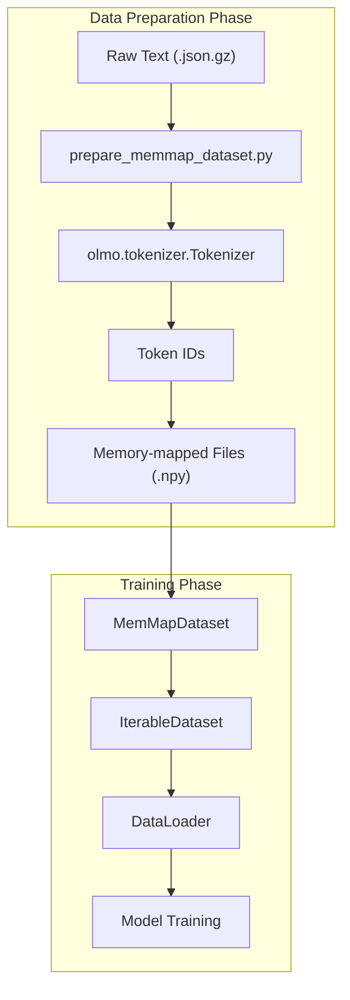
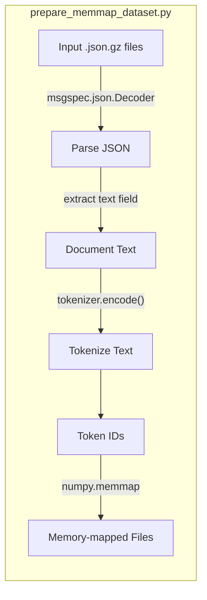
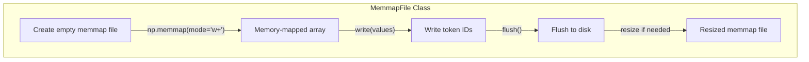
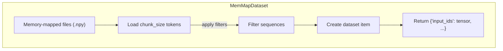
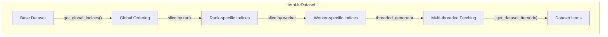
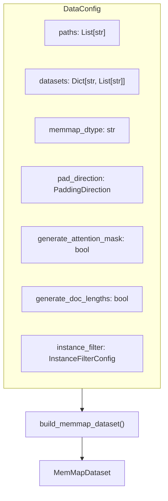
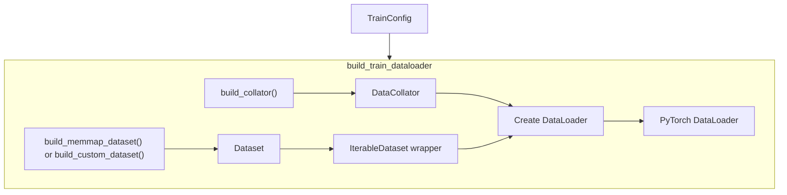
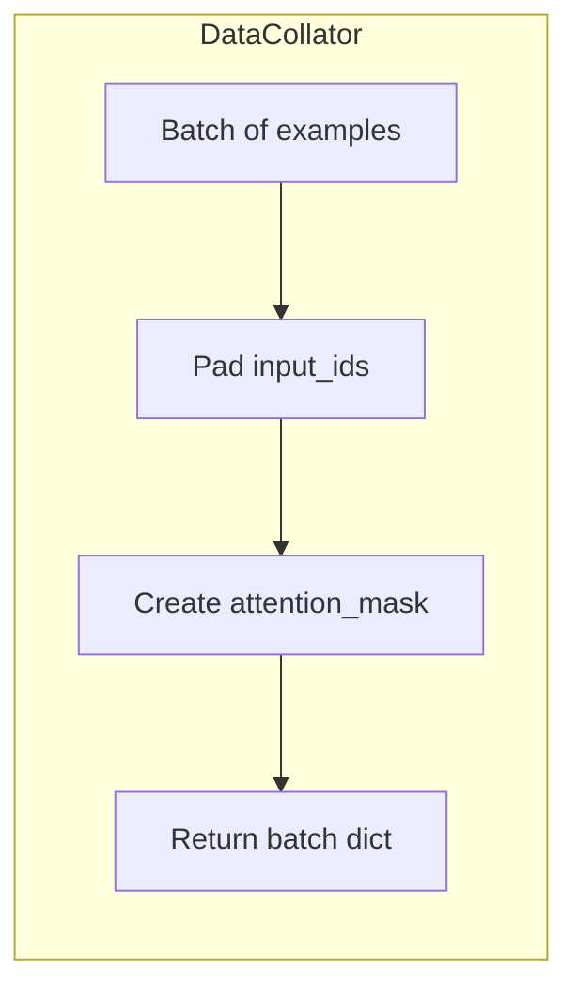
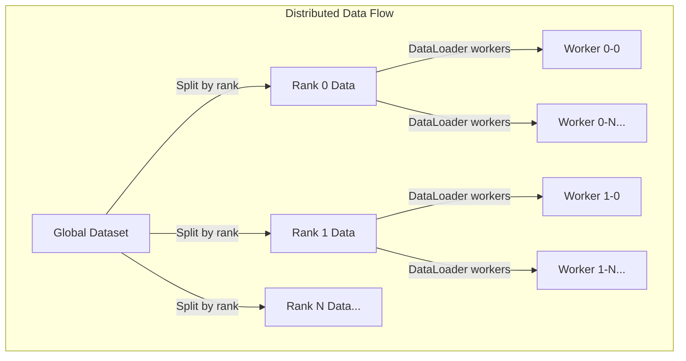
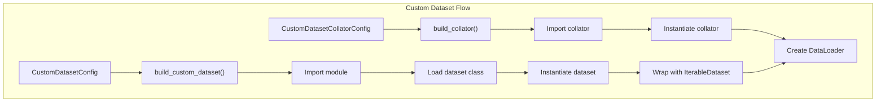

<!-- source: DeepWiki mcp.deepwiki.com · repo allenai/OLMo · page 3.1 Data Processing · fetched 2026-10-26 -->

# Data Processing

<details>
<summary>Relevant source files</summary>

The following files were used as context for generating this wiki page:

- [README.md](README.md)
- [configs/custom_dataset_example.yaml](configs/custom_dataset_example.yaml)
- [configs/official-0425/OLMo2-1B-stage1.yaml](configs/official-0425/OLMo2-1B-stage1.yaml)
- [configs/official-0425/OLMo2-1B-stage2-seed42.yaml](configs/official-0425/OLMo2-1B-stage2-seed42.yaml)
- [configs/official-0425/OLMo2-1B-stage2-seed42069.yaml](configs/official-0425/OLMo2-1B-stage2-seed42069.yaml)
- [configs/official-0425/OLMo2-1B-stage2-seed666.yaml](configs/official-0425/OLMo2-1B-stage2-seed666.yaml)
- [configs/official-1124/OLMo2-13B-stage1.yaml](configs/official-1124/OLMo2-13B-stage1.yaml)
- [configs/official-1124/OLMo2-13B-stage2-seed1110-100B.yaml](configs/official-1124/OLMo2-13B-stage2-seed1110-100B.yaml)
- [configs/official-1124/OLMo2-13B-stage2-seed2662-100B.yaml](configs/official-1124/OLMo2-13B-stage2-seed2662-100B.yaml)
- [configs/official-1124/OLMo2-13B-stage2-seed2662-300B.yaml](configs/official-1124/OLMo2-13B-stage2-seed2662-300B.yaml)
- [configs/official-1124/OLMo2-13B-stage2-seed6209-100B.yaml](configs/official-1124/OLMo2-13B-stage2-seed6209-100B.yaml)
- [configs/official-1124/OLMo2-7B-stage1.yaml](configs/official-1124/OLMo2-7B-stage1.yaml)
- [configs/official-1124/OLMo2-7B-stage2-seed42.yaml](configs/official-1124/OLMo2-7B-stage2-seed42.yaml)
- [configs/official-1124/OLMo2-7B-stage2-seed42069.yaml](configs/official-1124/OLMo2-7B-stage2-seed42069.yaml)
- [configs/official-1124/OLMo2-7B-stage2-seed666.yaml](configs/official-1124/OLMo2-7B-stage2-seed666.yaml)
- [olmo/data/__init__.py](olmo/data/__init__.py)
- [olmo/data/collator.py](olmo/data/collator.py)
- [olmo/data/custom_datasets.py](olmo/data/custom_datasets.py)
- [olmo/data/iterable_dataset.py](olmo/data/iterable_dataset.py)
- [olmo/data/memmap_dataset.py](olmo/data/memmap_dataset.py)
- [olmo/data/util.py](olmo/data/util.py)
- [scripts/olmo2_modal_openai.py](scripts/olmo2_modal_openai.py)
- [tests/data/collator_test.py](tests/data/collator_test.py)
- [tests/data/custom_dataset_test.py](tests/data/custom_dataset_test.py)
- [tests/data/iterable_dataset_test.py](tests/data/iterable_dataset_test.py)
- [tests/data/memmap_dataset_test.py](tests/data/memmap_dataset_test.py)
- [tests/data/util_test.py](tests/data/util_test.py)

</details>


This page documents the data processing pipeline used in OLMo, explaining how raw text data is prepared, tokenized, stored, and loaded for model training. The document covers the data format, memory-mapped datasets, tokenization, and data loading mechanisms.

## Overview

The OLMo data processing pipeline converts raw text into tokenized, memory-mapped datasets that can be efficiently loaded during training. This pipeline is designed to handle large-scale language modeling datasets such as C4 (Common Crawl).



Sources:
- [scripts/prepare_memmap_dataset.py:1-227]()
- [olmo/data/__init__.py:1-181]()
- [olmo/data/iterable_dataset.py:1-192]()
- [olmo/tokenizer.py:1-189]()

## Data Preparation

### Raw Data Format

The raw input data for OLMo typically consists of gzipped JSON lines (`.json.gz`) files, where each line contains a JSON object with a `text` field representing a single document.

```
{"text": "Document text goes here..."}
```

### Tokenization

The `prepare_memmap_dataset.py` script handles the tokenization of raw text data. It uses the OLMo Tokenizer, which is a wrapper around HuggingFace's tokenizers library.



Sources:
- [scripts/prepare_memmap_dataset.py:73-104]()
- [scripts/prepare_memmap_dataset.py:110-224]()
- [olmo/tokenizer.py:18-44]()

The tokenization process:

1. Read and decompress `.json.gz` files
2. Extract text from each JSON object
3. Tokenize text using OLMo Tokenizer
4. Write token IDs to memory-mapped files

### Memory-mapped File Creation

Memory-mapped files allow efficient random access to large datasets without loading the entire dataset into memory.



Sources:
- [scripts/prepare_memmap_dataset.py:110-224]()
- [scripts/prepare_memmap_dataset.py:226-344]()

Key features of the memory-mapped implementation:
- Dynamic resizing to accommodate actual token count
- Support for both local and remote file storage
- Configurable maximum token limit per file

## Dataset Creation and Loading

### MemMapDataset

The `MemMapDataset` class reads token IDs from memory-mapped files and provides them to the training pipeline.



Sources:
- [olmo/data/__init__.py:22-53]()

Key features:
- Reads fixed-sized chunks from memory-mapped files
- Applies optional filters to remove low-quality sequences
- Supports padding and attention mask generation
- Handles document boundaries

### IterableDataset

The `IterableDataset` class wraps the base dataset (typically a `MemMapDataset`) to provide functionality for distributed training and deterministic iteration.



Sources:
- [olmo/data/iterable_dataset.py:20-192]()

Key features:
- Deterministic epoch-based shuffling
- Support for distributed training (slicing by rank)
- Multi-processing and multi-threading support
- Ability to restart from a specific index
- Support for maximum example limit

### Dataset Configuration

Data loading is controlled through the `DataConfig` class which provides various options for customizing the data pipeline.



Sources:
- [olmo/data/__init__.py:22-53]()
- [olmo/config.py:596-635]()

## Data Loading for Training

### Building the Training DataLoader

The `build_train_dataloader` function creates a PyTorch DataLoader for training, handling both the dataset creation and configuration.



Sources:
- [olmo/data/__init__.py:127-180]()

The data loading process:
1. Build a collator based on the training configuration
2. Create a dataset from memory-mapped files or a custom dataset
3. Wrap the dataset with `IterableDataset` for distributed training
4. Create a PyTorch DataLoader with the wrapped dataset and collator

### DataCollator

The `DataCollator` class handles the batching of examples, including padding and attention mask generation.



Sources:
- [olmo/data/__init__.py:56-89]()

Key features:
- Support for different padding directions (left or right)
- Generation of attention masks
- Support for custom collation functions

## Distributed Training Support

OLMo's data processing pipeline is designed to work seamlessly with distributed training across multiple GPUs and nodes.



Sources:
- [olmo/data/iterable_dataset.py:52-57]()
- [olmo/data/iterable_dataset.py:127-142]()
- [olmo/torch_util.py:27-57]()

Key features:
- Each process (rank) in distributed training gets a unique subset of the data
- Deterministic shuffling ensures no duplication across ranks
- Support for multi-node training with proper data partitioning
- Restartable from checkpoints with deterministic data ordering

## Example Usage

### Preparing a Dataset

To prepare a memory-mapped dataset from raw JSON files:

```bash
python scripts/prepare_memmap_dataset.py input/*.json.gz -o /path/to/output.npy --tokenizer gpt2
```

### Loading a Dataset for Training

In training code:

```python
from olmo.data import build_train_dataloader
from olmo.config import TrainConfig

# Load configuration
config = TrainConfig.load("config.yaml")

# Build data loader
dataloader = build_train_dataloader(config)

# Train with the data loader
for batch in dataloader:
    # Process batch
    ...
```

Sources:
- [scripts/train.py:131-132]()
- [scripts/prepare_memmap_dataset.py:456-487]()

## Configuration Options

The most relevant configuration options for data processing:

| Option | Description | Default |
|--------|-------------|---------|
| `data.paths` | List of paths to memory-mapped datasets | `None` |
| `data.memmap_dtype` | Data type for memory-mapped files | `"uint16"` |
| `data.pad_direction` | Direction for padding (`"left"` or `"right"`) | `"right"` |
| `data.generate_attention_mask` | Whether to generate attention masks | `False` |
| `data.generate_doc_lengths` | Whether to generate document lengths | `False` |
| `data.num_workers` | Number of dataloader workers | `0` |
| `data.drop_last` | Whether to drop the last incomplete batch | `False` |
| `tokenizer.identifier` | Tokenizer identifier or path | `"gpt2"` |
| `tokenizer.truncate_direction` | Direction for truncation | `"right"` |
| `model.max_sequence_length` | Maximum sequence length | `1024` |

Sources:
- [olmo/config.py:596-635]()
- [olmo/config.py:680-689]()
- [olmo/config.py:234-389]()

## Custom Datasets

OLMo supports custom datasets through the `CustomDatasetConfig` and `CustomDatasetCollatorConfig` classes.



Sources:
- [olmo/data/__init__.py:56-89]()
- [olmo/data/__init__.py:135-146]()
- [olmo/config.py:637-664]()

Custom datasets allow flexibility in data sources and formats while maintaining compatibility with the OLMo training pipeline.

---

