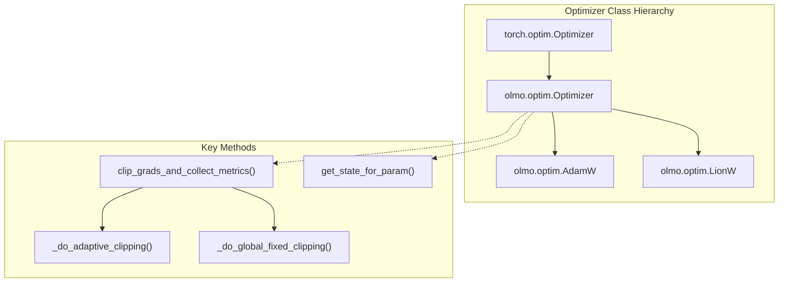
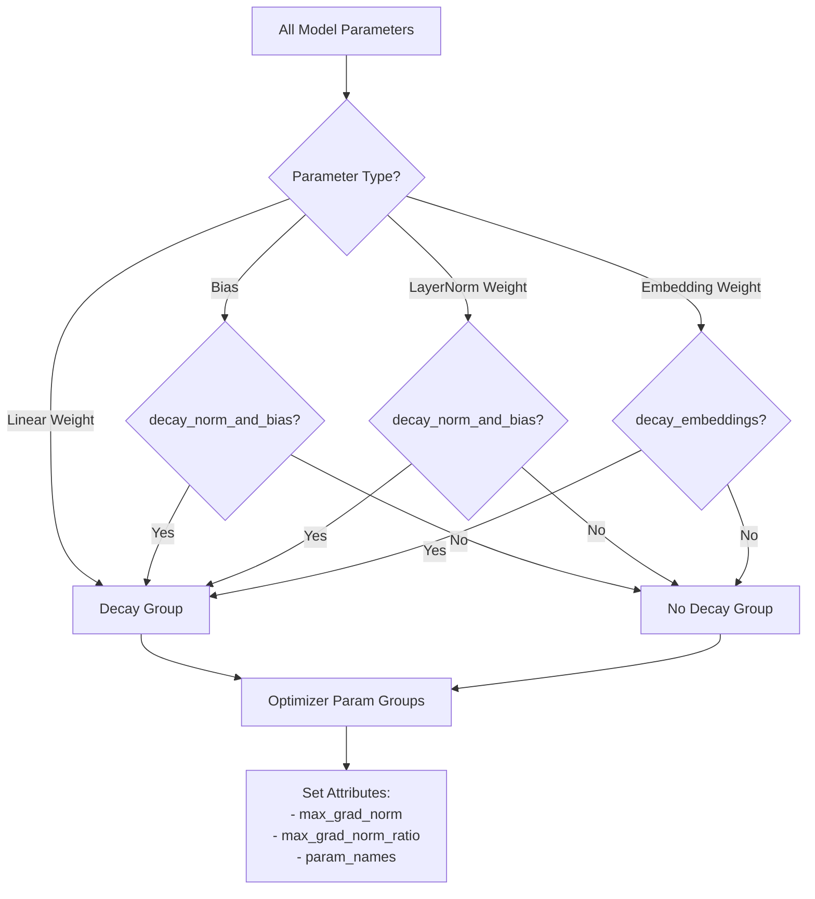
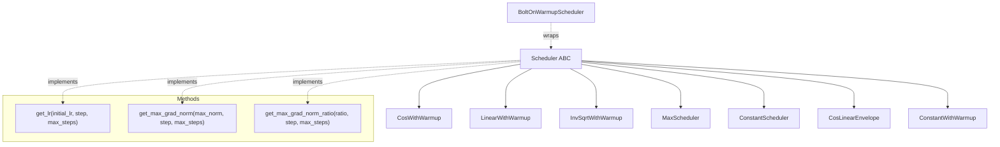
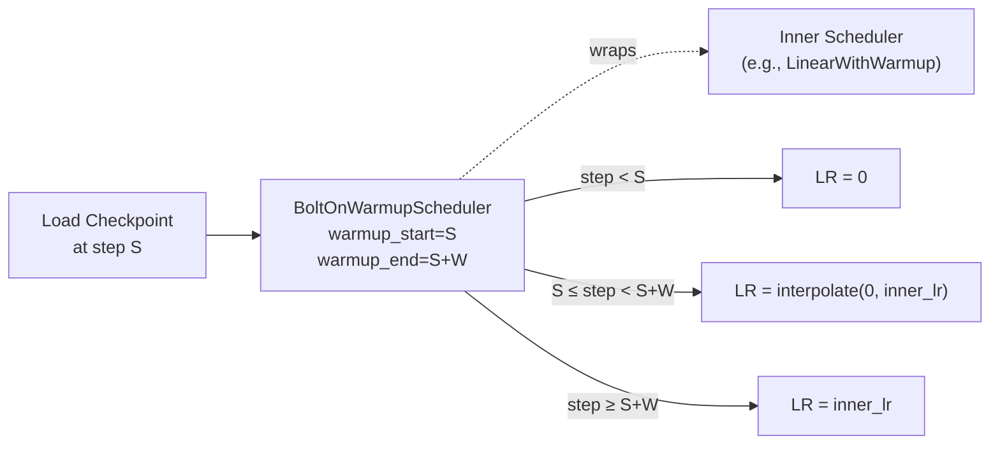
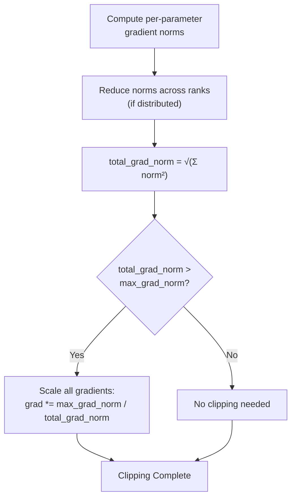
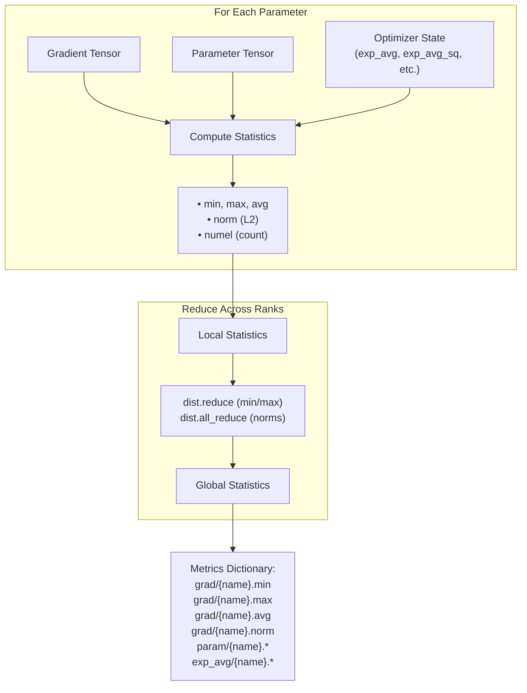
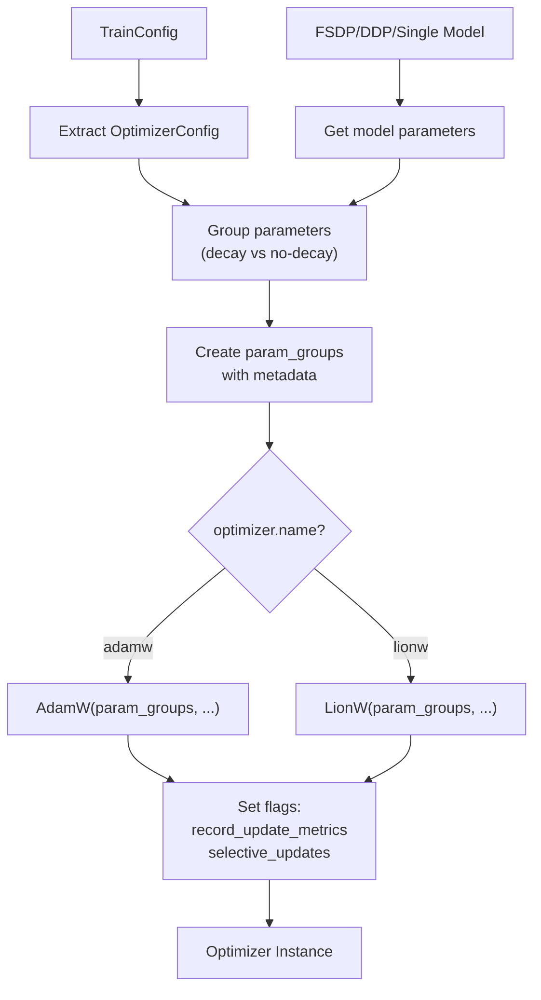
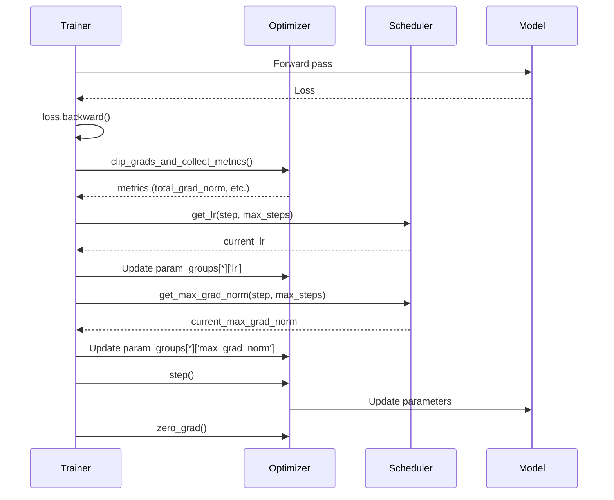

<!-- source: DeepWiki mcp.deepwiki.com · repo allenai/OLMo · page 3.2 Optimization · fetched 2026-10-26 -->

# Optimization

<details>
<summary>Relevant source files</summary>

The following files were used as context for generating this wiki page:

- [olmo/beam_search.py](olmo/beam_search.py)
- [olmo/checkpoint.py](olmo/checkpoint.py)
- [olmo/config.py](olmo/config.py)
- [olmo/data/named_data_mixes.py](olmo/data/named_data_mixes.py)
- [olmo/initialization.py](olmo/initialization.py)
- [olmo/model.py](olmo/model.py)
- [olmo/optim.py](olmo/optim.py)
- [olmo/torch_util.py](olmo/torch_util.py)
- [olmo/train.py](olmo/train.py)
- [olmo/util.py](olmo/util.py)
- [scripts/compare_wandb_configs.py](scripts/compare_wandb_configs.py)
- [scripts/ladder.py](scripts/ladder.py)
- [scripts/train.py](scripts/train.py)
- [tests/grad_norm_test.py](tests/grad_norm_test.py)
- [tests/initialization_test.py](tests/initialization_test.py)
- [tests/optim_test.py](tests/optim_test.py)
- [tests/util_test.py](tests/util_test.py)

</details>


## Purpose and Scope

This page documents the optimization system in OLMo, including optimizer implementations, learning rate schedulers, gradient clipping strategies, and their configuration. For information about the broader training pipeline that orchestrates these components, see [Training Pipeline](#3). For distributed training strategies that affect optimizer state management, see [Distributed Training](#3.3).

The optimization system provides:
- Two optimizer implementations: `AdamW` and `LionW`
- Multiple learning rate schedulers with warmup support
- Fixed and adaptive gradient clipping strategies
- Automated parameter grouping for weight decay
- Detailed metrics collection for monitoring optimization progress

---

## Optimizer Types

### OptimizerConfig

The `OptimizerConfig` dataclass [olmo/config.py:504-551]() defines all optimizer parameters:

| Field | Type | Default | Description |
|-------|------|---------|-------------|
| `name` | `OptimizerType` | `lionw` | Optimizer type (`adamw` or `lionw`) |
| `learning_rate` | `float` | `1.0e-4` | Base learning rate |
| `weight_decay` | `float` | `0.01` | Weight decay coefficient |
| `betas` | `Tuple[float, float]` | `(0.9, 0.95)` | Momentum coefficients |
| `eps` | `float` | `1e-5` | Numerical stability epsilon |
| `decay_norm_and_bias` | `bool` | `False` | Apply weight decay to norms and biases |
| `decay_embeddings` | `bool` | `False` | Apply weight decay to embeddings |
| `selective_updates` | `bool` | `False` | Skip updates when gradient is zero |
| `record_update_metrics` | `bool` | `False` | Record detailed update metrics |
| `metrics_log_interval` | `Optional[int]` | `None` | Interval for detailed metrics |

**Sources:** [olmo/config.py:504-551]()

### Optimizer Base Class

The `Optimizer` class [olmo/optim.py:38-322]() extends `torch.optim.Optimizer` with gradient clipping and metrics collection:



**Sources:** [olmo/optim.py:38-322]()

### AdamW Implementation

The `AdamW` optimizer [olmo/optim.py:325-435]() implements the AdamW algorithm with optional selective updates:

Key features:
- Decoupled weight decay (applied after gradient step)
- Optional selective updates (skip params with zero gradient)
- Exponential moving averages for first and second moments
- Bias correction for moment estimates
- Support for detailed update metrics

**Sources:** [olmo/optim.py:325-435]()

### LionW Implementation

The `LionW` optimizer [olmo/optim.py:438-528]() implements the Lion algorithm (Evolved Sign Momentum):

Key differences from AdamW:
- Uses sign of momentum for updates (more memory efficient)
- Single momentum buffer instead of two (first and second moments)
- Different update rule: `param -= lr * sign(m_t)`
- Typically requires smaller learning rates than AdamW

**Sources:** [olmo/optim.py:438-528]()

---

## Parameter Grouping

The `build_optimizer()` function [olmo/optim.py:531-643]() automatically groups parameters for differential weight decay:



The grouping logic [olmo/optim.py:559-620]():
1. Iterates through all model modules and parameters
2. Classifies each parameter by type (bias, linear weight, layernorm weight, embedding)
3. Assigns to decay or no-decay group based on configuration
4. Creates optimizer param groups with appropriate weight decay values
5. Adds metadata like parameter names for metrics collection

**Sources:** [olmo/optim.py:531-643]()

---

## Learning Rate Schedulers

### SchedulerConfig

The `SchedulerConfig` dataclass [olmo/config.py:569-593]() defines scheduler parameters:

| Field | Type | Default | Description |
|-------|------|---------|-------------|
| `name` | `SchedulerType` | `cosine_with_warmup` | Scheduler type |
| `units` | `SchedulerUnits` | `steps` | Units for t_warmup/t_max (`steps` or `tokens`) |
| `t_warmup` | `Union[int, float]` | `100` | Warmup duration |
| `t_max` | `Optional[Union[int, float]]` | `None` | Total training duration |
| `alpha_f` | `float` | `0.1` | Final LR as fraction of base LR |
| `grad_clip_warmup_steps` | `Optional[Union[int, float]]` | `None` | Gradient clip warmup duration |
| `grad_clip_warmup_factor` | `Optional[float]` | `None` | Gradient clip warmup multiplier |
| `warmup_min_lr` | `Optional[float]` | `None` | Starting LR during warmup (default: 0.1 * base LR) |

**Sources:** [olmo/config.py:569-593]()

### Scheduler Types

The following scheduler types are available [olmo/optim.py:646-842]():



**Sources:** [olmo/optim.py:646-842]()

### CosWithWarmup

Cosine annealing with linear warmup [olmo/optim.py:680-729]():

```
LR = warmup_min_lr + (initial_lr - warmup_min_lr) * (step / t_warmup)           # if step < t_warmup
LR = alpha_f * initial_lr + (1 - alpha_f) * initial_lr * 0.5 * (1 + cos(π * progress))  # otherwise
where progress = (step - t_warmup) / (max_steps - t_warmup)
```

Used for Stage 1 training in OLMo-2 [scripts/ladder.py:200-204]().

**Sources:** [olmo/optim.py:680-729](), [scripts/ladder.py:200-204]()

### LinearWithWarmup

Linear decay with linear warmup [olmo/optim.py:732-771]():

```
LR = warmup_min_lr + (initial_lr - warmup_min_lr) * (step / t_warmup)           # if step < t_warmup
LR = alpha_f * initial_lr + (1 - alpha_f) * initial_lr * (1 - progress)         # otherwise
where progress = (step - t_warmup) / (max_steps - t_warmup)
```

Used for Stage 2 training in OLMo-2.

**Sources:** [olmo/optim.py:732-771]()

### BoltOnWarmupScheduler

A wrapper that adds additional warmup to an existing scheduler [olmo/optim.py:845-897]():



Used when resuming training with `reset_optimizer_state=True` but `reset_trainer_state=False` [scripts/train.py:362-367]().

**Sources:** [olmo/optim.py:845-897](), [scripts/train.py:362-367]()

---

## Gradient Clipping

The optimizer supports two gradient clipping strategies, configured via param group attributes.

### Fixed Gradient Norm Clipping

Clips gradients when the global gradient norm exceeds `max_grad_norm` [olmo/optim.py:254-322]():



Applied before optimizer step [olmo/train.py:751-752]():

**Sources:** [olmo/optim.py:254-322](), [olmo/train.py:751-752]()

### Adaptive Gradient Norm Clipping

Clips gradients adaptively based on exponential moving average of gradient norms [olmo/optim.py:254-322]():

```python
# For each parameter p:
grad_norm_exp_avg = beta * grad_norm_exp_avg + (1 - beta) * grad_norm
if grad_norm > max_grad_norm_ratio * grad_norm_exp_avg:
    p.grad *= (max_grad_norm_ratio * grad_norm_exp_avg) / grad_norm
```

Key features:
- Per-parameter adaptive clipping
- Uses exponential moving average (EMA) with beta from optimizer
- Tracks `grad_norm_exp_avg` in optimizer state
- Prevents clipping based on short-term spikes

**Sources:** [olmo/optim.py:254-322]()

### Gradient Clip Warmup

Both clipping strategies support warmup [olmo/optim.py:680-729]():

```
effective_max_norm = max_norm * grad_clip_warmup_factor            # if step < grad_clip_warmup_steps
effective_max_norm = max_norm                                       # otherwise
```

This allows gradients to be larger during early training, helpful for models with unstable initialization.

**Sources:** [olmo/optim.py:680-729](), [olmo/config.py:577-587]()

---

## Metrics Collection

### Per-Parameter Metrics

The `clip_grads_and_collect_metrics()` method [olmo/optim.py:48-252]() collects detailed metrics when `collect_param_metrics=True`:



Metric naming convention:
- `grad/{param_name}.{stat}` - Gradient statistics
- `param/{param_name}.{stat}` - Parameter statistics  
- `{state_key}/{param_name}.{stat}` - Optimizer state statistics
- `total_grad_norm` - Global gradient norm
- `clipping_rate` - Fraction of parameters clipped

**Sources:** [olmo/optim.py:48-252]()

### Update Metrics

When `record_update_metrics=True`, optimizers record update-specific metrics [olmo/optim.py:380-435]():

For AdamW:
- `update/{param_name}.norm` - Norm of the parameter update
- `update/{param_name}.max` - Maximum absolute update value

**Sources:** [olmo/optim.py:380-435]()

---

## Building and Integration

### build_optimizer Function

The `build_optimizer()` function [olmo/optim.py:531-643]() constructs an optimizer from configuration:



**Sources:** [olmo/optim.py:531-643]()

### build_scheduler Function

The `build_scheduler()` function [olmo/optim.py:646-842]() creates a scheduler from configuration:

```python
def build_scheduler(config: TrainConfig) -> Scheduler:
    if config.scheduler.name == SchedulerType.cosine_with_warmup:
        return CosWithWarmup(...)
    elif config.scheduler.name == SchedulerType.linear_with_warmup:
        return LinearWithWarmup(...)
    # ... other scheduler types
```

**Sources:** [olmo/optim.py:646-842]()

### Integration in Training Loop

The Trainer integrates optimizer and scheduler [olmo/train.py:236-239]():



The training step [olmo/train.py:717-767]():
1. Zero gradients
2. Forward pass through model
3. Compute loss
4. Backward pass
5. Clip gradients and collect metrics
6. Update learning rate and gradient clip values from scheduler
7. Optimizer step
8. Log metrics

**Sources:** [olmo/train.py:236-239](), [olmo/train.py:717-767](), [scripts/train.py:236-239]()

---

## Configuration Examples

### Ladder CLI Configuration

The `ladder.py` script [scripts/ladder.py:190-204]() generates optimizer and scheduler configs based on scaling laws:

```python
# Learning rate scales with model size^(-1/3)
lr = 0.0047 * (model_size / 108000000) ** (-1 / 3)

# Warmup steps scale with model size / batch throughput
t_warmup = round(model_size / (global_batch_size * max_sequence_length))

OptimizerConfig(
    name=OptimizerType.adamw,
    learning_rate=lr,
    weight_decay=0.05,
    eps=1e-8,
    decay_norm_and_bias=True,
    decay_embeddings=True,
    betas=(0.9, 0.95),
)

SchedulerConfig(
    name=SchedulerType.cosine_with_warmup,
    alpha_f=0.01,  # Decay to 1% of base LR
    warmup_min_lr=0.0,
    t_warmup=t_warmup,
)
```

**Sources:** [scripts/ladder.py:190-204]()

### Manual Configuration Example

A typical training configuration [olmo/config.py:504-593]():

```yaml
optimizer:
  name: adamw
  learning_rate: 1.0e-4
  weight_decay: 0.01
  betas: [0.9, 0.95]
  eps: 1.0e-5
  decay_norm_and_bias: false
  decay_embeddings: false
  metrics_log_interval: 10

scheduler:
  name: cosine_with_warmup
  units: steps
  t_warmup: 2000
  alpha_f: 0.1
  warmup_min_lr: 0.0
  grad_clip_warmup_steps: 1000
  grad_clip_warmup_factor: 2.0

max_grad_norm: 1.0
```

**Sources:** [olmo/config.py:504-593]()

---

