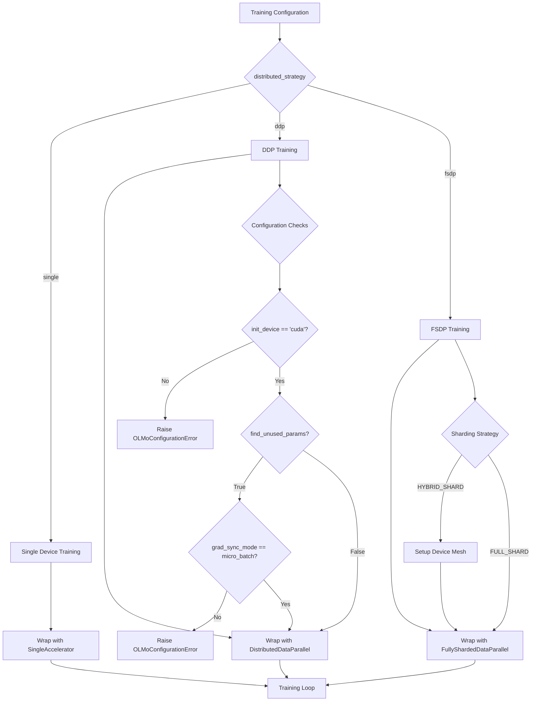
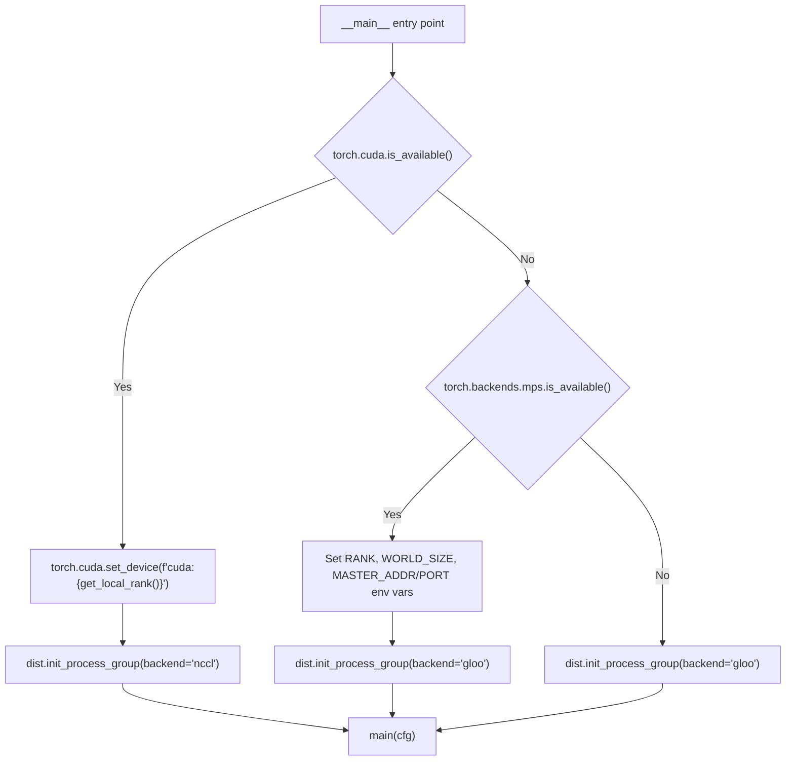
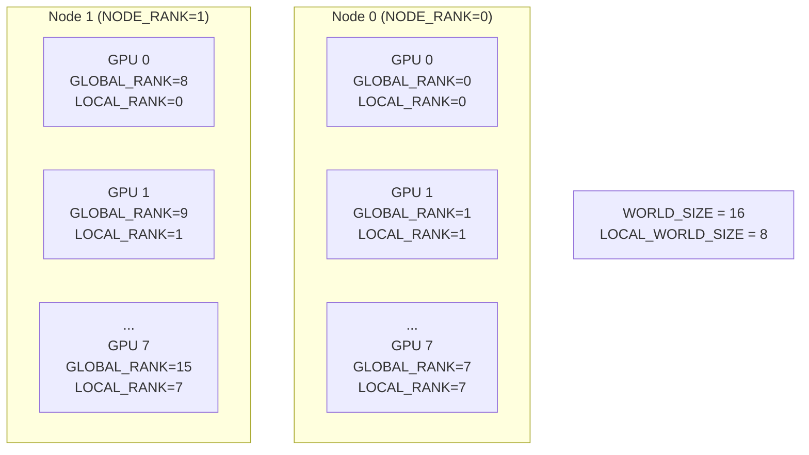
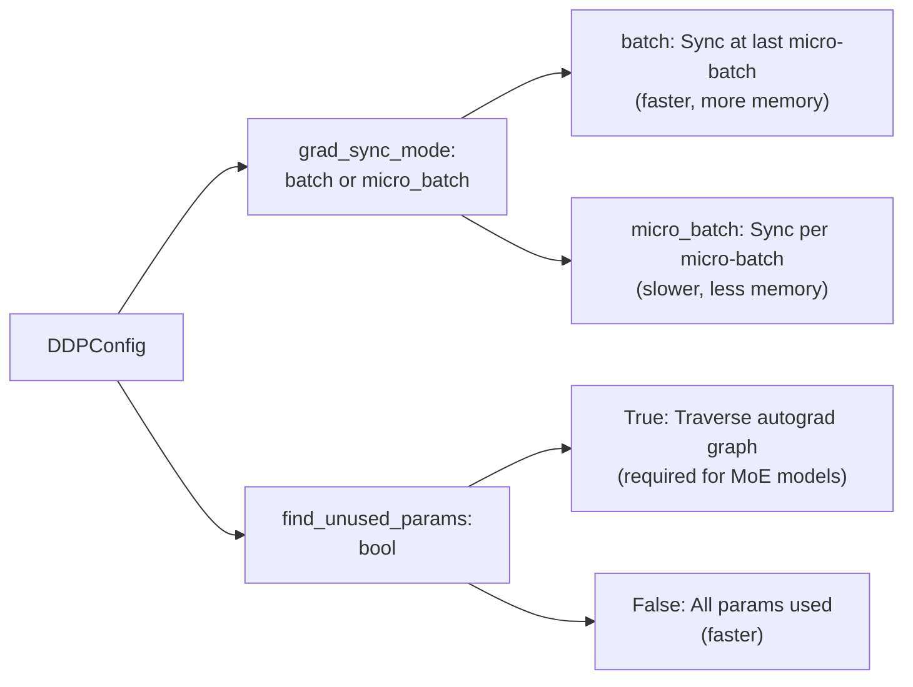
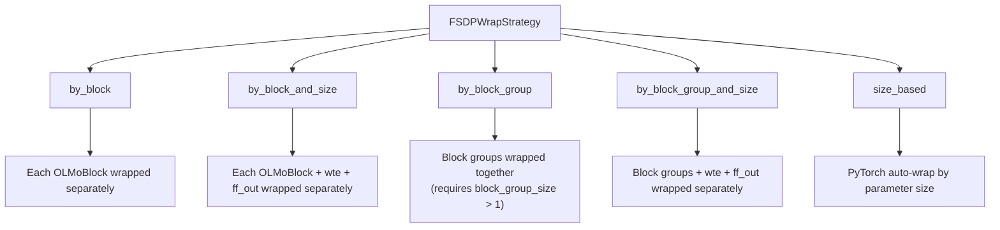
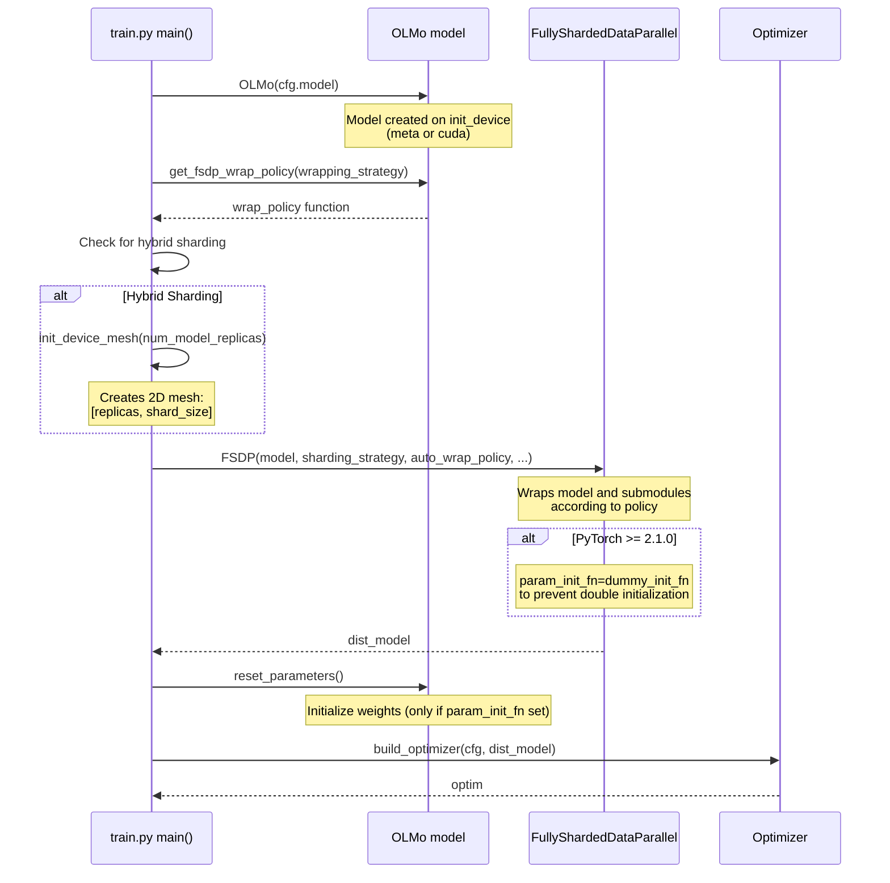
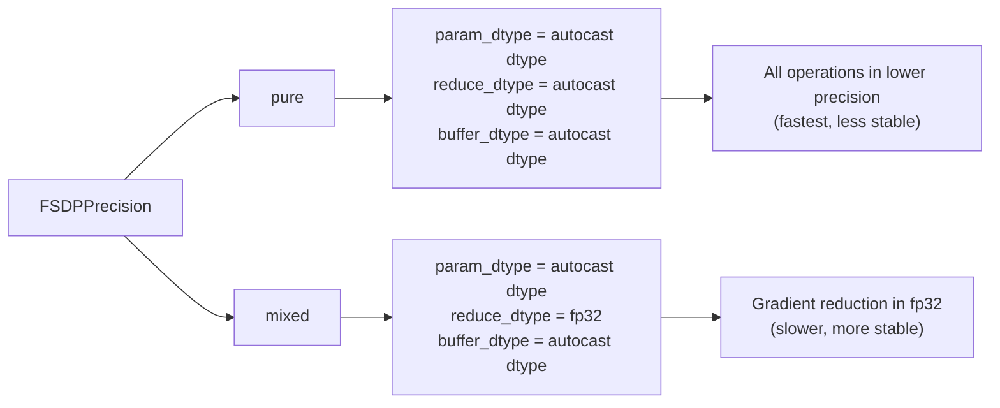
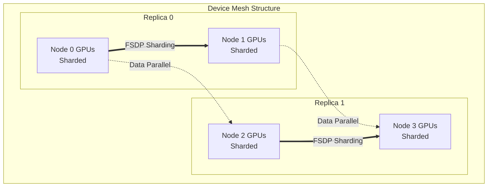
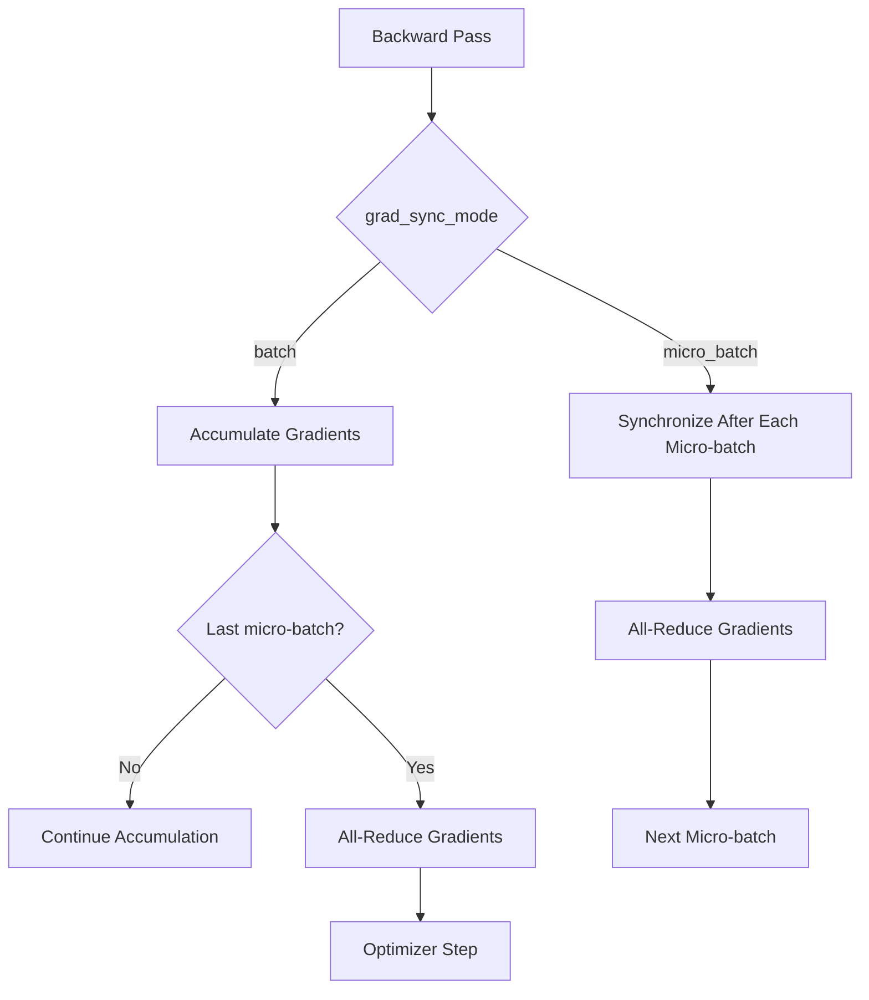
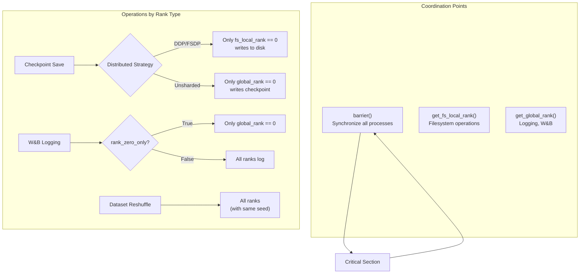

<!-- source: DeepWiki mcp.deepwiki.com · repo allenai/OLMo · page 3.3 Distributed Training · fetched 2026-10-26 -->

# Distributed Training

<details>
<summary>Relevant source files</summary>

The following files were used as context for generating this wiki page:

- [olmo/beam_search.py](olmo/beam_search.py)
- [olmo/checkpoint.py](olmo/checkpoint.py)
- [olmo/config.py](olmo/config.py)
- [olmo/initialization.py](olmo/initialization.py)
- [olmo/model.py](olmo/model.py)
- [olmo/optim.py](olmo/optim.py)
- [olmo/torch_util.py](olmo/torch_util.py)
- [olmo/train.py](olmo/train.py)
- [olmo/util.py](olmo/util.py)
- [scripts/train.py](scripts/train.py)
- [tests/grad_norm_test.py](tests/grad_norm_test.py)
- [tests/initialization_test.py](tests/initialization_test.py)
- [tests/optim_test.py](tests/optim_test.py)

</details>


## Purpose and Scope

This document explains OLMo's distributed training infrastructure, covering the strategies, configurations, and implementation details for training models across multiple GPUs and nodes. The system supports three distributed strategies: DDP (Distributed Data Parallel), FSDP (Fully Sharded Data Parallel), and single-device training.

For checkpoint management in distributed settings, see [Checkpoint Formats and Sharding](#4.1). For optimizer and gradient handling, see [Optimization](#3.2). For the overall training pipeline, see [Training Pipeline](#3).

## Distributed Strategy Overview

OLMo supports three distributed strategies configured via `TrainConfig.distributed_strategy`:

| Strategy | Use Case | Model Replication | Parameter Sharding | Optimizer State Sharding |
|----------|----------|-------------------|-------------------|------------------------|
| `single` | Development/debugging | N/A (single device) | No | No |
| `ddp` | Models < 7B | Full model on each GPU | No | No |
| `fsdp` | Models ≥ 7B | Sharded across GPUs | Yes | Yes |

**Strategy Selection Flow**



**Sources**: [scripts/train.py:154-226](), [olmo/config.py:741-756]()

## Process Group Initialization

Distributed training requires initializing PyTorch's process group before model creation. The initialization varies by backend:



The process group uses a 30-minute timeout to handle slow initialization on large clusters:

- **NCCL backend**: For CUDA devices, provides optimized GPU-to-GPU communication
- **Gloo backend**: For CPU/MPS devices, provides cross-platform support
- **Device assignment**: Each process sets its device based on `LOCAL_RANK` environment variable

**Sources**: [scripts/train.py:388-412](), [olmo/torch_util.py:27-28]()

## Rank and Device Management

OLMo tracks multiple rank types for coordinating distributed operations:

| Function | Environment Variable | Purpose |
|----------|---------------------|---------|
| `get_global_rank()` | `RANK` | Unique rank across all processes (0 to world_size-1) |
| `get_local_rank()` | `LOCAL_RANK` | Rank within a node (0 to local_world_size-1) |
| `get_node_rank()` | `NODE_RANK` | Node index in multi-node setup |
| `get_local_world_size()` | `LOCAL_WORLD_SIZE` | Number of processes per node |
| `get_world_size()` | N/A | Total number of processes |
| `get_fs_local_rank()` | `FS_LOCAL_RANK`, `OLMO_SHARED_FS` | Rank for filesystem operations |

**Rank Hierarchy Example** (2 nodes × 8 GPUs):



**Filesystem Local Rank**: Used for checkpoint operations to prevent multiple processes from writing to the same file. When `OLMO_SHARED_FS=True`, only one process per shared filesystem performs I/O.

**Sources**: [olmo/torch_util.py:31-65](), [scripts/train.py:69-71]()

## DDP (Distributed Data Parallel)

DDP replicates the entire model on each GPU, synchronizing gradients across processes during backward passes. Used for models under 7B parameters where memory permits full replication.

### DDP Configuration



**Configuration Requirements**:
- `model.init_device` must be `"cuda"` (no meta device support)
- If `find_unused_params=True`, must use `grad_sync_mode=micro_batch` to avoid errors
- Checkpoints are saved as `CheckpointType.unsharded`

**DDP Wrapping** ([scripts/train.py:154-169]()):

```python
dist_model = DDP(
    olmo_model.to(device),
    find_unused_parameters=cfg.ddp.find_unused_params
)
```

The `DDPGradSyncMode` controls when gradient synchronization occurs:
- **batch**: Synchronize only at the last micro-batch per batch, reducing communication overhead
- **micro_batch**: Synchronize after each micro-batch, required when `find_unused_params=True`

**Sources**: [olmo/config.py:758-794](), [scripts/train.py:154-169]()

## FSDP (Fully Sharded Data Parallel)

FSDP shards model parameters, gradients, and optimizer states across GPUs, enabling training of models that don't fit on a single GPU. Used for models 7B parameters and above.

### FSDP Sharding Strategies

FSDP supports multiple sharding strategies defined in `ShardingStrategy`:

| Strategy | Parameters | Gradients | Optimizer States | Use Case |
|----------|-----------|-----------|-----------------|----------|
| `FULL_SHARD` | Sharded | Sharded | Sharded | Maximum memory savings |
| `SHARD_GRAD_OP` | Replicated | Sharded | Sharded | Less communication |
| `NO_SHARD` | Replicated | Replicated | Replicated | DDP equivalent |
| `HYBRID_SHARD` | Sharded within nodes, replicated across nodes | Sharded within nodes | Sharded within nodes | Multi-node optimization |
| `_HYBRID_SHARD_ZERO2` | Like HYBRID_SHARD but parameters not sharded | Sharded within nodes | Sharded within nodes | ZeRO-2 style |

**Default Configuration**: OLMo uses `FULL_SHARD` by default for maximum memory efficiency.

**Sources**: [olmo/config.py:843-867]()

### FSDP Wrapping Strategies

The wrapping strategy determines how FSDP instances are nested within the model hierarchy. This affects communication patterns and memory usage.



**Wrapping Strategy Implementation** ([olmo/model.py:1373-1425]()):

The `OLMo.get_fsdp_wrap_policy()` method returns a policy function that determines which modules to wrap:

- **by_block**: Wraps each `OLMoBlock` instance
- **by_block_and_size**: Wraps `OLMoBlock`, `wte` (embeddings), and `ff_out` (output projection)
- **by_block_group**: Wraps groups of blocks when `block_group_size > 1`
- **by_block_group_and_size**: Combines block grouping with separate embedding/output wrapping

**Sources**: [olmo/config.py:796-827](), [olmo/model.py:1373-1425]()

### FSDP Initialization Flow



**Key Initialization Details**:
- **Meta device initialization**: For PyTorch ≥2.1.0, `param_init_fn` prevents double initialization
- **Hybrid sharding device mesh**: Requires PyTorch ≥2.2.0, creates a 2D process mesh for sharding within replicas
- **Parameter initialization**: Called explicitly after FSDP wrapping when using `param_init_fn`

**Sources**: [scripts/train.py:170-230]()

### FSDP Precision Modes



The precision mode is converted to PyTorch's `MixedPrecision` object based on the configured autocast precision (`cfg.precision`).

**Sources**: [olmo/config.py:829-841]()

## Hybrid Sharding

Hybrid sharding (available in PyTorch ≥2.2.0) combines data parallelism across nodes with FSDP within nodes. This reduces inter-node communication while maintaining memory efficiency.

**Device Mesh Structure**:



**Configuration** ([scripts/train.py:185-208]()):

```python
num_model_replicas = cfg.fsdp.hybrid_sharding_num_model_replicas or (
    get_world_size() // get_local_world_size()
)

# Create 2D device mesh: [num_replicas, shard_size]
device_mesh = init_device_mesh(
    "cuda",
    (num_model_replicas, get_world_size() // num_model_replicas)
)
```

**Requirements**:
- `num_model_replicas` must divide `world_size`
- If not specified, defaults to one replica per node
- Reduces all-reduce operations across nodes, improving multi-node scaling

**Sources**: [scripts/train.py:185-208]()

## Gradient Synchronization

Gradient synchronization differs between DDP and FSDP:

### DDP Gradient Synchronization



**DDP Context Manager** (used in training loop):
- `no_sync()`: Prevents gradient synchronization during micro-batches (batch mode)
- Without `no_sync()`: Gradients synchronized after each backward (micro_batch mode)

### FSDP Gradient Synchronization

FSDP automatically handles gradient synchronization during backward passes:

1. **Forward pass**: Parameters are gathered (all-gather) just before use
2. **Backward pass**: Gradients are reduced (reduce-scatter) after computation
3. **Optimizer step**: Only local shard of parameters updated

This happens transparently within FSDP's implementation, controlled by the sharding strategy.

**Sources**: [olmo/config.py:758-773](), [olmo/train.py]()

## Multi-Node Coordination

Multi-node training requires coordination for checkpointing, logging, and data loading:



**Barrier Usage**:
- Before/after checkpoint saves to ensure all ranks ready
- After configuration saves
- Before starting training

**Rank-Specific Operations**:
- **global_rank == 0**: Configuration saves, final logging, unsharded checkpoint creation
- **fs_local_rank == 0**: Sharded checkpoint saves (one per shared filesystem)
- **local_rank == 0**: Per-node operations (when applicable)

**Sources**: [olmo/torch_util.py:101-103](), [scripts/train.py:95-110](), [olmo/checkpoint.py:122-128]()

## Distributed Utilities

OLMo provides utility functions for distributed operations:

| Function | Purpose | Returns |
|----------|---------|---------|
| `is_distributed()` | Check if distributed training active | `bool` |
| `barrier()` | Synchronize all processes | `None` |
| `synchronize_value(value, device)` | Broadcast value from rank 0 | Same type as input |
| `synchronize_flag(flag, device)` | Broadcast boolean from rank 0 | `bool` |
| `peak_gpu_memory(reset)` | Get max GPU memory across ranks | `Optional[float]` (MB) |

**Usage Example** (from training loop):
```python
# Synchronize whether to stop training
should_stop = synchronize_flag(should_stop, device)

# Get peak memory usage across all ranks
peak_mem = peak_gpu_memory(reset=False)
```

**Sources**: [olmo/torch_util.py:27-141]()

## SingleAccelerator Wrapper

For single-device training, OLMo uses a `SingleAccelerator` wrapper to provide a consistent interface with DDP/FSDP:

```python
class SingleAccelerator(torch.nn.Module):
    process_group = None
    
    def __init__(self, module: torch.nn.Module):
        super().__init__()
        self.module = module
    
    def forward(self, *args, **kwargs):
        return self.module(*args, **kwargs)
```

This wrapper:
- Provides `process_group` attribute (set to `None`) for compatibility
- Wraps the model to match the interface expected by the Trainer
- Used when `distributed_strategy == "single"`

**Sources**: [olmo/torch_util.py:163-172](), [scripts/train.py:221-226]()

---

