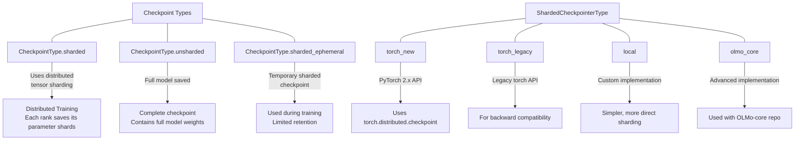
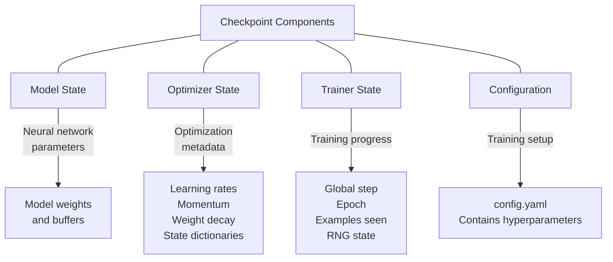
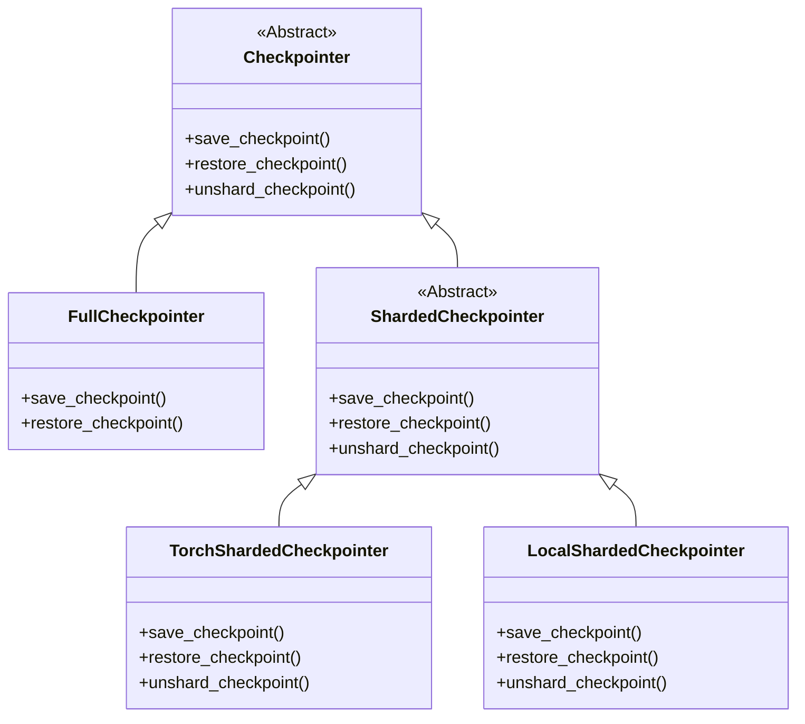
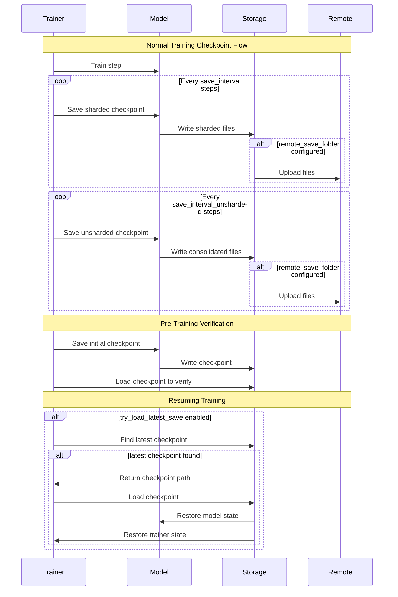
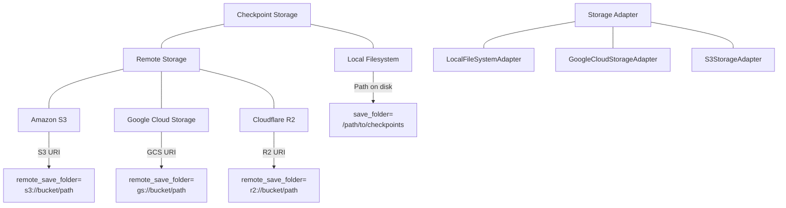
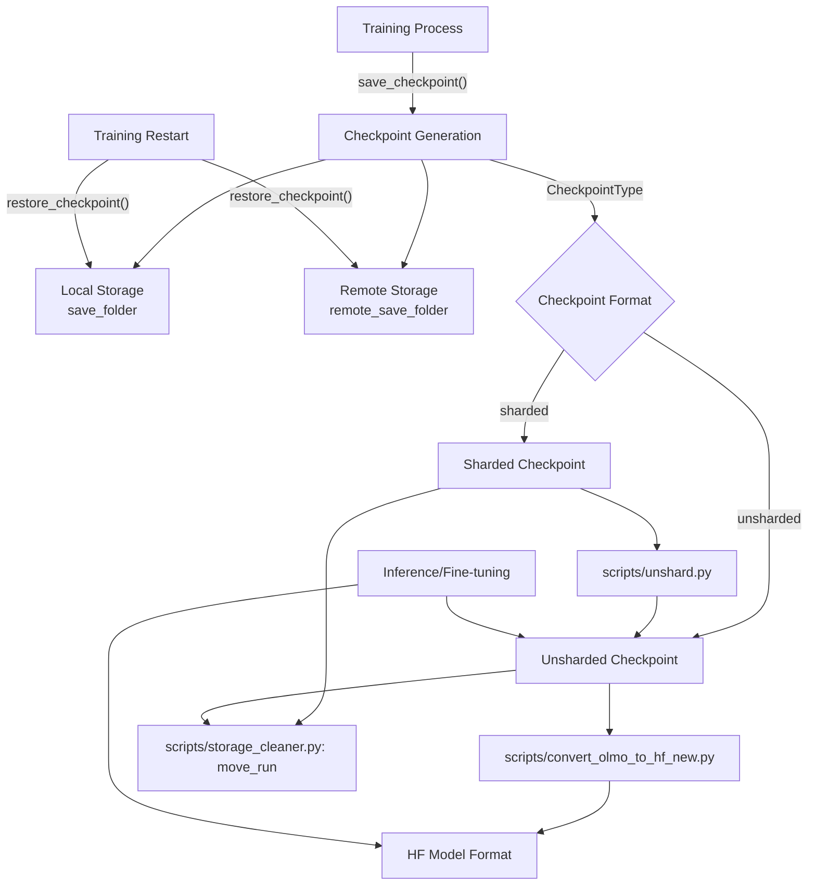

<!-- source: DeepWiki mcp.deepwiki.com · repo allenai/OLMo · page 4 Checkpoint Management · fetched 2026-10-26 -->

# Checkpoint Management

<details>
<summary>Relevant source files</summary>

The following files were used as context for generating this wiki page:

- [olmo/beam_search.py](olmo/beam_search.py)
- [olmo/checkpoint.py](olmo/checkpoint.py)
- [olmo/config.py](olmo/config.py)
- [olmo/initialization.py](olmo/initialization.py)
- [olmo/model.py](olmo/model.py)
- [olmo/optim.py](olmo/optim.py)
- [olmo/torch_util.py](olmo/torch_util.py)
- [olmo/train.py](olmo/train.py)
- [olmo/util.py](olmo/util.py)
- [scripts/storage_cleaner.py](scripts/storage_cleaner.py)
- [scripts/train.py](scripts/train.py)
- [scripts/unshard.py](scripts/unshard.py)
- [tests/checkpoint_test.py](tests/checkpoint_test.py)
- [tests/grad_norm_test.py](tests/grad_norm_test.py)
- [tests/initialization_test.py](tests/initialization_test.py)
- [tests/optim_test.py](tests/optim_test.py)

</details>


This page documents the checkpoint management system in OLMo, which handles saving, loading, and converting model checkpoints during training and inference. The checkpoint system is designed to be flexible and robust, supporting both standard and distributed training environments across different computing platforms.

For information about converting OLMo checkpoints to Hugging Face format, see [Hugging Face Integration](#4.1).

## Checkpoint Types

OLMo supports multiple checkpoint types to accommodate different training configurations and storage needs:



Sources: [olmo/config.py:892-896](https://github.com/allenai/OLMo/blob/main/olmo/config.py#L892-L896), [olmo/config.py:898-902](https://github.com/allenai/OLMo/blob/main/olmo/config.py#L898-L902)

### Sharded Checkpoints

Sharded checkpoints distribute model parameters across multiple files, with each training process (rank) saving its portion of the model. This is particularly useful for large models trained with Fully Sharded Data Parallelism (FSDP) where memory constraints prevent a single process from holding the entire model.

- **Uses**: Primary checkpoint format during distributed training with FSDP
- **Structure**: Each rank saves its parameter shards in separate files
- **Efficiency**: Faster saving during training (no need to consolidate parameters)
- **Storage**: Requires more complex loading logic but enables faster checkpoint creation

### Unsharded Checkpoints

Unsharded checkpoints contain the full model in a single, consolidated format that's easier to use for inference or fine-tuning.

- **Uses**: For inference, fine-tuning, or transferring to other frameworks
- **Structure**: Complete model weights and state in a single logical location
- **Efficiency**: Slower to create during training but easier to load
- **Storage**: More straightforward structure, but requires gathering all parameters

### Ephemeral Checkpoints

Ephemeral sharded checkpoints are temporary checkpoints with limited retention, typically used during training to provide recovery points without consuming excessive storage.

Sources: [olmo/train.py:521-530](https://github.com/allenai/OLMo/blob/main/olmo/train.py#L521-L530)

## Checkpoint Components

Each checkpoint contains multiple components:



Sources: [olmo/train.py:322-339](https://github.com/allenai/OLMo/blob/main/olmo/train.py#L322-L339), [olmo/checkpoint.py:95-445](https://github.com/allenai/OLMo/blob/main/olmo/checkpoint.py#L95-L445)

## Checkpoint Management Classes

The checkpoint system is implemented through various checkpointer classes:



Sources: [olmo/checkpoint.py:634-835](https://github.com/allenai/OLMo/blob/main/olmo/checkpoint.py#L634-L835)

## Checkpoint Configuration

Checkpoint behavior is controlled through the `TrainConfig` class with several important parameters:

| Configuration Parameter | Description | Default |
|-------------------------|-------------|---------|
| `save_folder` | Directory to save checkpoints | Required |
| `remote_save_folder` | Remote location (e.g., S3) to upload checkpoints | Optional |
| `save_interval` | Steps between saving sharded checkpoints | - |
| `save_interval_unsharded` | Steps between saving unsharded checkpoints | - |
| `save_num_checkpoints_to_keep` | Number of sharded checkpoints to retain | - |
| `save_num_unsharded_checkpoints_to_keep` | Number of unsharded checkpoints to retain | - |
| `save_overwrite` | Whether to overwrite existing checkpoints | `False` |
| `sharded_checkpointer` | Type of sharded checkpointer to use | `torch_new` |
| `force_save_unsharded` | Force saving an unsharded checkpoint | `False` |

Sources: [scripts/train.py:99-107](https://github.com/allenai/OLMo/blob/main/scripts/train.py#L99-L107), [scripts/train.py:300-333](https://github.com/allenai/OLMo/blob/main/scripts/train.py#L300-L333)

## Checkpoint Operations During Training

During training, OLMo automatically manages checkpoints based on the configuration:



Sources: [scripts/train.py:250-368](https://github.com/allenai/OLMo/blob/main/scripts/train.py#L250-L368), [olmo/train.py:447-587](https://github.com/allenai/OLMo/blob/main/olmo/train.py#L447-L587)

## Checkpoint Directory Structure

Checkpoints are saved with the following directory structure:

```
save_folder/
├── config.yaml                   # Training configuration
├── latest -> step10000/          # Symbolic link to latest checkpoint
├── latest-unsharded -> step9000-unsharded/  # Link to latest unsharded
├── step9000-unsharded/           # Unsharded checkpoint at step 9000
│   ├── model.pt                  # Full model state
│   ├── optim.pt                  # Full optimizer state
│   └── train.pt                  # Trainer state
├── step10000/                    # Sharded checkpoint at step 10000
│   ├── model_and_optim/          # Distributed checkpoint directory
│   │   ├── .metadata             # Checkpoint metadata
│   │   ├── __0_0.distcp          # Rank 0's checkpoint data
│   │   ├── __1_0.distcp          # Rank 1's checkpoint data
│   │   └── ...                   # Additional rank data
│   └── trainer_state.pt          # Trainer state
└── train_data/                   # Data related to training
```

Sources: [olmo/train.py:447-457](https://github.com/allenai/OLMo/blob/main/olmo/train.py#L447-L457), [olmo/checkpoint.py:140-147](https://github.com/allenai/OLMo/blob/main/olmo/checkpoint.py#L140-L147)

## Checkpoint Storage Systems

OLMo supports various storage systems for checkpoints:



Sources: [scripts/storage_cleaner.py:46-126](https://github.com/allenai/OLMo/blob/main/scripts/storage_cleaner.py#L46-L126), [olmo/util.py:353-365](https://github.com/allenai/OLMo/blob/main/olmo/util.py#L353-L365)

## Saving and Loading Checkpoints

### Saving Checkpoints During Training

During training, checkpoints are automatically saved based on the configured intervals. The system is designed to handle various distributed training configurations:

```python
# Examples of checkpoint configuration in training script
cfg.save_folder = "checkpoints/run-1"  # Local save path
cfg.remote_save_folder = "s3://my-bucket/checkpoints/run-1"  # Remote save path
cfg.save_interval = 1000  # Save sharded checkpoint every 1000 steps
cfg.save_interval_unsharded = 5000  # Save unsharded checkpoint every 5000 steps
cfg.save_num_checkpoints_to_keep = 3  # Keep last 3 sharded checkpoints
cfg.save_num_unsharded_checkpoints_to_keep = 2  # Keep last 2 unsharded checkpoints
```

The `Trainer` class handles checkpoint saving with methods like `save_checkpoint`, `save_sharded_checkpoint`, and `save_unsharded_checkpoint`. These methods ensure proper coordination across distributed processes.

Sources: [olmo/train.py:447-587](https://github.com/allenai/OLMo/blob/main/olmo/train.py#L447-L587)

### Loading Checkpoints

To resume training from a checkpoint:

```python
# Load from specific checkpoint
cfg.load_path = "checkpoints/run-1/step10000"

# Automatically find and load the latest checkpoint
cfg.try_load_latest_save = True
```

The `Trainer.restore_checkpoint` method handles loading the model, optimizer, and trainer states. For distributed training, it ensures proper shard distribution.

Sources: [scripts/train.py:351-368](https://github.com/allenai/OLMo/blob/main/scripts/train.py#L351-L368), [olmo/train.py:557-595](https://github.com/allenai/OLMo/blob/main/olmo/train.py#L557-L595)

## Advanced Checkpoint Operations

### Unsharding Checkpoints

To convert a sharded checkpoint to an unsharded one for easier use:

```bash
python scripts/unshard.py input_dir output_dir [--type CHECKPOINTER_TYPE] [--model-only] [--safe-tensors]
```

This script consolidates the sharded parameter files into a single unsharded checkpoint.

Sources: [scripts/unshard.py:15-115](https://github.com/allenai/OLMo/blob/main/scripts/unshard.py#L15-L115)

### Moving Checkpoints Between Storage Systems

The `storage_cleaner.py` script provides utilities for managing checkpoint storage:

```bash
# Moving a checkpoint run from one location to another
python scripts/storage_cleaner.py move-run source_path destination_path
```

Sources: [scripts/storage_cleaner.py:921-976](https://github.com/allenai/OLMo/blob/main/scripts/storage_cleaner.py#L921-L976)

### Converting to Hugging Face Format

To convert an OLMo checkpoint to Hugging Face format:

```bash
python scripts/convert_olmo_to_hf_new.py --input_dir /path/to/unsharded/checkpoint --output_dir /path/to/hf/model
```

This enables using OLMo models with the Hugging Face ecosystem.

Sources: [scripts/convert_olmo_to_hf_new.py:45-368](https://github.com/allenai/OLMo/blob/main/scripts/convert_olmo_to_hf_new.py#L45-L368)

## Checkpoint Management Flow

The following diagram illustrates how checkpoints are managed throughout the training and inference lifecycle:



Sources: [olmo/train.py:447-595](https://github.com/allenai/OLMo/blob/main/olmo/train.py#L447-L595), [scripts/unshard.py:15-115](https://github.com/allenai/OLMo/blob/main/scripts/unshard.py#L15-L115), [scripts/storage_cleaner.py:921-976](https://github.com/allenai/OLMo/blob/main/scripts/storage_cleaner.py#L921-L976)

## Best Practices

1. **Regular Checkpointing**: Configure appropriate `save_interval` values to balance training progress and disk usage
2. **Remote Storage**: Always use `remote_save_folder` for important runs to prevent data loss from node failures
3. **Checkpoint Retention**: Set reasonable values for `save_num_checkpoints_to_keep` and `save_num_unsharded_checkpoints_to_keep` to manage storage usage
4. **Pre-train Verification**: OLMo automatically saves and loads a checkpoint at the start of training to verify the save/load functionality
5. **Unsharded for Sharing**: Always create unsharded checkpoints when sharing models with others, as they're easier to work with

Sources: [scripts/train.py:300-344](https://github.com/allenai/OLMo/blob/main/scripts/train.py#L300-L344)

## Troubleshooting

| Issue | Possible Solution |
|-------|------------------|
| "Checkpoint already exists" error | Use `--save_overwrite=True` to allow overwriting existing checkpoints |
| Out of disk space | Reduce `save_num_checkpoints_to_keep` or use `scripts/storage_cleaner.py` to clean up old checkpoints |
| Slow checkpoint saving | Consider using sharded checkpoints only and increasing the `save_interval` |
| Failed checkpoint load | Make sure world size matches between saving and loading, or use an unsharded checkpoint |
| Memory error during unsharding | Use the `--model-only` flag with `scripts/unshard.py` to skip optimizer state |

Sources: [olmo/train.py:491-493](https://github.com/allenai/OLMo/blob/main/olmo/train.py#L491-L493), [scripts/unshard.py:89-94](https://github.com/allenai/OLMo/blob/main/scripts/unshard.py#L89-L94)

---

