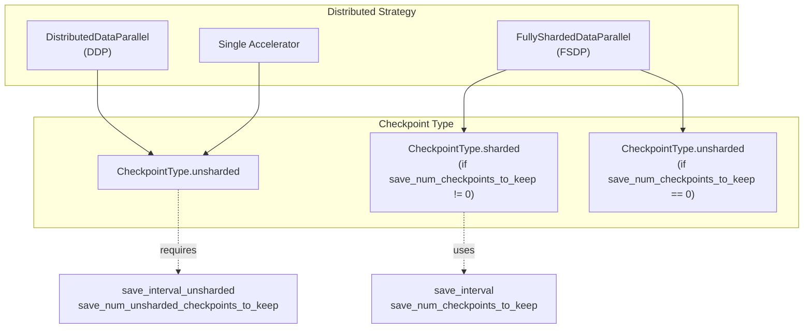
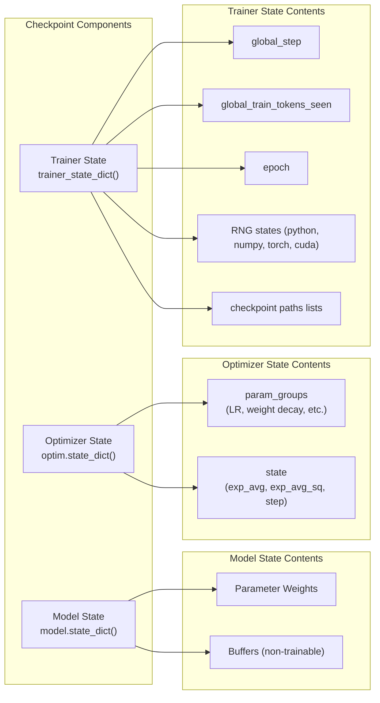
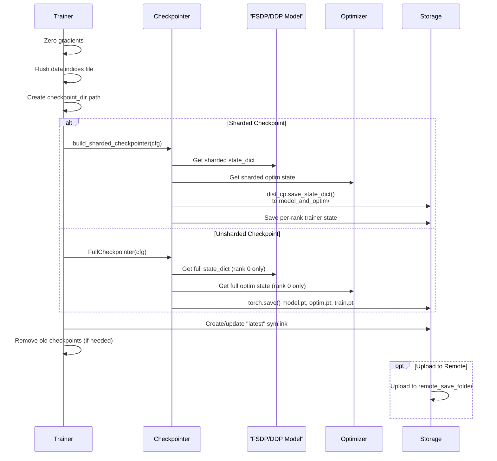
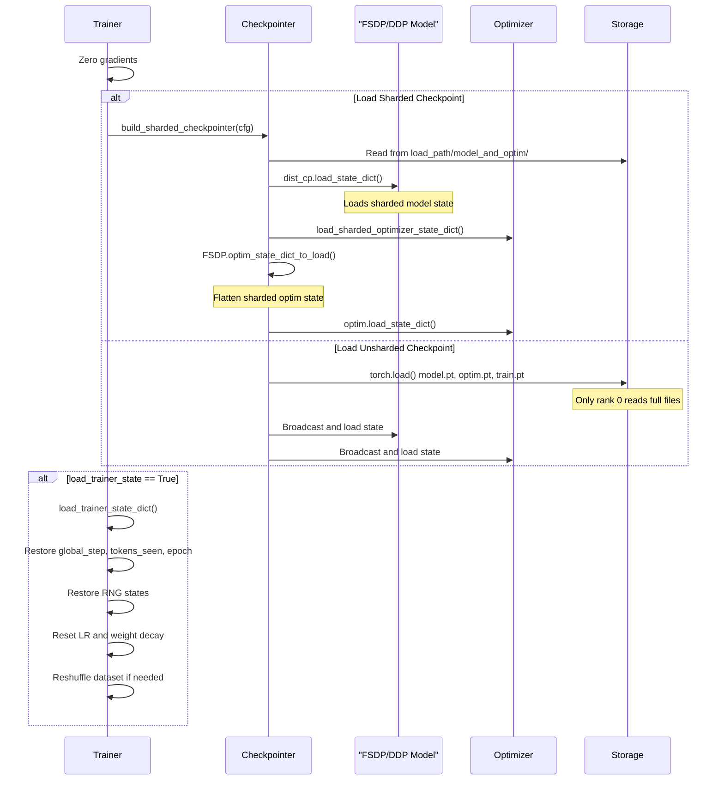
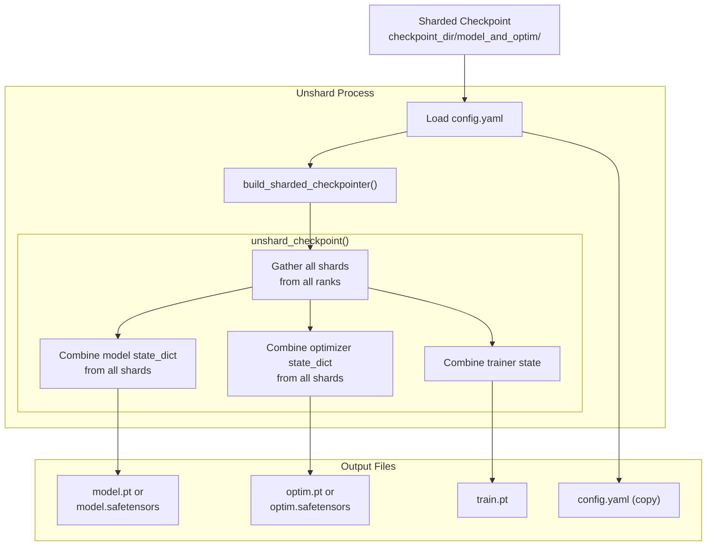
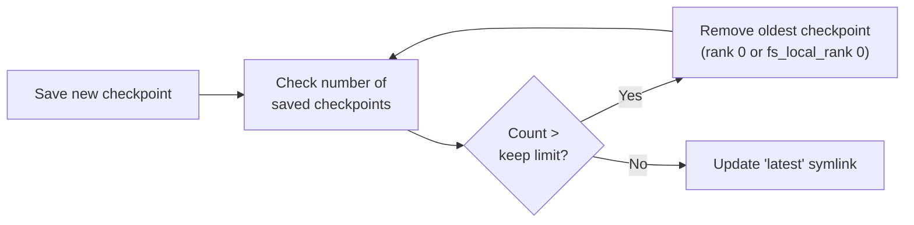

<!-- source: DeepWiki mcp.deepwiki.com · repo allenai/OLMo · page 4.1 Checkpoint Formats and Sharding · fetched 2026-10-26 -->

# Checkpoint Formats and Sharding

<details>
<summary>Relevant source files</summary>

The following files were used as context for generating this wiki page:

- [olmo/beam_search.py](olmo/beam_search.py)
- [olmo/checkpoint.py](olmo/checkpoint.py)
- [olmo/config.py](olmo/config.py)
- [olmo/initialization.py](olmo/initialization.py)
- [olmo/model.py](olmo/model.py)
- [olmo/optim.py](olmo/optim.py)
- [olmo/torch_util.py](olmo/torch_util.py)
- [olmo/train.py](olmo/train.py)
- [olmo/util.py](olmo/util.py)
- [scripts/storage_cleaner.py](scripts/storage_cleaner.py)
- [scripts/train.py](scripts/train.py)
- [scripts/unshard.py](scripts/unshard.py)
- [tests/checkpoint_test.py](tests/checkpoint_test.py)
- [tests/grad_norm_test.py](tests/grad_norm_test.py)
- [tests/initialization_test.py](tests/initialization_test.py)
- [tests/optim_test.py](tests/optim_test.py)

</details>


This document describes the checkpoint system in OLMo, including the different checkpoint formats (sharded vs unsharded), the available sharding implementations, checkpoint directory structure, and the process of saving, loading, and unsharding checkpoints. For information about checkpoint storage management and cleanup, see [Storage Management](#4.2). For details on converting checkpoints to Hugging Face format, see [Hugging Face Integration](#4.3).

## Checkpoint Types

OLMo supports three checkpoint types, defined by the `CheckpointType` enum:

| Type | Description | Use Case |
|------|-------------|----------|
| `sharded` | Distributed checkpoint where model/optimizer state is split across ranks | Default for FSDP training, saves disk space and memory |
| `unsharded` | Single-file checkpoint containing full model/optimizer state | Required for DDP, easier to share and load |
| `sharded_ephemeral` | Temporary sharded checkpoint, only one kept at a time | Used for frequent checkpointing without accumulating many checkpoints |

**Sources:** [olmo/config.py:892-896]()

### Checkpoint Type Selection by Distributed Strategy



**Sources:** [scripts/train.py:301-333]()

## Sharded Checkpointer Implementations

OLMo provides four different sharded checkpointer implementations, specified by `ShardedCheckpointerType`:

### torch_new

Uses PyTorch's modern distributed checkpoint API (`torch.distributed.checkpoint`). This is the recommended implementation for new models.

- **Class:** `TorchNewStyleShardedCheckpointer`
- **Key Features:**
  - Uses `dist_cp.save_state_dict()` and `dist_cp.load_state_dict()`
  - Supports `RemoteFileSystemWriter` for direct cloud uploads
  - Handles FSDP's `ShardedStateDictConfig` and `ShardedOptimStateDictConfig`
- **Storage:** Saves to `model_and_optim/` subdirectory with metadata file

**Sources:** [olmo/checkpoint.py:869-1008]()

### torch_legacy

Uses an older PyTorch sharded checkpoint format, maintained for backward compatibility.

- **Class:** `TorchLegacyShardedCheckpointer`
- **Key Features:**
  - Compatible with older PyTorch versions (< 2.1.0)
  - Supports optional shared memory implementation for faster unsharding with large world sizes
  - Uses `_save_model_and_optim_state()` and `_load_model_and_optim_state()`

**Sources:** [olmo/checkpoint.py:1011-1623]()

### local

Custom implementation optimized for local filesystem operations.

- **Class:** `LocalShardedCheckpointer`
- **Key Features:**
  - Each rank saves its shard independently
  - Efficient for NFS or shared filesystems
  - Simpler metadata format
  - Fast unsharding on single machine

**Sources:** [olmo/checkpoint.py:1626-1897]()

### olmo_core

Integration with the `olmo-core` library's checkpointing system.

- **Class:** `OLMoCoreShardedCheckpointer`
- **Key Features:**
  - Uses `olmo_core.distributed.checkpoint` module
  - Provides advanced features for production deployments
  - Requires `olmo-core` package installation

**Sources:** [olmo/checkpoint.py:1900-2043]()

## Checkpoint Directory Structure

### Sharded Checkpoint Structure

```
checkpoint_dir/
├── config.yaml                    # Training configuration
├── model_and_optim/              # Model and optimizer state
│   ├── .metadata                 # Checkpoint metadata
│   ├── __0_0.distcp             # Rank 0 model/optim shard
│   ├── __1_0.distcp             # Rank 1 model/optim shard
│   └── ...
└── train_rank{rank}.pt          # Per-rank trainer state (optional)
```

### Unsharded Checkpoint Structure

```
checkpoint_dir/
├── config.yaml                    # Training configuration
├── model.pt                       # Full model state dict
├── optim.pt                       # Full optimizer state dict
└── train.pt                       # Trainer state dict
```

**Sources:** [olmo/checkpoint.py:96-97](), [olmo/checkpoint.py:246-286]()

## Checkpoint Contents

### Checkpoint State Components



**Sources:** [olmo/train.py:322-339](), [olmo/checkpoint.py:99-148]()

## Saving Checkpoints

### Save Process Flow



**Sources:** [olmo/train.py:446-519](), [olmo/checkpoint.py:99-148](), [olmo/checkpoint.py:869-967]()

### Key Save Functions

| Function | Class | Purpose |
|----------|-------|---------|
| `save_checkpoint()` | `Checkpointer` (abstract) | Base method signature for all checkpointers |
| `save_sharded_checkpoint()` | `Trainer` | Saves a sharded checkpoint using configured checkpointer |
| `save_unsharded_checkpoint()` | `Trainer` | Saves an unsharded checkpoint using `FullCheckpointer` |
| `save_ephemeral_checkpoint()` | `Trainer` | Saves a temporary sharded checkpoint (only 1 kept) |
| `save_fsdp_model_and_optim_state()` | Module function | Low-level FSDP state saving |

**Sources:** [olmo/train.py:521-576](), [olmo/checkpoint.py:99-148]()

## Loading Checkpoints

### Load Process Flow



**Sources:** [olmo/train.py:549-571](), [olmo/checkpoint.py:150-217](), [olmo/checkpoint.py:219-243]()

### Key Load Functions

| Function | Class | Purpose |
|----------|-------|---------|
| `restore_checkpoint()` | `Checkpointer` (abstract) | Base method for loading checkpoints |
| `restore_sharded_checkpoint()` | `Trainer` | Loads a sharded checkpoint |
| `restore_unsharded_checkpoint()` | `Trainer` | Loads an unsharded checkpoint |
| `load_fsdp_model_and_optim_state()` | Module function | Low-level FSDP state loading |
| `load_fsdp_optim_state()` | Module function | Loads optimizer state into FSDP model |
| `load_trainer_state_dict()` | `Trainer` | Restores trainer state (step, epoch, RNG, etc.) |

**Sources:** [olmo/train.py:341-445](), [olmo/checkpoint.py:150-243]()

## Unsharding Process

The unsharding process converts a distributed sharded checkpoint into a single unsharded checkpoint file. This is useful for sharing models, deployment, or loading on different hardware configurations.

### Unshard Command

```bash
python scripts/unshard.py INPUT_DIR OUTPUT_DIR \
    [--type {torch_new,torch_legacy,local,olmo_core}] \
    [--model-only] \
    [--safe-tensors]
```

**Sources:** [scripts/unshard.py:77-116]()

### Unsharding Flow



**Sources:** [scripts/unshard.py:15-75](), [olmo/checkpoint.py:869-1008]()

### Checkpointer Unshard Methods

Each checkpointer implementation provides an `unshard_checkpoint()` method:

| Checkpointer | Method | Implementation Details |
|--------------|--------|------------------------|
| `TorchNewStyleShardedCheckpointer` | `unshard_checkpoint()` | Uses PyTorch distributed checkpoint reader to gather all shards |
| `TorchLegacyShardedCheckpointer` | `unshard_checkpoint()` | Can optionally use shared memory for faster processing |
| `LocalShardedCheckpointer` | `unshard_checkpoint()` | Directly reads per-rank checkpoint files and merges |
| `OLMoCoreShardedCheckpointer` | `unshard_checkpoint()` | Uses olmo-core's unshard utilities |

**Sources:** [olmo/checkpoint.py:997-1008](), [olmo/checkpoint.py:1571-1623](), [olmo/checkpoint.py:1873-1897]()

## Checkpoint Type Selection in Training

### Configuration Defaults

The checkpoint type used during training is automatically selected based on the distributed strategy:

```python
# From scripts/train.py
if cfg.distributed_strategy == DistributedStrategy.ddp:
    checkpoint_type = CheckpointType.unsharded
    # DDP requires unsharded checkpoints
    
elif cfg.distributed_strategy == DistributedStrategy.fsdp:
    checkpoint_type = (
        CheckpointType.sharded 
        if cfg.save_num_checkpoints_to_keep != 0 
        else CheckpointType.unsharded
    )
    # FSDP can use sharded, but falls back to unsharded if not keeping checkpoints
    
elif cfg.distributed_strategy == DistributedStrategy.single:
    checkpoint_type = CheckpointType.unsharded
    # Single accelerator uses unsharded
```

**Sources:** [scripts/train.py:301-333]()

### Checkpoint Saving Intervals

| Configuration Parameter | Description | Default |
|------------------------|-------------|---------|
| `save_interval` | Steps between sharded checkpoint saves | Required |
| `save_num_checkpoints_to_keep` | Number of sharded checkpoints to retain | 0 (no limit) |
| `save_interval_unsharded` | Steps between unsharded checkpoint saves | `None` (disabled) |
| `save_num_unsharded_checkpoints_to_keep` | Number of unsharded checkpoints to retain | 0 (no limit) |
| `save_interval_ephemeral` | Steps between ephemeral checkpoint saves | `None` (disabled) |

**Sources:** [olmo/config.py:1128-1175]()

## Checkpoint Cleanup and Management

### Automatic Checkpoint Removal

During training, older checkpoints are automatically removed to save storage:



**Sources:** [olmo/train.py:508-513](), [olmo/train.py:533-547](), [olmo/train.py:578-586]()

### Checkpoint Lists in Trainer State

The `Trainer` maintains three lists of checkpoint paths in its state:

- `checkpoints`: List of regular sharded checkpoint directories
- `unsharded_checkpoints`: List of unsharded checkpoint directories  
- `ephemeral_checkpoints`: List of ephemeral sharded checkpoints (max 1 entry)

These lists are saved in the trainer state and restored on checkpoint load, allowing the training process to continue managing checkpoints correctly after a restart.

**Sources:** [olmo/train.py:225-227](), [olmo/train.py:329-331](), [olmo/train.py:342-357]()

## Remote Checkpoint Storage

OLMo supports saving checkpoints directly to remote storage (S3, GCS, R2) during training:

### RemoteFileSystemWriter

The `RemoteFileSystemWriter` class extends PyTorch's `FileSystemWriter` to upload checkpoint files to cloud storage:

```python
writer = RemoteFileSystemWriter(
    path=local_checkpoint_dir,
    upload_to="s3://bucket/path/to/checkpoint",
    save_overwrite=False
)
```

**Features:**
- Uploads checkpoint files in parallel using thread pool
- Supports S3, R2, Weka, and GCS protocols
- Automatically handles `.metadata` file upload after main files

**Sources:** [olmo/checkpoint.py:334-408]()

### RemoteFileSystemReader

The `RemoteFileSystemReader` loads checkpoints directly from cloud storage:

```python
reader = RemoteFileSystemReader(
    path="s3://bucket/path/to/checkpoint/model_and_optim",
    local_cache="/path/to/cache"  # optional
)
```

**Features:**
- Caches downloaded files locally if `local_cache` specified
- Uses byte-range requests for efficient partial reads
- Supports all major cloud storage providers

**Sources:** [olmo/checkpoint.py:410-719]()

---

