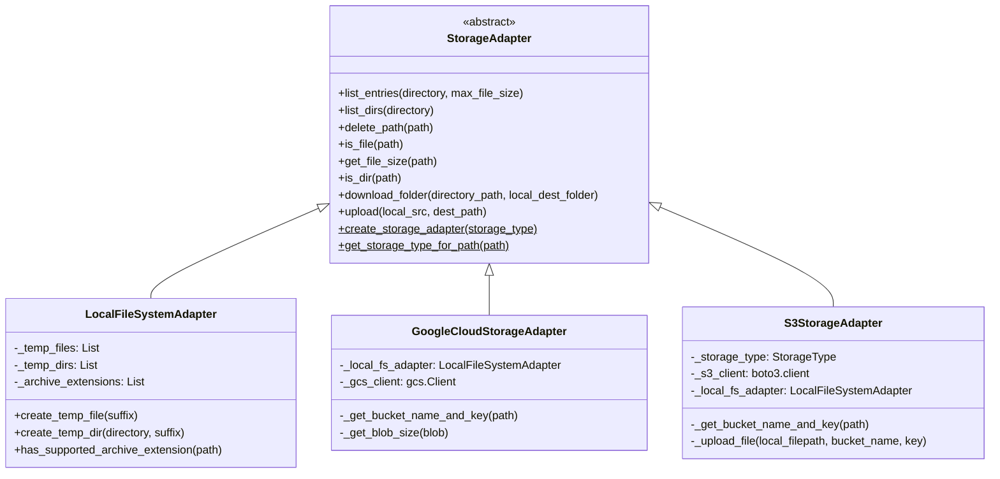
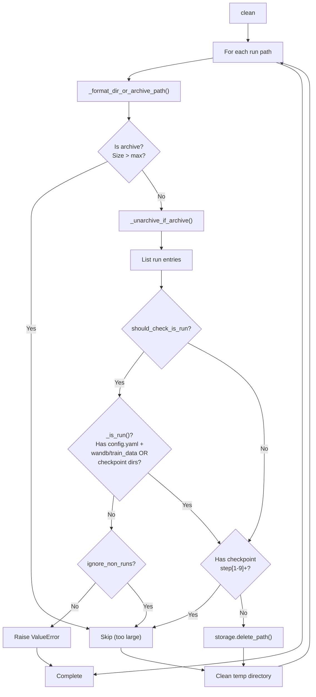
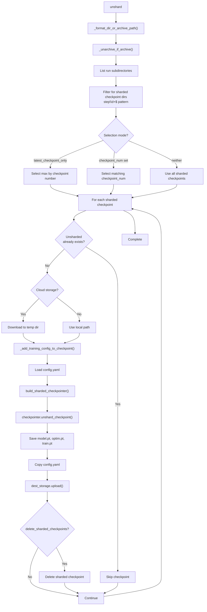
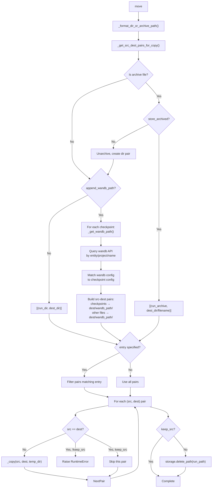
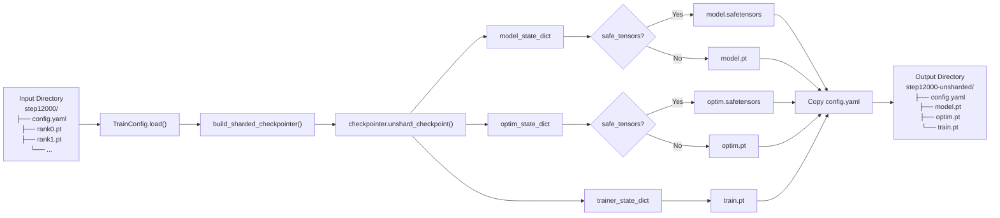
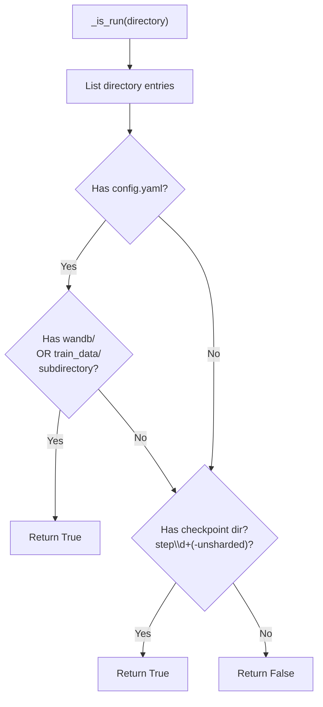

<!-- source: DeepWiki mcp.deepwiki.com · repo allenai/OLMo · page 4.2 Storage Management · fetched 2026-10-26 -->

# Storage Management

<details>
<summary>Relevant source files</summary>

The following files were used as context for generating this wiki page:

- [scripts/storage_cleaner.py](scripts/storage_cleaner.py)
- [scripts/unshard.py](scripts/unshard.py)
- [tests/checkpoint_test.py](tests/checkpoint_test.py)

</details>


This page documents the storage management utilities for managing OLMo checkpoints across different storage backends. These tools handle checkpoint lifecycle operations including cleaning failed runs, converting sharded checkpoints to unsharded format, and relocating checkpoints between storage systems.

**Scope**: This page covers the `storage_cleaner.py` and `unshard.py` utilities. For information about checkpoint formats and the sharding mechanism itself, see [Checkpoint Formats and Sharding](#4.1). For converting checkpoints to Hugging Face format, see [Hugging Face Integration](#4.3).

## Overview

The OLMo repository provides two primary storage management utilities:

| Utility | Purpose | Key Operations |
|---------|---------|----------------|
| `storage_cleaner.py` | Comprehensive checkpoint management across storage backends | Delete bad runs, unshard checkpoints in-place, move/reorganize runs |
| `unshard.py` | Standalone checkpoint unsharding | Convert sharded checkpoint to unsharded format |

Both tools support multiple storage backends (local filesystem, Google Cloud Storage, AWS S3, Cloudflare R2) and handle complex checkpoint transformations while preserving training state.

**Sources**: [scripts/storage_cleaner.py:1-50](), [scripts/unshard.py:1-20]()

## Storage Adapter Architecture

The storage management system abstracts storage operations through a unified `StorageAdapter` interface, enabling seamless operation across different storage backends.

### StorageAdapter Interface

The abstract `StorageAdapter` class defines the core operations for interacting with storage systems:



**Sources**: [scripts/storage_cleaner.py:53-126]()

### Storage Type Detection

Storage type is automatically detected from path schemes:

| Storage Type | URL Scheme | Example Path |
|--------------|------------|--------------|
| `LOCAL_FS` | (none) or `file://` | `/path/to/checkpoint` |
| `GCS` | `gs://` | `gs://bucket-name/checkpoint` |
| `S3` | `s3://` | `s3://bucket-name/checkpoint` |
| `R2` | `r2://` | `r2://bucket-name/checkpoint` |

The `get_storage_type_for_path()` method parses the URL scheme to determine the appropriate adapter, while `create_storage_adapter()` instantiates the correct implementation.

**Sources**: [scripts/storage_cleaner.py:46-51](), [scripts/storage_cleaner.py:108-126]()

### LocalFileSystemAdapter

The `LocalFileSystemAdapter` provides additional functionality for local storage operations:

- **Temporary file/directory management**: Creates and tracks temporary resources that are automatically cleaned up via `__del__`
- **Archive format detection**: Identifies supported archive extensions (`.tar.gz`, `.zip`, etc.) using `shutil.get_unpack_formats()`
- **File size filtering**: Supports `max_file_size` parameter in `list_entries()` to exclude large files

The adapter manages temporary resources through internal lists `_temp_files` and `_temp_dirs` to ensure cleanup even if exceptions occur.

**Sources**: [scripts/storage_cleaner.py:128-226]()

### Cloud Storage Adapters

Both `GoogleCloudStorageAdapter` and `S3StorageAdapter` implement cloud-specific operations:

**GoogleCloudStorageAdapter**:
- Uses `google.cloud.storage.Client` for GCS API access
- Implements prefix-based listing with delimiter for directory-like structure
- Batch deletion support via `bucket.delete_blobs()`
- Progress tracking with `rich.progress.track()` during downloads

**S3StorageAdapter**:
- Supports both AWS S3 and Cloudflare R2 via endpoint configuration
- Uses `list_objects_v2` with delimiter for directory simulation
- Batch deletion in chunks of 1000 objects (S3 API limit)
- Multi-threaded uploads via `TransferConfig(max_concurrency=4)`
- Validates deletion operations to prevent accidental data loss

**Sources**: [scripts/storage_cleaner.py:228-390](), [scripts/storage_cleaner.py:392-604]()

## Storage Cleaner Operations

The `storage_cleaner.py` script provides three primary operations, each with specific configuration options.

### Operation: Delete Bad Runs

The `clean` command identifies and removes training runs that failed or produced no useful checkpoints.



**Configuration** (`DeleteBadRunsConfig`):

| Parameter | Type | Default | Description |
|-----------|------|---------|-------------|
| `dry_run` | bool | - | Preview deletions without executing |
| `should_check_is_run` | bool | True | Verify path is a training run before deletion |
| `ignore_non_runs` | bool | False | Skip non-run paths instead of raising error |
| `max_archive_size` | int | 5GB | Skip archive files larger than this threshold |

**Run Identification Logic**:

A directory or archive is considered a run if it contains:
1. `config.yaml` AND (`wandb/` subdirectory OR `train_data/` subdirectory), OR
2. At least one checkpoint directory matching pattern `step\d+(-unsharded)?`

A run is considered "bad" (eligible for deletion) if it has only trivial checkpoints (`step0`, `step0-unsharded`) or no checkpoints at all.

**Sources**: [scripts/storage_cleaner.py:756-766](), [scripts/storage_cleaner.py:647-675](), [scripts/storage_cleaner.py:714-753]()

### Operation: Unshard Checkpoints

The `unshard` command converts sharded checkpoints to single-file format, optionally replacing the sharded versions.



**Configuration** (`UnshardCheckpointsConfig`):

| Parameter | Type | Default | Description |
|-----------|------|---------|-------------|
| `dry_run` | bool | - | Preview operations without executing |
| `latest_checkpoint_only` | bool | False | Unshard only the highest-numbered checkpoint |
| `delete_sharded_checkpoints` | bool | False | Remove sharded version after successful unsharding |
| `checkpoint_num` | int | None | Unshard only this specific checkpoint number |

**Unsharding Process**:

1. **Download**: If checkpoint is in cloud storage, download to temporary directory
2. **Config Addition**: If `config.yaml` missing from checkpoint, copy from run directory
3. **Load Config**: Parse `config.yaml` to determine `sharded_checkpointer` type
4. **Build Checkpointer**: Instantiate appropriate `ShardedCheckpointer` (torch_new, torch_legacy, local, olmo_core)
5. **Unshard**: Call `checkpointer.unshard_checkpoint()` to gather distributed state
6. **Save**: Write `model.pt`, `optim.pt`, `train.pt` to output directory
7. **Upload**: Upload unsharded checkpoint to destination storage

The unsharding uses a dummy `TrainConfig` because legacy checkpoints may not be compatible with current config schemas, but no config settings are needed for the unsharding operation itself.

**Sources**: [scripts/storage_cleaner.py:942-1005](), [scripts/storage_cleaner.py:851-939]()

### Operation: Move Run

The `move` command relocates runs between storage locations, with optional wandb path organization.



**Configuration** (`MoveRunConfig`):

| Parameter | Type | Default | Description |
|-----------|------|---------|-------------|
| `dry_run` | bool | - | Preview operations without executing |
| `append_wandb_path` | bool | False | Organize by wandb run path (entity/project/run_id) |
| `keep_src` | bool | False | Retain source after copying to destination |
| `store_archived` | bool | True | Keep archive format (vs. unarchiving before storage) |
| `entry` | str | None | Move only this specific file/directory within run |

**Wandb Path Resolution**:

When `append_wandb_path=True`, the tool queries the Weights & Biases API to find the correct wandb run path:

1. Extract wandb configuration from checkpoint's `config.yaml`
2. Query wandb API: `api.runs(entity/project, filters={name, group})`
3. Also check local `wandb/` directory for run metadata
4. Match wandb runs to checkpoint by comparing full configs (excluding wandb section)
5. Construct destination path as `dest_dir/entity/project/run_id/`

This enables organizing checkpoints by their wandb lineage, useful for consolidating multi-run experiments.

**Sources**: [scripts/storage_cleaner.py:1275-1279](), [scripts/storage_cleaner.py:1160-1233](), [scripts/storage_cleaner.py:1074-1108]()

## Standalone Unshard Utility

The `unshard.py` script provides a simpler, direct interface for checkpoint unsharding without the additional features of `storage_cleaner.py`.

### Usage

```bash
python scripts/unshard.py <input_dir> <output_dir> [options]
```

**Command-line Arguments**:

| Argument | Type | Description |
|----------|------|-------------|
| `input_dir` | Path | Directory containing sharded checkpoint |
| `output_dir` | Path | Output directory for unsharded checkpoint |
| `--type` | ShardedCheckpointerType | Override checkpoint type (torch_new, torch_legacy, local, olmo_core) |
| `--model-only` | Flag | Save only model weights, skip optimizer and trainer state |
| `--safe-tensors` | Flag | Save as `.safetensors` format instead of `.pt` |
| `--use-legacy-shared-mem-impl` | Flag | Use shared memory implementation for torch_legacy (faster for large world sizes) |

### Unshard Operation Flow



**Key Differences from storage_cleaner.py**:

| Feature | unshard.py | storage_cleaner.py unshard |
|---------|------------|---------------------------|
| Cloud storage | No (local only) | Yes (all backends) |
| Batch processing | Single checkpoint | Multiple checkpoints in run |
| Archive handling | No | Yes (automatic unarchiving) |
| Config injection | No | Yes (copies from run dir if missing) |
| Deletion of sharded | No | Optional via `--delete_sharded` |
| Safetensors support | Yes | No |

The standalone utility is designed for simple, one-off unsharding tasks where full storage management features are not needed.

**Sources**: [scripts/unshard.py:15-75](), [scripts/unshard.py:77-116]()

## Run Identification and Validation

The storage cleaner implements heuristics to identify training runs and distinguish them from arbitrary directories.

### Run Detection Heuristics

The `_is_run()` function applies these rules:



**Rationale**: This approach prioritizes minimizing false positives (non-runs marked as runs) to prevent accidental deletion of important directories. False negatives (runs not recognized) are acceptable as they simply result in skipped directories.

**Archive File Handling**: For archive files, the tool uses `cached_path` to extract the archive to a temporary location, then applies run detection to the extracted contents. After extraction, if the top-level directory contains only a single subdirectory, that subdirectory is used instead (handles archives with redundant wrapper directories).

**Sources**: [scripts/storage_cleaner.py:647-665](), [scripts/storage_cleaner.py:692-711]()

### Checkpoint Classification

Checkpoints are classified as trivial or non-trivial:

- **Trivial**: `step0` or `step0-unsharded` (initialization checkpoint)
- **Non-trivial**: Any checkpoint with step number ≥ 1

The `_contains_nontrivial_checkpoint_dir()` function uses regex `step[1-9]\d*(-unsharded)?` to identify non-trivial checkpoints. Only runs with exclusively trivial checkpoints (or no checkpoints) are eligible for deletion.

**Sources**: [scripts/storage_cleaner.py:639-644](), [scripts/storage_cleaner.py:714-740]()

## Command-Line Interface

The storage cleaner provides a comprehensive CLI with subcommands for each operation.

### Base Arguments

Available for all subcommands:

```bash
python scripts/storage_cleaner.py [-n] [--temp_dir DIR] <subcommand> [args]
```

| Argument | Description |
|----------|-------------|
| `-n, --dry_run` | Preview actions without executing them |
| `--temp_dir DIR` | Local directory for temporary files (downloads, unarchived content) |

### Subcommand: clean

```bash
python scripts/storage_cleaner.py clean <run_paths...> [options]
```

| Option | Description |
|--------|-------------|
| `--bypass_run_verification` | (UNSAFE) Skip run detection, delete any directory |
| `--ignore_non_runs` | Skip non-run directories instead of raising error |
| `--max_archive_size BYTES` | Max archive size to consider (default: 5GB) |

**Example**:
```bash
# Delete bad runs from S3, dry run first
python scripts/storage_cleaner.py -n clean s3://bucket/experiment-1 s3://bucket/experiment-2

# Actually delete, ignore non-runs
python scripts/storage_cleaner.py clean --ignore_non_runs s3://bucket/experiment-*
```

### Subcommand: unshard

```bash
python scripts/storage_cleaner.py unshard <run_path> <dest_dir> [options]
```

| Option | Description |
|--------|-------------|
| `--latest_checkpoint_only` | Unshard only the latest checkpoint |
| `--delete_sharded` | Delete sharded checkpoint after successful unsharding |
| `--checkpoint_num NUM` | Unshard only checkpoint with this step number |

**Example**:
```bash
# Unshard latest checkpoint from GCS run to S3
python scripts/storage_cleaner.py unshard \
    gs://bucket/run-abc123 \
    s3://dest-bucket/run-abc123-unsharded \
    --latest_checkpoint_only

# Unshard specific checkpoint and delete sharded version
python scripts/storage_cleaner.py unshard \
    /local/run \
    /local/run-unsharded \
    --checkpoint_num 12000 \
    --delete_sharded
```

### Subcommand: move

```bash
python scripts/storage_cleaner.py move <run_path> <dest_dir> [options]
```

| Option | Description |
|--------|-------------|
| `--keep_src` | Do not delete source after copying |
| `--unarchive` | Extract archive before storing at destination |
| `--append_wandb_path` | Organize by wandb run path (entity/project/run_id) |
| `--entry NAME` | Move only this specific file/directory from run |

**Example**:
```bash
# Move run from S3 to GCS, organized by wandb path
python scripts/storage_cleaner.py move \
    s3://bucket/run-abc123 \
    gs://dest-bucket/organized/ \
    --append_wandb_path

# Copy only unsharded checkpoint, keep source
python scripts/storage_cleaner.py move \
    /local/run \
    s3://backup/run \
    --entry step12000-unsharded \
    --keep_src
```

**Sources**: [scripts/storage_cleaner.py:1476-1505](), [scripts/storage_cleaner.py:1377-1475]()

## Integration with Cached Path

The storage cleaner leverages the `cached_path` library for transparent handling of remote resources.

### S3 Scheme Client

A custom `S3SchemeClient` is registered to support both `s3://` and `r2://` schemes:

```python
class S3SchemeClient(S3Client):
    scheme = ("s3", "r2")
    
    def __init__(self, resource: str):
        # Parses s3://bucket/key or r2://bucket/key
        # Uses appropriate endpoint URL and profile for each scheme
```

This enables `cached_path()` to automatically download and cache remote files, with proper handling of S3-compatible services (R2) that use different endpoints.

**Cache Directory Configuration**: The `set_cache_dir()` function configures where `cached_path` stores downloaded files, defaulting to the temporary directory specified via `--temp_dir`.

**Sources**: [scripts/storage_cleaner.py:1282-1314]()

## Error Handling and Validation

The storage cleaner implements comprehensive validation to prevent data loss:

### Deletion Safeguards

1. **Run Verification**: By default, verifies directories are training runs before deletion
2. **Archive Size Limit**: Skips deletion of large archives (default 5GB) to avoid removing important backups
3. **Batch Deletion Validation**: For S3, verifies all requested objects were deleted and no extra objects were removed

### Move Operation Validation

1. **Source-Destination Conflict**: Raises error if source equals destination and `keep_src=False`
2. **File-Directory Mismatch**: Prevents moving file to directory path or vice versa
3. **Entry Existence**: Validates specified `--entry` exists within run before attempting move
4. **Wandb Path Resolution**: Raises error if no matching wandb run found or multiple matches found

### Unsharding Error Recovery

If unsharding fails:
1. Exception is logged with full traceback
2. Temporary output directory is deleted
3. If config was added to input, it is removed (restores original state)
4. Operation returns `False`, allowing batch processing to continue

**Sources**: [scripts/storage_cleaner.py:668-674](), [scripts/storage_cleaner.py:1250-1259](), [scripts/storage_cleaner.py:894-907]()

---

