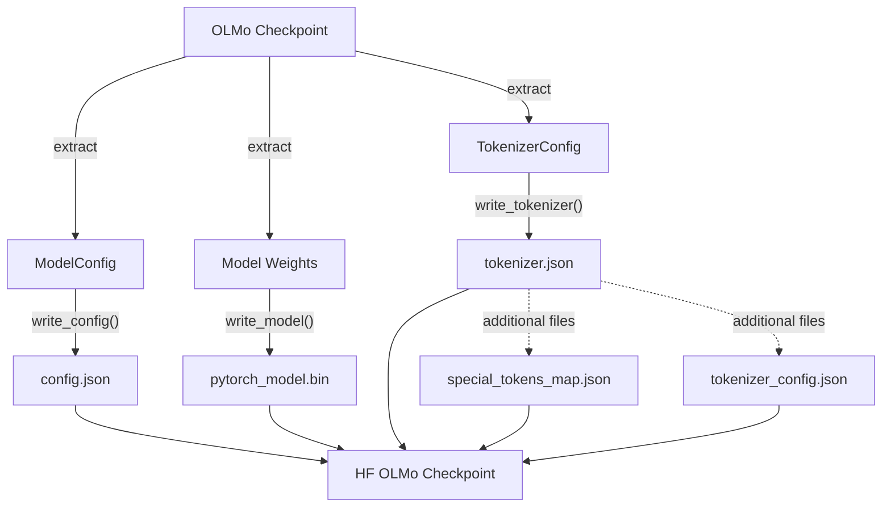
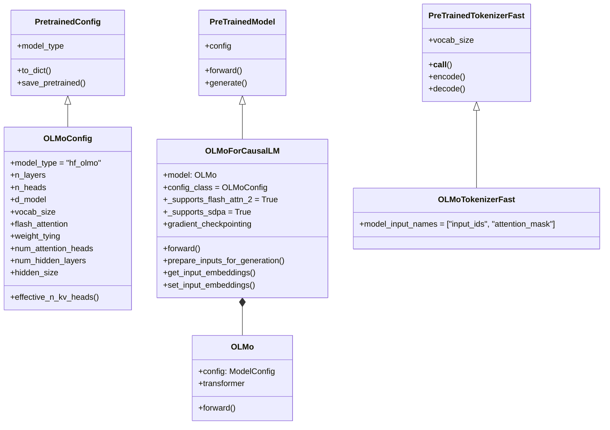
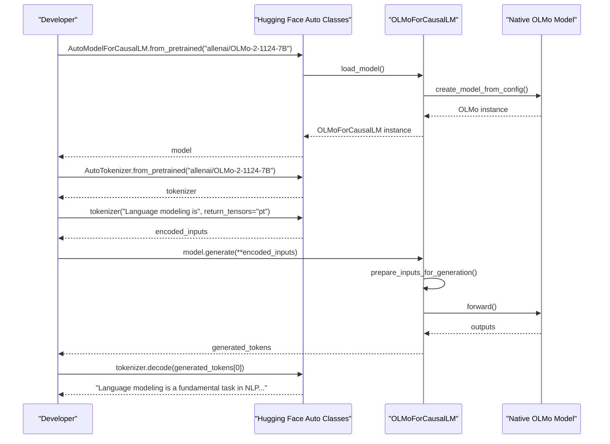

<!-- source: DeepWiki mcp.deepwiki.com · repo allenai/OLMo · page 4.3 Hugging Face Integration · fetched 2026-10-26 -->

# Hugging Face Integration

<details>
<summary>Relevant source files</summary>

The following files were used as context for generating this wiki page:

- [README.md](README.md)
- [configs/official-0425/OLMo2-1B-stage1.yaml](configs/official-0425/OLMo2-1B-stage1.yaml)
- [configs/official-0425/OLMo2-1B-stage2-seed42.yaml](configs/official-0425/OLMo2-1B-stage2-seed42.yaml)
- [configs/official-0425/OLMo2-1B-stage2-seed42069.yaml](configs/official-0425/OLMo2-1B-stage2-seed42069.yaml)
- [configs/official-0425/OLMo2-1B-stage2-seed666.yaml](configs/official-0425/OLMo2-1B-stage2-seed666.yaml)
- [configs/official-1124/OLMo2-13B-stage1.yaml](configs/official-1124/OLMo2-13B-stage1.yaml)
- [configs/official-1124/OLMo2-13B-stage2-seed1110-100B.yaml](configs/official-1124/OLMo2-13B-stage2-seed1110-100B.yaml)
- [configs/official-1124/OLMo2-13B-stage2-seed2662-100B.yaml](configs/official-1124/OLMo2-13B-stage2-seed2662-100B.yaml)
- [configs/official-1124/OLMo2-13B-stage2-seed2662-300B.yaml](configs/official-1124/OLMo2-13B-stage2-seed2662-300B.yaml)
- [configs/official-1124/OLMo2-13B-stage2-seed6209-100B.yaml](configs/official-1124/OLMo2-13B-stage2-seed6209-100B.yaml)
- [configs/official-1124/OLMo2-7B-stage1.yaml](configs/official-1124/OLMo2-7B-stage1.yaml)
- [configs/official-1124/OLMo2-7B-stage2-seed42.yaml](configs/official-1124/OLMo2-7B-stage2-seed42.yaml)
- [configs/official-1124/OLMo2-7B-stage2-seed42069.yaml](configs/official-1124/OLMo2-7B-stage2-seed42069.yaml)
- [configs/official-1124/OLMo2-7B-stage2-seed666.yaml](configs/official-1124/OLMo2-7B-stage2-seed666.yaml)
- [scripts/olmo2_modal_openai.py](scripts/olmo2_modal_openai.py)
- [scripts/storage_cleaner.py](scripts/storage_cleaner.py)
- [scripts/unshard.py](scripts/unshard.py)
- [tests/checkpoint_test.py](tests/checkpoint_test.py)

</details>


This page documents the integration between OLMo and the Hugging Face ecosystem, allowing users to leverage Hugging Face's tools and infrastructure for utilizing OLMo models. This integration enables loading OLMo checkpoints into the Hugging Face Transformers format, using OLMo models with Hugging Face interfaces for inference, and deploying models using Hugging Face's infrastructure.

OLMo provides both a custom Hugging Face integration through the `hf_olmo` package and is also directly integrated into the Hugging Face Transformers library (from v4.40.0 onward). The `hf_olmo` package implementation may support newer architectures or features not yet available in the official Hugging Face implementation.

## Conversion Process

The repository provides multiple scripts to convert OLMo checkpoints to Hugging Face format:



Sources: [hf_olmo/convert_olmo_to_hf.py](), [scripts/convert_olmo_to_hf_new.py]()

### Original Conversion Script

The `convert_olmo_to_hf.py` script in the `hf_olmo` package converts OLMo checkpoints to work with the custom Hugging Face integration:

```bash
python hf_olmo/convert_olmo_to_hf.py --checkpoint-dir /path/to/olmo/checkpoint
```

This script:
1. Extracts and converts the model configuration to `config.json`
2. Transforms model weights into Hugging Face's expected format
3. Adapts the tokenizer for use with Hugging Face's interfaces

Sources: [hf_olmo/convert_olmo_to_hf.py:88-111](), [hf_olmo/convert_olmo_to_hf.py:248-311]()

### Newer Conversion Script

The newer `convert_olmo_to_hf_new.py` script uses the official Hugging Face OLMo implementation:

```bash
python scripts/convert_olmo_to_hf_new.py \
    --input_dir /path/to/olmo/checkpoint \
    --output_dir /path/to/output \
    --safe_serialization True
```

This script follows the same general workflow but outputs a model compatible with the official Hugging Face Transformers implementation of OLMo.

Sources: [scripts/convert_olmo_to_hf_new.py:59-196](), [scripts/convert_olmo_to_hf_new.py:198-230]()

### S3 Convenience Script

For research environments using S3 storage, the `s3_unshard_to_hf.py` script provides a streamlined workflow:

```bash
python scripts/s3_unshard_to_hf.py \
    --sharded_bucket s3://bucket/path/checkpoint \
    --unsharded_bucket s3://bucket/path/checkpoint-unsharded \
    --hf_bucket s3://bucket/path/checkpoint-huggingface \
    --local_dir /tmp/conversion
```

This script:
1. Downloads sharded checkpoints from S3
2. Unshards the checkpoint
3. Converts to Hugging Face format
4. Uploads the converted checkpoint back to S3

Sources: [scripts/s3_unshard_to_hf.py:24-76](), [scripts/s3_unshard_to_hf.py:91-168]()

## Model Architecture

The Hugging Face integration consists of three main classes that wrap the original OLMo implementation:



Sources: [hf_olmo/configuration_olmo.py](), [hf_olmo/modeling_olmo.py](), [hf_olmo/tokenization_olmo_fast.py]()

### OLMoConfig

The `OLMoConfig` class extends Hugging Face's `PretrainedConfig` to represent OLMo model configurations:

```python
class OLMoConfig(PretrainedConfig):
    model_type = "hf_olmo"
    
    # Properties map OLMo parameter names to HF expected names
    @property
    def num_attention_heads(self):
        return self.n_heads

    @property
    def num_hidden_layers(self):
        return self.n_layers

    @property
    def hidden_size(self):
        return self.d_model
        
    @property
    def effective_n_kv_heads(self) -> int:
        # Logic to determine effective KV heads based on multi-query attention
        # and n_kv_heads settings
```

Sources: [hf_olmo/configuration_olmo.py:14-65]()

### OLMoForCausalLM

The `OLMoForCausalLM` class extends Hugging Face's `PreTrainedModel` to wrap the original OLMo model:

```python
class OLMoForCausalLM(PreTrainedModel):
    config_class = OLMoConfig
    base_model_prefix = "model"
    _no_split_modules = ["OLMoBlock"]
    _supports_flash_attn_2 = True
    _supports_sdpa = True
    
    def __init__(self, config: OLMoConfig, model: Optional[OLMo] = None, init_params: bool = False):
        # Initialize with either provided OLMo model or create new one from config
        
    def forward(
        self,
        input_ids: torch.LongTensor = None,
        inputs_embeds: Optional[torch.FloatTensor] = None,
        attention_mask: Optional[torch.Tensor] = None,
        past_key_values: Optional[List[torch.FloatTensor]] = None,
        labels: Optional[torch.LongTensor] = None,
        use_cache: Optional[bool] = None,
        output_hidden_states: Optional[bool] = None,
        return_dict: Optional[bool] = None,
    ) -> Union[Tuple, CausalLMOutputWithPast]:
        # Adapt OLMo's forward method to match Hugging Face's expected interface
        
    def prepare_inputs_for_generation(self, input_ids, past_key_values=None, **kwargs):
        # Only process the last token when generating text
```

Sources: [hf_olmo/modeling_olmo.py:41-168]()

### OLMoTokenizerFast

The `OLMoTokenizerFast` class extends Hugging Face's `PreTrainedTokenizerFast`:

```python
class OLMoTokenizerFast(PreTrainedTokenizerFast):
    # Primarily a wrapper around the Hugging Face tokenizer
    # OLMo's tokenizer is already built on HuggingFace's tokenizers library
    pass
```

Sources: [hf_olmo/tokenization_olmo_fast.py:1-17](), [olmo/tokenizer.py:18-199]()

## Using OLMo with Hugging Face

Once converted, OLMo models can be used with standard Hugging Face interfaces:



Sources: [README.md:148-159](), [README.md:162-167]()

### Basic Usage

```python
from transformers import AutoModelForCausalLM, AutoTokenizer

# Load model and tokenizer
model = AutoModelForCausalLM.from_pretrained("allenai/OLMo-2-1124-7B")
tokenizer = AutoTokenizer.from_pretrained("allenai/OLMo-2-1124-7B")

# Prepare input
message = ["Language modeling is "]
inputs = tokenizer(message, return_tensors='pt', return_token_type_ids=False)

# Generate text
response = model.generate(**inputs, max_new_tokens=100, do_sample=True, top_k=50, top_p=0.95)
print(tokenizer.batch_decode(response, skip_special_tokens=True)[0])
```

Sources: [README.md:148-159]()

### Using Pipelines

```python
from transformers import pipeline

olmo_pipe = pipeline("text-generation", model="allenai/OLMo-2-1124-7B")
print(olmo_pipe("Language modeling is", max_new_tokens=100))
```

Sources: [README.md:162-167](), [tests/hf_olmo/hf_pipeline_test.py:1-12]()

### Advanced Features

#### Quantization

OLMo models support weight quantization for reduced memory footprint:

```python
import torch
from transformers import AutoModelForCausalLM

model = AutoModelForCausalLM.from_pretrained(
    "allenai/OLMo-2-1124-7B", 
    torch_dtype=torch.float16, 
    load_in_8bit=True  # requires bitsandbytes
)
```

Sources: [README.md:171-176]()

#### Flash Attention and SDPA

OLMo supports both Flash Attention 2 and Scaled Dot Product Attention (SDPA):

```python
# Using Flash Attention 2
model = AutoModelForCausalLM.from_pretrained(
    "allenai/OLMo-2-1124-7B", 
    attn_implementation="flash_attention_2"
)

# Using SDPA
model = AutoModelForCausalLM.from_pretrained(
    "allenai/OLMo-2-1124-7B", 
    attn_implementation="sdpa"
)
```

Sources: [hf_olmo/modeling_olmo.py:49-50](), [tests/hf_olmo/modeling_olmo_test.py:27-62]()

#### Gradient Checkpointing

For training with limited memory, gradient checkpointing is supported:

```python
model = AutoModelForCausalLM.from_pretrained("allenai/OLMo-2-1124-7B")
model.gradient_checkpointing_enable()
```

Sources: [hf_olmo/modeling_olmo.py:67-82](), [tests/hf_olmo/modeling_olmo_test.py:65-103]()

## Modal.com Deployment

The repository includes a script for hosting OLMo models on Modal.com with an OpenAI-compatible API:

```python
# Deploy using Modal
modal deploy ./scripts/olmo2_modal_openai.py
```

This creates an endpoint that can be queried using the OpenAI API format:

```bash
curl -X POST \
  -H "Authorization: Bearer [token]" \
  -H "Content-Type: application/json" \
  -d '{
    "model": "OLMo-2-1124-13B-Instruct",
    "messages": [
        {
            "role": "user",
            "content": "Who was Alan Turing?"
        }
      ],
    "max_tokens": 100,
    "temperature": 0.9,
    "stream": true
  }' \
  https://[endpoint]/v1/chat/completions
```

The script uses vLLM for efficient inference and provides a fully OpenAI-compatible API interface.

Sources: [README.md:181-218](), [scripts/olmo2_modal_openai.py:1-250]()

## Available Models

The following OLMo models are available on Hugging Face Hub:

| Model | Base Model | HF Hub Link |
|-------|------------|-------------|
| OLMo-2 7B | Pre-trained | [allenai/OLMo-2-1124-7B](https://huggingface.co/allenai/OLMo-2-1124-7B) |
| OLMo-2 13B | Pre-trained | [allenai/OLMo-2-1124-13B](https://huggingface.co/allenai/OLMo-2-1124-13B) |
| OLMo-2 32B | Pre-trained | [allenai/OLMo-2-0325-32B](https://huggingface.co/allenai/OLMo-2-0325-32B) |
| OLMo-2 7B Instruct | Instruction-tuned | [allenai/OLMo-2-1124-7B-Instruct](https://huggingface.co/allenai/OLMo-2-1124-7B-Instruct) |
| OLMo-2 13B Instruct | Instruction-tuned | [allenai/OLMo-2-1124-13B-Instruct](https://huggingface.co/allenai/OLMo-2-1124-13B-Instruct) |
| OLMo-2 32B Instruct | Instruction-tuned | [allenai/OLMo-2-0325-32B-Instruct](https://huggingface.co/allenai/OLMo-2-0325-32B-Instruct) |

Sources: [README.md:139-142]()

---

