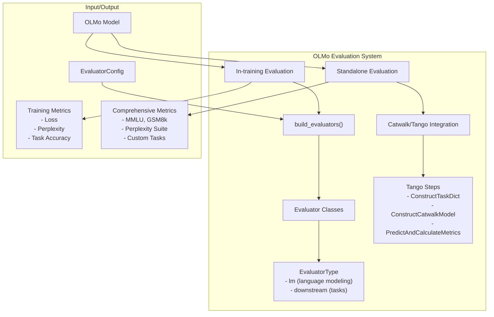
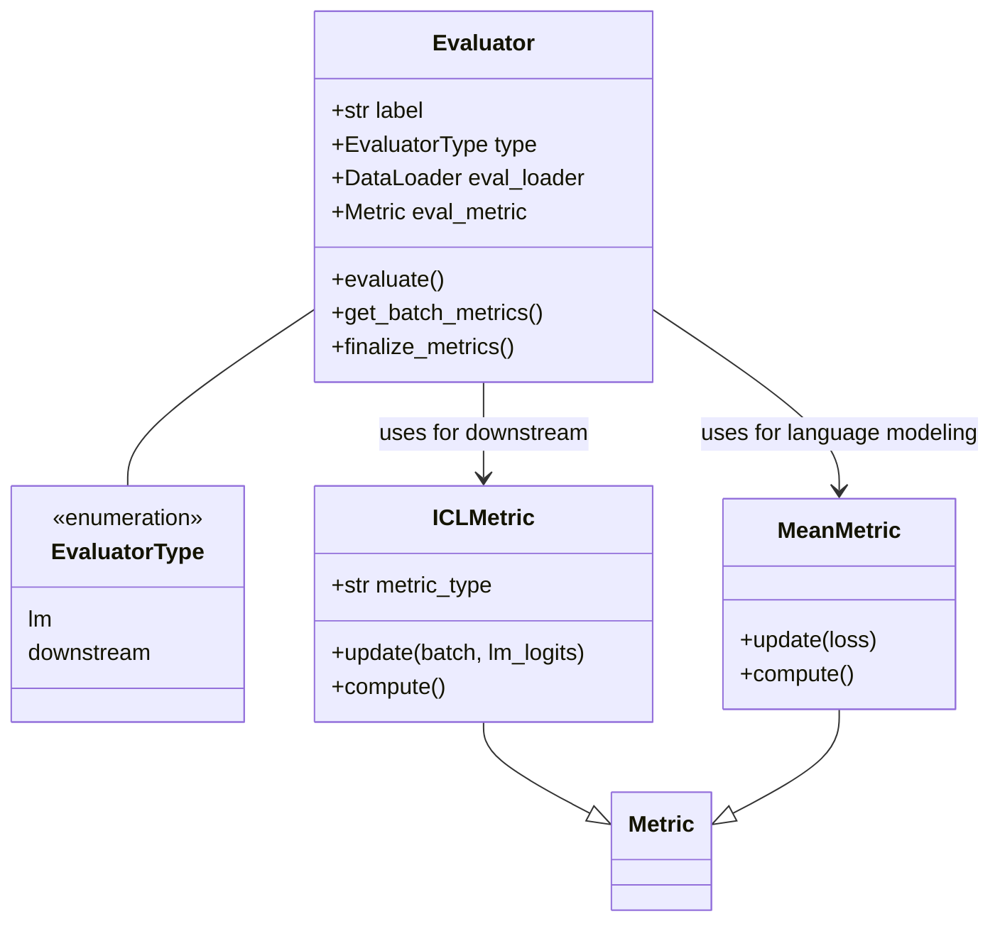
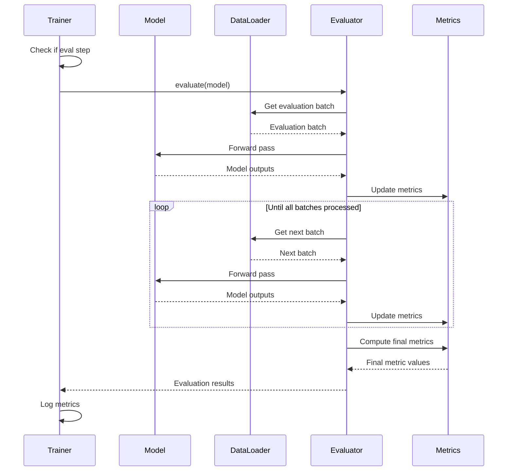
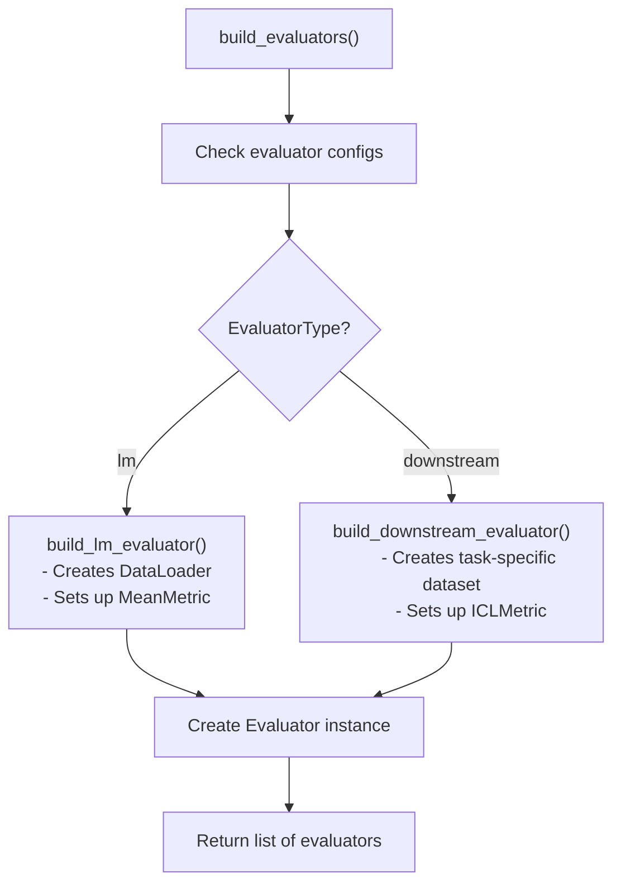
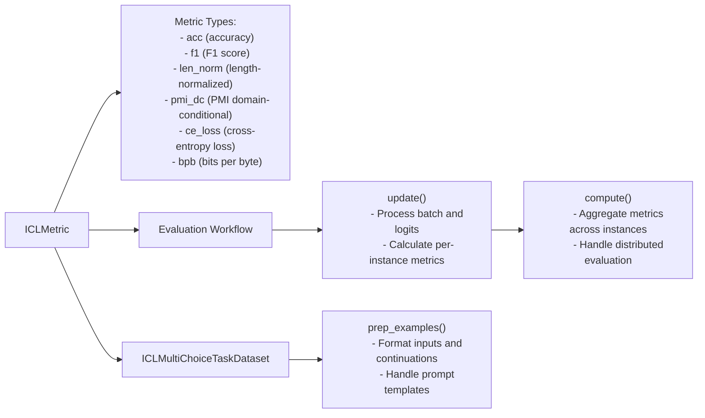
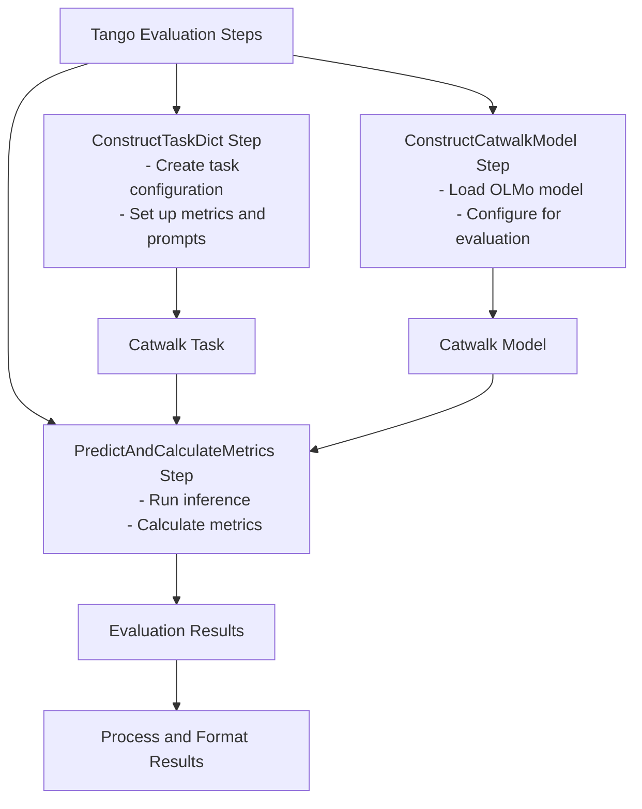
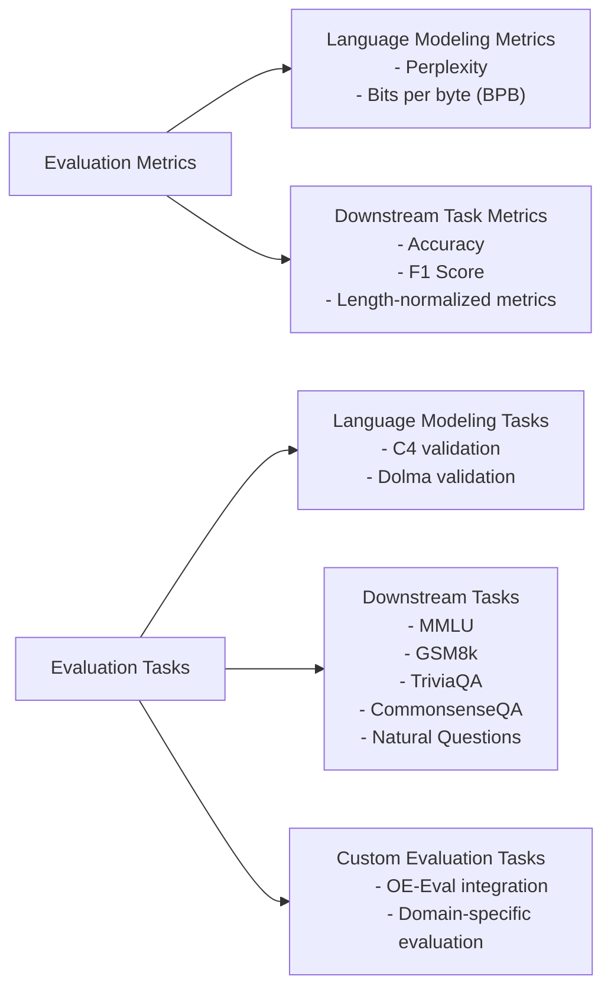
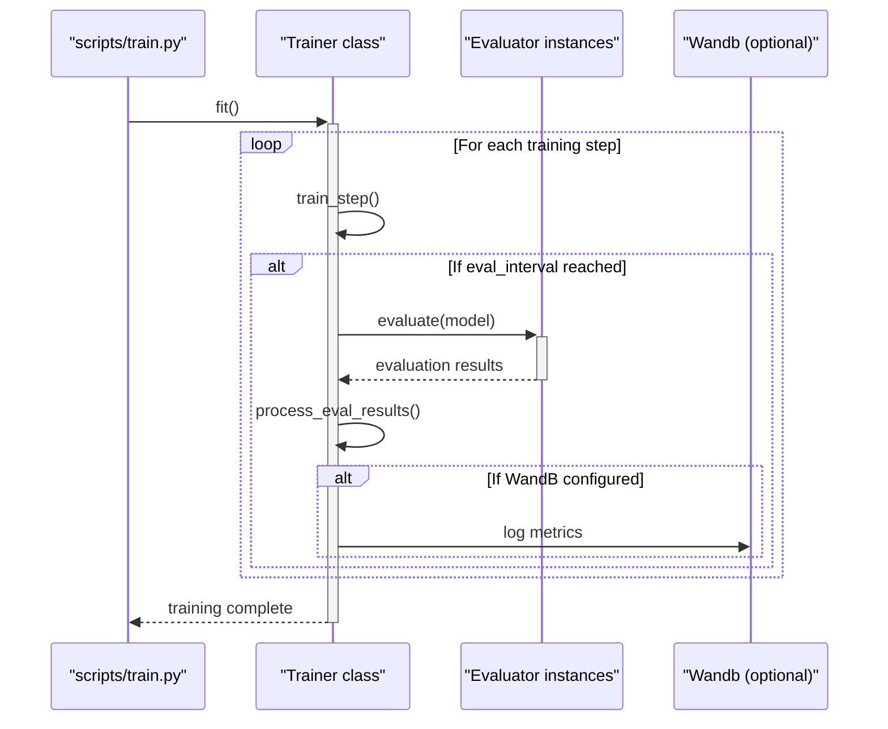
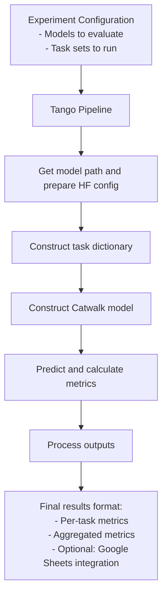
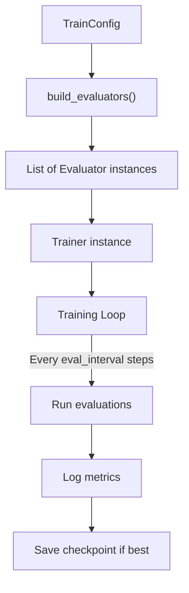

<!-- source: DeepWiki mcp.deepwiki.com · repo allenai/OLMo · page 5 Evaluation System · fetched 2026-10-26 -->

# Evaluation System

<details>
<summary>Relevant source files</summary>

The following files were used as context for generating this wiki page:

- [CHANGELOG.md](CHANGELOG.md)
- [evaluation/README.md](evaluation/README.md)
- [evaluation/__init__.py](evaluation/__init__.py)
- [evaluation/experiments/evaluation_2023_07_26.jsonnet](evaluation/experiments/evaluation_2023_07_26.jsonnet)
- [evaluation/experiments/task_sets/eval_suite_ppl_val_v2_small.libsonnet](evaluation/experiments/task_sets/eval_suite_ppl_val_v2_small.libsonnet)
- [evaluation/experiments/task_sets/gen_tasks.libsonnet](evaluation/experiments/task_sets/gen_tasks.libsonnet)
- [evaluation/experiments/task_sets/rc20_tasks.libsonnet](evaluation/experiments/task_sets/rc20_tasks.libsonnet)
- [evaluation/experiments/task_sets/summary_tasks.libsonnet](evaluation/experiments/task_sets/summary_tasks.libsonnet)
- [evaluation/experiments/task_sets/task_utils.libsonnet](evaluation/experiments/task_sets/task_utils.libsonnet)
- [evaluation/experiments/task_sets/test_sets/test_eval_suite_ppl_val_v2_small.libsonnet](evaluation/experiments/task_sets/test_sets/test_eval_suite_ppl_val_v2_small.libsonnet)
- [evaluation/experiments/task_sets/test_sets/test_gen_tasks.libsonnet](evaluation/experiments/task_sets/test_sets/test_gen_tasks.libsonnet)
- [evaluation/experiments/task_sets/test_sets/test_rc20_tasks.libsonnet](evaluation/experiments/task_sets/test_sets/test_rc20_tasks.libsonnet)
- [evaluation/experiments/test_config.jsonnet](evaluation/experiments/test_config.jsonnet)
- [evaluation/experiments/utils.libsonnet](evaluation/experiments/utils.libsonnet)
- [evaluation/requirements.txt](evaluation/requirements.txt)
- [evaluation/see_available_tasks.py](evaluation/see_available_tasks.py)
- [evaluation/steps/__init__.py](evaluation/steps/__init__.py)
- [evaluation/steps/get_model.py](evaluation/steps/get_model.py)
- [evaluation/steps/run_catwalk.py](evaluation/steps/run_catwalk.py)
- [evaluation/tango-in-beaker.yml](evaluation/tango-in-beaker.yml)
- [olmo/eval/__init__.py](olmo/eval/__init__.py)
- [olmo/eval/downstream.py](olmo/eval/downstream.py)
- [olmo/eval/evaluator.py](olmo/eval/evaluator.py)
- [olmo/version.py](olmo/version.py)
- [olmo_data/oe_eval_tasks/gsm8k/gold_bpb_5shot/config.json](olmo_data/oe_eval_tasks/gsm8k/gold_bpb_5shot/config.json)
- [olmo_data/oe_eval_tasks/gsm8k/gold_bpb_5shot/requests.jsonl.gz](olmo_data/oe_eval_tasks/gsm8k/gold_bpb_5shot/requests.jsonl.gz)
- [pyproject.toml](pyproject.toml)
- [scripts/flops_by_perf_figure.py](scripts/flops_by_perf_figure.py)
- [scripts/list_evals_from_oe_eval.py](scripts/list_evals_from_oe_eval.py)
- [test_fixtures/evaluation/ppl-test-data/4chan/val/4chan_00000000.jsonl.gz](test_fixtures/evaluation/ppl-test-data/4chan/val/4chan_00000000.jsonl.gz)
- [test_fixtures/evaluation/ppl-test-data/c4_100_domains/val/c4_100_domains_5_www.theguardian.com_00000000.jsonl.gz](test_fixtures/evaluation/ppl-test-data/c4_100_domains/val/c4_100_domains_5_www.theguardian.com_00000000.jsonl.gz)

</details>


The OLMo Evaluation System provides robust mechanisms for assessing model performance during and after training. It supports both in-training evaluation loops and comprehensive post-training assessments through integration with external frameworks. This document details the architecture and components of the evaluation system, explaining how it interfaces with the training pipeline and standalone evaluation workflows.

For information about training configuration, see [Training Pipeline](#3). For details on checkpoint management that's used during evaluation, see [Checkpoint Management](#4).

## Evaluation System Overview

The OLMo evaluation system is designed around two primary evaluation workflows:

1. **In-training evaluation**: Periodic assessment during model training to monitor progress
2. **Standalone evaluation**: Comprehensive assessment after training using external frameworks



Sources: [olmo/eval/__init__.py:1-122](). [olmo/eval/evaluator.py:1-50](), [evaluation/steps/run_catwalk.py:1-230]()

## Evaluator Architecture

The evaluation system is built around the `Evaluator` class, which defines a standardized interface for different types of evaluations. The system supports both language modeling and downstream task evaluations through a flexible architecture.



Sources: [olmo/eval/evaluator.py:1-50](), [olmo/eval/downstream.py:1-166](), [olmo/config.py:665-675]()

## Integration with Training Pipeline

The evaluation system integrates with the training pipeline through the `build_evaluators` function, which creates a list of evaluators based on the provided configuration. During training, evaluations are run periodically according to the evaluation interval specified in the configuration.



Sources: [olmo/train.py:1-200](), [scripts/train.py:126-136]()

## Building Evaluators

The `build_evaluators` function is the primary entry point for creating evaluators during training. It supports creating both language modeling and downstream task evaluators based on the provided configuration.



Sources: [olmo/eval/__init__.py:24-121]()

## Downstream Task Evaluation

The system supports evaluation on a variety of downstream tasks through the `ICLMetric` class, which implements metrics for in-context learning tasks.



Sources: [olmo/eval/downstream.py:28-166](), [olmo/eval/downstream.py:168-303]()

## Catwalk Integration for Standalone Evaluation

For comprehensive post-training evaluation, OLMo integrates with the Catwalk framework through Tango steps. This enables standardized evaluation across a variety of benchmarks.



Sources: [evaluation/steps/run_catwalk.py:24-234](), [evaluation/experiments/test_config.jsonnet:1-52]()

## Evaluator Configuration

The evaluation system is configured through the `EvaluatorConfig` class, which defines the parameters for each evaluator.

| Configuration Parameter | Description | Default |
|-------------------------|-------------|---------|
| `label` | Identifier for the evaluator | (Required) |
| `type` | Type of evaluator (lm or downstream) | `EvaluatorType.lm` |
| `data` | Configuration for evaluation data | `DataConfig()` |
| `device_eval_batch_size` | Batch size for evaluation on each device | `None` (uses train batch size) |
| `subset_num_batches` | Number of batches to evaluate on | `None` (all batches) |

Sources: [olmo/config.py:665-678]()

## Metrics and Evaluation Tasks

The evaluation system supports various metrics and tasks, with specific implementations for different evaluation needs.



Sources: [olmo/eval/downstream.py:19-26](), [olmo_data/oe_eval_tasks/gsm8k/gold_bpb_5shot/requests.jsonl.gz:1-3]()

## In-training Evaluation Flow

During training, evaluations are triggered at specified intervals. The following diagram illustrates this flow:



Sources: [scripts/train.py:374-376](), [olmo/train.py:1082-1146]()

## Example Evaluation Configuration

Here's an example of how evaluation is configured in the OLMo training pipeline:

```python
# Example evaluation configuration in a YAML file
evaluators:
  - label: "c4_val"
    type: "lm"
    data:
      paths: ["path/to/c4/validation"]
    device_eval_batch_size: 4
  
  - label: "mmlu_5shot"
    type: "downstream"
    data:
      custom_dataset:
        name: "mmlu_5shot_dataset"
    device_eval_batch_size: 8
```

## Catwalk Evaluation Workflow

The evaluation pipeline using Catwalk follows these steps:



Sources: [evaluation/steps/run_catwalk.py:24-234](), [evaluation/tango-in-beaker.yml:1-57](), [evaluation/steps/get_model.py:1-20]()

## Integration with Training Pipeline

The evaluation system is integrated with the training pipeline through the `build_evaluators` function in the main training script.



Sources: [scripts/train.py:126-136](), [olmo/train.py:1082-1146]()

## Performance and Efficiency Considerations

The evaluation system is designed to be efficient and scalable, with considerations for distributed evaluation and performance optimization.

| Feature | Implementation | Benefit |
|---------|---------------|---------|
| Distributed evaluation | Metrics synchronized across devices | Accurate evaluation with multiple GPUs |
| Batch processing | DataLoader with configurable batch size | Memory efficiency during evaluation |
| Subset evaluation | `subset_num_batches` parameter | Quick evaluation for debugging |
| Cached datasets | HuggingFace datasets caching | Reduced I/O overhead |
| Optimized metrics | Specialized implementations | Faster evaluation |

Sources: [olmo/eval/downstream.py:103-165](), [olmo/eval/__init__.py:92-121]()

## Extending the Evaluation System

The evaluation system can be extended with new tasks and metrics by following these steps:

1. Create a new task dataset that inherits from appropriate base classes
2. Implement the necessary metric computation logic
3. Register the task in the task map
4. Add configuration for the new task

The modular design allows for easy integration of new evaluation methods as the model evolves.

Sources: [olmo/eval/downstream.py:168-303]()

---

