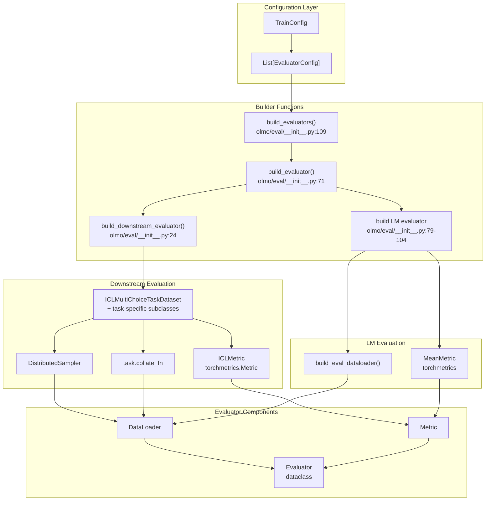
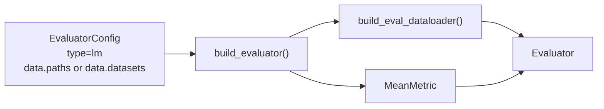
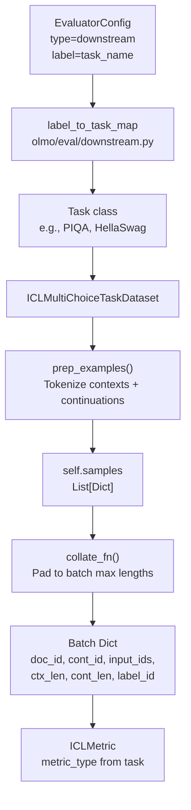
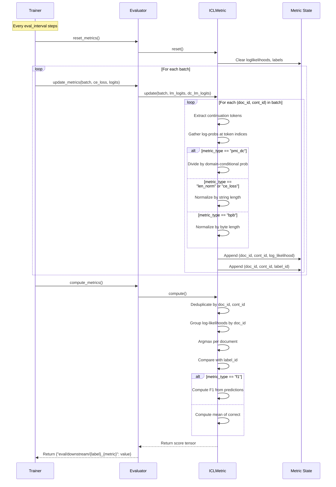
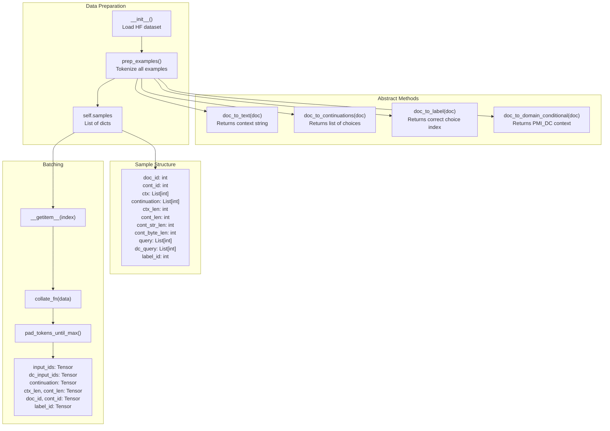
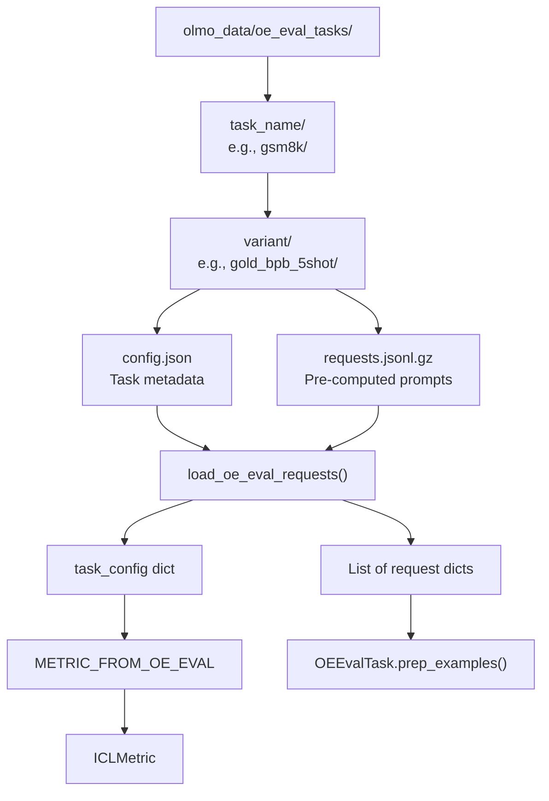
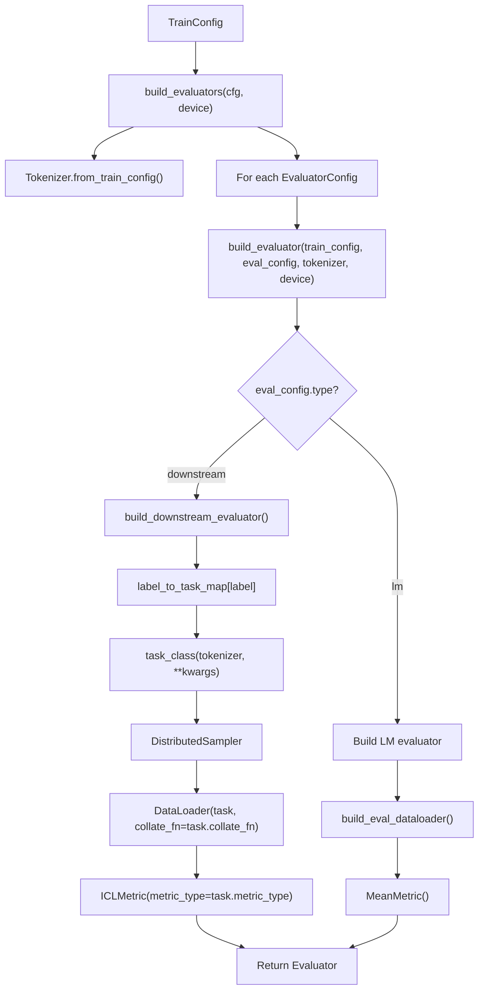
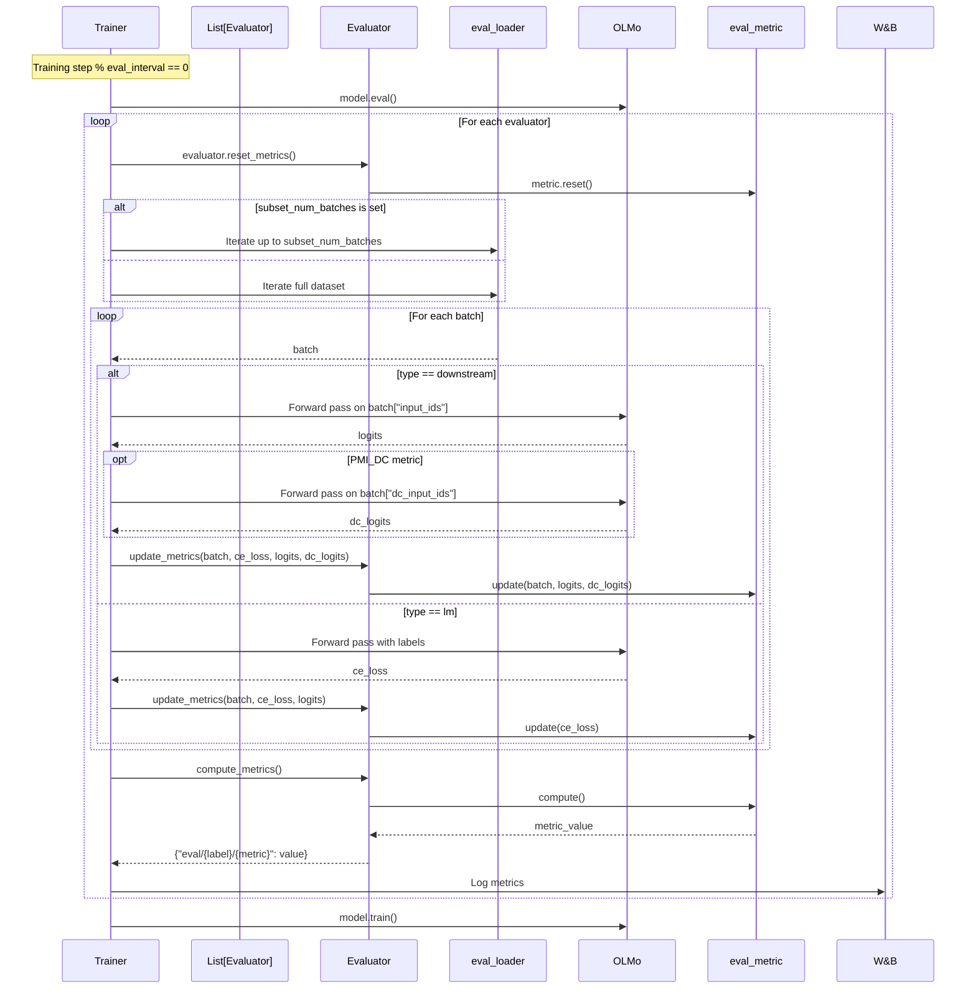

<!-- source: DeepWiki mcp.deepwiki.com · repo allenai/OLMo · page 5.1 Inline Evaluation · fetched 2026-10-26 -->

# Inline Evaluation

<details>
<summary>Relevant source files</summary>

The following files were used as context for generating this wiki page:

- [CHANGELOG.md](CHANGELOG.md)
- [olmo/eval/__init__.py](olmo/eval/__init__.py)
- [olmo/eval/downstream.py](olmo/eval/downstream.py)
- [olmo/eval/evaluator.py](olmo/eval/evaluator.py)
- [olmo/version.py](olmo/version.py)
- [olmo_data/oe_eval_tasks/gsm8k/gold_bpb_5shot/config.json](olmo_data/oe_eval_tasks/gsm8k/gold_bpb_5shot/config.json)
- [olmo_data/oe_eval_tasks/gsm8k/gold_bpb_5shot/requests.jsonl.gz](olmo_data/oe_eval_tasks/gsm8k/gold_bpb_5shot/requests.jsonl.gz)
- [pyproject.toml](pyproject.toml)
- [scripts/flops_by_perf_figure.py](scripts/flops_by_perf_figure.py)
- [scripts/list_evals_from_oe_eval.py](scripts/list_evals_from_oe_eval.py)

</details>


## Purpose and Scope

Inline evaluation is the system that runs evaluation tasks **during training** at regular intervals (typically every 1000 steps). This page covers the evaluator architecture, metric computation via `ICLMetric`, task dataset implementations, and how inline evaluation integrates with the training loop.

For comprehensive evaluation of trained checkpoints using external frameworks, see [External Evaluation (Catwalk)](#5.3). For details on specific downstream task configurations, see [Downstream Tasks](#5.2).

**Sources:** [CHANGELOG.md:1-194](), [README.md]()

---

## Overview

The inline evaluation system provides two types of evaluators that run during training:

1. **Language Modeling (LM) Evaluators** - Compute perplexity on validation datasets (c4, dolma, pile, wikitext)
2. **Downstream Evaluators** - Evaluate on specific tasks (PIQA, HellaSwag, MMLU, etc.)

Both evaluator types are configured in `TrainConfig.evaluators` and execute at intervals specified by `TrainConfig.eval_interval`.

**Sources:** [olmo/eval/__init__.py:1-115](), [olmo/eval/evaluator.py:1-86]()

---

## System Architecture

The inline evaluation system consists of three primary components that work together during training:



**Evaluator Dataclass Structure:**

| Field | Type | Description |
|-------|------|-------------|
| `label` | `str` | Identifier for metrics (e.g., "piqa", "c4_val") |
| `type` | `EvaluatorType` | Either `lm` or `downstream` |
| `eval_loader` | `DataLoader` | Batches evaluation data |
| `eval_metric` | `Metric \| Dict[str, Metric]` | Tracks and computes metrics |
| `subset_num_batches` | `Optional[int]` | Limits batches per evaluation |

**Sources:** [olmo/eval/evaluator.py:14-21](), [olmo/eval/__init__.py:71-114]()

---

## Evaluator Types

### Language Modeling Evaluators

LM evaluators compute cross-entropy loss and perplexity on validation datasets. They use `MeanMetric` to aggregate loss across batches.



**Metric Computation:**

- `update_metrics()` receives batch and `ce_loss` tensor [olmo/eval/evaluator.py:76-83]()
- For each instance, updates metric with loss value
- `compute_metrics()` returns `eval/{label}/CrossEntropyLoss` and `eval/{label}/Perplexity`

**Sources:** [olmo/eval/__init__.py:79-104](), [olmo/eval/evaluator.py:38-63]()

### Downstream Evaluators

Downstream evaluators assess task-specific performance (accuracy, F1, etc.) on multiple-choice and other ICL tasks.



**Sources:** [olmo/eval/__init__.py:24-68](), [olmo/eval/downstream.py:168-409]()

---

## ICLMetric System

`ICLMetric` is a `torchmetrics.Metric` that computes accuracy and related metrics for in-context learning tasks. It accumulates log-likelihoods for each document-continuation pair, then selects the highest-scoring continuation per document.

### Metric Types

| Metric Type | Description | Formula |
|-------------|-------------|---------|
| `acc` | Raw accuracy | Argmax of log-likelihoods |
| `f1` | F1 score | Macro F1 across labels |
| `len_norm` | Length-normalized accuracy | Log-likelihood / continuation string length |
| `pmi_dc` | PMI with domain-conditional normalization | `log P(cont\|ctx) / P(cont\|domain_cond)` |
| `ce_loss` | Cross-entropy loss | `-log P(correct_answer) / length` |
| `bpb` | Bits per byte | `-log P(cont) / byte_length * log2(e)` |

**Sources:** [olmo/eval/downstream.py:28-166]()

### Metric Computation Flow



**Key Implementation Details:**

1. **State Management:** [olmo/eval/downstream.py:38-45]()
   - `self.loglikelihoods` - List of tensors `(doc_id, cont_id, log_likelihood)`
   - `self.labels` - List of tensors `(doc_id, cont_id, label_id)`

2. **Update Logic:** [olmo/eval/downstream.py:47-101]()
   - Applies `log_softmax` to logits
   - Extracts continuation slice from full sequence
   - Gathers log-probs at continuation token positions
   - Applies metric-specific transformations

3. **Compute Logic:** [olmo/eval/downstream.py:103-165]()
   - Deduplicates states (handles distributed sampling padding)
   - Groups by `doc_id` to get all continuations
   - Selects argmax continuation
   - Computes accuracy or F1

**Sources:** [olmo/eval/downstream.py:28-166]()

---

## Task Datasets

### ICLMultiChoiceTaskDataset Base Class

All downstream tasks inherit from `ICLMultiChoiceTaskDataset`, which implements the core logic for tokenizing and batching multiple-choice tasks.

**Structure:**



**Key Fields in Prepared Samples:**

| Field | Type | Description |
|-------|------|-------------|
| `doc_id` | `int` | Document identifier (unique per question) |
| `cont_id` | `int` | Continuation index (0 to num_choices-1) |
| `query` | `List[int]` | Context + continuation[:-1], truncated to model_ctx_len |
| `dc_query` | `List[int]` | Domain-conditional context + continuation[:-1] |
| `ctx_len` | `int` | Actual context length after truncation |
| `cont_len` | `int` | Continuation token length |
| `cont_str_len` | `int` | Continuation string length (chars, minus leading space) |
| `cont_byte_len` | `int` | Continuation byte length |
| `label_id` | `int` | Index of correct continuation |

**Sources:** [olmo/eval/downstream.py:168-409]()

### Example Task Implementations

**PIQA** - Physical Interaction QA:

```python
# Context format: "Question: {goal}\nAnswer:"
# Continuations: " {sol1}", " {sol2}"
# Metric: len_norm
# Domain conditional: "Answer:"
```

[olmo/eval/downstream.py:411-451]()

**HellaSwag** - Commonsense NLI:

```python
# Context: "{activity_label}: {ctx_a} {ctx_b.capitalize()}"
# Continuations: " {ending}" for each ending
# Metric: len_norm
# Domain conditional: ctx_b.capitalize() or last word of ctx_a
```

[olmo/eval/downstream.py:454-509]()

**WinoGrande** - Coreference resolution:

```python
# Special case: Multiple contexts, single continuation
# Context variants: sentence[:pronoun] + option1/option2
# Continuation: " {sentence[pronoun+1:].strip()}"
# Metric: acc
# Domain conditionals: [option1, option2]
```

[olmo/eval/downstream.py:512-616]()

**Complete Task List:**

| Task Class | Dataset | Metric Type | Source |
|------------|---------|-------------|--------|
| PIQA | piqa | len_norm | [downstream.py:411-451]() |
| HellaSwag | hellaswag | len_norm | [downstream.py:454-509]() |
| WinoGrande | winogrande | acc | [downstream.py:512-616]() |
| OpenBookQA | openbookqa | len_norm | [downstream.py:619-658]() |
| BoolQ | boolq | acc | [downstream.py:661-704]() |
| SciQ | sciq | acc | [downstream.py:707-755]() |
| ArcEasy | ai2_arc/ARC-Easy | acc | [downstream.py:758-802]() |
| ArcChallenge | ai2_arc/ARC-Challenge | len_norm | [downstream.py:805-822]() |
| CommonsenseQA | tau/commonsense_qa | len_norm | [downstream.py:865-888]() |
| SocialIQa | social_i_qa | len_norm | [downstream.py:891-930]() |
| COPA | super_glue/copa | acc | [downstream.py:933-984]() |
| RTE | glue/rte | len_norm | [downstream.py:987-1021]() |

**Sources:** [olmo/eval/downstream.py:411-1800]()

---

## OE-Eval Integration

The system supports loading tasks from OE-Eval format (Open Evaluation), which provides pre-computed evaluation requests.

### OEEvalTask Class

Tasks loaded from `olmo_data/oe_eval_tasks/{task_name}/{variant}/` use the `OEEvalTask` class:



**METRIC_FROM_OE_EVAL Mapping:**

```python
METRIC_FROM_OE_EVAL = {
    "acc_raw": "acc",
    "acc_per_char": "len_norm",
    "acc_uncond": "pmi_dc",
    "logits_per_byte": "bpb",
}
```

**Example: GSM8K BPB Evaluation**

The GSM8K task computes bits-per-byte over correct continuations:

- Config: [olmo_data/oe_eval_tasks/gsm8k/gold_bpb_5shot/config.json]()
- Requests: [olmo_data/oe_eval_tasks/gsm8k/gold_bpb_5shot/requests.jsonl.gz]()
- Task name: `gsm8k_gold_bpb_5shot`
- Primary metric: `logits_per_byte` → `bpb`
- Num instances: 1319

**Sources:** [olmo/eval/downstream.py:18-24](), [olmo/util.py](), [scripts/list_evals_from_oe_eval.py:1-87]()

---

## Configuration and Integration

### Training Config Example

```yaml
evaluators:
  # LM evaluators
  - label: c4_val
    type: lm
    data:
      paths: ["s3://path/to/c4/val/"]
    subset_num_batches: 100
    
  # Downstream evaluators
  - label: piqa
    type: downstream
    data:
      num_workers: 4
      drop_last: false
    subset_num_batches: null  # Evaluate full dataset
    
  - label: gsm8k_gold_bpb_5shot
    type: downstream
    data:
      num_workers: 2

eval_interval: 1000  # Run evaluation every 1000 training steps
device_eval_batch_size: 16
```

### Builder Flow



**Sources:** [olmo/eval/__init__.py:109-114](), [olmo/eval/__init__.py:71-106](), [olmo/eval/__init__.py:24-68]()

### Distributed Sampling

Downstream evaluators use `DistributedSampler` to ensure each rank evaluates a subset of examples:

```python
DistributedSampler(
    ds_eval_dataset,
    drop_last=data_config.drop_last,  # Usually False
    shuffle=False,
    num_replicas=get_world_size(),
    rank=get_global_rank(),
    seed=train_config.seed,
)
```

**Deduplication:** Since `drop_last=False`, the sampler pads to make the dataset evenly divisible. `ICLMetric.compute()` handles duplicates by checking if `(doc_id, cont_id)` pairs already exist in the accumulated state.

**Sources:** [olmo/eval/__init__.py:40-47](), [olmo/eval/downstream.py:106-120]()

---

## Evaluation Execution Flow

### Integration with Training Loop



**Key Points:**

1. Model switches to eval mode before evaluation
2. Each evaluator processes its full dataset (or subset)
3. Downstream evaluators may require two forward passes for PMI_DC metrics
4. All metrics are aggregated across distributed ranks via torchmetrics sync
5. Results are logged to W&B with hierarchical keys

**Sources:** Training loop integration would be in the main training script, evaluator methods at [olmo/eval/evaluator.py:22-85]()

---

## Metric Output Format

### LM Evaluator Metrics

```python
{
    "eval/c4_val/CrossEntropyLoss": 2.345,
    "eval/c4_val/Perplexity": 10.43,
    "eval/dolma_val/CrossEntropyLoss": 2.123,
    "eval/dolma_val/Perplexity": 8.35,
}
```

**Sources:** [olmo/eval/evaluator.py:44-62]()

### Downstream Evaluator Metrics

```python
{
    "eval/downstream/piqa_len_norm": 0.753,
    "eval/downstream/hellaswag_len_norm": 0.582,
    "eval/downstream/arc_easy_acc": 0.681,
    "eval/downstream_bpb/gsm8k_gold_bpb_5shot_bpb": 1.234,
}
```

**Note:** Metrics with type `ce_loss` or `bpb` get a separate category prefix:
- Standard: `eval/downstream/{label}_{metric_type}`
- BPB/CE Loss: `eval/downstream_{metric_type}/{label}_{metric_type}`

**Sources:** [olmo/eval/evaluator.py:30-36]()

---

## Summary

The inline evaluation system provides real-time assessment of model quality during training through:

1. **Dual evaluator types:** LM evaluators for perplexity, downstream evaluators for task performance
2. **ICLMetric framework:** Flexible metric computation supporting acc, F1, length-normalized, PMI_DC, and BPB metrics
3. **Task dataset abstraction:** Standardized interface for multiple-choice tasks with HuggingFace and OE-Eval integration
4. **Distributed evaluation:** Proper handling of multi-GPU evaluation with deduplication
5. **Modular configuration:** YAML-based specification of evaluation tasks and intervals

This enables continuous monitoring of model capabilities without waiting for external evaluation pipelines.

**Sources:** [olmo/eval/__init__.py:1-115](), [olmo/eval/evaluator.py:1-86](), [olmo/eval/downstream.py:1-1800]()

---

