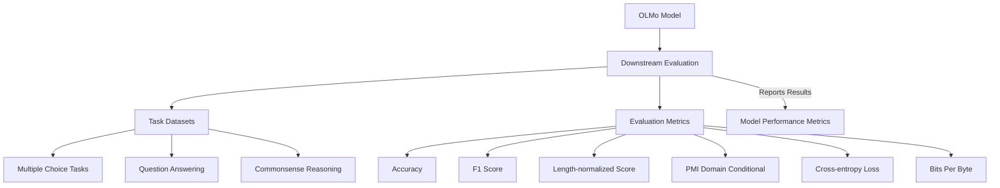
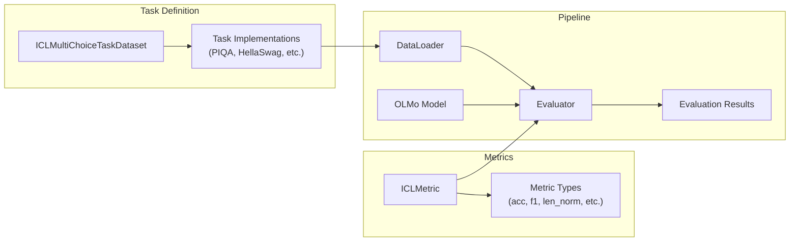
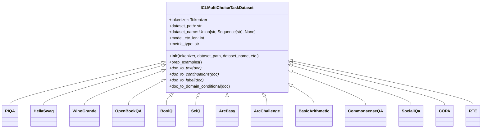
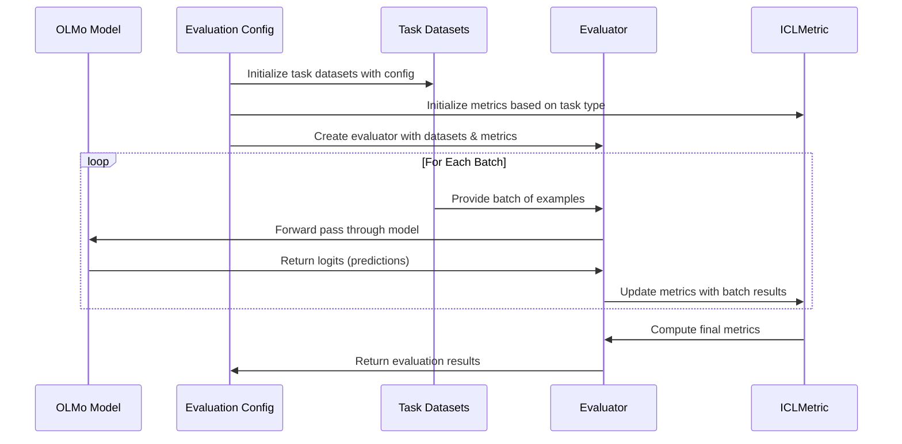
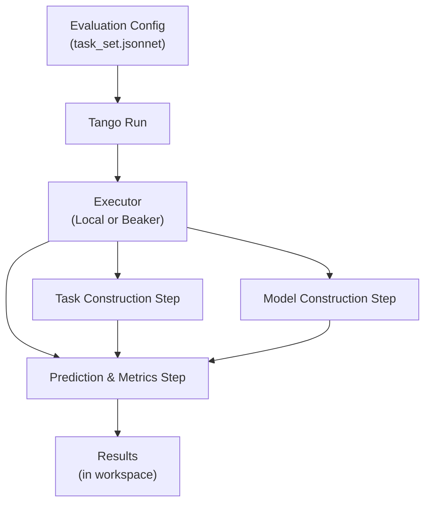
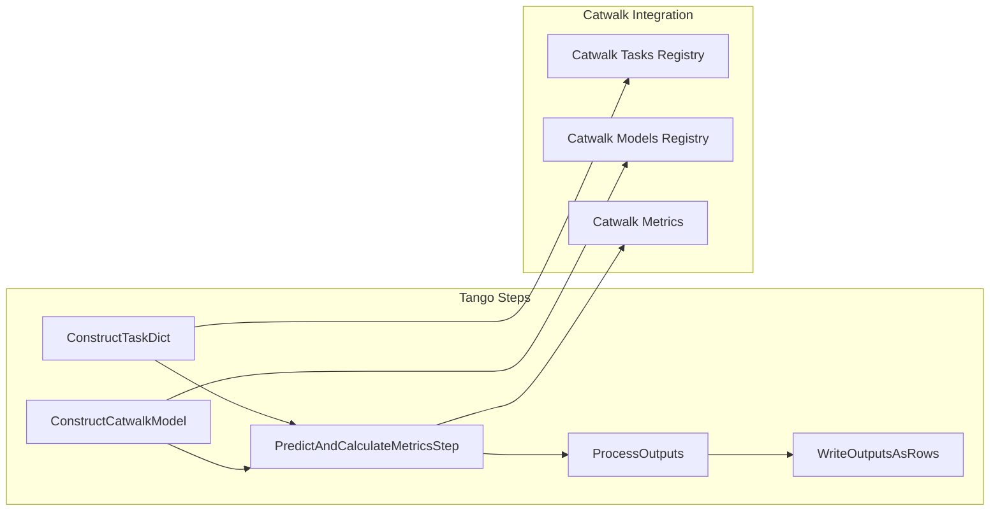
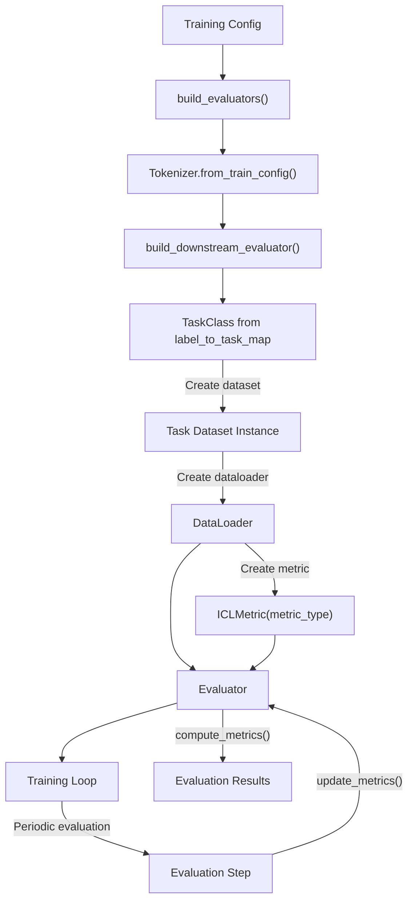

<!-- source: DeepWiki mcp.deepwiki.com · repo allenai/OLMo · page 5.2 Downstream Tasks · fetched 2026-10-26 -->

# Downstream Tasks

<details>
<summary>Relevant source files</summary>

The following files were used as context for generating this wiki page:

- [CHANGELOG.md](CHANGELOG.md)
- [olmo/eval/__init__.py](olmo/eval/__init__.py)
- [olmo/eval/downstream.py](olmo/eval/downstream.py)
- [olmo/eval/evaluator.py](olmo/eval/evaluator.py)
- [olmo/version.py](olmo/version.py)
- [olmo_data/oe_eval_tasks/gsm8k/gold_bpb_5shot/config.json](olmo_data/oe_eval_tasks/gsm8k/gold_bpb_5shot/config.json)
- [olmo_data/oe_eval_tasks/gsm8k/gold_bpb_5shot/requests.jsonl.gz](olmo_data/oe_eval_tasks/gsm8k/gold_bpb_5shot/requests.jsonl.gz)
- [pyproject.toml](pyproject.toml)
- [scripts/flops_by_perf_figure.py](scripts/flops_by_perf_figure.py)
- [scripts/list_evals_from_oe_eval.py](scripts/list_evals_from_oe_eval.py)

</details>


This document provides a comprehensive guide to OLMo's downstream task evaluation system, which allows users to assess model performance on specific natural language processing tasks. For information about the broader evaluation system, see [Evaluation System](#5).

The downstream tasks infrastructure enables consistent and standardized evaluation of OLMo models on a variety of benchmark tasks such as question answering, natural language inference, common sense reasoning, and more. This page explains how to use existing downstream tasks, how the evaluation pipeline works, and how metrics are calculated.

## Overview of Downstream Task Evaluation

OLMo's downstream evaluation system is designed to evaluate model performance on specific NLP tasks using predefined datasets and metrics. The framework leverages in-context learning (ICL) evaluation, where models are provided with contexts and evaluated on their ability to predict correct continuations.



Sources: 
- [olmo/eval/downstream.py:28-91]()
- [olmo/eval/__init__.py:1-114]()
- [evaluation/steps/run_catwalk.py:1-371]()

## Key Components

The downstream evaluation infrastructure consists of several key components that work together:



Sources:
- [olmo/eval/downstream.py:28-166]()
- [olmo/eval/evaluator.py:1-86]()
- [olmo/eval/__init__.py:24-107]()

### ICLMetric Class

The `ICLMetric` class is central to downstream evaluation and calculates various metrics for in-context learning tasks:

1. **Accuracy**: Standard classification accuracy
2. **F1 Score**: For unbalanced classification tasks
3. **Length-normalized score**: Scores normalized by continuation length
4. **PMI Domain Conditional**: Pointwise mutual information domain conditional
5. **Cross-entropy Loss**: For measuring prediction quality
6. **Bits Per Byte (BPB)**: Information-theoretic measure of prediction efficiency

The metric is selected based on the task type and requirements.

Sources:
- [olmo/eval/downstream.py:28-166]()
- [CHANGELOG.md:12-12]()

### Task Dataset Implementation

The `ICLMultiChoiceTaskDataset` abstract class provides the foundation for implementing downstream tasks:



Each task implementation must provide:
- `doc_to_text`: Extracts the context text from a document
- `doc_to_continuations`: Extracts possible continuations from a document
- `doc_to_label`: Extracts the correct label index from a document
- `doc_to_domain_conditional`: Provides domain conditional text (for PMI metrics)

Sources:
- [olmo/eval/downstream.py:168-407]()
- [olmo/eval/downstream.py:411-1006]()

## Available Downstream Tasks

OLMo includes implementations for numerous standardized benchmark tasks:

| Task | Description | Default Metric | Example Use Case |
|------|-------------|---------------|------------------|
| PIQA | Physical Interaction QA | Length-normalized | Common sense about physical interactions |
| HellaSwag | Commonsense NLI | Length-normalized | Multi-choice completion prediction |
| WinoGrande | Winograd Schema Challenge | Accuracy | Coreference resolution |
| OpenBookQA | Open-domain QA | Length-normalized | Multi-choice science questions |
| BoolQ | Boolean Questions | Accuracy | Yes/no question answering |
| SciQ | Science Exam QA | Accuracy | Multiple-choice science questions |
| ARC Easy/Challenge | AI2 Reasoning Challenge | Accuracy/Length-normalized | Science reasoning tasks |
| BasicArithmetic | Arithmetic Operations | Accuracy | Basic math calculations |
| CommonsenseQA | Common Sense QA | Length-normalized | Tests factual knowledge |
| SocialIQa | Social Interaction QA | Length-normalized | Tests social reasoning |
| COPA | Choice of Plausible Alternatives | Accuracy | Cause-effect reasoning |
| RTE | Recognizing Textual Entailment | Length-normalized | Textual inference |

Additionally, OLMo supports evaluation for Open Eval tasks, including GSM8K for mathematical reasoning.

Sources:
- [olmo/eval/downstream.py:411-1760]()
- [olmo_data/oe_eval_tasks/gsm8k/gold_bpb_5shot/config.json:1-1]()
- [scripts/list_evals_from_oe_eval.py:1-87]()

## Evaluation Pipeline Workflow

The downstream task evaluation pipeline follows this general workflow:



Sources:
- [olmo/eval/__init__.py:24-114]()
- [olmo/eval/evaluator.py:15-86]()
- [evaluation/steps/run_catwalk.py:133-164]()

## Using the Evaluation System

### Running Downstream Evaluations with Tango

OLMo uses Tango for orchestrating evaluations, which can be run locally or on Beaker:



The evaluation pipeline is configured through jsonnet files that specify:
1. Models to evaluate
2. Task sets to run
3. Configuration parameters
4. Optional reporting to Google Sheets

Sources:
- [evaluation/README.md:1-104]()
- [evaluation/tango-in-beaker.yml:1-65]()
- [evaluation/experiments/test_config.jsonnet:1-52]()
- [evaluation/experiments/utils.libsonnet:1-245]()

### Example Configuration

To run evaluations, create a configuration file like this:

```jsonnet
local utils = import 'utils.libsonnet';
local rc20_tasks = import 'task_sets/rc20_tasks.libsonnet';

local models = [
    {
        model_path: "path/to/olmo-model", 
        gpus_needed: 1,
        trust_remote_code: true
    }
];

local task_sets = [
    rc20_tasks.task_set
];

{
    steps: utils.create_pipeline(models, task_sets, null)
}
```

This configuration evaluates a model on the RC20 task set, which includes common benchmark tasks like BoolQ, ARC, HellaSwag, etc.

Sources:
- [evaluation/experiments/test_config.jsonnet:1-52]()
- [evaluation/experiments/evaluation_2023_07_26.jsonnet:1-47]()

### Adding to Training Config

Downstream tasks can also be evaluated during training by adding them to the training configuration:

```yaml
evaluators:
  - label: piqa
    type: downstream
    device_eval_batch_size: ${device_train_microbatch_size}
    subset_num_batches: 8
    data:
      persistent_workers: false
      num_workers: 0
      prefetch_factor: null
```

This configuration will evaluate the model on the PIQA task at regular intervals during training.

Sources:
- [test_fixtures/train_tiny_with_evaluator.yaml:1-55]()
- [CHANGELOG.md:12-63]()

## Extending with New Tasks

The evaluation framework can be extended with new tasks by:

1. Creating a new class that inherits from `ICLMultiChoiceTaskDataset`
2. Implementing the required methods (`doc_to_text`, `doc_to_continuations`, etc.)
3. Registering the task in the `label_to_task_map` dictionary

```python
class NewTask(ICLMultiChoiceTaskDataset):
    metric_type = "acc"  # Choose appropriate metric
    
    def __init__(self, tokenizer, dataset_path="path/to/dataset", dataset_name=None):
        super().__init__(tokenizer=tokenizer, dataset_path=dataset_path, dataset_name=dataset_name)
    
    def doc_to_text(self, doc):
        # Extract context from document
        return context_text
    
    def doc_to_continuations(self, doc):
        # Extract possible continuations
        return continuations
    
    def doc_to_label(self, doc):
        # Extract correct answer index
        return label_index
```

Sources:
- [olmo/eval/downstream.py:168-407]()
- [scripts/list_evals_from_oe_eval.py:15-62]()

## Integration with Catwalk

OLMo's evaluation system uses Catwalk for task implementation and evaluation. The integration happens through Tango steps:



The `ConstructTaskDict` and `ConstructCatwalkModel` steps set up the necessary components, while `PredictAndCalculateMetricsStep` handles the actual evaluation and metric calculation.

Sources:
- [evaluation/steps/run_catwalk.py:24-79]()
- [evaluation/steps/run_catwalk.py:81-119]()
- [evaluation/steps/run_catwalk.py:166-230]()
- [evaluation/requirements.txt:1-5]()

## Integration with Training Loop

Downstream evaluations can be integrated directly into the training loop using the `Evaluator` class, which handles dataset loading, metric calculation, and reporting:



The `build_evaluators` function in `olmo/eval/__init__.py` handles the construction of evaluators from the training configuration, creating the appropriate task datasets and metrics.

Sources:
- [olmo/eval/__init__.py:24-114]()
- [olmo/eval/evaluator.py:15-86]()

## Conclusion

OLMo's downstream task evaluation system provides a comprehensive framework for assessing model performance on a wide range of NLP tasks. By standardizing task implementations and metrics, it enables consistent evaluation and comparison across different models and experiments.

The system is designed to be extensible, allowing for the addition of new tasks and metrics as needed. Integration with Tango and Catwalk enables efficient and scalable evaluation pipelines that can be run locally or on distributed compute platforms.

---

