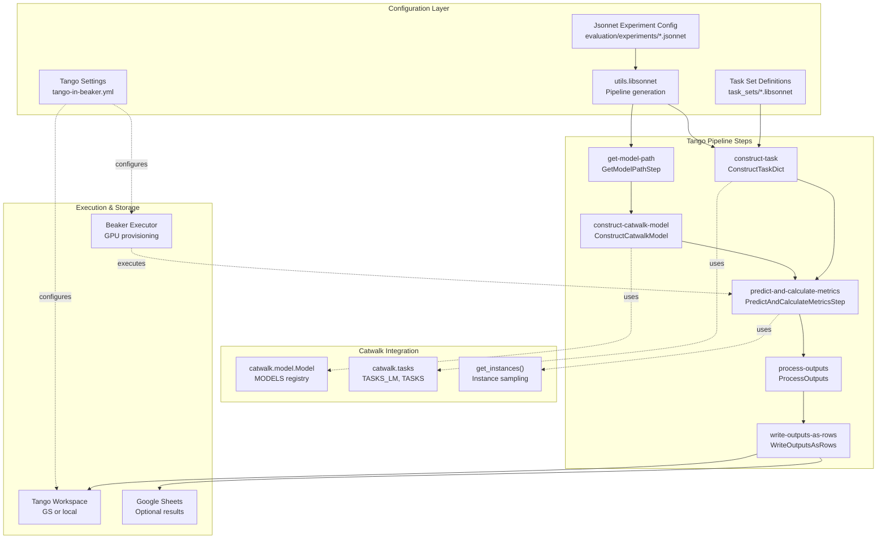
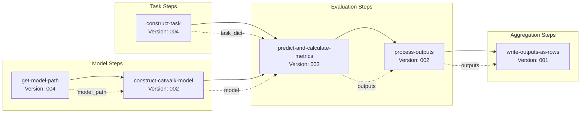
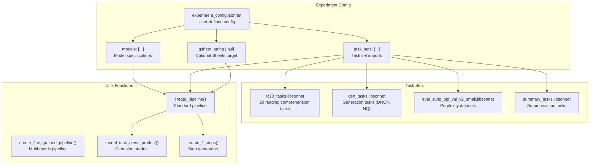

<!-- source: DeepWiki mcp.deepwiki.com · repo allenai/OLMo · page 5.3 External Evaluation (Catwalk) · fetched 2026-10-26 -->

# External Evaluation (Catwalk)

<details>
<summary>Relevant source files</summary>

The following files were used as context for generating this wiki page:

- [evaluation/README.md](evaluation/README.md)
- [evaluation/__init__.py](evaluation/__init__.py)
- [evaluation/experiments/evaluation_2023_07_26.jsonnet](evaluation/experiments/evaluation_2023_07_26.jsonnet)
- [evaluation/experiments/task_sets/eval_suite_ppl_val_v2_small.libsonnet](evaluation/experiments/task_sets/eval_suite_ppl_val_v2_small.libsonnet)
- [evaluation/experiments/task_sets/gen_tasks.libsonnet](evaluation/experiments/task_sets/gen_tasks.libsonnet)
- [evaluation/experiments/task_sets/rc20_tasks.libsonnet](evaluation/experiments/task_sets/rc20_tasks.libsonnet)
- [evaluation/experiments/task_sets/summary_tasks.libsonnet](evaluation/experiments/task_sets/summary_tasks.libsonnet)
- [evaluation/experiments/task_sets/task_utils.libsonnet](evaluation/experiments/task_sets/task_utils.libsonnet)
- [evaluation/experiments/task_sets/test_sets/test_eval_suite_ppl_val_v2_small.libsonnet](evaluation/experiments/task_sets/test_sets/test_eval_suite_ppl_val_v2_small.libsonnet)
- [evaluation/experiments/task_sets/test_sets/test_gen_tasks.libsonnet](evaluation/experiments/task_sets/test_sets/test_gen_tasks.libsonnet)
- [evaluation/experiments/task_sets/test_sets/test_rc20_tasks.libsonnet](evaluation/experiments/task_sets/test_sets/test_rc20_tasks.libsonnet)
- [evaluation/experiments/test_config.jsonnet](evaluation/experiments/test_config.jsonnet)
- [evaluation/experiments/utils.libsonnet](evaluation/experiments/utils.libsonnet)
- [evaluation/requirements.txt](evaluation/requirements.txt)
- [evaluation/see_available_tasks.py](evaluation/see_available_tasks.py)
- [evaluation/steps/__init__.py](evaluation/steps/__init__.py)
- [evaluation/steps/get_model.py](evaluation/steps/get_model.py)
- [evaluation/steps/run_catwalk.py](evaluation/steps/run_catwalk.py)
- [evaluation/tango-in-beaker.yml](evaluation/tango-in-beaker.yml)
- [test_fixtures/evaluation/ppl-test-data/4chan/val/4chan_00000000.jsonl.gz](test_fixtures/evaluation/ppl-test-data/4chan/val/4chan_00000000.jsonl.gz)
- [test_fixtures/evaluation/ppl-test-data/c4_100_domains/val/c4_100_domains_5_www.theguardian.com_00000000.jsonl.gz](test_fixtures/evaluation/ppl-test-data/c4_100_domains/val/c4_100_domains_5_www.theguardian.com_00000000.jsonl.gz)

</details>


## Purpose and Scope

This page describes the external evaluation system that uses Catwalk and Tango to perform comprehensive post-training evaluation of OLMo models. This evaluation runs independently from training and supports batch evaluation across multiple models and tasks with configurable metrics and output formats.

For evaluation that occurs during training, see [Inline Evaluation](#5.1). For information about specific downstream tasks, see [Downstream Tasks](#5.2).

## System Architecture

The external evaluation system is built on three primary components: **Tango** (workflow orchestration), **Catwalk** (evaluation framework), and **Beaker** (distributed execution). Tango manages a directed acyclic graph (DAG) of evaluation steps, Catwalk provides task definitions and model wrappers, and Beaker enables distributed execution across compute clusters.



**Sources:** [evaluation/steps/run_catwalk.py](), [evaluation/steps/get_model.py](), [evaluation/experiments/utils.libsonnet](), [evaluation/README.md]()

## Tango Pipeline Steps

The evaluation pipeline is composed of registered Tango steps that form a DAG. Each step is cacheable and versioned to enable incremental execution and reproducibility.

### Step Execution Flow



**Sources:** [evaluation/steps/run_catwalk.py:14-44](), [evaluation/steps/run_catwalk.py:81-120](), [evaluation/steps/run_catwalk.py:166-229]()

### Step Details

#### get-model-path

Located in [evaluation/steps/get_model.py:14-43](), this step converts OLMo checkpoint paths to HuggingFace-compatible model directories.

**Input:**
- `model_path`: S3/GS path or HuggingFace model name
- `revision`: Optional checkpoint revision

**Output:**
- Local path to HuggingFace-compatible model

**Behavior:**
- For OLMo models: Downloads checkpoint and adds HF config using `download_remote_checkpoint_and_add_hf_config`
- For other models: Returns path directly
- Uses `GLOBAL_MODEL_DIR` environment variable for storage location

#### construct-catwalk-model

Located in [evaluation/steps/run_catwalk.py:81-120](), creates a Catwalk `Model` instance.

**Input:**
- `model_path`: Path from `get-model-path` step
- `model_class`: Optional custom model class
- `revision`: Optional revision
- `trust_remote_code`: Boolean for remote code execution

**Output:**
- `catwalk.model.Model` instance registered in `MODELS` registry

**Behavior:**
- Parses model arguments using `simple_parse_args_string`
- Registers decoder-only models via `add_decoder_only_model`
- Returns model from `MODELS` registry

#### construct-task

Located in [evaluation/steps/run_catwalk.py:24-78](), constructs task dictionaries from task names.

**Input:**
- `task_name`: Task identifier from `TASKS_LM` or `TASKS`
- `task_rename`: Optional name override
- Additional task-specific kwargs (e.g., `files` for custom datasets)

**Output:**
- Dictionary containing:
  - `name`: Task name
  - `task_obj`: Task instance
  - `unconditioned_prompt`: Optional prompt for PMI normalization
  - Additional kwargs

**Behavior:**
- Retrieves task from `TASKS_LM` or `TASKS` registries
- Clones task with custom files if specified
- Updates metrics using `rc_metrics` if needed
- Extracts unconditioned prompts for normalization

#### predict-and-calculate-metrics

Located in [evaluation/steps/run_catwalk.py:166-229](), the core evaluation step.

**Input:**
- `model`: Catwalk model from `construct-catwalk-model`
- `task_dict`: Task dictionary from `construct-task`
- `split`: Dataset split (default: "validation")
- `limit`: Instance limit (default: 1000)
- `random_subsample_seed`: Sampling seed (default: 1234)
- `model_max_length`: Max sequence length (default: 2048)
- `max_batch_tokens`: Batch size in tokens (default: 20480)
- `batch_size`: Number of instances per batch (default: 32)

**Output:**
- Dictionary containing:
  - `task`: Task name
  - `metrics`: Computed metrics
  - `num_instances`: Number of evaluated instances
  - `processing_time`: Execution time
  - `instance_predictions`: Per-instance results
  - `task_options`: Evaluation configuration
  - `model_kwargs`: Model configuration

**Behavior:**
1. Samples instances using `get_instances(task, split, limit, random_subsample_seed)`
2. Generates predictions via `model.predict()` with batching
3. Calculates metrics via `model.calculate_metrics()`
4. Constructs instance predictions with optional field filtering

**Default Prediction Settings:** [evaluation/steps/run_catwalk.py:122-129]()

| Parameter | Default Value |
|-----------|--------------|
| `model_max_length` | 2048 |
| `max_batch_tokens` | 20480 |
| `batch_size` | 32 |
| `limit` | 1000 |
| `split` | "validation" |
| `random_subsample_seed` | 1234 |

#### process-outputs

Located in [evaluation/steps/run_catwalk.py:132-163](), post-processes evaluation outputs to compute additional metrics.

**Input:**
- `outputs`: Dictionary from `predict-and-calculate-metrics`

**Output:**
- Updated outputs dictionary with additional metrics

**Behavior:**
- Computes subdomain-level perplexity if instances contain `subdomain` field
- Aggregates `sum_logits` and `num_tokens` across subdomains
- Calculates perplexity as `exp(-sum_logits/num_tokens)`

#### write-outputs-as-rows

Located in [evaluation/steps/run_catwalk.py:272-311](), aggregates results into tabular format.

**Input:**
- `models`: List of model paths
- `outputs`: List of output dictionaries
- `prediction_kwargs`: List of prediction configurations
- `gsheet`: Optional Google Sheets name

**Output:**
- List of row dictionaries containing:
  - `date`: Timestamp
  - `model`: Model path
  - `task`: Task name
  - `metric`: Primary metric value
  - `processing_time`: Execution time
  - `num_instances`: Instance count
  - `tango_workspace`: Workspace URL
  - `tango_step`: Step ID
  - Additional prediction kwargs

**Behavior:**
- Merges default prediction kwargs with step-specific overrides
- Extracts primary metric (defaults to `f1`)
- Writes to Google Sheets if specified via `write_to_gsheet`

**Sources:** [evaluation/steps/run_catwalk.py]()

## Configuration System

The configuration system uses Jsonnet to generate Tango experiment definitions through functional composition.

### Configuration Structure



**Sources:** [evaluation/experiments/test_config.jsonnet](), [evaluation/experiments/utils.libsonnet]()

### Model Configuration

Each model in the `models` array specifies:

```jsonnet
{
    model_path: "s3://path/to/checkpoint",  // Required
    revision: "step140000",                  // Optional
    gpus_needed: 1,                          // GPU count for evaluation
    trust_remote_code: true,                 // Allow remote code execution
    hf_model_class: "package.ClassName",    // Optional custom model class
    prediction_kwargs: {                     // Override task defaults
        model_max_length: 2048,
        max_batch_tokens: 20480
    }
}
```

**Example:** [evaluation/experiments/test_config.jsonnet:19-41]()

### Task Set Configuration

Task sets define collections of related evaluation tasks:

```jsonnet
{
    name: "task_set_name",
    tasks: [
        {
            task_name: "boolq",              // From TASKS_LM/TASKS
            task_kwargs: {                   // Task-specific arguments
                task_rename: "custom_name",
                files: ["path/to/data"]
            },
            prediction_kwargs: {             // Evaluation parameters
                split: "validation",
                limit: 1000,
                num_shots: 0,
                model_max_length: 2048
            }
        }
    ]
}
```

**Example Task Sets:**

| Task Set | Tasks | Purpose |
|----------|-------|---------|
| `rc20_tasks` | 20 tasks (BoolQ, ARC, HellaSwag, etc.) | Reading comprehension |
| `gen_tasks` | DROP, NaturalQuestions | Generation tasks |
| `eval_suite_ppl_val_v2_small` | 13 domains | Perplexity evaluation |
| `summary_tasks` | SciTLDR, XSum | Summarization |

**Sources:** [evaluation/experiments/task_sets/rc20_tasks.libsonnet](), [evaluation/experiments/task_sets/gen_tasks.libsonnet](), [evaluation/experiments/task_sets/eval_suite_ppl_val_v2_small.libsonnet]()

### Pipeline Generation

The [evaluation/experiments/utils.libsonnet]() module provides utility functions for generating Tango pipelines:

#### create_pipeline()

Generates a standard evaluation pipeline:

1. Flattens task sets via `flatten_task_sets()`
2. Creates model × task cross-product via `model_task_cross_product()`
3. Generates steps:
   - `create_model_location_steps()`: One per model
   - `create_catwalk_model_steps()`: One per model
   - `create_task_steps()`: One per unique task
   - `create_outputs_steps()`: One per model-task pair
   - `create_outputs_as_rows_steps()`: Single aggregation step

**Step Naming Convention:**
- Model location: `model_location_{model_name}`
- Catwalk model: `catwalk_model_{model_name}`
- Task: `task_{task_set}_{task_name}`
- Outputs: `outputs_{model}_{task_set}_{task_name}`

#### create_fine_grained_pipeline()

Similar to `create_pipeline()` but includes `process-outputs` step for subdomain-level metrics and uses `write-outputs-as-rows-multiple-metrics` for multi-metric aggregation.

**Sources:** [evaluation/experiments/utils.libsonnet:185-238]()

## Execution

### Local Execution

```bash
tango run evaluation/experiments/test_config.jsonnet \
    -w your-local-workspace \
    --include-package evaluation.steps
```

**Environment Variables:**
- `GLOBAL_MODEL_DIR`: Directory for HF-compatible models
- `EVAL_DATA_PATH`: Directory for perplexity datasets
- `GDRIVE_SERVICE_ACCOUNT_JSON`: JSON credentials for Sheets (optional)

### Beaker Execution

Configuration: [evaluation/tango-in-beaker.yml]()

```bash
tango --settings evaluation/tango-in-beaker.yml \
    run evaluation/experiments/test_config.jsonnet
```

**Key Settings:**

| Setting | Purpose |
|---------|---------|
| `workspace.type: "gs"` | Google Storage workspace |
| `workspace.workspace` | GS bucket path |
| `executor.type: beaker` | Beaker executor |
| `executor.beaker_workspace` | Beaker workspace name |
| `executor.beaker_image` | Docker image for execution |
| `executor.venv_name` | Conda environment name |
| `executor.scheduler.priority` | Job priority (e.g., "preemptible") |
| `executor.scheduler.clusters` | Available clusters |

**Dataset Mounting:**
- NFS datasets mounted at `/net/nfs.cirrascale`
- HF datasets cache: `/net/nfs.cirrascale/aristo/oyvindt/hf_datasets_cache`

**Secrets:**
- `GDRIVE_SERVICE_ACCOUNT_JSON`: For Google Sheets integration

**Sources:** [evaluation/tango-in-beaker.yml](), [evaluation/README.md:42-54]()

## Task and Model Integration

### Catwalk Tasks

Tasks are retrieved from two registries:

**TASKS_LM:** Language modeling tasks with perplexity calculation
**TASKS:** General evaluation tasks (classification, generation, etc.)

Custom tasks can be cloned with specific file paths:

```jsonnet
{
    task_name: "ppl_custom",
    task_kwargs: {
        task_rename: "ppl_c4_small",
        files: ["olmo-ppl-val-v2-small/c4_en/val"]
    }
}
```

The `construct-task` step handles file path resolution using `EVAL_DATA_PATH` environment variable.

**Sources:** [evaluation/steps/run_catwalk.py:28-51](), [evaluation/experiments/task_sets/eval_suite_ppl_val_v2_small.libsonnet]()

### Catwalk Models

The `construct-catwalk-model` step wraps models for Catwalk evaluation:

1. **HuggingFace Models:** Loaded directly via model path
2. **OLMo Models:** Converted to HF format via `get-model-path` step
3. **Custom Models:** Specified via `model_class` parameter

Model registration uses the naming pattern: `lm::pretrained={model_path}`

**Sources:** [evaluation/steps/run_catwalk.py:81-120](), [evaluation/steps/get_model.py]()

## Output Formats

### Instance Predictions

Each instance prediction contains:

```python
{
    "instance": {
        # Instance ID fields
        # Optional: filtered fields via keep_instance_fields
    },
    "prediction": {
        # Model prediction
        # Task-specific structure
    },
    "model_input": {
        # Optional: input provided to model
    }
}
```

**Field Filtering:** [evaluation/steps/run_catwalk.py:231-269]()
- `keep_instance_fields`: Whitelist of fields to include
- `keep_all_instance_fields_except`: Blacklist of fields to exclude

### Aggregated Results

The `write-outputs-as-rows` step produces rows with:

| Field | Description |
|-------|-------------|
| `date` | Evaluation timestamp (UTC) |
| `model` | Model path |
| `task` | Task name |
| `primary_metric` | Metric name |
| `metric` | Metric value |
| `processing_time` | Execution time (seconds) |
| `num_instances` | Instance count |
| `tango_workspace` | Workspace URL |
| `tango_step` | Step unique ID |
| `split` | Dataset split |
| `limit` | Instance limit |
| `model_max_length` | Max sequence length |
| Additional prediction kwargs |

### Google Sheets Integration

When `gsheet` is specified:

1. Results are formatted as DataFrame
2. Sheet is created if it doesn't exist
3. New results are appended to existing data
4. Multiple metric types use separate sheets (for `write-outputs-as-rows-multiple-metrics`)

**Authentication:** Uses service account credentials from `GDRIVE_SERVICE_ACCOUNT_JSON` environment variable

**Sheets Configuration:** [evaluation/README.md:24-40]()
- Share sheet with `olmo-eval@ai2-allennlp.iam.gserviceaccount.com`
- Create API JSON key from Google Cloud Console
- Store as Beaker secret or environment variable

**Sources:** [evaluation/steps/run_catwalk.py:353-371](), [evaluation/steps/run_catwalk.py:272-350]()

### Workspace Access

Results are stored in the Tango workspace and can be accessed programmatically:

```python
from tango import Workspace

workspace = Workspace.from_url("gs://your-workspace-url")
result = workspace.step_result("combine-all-outputs")
```

The workspace contains cached results for all steps, enabling:
- Incremental execution (only re-run changed steps)
- Result inspection and analysis
- Programmatic access to intermediate outputs

**Sources:** [evaluation/README.md:60-66]()

---

