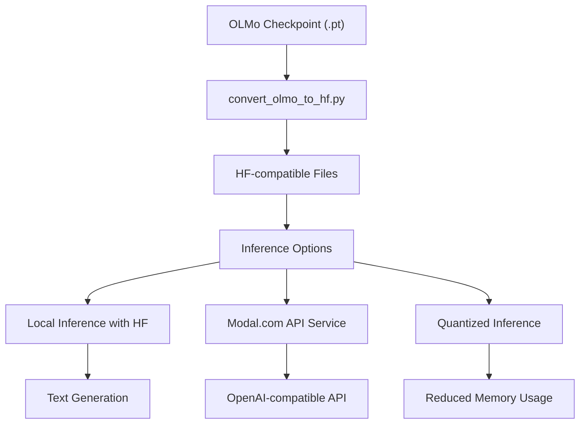
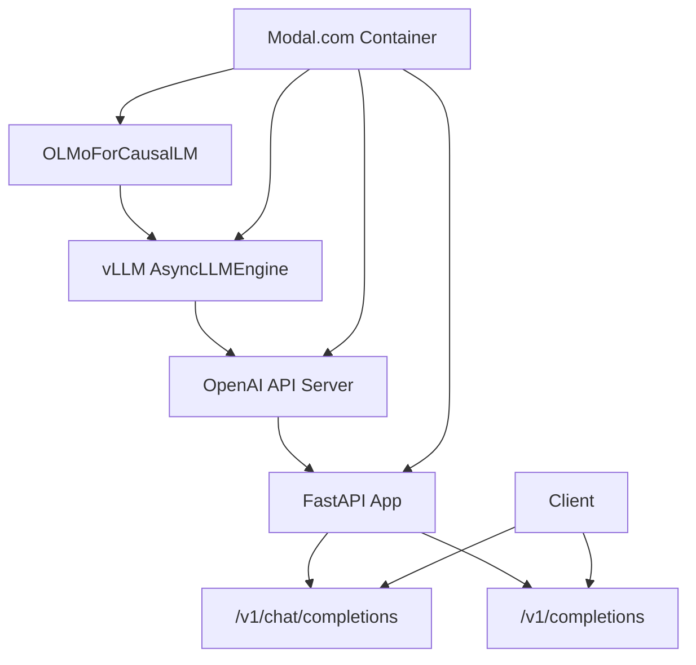
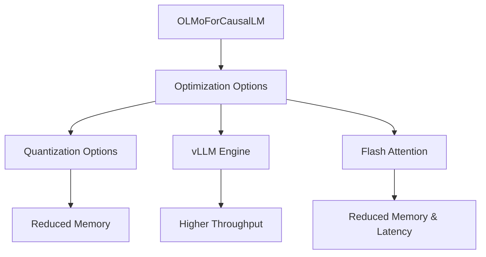
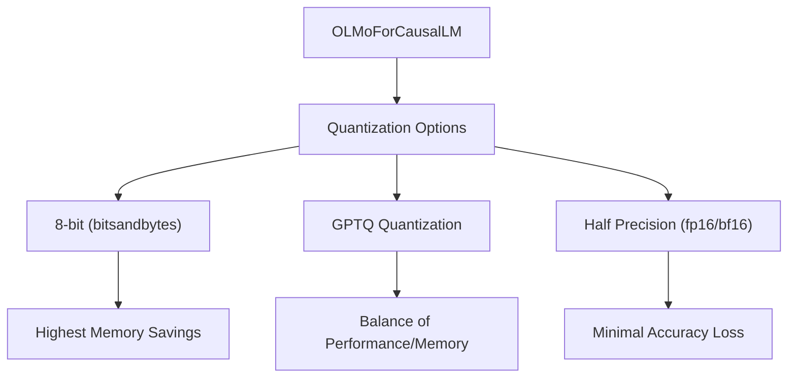

<!-- source: DeepWiki mcp.deepwiki.com · repo allenai/OLMo · page 6 Deployment and Inference · fetched 2026-10-26 -->

# Deployment

<details>
<summary>Relevant source files</summary>

The following files were used as context for generating this wiki page:

- [README.md](README.md)
- [configs/official-0425/OLMo2-1B-stage1.yaml](configs/official-0425/OLMo2-1B-stage1.yaml)
- [configs/official-0425/OLMo2-1B-stage2-seed42.yaml](configs/official-0425/OLMo2-1B-stage2-seed42.yaml)
- [configs/official-0425/OLMo2-1B-stage2-seed42069.yaml](configs/official-0425/OLMo2-1B-stage2-seed42069.yaml)
- [configs/official-0425/OLMo2-1B-stage2-seed666.yaml](configs/official-0425/OLMo2-1B-stage2-seed666.yaml)
- [configs/official-1124/OLMo2-13B-stage1.yaml](configs/official-1124/OLMo2-13B-stage1.yaml)
- [configs/official-1124/OLMo2-13B-stage2-seed1110-100B.yaml](configs/official-1124/OLMo2-13B-stage2-seed1110-100B.yaml)
- [configs/official-1124/OLMo2-13B-stage2-seed2662-100B.yaml](configs/official-1124/OLMo2-13B-stage2-seed2662-100B.yaml)
- [configs/official-1124/OLMo2-13B-stage2-seed2662-300B.yaml](configs/official-1124/OLMo2-13B-stage2-seed2662-300B.yaml)
- [configs/official-1124/OLMo2-13B-stage2-seed6209-100B.yaml](configs/official-1124/OLMo2-13B-stage2-seed6209-100B.yaml)
- [configs/official-1124/OLMo2-7B-stage1.yaml](configs/official-1124/OLMo2-7B-stage1.yaml)
- [configs/official-1124/OLMo2-7B-stage2-seed42.yaml](configs/official-1124/OLMo2-7B-stage2-seed42.yaml)
- [configs/official-1124/OLMo2-7B-stage2-seed42069.yaml](configs/official-1124/OLMo2-7B-stage2-seed42069.yaml)
- [configs/official-1124/OLMo2-7B-stage2-seed666.yaml](configs/official-1124/OLMo2-7B-stage2-seed666.yaml)
- [scripts/olmo2_modal_openai.py](scripts/olmo2_modal_openai.py)

</details>


This document explains how to deploy OLMo models for inference in various environments. It covers converting OLMo checkpoints to Hugging Face format, running inference locally using the transformers library, deploying models as API services with Modal.com, and optimizing performance through various techniques like quantization and Flash Attention.

For information about training OLMo models, refer to the [Training Pipeline](#3) page.

## Deployment Workflow Overview

The diagram below illustrates the overall workflow for deploying OLMo models:



Sources: [hf_olmo/convert_olmo_to_hf.py](), [README.md:144-175]()

## Converting OLMo Checkpoints to Hugging Face Format

Before deploying, OLMo checkpoints must be converted to the Hugging Face format. This process transforms the native OLMo checkpoint into a format compatible with the transformers library.

### Conversion Process

The conversion is performed using the `convert_olmo_to_hf.py` script:

```bash
python -m hf_olmo.convert_olmo_to_hf --checkpoint-dir /path/to/olmo/checkpoint --destination-dir /path/to/output/dir
```

The script performs three main operations:
- `write_config`: Creates a `config.json` file with model configuration
- `write_model`: Converts model weights to the format expected by Hugging Face
- `write_tokenizer`: Prepares tokenizer files needed by Hugging Face

After conversion, the destination directory will contain:
- `config.json` - Model architecture parameters
- `pytorch_model.bin` - Model weights
- `tokenizer.json` - Tokenizer vocabulary and merges
- `tokenizer_config.json` - Tokenizer configuration
- `special_tokens_map.json` - Mapping of special token names

### SafeTensors Conversion

For enhanced security when sharing models, you can convert PyTorch weights to SafeTensors format:

```bash
python scripts/convert_pt_to_safetensors.py /path/to/model.pt /path/to/output/model.safetensors
```

The SafeTensors format prevents arbitrary code execution during model loading.

Sources: [hf_olmo/convert_olmo_to_hf.py:32-311](), [scripts/convert_pt_to_safetensors.py:1-26]()

## Local Inference with Hugging Face

After conversion, you can use the transformers library for inference with OLMo models.

### Basic Inference Example

```python
from transformers import AutoModelForCausalLM, AutoTokenizer

model = AutoModelForCausalLM.from_pretrained("allenai/OLMo-2-1124-7B")
tokenizer = AutoTokenizer.from_pretrained("allenai/OLMo-2-1124-7B")

message = ["Language modeling is "]
inputs = tokenizer(message, return_tensors='pt', return_token_type_ids=False)
response = model.generate(**inputs, max_new_tokens=100, do_sample=True, top_k=50, top_p=0.95)
print(tokenizer.batch_decode(response, skip_special_tokens=True)[0])
```

You can also use the simpler pipeline API:

```python
from transformers import pipeline

olmo_pipe = pipeline("text-generation", model="allenai/OLMo-2-1124-7B")
print(olmo_pipe("Language modeling is"))
```

### Memory Optimization Techniques

For large models, several memory optimization techniques are available:

1. **Device mapping**: Distribute model across multiple GPUs
   ```python
   model = AutoModelForCausalLM.from_pretrained("allenai/OLMo-2-1124-7B", device_map="auto")
   ```

2. **Gradient checkpointing**: Trade computation for memory
   ```python
   model.gradient_checkpointing_enable()
   ```

3. **Quantization**: Use lower precision for weights
   ```python
   import torch
   model = AutoModelForCausalLM.from_pretrained("allenai/OLMo-2-1124-7B", 
                                               torch_dtype=torch.float16, 
                                               load_in_8bit=True)
   ```

4. **Flash Attention**: More efficient attention implementation
   ```python
   model = AutoModelForCausalLM.from_pretrained("allenai/OLMo-2-1124-7B", 
                                               attn_implementation="flash_attention_2")
   ```

Sources: [README.md:144-176](), [hf_olmo/modeling_olmo.py:41-201](), [tests/hf_olmo/modeling_olmo_test.py:9-136]()

## Modal.com API Deployment

OLMo can be deployed as an OpenAI-compatible API service using Modal.com. This method leverages vLLM for efficient serving.



### Deployment Steps

1. Install Modal.com tools following [Modal.com Guide](https://modal.com/docs/guide)
2. Create a Modal secret named "example-secret-token" following [Secrets Guide](https://modal.com/docs/guide/secrets)
3. Deploy with the provided script:
   ```bash
   modal deploy ./scripts/olmo2_modal_openai.py
   ```

The deployment script:
1. Creates a container image with necessary dependencies
2. Downloads model weights from Hugging Face
3. Sets up a vLLM engine with an OpenAI-compatible API
4. Exposes endpoints for completions and chat completions

### Using the API Service

After deployment, you can interact with the model using curl:

```bash
curl -X POST \
  -H "Authorization: Bearer [your_secret_token]" \
  -H "Content-Type: application/json" \
  -d @body.json \
  https://[your_endpoint]/v1/chat/completions
```

With a request body like:

```json
{
    "model": "OLMo-2-1124-13B-Instruct",
    "messages": [
        {
            "role": "user",
            "content": "Who was Alan Turing?"
        }
    ],
    "max_tokens": 100,
    "temperature": 0.9,
    "stream": true
}
```

### Customization Options

The deployment can be customized by modifying the script:
- Model name and revision
- GPU configuration (type, count, memory)
- Container idle timeout
- Authentication method

Sources: [scripts/olmo2_modal_openai.py:1-251](), [README.md:181-219]()

## Efficiency Optimization

Deploying large language models efficiently requires careful optimization. OLMo provides several techniques to balance performance and resource usage.



### Benchmarking Tools

OLMo includes tools to measure model efficiency:

```bash
efficiency-pentathlon run \
  --task wikitext-prompt \
  --scenario single_stream \
  --limit 10 \
  -- python run_efficiency_benchmark.py \
     --pretrained-model-dir MODEL_PATH \
     --quantized-model-dir QUANTIZED_PATH
```

The benchmarking utilities measure:
- Throughput (tokens/second)
- Latency (time to first token, time per token)
- Memory usage

### Quantization Options



1. **8-bit Quantization** (highest memory savings)
   ```python
   model = AutoModelForCausalLM.from_pretrained("allenai/OLMo-2-1124-7B", load_in_8bit=True)
   ```

2. **GPTQ Quantization** (good balance of performance/memory)
   ```python
   from auto_gptq import AutoGPTQForCausalLM
   model = AutoGPTQForCausalLM.from_quantized("/path/to/quantized/model", device="cuda")
   ```

3. **Half Precision** (minimal accuracy loss)
   ```python
   model = AutoModelForCausalLM.from_pretrained("allenai/OLMo-2-1124-7B", torch_dtype=torch.float16)
   ```

### vLLM Acceleration

vLLM provides significant throughput improvements for inference. It can be enabled:

1. In Modal.com deployment (enabled by default)
2. In benchmarking with:
   ```bash
   python run_efficiency_benchmark.py --pretrained-model-dir MODEL_PATH --vllm
   ```

### Optimization Selection Guide

| Use Case | Recommended Optimization |
|----------|--------------------------|
| Lowest latency | vLLM + Flash Attention |
| Memory constrained | 8-bit quantization |
| Balance of performance/memory | Half precision (fp16/bf16) |
| Maximum throughput | vLLM engine |

Sources: [inference/efficiency/run_efficiency_benchmark.py:1-115](), [inference/efficiency/run_efficiency_benchmark.sh:1-12](), [tests/hf_olmo/hf_olmo_test.py:32-204]()

## Summary

The OLMo deployment system provides a flexible set of tools for serving models in various environments. By converting to Hugging Face format, you gain access to the rich ecosystem of transformers tools. For production API services, the Modal.com deployment offers an easy way to create OpenAI-compatible endpoints. Numerous optimization techniques allow you to balance performance, memory usage, and latency based on your specific requirements.

---

