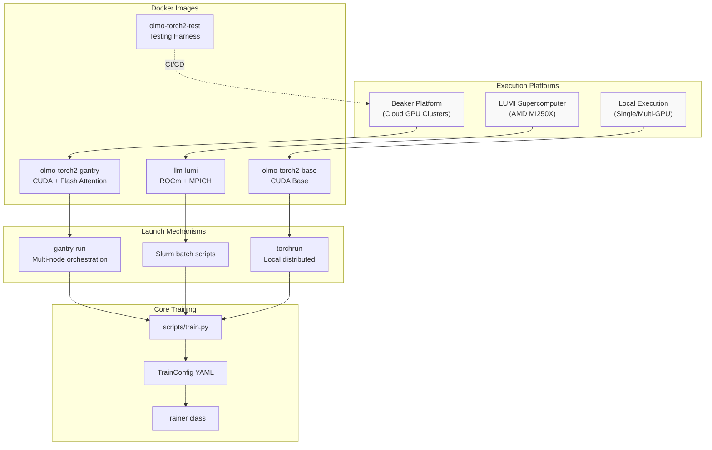
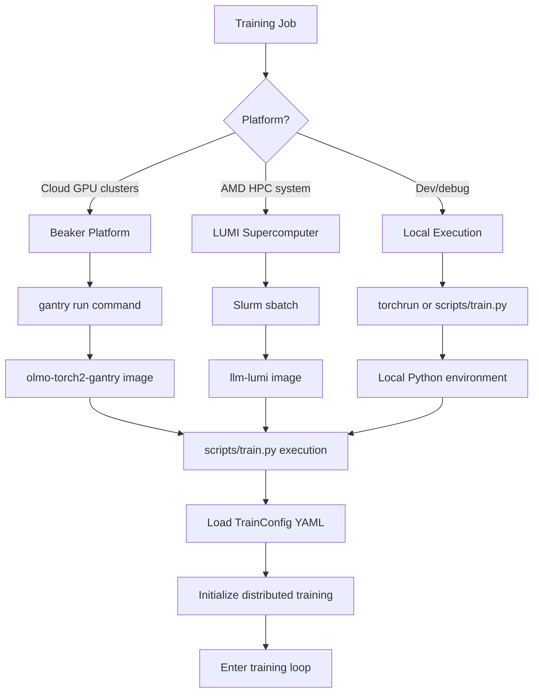
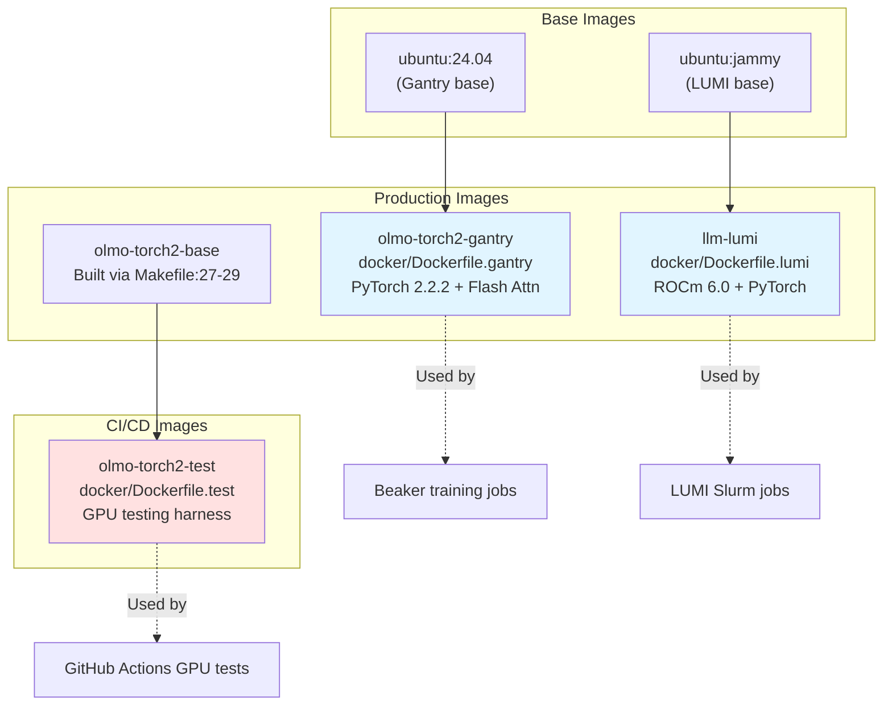
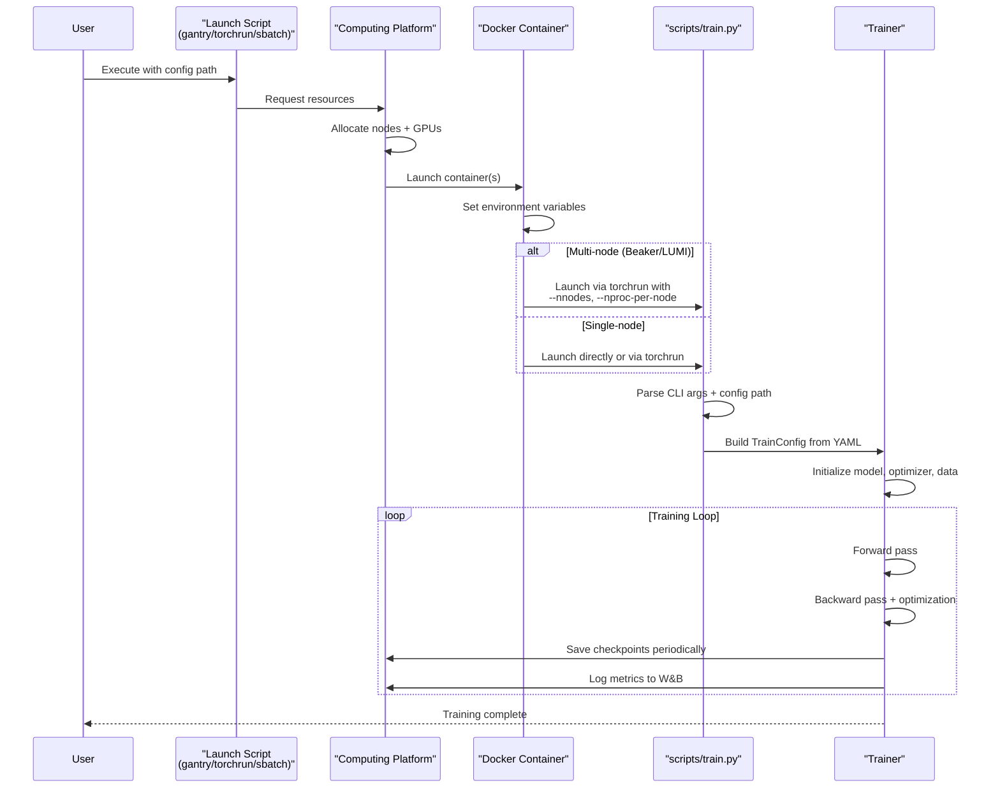
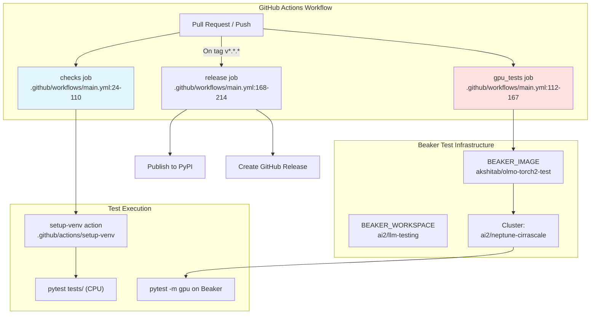

<!-- source: DeepWiki mcp.deepwiki.com · repo allenai/OLMo · page 7 Training Infrastructure · fetched 2026-10-26 -->

# Training Infrastructure

<details>
<summary>Relevant source files</summary>

The following files were used as context for generating this wiki page:

- [.github/actions/setup-venv/action.yml](.github/actions/setup-venv/action.yml)
- [.github/workflows/main.yml](.github/workflows/main.yml)
- [Makefile](Makefile)
- [configs/tiny/OLMo-150M.yaml](configs/tiny/OLMo-150M.yaml)
- [configs/tiny/OLMo-20M.yaml](configs/tiny/OLMo-20M.yaml)
- [configs/tiny/OLMo-300M.yaml](configs/tiny/OLMo-300M.yaml)
- [configs/tiny/OLMo-60M.yaml](configs/tiny/OLMo-60M.yaml)
- [configs/tiny/OLMo-700M.yaml](configs/tiny/OLMo-700M.yaml)
- [docker/Dockerfile.gantry](docker/Dockerfile.gantry)
- [docker/Dockerfile.lumi](docker/Dockerfile.lumi)
- [docker/Dockerfile.test](docker/Dockerfile.test)
- [scripts/beaker/tiny/gantry-script.sh](scripts/beaker/tiny/gantry-script.sh)
- [scripts/beaker/tiny/torchrun-script.sh](scripts/beaker/tiny/torchrun-script.sh)

</details>


This page provides an overview of the training infrastructure used to execute OLMo training at scale. The infrastructure supports multiple computing platforms through containerized environments and standardized launch workflows. For detailed platform-specific documentation, see the child pages.

## Overview

The OLMo training infrastructure consists of:
- **Docker-based containerization** for reproducible execution environments
- **Platform-specific launch scripts** that adapt to different compute environments
- **Unified configuration system** using YAML files (see [Configuration System](#2.1))
- **Storage backends** supporting S3, GCS, local filesystem, and R2

The same [scripts/train.py]() entrypoint and [TrainConfig]() classes run across all platforms, with platform differences handled through environment configuration and launch scripts.

**Training Infrastructure Architecture**



Sources:
- [Makefile:1-126]()
- [.github/workflows/main.yml:112-167]()
- [docker/Dockerfile.gantry:1-44]()
- [docker/Dockerfile.lumi:1-123]()

## Supported Platforms

OLMo supports three primary execution platforms, each with dedicated child pages for detailed documentation:

| Platform | Hardware | Use Case | Details |
|----------|----------|----------|---------|
| **Beaker** | NVIDIA GPUs (A100, H100) | Production training, CI/CD | See [Beaker Platform](#7.1) |
| **LUMI** | AMD MI250X | HPC environments, large-scale | See [LUMI Supercomputer](#7.2) |
| **Local** | Any CUDA-capable GPU | Development, debugging | See [Local Training](#7.3) |

**Platform Selection Workflow**



Sources:
- [scripts/beaker/tiny/gantry-script.sh:8-34]()
- [Makefile:66-89]()
- [docker/Dockerfile.lumi:1-7]()

## Docker Images

The OLMo infrastructure uses multiple Docker images for different execution contexts. Images are built via [Makefile]() targets and pushed to Beaker workspaces.

**Docker Image Hierarchy**



### Image Build Targets

The [Makefile:1-126]() provides targets for building and managing images:

| Target | Command | Purpose |
|--------|---------|---------|
| `base-image` | `make base-image` | Builds base CUDA image |
| `gantry-image` | `make gantry-image` | Builds and pushes production Gantry image |
| `test-image` | `make test-image` | Builds and pushes CI/CD test image |
| `lumi-image` | `make lumi-image` | Builds LUMI ROCm image and pushes to GHCR |

### Key Image Features

**olmo-torch2-gantry** ([docker/Dockerfile.gantry:1-44]()):
- Conda-based environment with PyTorch 2.2.2
- Flash Attention compiled with CUDA 11.8
- Used for production Beaker training

**llm-lumi** ([docker/Dockerfile.lumi:1-123]()):
- ROCm 6.0 for AMD GPU support
- MPICH 3.1.4 for MPI communication
- aws-ofi-rccl for optimized GPU communication
- PyTorch 2.3.1 compiled for ROCm

**olmo-torch2-test** ([docker/Dockerfile.test:1-17]()):
- Extends `olmo-torch2-base`
- Includes [scripts/test_entrypoint.sh]() for automated testing
- Used by [.github/workflows/main.yml:112-167]() for GPU tests

Sources:
- [Makefile:24-61]()
- [docker/Dockerfile.gantry:1-44]()
- [docker/Dockerfile.lumi:1-123]()
- [docker/Dockerfile.test:1-17]()

## Common Execution Workflow

All platforms follow a similar execution workflow, with platform-specific variations in the launch mechanism.

**General Training Execution Flow**



### Launch Script Patterns

Each platform uses a specific launch pattern:

**Beaker**: [scripts/beaker/tiny/gantry-script.sh:8-34]()
```bash
gantry run \
  --workspace ai2/OLMo-training \
  --beaker-image shanea/olmo-torch2.2-gantry \
  --gpus 8 \
  --replicas 16 \
  --leader-selection \
  -- /bin/bash -c "scripts/beaker/tiny/torchrun-script.sh ..."
```

**LUMI**: Slurm batch scripts (see [LUMI Supercomputer](#7.2))
```bash
srun singularity exec container.sif \
  python scripts/train.py configs/config.yaml
```

**Local**: Direct [torchrun]() invocation (see [Local Training](#7.3))
```bash
torchrun --nproc-per-node 8 \
  scripts/train.py configs/config.yaml
```

Sources:
- [scripts/beaker/tiny/gantry-script.sh:8-34]()
- [scripts/beaker/tiny/torchrun-script.sh:22-33]()

## Environment Configuration

Training environments require specific configuration depending on the platform and distributed training strategy.

### Environment Variables

Key environment variables set by platform launch scripts:

| Variable | Purpose | Set By |
|----------|---------|--------|
| `BEAKER_LEADER_REPLICA_HOSTNAME` | Hostname of leader node for rendezvous | Beaker |
| `BEAKER_REPLICA_RANK` | Node rank in distributed setup | Beaker |
| `WANDB_API_KEY` | W&B authentication | All platforms (via secrets) |
| `AWS_ACCESS_KEY_ID` / `AWS_SECRET_ACCESS_KEY` | S3 access for checkpoints/data | All platforms |
| `OMP_NUM_THREADS` | OpenMP thread count | Launch scripts |
| `LOG_FILTER_TYPE` | Logging filter (e.g., `local_rank0_only`) | Launch scripts |
| `ROCM_HOME` / `ROCM_PATH` | ROCm installation path | LUMI |

### Distributed Training Initialization

Distributed training uses PyTorch's distributed package with different backends:

**NCCL (NVIDIA)**: Used on Beaker and local CUDA systems
- Initialized via `torchrun` with `--rdzv_backend=c10d`
- Example from [scripts/beaker/tiny/torchrun-script.sh:22-28]():
  ```bash
  torchrun \
    --nnodes ${NUM_NODES}:${NUM_NODES} \
    --nproc-per-node 8 \
    --rdzv_id=101 \
    --rdzv_backend=c10d \
    --rdzv_endpoint=$BEAKER_LEADER_REPLICA_HOSTNAME:29400 \
    scripts/train.py configs/tiny/OLMo-300M.yaml
  ```

**RCCL (AMD)**: Used on LUMI
- Requires [aws-ofi-rccl]() plugin (installed in [docker/Dockerfile.lumi:77-86]())
- Configured via `LD_LIBRARY_PATH` environment variable

Sources:
- [scripts/beaker/tiny/gantry-script.sh:24-30]()
- [scripts/beaker/tiny/torchrun-script.sh:22-28]()
- [docker/Dockerfile.lumi:63-64]()
- [docker/Dockerfile.lumi:77-87]()

## CI/CD Integration

The training infrastructure integrates with GitHub Actions for continuous integration and deployment.

**CI/CD Pipeline Architecture**



### Virtual Environment Caching

The [.github/actions/setup-venv/action.yml:1-64]() provides cached Python virtual environment setup:

- Caches `.venv` directory based on Python version and dependency hashes
- Installs PyTorch with CPU-only wheels for faster CI
- Cache key: `$CACHE_PREFIX-$RUNNER_OS-$PYTHON_VERSION-$DEPENDENCY_HASH`

### GPU Test Execution

GPU tests run on Beaker using [beaker-run-action]():
- Image: `akshitab/olmo-torch2-test` (defined in [Makefile:8]())
- Workspace: `ai2/llm-testing` (defined in [Makefile:4]())
- Command: `pytest -v -m gpu tests/ -k "not hf_olmo"`
- Cluster constraint: `ai2/neptune-cirrascale`

Sources:
- [.github/workflows/main.yml:24-110]()
- [.github/workflows/main.yml:112-167]()
- [.github/actions/setup-venv/action.yml:1-64]()
- [Makefile:1-9]()

## Platform Comparison

The following table summarizes key differences between supported platforms:

| Aspect | Beaker | LUMI | Local |
|--------|--------|------|-------|
| **Hardware** | NVIDIA A100/H100 | AMD MI250X | Any CUDA GPU |
| **GPU Backend** | CUDA 11.8/12.x | ROCm 6.0 | CUDA (system) |
| **Communication** | NCCL | RCCL + aws-ofi-rccl | NCCL |
| **Launch Tool** | `gantry` | `srun` (Slurm) | `torchrun` |
| **Docker Image** | `olmo-torch2-gantry` | `llm-lumi` | N/A (local venv) |
| **PyTorch Version** | 2.2.2 | 2.3.1 | 2.x (user-installed) |
| **Flash Attention** | 2.x (CUDA) | Not used | Optional |
| **Node Count** | 1-100s | 1-100s | 1 |
| **Workspace** | Beaker workspace | Lustre filesystem | Local disk |
| **Configuration** | Via Gantry CLI | Via Slurm sbatch | Via CLI args |

### Resource Specifications

**Typical Beaker Job** ([scripts/beaker/tiny/gantry-script.sh:8-33]()):
- GPUs per node: 8
- Nodes: 16 (configurable via `NUM_NODES`)
- Shared memory: 10GiB
- Budget: `ai2/oe-training`
- Workspace: `ai2/OLMo-training`

**Typical LUMI Job**:
- GPUs per node: 8 (MI250X, each with 2 GCDs)
- Nodes: Variable (HPC allocation)
- Interconnect: Slingshot 11
- Filesystem: Lustre parallel filesystem

Sources:
- [scripts/beaker/tiny/gantry-script.sh:5-34]()
- [docker/Dockerfile.gantry:32-34]()
- [docker/Dockerfile.lumi:52-92]()

## Summary

The OLMo training infrastructure provides:

1. **Multi-platform support**: Training on Beaker, Augusta, and LUMI platforms
2. **Containerized environments**: Optimized Docker containers for each platform
3. **Unified configuration**: YAML-based configuration for all model sizes
4. **Distributed training**: Support for DDP and FSDP strategies
5. **Optimized networking**: High-performance networking stack for multi-node training
6. **Cloud storage integration**: Seamless access to training data on S3/GCS

This infrastructure enables training OLMo models ranging from 20M to 700M parameters efficiently on various computing platforms, with consistent behavior across environments.

---

