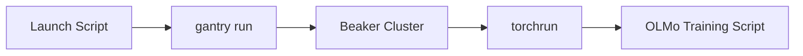
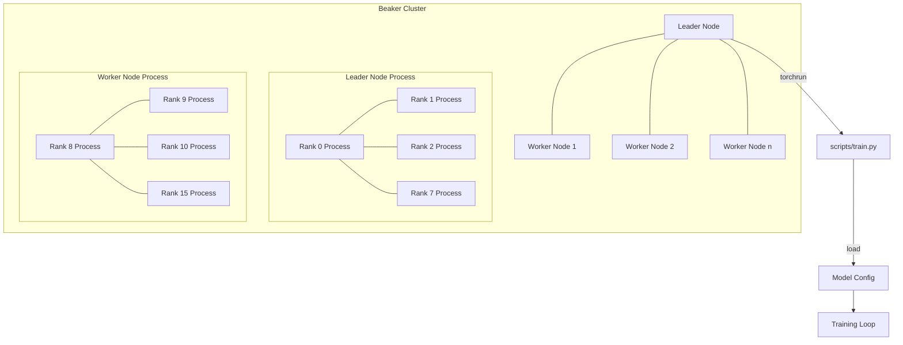
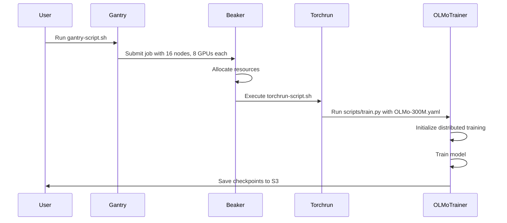
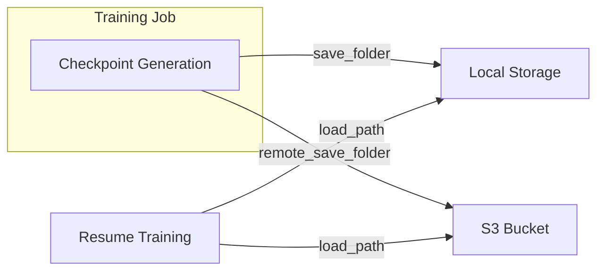
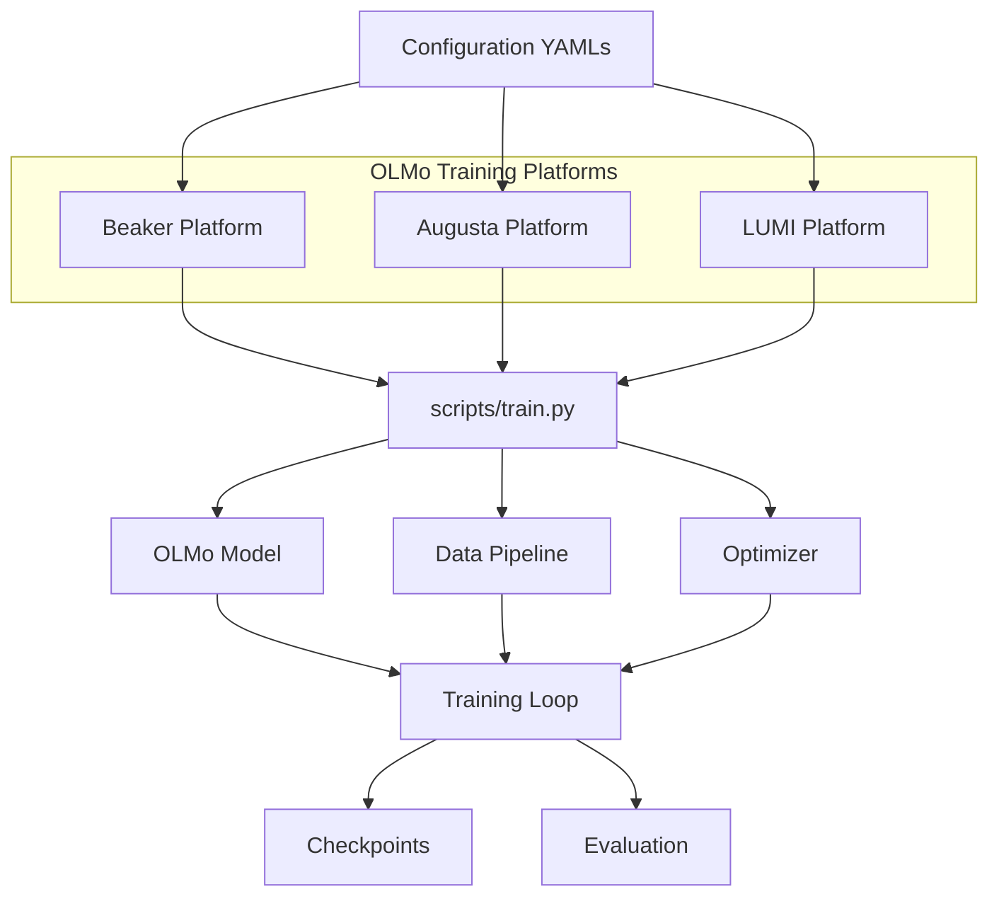

<!-- source: DeepWiki mcp.deepwiki.com · repo allenai/OLMo · page 7.1 Beaker Platform · fetched 2026-10-26 -->

# Beaker Platform

<details>
<summary>Relevant source files</summary>

The following files were used as context for generating this wiki page:

- [configs/tiny/OLMo-150M.yaml](configs/tiny/OLMo-150M.yaml)
- [configs/tiny/OLMo-20M.yaml](configs/tiny/OLMo-20M.yaml)
- [configs/tiny/OLMo-300M.yaml](configs/tiny/OLMo-300M.yaml)
- [configs/tiny/OLMo-60M.yaml](configs/tiny/OLMo-60M.yaml)
- [configs/tiny/OLMo-700M.yaml](configs/tiny/OLMo-700M.yaml)
- [scripts/beaker/beaker_interactive.sh](scripts/beaker/beaker_interactive.sh)
- [scripts/beaker/tiny/gantry-script.sh](scripts/beaker/tiny/gantry-script.sh)
- [scripts/beaker/tiny/torchrun-script.sh](scripts/beaker/tiny/torchrun-script.sh)

</details>


This document provides detailed information about using the Beaker Platform for training OLMo models in a distributed environment. Beaker serves as the primary compute platform for running smaller-scale model training jobs (typically up to around 128 GPUs) in the OLMo training infrastructure ecosystem. For information about training on larger supercomputing platforms, see [Augusta Platform](#7.2) and [LUMI Platform](#7.3).

## Overview of Beaker in OLMo

Beaker is an experiment tracking and compute platform used by the OLMo project to run distributed training jobs on GPU clusters. In the OLMo workflow, Beaker is leveraged through the Gantry tool, which provides a streamlined interface for launching and managing distributed training jobs.

The typical execution chain for OLMo training on Beaker is:



Sources:
- [scripts/beaker/tiny/gantry-script.sh:1-34]()
- [scripts/beaker/peteish/peteish13-highlr-launch.sh:1-35]()

## Beaker Job Configuration

Beaker training jobs in OLMo are configured using shell scripts that specify parameters for the Gantry tool, which then orchestrates the distributed training. Here's the typical structure of a Beaker job configuration:

```mermaid
classDiagram
    class "BeakerJobConfig" {
        workspace: string
        task-name: string
        priority: string
        beaker-image: string
        cluster: string
        gpus: int
        replicas: int
        environment_variables: map
        execution_script: string
    }
    
    class "GantryCommand" {
        +run(BeakerJobConfig) Job
    }
    
    class "TorchrunCommand" {
        +nnodes: int
        +nproc-per-node: int
        +rdzv_id: string
        +rdzv_backend: string
        +rdzv_endpoint: string
        +train_script: string
        +config: string
    }
    
    BeakerJobConfig --> GantryCommand
    GantryCommand --> TorchrunCommand
```

Sources:
- [scripts/beaker/tiny/gantry-script.sh:8-33]()
- [scripts/beaker/peteish/peteish13-highlr-launch.sh:7-35]()

### Key Configuration Parameters

The key parameters for Beaker jobs in OLMo include:

| Parameter | Description | Example Value |
|-----------|-------------|---------------|
| workspace | Beaker workspace for the job | ai2/OLMo-training |
| task-name | Name of the training task | tiny-olmo-300M-rms-norm-adam-eps-1e-8 |
| priority | Job priority | high |
| beaker-image | Docker image for training | shanea/olmo-torch2.2-gantry |
| cluster | Beaker cluster for execution | ai2/jupiter-cirrascale-2 |
| gpus | Number of GPUs per node | 8 |
| replicas | Number of nodes | 16 |
| budget | Beaker budget for the job | ai2/oe-training |

Sources:
- [scripts/beaker/tiny/gantry-script.sh:8-33]()
- [scripts/beaker/peteish/peteish13-highlr-launch.sh:7-34]()

## Distributed Training Execution

OLMo uses PyTorch's distributed training capabilities through `torchrun` to coordinate training across multiple nodes in a Beaker cluster. The distributed training setup is orchestrated by the `torchrun` command, which initializes the distributed environment and starts the training process.



Sources:
- [scripts/beaker/tiny/torchrun-script.sh:22-33]()
- [scripts/beaker/peteish/peteish13-highlr.sh:38-65]()

### Distributed Training Configuration

The distributed training on Beaker is configured with the following key parameters:

| Parameter | Description | Example |
|-----------|-------------|---------|
| nnodes | Total number of nodes | 16:16 |
| nproc-per-node | Processes per node (GPUs) | 8 |
| rdzv_id | Rendezvous ID | 12349 |
| rdzv_backend | Rendezvous backend | static or c10d |
| rdzv_endpoint | Leader node endpoint | $BEAKER_LEADER_REPLICA_HOSTNAME:29400 |
| node_rank | Current node rank | $BEAKER_REPLICA_RANK |

Sources:
- [scripts/beaker/tiny/torchrun-script.sh:22-33]()
- [scripts/beaker/peteish/peteish13-highlr.sh:38-45]()

## Model Configurations for Beaker

OLMo defines model configurations in YAML files that specify the model architecture, training hyperparameters, and data sources. Several predefined configurations are available for different model sizes:

| Model | Parameters | Hidden Size | Layers | Attention Heads |
|-------|------------|-------------|--------|-----------------|
| OLMo-20M | 20 million | 256 | 8 | 8 |
| OLMo-60M | 60 million | 512 | 8 | 8 |
| OLMo-150M | 150 million | 768 | 12 | 12 |
| OLMo-300M | 300 million | 1024 | 16 | 16 |
| Peteish13 | 13 billion | 5120 | 40 | 40 |

Sources:
- [configs/tiny/OLMo-20M.yaml:10-39]()
- [configs/tiny/OLMo-60M.yaml:10-39]()
- [configs/tiny/OLMo-150M.yaml:10-39]()
- [configs/tiny/OLMo-300M.yaml:10-39]()
- [configs/peteish13-weka.yaml:10-42]()

### Example Configuration

Here's an example of launching an OLMo-300M training job on Beaker:



Sources:
- [scripts/beaker/tiny/gantry-script.sh:1-34]()
- [scripts/beaker/tiny/torchrun-script.sh:1-33]()
- [configs/tiny/OLMo-300M.yaml:1-504]()

## Training Environment Setup

When training on Beaker, the environment is set up to optimize for distributed training performance. Several important environment variables are configured:

| Environment Variable | Purpose | Example Value |
|----------------------|---------|---------------|
| LOG_FILTER_TYPE | Control logging verbosity | local_rank0_only |
| OMP_NUM_THREADS | Control OpenMP threading | 8 |
| OLMO_TASK | Set task type | model |
| TORCH_DIST_INIT_BARRIER | Force process synchronization | 1 |
| OLMO_SHARED_FS | Indicate shared filesystem for checkpoints | 1 |
| NCCL_DEBUG | Set NCCL debugging level | INFO |
| NCCL_IB_HCA | Specify InfiniBand adapters | ^=mlx5_bond_0 |
| NCCL_SOCKET_IFNAME | Network interface for NCCL | ib |

Sources:
- [scripts/beaker/tiny/gantry-script.sh:24-26]()
- [scripts/beaker/peteish/peteish13-highlr.sh:27-36]()

## Storage Integration

OLMo on Beaker is configured to save checkpoints to both local storage and remote storage (typically S3). This ensures that training can be resumed even if nodes are preempted.



Sources:
- [configs/tiny/OLMo-300M.yaml:69-70]()
- [configs/peteish13-weka.yaml:73-74]()
- [scripts/beaker/peteish/peteish13-highlr.sh:52-56]()

## Workflow Examples

### Training a Tiny Model

To train a tiny OLMo model on Beaker:

1. Use the gantry script to launch the job:
```bash
./scripts/beaker/tiny/gantry-script.sh
```

This will:
- Launch a job with the specified number of nodes (e.g., 16)
- Configure 8 GPUs per node
- Use the OLMo-300M configuration
- Save checkpoints to S3

Sources:
- [scripts/beaker/tiny/gantry-script.sh:1-34]()
- [scripts/beaker/tiny/torchrun-script.sh:1-33]()

### Training a Medium-Sized Model

For larger models like the Peteish13 (13B parameters):

1. Launch with the peteish script:
```bash
./scripts/beaker/peteish/peteish13-highlr-launch.sh
```

This uses:
- Larger node count (e.g., 32)
- Hybrid sharding strategy for better memory efficiency
- Weka filesystem for faster I/O
- Higher learning rate

Sources:
- [scripts/beaker/peteish/peteish13-highlr-launch.sh:1-35]()
- [scripts/beaker/peteish/peteish13-highlr.sh:1-65]()
- [configs/peteish13-weka.yaml:1-900]()

## Integration with OLMo Training Pipeline

The Beaker platform integrates with the broader OLMo training pipeline as shown:



Sources:
- [scripts/beaker/tiny/torchrun-script.sh:22-33]()
- [scripts/beaker/peteish/peteish13-highlr.sh:46-65]()

## Best Practices for Beaker Training

When using Beaker for OLMo training, consider these best practices:

1. **Checkpoint Frequency**: Balance checkpoint frequency with training speed
   - For tiny models: Every 5000 steps
   - For medium models: Every 1000 steps or less

2. **Preemption Handling**: Always use remote checkpointing to handle node preemption

3. **Resource Allocation**: Match the model size to appropriate node count

4. **Networking**: Use host networking and InfiniBand when available

5. **Monitoring**: Enable WandB for monitoring training progress

Sources:
- [configs/tiny/OLMo-300M.yaml:74-75]()
- [configs/peteish13-weka.yaml:76-79]()
- [scripts/beaker/peteish/peteish13-highlr-launch.sh:12-19]()

---

