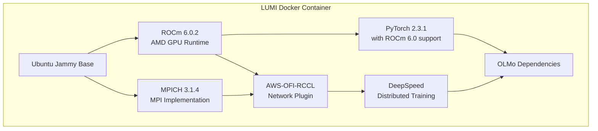
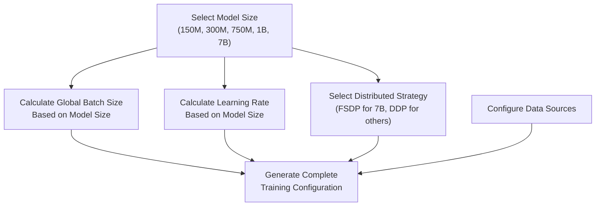
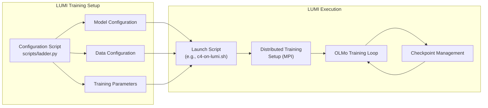

<!-- source: DeepWiki mcp.deepwiki.com · repo allenai/OLMo · page 7.2 LUMI Supercomputer · fetched 2026-10-26 -->

# LUMI Platform

<details>
<summary>Relevant source files</summary>

The following files were used as context for generating this wiki page:

- [docker/Dockerfile.lumi](docker/Dockerfile.lumi)

</details>


This document provides detailed information on running OLMo training workloads on the LUMI supercomputer. It covers environment setup, configuration, execution, and best practices specific to the LUMI platform. For information about other computing platforms, see [Beaker Platform](#7.1) and [Augusta Platform](#7.2).

## Overview of LUMI

LUMI (Large Unified Modern Infrastructure) is one of Europe's most powerful supercomputers, hosted at the CSC IT Center for Science in Finland. For OLMo training, LUMI's significant advantages include:

- AMD MI250X GPUs with ROCm platform instead of NVIDIA CUDA
- Massive parallel computing capabilities
- High-speed interconnect with HPE Slingshot network
- Optimized for large-scale distributed training

OLMo leverages LUMI's architecture for training large language models efficiently at scale, using specialized Docker containers and configuration scripts.

Sources: [docker/Dockerfile.lumi:1-122]()

## LUMI Environment Configuration

OLMo uses a custom Docker environment for running on LUMI. The Dockerfile (`docker/Dockerfile.lumi`) sets up the necessary components for AMD GPU-based training.

### Docker Container Architecture



The Docker image includes:

- **Base OS**: Ubuntu 22.04 (Jammy)
- **GPU Runtime**: ROCm 6.0.2 for AMD GPU support
- **Communication**: MPICH 3.1.4 and AWS-OFI-RCCL for efficient network communication
- **ML Framework**: PyTorch 2.3.1 with ROCm 6.0 support
- **Distributed Training**: DeepSpeed with LUMI-specific modifications
- **Additional Tools**: S3 tools, Google Cloud SDK, monitoring utilities

Sources: [docker/Dockerfile.lumi:1-122]()

### Key Environment Components

| Component | Version | Purpose |
|-----------|---------|---------|
| ROCm | 6.0.2 | AMD GPU computing platform |
| PyTorch | 2.3.1 | Deep learning framework with ROCm support |
| MPICH | 3.1.4 | MPI implementation for inter-node communication |
| AWS-OFI-RCCL | Latest | RCCL plugin for efficient network operations |
| DeepSpeed | Latest | Distributed training optimization library |

Note that the code includes a commented section for Flash Attention installation for MI200 series GPUs (lines 113-117), which may be useful for performance optimization if uncommented and built.

Sources: [docker/Dockerfile.lumi:52-122]()

## Training Configuration for LUMI

The `scripts/ladder.py` script provides utilities for configuring OLMo training runs on various platforms, including LUMI. This script helps calculate appropriate batch sizes, learning rates, and other hyperparameters based on model size.

### Configuration Process



### Model Size Configuration

The script defines configurations for various model sizes, starting with a base 150M parameter model and scaling up to 7B:

```python
MODEL_CONFIG_150M = ModelConfig(
    d_model=768,
    n_heads=12,
    n_layers=12,
    mlp_ratio=8,
    # ... other parameters
)

MODEL_CONFIGS = {
    "150M": MODEL_CONFIG_150M,
    "300M": MODEL_CONFIG_150M.update_with(d_model=1024, n_heads=16, n_layers=16, mlp_ratio=8),
    "750M": MODEL_CONFIG_150M.update_with(d_model=1536, n_heads=16, n_layers=16, mlp_ratio=8),
    "1B": MODEL_CONFIG_150M.update_with(d_model=2048, n_heads=16, n_layers=16, mlp_ratio=8),
    "7B": MODEL_CONFIG_150M.update_with(
        d_model=4096, n_heads=32, n_layers=32, mlp_ratio=0, mlp_hidden_size=22016, init_device="meta"
    ),
}
```

### Automatic Parameter Scaling

The script automatically scales important hyperparameters based on model size:

1. **Global Batch Size**: Calculated as `160 * (model_size / 108000000) ** (2 / 3)` with adjustments for parallelism
2. **Learning Rate**: Calculated as `0.0047 * (model_size / 108000000) ** (-1 / 3)`
3. **Device Batch Size**: Predetermined based on model size to fit in GPU memory
4. **Distributed Strategy**: Defaults to DDP for smaller models, FSDP for 7B models

Sources: [scripts/ladder.py:79-177](), [scripts/ladder.py:125-177]()

## Running Training on LUMI

To run training on LUMI, the project provides configuration utilities and integration with the OLMo training pipeline.

### Training Pipeline Integration



### Data Configuration

Data configuration is a critical part of training setup. The OLMo codebase includes predefined data mixes that can be specified when launching training:

```python
# Example from olmo/data/named_data_mixes.py
DATA_PATHS = {
    "dolma17_flan_sep_rulebased": [
        # Various preprocessed data paths
        "preprocessed/olmo-mix/v1_6-decontaminated/books/gpt-neox-olmo-dolma-v1_5/part-0-00000.npy",
        # ... many more data paths
    ]
}
```

When configuring a training run, you can select which data mix to use:

```python
# In ladder.py
config = TrainConfig(
    # ... other config ...
    data=DataConfig(
        num_workers=32,
        drop_last=True,
        pin_memory=True,
        prefetch_factor=8,
        persistent_workers=True,
        instance_filter=InstanceFilterConfig(),  # defaults are fine
        paths=[f"{read_location}/{path}" for path in named_data_mixes.DATA_PATHS[args.data]],
    ),
)
```

Sources: [scripts/ladder.py:297-305](), [olmo/data/named_data_mixes.py:1-780]()

### Executing Training

To launch training on LUMI:

1. Configure your training run using `scripts/ladder.py` with appropriate model size and data mix
2. Use a LUMI-specific launch script (e.g., referenced in diagrams as `scripts/c4-on-lumi.sh`) 
3. The script will handle:
   - Setting up the correct environment variables for ROCm and MPI
   - Distributing the training across the requested nodes
   - Initializing the model and data loaders
   - Running the training loop with appropriate distributed strategy

Example command (based on available information):

```bash
# Example command (actual script parameters may vary)
python scripts/ladder.py train --model 7B --data dolma17_flan_sep_rulebased --length 2xC --name my-lumi-run
```

The `train_cmd` function in ladder.py takes care of initializing the distributed environment and launching the main training function:

```python
def train_cmd(args: argparse.Namespace):
    cfg = config_from_args(args)

    try:
        mp.set_start_method("spawn", force=True)
    except RuntimeError as e:
        print(f"failed to set multiprocessing start method: {e}")
    dist.init_process_group(backend="nccl")
    prepare_cli_environment()
    add_cached_path_clients()

    from train import main
    main(cfg)
```

Sources: [scripts/ladder.py:367-380]()

## Best Practices for LUMI Training

When running OLMo training on LUMI, consider the following best practices:

### Resource Allocation

The ladder.py script includes a `nodecounts_cmd` function that helps determine optimal node allocation based on global batch size and device batch size:

```python
def nodecounts_cmd(args: argparse.Namespace):
    cfg = config_from_args(args)
    if cfg.global_train_batch_size % cfg.device_train_microbatch_size != 0:
        raise ValueError("Microbatchsize must divide global batch size evenly.")
    num_gpus = cfg.global_train_batch_size // cfg.device_train_microbatch_size
    if num_gpus % args.gpus_per_node != 0:
        raise ValueError(
            f"With {cfg.global_train_batch_size} bz, {cfg.device_train_microbatch_size} mbz, and {args.gpus_per_node} GPUs per node, it's impossible to allocate whole nodes."
        )
    max_num_nodes = num_gpus // args.gpus_per_node

    for factor in reversed(list(_factors(max_num_nodes))):
        print(factor)
```

You can use this utility to determine the optimal number of nodes for your training run:

```bash
python scripts/ladder.py nodecounts --model 7B --gpus-per-node 8
```

Sources: [scripts/ladder.py:309-326](), [scripts/ladder.py:398-402]()

### Model Size Considerations

Different model sizes have different resource requirements:

| Model Size | Default Device Batch Size | Distributed Strategy |
|------------|--------------------------|----------------------|
| 150M       | 32                       | DDP                  |
| 300M       | 10                       | DDP                  |
| 750M       | 8                        | DDP                  |
| 1B         | 2                        | DDP                  |
| 7B         | 2                        | FSDP                 |

For the largest models (7B), the code automatically switches to Fully Sharded Data Parallel (FSDP) training to distribute model parameters across multiple GPUs.

Sources: [scripts/ladder.py:159-177]()

### Checkpoint Management

OLMo's checkpoint management system integrates with LUMI training. The default configuration:

1. Saves checkpoints at regular intervals (e.g., every 1000-5000 steps, varying by model size)
2. Uses a remote save folder (typically in S3) for persistent storage
3. Provides both sharded and unsharded checkpoint formats

When resuming training, you can specify a checkpoint path:

```bash
python scripts/ladder.py train --model 7B --data dolma17_flan_sep_rulebased --name my-lumi-run --load_path s3://ai2-llm/checkpoints/OLMo-ladder/my-lumi-run/step-5000
```

Sources: [scripts/ladder.py:139-143](), [scripts/ladder.py:210-217]()

### Performance Monitoring

The OLMo training configuration includes a speed monitor that logs performance metrics:

```python
TrainConfig(
    # ... other config ...
    speed_monitor=SpeedMonitorConfig(window_size=1),
)
```

This helps track training throughput and identify potential performance bottlenecks when running on LUMI.

Sources: [scripts/ladder.py:224]()

## Troubleshooting

### Common Issues

1. **Flash Attention**: The Dockerfile includes commented code for building Flash Attention for MI200 series GPUs. If you need this performance optimization, uncomment and rebuild the Docker image.

2. **MPI Communication**: If you encounter MPI-related errors, check that the AWS-OFI-RCCL plugin is properly configured for LUMI's network.

3. **Batch Size Errors**: Ensure that your global batch size is evenly divisible by your device batch size and the number of GPUs.

4. **Out-of-Memory Errors**: For larger models, consider reducing the device batch size or using gradient accumulation.

5. **ROCm Compatibility**: Ensure that the ROCm version in the Docker container (6.0.2) is compatible with the version installed on LUMI.

Sources: [docker/Dockerfile.lumi:113-118](), [scripts/ladder.py:309-326]()

## Conclusion

The LUMI platform provides a powerful environment for training OLMo models, especially at the largest scales. The OLMo codebase includes specialized configurations and tooling to efficiently utilize LUMI's AMD GPU architecture and high-speed interconnect. By following the guidelines in this document, you can effectively set up and run OLMo training on LUMI.

---

