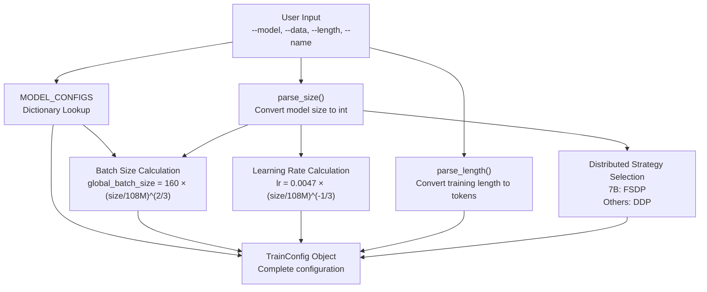

<!-- source: DeepWiki mcp.deepwiki.com · repo allenai/OLMo · page 7.3 Local Training · fetched 2026-10-26 -->

# Local Training

<details>
<summary>Relevant source files</summary>

The following files were used as context for generating this wiki page:

- [olmo/aliases.py](olmo/aliases.py)
- [olmo/data/named_data_mixes.py](olmo/data/named_data_mixes.py)
- [scripts/compare_wandb_configs.py](scripts/compare_wandb_configs.py)
- [scripts/ladder.py](scripts/ladder.py)
- [test_fixtures/train_tiny_with_evaluator.yaml](test_fixtures/train_tiny_with_evaluator.yaml)
- [tests/util_test.py](tests/util_test.py)

</details>


## Purpose and Scope

This page describes how to run OLMo training on local hardware using either `ladder.py` for automated configuration generation or direct `train.py` invocation. Local training is suitable for development, debugging, and small-scale experiments on single-node or limited multi-node setups.

For cloud-based distributed training via Beaker, see [Beaker Platform](#7.1). For HPC execution on LUMI supercomputer, see [LUMI Supercomputer](#7.2).

## Execution Methods

Local training can be initiated through two primary methods: using the `ladder.py` convenience wrapper or invoking `train.py` directly with `torchrun`.

### Using ladder.py

The `ladder.py` script provides a high-level interface that automatically generates training configurations and launches distributed training. It handles model configuration, scaling laws, and data path resolution.

**Basic Usage:**

```bash
python scripts/ladder.py train --model 1B --data dolma17_flan_sep_rulebased --length 2xC --name my-experiment
```

**Command Structure:**

| Argument | Description | Example Values |
|----------|-------------|----------------|
| `--model` | Model size | `150M`, `300M`, `750M`, `1B`, `7B` |
| `--data` | Named data mix | `dolma17_flan_sep_rulebased` |
| `--length` | Training length | `1xC`, `2xC`, `100B`, `1T` |
| `--name` | Experiment name | `my-experiment` |
| `--s3` | Read data from S3, write checkpoints to S3 | Flag (default: false) |
| `--wandb` | Enable Weights & Biases logging | Flag (default: true) |
| `--load_path` | Path to checkpoint for resuming | S3 or local path |
| `--read_location` | Override default data location | Custom path |

The length parameter supports units: `C` (chinchilla tokens = 20 × model_size), `K` (thousands), `M` (millions), `B` (billions), `T` (trillions).

**Sources:** [scripts/ladder.py:367-381](), [scripts/ladder.py:416-438]()

### Using train.py Directly

For more control, invoke `train.py` directly with `torchrun` for distributed execution:

```bash
torchrun --nproc_per_node=8 scripts/train.py configs/my_config.yaml
```

This method requires a pre-existing YAML configuration file but provides complete control over all training parameters.

**Sources:** [scripts/ladder.py:378-380]()

## Configuration Generation

The `ladder.py` script automatically generates `TrainConfig` objects with parameters calculated according to scaling laws from research literature.

### Automatic Parameter Calculation



**Diagram: Configuration Generation Flow**

**Sources:** [scripts/ladder.py:125-307]()

### Model Configurations

The `MODEL_CONFIGS` dictionary in `ladder.py` defines architecture parameters for each model size:

| Model Size | `d_model` | `n_heads` | `n_layers` | `mlp_ratio` / `mlp_hidden_size` |
|------------|-----------|-----------|------------|--------------------------------|
| 150M | 768 | 12 | 12 | 8 |
| 300M | 1024 | 16 | 16 | 8 |
| 750M | 1536 | 16 | 16 | 8 |
| 1B | 2048 | 16 | 16 | 8 |
| 7B | 4096 | 32 | 32 | 22016 (fixed size) |

All configurations use:
- RoPE positional embeddings (`rope=True`)
- Flash Attention (`flash_attention=True`)
- RMS Layer Normalization (`layer_norm_type=LayerNormType.rms`)
- SwiGLU activation (`activation_type=ActivationType.swiglu`)
- No weight tying (`weight_tying=False`)
- Max sequence length of 2048 tokens

**Sources:** [scripts/ladder.py:48-87]()

### Device Batch Size Selection

The script automatically selects appropriate device batch sizes based on typical GPU memory constraints:

| Model Size | Device Batch Size | Rationale |
|------------|-------------------|-----------|
| 150M | 32 | Fits comfortably in GPU memory |
| 300M | 10 | Balanced for typical GPUs |
| 750M | 8 | Moderate memory usage |
| 1B | 2 | Larger model requires smaller batches |
| 7B | 2 | Very large model, small batch per device |

These values can be overridden in custom configurations if using GPUs with different memory capacities.

**Sources:** [scripts/ladder.py:159-166]()

### Data Location Resolution

By default, `ladder.py` assumes data is stored locally at `/weka/oe-training-default/ai2-llm`. When the `--s3` flag is provided, it switches to reading from `s3://ai2-llm`.

The script resolves named data mixes from `olmo.data.named_data_mixes.DATA_PATHS`, which contains predefined collections like `dolma17_flan_sep_rulebased` with paths to approximately 1400 preprocessed `.npy` files across various domains (books, papers, wiki, code, web, social media, instruction data, math).

**Sources:** [scripts/ladder.py:131-137](), [scripts/ladder.py:304](), [olmo/data/named_data_mixes.py:1-2]()

## Distributed Training Setup

Local training uses PyTorch's distributed training infrastructure with the NCCL backend for efficient GPU communication.

```mermaid
sequenceDiagram
    participant User
    participant ladder["ladder.py<br/>train_cmd()"]
    participant mp["torch.multiprocessing"]
    participant dist["torch.distributed"]
    participant env["prepare_cli_environment()"]
    participant train["train.main()"]
    
    User->>ladder: python ladder.py train ...
    ladder->>ladder: config_from_args()
    ladder->>mp: set_start_method("spawn")
    ladder->>dist: init_process_group(backend="nccl")
    ladder->>env: prepare_cli_environment()
    ladder->>ladder: add_cached_path_clients()
    ladder->>train: main(cfg)
    train->>train: Initialize model with FSDP/DDP
    train->>train: Execute training loop
```

**Diagram: Local Training Initialization Sequence**

**Sources:** [scripts/ladder.py:367-381]()

### Process Group Initialization

The `train_cmd()` function in `ladder.py` performs the following initialization steps:

1. **Set Multiprocessing Start Method**: Uses `spawn` method for launching processes
   ```python
   mp.set_start_method("spawn", force=True)
   ```

2. **Initialize NCCL Process Group**: Sets up distributed communication backend
   ```python
   dist.init_process_group(backend="nccl")
   ```

3. **Prepare CLI Environment**: Configures logging and environment variables
   ```python
   prepare_cli_environment()
   ```

4. **Register Cached Path Clients**: Adds support for S3, GCS, and other remote storage backends
   ```python
   add_cached_path_clients()
   ```

**Sources:** [scripts/ladder.py:370-377]()

### torchrun Integration

When using `ladder.py`, the script expects to be launched via `torchrun` or an equivalent distributed launcher. The typical invocation pattern is:

```bash
torchrun --nproc_per_node=8 scripts/ladder.py train --model 1B --data dolma17_flan_sep_rulebased --length 2xC --name experiment
```

The `--nproc_per_node` argument specifies the number of GPUs on the local node. For multi-node setups, additional `torchrun` arguments like `--nnodes` and `--node_rank` would be required.

### Distributed Strategy Selection

The configuration automatically selects the appropriate distributed strategy based on model size:

| Model Size | Strategy | Sharding Strategy | Wrapping Strategy |
|------------|----------|-------------------|-------------------|
| 150M - 1B | DDP | N/A (full replication) | N/A |
| 7B | FSDP | `SHARD_GRAD_OP` | `by_block_and_size` |

For FSDP configurations, additional parameters are set:
- **Precision**: Mixed precision (`FSDPPrecision.mixed`)
- **Sharding**: Gradient and optimizer state sharding (`ShardingStrategy.SHARD_GRAD_OP`)
- **Wrapping**: By transformer block and size threshold (`FSDPWrapStrategy.by_block_and_size`)

**Sources:** [scripts/ladder.py:177](), [scripts/ladder.py:184-189]()

## Resource Requirements

### GPU Requirements by Model Size

The following table provides guidance on GPU requirements for different model sizes:

| Model Size | Global Batch Size | Device Batch Size | Min GPUs (no grad accum) | Recommended GPUs |
|------------|-------------------|-------------------|-------------------------|------------------|
| 150M | ~544 | 32 | 17 | 2-4 (8 GPUs per node) |
| 300M | ~896 | 10 | 90 | 16 (2 nodes × 8 GPUs) |
| 750M | ~1376 | 8 | 172 | 24 (3 nodes × 8 GPUs) |
| 1B | ~1792 | 2 | 896 | 112 (14 nodes × 8 GPUs) |
| 7B | ~5120 | 2 | 2560 | 128 (16 nodes × 8 GPUs) |

These calculations assume no gradient accumulation. In practice, gradient accumulation can reduce the number of required GPUs by allowing each device to process multiple microbatches before synchronizing gradients.

**Gradient Accumulation Factor** = `global_train_batch_size / (device_train_microbatch_size × num_gpus)`

**Sources:** [scripts/ladder.py:148-156](), [scripts/ladder.py:159-166]()

### Memory Requirements

Approximate GPU memory requirements per device:

| Model Size | Parameters | Memory per Device (FSDP) | Memory per Device (DDP) |
|------------|------------|-------------------------|------------------------|
| 150M | ~150M | ~2 GB | ~4 GB |
| 300M | ~300M | ~3 GB | ~6 GB |
| 750M | ~750M | ~6 GB | ~12 GB |
| 1B | ~1B | ~8 GB | ~16 GB |
| 7B | ~7B | ~28 GB (sharded) | Not feasible |

These are rough estimates including model parameters, optimizer states, gradients, and activation memory. Actual requirements vary based on sequence length, batch size, and mixed-precision settings.

### Storage Requirements

Training requires sufficient storage for:

1. **Training Data**: Named data mixes like `dolma17_flan_sep_rulebased` contain ~1400 `.npy` files totaling several hundred GB to TB
2. **Checkpoints**: Unsharded checkpoints range from ~1 GB (150M) to ~28 GB (7B) per checkpoint
3. **Workspace**: Temporary files, logs, and evaluation results

For local training, ensure the filesystem specified in `save_folder` has adequate space. The default local save path is `runs/{run_name}`.

**Sources:** [scripts/ladder.py:209]()

## Key Configuration Parameters

The following table summarizes critical configuration parameters set by `ladder.py`:

| Parameter | Description | Example Value (1B) |
|-----------|-------------|-------------------|
| `run_name` | Experiment identifier | `my-experiment-1B-2xC` |
| `seed` | Random seed | `6198` |
| `max_duration` | Training length in tokens | `40000000000T` (40B tokens for 2xC) |
| `global_train_batch_size` | Total samples per step | `1792` |
| `device_train_microbatch_size` | Samples per device per step | `2` |
| `precision` | Mixed precision type | `amp_bf16` |
| `save_interval_unsharded` | Steps between unsharded checkpoints | `2500` (1B), `1000` (7B) |
| `eval_interval` | Steps between evaluations | Same as save interval |
| `max_grad_norm` | Gradient clipping threshold | `1.0` |
| `fused_loss` | Use fused loss kernel | `True` |

**Sources:** [scripts/ladder.py:179-226]()

### Scheduler Configuration

The default scheduler is `cosine_with_warmup` with:
- **Warmup steps**: Calculated as `model_size / (global_batch_size × sequence_length)`
- **Final alpha**: `0.01` (cosine anneals to 1% of peak LR)
- **Warmup minimum LR**: `0.0`

**Sources:** [scripts/ladder.py:200-205]()

### Evaluator Configuration

`ladder.py` configures comprehensive evaluation including:

1. **Perplexity Evaluators**: Validation sets for c4, dolma (books, common-crawl, pes2o, reddit, stack, wiki), ice, m2d2_s2orc, pile, wikitext_103
2. **Downstream Task Evaluators**: PIQA, HellaSwag, WinoGrande, OpenBookQA, BoolQ, SciQ, ARC (easy/challenge), COPA, CommonsenseQA, Social IQA, MMLU variants (stem, humanities, social sciences, other), basic arithmetic, TriviaQA, Natural Questions

All evaluators run every `eval_interval` steps (default: 2500 for 1B, 1000 for 7B).

**Sources:** [scripts/ladder.py:227-296]()

## Checkpointing

### Save Configuration

Checkpoints are saved to two locations:

1. **Local**: `save_folder = "runs/{run_name}"` - Local filesystem workspace
2. **Remote**: `remote_save_folder = "s3://ai2-llm/checkpoints/OLMo-ladder/{run_name}"` - S3 bucket for persistence

### Checkpoint Cadence

| Parameter | Default Value | Notes |
|-----------|---------------|-------|
| `save_interval_unsharded` | 2500 (1B), 1000 (7B) | Saves full unsharded checkpoint |
| `save_interval` | `None` | Sharded checkpoints disabled by default |
| `save_num_unsharded_checkpoints_to_keep` | `-1` | Keep all checkpoints |
| `sharded_checkpointer` | `olmo_core` | Checkpointer backend |

The system prioritizes unsharded checkpoints for easier downstream use and compatibility with Hugging Face format.

**Sources:** [scripts/ladder.py:209-217]()

### Checkpoint Loading and Resumption

To resume training from a checkpoint:

```bash
python scripts/ladder.py train \
    --model 1B \
    --data dolma17_flan_sep_rulebased \
    --length 2xC \
    --name my-experiment \
    --load_path s3://ai2-llm/checkpoints/OLMo-ladder/my-experiment-1B-2xC/step1000-unsharded \
    --eval_on_load
```

The `--load_path` argument specifies the checkpoint directory. If not provided, `ladder.py` automatically searches for the latest checkpoint in the `remote_save_folder`. The `--eval_on_load` flag triggers evaluation immediately after loading.

**Sources:** [scripts/ladder.py:140-142](), [scripts/ladder.py:215-216]()

## Differences from Cloud/HPC Execution

### Local vs. Beaker

| Aspect | Local Training | Beaker Platform |
|--------|----------------|-----------------|
| **Execution** | Direct `torchrun` invocation | Gantry job submission with resource provisioning |
| **Resource Management** | Manual GPU allocation | Automated cluster scheduling |
| **Data Access** | Local filesystem or manual S3 mount | Automatic S3 integration via Beaker datasets |
| **Monitoring** | Local logs + W&B | Beaker workspace + W&B |
| **Scalability** | Limited to available local hardware | Dynamic scaling across cluster nodes |
| **Docker** | Optional | Required (olmo-torch2-gantry image) |

For Beaker execution details, see [Beaker Platform](#7.1).

### Local vs. LUMI

| Aspect | Local Training | LUMI Supercomputer |
|--------|----------------|-------------------|
| **Hardware** | NVIDIA GPUs (CUDA) | AMD GPUs (ROCm) |
| **Scheduling** | Manual execution | Slurm batch scheduler |
| **MPI Backend** | NCCL | aws-ofi-rccl (via MPICH) |
| **Container** | Optional | Required (LUMI-specific Docker image) |
| **Scale** | Single node or small clusters | Large-scale HPC (thousands of GPUs) |

For LUMI-specific configuration, see [LUMI Supercomputer](#7.2).

**Sources:** [scripts/ladder.py:367-381]()

## Utility Commands

The `ladder.py` script provides additional utility commands for configuration inspection:

### Calculate Node Requirements

Determine valid node counts for a given configuration:

```bash
python scripts/ladder.py nodecounts --model 1B --gpus-per-node 8
```

This outputs all valid node counts that evenly divide the required number of GPUs, helping plan multi-node deployments.

**Sources:** [scripts/ladder.py:313-326]()

### Calculate Model Size

Compute the total parameter count for a model configuration:

```bash
python scripts/ladder.py size --model 1B
```

Outputs two values:
1. Total parameters (including embeddings)
2. Non-embedding parameters

**Sources:** [scripts/ladder.py:328-355]()

### Dump Configuration

Preview the generated configuration without starting training:

```bash
python scripts/ladder.py dump \
    --model 1B \
    --data dolma17_flan_sep_rulebased \
    --length 2xC \
    --name my-experiment \
    --dump_evaluators \
    --dump_data
```

This flattens and prints all configuration keys, useful for debugging and verification. The `--dump_evaluators` and `--dump_data` flags control whether evaluator and data configurations are included (they can be verbose).

**Sources:** [scripts/ladder.py:357-365]()

---

**Sources:** [scripts/ladder.py:1-441](), [test_fixtures/train_tiny_with_evaluator.yaml:1-55](), [olmo/data/named_data_mixes.py:1-2]()

---

