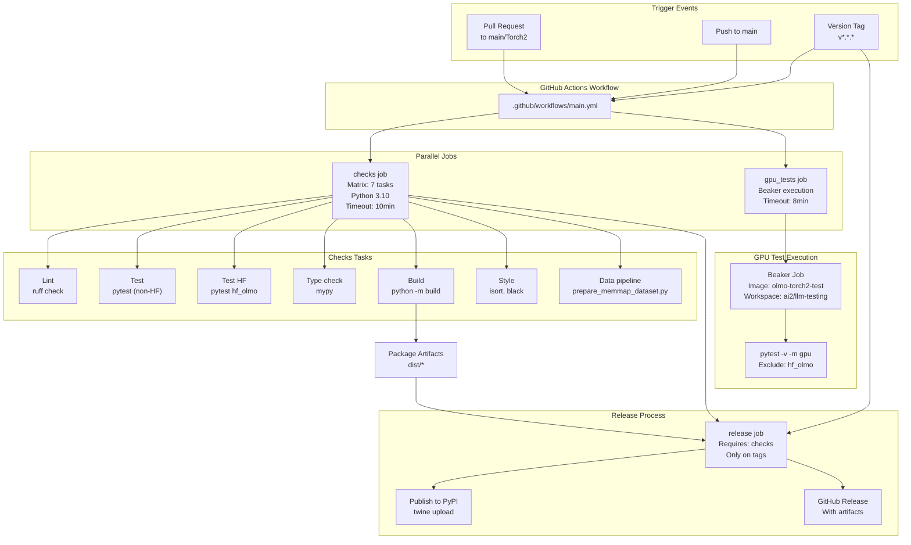
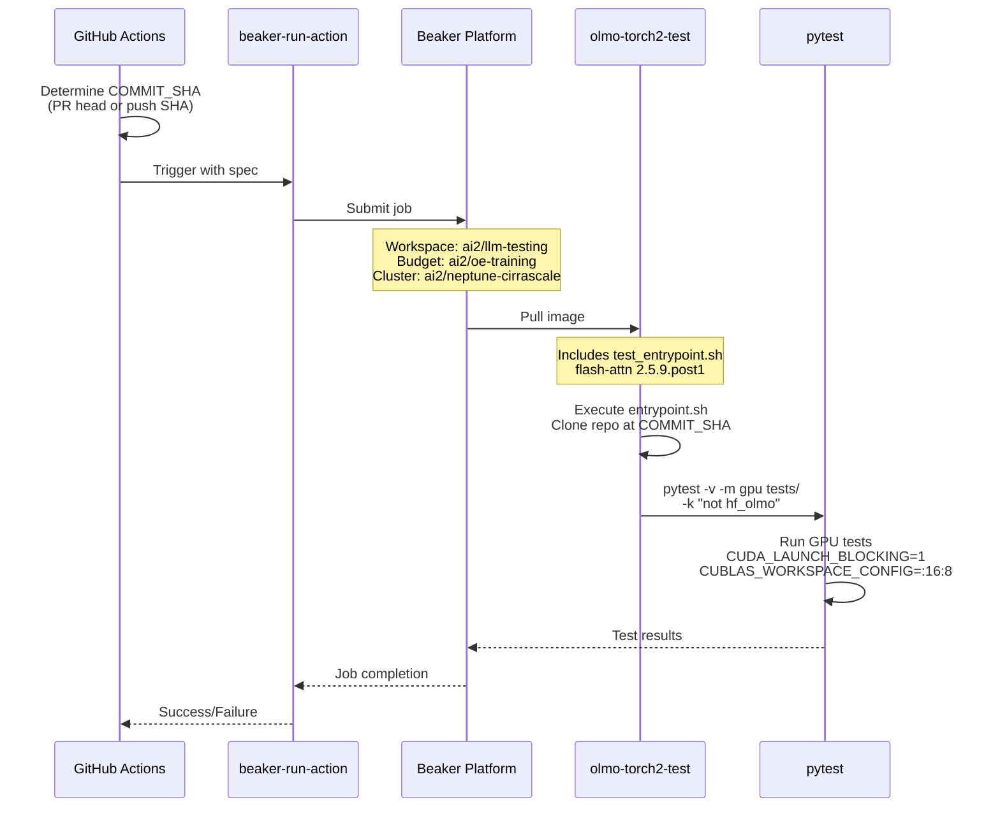
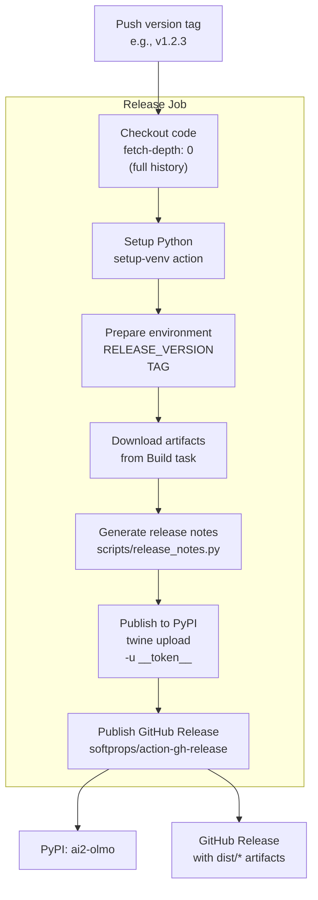
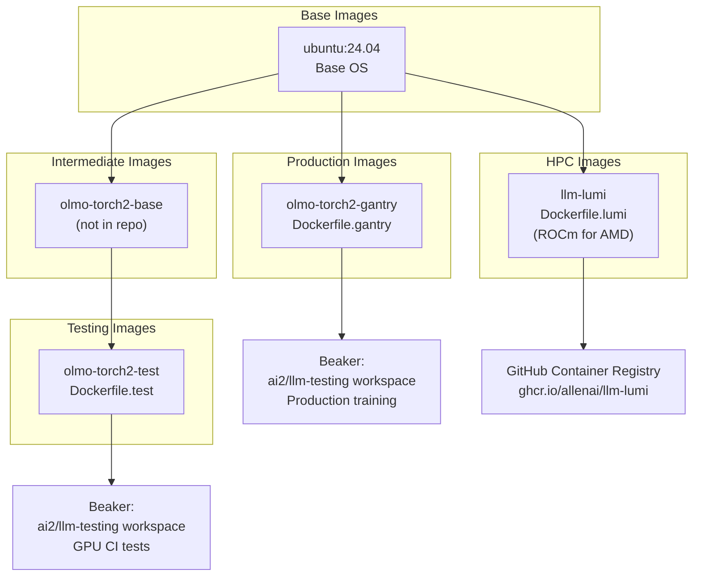

<!-- source: DeepWiki mcp.deepwiki.com · repo allenai/OLMo · page 8 Development and CI/CD · fetched 2026-10-26 -->

# Development and CI/CD

<details>
<summary>Relevant source files</summary>

The following files were used as context for generating this wiki page:

- [.github/actions/setup-venv/action.yml](.github/actions/setup-venv/action.yml)
- [.github/workflows/main.yml](.github/workflows/main.yml)
- [Makefile](Makefile)
- [docker/Dockerfile.gantry](docker/Dockerfile.gantry)
- [docker/Dockerfile.test](docker/Dockerfile.test)
- [tests/config_test.py](tests/config_test.py)
- [tests/model_test.py](tests/model_test.py)

</details>


## Purpose and Scope

This page documents the development workflows, testing infrastructure, and continuous integration/deployment (CI/CD) pipeline for the OLMo repository. It covers local development setup, automated quality checks, GPU testing on Beaker, Docker image building, and the release automation process.

For information about training infrastructure platforms (Beaker, LUMI), see [Training Infrastructure](#7). For details about running training jobs specifically, see [Training Pipeline](#3).

## Overview

The OLMo repository uses GitHub Actions for CI/CD automation, with three primary workflows:

1. **Checks Job** - Runs linting, testing, type checking, and package building on every pull request and push
2. **GPU Tests Job** - Executes GPU-specific tests on Beaker infrastructure using dedicated Docker images
3. **Release Job** - Automatically publishes packages to PyPI and GitHub Releases when version tags are pushed

All development workflows leverage Python virtual environment caching to minimize CI execution time, and the system maintains multiple Docker images for different execution contexts (production training, GPU testing, HPC environments).

**Sources:** [.github/workflows/main.yml:1-214]()

## CI/CD Pipeline Architecture



**Sources:** [.github/workflows/main.yml:1-214]()

## Development Workflow

### Local Development Setup

Developers can run quality checks locally using the Makefile target:

```bash
make run-checks
```

This executes the same checks that run in CI:

| Check | Command | Purpose |
|-------|---------|---------|
| Import Sorting | `isort --check .` | Verify imports are alphabetically sorted |
| Code Formatting | `black --check .` | Verify code follows Black style |
| Linting | `ruff check .` | Static analysis for code quality issues |
| Type Checking | `mypy .` | Verify type annotations |
| Tests | `pytest -v --color=yes tests/` | Run CPU test suite |

The environment variable `CUDA_VISIBLE_DEVICES=''` is set to ensure tests run on CPU only during local checks.

**Sources:** [Makefile:10-16]()

### Virtual Environment Setup

The repository uses a custom GitHub Action [`setup-venv`](.github/actions/setup-venv/action.yml:1-64)() for consistent Python environment setup across CI jobs:

```mermaid
graph LR
    Start["setup-venv action"]
    SetupPython["Setup Python<br/>actions/setup-python@v4"]
    InstallPrereq["Install Prerequisites<br/>pip, setuptools, build, wheel"]
    CacheCheck["Check Cache<br/>Key: prefix-os-pyversion-deps-hash"]
    
    CacheHit{"Cache<br/>Hit?"}
    
    CreateVenv["Create .venv<br/>virtualenv -p python"]
    InstallTorch["Install PyTorch<br/>torch<2.2 (CPU)"]
    InstallFull["Install Package<br/>pip install -e .[all]"]
    InstallHF["Install HF OLMo<br/>pip install -e hf_olmo"]
    
    InstallNoDeps["Install Package (no deps)<br/>pip install --no-deps -e ."]
    
    ShowInfo["Show Environment Info<br/>python --version<br/>pip freeze"]
    
    Start --> SetupPython
    SetupPython --> InstallPrereq
    InstallPrereq --> CacheCheck
    CacheCheck --> CacheHit
    
    CacheHit -->|No| CreateVenv
    CreateVenv --> InstallTorch
    InstallTorch --> InstallFull
    InstallFull --> InstallHF
    
    CacheHit -->|Yes| InstallNoDeps
    InstallNoDeps --> ShowInfo
    InstallHF --> ShowInfo
```



The cache key [.github/actions/setup-venv/action.yml:37]() includes:
- `cache-prefix`: Manual cache invalidation control (default: `v0`)
- `runner.os`: Operating system
- `PYTHON_VERSION`: Exact Python version
- Hash of `*requirements.txt` and `*pyproject.toml` files

**Sources:** [.github/actions/setup-venv/action.yml:1-64](), [.github/workflows/main.yml:17-21]()

## Checks Job

The checks job [.github/workflows/main.yml:24-111]() runs a matrix of 7 tasks in parallel:

### Task Matrix Configuration

| Task Name | Command | Dependencies | Output |
|-----------|---------|--------------|--------|
| **Lint** | `ruff check .` | ruff | Error report |
| **Test** | `pytest -v --color=yes --durations=5 tests/ --ignore-glob='tests/hf_olmo/*'` | pytest | Test results (non-HF) |
| **Test HF** | `pytest -v --color=yes --durations=5 tests/hf_olmo` | pytest, transformers | HF integration tests |
| **Type check** | `mypy .` | mypy | Type errors |
| **Build** | `python -m build` | build | Package dist files |
| **Style** | `isort --check .`<br/>`black --check .` | isort, black | Style violations |
| **Data pipeline** | `python scripts/prepare_memmap_dataset.py test_fixtures/*.json.gz -o /tmp/c4-sample.npy --validate --ack-deprecated` | numpy | Validation report |

The Build task uploads package distribution files as artifacts [.github/workflows/main.yml:99-104](), which are later downloaded by the release job.

### Mypy Cache Optimization

Type checking uses a dedicated cache strategy [.github/workflows/main.yml:84-92]() to speed up `mypy` execution:

```yaml
path: .mypy_cache
key: mypy-{CACHE_PREFIX}-{os}-{python}-{deps-hash}-{ref}-{sha}
restore-keys:
  - mypy-{CACHE_PREFIX}-{os}-{python}-{deps-hash}-{ref}
  - mypy-{CACHE_PREFIX}-{os}-{python}-{deps-hash}
```

This hierarchical fallback strategy allows incremental type checking across commits.

**Sources:** [.github/workflows/main.yml:24-111]()

## GPU Tests Job

GPU-specific tests run on Beaker infrastructure using the `beaker-run-action`:



### GPU Test Configuration

The Beaker job specification [.github/workflows/main.yml:135-166]() includes:

| Parameter | Value | Purpose |
|-----------|-------|---------|
| **Image** | `akshitab/olmo-torch2-test` | Test harness with GPU support |
| **Workspace** | `ai2/llm-testing` | Beaker workspace |
| **Budget** | `ai2/oe-training` | Cost allocation |
| **GPUs** | 1 | Single GPU sufficient for tests |
| **Cluster** | `ai2/neptune-cirrascale` | GPU cluster constraint |
| **Priority** | `normal` | Job scheduling priority |
| **Preemptible** | `true` | Can be preempted for cost savings |

### Environment Variables

Tests run with deterministic CUDA settings:

- `CUDA_LAUNCH_BLOCKING=1` - Synchronous kernel launches for debugging
- `CUBLAS_WORKSPACE_CONFIG=:16:8` - Deterministic cuBLAS operations
- `TOKENIZERS_PARALLELISM=false` - Disable tokenizer parallelism warnings
- `COMMIT_SHA` - Specific commit to test
- `TMP_GITHUB_TOKEN` - Repository access token

The test command excludes HuggingFace tests: `pytest -v -m gpu tests/ -k "not hf_olmo"`

**Sources:** [.github/workflows/main.yml:112-167]()

## Release Process

Releases are automatically triggered when version tags matching `v*.*.*` are pushed:



### Release Steps

1. **Environment Preparation** [.github/workflows/main.yml:184-187]()
   - Extract version from tag: `RELEASE_VERSION=${GITHUB_REF#refs/tags/v}`
   - Store tag name: `TAG=${GITHUB_REF#refs/tags/}`

2. **Artifact Download** [.github/workflows/main.yml:189-193]()
   - Downloads package distribution files from the Build task
   - Files placed in `dist/` directory

3. **Release Notes Generation** [.github/workflows/main.yml:195-198]()
   - Runs `scripts/release_notes.py` to generate changelog
   - Outputs to `${{ github.workspace }}-RELEASE_NOTES.md`

4. **PyPI Publication** [.github/workflows/main.yml:200-203]()
   - Uses `twine` to upload to PyPI
   - Authenticates with `__token__` username and `PYPI_PASSWORD` secret

5. **GitHub Release** [.github/workflows/main.yml:205-213]()
   - Uses `softprops/action-gh-release@v1`
   - Includes generated release notes
   - Attaches `dist/*` files
   - Marks as prerelease if tag contains `rc`

**Sources:** [.github/workflows/main.yml:168-214]()

## Docker Images

The repository maintains multiple Docker images for different execution contexts:



### Gantry Image (Production Training)

Built from [docker/Dockerfile.gantry:1-44]():

**Key Components:**
- **Base**: Ubuntu 24.04
- **Conda**: Miniconda3 for package management
- **PyTorch**: Version 2.2.2 with CUDA 11.8 support
- **Flash Attention**: Compiled with `pip install flash-attn --no-build-isolation`
- **Dependencies**: Installs `[train]` extras from `pyproject.toml`

**Build Process** [Makefile:31-36]():
```bash
make gantry-image
# 1. Build Docker image locally
# 2. Push to Beaker: beaker image create
# 3. Delete old image: beaker image delete
# 4. Rename to canonical name: beaker image rename
```

**Environment Variables:**
- `NVIDIA_VISIBLE_DEVICES=all`
- `NVIDIA_DRIVER_CAPABILITIES=compute,utility`
- `LD_LIBRARY_PATH=/usr/local/nvidia/lib:/usr/local/nvidia/lib64`

**Sources:** [docker/Dockerfile.gantry:1-44](), [Makefile:31-36]()

### Test Image (GPU CI)

Built from [docker/Dockerfile.test:1-17]():

**Key Components:**
- **Base**: `olmo-torch2-base` (not in repository, built separately)
- **Entrypoint**: Custom script at `/entrypoint.sh`
- **Flash Attention**: Version 2.5.9.post1 with `FLASH_ATTENTION_SKIP_CUDA_BUILD=TRUE`
- **Test Dependencies**: `packaging`, `ninja`

**Entrypoint Behavior** [scripts/test_entrypoint.sh]():
The entrypoint script clones the repository at the specified `COMMIT_SHA` using the `TMP_GITHUB_TOKEN`, installs the package, and executes the provided test command.

**Build Process** [Makefile:38-43]():
```bash
make test-image
# 1. Build base image first: make base-image
# 2. Build test image on top
# 3. Push to Beaker with temporary name
# 4. Delete old image and rename
```

**Sources:** [docker/Dockerfile.test:1-17](), [Makefile:38-43]()

### LUMI Image (AMD HPC)

Built from `docker/Dockerfile.lumi` (not provided but referenced in [Makefile:45-48]()):

**Build Process:**
```bash
make lumi-image
# 1. Build with Git commit SHA as tag
# 2. Push to GitHub Container Registry
# Tag format: ghcr.io/allenai/llm-lumi:{git-sha}
```

**Singularity Conversion** [Makefile:50-52]():
```bash
make singularity-pull TAG={git-sha}
# Converts Docker image to Singularity format for LUMI
# Output: $PROJECT_DIR/containers/llm-lumi_{TAG}.sif
```

**Sources:** [Makefile:45-52]()

## Image Management Commands

The Makefile provides utilities for inspecting image configurations:

| Command | Output | Usage |
|---------|--------|-------|
| `make beaker-info` | Current Beaker user and image names | Verify configuration before operations |
| `make show-test-image` | Full Beaker path to test image | Use in scripts/configs |
| `make show-gantry-image` | Full Beaker path to gantry image | Use in scripts/configs |
| `make show-beaker-workspace` | Workspace name | Verify workspace access |

**Query Implementation** [Makefile:6-8]():
The Makefile uses `jq` to parse Beaker API responses:
```makefile
GANTRY_IMAGE = $(shell beaker workspace images $(BEAKER_WORKSPACE) --format=json | \
    jq -r -c '.[] | select( .name == "$(IMAGE_NAME_BASE)-gantry" ) | .fullName')
```

**Sources:** [Makefile:1-65]()

## Test Infrastructure

### Test Organization

Tests are organized with pytest markers [tests/model_test.py:13-113]():

- **CPU Tests**: Default, run in CI checks job
- **GPU Tests**: Marked with `@pytest.mark.gpu`, run on Beaker
- **Conditional Skip**: Tests skip if required hardware unavailable

Example GPU test marker:
```python
@pytest.mark.gpu
@pytest.mark.skipif(torch.cuda.device_count() < 1, reason="Requires CUDA device")
```

### Test Categories

| Category | Location | Purpose | CI Context |
|----------|----------|---------|------------|
| **Model Tests** | `tests/model_test.py` | Forward/backward passes, generation, attention variants | Both CPU and GPU |
| **Config Tests** | `tests/config_test.py` | Configuration loading, saving, validation | CPU only |
| **HF Integration** | `tests/hf_olmo/` | HuggingFace transformers integration | Separate task |
| **Data Pipeline** | Via `prepare_memmap_dataset.py` | Memmap dataset creation and validation | Checks job |

**Sources:** [tests/model_test.py:1-504](), [tests/config_test.py:1-69]()

### Deterministic Testing

GPU tests use deterministic algorithms [tests/model_test.py:126-127]():
```python
torch.manual_seed(0)
torch.use_deterministic_algorithms(True)
```

Combined with environment variables:
- `CUDA_LAUNCH_BLOCKING=1` - Synchronous execution
- `CUBLAS_WORKSPACE_CONFIG=:16:8` - Deterministic cuBLAS

This ensures reproducible test results across runs.

**Sources:** [tests/model_test.py:126-127](), [.github/workflows/main.yml:156-159]()

## Caching Strategy

The CI/CD pipeline employs multiple caching layers to minimize execution time:

### Virtual Environment Cache

**Cache Key** [.github/actions/setup-venv/action.yml:37]():
```
{cache-prefix}-{os}-{python-version}-{deps-hash}
```

**Cached Content:**
- Entire `.venv` directory with all installed packages
- PyTorch CPU version
- All project dependencies
- HuggingFace OLMo integration

**Cache Behavior:**
- **Cache Miss**: Full installation (~5-10 minutes)
- **Cache Hit**: Only no-deps reinstall of project (~30 seconds)

**Sources:** [.github/actions/setup-venv/action.yml:33-56]()

### Mypy Cache

**Cache Key** [.github/workflows/main.yml:89]():
```
mypy-{cache-prefix}-{os}-{python}-{deps-hash}-{ref}-{sha}
```

**Restore Keys** (hierarchical fallback):
1. Same ref + deps: `mypy-{prefix}-{os}-{python}-{deps}-{ref}`
2. Same deps: `mypy-{prefix}-{os}-{python}-{deps}`

This allows incremental type checking even when exact match unavailable.

**Sources:** [.github/workflows/main.yml:84-92]()

### Cache Invalidation

Manual cache invalidation via `CACHE_PREFIX` environment variable [.github/workflows/main.yml:19]():
```yaml
env:
  CACHE_PREFIX: v2  # Increment to invalidate all caches
```

This global prefix is used in both virtual environment and mypy cache keys.

**Sources:** [.github/workflows/main.yml:17-21]()

## Gantry Integration

The Makefile includes targets for testing Beaker/Gantry integration:

### Gantry Test Run

[Makefile:66-89]() demonstrates a minimal Gantry test:

```bash
make gantry-test
```

**Configuration:**
- **Clusters**: Tests across 7 different Beaker clusters
- **Resources**: 1 GPU
- **Priority**: normal
- **Preemptible**: true (cost optimization)
- **Command**: `make check-cuda-install`

### Multi-Node Training Example

[Makefile:91-117]() shows distributed training setup:

```bash
make gantry-run-ib
```

**Configuration:**
- **GPUs**: 8 per node
- **Replicas**: 4 nodes (32 total GPUs)
- **Features**: 
  - `--leader-selection`: Automatic leader election
  - `--host-networking`: Direct network access
  - `--nfs`: Shared filesystem
- **Environment**:
  - `WORLD_SIZE=32`: Total GPU count
  - `NCCL_DEBUG=INFO`: NCCL debugging
  - `BEAKER_LEADER_REPLICA_HOSTNAME`: Leader address
  - `BEAKER_REPLICA_RANK`: Node rank

**Launch Command:**
```bash
torchrun \
  --master-addr $BEAKER_LEADER_REPLICA_HOSTNAME \
  --master_port 1234 \
  --nnodes 4 \
  --node-rank $BEAKER_REPLICA_RANK \
  --nproc-per-node 8 \
  scripts/train.py configs/c4-large.yaml
```

**Sources:** [Makefile:66-117]()

## Configuration Reference

### Key Environment Variables

| Variable | Purpose | Set By | Used In |
|----------|---------|--------|---------|
| `CACHE_PREFIX` | Cache invalidation | Workflow config | All caching |
| `PYTHONPATH` | Module resolution | Workflow config | All jobs |
| `TOKENIZERS_PARALLELISM` | Disable tokenizer warnings | Workflow config | Tests |
| `BEAKER_TOKEN` | Beaker authentication | GitHub secret | GPU tests |
| `COMMIT_SHA` | Specific commit to test | Workflow logic | GPU tests |
| `CUDA_LAUNCH_BLOCKING` | Synchronous CUDA | Test job spec | GPU tests |
| `CUBLAS_WORKSPACE_CONFIG` | Deterministic cuBLAS | Test job spec | GPU tests |

### Makefile Variables

| Variable | Default | Purpose |
|----------|---------|---------|
| `IMAGE_NAME_BASE` | `olmo-torch2` | Base name for Docker images |
| `BEAKER_WORKSPACE` | `ai2/llm-testing` | Beaker workspace for images |
| `BEAKER_USER` | Auto-detected | Current Beaker user |
| `GANTRY_IMAGE` | Auto-detected | Full path to gantry image |
| `TEST_IMAGE` | Auto-detected | Full path to test image |

**Sources:** [.github/workflows/main.yml:17-22](), [Makefile:1-9]()

## Workflow Concurrency

The workflow uses concurrency control [.github/workflows/main.yml:3-4]():

```yaml
concurrency:
  group: ${{ github.workflow }}-${{ github.ref }}
```

This ensures that only one workflow runs per branch/PR at a time. When a new commit is pushed, any in-progress workflow for that branch is automatically cancelled, preventing resource waste and ensuring developers get feedback on the latest code.

**Sources:** [.github/workflows/main.yml:3-4]()

---

