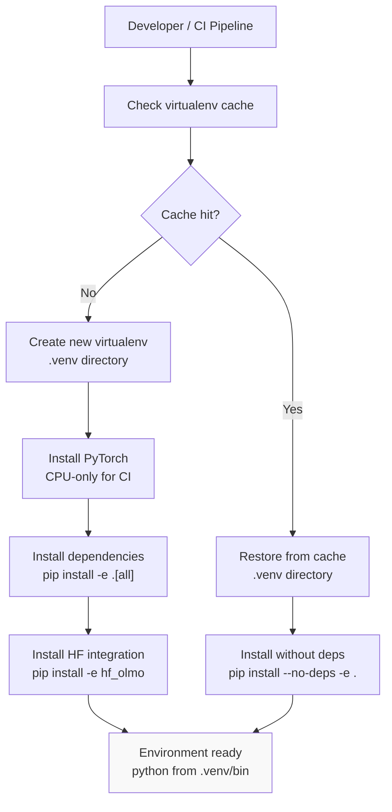
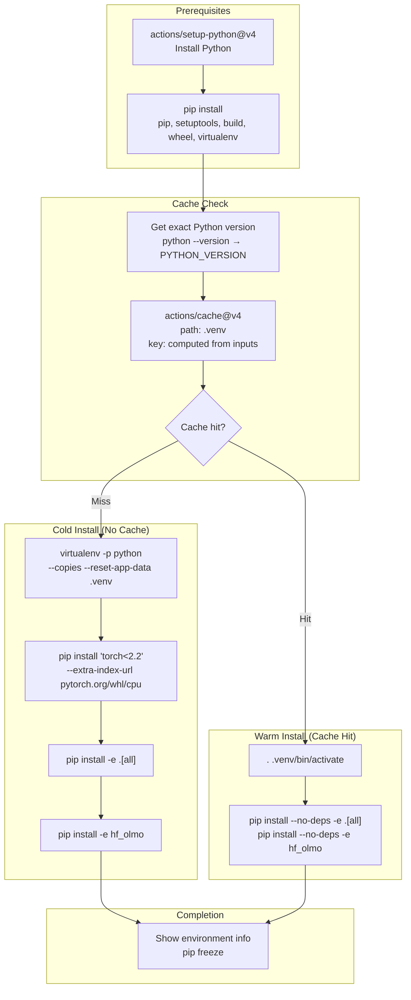
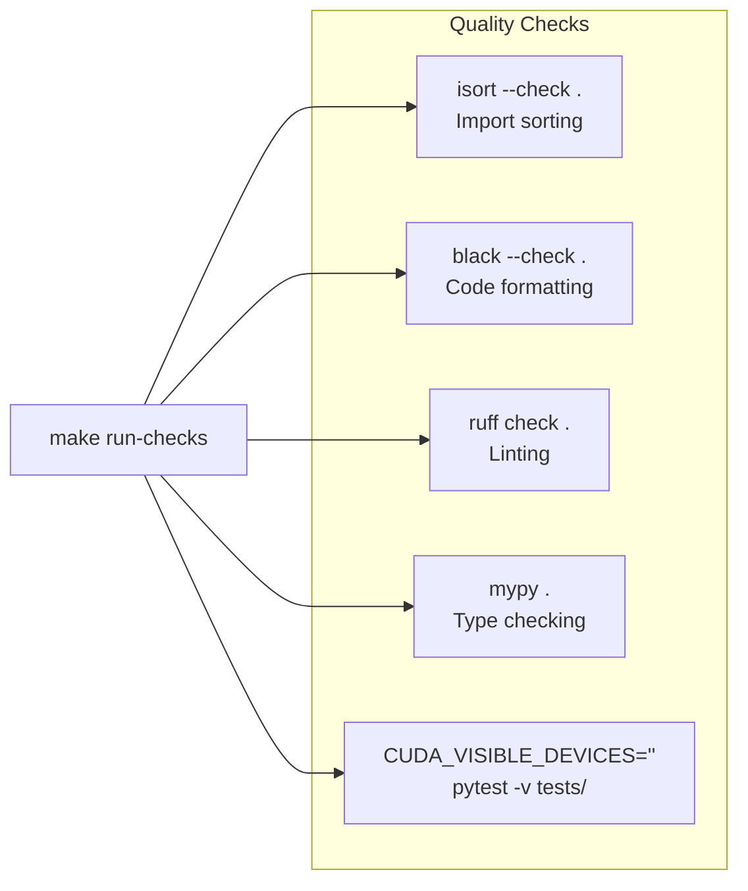
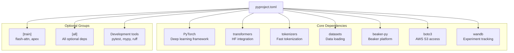
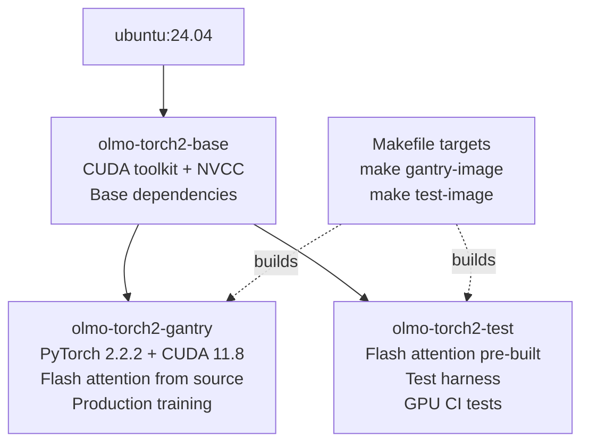

<!-- source: DeepWiki mcp.deepwiki.com · repo allenai/OLMo · page 8.1 Development Setup · fetched 2026-10-26 -->

# Development Setup

<details>
<summary>Relevant source files</summary>

The following files were used as context for generating this wiki page:

- [.github/actions/setup-venv/action.yml](.github/actions/setup-venv/action.yml)
- [.github/workflows/main.yml](.github/workflows/main.yml)
- [Makefile](Makefile)
- [docker/Dockerfile.gantry](docker/Dockerfile.gantry)
- [docker/Dockerfile.test](docker/Dockerfile.test)

</details>


## Purpose and Scope

This document explains how to set up a local development environment for the OLMo repository, including virtual environment configuration, dependency installation, and caching strategies. It covers the `setup-venv` GitHub Action used in CI/CD and local development workflows.

For information about running tests, see [Testing](#8.2). For the complete CI/CD pipeline, see [CI/CD Pipeline](#8.3). For production training infrastructure, see [Training Infrastructure](#7).

---

## Environment Setup Overview

The OLMo development environment is designed around Python virtual environments with aggressive dependency caching to minimize setup time. The same setup process is used both locally and in GitHub Actions CI/CD.

### Development Environment Flow



**Sources**: [.github/actions/setup-venv/action.yml:1-64](), [.github/workflows/main.yml:76-97]()

---

## Virtual Environment Configuration

### Python Version Requirements

The OLMo codebase requires **Python 3.10** for development and testing. This version is specified consistently across all CI jobs and recommended for local development.

| Component | Python Version | Specified In |
|-----------|---------------|--------------|
| CI Checks | 3.10 | [.github/workflows/main.yml:31]() |
| Release Job | 3.10 | [.github/workflows/main.yml:181]() |
| setup-venv Action | Parameter-driven | [.github/actions/setup-venv/action.yml:4-6]() |

**Sources**: [.github/workflows/main.yml:31](), [.github/workflows/main.yml:181]()

### Cache Key Strategy

The virtual environment cache uses a composite key to ensure cache invalidation when dependencies change:

```
<cache-prefix>-<os>-<python-version>-<requirements-hash>
```

The cache key components are:

- **cache-prefix**: Manual invalidation token (currently `v2`) defined in [.github/workflows/main.yml:19]()
- **os**: Operating system (e.g., `Linux`, `macOS`)
- **python-version**: Exact Python version string from `python --version`
- **requirements-hash**: Hash of `*requirements.txt` and `*pyproject.toml` files

This strategy ensures that:
1. Changing `CACHE_PREFIX` invalidates all caches globally
2. OS-specific binaries don't mix
3. Different Python versions maintain separate caches
4. Dependency updates trigger cache misses

**Sources**: [.github/actions/setup-venv/action.yml:33-37](), [.github/workflows/main.yml:19]()

---

## setup-venv GitHub Action

The `setup-venv` action provides a reusable virtual environment setup process used across all CI jobs.

### Action Inputs

| Input | Required | Default | Description |
|-------|----------|---------|-------------|
| `python-version` | Yes | N/A | Python version to install (e.g., `3.10`) |
| `cache-prefix` | Yes | `v0` | Cache invalidation token |
| `torch-version` | No | `<2.2` | PyTorch version constraint |

**Sources**: [.github/actions/setup-venv/action.yml:3-14]()

### Installation Process



**Key Implementation Details**:

1. **Prerequisites**: [.github/actions/setup-venv/action.yml:18-26]()
   - Uses `actions/setup-python@v4` to install the specified Python version
   - Upgrades pip and installs build tools

2. **Cache Check**: [.github/actions/setup-venv/action.yml:33-37]()
   - Caches the entire `.venv` directory
   - Uses composite key for precise invalidation

3. **Cold Install** (cache miss): [.github/actions/setup-venv/action.yml:39-47]()
   - Creates fresh virtualenv with `--copies` flag
   - Installs CPU-only PyTorch from PyTorch index
   - Installs editable package with all dependencies
   - Installs Hugging Face integration

4. **Warm Install** (cache hit): [.github/actions/setup-venv/action.yml:49-55]()
   - Restores `.venv` from cache
   - Installs only the local package in editable mode with `--no-deps`
   - This handles code changes without reinstalling dependencies

**Sources**: [.github/actions/setup-venv/action.yml:15-64]()

---

## Local Development Workflow

### Using Make Targets

The `Makefile` provides convenient targets for local development tasks:

```bash
# Run all quality checks (linting, formatting, type checking, tests)
make run-checks

# Display Beaker workspace information
make beaker-info

# Check CPU installation (no CUDA required)
make check-cpu-install

# Check CUDA installation (requires GPU)
make check-cuda-install
```

**Sources**: [Makefile:10-126]()

### run-checks Target

The `run-checks` target executes the same quality checks as CI:



**Implementation**: [Makefile:10-16]()

This target:
- Checks import sorting with `isort`
- Validates code formatting with `black`
- Runs linter with `ruff`
- Performs type checking with `mypy`
- Executes CPU tests with `pytest` (GPU disabled via `CUDA_VISIBLE_DEVICES=''`)

**Sources**: [Makefile:10-16]()

### Environment Variables

Key environment variables for development:

| Variable | Value | Purpose |
|----------|-------|---------|
| `PYTHONPATH` | `./` | Ensures local package is importable |
| `TOKENIZERS_PARALLELISM` | `false` | Disables tokenizer parallelism warnings |
| `CUDA_VISIBLE_DEVICES` | `''` | Disables GPU for CPU-only tests |
| `CUDA_LAUNCH_BLOCKING` | `1` | Synchronous CUDA execution for debugging |
| `CUBLAS_WORKSPACE_CONFIG` | `:16:8` | Deterministic CUDA operations |

**Sources**: [.github/workflows/main.yml:17-21](), [Makefile:16](), [.github/workflows/main.yml:156-161]()

---

## Dependency Management

### Core Dependencies

The OLMo package defines dependencies in `pyproject.toml` with several optional dependency groups:



**Sources**: [.github/actions/setup-venv/action.yml:46](), [docker/Dockerfile.gantry:37-41]()

### PyTorch Installation

Different PyTorch variants are used in different environments:

| Environment | PyTorch Version | Index URL | Installation |
|-------------|----------------|-----------|--------------|
| CI (CPU) | `<2.2` | `pytorch.org/whl/cpu` | [.github/actions/setup-venv/action.yml:45]() |
| Production (CUDA) | `2.2.2` | PyTorch channel | [docker/Dockerfile.gantry:32]() |
| Production (CUDA) | `pytorch-cuda=11.8` | Nvidia channel | [docker/Dockerfile.gantry:32]() |

**Sources**: [.github/actions/setup-venv/action.yml:45](), [docker/Dockerfile.gantry:32]()

### Flash Attention Installation

Flash Attention requires special handling due to CUDA compilation:

**Production Environment** (Gantry Docker):
```dockerfile
# Install ninja build system
conda install -y ninja

# Install flash-attn from source
pip install --no-cache-dir flash-attn --no-build-isolation
```
[docker/Dockerfile.gantry:32-34]()

**Test Environment** (GPU tests):
```dockerfile
# Skip CUDA build during pip install
export FLASH_ATTENTION_SKIP_CUDA_BUILD=TRUE

# Install pre-built wheel
pip install flash-attn==2.5.9.post1 --no-build-isolation
```
[docker/Dockerfile.test:12-13]()

The production build compiles from source for optimal performance, while the test environment uses a pre-built wheel with the `FLASH_ATTENTION_SKIP_CUDA_BUILD` flag to speed up image creation.

**Sources**: [docker/Dockerfile.gantry:32-34](), [docker/Dockerfile.test:11-13]()

---

## CI/CD Integration

### Usage in GitHub Actions

The `setup-venv` action is invoked consistently across all CI jobs:

```yaml
- name: Setup Python environment
  uses: ./.github/actions/setup-venv
  with:
    python-version: ${{ matrix.python }}
    cache-prefix: ${{ env.CACHE_PREFIX }}
```

This pattern appears in:
- **Checks job**: [.github/workflows/main.yml:78-82]()
- **Release job**: [.github/workflows/main.yml:178-182]()

After setup, jobs activate the environment before running commands:
```bash
. .venv/bin/activate
<command>
```

**Sources**: [.github/workflows/main.yml:78-82](), [.github/workflows/main.yml:96-97]()

### Mypy Cache Optimization

Type checking jobs use additional caching for mypy's internal cache:

```yaml
- name: Restore mypy cache
  if: matrix.task.name == 'Type check'
  uses: actions/cache@v3
  with:
    path: .mypy_cache
    key: mypy-${{ env.CACHE_PREFIX }}-${{ runner.os }}-...
```

This cache uses a similar composite key strategy but is specific to the type checking job. The cache path is `.mypy_cache` which stores incremental type checking results.

**Sources**: [.github/workflows/main.yml:84-92]()

---

## Container-Based Development

While local development uses virtual environments, production training and GPU testing use Docker containers.

### Docker Image Hierarchy



**Container Installation Strategy**:

1. **Gantry Image**: Full installation with source compilation
   - Installs conda with PyTorch, CUDA toolkit, and NVCC
   - Compiles flash-attention from source
   - Installs package with `pip install .[train]`
   - Used for production training runs

2. **Test Image**: Optimized for quick setup
   - Extends base image
   - Uses pre-built flash-attention wheel
   - Sets `FLASH_ATTENTION_SKIP_CUDA_BUILD=TRUE`
   - Used for GPU tests in CI

**Sources**: [docker/Dockerfile.gantry:1-44](), [docker/Dockerfile.test:1-17](), [Makefile:31-43]()

---

## Quick Start Guide

### Local Setup

1. **Clone the repository**:
   ```bash
   git clone https://github.com/allenai/OLMo.git
   cd OLMo
   ```

2. **Create virtual environment**:
   ```bash
   python3.10 -m venv .venv
   source .venv/bin/activate
   ```

3. **Install dependencies**:
   ```bash
   pip install --upgrade pip setuptools wheel
   pip install 'torch<2.2' --extra-index-url https://download.pytorch.org/whl/cpu
   pip install -e .[all]
   pip install -e hf_olmo
   ```

4. **Verify installation**:
   ```bash
   make check-cpu-install
   ```

5. **Run quality checks**:
   ```bash
   make run-checks
   ```

### Updating Dependencies

When `pyproject.toml` or requirements files change:

1. Delete the virtual environment:
   ```bash
   rm -rf .venv
   ```

2. Recreate and reinstall:
   ```bash
   python3.10 -m venv .venv
   source .venv/bin/activate
   pip install -e .[all]
   ```

For GitHub Actions, increment the `CACHE_PREFIX` in [.github/workflows/main.yml:19]() to invalidate all caches.

**Sources**: [.github/actions/setup-venv/action.yml:39-56](), [.github/workflows/main.yml:19]()

---

