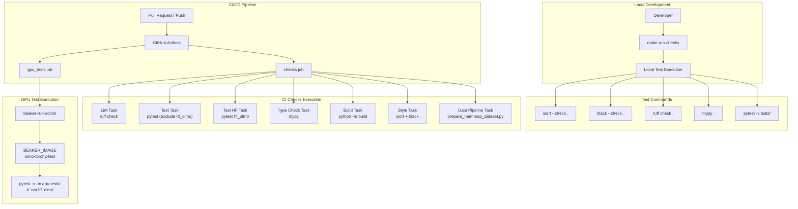
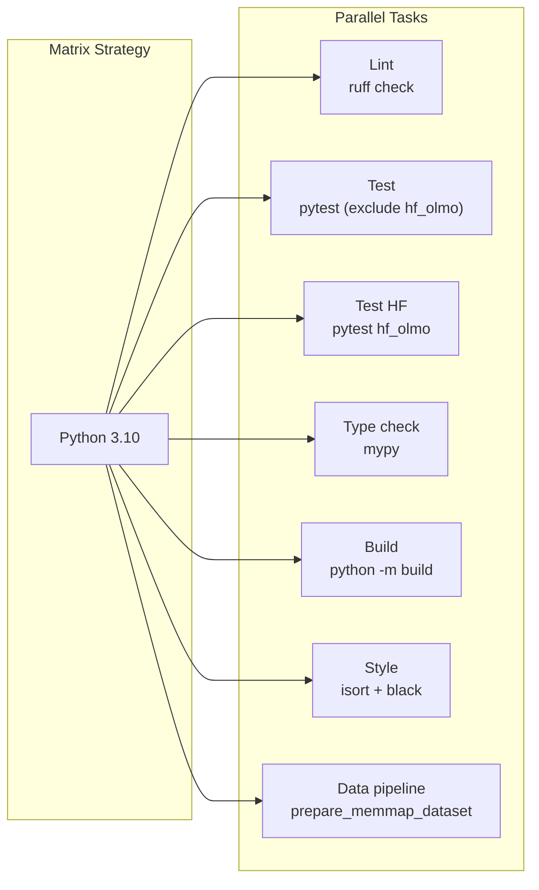
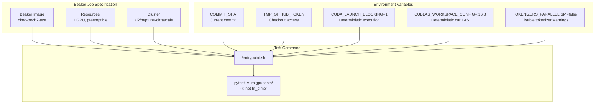
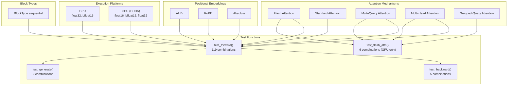
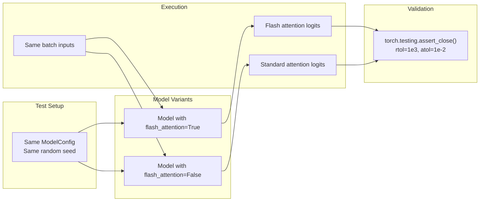

<!-- source: DeepWiki mcp.deepwiki.com · repo allenai/OLMo · page 8.2 Testing · fetched 2026-10-26 -->

# Testing

<details>
<summary>Relevant source files</summary>

The following files were used as context for generating this wiki page:

- [.github/actions/setup-venv/action.yml](.github/actions/setup-venv/action.yml)
- [.github/workflows/main.yml](.github/workflows/main.yml)
- [Makefile](Makefile)
- [docker/Dockerfile.gantry](docker/Dockerfile.gantry)
- [docker/Dockerfile.test](docker/Dockerfile.test)
- [tests/config_test.py](tests/config_test.py)
- [tests/model_test.py](tests/model_test.py)

</details>


The OLMo repository includes a comprehensive testing infrastructure that validates model architecture, data pipelines, configurations, and distributed training functionality. The test suite runs on both CPU and GPU platforms, with local execution for development and CI/CD execution for continuous validation.

For information about the CI/CD pipeline infrastructure, see [CI/CD Pipeline](#8.3). For development environment setup, see [Development Setup](#8.1).

---

## Test Suite Organization

The test suite is organized into several categories based on functionality and execution requirements:

| Test Category | Location | Purpose | Execution Platform |
|--------------|----------|---------|-------------------|
| Model Architecture | `tests/model_test.py` | Validate transformer implementation, attention mechanisms, layer norms | CPU and GPU |
| Configuration System | `tests/config_test.py` | Test config loading, saving, resolvers, type handling | CPU only |
| Data Pipeline | Tests triggered by workflow | Validate memmap dataset preparation and loading | CPU only |
| Hugging Face Integration | `tests/hf_olmo/` | Test HF model wrapper compatibility | CPU and GPU |
| GPU-specific | All tests marked with `@pytest.mark.gpu` | Validate CUDA kernels, flash attention, distributed training | GPU (Beaker) |

The test suite uses pytest markers to categorize tests:
- `@pytest.mark.gpu`: Tests requiring CUDA devices
- `@pytest.mark.skipif(torch.cuda.device_count() < 1, ...)`: Conditional GPU test execution

**Sources**: [tests/model_test.py:1-504](), [tests/config_test.py:1-69](), [.github/workflows/main.yml:42-73]()

---

## Test Execution Flow



**Test Execution Flow**: Local development uses `make run-checks` to run all quality checks sequentially. The CI/CD pipeline executes parallel matrix jobs for different test categories. GPU tests are dispatched to Beaker using the `beaker-run-action` with the `olmo-torch2-test` image.

**Sources**: [Makefile:10-16](), [.github/workflows/main.yml:23-98](), [.github/workflows/main.yml:112-166]()

---

## Local Testing

### Running All Checks

The `Makefile` provides a unified entry point for running all checks locally:

```bash
make run-checks
```

This executes the following checks in sequence:

1. **Import Sorting**: `isort --check .` validates import statement organization
2. **Code Formatting**: `black --check .` validates code style compliance
3. **Linting**: `ruff check .` performs static analysis for code quality issues
4. **Type Checking**: `mypy .` validates type annotations
5. **Testing**: `pytest -v --color=yes tests/` runs the full test suite on CPU

The environment variable `CUDA_VISIBLE_DEVICES=''` is set to force CPU-only execution, preventing accidental GPU usage during local development.

**Sources**: [Makefile:10-16]()

### Installation Verification

The repository provides specific checks to validate installation correctness:

| Target | Command | Purpose |
|--------|---------|---------|
| `check-cpu-install` | `python -c 'from olmo import check_install; check_install(cuda=False)'` | Verify CPU-only installation |
| `check-cuda-install` | `python -c 'from olmo import check_install; check_install(cuda=True)'` | Verify CUDA installation and GPU availability |

**Sources**: [Makefile:119-125]()

---

## CI/CD Test Execution

### Checks Job Matrix

The `checks` job runs as a parameterized matrix on Python 3.10 with multiple task variants:



**Checks Job Execution**: All tasks run in parallel on `ubuntu-latest` with a 10-minute timeout. The matrix uses `fail-fast: false` to ensure all tasks complete even if one fails.

**Sources**: [.github/workflows/main.yml:24-68]()

### Virtual Environment Caching

The CI pipeline uses a custom GitHub Action to set up and cache the virtual environment:

```yaml
- name: Setup Python environment
  uses: ./.github/actions/setup-venv
  with:
    python-version: ${{ matrix.python }}
    cache-prefix: ${{ env.CACHE_PREFIX }}
```

The caching strategy includes:
- **Cache Key**: `{cache-prefix}-{os}-{python-version}-{hash(requirements)}`
- **Cache Hit**: Dependencies installed with `pip install --no-deps -e .[all]`
- **Cache Miss**: Full installation including PyTorch from CPU wheel index

**Sources**: [.github/workflows/main.yml:78-82](), [.github/actions/setup-venv/action.yml:33-55]()

### Data Pipeline Testing

A dedicated task validates the data preparation pipeline:

```bash
python scripts/prepare_memmap_dataset.py test_fixtures/*.json.gz \
  -o /tmp/c4-sample.npy --validate --ack-deprecated
```

This test ensures:
- JSON.gz input files can be processed
- Memory-mapped numpy arrays are generated correctly
- Data validation passes
- Deprecated API usage is acknowledged

**Sources**: [.github/workflows/main.yml:71-73]()

---

## GPU Testing on Beaker

### GPU Test Configuration

GPU tests execute on Beaker using the `beaker-run-action` with specific environment configuration:

```yaml
env:
  BEAKER_TOKEN: ${{ secrets.BEAKER_TOKEN }}
  BEAKER_IMAGE: akshitab/olmo-torch2-test
  BEAKER_WORKSPACE: ai2/llm-testing
```

The Beaker specification defines:
- **Cluster**: `ai2/neptune-cirrascale`
- **GPU Count**: 1
- **Priority**: normal
- **Preemptible**: true
- **Budget**: ai2/oe-training

**Sources**: [.github/workflows/main.yml:112-166]()

### GPU Test Execution Environment



**GPU Test Environment**: Tests run with deterministic CUDA execution enabled through `CUDA_LAUNCH_BLOCKING=1` and `CUBLAS_WORKSPACE_CONFIG=:16:8`. The entrypoint script checks out the specific commit SHA and runs pytest with the `gpu` marker.

**Sources**: [.github/workflows/main.yml:151-162](), [docker/Dockerfile.test:9-14]()

### Test Docker Image

The `olmo-torch2-test` image is built from a base image with additional test dependencies:

```dockerfile
FROM olmo-torch2-base

COPY scripts/test_entrypoint.sh /entrypoint.sh
RUN chmod +x /entrypoint.sh && \
    pip install packaging ninja && \
    export FLASH_ATTENTION_SKIP_CUDA_BUILD=TRUE && \
    pip install flash-attn==2.5.9.post1 --no-build-isolation
WORKDIR /testing

ENTRYPOINT ["/entrypoint.sh"]
```

The image includes:
- Flash attention v2.5.9.post1 pre-built for CUDA
- Test entrypoint script for code checkout
- Working directory at `/testing`

To rebuild the test image: `make test-image`

**Sources**: [docker/Dockerfile.test:1-16](), [Makefile:38-43]()

---

## Model Architecture Tests

### Test Parameterization

The model test suite uses extensive parameterization to validate all architectural variants:



**Model Test Coverage**: Tests validate all combinations of positional embeddings (ALiBi, RoPE, absolute), attention mechanisms (flash, standard, MQA, GQA), precision levels (fp32, bf16, fp16), and execution platforms (CPU, CUDA).

**Sources**: [tests/model_test.py:13-113](), [tests/model_test.py:203-211]()

### Forward Pass Testing

The `test_forward` function validates:
- **Single vs Batch Consistency**: Individual inputs produce same logits as batched inputs
- **Cache Consistency**: Outputs using cached attention keys/values match full computation
- **Precision Handling**: Automatic mixed precision with `torch.autocast`
- **Device Placement**: Both CPU and CUDA execution

Key validation logic at [tests/model_test.py:159-199]():
```python
# Check that logits from individual inputs equal logits from batch
torch.testing.assert_close(
    output1.logits[0][:len(input1)], 
    batch_output.logits[0][:len(input1)], 
    rtol=rtol, atol=atol
)

# Check that output using cached attention keys + values matches
torch.testing.assert_close(
    output1.logits[0][-1], 
    output1_from_cached.logits[0][-1], 
    rtol=rtol, atol=atol
)
```

**Sources**: [tests/model_test.py:115-200]()

### Flash Attention Testing

The `test_flash_attn` function compares flash attention and standard attention implementations:



**Flash Attention Validation**: Tests ensure flash attention produces equivalent results to standard attention across MHA, MQA, and GQA configurations with RoPE or absolute positional embeddings.

**Sources**: [tests/model_test.py:202-280]()

### Backward Pass Testing

The `test_backward` function validates gradient computation:

```python
# Compute loss using CrossEntropyLoss
shift_logits = logits[..., :-1, :].contiguous()
shift_labels = input_ids[..., 1:].contiguous()
loss = CrossEntropyLoss()(
    shift_logits.view(-1, shift_logits.size(-1)), 
    shift_labels.view(-1)
)

# Backward pass with optional gradient scaling
if scaler is not None:
    scaler.scale(loss).backward()
else:
    loss.backward()

# Check all parameters have non-zero gradients
for name, parameter in model.named_parameters():
    if parameter.requires_grad:
        assert parameter.grad is not None
        if (parameter.grad == zeros).all():
            raise RuntimeError(f"{name} has zero gradient!")
```

**Sources**: [tests/model_test.py:326-373]()

### Layer Normalization Testing

The `test_layer_norm` function validates custom layer norm implementation against PyTorch's native implementation:

```python
# Build layer norm with specific configuration
ln = LayerNorm.build(train_config.model)

# Compare against torch.nn.functional.layer_norm
y_expected = F.layer_norm(x, [train_config.model.d_model], weight, bias)
y_actual = ln(x)
torch.testing.assert_close(y_actual, y_expected)
```

Tests cover four combinations:
1. `elementwise_affine=True, include_bias=True`
2. `elementwise_affine=True, include_bias=False`
3. `elementwise_affine=False, include_bias=True`
4. `elementwise_affine=False, include_bias=False`

**Sources**: [tests/model_test.py:443-473]()

### Block Group Testing

The `test_block_groups` function validates that models with and without block grouping are compatible:

```python
model_with_block_groups = OLMo(
    ModelConfig(d_model=128, n_heads=2, n_layers=9, block_group_size=3)
).eval()
model_without_block_groups = OLMo(
    ModelConfig(d_model=128, n_heads=2, n_layers=9, block_group_size=1)
).eval()

# Test state dict compatibility in both directions
state_dict_to_load, og_keys_to_new_keys = \
    model_with_block_groups._make_state_dict_compatible(
        model_without_block_groups.state_dict()
    )
model_with_block_groups.load_state_dict(state_dict_to_load)

# Verify outputs match exactly
torch.testing.assert_close(block_groups_output, no_block_groups_output)
```

**Sources**: [tests/model_test.py:476-503]()

---

## Configuration Testing

The configuration test suite validates the hierarchical configuration system:

| Test Function | Purpose | Key Validations |
|--------------|---------|-----------------|
| `test_resolvers` | OmegaConf custom resolvers | `${path.glob:*.md}`, `${oc.env:FOO}` |
| `test_str_enum` | StrEnum type functionality | String equality behavior |
| `test_save_and_load` | Config serialization | YAML save/load, override application |
| `test_new` | Config factory methods | `TrainConfig.new()` with kwargs |
| `test_data_config` | DataConfig dtype handling | `memmap_dtype` to numpy dtype conversion |

### Config Resolution and Override

```python
# Load config with overrides
loaded_train_config = TrainConfig.load(save_path, ["model.n_layers=2"])
assert loaded_train_config.model.n_layers == 2

# Test custom resolvers
config = FakeConfig.load(tmp_path / "config.yaml")
# config.yaml contains: env_var: ${oc.env:FOO}
assert config.env_var == "bar"  # From os.environ["FOO"]
```

**Sources**: [tests/config_test.py:18-46]()

---

## Test Fixtures

The test suite relies on centralized fixtures defined in `conftest.py` (not shown in provided files but referenced by tests):

| Fixture | Type | Provides |
|---------|------|----------|
| `train_config` | `TrainConfig` | Pre-configured training configuration |
| `tokenizer` | `Tokenizer` | OLMo tokenizer instance |
| `tmp_path` | `Path` | Temporary directory for test artifacts |

These fixtures are used across all test files to ensure consistent test environments.

**Sources**: [tests/model_test.py:8-11](), [tests/config_test.py:9]()

---

## Running Specific Test Subsets

### GPU Tests Only

```bash
pytest -v -m gpu tests/
```

### Exclude Hugging Face Tests

```bash
pytest -v tests/ --ignore-glob='tests/hf_olmo/*'
```

### Specific Test with Pattern

```bash
pytest -v tests/ -k "test_forward and alibi"
```

### With Duration Reporting

```bash
pytest -v --color=yes --durations=5 tests/
```

**Sources**: [.github/workflows/main.yml:42-43](), [.github/workflows/main.yml:162]()

---

## Deterministic Testing

GPU tests enforce deterministic execution to ensure reproducible results:

```python
torch.manual_seed(0)
torch.use_deterministic_algorithms(True)
```

Environment variables set in CI for determinism:
- `CUDA_LAUNCH_BLOCKING=1`: Synchronous CUDA kernel launches
- `CUBLAS_WORKSPACE_CONFIG=:16:8`: Deterministic cuBLAS operations
- `TOKENIZERS_PARALLELISM=false`: Disable tokenizer parallelism

**Sources**: [tests/model_test.py:126-127](), [.github/workflows/main.yml:156-161]()

---

