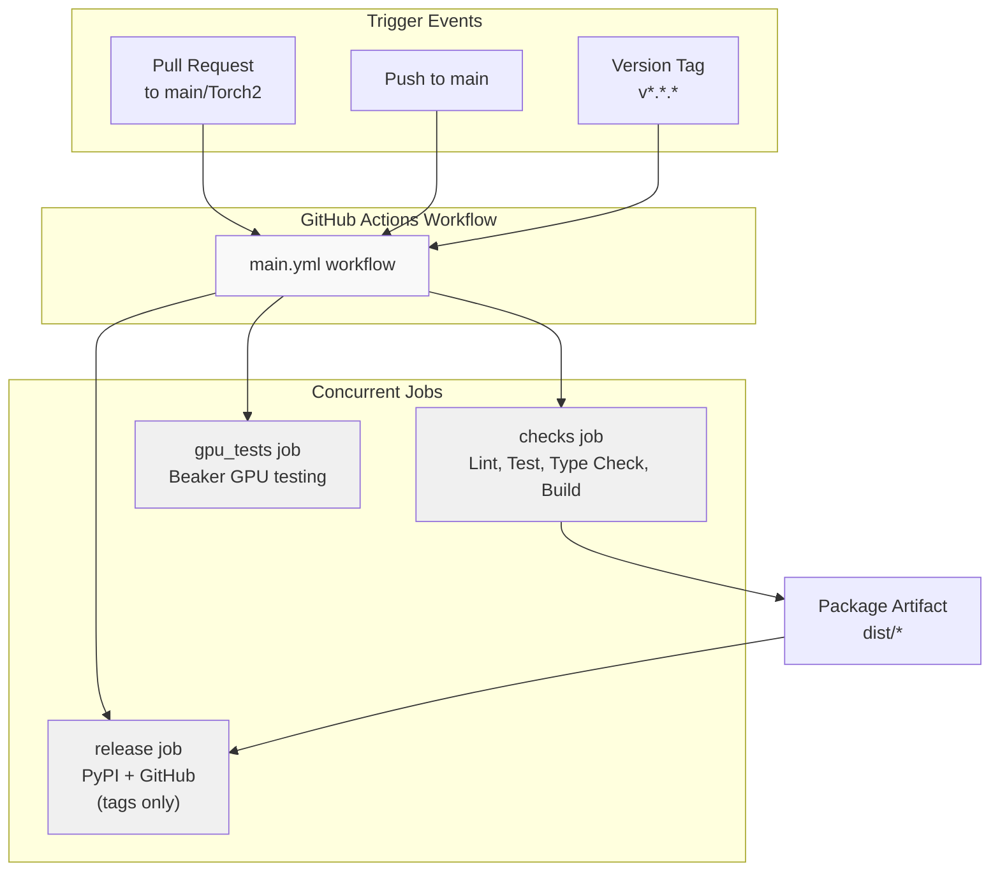
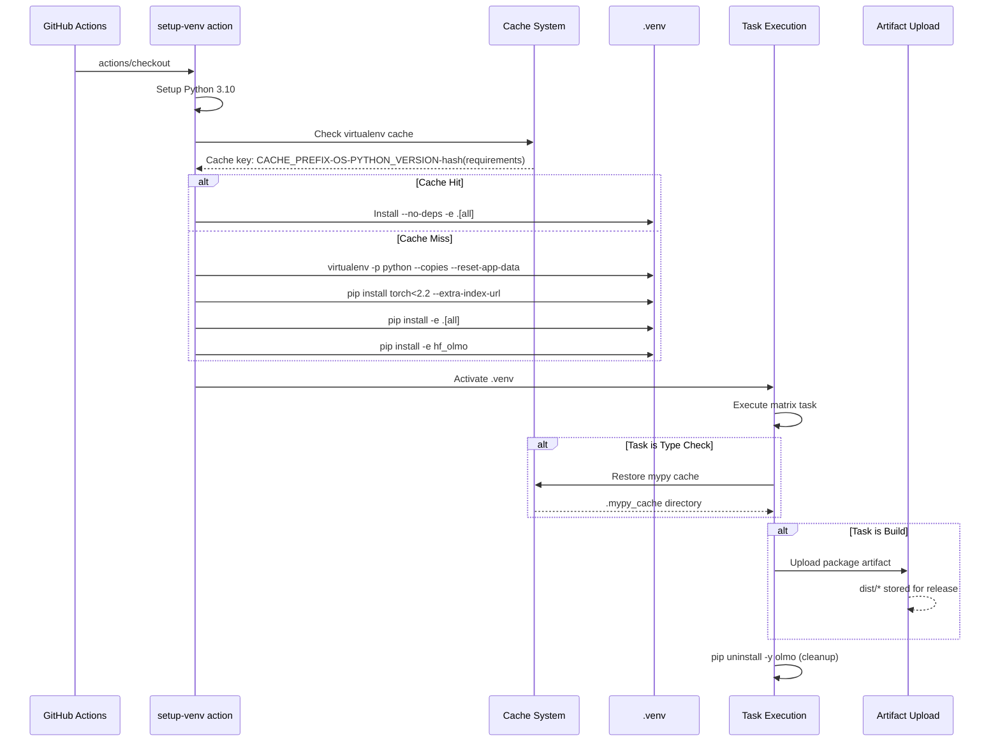
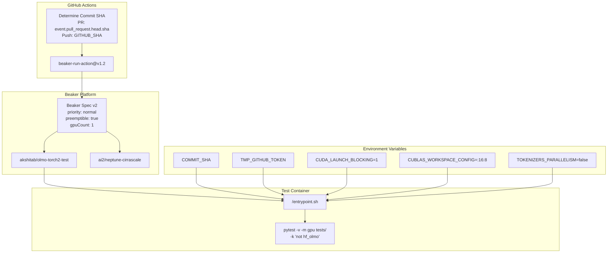
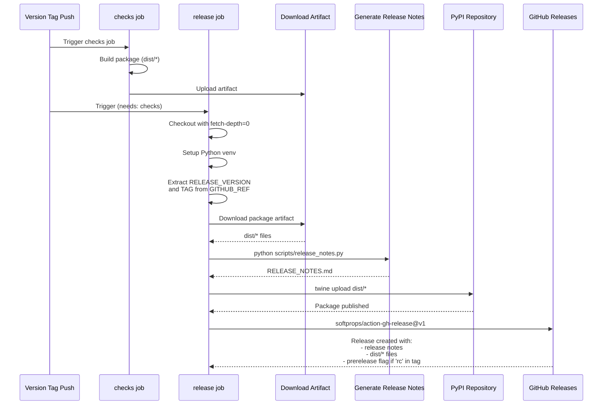
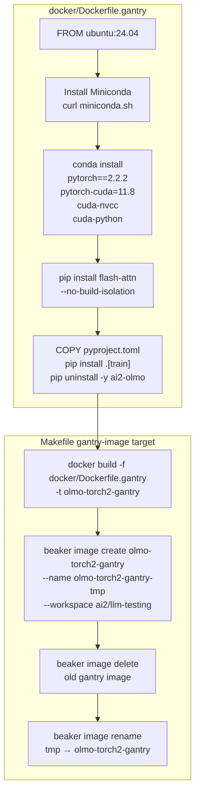

<!-- source: DeepWiki mcp.deepwiki.com · repo allenai/OLMo · page 8.3 CI/CD Pipeline · fetched 2026-10-26 -->

# CI/CD Pipeline

<details>
<summary>Relevant source files</summary>

The following files were used as context for generating this wiki page:

- [.github/actions/setup-venv/action.yml](.github/actions/setup-venv/action.yml)
- [.github/workflows/main.yml](.github/workflows/main.yml)
- [Makefile](Makefile)
- [docker/Dockerfile.gantry](docker/Dockerfile.gantry)
- [docker/Dockerfile.test](docker/Dockerfile.test)

</details>


## Purpose and Scope

This document describes the continuous integration and deployment (CI/CD) infrastructure for the OLMo repository, implemented via GitHub Actions. The pipeline automates code quality checks, testing (both CPU and GPU), package building, Docker image management, and releases to PyPI and GitHub. For information about local development setup, see [Development Setup](#8.1). For details on the test suite itself, see [Testing](#8.2). For Beaker platform integration, see [Beaker Platform](#7.1).

**Sources**: [.github/workflows/main.yml:1-214]()

## Workflow Overview

The CI/CD pipeline is defined in a single GitHub Actions workflow file that triggers on pull requests to `main` and `Torch2` branches, pushes to `main`, and version tags matching `v*.*.*`. The workflow consists of three parallel jobs with distinct responsibilities.

### Workflow Trigger Flow



**Sources**: [.github/workflows/main.yml:3-22]()

## Checks Job

The `checks` job executes multiple quality control tasks in parallel using a matrix strategy. All tasks run on Ubuntu with Python 3.10 and have a 10-minute timeout.

### Task Matrix

| Task Name | Command | Purpose |
|-----------|---------|---------|
| Lint | `ruff check .` | Verify code style with Ruff linter |
| Test | `pytest -v --color=yes --durations=5 tests/ --ignore-glob='tests/hf_olmo/*'` | Run main test suite (CPU only) |
| Test HF | `pytest -v --color=yes --durations=5 tests/hf_olmo` | Run Hugging Face integration tests |
| Type check | `mypy .` | Static type checking |
| Build | `python -m build` | Build Python package (sdist and wheel) |
| Style | `isort --check . && black --check .` | Check import sorting and code formatting |
| Data pipeline | `python scripts/prepare_memmap_dataset.py test_fixtures/*.json.gz -o /tmp/c4-sample.npy --validate --ack-deprecated` | Validate data preprocessing pipeline |

**Sources**: [.github/workflows/main.yml:24-74]()

### Checks Job Execution Flow



**Sources**: [.github/workflows/main.yml:75-111](), [.github/actions/setup-venv/action.yml:1-64]()

### Virtual Environment Setup

The `setup-venv` custom action handles Python environment configuration with aggressive caching to minimize CI time. The cache key incorporates:

- `CACHE_PREFIX` (currently `v2`) - manual cache invalidation
- Operating system
- Exact Python version string
- Hash of `*requirements.txt` and `*pyproject.toml` files

On cache hit, the action performs minimal work (`pip install --no-deps`). On cache miss, it builds the full environment including PyTorch CPU version and all dependencies.

**Sources**: [.github/actions/setup-venv/action.yml:33-56](), [.github/workflows/main.yml:17-21]()

### MyPy Cache Strategy

Type checking uses a separate cache for `.mypy_cache` with a hierarchical restore strategy:

```
mypy-v2-ubuntu-3.10-<hash>-<ref>-<sha>
mypy-v2-ubuntu-3.10-<hash>-<ref>
mypy-v2-ubuntu-3.10-<hash>
```

This allows partial cache hits when dependencies haven't changed but the code has.

**Sources**: [.github/workflows/main.yml:84-92]()

## GPU Tests Job

The `gpu_tests` job executes GPU-specific tests on Beaker infrastructure using the `beaker-run-action`. This job requires the `BEAKER_TOKEN` secret to be configured.

### GPU Test Configuration

```yaml
Environment Variables:
  BEAKER_TOKEN: ${{ secrets.BEAKER_TOKEN }}
  BEAKER_IMAGE: akshitab/olmo-torch2-test
  BEAKER_WORKSPACE: ai2/llm-testing

Beaker Spec:
  version: v2
  budget: ai2/oe-training
  resources:
    gpuCount: 1
  context:
    priority: normal
    preemptible: true
  constraints:
    cluster: ai2/neptune-cirrascale
```

**Sources**: [.github/workflows/main.yml:112-166]()

### GPU Test Execution



**Sources**: [.github/workflows/main.yml:121-163]()

### GPU Test Container Setup

The test container is built from `docker/Dockerfile.test`, which layers on top of `olmo-torch2-base`. It includes:

- Test entrypoint script at `/entrypoint.sh`
- Flash Attention 2.5.9.post1 (pre-built)
- `FLASH_ATTENTION_SKIP_CUDA_BUILD=TRUE` to avoid compilation in CI

The entrypoint script clones the OLMo repository at the specified commit SHA and runs the test command.

**Sources**: [docker/Dockerfile.test:1-17](), [.github/workflows/main.yml:162]()

## Release Job

The `release` job triggers only on version tags (matching `refs/tags/v*`) and depends on successful completion of the `checks` job. It publishes the package to both PyPI and GitHub Releases.

### Release Process



**Sources**: [.github/workflows/main.yml:168-214]()

### Release Configuration

The release job extracts metadata from the git tag:

```bash
RELEASE_VERSION=${GITHUB_REF#refs/tags/v}  # e.g., "2.0.1"
TAG=${GITHUB_REF#refs/tags/}                # e.g., "v2.0.1"
```

The `prerelease` flag is set if the tag contains `rc` (release candidate).

**Sources**: [.github/workflows/main.yml:184-187](), [.github/workflows/main.yml:211]()

## Docker Image Management

The repository maintains multiple Docker images for different purposes, built and managed via the Makefile.

### Docker Image Types

| Image Name | Dockerfile | Purpose | Base |
|------------|------------|---------|------|
| `olmo-torch2-base` | `docker/Dockerfile.base` | Foundation image with CUDA/ROCm | Ubuntu 24.04 |
| `olmo-torch2-gantry` | `docker/Dockerfile.gantry` | Production training via Gantry | Ubuntu 24.04 |
| `olmo-torch2-test` | `docker/Dockerfile.test` | GPU tests on Beaker | `olmo-torch2-base` |
| `llm-lumi` | `docker/Dockerfile.lumi` | LUMI supercomputer (AMD GPUs) | Custom ROCm base |

**Sources**: [Makefile:1-9](), [docker/Dockerfile.gantry:1-4](), [docker/Dockerfile.test:1-7]()

### Gantry Image Build Process



**Sources**: [docker/Dockerfile.gantry:4-44](), [Makefile:31-36]()

### Gantry Image Dependencies

The Gantry image installs dependencies in this order:

1. **System packages**: build-essential, ca-certificates, curl, wget, libxml2-dev, jq, git
2. **Conda**: Miniconda3-latest-Linux-x86_64
3. **PyTorch stack**: torch==2.2.2, torchvision, torchaudio, pytorch-cuda=11.8, cuda-nvcc, cuda-python
4. **Flash Attention**: flash-attn (compiled without isolation)
5. **OLMo dependencies**: Installed from `pyproject.toml` with `[train]` extras, then ai2-olmo is uninstalled to avoid conflicts with mounted source

The final step creates a dummy `olmo` package to satisfy `pyproject.toml` during dependency installation, then removes it so the actual source can be mounted at runtime.

**Sources**: [docker/Dockerfile.gantry:13-42]()

### Test Image Build Process

The test image is built in two stages:

1. **Base image**: Built via `make base-image`
2. **Test image**: Extends base with test entrypoint and Flash Attention

```bash
# Makefile targets
make base-image        # docker build -f docker/Dockerfile.base
make test-image        # docker build -f docker/Dockerfile.test
                      # beaker image create/delete/rename
```

**Sources**: [Makefile:27-43]()

## Environment Variables and Configuration

The workflow uses several environment variables for configuration and cache management.

### Global Environment Variables

```yaml
env:
  CACHE_PREFIX: v2                         # Manual cache invalidation
  PYTHONPATH: ./                          # Python module resolution
  TOKENIZERS_PARALLELISM: 'false'         # Disable tokenizer parallelism warnings
```

**Sources**: [.github/workflows/main.yml:17-21]()

### Job-Specific Environment Variables

#### Checks Job
- `PYTHON_VERSION`: Exact Python version for cache key (computed dynamically)

#### GPU Tests Job
- `BEAKER_TOKEN`: Authentication for Beaker API (from secrets)
- `BEAKER_IMAGE`: Image name for test container
- `BEAKER_WORKSPACE`: Beaker workspace for test execution
- `COMMIT_SHA`: Git commit to test (from PR head or push)
- `CUDA_LAUNCH_BLOCKING`: Enable synchronous CUDA execution for debugging
- `CUBLAS_WORKSPACE_CONFIG`: Configure cuBLAS workspace for determinism

#### Release Job
- `RELEASE_VERSION`: Extracted from git tag (e.g., "2.0.1")
- `TAG`: Full git tag (e.g., "v2.0.1")
- `PYPI_PASSWORD`: PyPI API token (from secrets)
- `GITHUB_TOKEN`: Automatic token for GitHub API access

**Sources**: [.github/workflows/main.yml:116-161](), [.github/workflows/main.yml:184-187](), [.github/actions/setup-venv/action.yml:31]()

## Makefile Integration

The Makefile provides convenience targets for local development and CI/CD operations.

### Key Makefile Targets

| Target | Command | Purpose |
|--------|---------|---------|
| `run-checks` | `isort --check . && black --check . && ruff check . && mypy . && pytest -v tests/` | Execute all checks locally |
| `beaker-info` | Display Beaker user and image information | Debugging |
| `gantry-image` | Build and push Gantry image to Beaker | Image management |
| `test-image` | Build and push test image to Beaker | Image management |
| `lumi-image` | Build and push LUMI image to GitHub Container Registry | LUMI deployment |
| `check-cuda-install` | Verify CUDA installation in container | Container validation |

**Sources**: [Makefile:10-125]()

### Image Naming Strategy

Images are managed with a temporary name during creation to enable atomic updates:

```bash
# Create with temporary name
beaker image create olmo-torch2-gantry --name olmo-torch2-gantry-tmp

# Delete old image (may fail if doesn't exist)
beaker image delete $(GANTRY_IMAGE) || true

# Rename to final name
beaker image rename $(BEAKER_USER)/olmo-torch2-gantry-tmp olmo-torch2-gantry
```

This ensures the canonical image name always points to the latest version without race conditions.

**Sources**: [Makefile:31-43]()

## Concurrency Control

The workflow uses concurrency groups to prevent multiple runs on the same ref:

```yaml
concurrency:
  group: ${{ github.workflow }}-${{ github.ref }}
```

This automatically cancels in-progress runs when new commits are pushed to the same branch or PR, conserving CI resources.

**Sources**: [.github/workflows/main.yml:3-4]()

---

