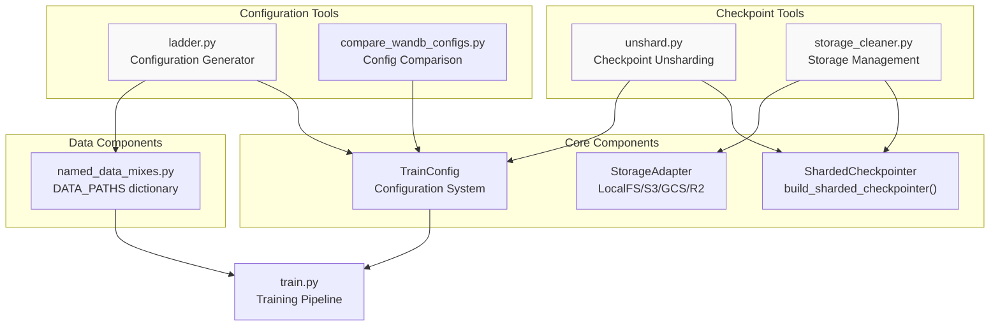
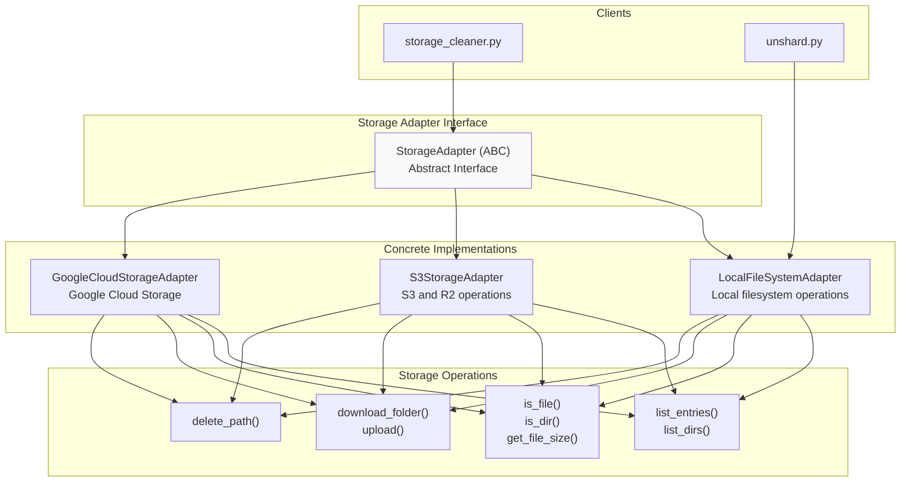
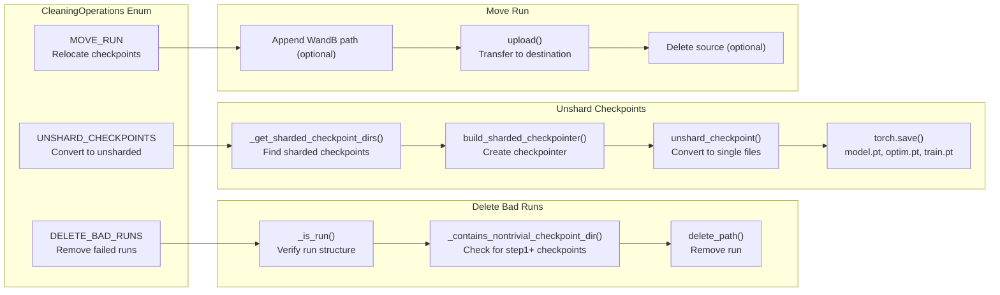
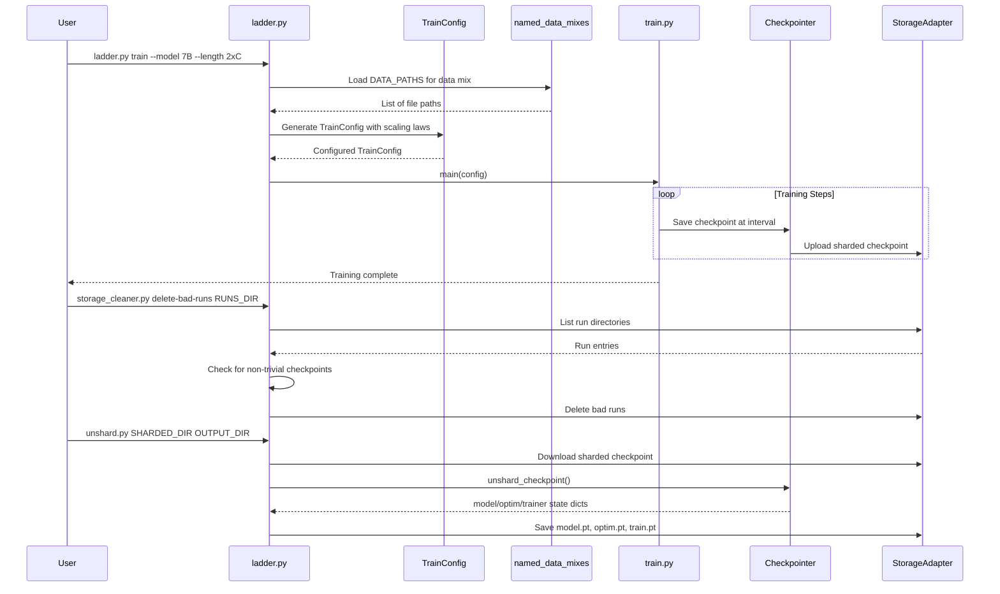

<!-- source: DeepWiki mcp.deepwiki.com · repo allenai/OLMo · page 9 Tools and Utilities · fetched 2026-10-26 -->

# Tools and Utilities

<details>
<summary>Relevant source files</summary>

The following files were used as context for generating this wiki page:

- [olmo/data/named_data_mixes.py](olmo/data/named_data_mixes.py)
- [scripts/compare_wandb_configs.py](scripts/compare_wandb_configs.py)
- [scripts/ladder.py](scripts/ladder.py)
- [scripts/storage_cleaner.py](scripts/storage_cleaner.py)
- [scripts/unshard.py](scripts/unshard.py)
- [tests/checkpoint_test.py](tests/checkpoint_test.py)
- [tests/util_test.py](tests/util_test.py)

</details>


This page provides an overview of command-line tools, utility scripts, and helper functions available in the OLMo repository for configuration generation, checkpoint management, data preparation, and system analysis.

For detailed information about programmatic configuration generation, see [Configuration Generation (ladder.py)](#9.1). For detailed information about checkpoint and storage management utilities, see [Storage Management Tools](#9.2).

## Overview

The OLMo repository includes several categories of tools and utilities:

| Category | Tools | Purpose |
|----------|-------|---------|
| Configuration Generation | `ladder.py` | Programmatically generate training configurations with automatic scaling law application |
| Checkpoint Management | `storage_cleaner.py`, `unshard.py` | Manage checkpoint lifecycle, convert between sharded and unsharded formats |
| Analysis & Debugging | `compare_wandb_configs.py` | Compare training run configurations from Weights & Biases |
| Data Management | `named_data_mixes.py` | Define named data mix compositions |
| Storage Abstraction | `StorageAdapter` classes | Unified interface for local, S3, GCS, and R2 storage |

## Command-Line Tool Architecture



**Sources:** [scripts/ladder.py:1-441](), [scripts/storage_cleaner.py:1-1383](), [scripts/unshard.py:1-116](), [scripts/compare_wandb_configs.py:1-162]()

## Configuration Generation

The `ladder.py` script provides programmatic generation of training configurations with automatic application of scaling laws. It supports multiple subcommands for different use cases:

### ladder.py Subcommands

| Subcommand | Purpose | Key Arguments |
|------------|---------|---------------|
| `train` | Generate config and launch training | `--model`, `--data`, `--length`, `--name` |
| `dump` | Display generated configuration | `--model`, `--data`, `--dump_evaluators`, `--dump_data` |
| `nodecounts` | Calculate valid node counts | `--model`, `--gpus-per-node` |
| `size` | Calculate model parameter count | `--model` |

The tool automatically calculates batch sizes and learning rates using scaling laws:

- **Batch Size**: `160 * (model_size / 108M)^(2/3)`, rounded to be divisible by GPU count
- **Learning Rate**: `0.0047 * (model_size / 108M)^(-1/3)`
- **Warmup Steps**: `model_size / (global_batch_size * sequence_length)`

**Sources:** [scripts/ladder.py:125-307](), [scripts/ladder.py:148-170]()

### Model Configurations

The `MODEL_CONFIGS` dictionary defines predefined model architectures:

```python
MODEL_CONFIGS = {
    "150M": ModelConfig(d_model=768, n_heads=12, n_layers=12, ...),
    "300M": ModelConfig(d_model=1024, n_heads=16, n_layers=16, ...),
    "750M": ModelConfig(d_model=1536, n_heads=16, n_layers=16, ...),
    "1B": ModelConfig(d_model=2048, n_heads=16, n_layers=16, ...),
    "7B": ModelConfig(d_model=4096, n_heads=32, n_layers=32, ...),
}
```

All configurations use RoPE positional embeddings, SwiGLU activations, RMS layer normalization, and flash attention.

**Sources:** [scripts/ladder.py:48-87]()

For complete documentation of configuration generation, see [Configuration Generation (ladder.py)](#9.1).

## Storage Management

### Storage Adapter Architecture

The repository provides a unified storage abstraction layer supporting multiple backends:



**Sources:** [scripts/storage_cleaner.py:53-126](), [scripts/storage_cleaner.py:128-226](), [scripts/storage_cleaner.py:228-390](), [scripts/storage_cleaner.py:392-604]()

### Storage Types

The `StorageType` enum defines supported storage backends:

```python
class StorageType(util.StrEnum):
    LOCAL_FS = ""      # Local filesystem
    GCS = "gs"         # Google Cloud Storage
    S3 = "s3"          # Amazon S3
    R2 = "r2"          # Cloudflare R2
```

Storage type is automatically detected from path URLs using [scripts/storage_cleaner.py:113-125]().

**Sources:** [scripts/storage_cleaner.py:46-50]()

### storage_cleaner.py Operations

The `storage_cleaner.py` script provides three main operations:



**Sources:** [scripts/storage_cleaner.py:40-43](), [scripts/storage_cleaner.py:714-753](), [scripts/storage_cleaner.py:851-939](), [scripts/storage_cleaner.py:991-1057]()

#### Delete Bad Runs

Removes training runs that failed early or contain no valid checkpoints. A run is considered "bad" if:

1. It contains no checkpoint directories matching `step[1-9]\d*` (i.e., no checkpoints beyond step 0)
2. Archive files exceeding `max_archive_size` are skipped by default (5GB)

The operation validates that paths are actual run directories by checking for `config.yaml`, `wandb/` subdirectory, or `train_data/` subdirectory.

**Sources:** [scripts/storage_cleaner.py:714-766](), [scripts/storage_cleaner.py:639-645](), [scripts/storage_cleaner.py:647-675]()

#### Unshard Checkpoints

Converts sharded checkpoints (distributed across multiple files) into single-file unsharded checkpoints. The process:

1. Downloads checkpoint from cloud storage if needed
2. Loads sharded checkpoint using appropriate `ShardedCheckpointerType` (torch_new, torch_legacy, local, olmo_core)
3. Saves three files: `model.pt`, `optim.pt`, `train.pt`
4. Copies `config.yaml` to output directory
5. Optionally uploads to cloud storage and deletes sharded checkpoint

**Sources:** [scripts/storage_cleaner.py:851-939](), [scripts/storage_cleaner.py:942-987]()

#### Move Run

Relocates entire training runs between storage backends:

1. Optionally appends WandB path components (`entity/project/run_id`) to destination
2. Transfers all run files to destination using `StorageAdapter.upload()`
3. Optionally keeps source files or deletes them
4. Optionally archives runs before moving

**Sources:** [scripts/storage_cleaner.py:991-1057]()

### unshard.py

Standalone utility for converting sharded checkpoints to unsharded format on CPU:

```bash
python scripts/unshard.py INPUT_DIR OUTPUT_DIR \
    [--type {torch_new,torch_legacy,local,olmo_core}] \
    [--model-only] \
    [--safe-tensors] \
    [--use-legacy-shared-mem-impl]
```

The `--model-only` flag skips optimizer and trainer state, useful for deployment. The `--safe-tensors` flag saves weights in SafeTensors format instead of PyTorch pickle format.

**Sources:** [scripts/unshard.py:15-75](), [scripts/unshard.py:77-115]()

For complete documentation of storage management tools, see [Storage Management Tools](#9.2).

## Configuration Comparison

The `compare_wandb_configs.py` script compares configurations between two training runs logged to Weights & Biases:

```bash
python scripts/compare_wandb_configs.py \
    https://wandb.ai/ai2-llm/olmo-medium/runs/RUN_ID_1 \
    https://wandb.ai/ai2-llm/olmo-medium/runs/RUN_ID_2
```

The tool:

1. Fetches run configurations from WandB API
2. Flattens nested configuration dictionaries for easier comparison
3. Groups data paths by directory and counts files
4. Simplifies evaluator configurations
5. Displays three categories of differences:
   - Settings only in left config
   - Settings only in right config  
   - Settings present in both but with different values

**Sources:** [scripts/compare_wandb_configs.py:82-161](), [scripts/compare_wandb_configs.py:41-80]()

## Named Data Mixes

The `named_data_mixes.py` module defines predefined data mix compositions used by training scripts. Each named mix is a list of file paths relative to the data root:

```python
DATA_PATHS = {
    "dolma17_flan_sep_rulebased": [
        # Books (~5.3 GT)
        "preprocessed/olmo-mix/v1_6-decontaminated/books/...",
        # Papers (~57.2 GT)
        "preprocessed/olmo-mix/v1_6-decontaminated/pes2o/...",
        # Wikipedia (~3.7 GT, repeated 2x)
        "preprocessed/olmo-mix/v1_6-decontaminated/wiki/...",
        # Code (~264 GT)
        "preprocessed/starcoder/v0_decontaminated_doc_only/...",
        # Web (~138 GT)
        "preprocessed/c4/v1_7-dd_ngram_dp_030-qc_cc_en_bin_001-fix/...",
        # Additional domains...
    ],
    # Additional named mixes...
}
```

The `dolma17_flan_sep_rulebased` mix includes approximately 1400 files spanning:

- **Non-web data**: Books (Gutenberg), papers (PES2O), Wikipedia/Wikibooks, multilingual Wikipedia (Megawika), Q&A (StackExchange, arxiv), math (ProofPile2), instruction data (Tulu FLAN), news (CC-News)
- **Code**: StarCoder dataset
- **Web**: C4 high-quality web text

**Sources:** [olmo/data/named_data_mixes.py:1-1406]()

## Utility Functions

The `olmo.util` module provides helper functions used throughout the codebase:

| Function | Purpose | Usage |
|----------|---------|-------|
| `flatten_dict()` | Flatten nested dictionaries into dotted keys | Config comparison and logging |
| `dir_is_empty()` | Check if directory is empty or non-existent | Checkpoint validation |
| `prepare_cli_environment()` | Set up logging and environment for CLI scripts | Script initialization |
| `add_cached_path_clients()` | Register S3/R2 clients with cached_path | Remote file access |
| `find_latest_checkpoint()` | Find most recent checkpoint in directory | Training resumption |

The `flatten_dict()` function supports optional list flattening for deep comparison:

```python
# Basic flattening
flatten_dict({"a": {"b": 1}}) 
# Returns: {"a.b": 1}

# With list flattening
flatten_dict({"a": [{"b": 1}, {"c": 2}]}, include_lists=True)
# Returns: {"a.0.b": 1, "a.1.c": 2}
```

**Sources:** [tests/util_test.py:17-42](), [tests/util_test.py:4-14]()

## Integration with Training Pipeline



**Sources:** [scripts/ladder.py:367-381](), [scripts/storage_cleaner.py:756-766](), [scripts/unshard.py:15-75]()

---

