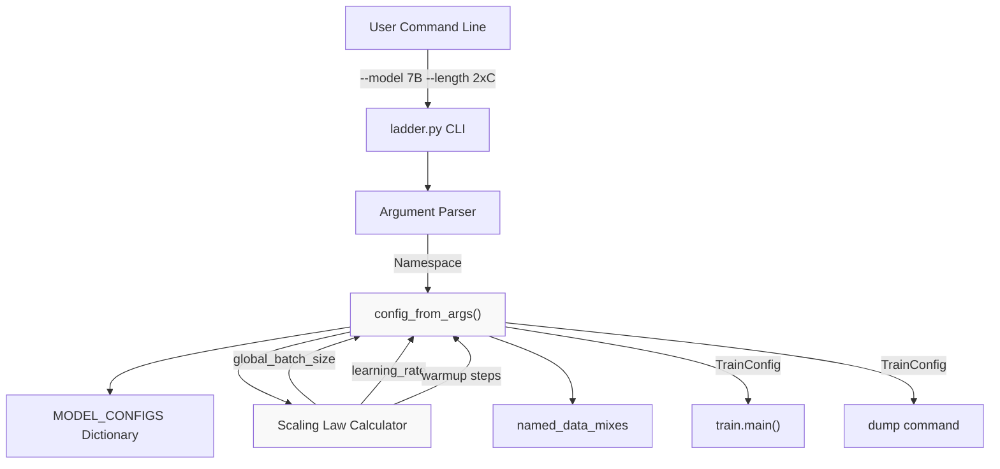
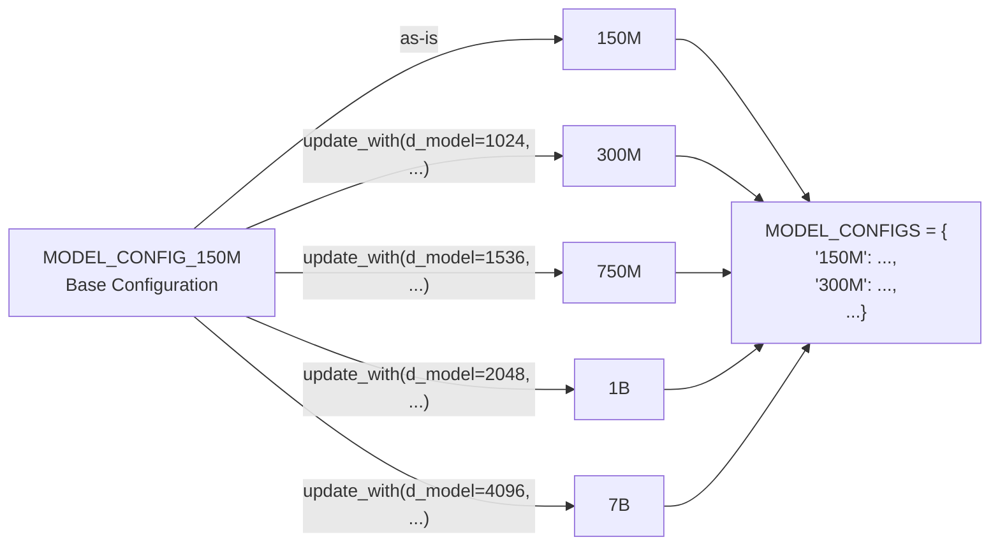
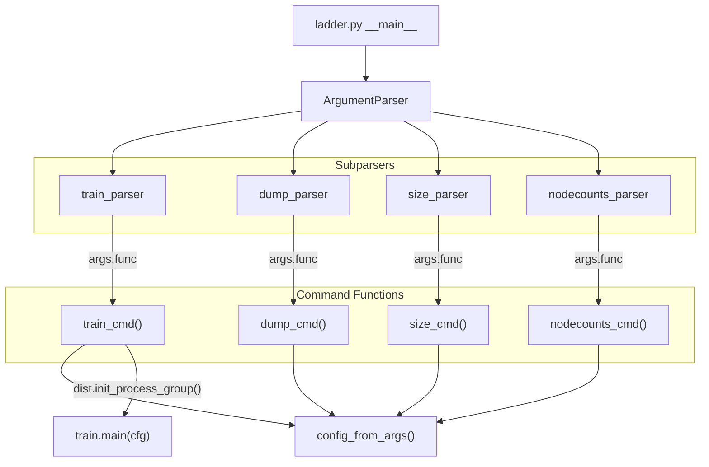
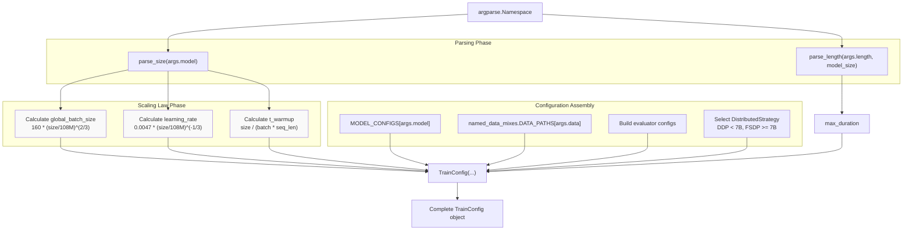
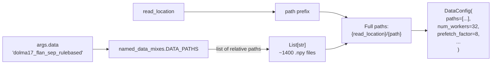
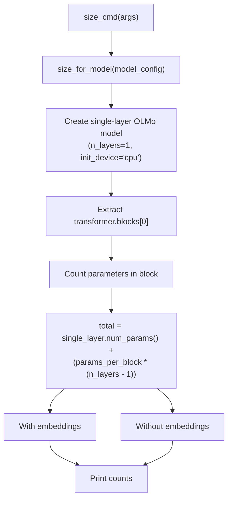
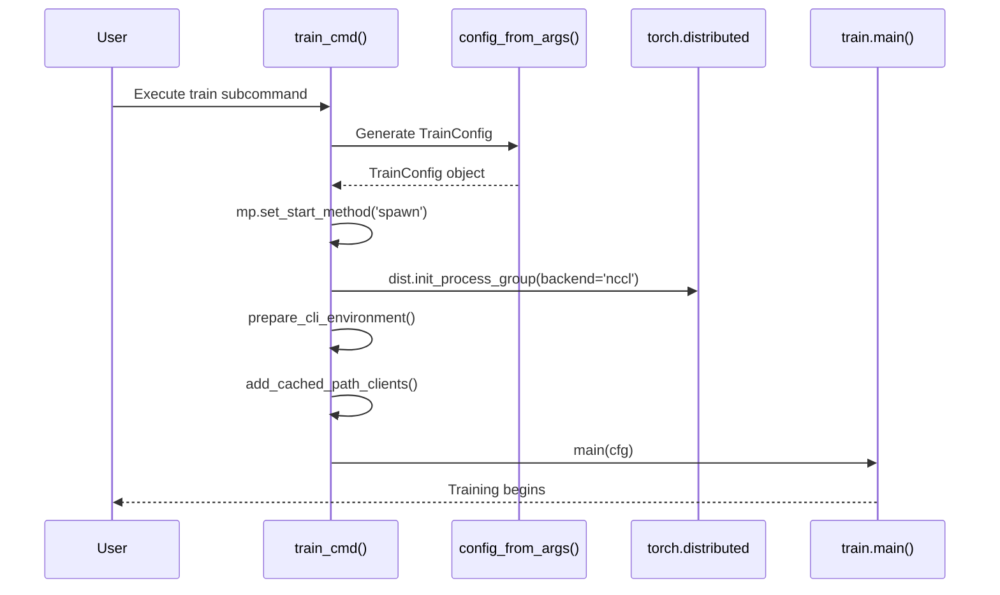
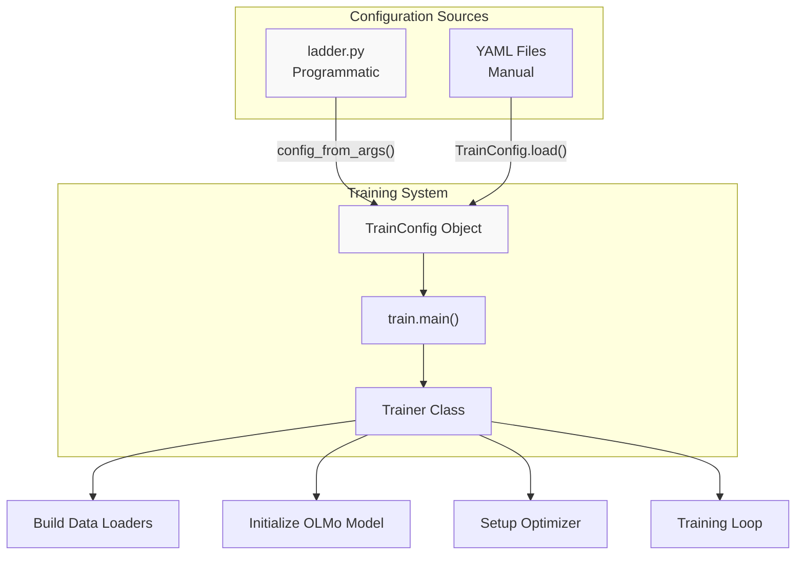

<!-- source: DeepWiki mcp.deepwiki.com · repo allenai/OLMo · page 9.1 Configuration Generation (ladder.py) · fetched 2026-10-26 -->

# Configuration Generation (ladder.py)

<details>
<summary>Relevant source files</summary>

The following files were used as context for generating this wiki page:

- [olmo/data/named_data_mixes.py](olmo/data/named_data_mixes.py)
- [scripts/compare_wandb_configs.py](scripts/compare_wandb_configs.py)
- [scripts/ladder.py](scripts/ladder.py)
- [tests/util_test.py](tests/util_test.py)

</details>


## Purpose and Scope

The `ladder.py` script provides a command-line tool for programmatically generating training configurations for OLMo models. It automatically calculates hyperparameters (batch size, learning rate, warmup steps) using scaling laws based on model size and training length. This tool simplifies the process of launching training runs with appropriate settings for different model scales.

For information about the underlying configuration system that ladder.py produces, see [Configuration System](#2.1). For details about training execution, see [Training Pipeline](#3).

**Sources**: [scripts/ladder.py:1-441]()

## Overview

The ladder.py tool eliminates the need to manually craft YAML configuration files for every training run. Instead, it accepts high-level parameters (model size, training length, data mix) and applies research-backed scaling laws to generate a complete `TrainConfig` object. This approach ensures consistency across experiments and makes it easy to explore different model scales.



**Sources**: [scripts/ladder.py:125-307](), [scripts/ladder.py:367-381]()

## Model Configurations

The `MODEL_CONFIGS` dictionary defines predefined architectures for five model sizes. Each configuration inherits from a base 150M configuration and overrides specific parameters.

| Model Size | d_model | n_heads | n_layers | mlp_ratio | mlp_hidden_size | init_device |
|------------|---------|---------|----------|-----------|-----------------|-------------|
| 150M       | 768     | 12      | 12       | 8         | -               | cuda        |
| 300M       | 1024    | 16      | 16       | 8         | -               | cuda        |
| 750M       | 1536    | 16      | 16       | 8         | -               | cuda        |
| 1B         | 2048    | 16      | 16       | 8         | -               | cuda        |
| 7B         | 4096    | 32      | 32       | 0         | 22016           | meta        |

All models share common architectural features:
- **Positional encoding**: RoPE (not ALiBi)
- **Attention**: Flash attention with zero dropout
- **Layer normalization**: RMSNorm with affine, eps=1e-6
- **Activation**: SwiGLU
- **Weight tying**: Disabled
- **Sequence length**: 2048 tokens
- **Vocabulary**: 50280 tokens (padded to 50304 for efficiency)



**Sources**: [scripts/ladder.py:48-87]()

## Command-Line Interface

The ladder.py script exposes four subcommands through an argparse-based CLI:

### Subcommands

**train**: Generate configuration and launch distributed training
```bash
python scripts/ladder.py train --model 7B --data dolma17_flan_sep_rulebased \
    --length 2xC --name my-experiment --wandb --s3
```

**dump**: Display generated configuration without training
```bash
python scripts/ladder.py dump --model 1B --data dolma17_flan_sep_rulebased \
    --length 1xC --name config-check --dump_evaluators --dump_data
```

**size**: Calculate model parameter count
```bash
python scripts/ladder.py size --model 7B
# Outputs: total parameters (with embeddings), non-embedding parameters
```

**nodecounts**: Calculate valid node counts for distributed training
```bash
python scripts/ladder.py nodecounts --model 7B --gpus-per-node 8
# Outputs: factors of (global_batch_size / device_batch_size / gpus_per_node)
```



**Sources**: [scripts/ladder.py:383-441]()

### Common Arguments

The `train` and `dump` subcommands share these arguments:

| Argument | Type | Default | Description |
|----------|------|---------|-------------|
| `--model` | str | required | Model size: 150M, 300M, 750M, 1B, 7B |
| `--data` | str | required | Named data mix from `named_data_mixes.DATA_PATHS` |
| `--length` | str | 2xC | Training duration (e.g., 2xC, 100B, 5T) |
| `--name` | str | required | Run name (used in paths and W&B) |
| `--s3` | bool | False | Read data from S3, write checkpoints to S3 |
| `--wandb` | bool | True | Create W&B run for tracking |
| `--read_location` | str | auto | Override data read location |
| `--write_location` | str | auto | Override checkpoint write location |
| `--save_overwrite` | bool | False | Overwrite existing checkpoints |
| `--load_path` | str | None | Path to checkpoint for resumption |
| `--eval_on_load` | bool | False | Run evaluation after loading checkpoint |

**Sources**: [scripts/ladder.py:419-438]()

## Configuration Generation Logic

The `config_from_args()` function is the core of ladder.py. It constructs a complete `TrainConfig` object by combining model configurations, scaling law calculations, and named data mixes.



**Sources**: [scripts/ladder.py:125-307]()

### Parsing Input Specifications

The script includes specialized parsers for size and length specifications:

**Size Parsing** ([scripts/ladder.py:93-104]()):
- Accepts strings like "150M", "1B", "7B"
- Returns integer parameter count
- Supports K (thousands), M (millions), B (billions)

**Length Parsing** ([scripts/ladder.py:107-122]()):
- Accepts strings like "2xC", "100B", "5T"
- Special unit "C" or "xC": Chinchilla-optimal (20 × model_size tokens)
- Returns total training tokens
- Supports K, M, B, T (trillion)

Example:
```python
model_size = parse_size("7B")          # 7,000,000,000
length = parse_length("2xC", model_size)  # 2 * 20 * 7B = 280B tokens
```

**Sources**: [scripts/ladder.py:90-122]()

### Storage Location Resolution

The configuration builder automatically determines storage locations based on the `--s3` flag:

- **When `--s3=True`**:
  - `read_location` defaults to `s3://ai2-llm`
  - Checkpoints saved to `s3://ai2-llm/checkpoints/OLMo-ladder/{run_name}`
  
- **When `--s3=False`**:
  - `read_location` defaults to `/weka/oe-training-default/ai2-llm`
  - Checkpoints saved locally to `runs/{run_name}`

Users can override with `--read_location` and `--write_location`.

**Sources**: [scripts/ladder.py:131-143]()

## Scaling Laws

The ladder.py tool implements scaling laws from [Hoffmann et al. (2022)](https://www.semanticscholar.org/reader/5585191b1b479346ecf173be3b35c8313b77d457) (Chinchilla paper) to automatically calculate hyperparameters based on model size.

### Global Batch Size Calculation

The global batch size scales with model size to the 2/3 power:

```
global_batch_size = 160 * (model_size / 108000000) ** (2/3)
```

This value is then rounded to be divisible by `(num_gpus_per_node × device_batch_size)` to ensure efficient multi-GPU training:

```python
# Example for 7B model:
# global_batch_size = 160 * (7B / 108M) ** (2/3) ≈ 2560
# Rounded to multiple of 8 GPUs × 2 device_batch = 16
# Result: 2560 tokens across all devices
```

Device batch sizes are preset per model size to fit in GPU memory:

| Model | Device Batch Size |
|-------|-------------------|
| 150M  | 32 |
| 300M  | 10 |
| 750M  | 8 |
| 1B    | 2 |
| 7B    | 2 |

**Sources**: [scripts/ladder.py:148-167]()

### Learning Rate Calculation

The learning rate scales with model size to the -1/3 power:

```
learning_rate = 0.0047 * (model_size / 108000000) ** (-1/3)
```

This inverse scaling means larger models use smaller learning rates:
- 150M: ~0.0067
- 1B: ~0.0041
- 7B: ~0.0028

**Sources**: [scripts/ladder.py:169-170]()

### Warmup Duration Calculation

Warmup steps are calculated to be proportional to the inverse of the effective training throughput:

```
t_warmup = model_size / (global_batch_size * sequence_length)
```

For a 7B model with batch size 2560 and sequence length 2048:
```
t_warmup = 7,000,000,000 / (2560 * 2048) ≈ 1,335 steps
```

This ensures larger models get proportionally longer warmup periods.

**Sources**: [scripts/ladder.py:204-205]()

### Distributed Strategy Selection

The script automatically selects the appropriate distributed training strategy:

- **DDP (Distributed Data Parallel)**: Used for models < 7B
  - Each GPU maintains a full copy of the model
  - Gradients are synchronized across GPUs
  
- **FSDP (Fully Sharded Data Parallel)**: Used for 7B+ models
  - Model parameters, gradients, and optimizer states are sharded
  - Sharding strategy: `SHARD_GRAD_OP`
  - Wrapping strategy: `by_block_and_size`
  - Precision: mixed (amp_bf16)

**Sources**: [scripts/ladder.py:177-189]()

## Evaluator Configuration

The `config_from_args()` function automatically configures a comprehensive evaluation suite with perplexity and downstream task evaluators.

### Perplexity Evaluation

A single evaluator measures perplexity across 11 validation sets:

```python
EvaluatorConfig(
    label="all-small-ppl-validation",
    data=DataConfig(
        datasets={
            "c4_en-validation": [...],
            "dolma_books-validation": [...],
            "dolma_common-crawl-validation": [...],
            "dolma_pes2o-validation": [...],
            "dolma_reddit-validation": [...],
            "dolma_stack-validation": [...],
            "dolma_wiki-validation": [...],
            "ice-validation": [...],
            "m2d2_s2orc-validation": [...],
            "pile-validation": [...],
            "wikitext_103-validation": [...]
        }
    )
)
```

Each dataset points to a preprocessed `.npy` file in the read location.

**Sources**: [scripts/ladder.py:227-267]()

### Downstream Task Evaluation

The configuration includes 25 downstream task evaluators covering:

**Multiple Choice Tasks**:
- piqa, hellaswag, winogrande
- openbook_qa, boolq, sciq
- arc_easy, arc_challenge
- copa, commonsense_qa, social_iqa

**MMLU Variants**:
- mmlu_stem_var, mmlu_humanities_var
- mmlu_social_sciences_var, mmlu_other_var
- 5-shot variants: mmlu_*_mc_5shot
- Test set variants: mmlu_*_mc_5shot_test

**Knowledge Tasks**:
- basic_arithmetic
- trivia_qa_wiki_ppl
- natural_qs_open_ppl
- arc_easy_ppl

All downstream evaluators use `type=EvaluatorType.downstream`, which triggers the ICLMetric evaluation system (see [Downstream Tasks](#5.2)).

**Sources**: [scripts/ladder.py:269-296]()

## Data Configuration

The data configuration section integrates with the named data mixes system to specify training data sources.



The DataConfig includes:
- **num_workers**: 32 (parallel data loading)
- **drop_last**: True (ensure consistent batch sizes)
- **pin_memory**: True (faster GPU transfer)
- **prefetch_factor**: 8 (number of batches to prefetch)
- **persistent_workers**: True (keep workers alive between epochs)
- **instance_filter**: InstanceFilterConfig with defaults

**Sources**: [scripts/ladder.py:297-306](), [olmo/data/named_data_mixes.py:1-1462]()

## Checkpoint and Save Configuration

The configuration builder sets up checkpoint intervals and storage locations:

```python
save_interval = {
    "1B": 2500,
    "7B": 1000,
}.get(args.model, 5000)  # Default: 5000 steps

TrainConfig(
    save_folder=f"runs/{run_name}",
    remote_save_folder=f"s3://ai2-llm/checkpoints/OLMo-ladder/{run_name}",
    save_interval_unsharded=save_interval,
    save_num_unsharded_checkpoints_to_keep=-1,  # Keep all
    save_interval=None,  # Disable sharded checkpoints
    sharded_checkpointer=ShardedCheckpointerType.olmo_core
)
```

Larger models checkpoint more frequently due to longer training times and higher cost of lost progress.

**Sources**: [scripts/ladder.py:172-217]()

## Utility Subcommands

### Size Command

The `size_cmd()` calculates model parameter count by instantiating a single-layer model and extrapolating:



This approach avoids instantiating massive models just to count parameters.

**Sources**: [scripts/ladder.py:328-355]()

### Nodecounts Command

The `nodecounts_cmd()` calculates valid node counts for distributed training:

```python
def nodecounts_cmd(args):
    cfg = config_from_args(args)
    num_gpus = cfg.global_train_batch_size // cfg.device_train_microbatch_size
    max_num_nodes = num_gpus // args.gpus_per_node
    
    for factor in reversed(list(_factors(max_num_nodes))):
        print(factor)
```

For a 7B model with global batch size 2560, device batch size 2, and 8 GPUs per node:
```
num_gpus = 2560 / 2 = 1280 GPUs
max_num_nodes = 1280 / 8 = 160 nodes
Valid node counts: 1, 2, 4, 5, 8, 10, 16, 20, 32, 40, 80, 160
```

**Sources**: [scripts/ladder.py:309-326]()

## Train Command Execution

The `train_cmd()` function initializes distributed training and launches the main training loop:



The sequence ensures:
1. Multiprocessing uses 'spawn' method for clean process creation
2. NCCL backend is initialized for GPU communication
3. CLI environment is prepared (logging, signal handlers)
4. Cached path clients are registered (for S3 access)

**Sources**: [scripts/ladder.py:367-381]()

## Integration with Training Pipeline

The ladder.py tool serves as a convenience wrapper around the main training system. The generated `TrainConfig` object is identical to one loaded from a YAML file.



Both configuration approaches produce the same TrainConfig type, ensuring consistency across manual and programmatic workflows.

**Sources**: [scripts/ladder.py:367-381](), [scripts/ladder.py:125-307]()

---

