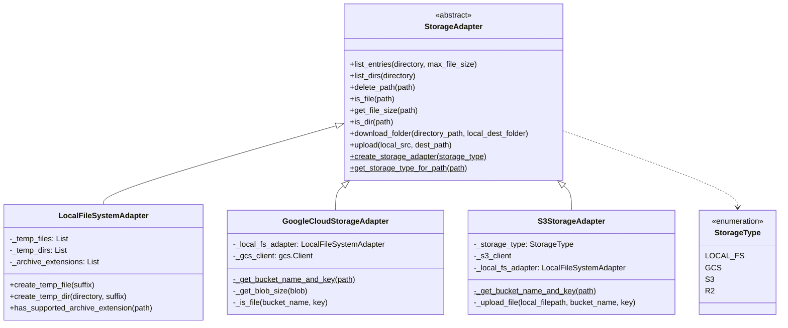
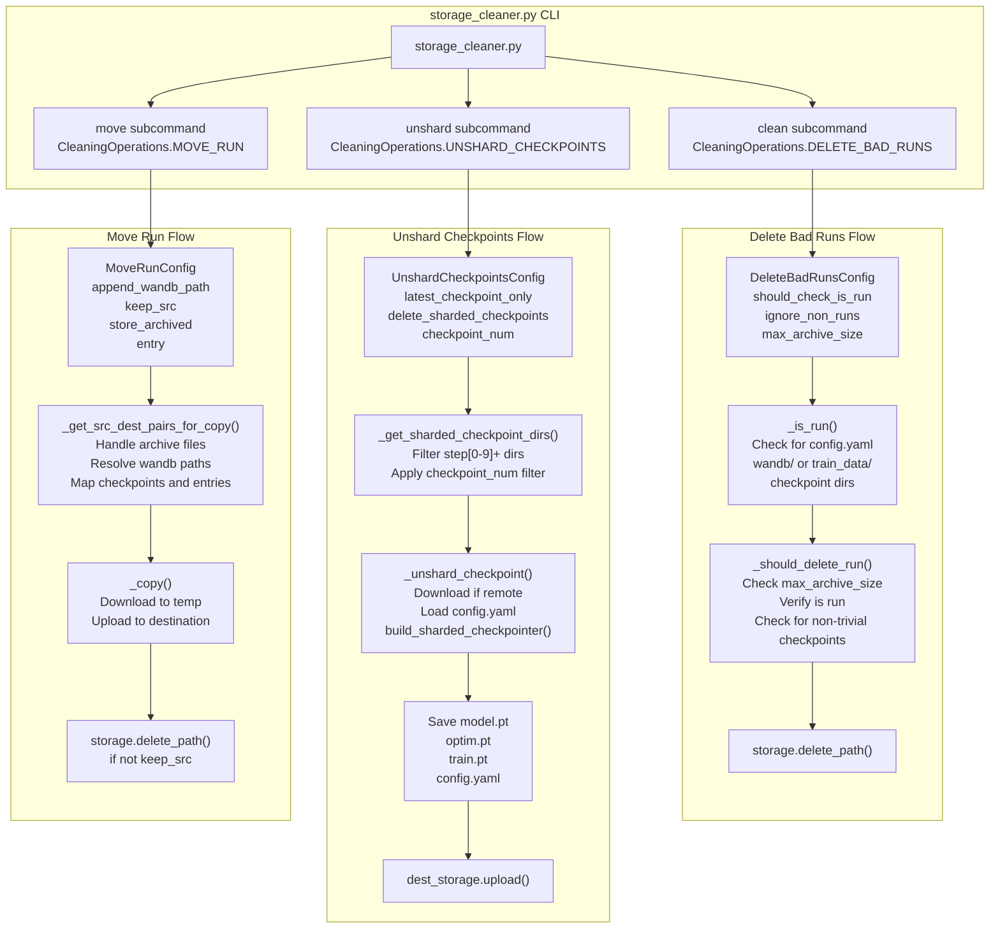
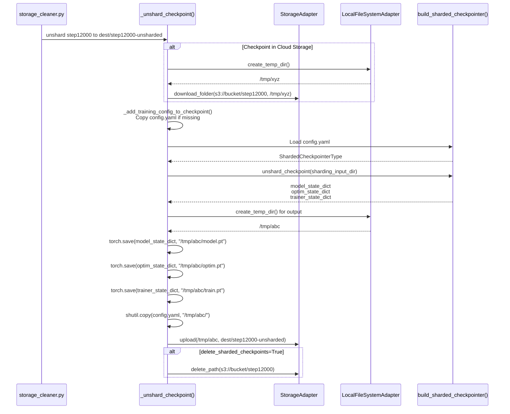
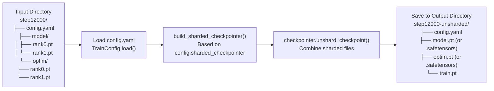

<!-- source: DeepWiki mcp.deepwiki.com · repo allenai/OLMo · page 9.2 Storage Management Tools · fetched 2026-10-26 -->

# Storage Management Tools

<details>
<summary>Relevant source files</summary>

The following files were used as context for generating this wiki page:

- [scripts/storage_cleaner.py](scripts/storage_cleaner.py)
- [scripts/unshard.py](scripts/unshard.py)
- [tests/checkpoint_test.py](tests/checkpoint_test.py)

</details>


This page documents the command-line utilities for managing OLMo training checkpoints across different storage backends (local filesystem, S3, Google Cloud Storage, R2). These tools handle common checkpoint management tasks including cleaning up failed runs, converting sharded checkpoints to unsharded format, and moving checkpoints between storage locations.

For information about checkpoint formats and the sharding/unsharding process from a training perspective, see [Checkpoint Formats and Sharding](#4.1). For checkpoint lifecycle management during training, see [Storage Management](#4.2).

## Overview

The OLMo codebase provides two primary utilities for checkpoint storage management:

| Tool | Primary Use Case | Location |
|------|------------------|----------|
| `storage_cleaner.py` | Multi-operation tool for deleting bad runs, unsharding checkpoints, and moving runs | [scripts/storage_cleaner.py]() |
| `unshard.py` | Standalone utility for converting sharded checkpoints to unsharded format | [scripts/unshard.py]() |

Both tools support multiple storage backends through a unified `StorageAdapter` abstraction, enabling seamless operations across local filesystems, S3, Google Cloud Storage (GCS), and Cloudflare R2.

**Sources:** [scripts/storage_cleaner.py:1-50](), [scripts/unshard.py:1-20]()

## Storage Adapter Architecture

The storage management system uses an abstract adapter pattern to provide uniform operations across different storage backends. This allows checkpoint operations to work identically whether checkpoints are stored locally or in cloud storage.

### Storage Adapter Class Hierarchy



### Supported Storage Types

The system recognizes storage types based on URL schemes:

| Storage Type | URL Scheme | Example Path | Implementation Class |
|--------------|------------|--------------|---------------------|
| Local Filesystem | `file://` or no scheme | `/path/to/checkpoint` | `LocalFileSystemAdapter` |
| Google Cloud Storage | `gs://` | `gs://bucket-name/path/to/checkpoint` | `GoogleCloudStorageAdapter` |
| Amazon S3 | `s3://` | `s3://bucket-name/path/to/checkpoint` | `S3StorageAdapter` |
| Cloudflare R2 | `r2://` | `r2://bucket-name/path/to/checkpoint` | `S3StorageAdapter` |

Path detection is performed by `StorageAdapter.get_storage_type_for_path()` which parses URL schemes to determine the appropriate backend.

**Sources:** [scripts/storage_cleaner.py:46-126](), [scripts/storage_cleaner.py:128-226](), [scripts/storage_cleaner.py:228-390](), [scripts/storage_cleaner.py:392-604]()

## storage_cleaner.py

The `storage_cleaner.py` script provides three main operations for managing training runs and their checkpoints. Each operation is implemented as a subcommand with specific configuration options.

### Operation Types and Workflow



**Sources:** [scripts/storage_cleaner.py:40-44](), [scripts/storage_cleaner.py:606-633](), [scripts/storage_cleaner.py:1316-1375]()

### Delete Bad Runs Operation

The delete operation removes training runs that did not produce meaningful checkpoints, helping to clean up storage from failed or interrupted experiments.

**Command:** `storage_cleaner.py clean <run_paths...> [options]`

**Key Functions:**
- `delete_bad_runs()` - Main entry point for deleting multiple runs
- `_is_run()` - Heuristic to verify a path corresponds to a training run
- `_should_delete_run()` - Determines if a run should be deleted based on checkpoint presence
- `_contains_nontrivial_checkpoint_dir()` - Checks for checkpoints beyond step 0

**Deletion Criteria:**

A run is considered "bad" and eligible for deletion if:
1. It passes the run verification check (has `config.yaml` and `wandb/` or `train_data/` directories, or contains checkpoint directories)
2. Archive file size is below `max_archive_size` threshold (default 5GB)
3. It contains no non-trivial checkpoints (no `step[1-9][0-9]*` directories)

**Configuration Options:**

```python
@dataclass
class DeleteBadRunsConfig(StorageCleanerConfig):
    should_check_is_run: bool          # Verify path is a run before deletion
    ignore_non_runs: bool              # Skip non-runs instead of raising error
    max_archive_size: Optional[int]    # Max archive size to consider (bytes)
```

**Example Usage:**

```bash
# Delete bad runs from S3, checking they are valid runs
python scripts/storage_cleaner.py clean s3://bucket/run1 s3://bucket/run2

# Delete with dry run to preview actions
python scripts/storage_cleaner.py -n clean s3://bucket/run1

# Ignore non-run directories instead of failing
python scripts/storage_cleaner.py clean --ignore_non_runs s3://bucket/path

# Set custom max archive size (10GB)
python scripts/storage_cleaner.py clean --max_archive_size 10737418240 s3://bucket/run1
```

**Sources:** [scripts/storage_cleaner.py:612-617](), [scripts/storage_cleaner.py:639-666](), [scripts/storage_cleaner.py:714-741](), [scripts/storage_cleaner.py:756-766](), [scripts/storage_cleaner.py:1377-1408]()

### Unshard Checkpoints Operation

The unshard operation converts sharded checkpoints (distributed across multiple files for FSDP training) into single-file unsharded checkpoints that are easier to use for inference and evaluation.

**Command:** `storage_cleaner.py unshard <run_path> <dest_dir> [options]`

**Key Functions:**
- `unshard_run_checkpoints()` - Main entry point for unsharding
- `_unshard_checkpoints()` - Orchestrates unsharding for a run
- `_unshard_checkpoint()` - Unshards a single checkpoint directory
- `_get_sharded_checkpoint_dirs()` - Finds sharded checkpoint directories in a run

**Unsharding Process:**



**Configuration Options:**

```python
@dataclass
class UnshardCheckpointsConfig(StorageCleanerConfig):
    latest_checkpoint_only: bool        # Only unshard latest checkpoint
    delete_sharded_checkpoints: bool    # Delete sharded after unsharding
    checkpoint_num: Optional[int]       # Unshard specific checkpoint number
```

**Output Structure:**

Unsharded checkpoints are saved with the `-unsharded` suffix and contain:
- `model.pt` - Model parameters
- `optim.pt` - Optimizer state
- `train.pt` - Trainer state (step count, RNG state, etc.)
- `config.yaml` - Training configuration

**Example Usage:**

```bash
# Unshard all checkpoints from a run
python scripts/storage_cleaner.py unshard s3://bucket/run1 s3://bucket/unsharded

# Unshard only the latest checkpoint
python scripts/storage_cleaner.py unshard --latest_checkpoint_only s3://bucket/run1 s3://bucket/unsharded

# Unshard specific checkpoint and delete sharded version
python scripts/storage_cleaner.py unshard --checkpoint_num 12000 --delete_sharded s3://bucket/run1 /local/unsharded

# Dry run to preview operations
python scripts/storage_cleaner.py -n unshard gs://bucket/run1 gs://bucket/unsharded
```

**Sources:** [scripts/storage_cleaner.py:619-624](), [scripts/storage_cleaner.py:768-825](), [scripts/storage_cleaner.py:827-849](), [scripts/storage_cleaner.py:851-940](), [scripts/storage_cleaner.py:942-1005](), [scripts/storage_cleaner.py:1410-1439]()

### Move Run Operation

The move operation relocates training runs between storage locations, with support for appending W&B paths for organization and handling archived runs.

**Command:** `storage_cleaner.py move <run_path> <dest_dir> [options]`

**Key Functions:**
- `move_run()` - Main entry point for moving runs
- `_move_run()` - Orchestrates the move operation
- `_get_src_dest_pairs_for_copy()` - Computes source-destination path mappings
- `_get_wandb_path()` - Retrieves W&B run path for organization
- `_copy()` - Performs the actual copy operation

**Move Strategies:**

The move operation supports several organizational strategies:

| Strategy | Configuration | Behavior |
|----------|--------------|----------|
| Simple Move | Default | Moves entire run to destination directory |
| W&B Path Organization | `--append_wandb_path` | Appends W&B entity/project/run path to destination |
| Entry-Specific Move | `--entry <name>` | Moves only specific entry (e.g., `step12000-unsharded`) |
| Archive Handling | `--unarchive` | Extracts archives before moving |
| Copy Only | `--keep_src` | Preserves source after copy |

**W&B Path Resolution:**

When `--append_wandb_path` is set, the tool:
1. Reads `config.yaml` from checkpoint directories
2. Queries W&B API to find matching runs based on entity/project/name/group
3. Validates config matches between checkpoint and W&B run
4. Appends path in format: `entity/project/run_id`

**Configuration Options:**

```python
@dataclass
class MoveRunConfig(StorageCleanerConfig):
    append_wandb_path: bool    # Append W&B path to destination
    keep_src: bool             # Keep source after copy
    store_archived: bool       # Store as archive if source is archive
    entry: Optional[str]       # Move only specific entry
```

**Example Usage:**

```bash
# Move entire run to new location
python scripts/storage_cleaner.py move s3://old-bucket/run1 s3://new-bucket/

# Move with W&B path organization
python scripts/storage_cleaner.py move --append_wandb_path s3://bucket/run1 s3://bucket/organized/

# Copy specific checkpoint without deleting source
python scripts/storage_cleaner.py move --keep_src --entry step12000-unsharded s3://bucket/run1 /local/checkpoints/

# Unarchive during move
python scripts/storage_cleaner.py move --unarchive s3://bucket/run1.tar.gz s3://bucket/extracted/

# Dry run
python scripts/storage_cleaner.py -n move s3://bucket/run1 gs://bucket/moved/
```

**Sources:** [scripts/storage_cleaner.py:626-632](), [scripts/storage_cleaner.py:1007-1108](), [scripts/storage_cleaner.py:1110-1158](), [scripts/storage_cleaner.py:1160-1233](), [scripts/storage_cleaner.py:1235-1280](), [scripts/storage_cleaner.py:1441-1474]()

## unshard.py

The `unshard.py` script provides a simpler, standalone interface for converting sharded checkpoints to unsharded format. It offers a more focused alternative to `storage_cleaner.py unshard` for common unsharding use cases.

### Functionality



**Main Function Signature:**

```python
def main(
    input_dir: Union[str, Path],
    output_dir: Union[str, Path],
    sharded_checkpoint_type: Optional[ShardedCheckpointerType] = None,
    model_only: bool = False,
    safe_tensors: bool = False,
    use_shared_mem_impl: bool = False,
) -> None
```

**Key Parameters:**

| Parameter | Type | Description |
|-----------|------|-------------|
| `input_dir` | `str \| Path` | Directory containing sharded checkpoint |
| `output_dir` | `str \| Path` | Directory where unsharded checkpoint will be saved |
| `sharded_checkpoint_type` | `ShardedCheckpointerType` | Override checkpoint type (defaults to `config.sharded_checkpointer`) |
| `model_only` | `bool` | Save only model weights, skip optimizer and trainer state |
| `safe_tensors` | `bool` | Save as `.safetensors` instead of `.pt` format |
| `use_shared_mem_impl` | `bool` | Use shared memory implementation for `torch_legacy` type (faster for large world sizes) |

**Supported Checkpoint Types:**

The tool automatically detects or accepts explicit specification of:
- `torch_new` - PyTorch 2.0+ native FSDP checkpointing
- `torch_legacy` - Legacy PyTorch FSDP checkpointing (pre-2.0)
- `local` - Local sharded checkpointer implementation
- `olmo_core` - OLMo core library checkpointer

**Example Usage:**

```bash
# Basic unsharding
python scripts/unshard.py /path/to/step12000 /path/to/step12000-unsharded

# Unshard with explicit checkpoint type
python scripts/unshard.py --type torch_new /path/to/step12000 /output

# Save only model weights in safetensors format
python scripts/unshard.py --model-only --safe-tensors /path/to/step12000 /output

# Use legacy shared memory implementation for large checkpoints
python scripts/unshard.py --type torch_legacy --use-legacy-shared-mem-impl /path/to/step12000 /output
```

**Comparison with storage_cleaner.py:**

| Feature | `unshard.py` | `storage_cleaner.py unshard` |
|---------|-------------|------------------------------|
| Remote storage support | No (local paths only) | Yes (S3, GCS, R2, local) |
| Batch unsharding | No (single checkpoint) | Yes (all or filtered checkpoints in run) |
| Delete sharded after | No | Yes (with `--delete_sharded`) |
| Checkpoint filtering | No | Yes (latest only, specific number) |
| SafeTensors output | Yes | No |
| Model-only mode | Yes | No |

**Sources:** [scripts/unshard.py:1-76](), [scripts/unshard.py:77-116]()

## Common Configuration

Both tools share common configuration options for operational control:

### Base Configuration Options

```python
@dataclass
class StorageCleanerConfig:
    dry_run: bool      # Preview actions without executing
    temp_dir: str      # Local directory for temporary files
```

**Dry Run Mode:**

Setting `--dry_run` (or `-n`) causes the tools to:
- Log all operations that would be performed
- Not execute any irreversible actions (deletion, uploads)
- Validate inputs and compute operation plans
- Exit with status 0 if successful, non-zero on errors

**Temporary Directory:**

The `--temp_dir` option specifies a local directory for:
- Downloading remote checkpoints before unsharding
- Extracting archive files
- Staging files before upload to remote storage
- Storing intermediate unsharding outputs

The directory must be on local filesystem and is automatically cleaned up after operations complete.

**Sources:** [scripts/storage_cleaner.py:606-610](), [scripts/storage_cleaner.py:1316-1375](), [scripts/storage_cleaner.py:1476-1494]()

## Integration with Cached Path

Both tools integrate with the `cached_path` library for efficient remote resource access. The integration provides:

1. **Automatic Caching:** Downloaded remote files are cached locally to avoid repeated downloads
2. **Archive Extraction:** Automatic extraction of `.tar.gz`, `.zip`, and other archive formats
3. **Custom S3/R2 Client:** Registration of custom scheme clients for S3 and R2 protocols

The custom S3 scheme client handles both S3 and R2 URLs:

```python
class S3SchemeClient(S3Client):
    scheme = ("s3", "r2")
    
    def __init__(self, resource: str) -> None:
        # Parses URL and creates boto3 S3 resource
        # with appropriate profile and endpoint for s3:// or r2://
```

Cache directory configuration:

```python
def _setup_cached_path(temp_dir: str):
    if temp_dir is not None:
        set_cache_dir(temp_dir)
    _add_cached_path_s3_client()
```

**Sources:** [scripts/storage_cleaner.py:1282-1314](), [scripts/storage_cleaner.py:1309-1314]()

## Error Handling and Validation

The tools implement comprehensive validation and error handling:

### Run Verification

```python
def _is_run(directory: str, run_entries: Optional[List[str]] = None) -> bool:
    """
    Heuristic to verify a path corresponds to a training run.
    Prioritizes minimizing false positives.
    """
```

Checks for:
- Presence of `config.yaml`
- Existence of `wandb/` or `train_data/` subdirectories
- Checkpoint directories matching pattern `step\d+(-unsharded)?`

### Path Format Validation

```python
def _format_dir_or_archive_path(storage: StorageAdapter, path: str) -> str:
    """Validates path is a directory or supported archive file."""
```

Ensures paths correspond to:
- Existing directories (with trailing `/`)
- Archive files with supported extensions (`.tar.gz`, `.zip`, etc.)

### Archive Handling

```python
def _unarchive_if_archive(dir_or_archive: str, storage: StorageAdapter) -> str:
    """Extracts archive if needed, handles nested directory structures."""
```

Handles:
- Archive extraction via `cached_path`
- Redundant top-level directories in archives
- Validation of extraction success

**Sources:** [scripts/storage_cleaner.py:647-666](), [scripts/storage_cleaner.py:668-675](), [scripts/storage_cleaner.py:677-690](), [scripts/storage_cleaner.py:692-712]()