# Page: Overview

# Overview

<details>
<summary>Relevant source files</summary>

The following files were used as context for generating this wiki page:

- [README.md](README.md)
- [configs/official-0425/OLMo2-1B-stage1.yaml](configs/official-0425/OLMo2-1B-stage1.yaml)
- [configs/official-0425/OLMo2-1B-stage2-seed42.yaml](configs/official-0425/OLMo2-1B-stage2-seed42.yaml)
- [configs/official-0425/OLMo2-1B-stage2-seed42069.yaml](configs/official-0425/OLMo2-1B-stage2-seed42069.yaml)
- [configs/official-0425/OLMo2-1B-stage2-seed666.yaml](configs/official-0425/OLMo2-1B-stage2-seed666.yaml)
- [configs/official-1124/OLMo2-13B-stage1.yaml](configs/official-1124/OLMo2-13B-stage1.yaml)
- [configs/official-1124/OLMo2-13B-stage2-seed1110-100B.yaml](configs/official-1124/OLMo2-13B-stage2-seed1110-100B.yaml)
- [configs/official-1124/OLMo2-13B-stage2-seed2662-100B.yaml](configs/official-1124/OLMo2-13B-stage2-seed2662-100B.yaml)
- [configs/official-1124/OLMo2-13B-stage2-seed2662-300B.yaml](configs/official-1124/OLMo2-13B-stage2-seed2662-300B.yaml)
- [configs/official-1124/OLMo2-13B-stage2-seed6209-100B.yaml](configs/official-1124/OLMo2-13B-stage2-seed6209-100B.yaml)
- [configs/official-1124/OLMo2-7B-stage1.yaml](configs/official-1124/OLMo2-7B-stage1.yaml)
- [configs/official-1124/OLMo2-7B-stage2-seed42.yaml](configs/official-1124/OLMo2-7B-stage2-seed42.yaml)
- [configs/official-1124/OLMo2-7B-stage2-seed42069.yaml](configs/official-1124/OLMo2-7B-stage2-seed42069.yaml)
- [configs/official-1124/OLMo2-7B-stage2-seed666.yaml](configs/official-1124/OLMo2-7B-stage2-seed666.yaml)
- [olmo/beam_search.py](olmo/beam_search.py)
- [olmo/checkpoint.py](olmo/checkpoint.py)
- [olmo/config.py](olmo/config.py)
- [olmo/initialization.py](olmo/initialization.py)
- [olmo/model.py](olmo/model.py)
- [olmo/optim.py](olmo/optim.py)
- [olmo/torch_util.py](olmo/torch_util.py)
- [olmo/train.py](olmo/train.py)
- [olmo/util.py](olmo/util.py)
- [scripts/olmo2_modal_openai.py](scripts/olmo2_modal_openai.py)
- [scripts/train.py](scripts/train.py)
- [tests/grad_norm_test.py](tests/grad_norm_test.py)
- [tests/initialization_test.py](tests/initialization_test.py)
- [tests/optim_test.py](tests/optim_test.py)

</details>


The OLMo (Open Language Model) repository is a state-of-the-art open language model training framework developed by the Allen Institute for AI (AI2). OLMo is designed by scientists, for scientists, providing a complete, transparent system for training transformer-based language models at scale.

The framework supports:
- **Full transparency**: Complete access to training data, model weights, training code, evaluation tools, and intermediate checkpoints
- **Production-scale training**: Multi-billion parameter models trained on trillions of tokens
- **Two-stage training procedure**: Web-based pretraining followed by high-quality data refinement
- **Flexible deployment**: Integration with Hugging Face transformers and custom inference solutions
- **Comprehensive evaluation**: Built-in downstream task evaluation and external evaluation pipelines

This page provides a high-level overview of the OLMo system. For detailed information about specific components, refer to their dedicated documentation pages:
- [Model Architecture](#2) - Transformer architecture, attention mechanisms, and model variants
- [Training Pipeline](#3) - Training loop orchestration and distributed training strategies
- [Data Processing](#3.1) - Data loading, preprocessing, and batching
- [Checkpoint Management](#4) - Saving, loading, and managing model checkpoints
- [Evaluation System](#5) - Inline evaluation, downstream tasks, and external evaluation

Sources: [README.md:1-27](README.md:1-27), [README.md:44-61](README.md:44-61)

## Two-Stage Training Approach

OLMo models follow a two-stage training procedure designed to balance scale with quality:

| Stage | Data Source | Token Count | Learning Rate Schedule | Purpose |
|-------|-------------|-------------|------------------------|---------|
| **Stage 1** | OLMo-mix-1124 (web-based) | 4-5 Trillion | Cosine with warmup | Large-scale pretraining on diverse web data |
| **Stage 2** | Dolmino-mix-1124 (high-quality) | 50-300 Billion | Linear warmup | Refinement on curated, high-quality data |

### Stage 1: Web-Based Pretraining

Stage 1 trains on 4-5 trillion tokens from **OLMo-mix-1124**, a large web-based dataset containing:
- Books (Dolma books)
- Academic papers (PES2O)
- Wikipedia content
- Code repositories
- Web crawl data
- Social media content

Training uses a cosine learning rate schedule with warmup, optimizing for broad language understanding across diverse domains.

### Stage 2: High-Quality Refinement

Stage 2 continues training on 50-300 billion tokens from **Dolmino-mix-1124**, focusing on:
- Higher-quality instruction data
- Curated domain-specific content
- Mathematical reasoning
- Code generation

Training uses linear warmup scheduling to fine-tune the model on this refined dataset.

### Model Souping

For 7B and 13B models, OLMo employs **model souping**: training multiple checkpoints with different random seeds and averaging their weights to improve robustness and performance.

| Model Size | Stage 2 Strategy |
|------------|------------------|
| 1B | Single best seed (seed 42) |
| 7B | Average of 3 seeds (42, 42069, 666) |
| 13B | Average of 4 seeds (1110, 2662, 6209, and one 300B run) |

Sources: [README.md:96-147](README.md:96-147), [configs/official-1124/OLMo2-7B-stage1.yaml](configs/official-1124/OLMo2-7B-stage1.yaml), [configs/official-0425/OLMo2-1B-stage2-seed42.yaml](configs/official-0425/OLMo2-1B-stage2-seed42.yaml)

## System Architecture

**High-Level System Architecture Diagram**

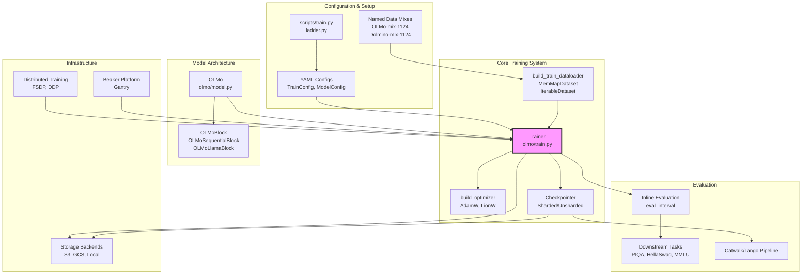

The OLMo system consists of five major subsystems:

1. **Configuration & Setup**: YAML-based configuration system (`TrainConfig`, `ModelConfig`) with CLI tools (`scripts/train.py`, `ladder.py`) for launching training jobs
2. **Core Training System**: `Trainer` class orchestrates data loading (`build_train_dataloader`), optimization (`build_optimizer`), and checkpointing
3. **Model Architecture**: `OLMo` model with modular transformer blocks (`OLMoSequentialBlock`, `OLMoLlamaBlock`)
4. **Evaluation**: Three-tier evaluation including inline evaluation during training, built-in downstream tasks, and external Catwalk pipeline
5. **Infrastructure**: Distributed training support (FSDP/DDP), Beaker platform integration, and multi-backend storage (S3, GCS, local)

Sources: [scripts/train.py:54-238](scripts/train.py:54-238), [olmo/train.py:209-280](olmo/train.py:209-280), [olmo/model.py:1-76](olmo/model.py:1-76), [olmo/config.py:1-65](olmo/config.py:1-65)

## Key Components

### Configuration System

The configuration system (`olmo/config.py`) provides a hierarchical YAML-based configuration structure:

**Configuration Hierarchy Diagram**

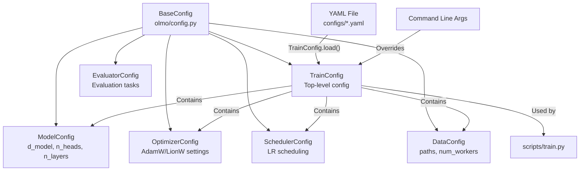

Configuration files define all aspects of training, from model architecture to distributed strategy. See [Configuration System](#2.1) for details.

Sources: [olmo/config.py:67-167](olmo/config.py:67-167), [scripts/train.py:422-426](scripts/train.py:422-426)

### Model Architecture

The `OLMo` class (`olmo/model.py`) implements a modular transformer architecture with support for multiple block types and configurations.

**OLMo Model Structure Diagram**

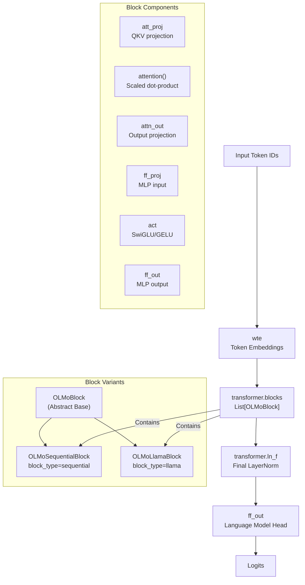

Key architectural features:
- **Transformer blocks**: Choice between `OLMoSequentialBlock` (standard) and `OLMoLlamaBlock` (Llama-style)
- **Attention mechanisms**: Multi-head attention with optional flash attention, RoPE, and grouped query attention (GQA)
- **Normalization**: RMSLayerNorm or standard LayerNorm with configurable affine parameters
- **Activations**: SwiGLU (default), GELU, or ReLU
- **Memory optimization**: Activation checkpointing support for reducing memory footprint

See [Model Architecture](#2) for comprehensive details.

Sources: [olmo/model.py:59-73](olmo/model.py:59-73), [olmo/model.py:411-476](olmo/model.py:411-476), [olmo/model.py:678-823](olmo/model.py:678-823)

### Training Pipeline

The `Trainer` class (`olmo/train.py`) orchestrates the complete training loop with support for distributed training, checkpointing, and evaluation.

**Training Execution Flow Diagram**

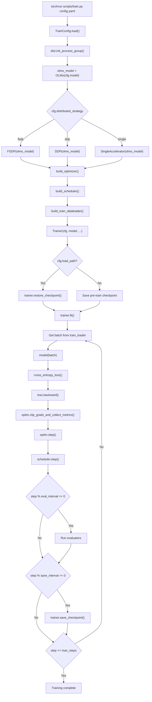

Key training components:
- **scripts/train.py**: Entry point that initializes distributed environment and creates `Trainer`
- **Trainer class**: Manages training loop with gradient accumulation, checkpointing, and evaluation
- **Distributed strategies**: FSDP (≥7B models), DDP (<7B models), or single-device training
- **Optimizers**: `AdamW` (default) or `LionW` with weight decay and gradient clipping
- **Schedulers**: Cosine (Stage 1) or linear (Stage 2) warmup schedules

See [Training Pipeline](#3) for comprehensive details.

Sources: [scripts/train.py:54-376](scripts/train.py:54-376), [olmo/train.py:209-303](olmo/train.py:209-303), [olmo/train.py:596-980](olmo/train.py:596-980)

### Data Processing

The data pipeline (`olmo/data/`) provides efficient loading and preprocessing of training data with support for memory-mapped datasets and distributed sampling.

**Data Pipeline Architecture Diagram**

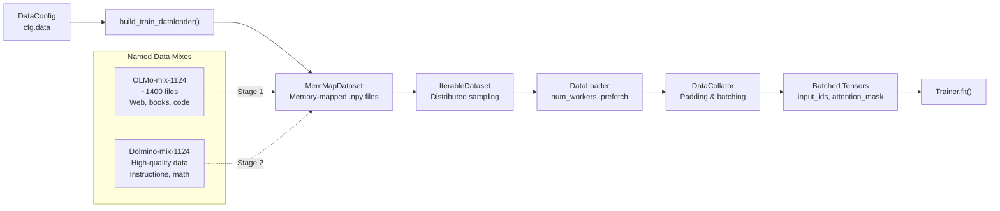

Key data components:
- **MemMapDataset**: Reads tokenized data from memory-mapped `.npy` files for efficient access
- **IterableDataset**: Wraps datasets with deterministic shuffling, distributed sampling, and restartability
- **DataCollator**: Batches examples with padding, generates attention masks, and handles label masking
- **build_train_dataloader**: Factory function that constructs the complete data pipeline

The pipeline supports efficient streaming from large datasets with proper sharding across distributed ranks. See [Data Processing](#3.1) for details.

Sources: [olmo/data/__init__.py:85-157](olmo/data/__init__.py:85-157), [olmo/data/__init__.py:22-84](olmo/data/__init__.py:22-84)

### Checkpoint Management

The checkpointing system (`olmo/checkpoint.py`) handles saving and loading model and optimizer states with support for both sharded (FSDP) and unsharded formats.

**Checkpoint Management Flow Diagram**

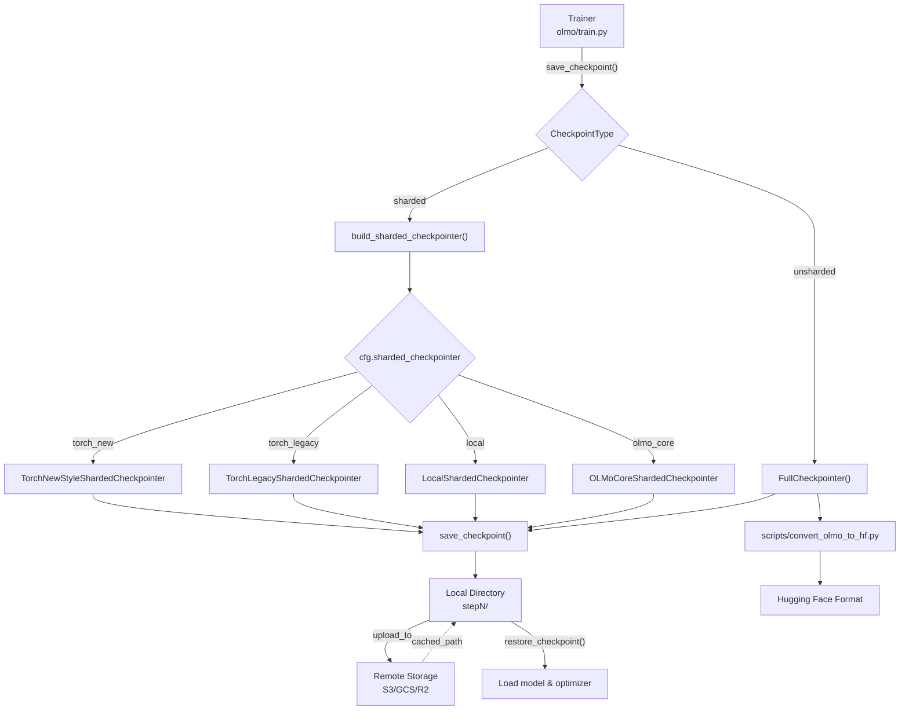

Key checkpoint features:
- **Sharded checkpoints**: FSDP-compatible distributed checkpoints split across ranks
- **Unsharded checkpoints**: Single-file checkpoints for DDP or single-device training
- **Remote storage**: Automatic upload to S3, GCS, or R2 cloud storage
- **Checkpoint rotation**: Configurable retention policy to manage disk space
- **Hugging Face conversion**: `convert_olmo_to_hf.py` script for transformers integration

Checkpoints are saved at regular intervals (`save_interval`) and can be restored for resuming training or evaluation. See [Checkpoint Management](#4) for details.

Sources: [olmo/checkpoint.py:76-91](olmo/checkpoint.py:76-91), [olmo/train.py:446-576](olmo/train.py:446-576)

### Evaluation System

The evaluation system (`olmo/eval/`) provides inline evaluation during training and comprehensive downstream task assessment.

**Evaluation System Architecture Diagram**

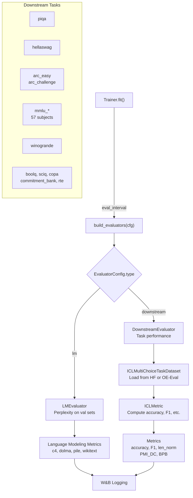

Key evaluation features:
- **Inline evaluation**: Runs every `eval_interval` steps (typically 1000) during training
- **Language modeling**: Perplexity on validation sets (C4, Dolma, Pile, WikiText)
- **Downstream tasks**: PIQA, HellaSwag, ARC, MMLU (57 subjects), WinoGrande, and more
- **ICLMetric**: Computes accuracy, F1, length-normalized accuracy, PMI with domain-conditional normalization, and bits-per-byte
- **Task datasets**: `ICLMultiChoiceTaskDataset` loads tasks from HuggingFace or OE-Eval format

Results are logged to Weights & Biases for tracking model performance throughout training. See [Evaluation System](#5) for comprehensive details.

Sources: [olmo/eval/__init__.py:24-91](olmo/eval/__init__.py:24-91), [olmo/eval/downstream.py:28-81](olmo/eval/downstream.py:28-81)

## Getting Started

### Installation

Install OLMo from source for training and fine-tuning:

```bash
git clone https://github.com/allenai/OLMo.git
cd OLMo
pip install -e .[all]
```

Or install from PyPI for inference:

```bash
pip install ai2-olmo
```

Sources: [README.md:28-42](README.md:28-42)

### Quick Start: Training

Launch training with a configuration file:

```bash
torchrun --nproc_per_node=8 scripts/train.py configs/official-1124/OLMo2-7B-stage1.yaml
```

Override configuration settings from the command line:

```bash
torchrun --nproc_per_node=8 scripts/train.py configs/my_config.yaml \
  --global_train_batch_size=1024 \
  --save_interval=2000 \
  --max_grad_norm=1.0
```

Sources: [README.md:62-80](README.md:62-80)

### Quick Start: Inference

Use OLMo models with Hugging Face transformers:

```python
from transformers import AutoModelForCausalLM, AutoTokenizer

# Load model and tokenizer
model = AutoModelForCausalLM.from_pretrained("allenai/OLMo-2-1124-7B")
tokenizer = AutoTokenizer.from_pretrained("allenai/OLMo-2-1124-7B")

# Generate text
inputs = tokenizer("Language modeling is", return_tensors='pt')
outputs = model.generate(**inputs, max_new_tokens=100)
print(tokenizer.decode(outputs[0]))
```

Sources: [README.md:158-173](README.md:158-173)

## Training Workflow

The typical workflow for training an OLMo model is:

1. **Prepare Data**: Tokenized data is prepared as memory-mapped files
2. **Create Configuration**: Define model architecture and training parameters in YAML
3. **Launch Training**: Use `torchrun` to start distributed training with the configuration
4. **Monitor Progress**: Track metrics through WandB or logs
5. **Evaluate Model**: Evaluate checkpoints on downstream tasks
6. **Convert Format**: Convert checkpoints to Hugging Face format for broader use

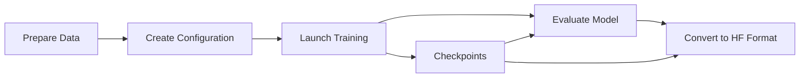

Example training command:
```
torchrun --nproc_per_node=8 scripts/train.py configs/official-1124/OLMo-2-7B-stage1.yaml
```

Sources:
- [README.md:66-79](README.md:66-79)
- [scripts/train.py:382-436](scripts/train.py:382-436)

---

# Page: Model Architecture

# Model Architecture

<details>
<summary>Relevant source files</summary>

The following files were used as context for generating this wiki page:

- [olmo/beam_search.py](olmo/beam_search.py)
- [olmo/checkpoint.py](olmo/checkpoint.py)
- [olmo/config.py](olmo/config.py)
- [olmo/initialization.py](olmo/initialization.py)
- [olmo/model.py](olmo/model.py)
- [olmo/optim.py](olmo/optim.py)
- [olmo/torch_util.py](olmo/torch_util.py)
- [olmo/train.py](olmo/train.py)
- [olmo/util.py](olmo/util.py)
- [scripts/train.py](scripts/train.py)
- [tests/config_test.py](tests/config_test.py)
- [tests/grad_norm_test.py](tests/grad_norm_test.py)
- [tests/initialization_test.py](tests/initialization_test.py)
- [tests/model_test.py](tests/model_test.py)
- [tests/optim_test.py](tests/optim_test.py)

</details>


This page documents the neural network architecture of OLMo (Open Language Model), a decoder-only transformer language model. It covers the core model components, their interactions, and the configurable aspects of the architecture. For information about training the model, see [Training Pipeline](#3).

## Overview

OLMo is a decoder-only transformer language model that builds on recent advances in transformer architecture design. It supports various architectural choices, including different block types, attention mechanisms, and activation functions. The model architecture is highly configurable, allowing for experimentation with different design choices.

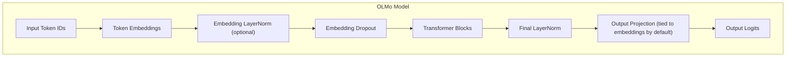

Sources: [olmo/model.py:4740-4996](). The main `OLMo` class implementation contains the high-level architecture.

## Components in Detail

### Transformer Block Architecture

OLMo implements two main transformer block types:

1. **Sequential Block** (`OLMoSequentialBlock`): A standard transformer block with a sequence of attention and feed-forward layers.
2. **Llama Block** (`OLMoLlamaBlock`): A block similar to the Sequential Block but with implementation differences to match the behavior of Llama models.

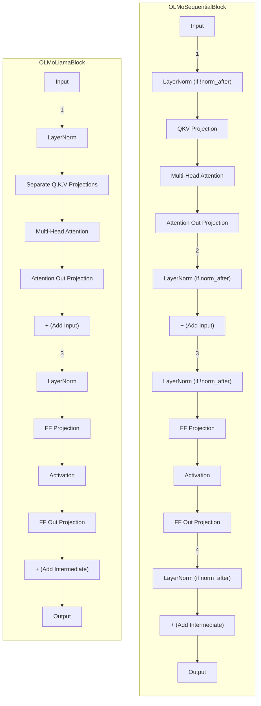

Sources: 
- Sequential Block: [olmo/model.py:678-823]()
- Llama Block: [olmo/model.py:826-1058]()

### Attention Mechanism

OLMo supports several attention variations:

1. **Multi-Head Attention (MHA)**: Standard multi-head attention where number of key-value heads equals number of query heads.
2. **Multi-Query Attention (MQA)**: A variation where all query heads share a single key-value head.
3. **Grouped-Query Attention (GQA)**: A middle ground where groups of query heads share key-value heads.

The attention mechanism is implemented in the `attention` method of the `OLMoBlock` class:

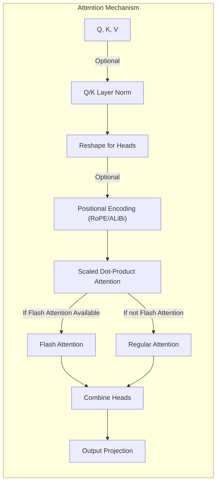

Sources: [olmo/model.py:588-654]()

### Positional Encodings

OLMo supports two types of positional encodings:

1. **Rotary Position Embeddings (RoPE)**: Applies rotation to the keys and queries based on their positions.
2. **ALiBi**: Adds a bias to the attention scores based on the relative positions of tokens.

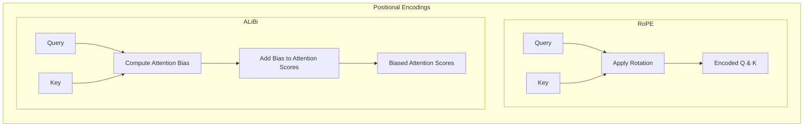

Sources: 
- RoPE: [olmo/model.py:258-306]()
- ALiBi: [olmo/model.py:396-408]()

### Feed-Forward Network

The feed-forward network consists of:
1. A projection to a higher dimension
2. An activation function
3. A projection back to the model dimension

OLMo supports several activation functions:
- GELU
- ReLU
- SwiGLU (Swish-Gated Linear Unit)

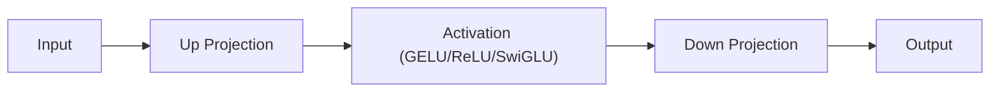

Sources:
- Activation functions: [olmo/model.py:327-372]()
- Implementation in blocks: [olmo/model.py:699-822]() for Sequential Block, [olmo/model.py:834-1057]() for Llama Block

## Layer Normalization Variants

OLMo implements multiple layer normalization variants:

1. **Default LayerNorm**: Standard implementation equivalent to PyTorch's built-in version
2. **Low Precision LayerNorm**: A variant optimized for lower precision computation
3. **RMSLayerNorm**: A simplified layer norm that only normalizes by the root mean square

```mermaid
flowchart TD
    subgraph "LayerNorm Variants"
        direction TB
        
        subgraph "Default LayerNorm"
            inputN1["Input"] --> meanVar1["Compute Mean & Variance"]
            meanVar1 --> norm1["Normalize"]
            norm1 --> scale1["Apply Scale & Bias"]
            scale1 --> outputN1["Output"]
        end
        
        subgraph "Low Precision LayerNorm"
            inputN2["Input"] --> cast["Cast to Low Precision"]
            cast --> meanVar2["Compute Mean & Variance"]
            meanVar2 --> norm2["Normalize"]
            norm2 --> scale2["Apply Scale & Bias"]
            scale2 --> outputN2["Output"]
        end
        
        subgraph "RMSLayerNorm"
            inputN3["Input"] --> var["Compute Variance"]
            var --> normRMS["Normalize by RMS"]
            normRMS --> scale3["Apply Scale & Bias"]
            scale3 --> outputN3["Output"]
        end
    end
```

Sources: [olmo/model.py:139-255]()

## OLMo Model

The main `OLMo` class ties all components together:

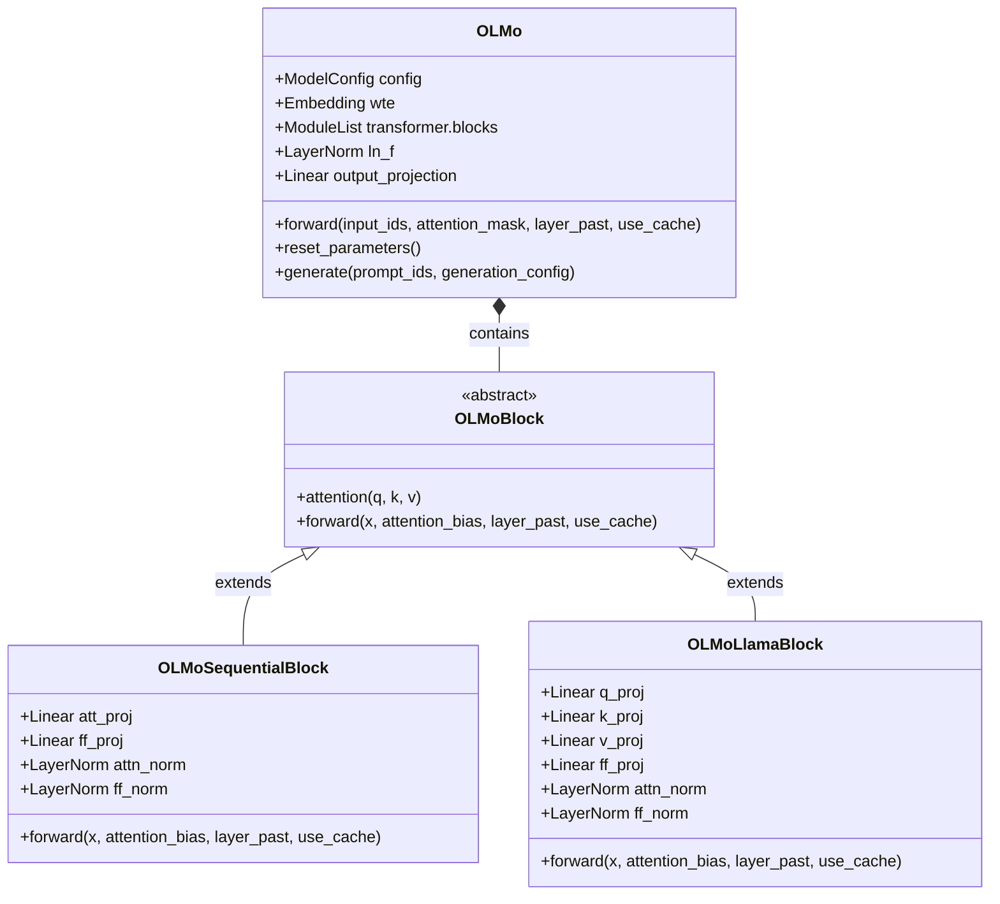

Sources: [olmo/model.py:4740-6039]() for the `OLMo` class, [olmo/model.py:411-673]() for the `OLMoBlock` base class, [olmo/model.py:678-823]() for `OLMoSequentialBlock`, and [olmo/model.py:826-1058]() for `OLMoLlamaBlock`.

## Forward Pass

The forward pass through the OLMo model follows these steps:

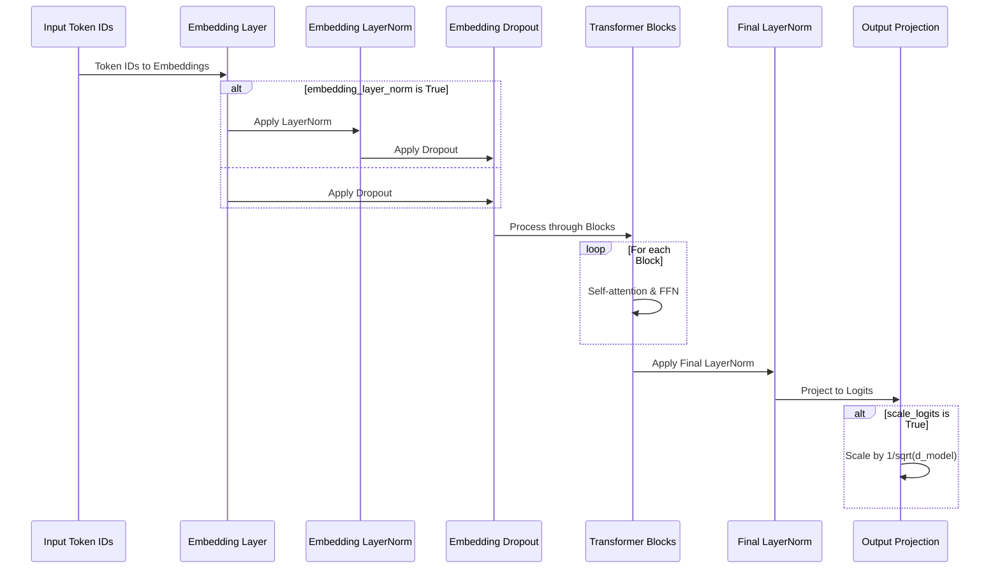

Sources: [olmo/model.py:4898-4996]()

## Generation Capabilities

OLMo supports text generation with various strategies:

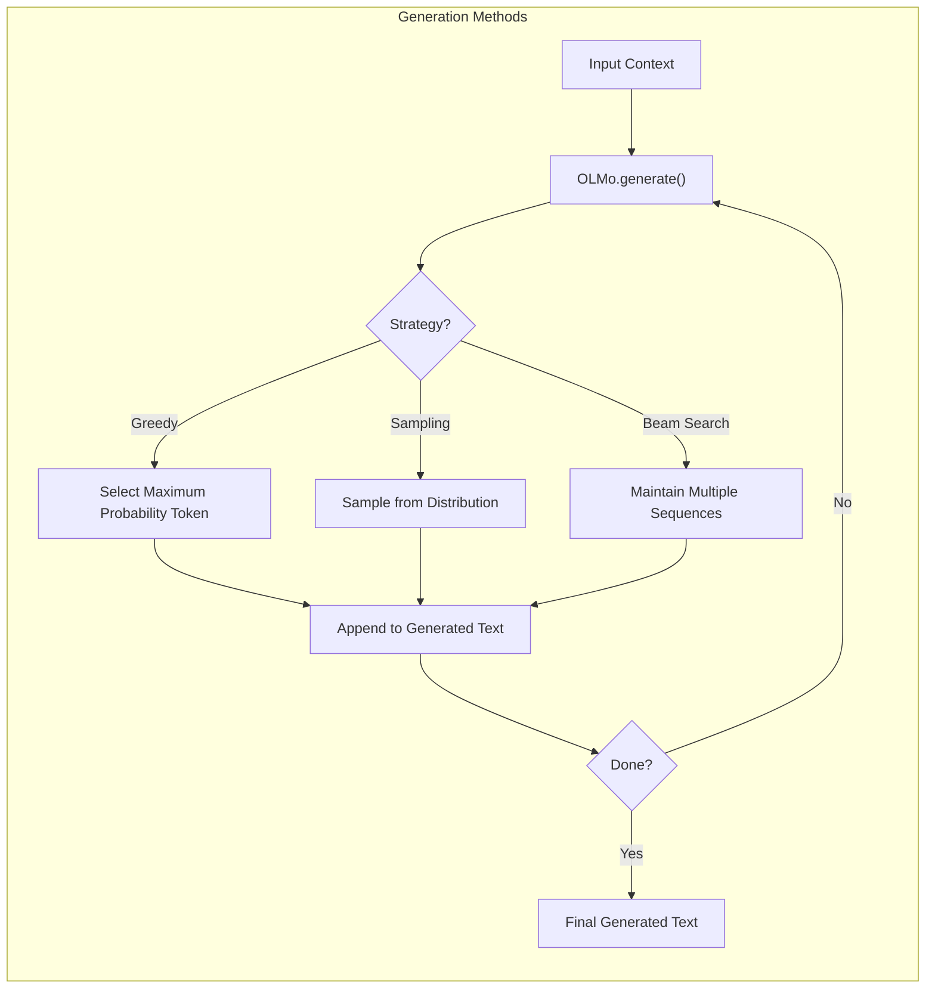

Sources: [olmo/model.py:5001-5285]()

## Model Initialization

OLMo supports several initialization strategies:

1. **Normal**: All weights are initialized from a normal distribution with a fixed standard deviation.
2. **Mitchell**: Weights are initialized with an adaptive standard deviation that depends on the layer depth.
3. **Full Megatron**: The initialization strategy used in Megatron-LM and Llama 2.

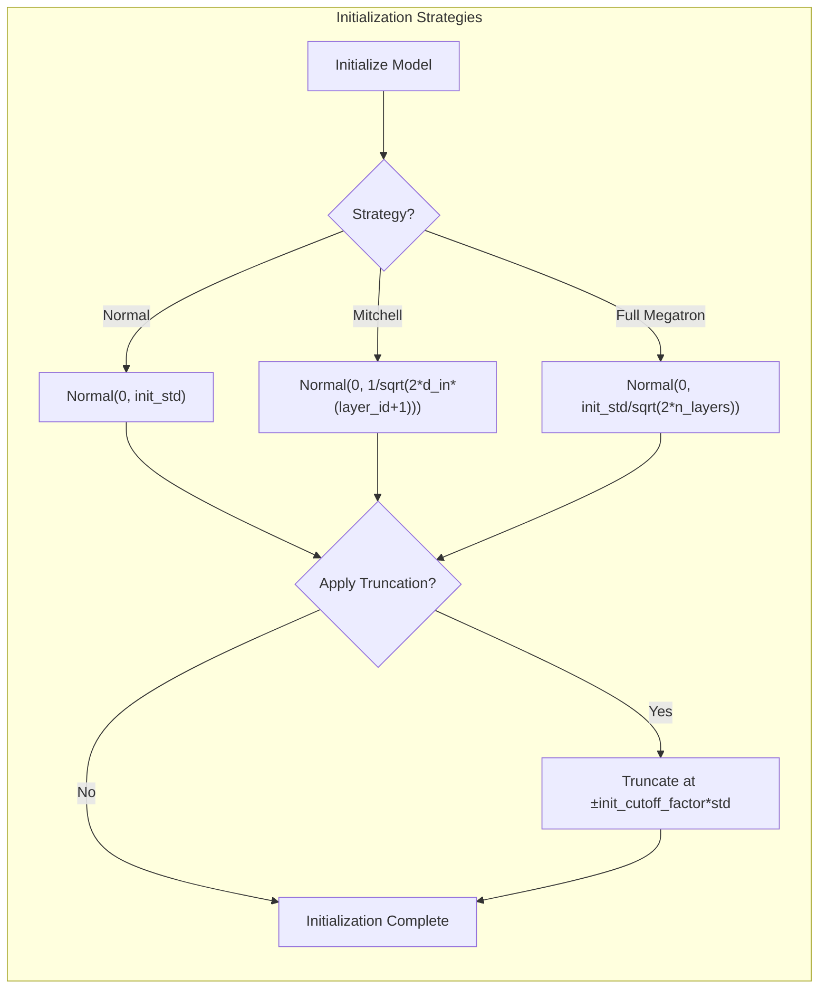

Sources: [olmo/model.py:482-506]() for transformer block initialization, [olmo/initialization.py:8-23]() for the `init_normal` function.

## Key Configuration Options

OLMo's architecture is highly configurable through the `ModelConfig` class. Here's a table of key architectural parameters:

| Parameter | Description | Default |
|-----------|-------------|---------|
| `d_model` | Hidden size of the model | 768 |
| `n_heads` | Number of attention heads | 12 |
| `n_kv_heads` | Number of key-value heads (for GQA/MQA) | Same as `n_heads` |
| `n_layers` | Number of transformer layers | 12 |
| `mlp_ratio` | Ratio of FFN hidden dim to model dim | 4 |
| `activation_type` | Activation function type | `swiglu` |
| `block_type` | Transformer block type | `sequential` |
| `rope` | Use rotary positional embeddings | `False` |
| `alibi` | Use ALiBi positional embeddings | `False` |
| `flash_attention` | Use Flash Attention if available | `False` |
| `attention_dropout` | Dropout rate in attention | 0.1 |
| `residual_dropout` | Dropout rate in residual connections | 0.1 |
| `embedding_dropout` | Dropout rate for embeddings | 0.1 |
| `layer_norm_type` | Type of layer normalization | `default` |
| `max_sequence_length` | Maximum input sequence length | 1024 |
| `vocab_size` | Size of the vocabulary | 50257 |
| `weight_tying` | Tie embedding and output weights | `True` |
| `init_fn` | Weight initialization strategy | `normal` |

Sources: [olmo/config.py:234-496]()

## Instantiating the Model

The OLMo model is typically instantiated in the training script:

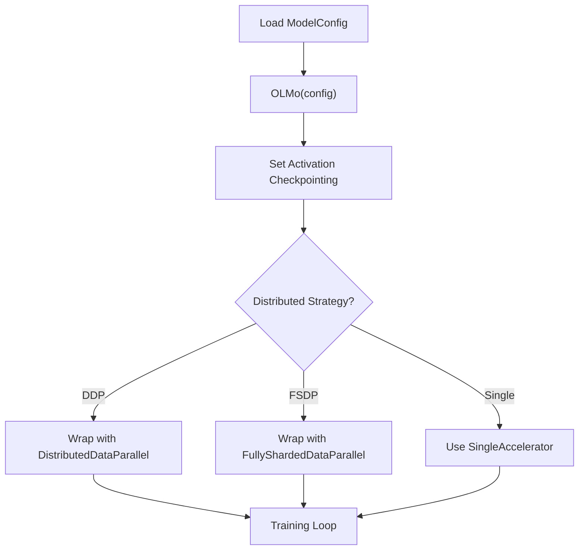

Sources: [scripts/train.py:139-226]()

## Differences Between Block Types

The main differences between the two block types are:

| Feature | OLMoSequentialBlock | OLMoLlamaBlock |
|---------|---------------------|----------------|
| Q,K,V Projection | Single fused projection | Separate projections |
| Layer Norm Position | Configurable (before or after) | Always before |
| Implementation Style | Standard transformer | Mimics Llama architecture |

Sources: [olmo/model.py:678-823]() for `OLMoSequentialBlock`, [olmo/model.py:826-1058]() for `OLMoLlamaBlock`

## Attention Implementation Details

The attention mechanism in OLMo supports various features:

1. **Flash Attention**: For efficient attention computation when available
2. **Attention Layer Norm**: Optional layer normalization for queries and keys
3. **Attention Bias**: Support for causal masking and ALiBi biases
4. **QKV Clipping**: Optional clipping of query, key, and value projections

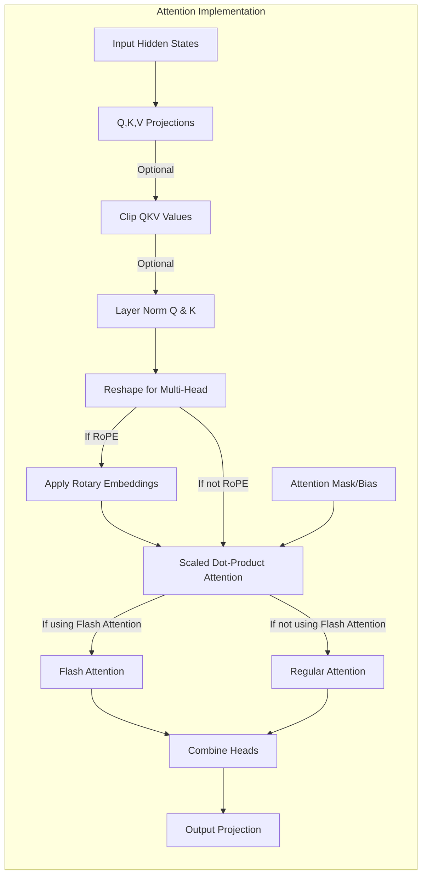

Sources: [olmo/model.py:588-654]()

---

# Page: Configuration System

# Configuration System

<details>
<summary>Relevant source files</summary>

The following files were used as context for generating this wiki page:

- [olmo/beam_search.py](olmo/beam_search.py)
- [olmo/checkpoint.py](olmo/checkpoint.py)
- [olmo/config.py](olmo/config.py)
- [olmo/data/named_data_mixes.py](olmo/data/named_data_mixes.py)
- [olmo/initialization.py](olmo/initialization.py)
- [olmo/model.py](olmo/model.py)
- [olmo/optim.py](olmo/optim.py)
- [olmo/torch_util.py](olmo/torch_util.py)
- [olmo/train.py](olmo/train.py)
- [olmo/util.py](olmo/util.py)
- [scripts/compare_wandb_configs.py](scripts/compare_wandb_configs.py)
- [scripts/ladder.py](scripts/ladder.py)
- [scripts/train.py](scripts/train.py)
- [tests/grad_norm_test.py](tests/grad_norm_test.py)
- [tests/initialization_test.py](tests/initialization_test.py)
- [tests/optim_test.py](tests/optim_test.py)
- [tests/util_test.py](tests/util_test.py)

</details>


## Purpose and Scope

The OLMo Configuration System provides a flexible, hierarchical approach to configuring all aspects of model architecture, training, and evaluation. This system uses YAML files to define parameters that control model behavior, training processes, data loading, and evaluation strategies. This page documents the structure of configuration files, available parameters, and how they integrate with the rest of the OLMo framework.

For information about the specific model architecture implementation, see [Model Architecture](#2).

## Configuration Overview

The configuration system uses YAML files to define all settings required for training and using OLMo models. It supports hierarchical organization of settings, parameter interpolation, and specialized configuration for different components of the system.

```mermaid
flowchart TD
    ConfigFile["Configuration YAML"] --> ConfigParser["Configuration Parser"]
    ConfigParser --> ModelConfig["ModelConfig"]
    ConfigParser --> OptimizerConfig["OptimizerConfig"]
    ConfigParser --> SchedulerConfig["SchedulerConfig"] 
    ConfigParser --> DataConfig["DataConfig"]
    ConfigParser --> TokenizerConfig["TokenizerConfig"]
    ConfigParser --> EvalConfig["EvaluatorConfig"]
    ConfigParser --> TrainingConfig["TrainingConfig"]
    
    ModelConfig --> ModelInit["Model Initialization"]
    OptimizerConfig --> OptimizerInit["Optimizer Setup"]
    SchedulerConfig --> SchedulerInit["Learning Rate Scheduler"]
    DataConfig --> DataLoaderInit["Data Pipeline Setup"]
    TokenizerConfig --> TokenizerInit["Tokenizer Setup"]
    EvalConfig --> EvaluatorsInit["Evaluators Setup"]
    TrainingConfig --> TrainingLoop["Training Loop Parameters"]
```

Sources: [test_fixtures/train_tiny_with_evaluator.yaml]()

## Configuration File Structure

A typical OLMo configuration file is organized into the following main sections:

| Section | Purpose |
|---------|---------|
| `save_folder` | Directory path where checkpoints and artifacts will be saved |
| `model` | Model architecture parameters (hidden size, layers, heads, etc.) |
| `optimizer` | Optimizer settings (learning rate, etc.) |
| `scheduler` | Learning rate scheduler configuration |
| `data` | Training data configuration (paths, workers, etc.) |
| `tokenizer` | Tokenizer settings |
| `evaluators` | List of evaluation configurations |
| Training parameters | Batch sizes, training duration, etc. |

### Parameter Interpolation

The configuration system supports variable interpolation within the YAML file, where one parameter can reference another using `${parameter_name}` syntax.

Example:
```yaml
device_eval_batch_size: ${device_train_microbatch_size}
```

Sources: [test_fixtures/train_tiny_with_evaluator.yaml:35-35]()

## Model Configuration

The `model` section defines the architecture and properties of the OLMo model.

```mermaid
classDiagram
    class ModelConfig {
        d_model: int
        n_heads: int
        n_layers: int
        mlp_ratio: float
        alibi: bool
        alibi_bias_max: float
        attention_dropout: float
        attention_layer_norm: bool
        residual_dropout: float
        embedding_dropout: float
        max_sequence_length: int
        vocab_size: int
        eos_token_id: int
        pad_token_id: int
        init_device: str|null
        init_std: float
    }
```

| Parameter | Description | Default Example |
|-----------|-------------|----------------|
| `d_model` | Hidden state dimension | 128 |
| `n_heads` | Number of attention heads | 4 |
| `n_layers` | Number of transformer layers | 4 |
| `mlp_ratio` | Ratio for MLP hidden dimension relative to `d_model` | 4 |
| `alibi` | Whether to use ALiBi positional embeddings | false |
| `alibi_bias_max` | Maximum ALiBi bias value | 8.0 |
| `attention_dropout` | Dropout probability in attention layers | 0.1 |
| `attention_layer_norm` | Whether to use layer normalization in attention | false |
| `residual_dropout` | Dropout probability for residual connections | 0.1 |
| `embedding_dropout` | Dropout probability for token embeddings | 0.1 |
| `max_sequence_length` | Maximum sequence length the model supports | 512 |
| `vocab_size` | Size of the vocabulary | 50257 |
| `eos_token_id` | End of sequence token ID | 50256 |
| `pad_token_id` | Padding token ID | 50256 |
| `init_device` | Device for model initialization (null for default) | null |
| `init_std` | Standard deviation for weight initialization | 0.02 |

Sources: [test_fixtures/train_tiny_with_evaluator.yaml:2-18]()

## Optimizer Configuration

The `optimizer` section configures the optimization algorithm used during training.

```mermaid
classDiagram
    class OptimizerConfig {
        learning_rate: float
    }
```

| Parameter | Description | Default Example |
|-----------|-------------|----------------|
| `learning_rate` | Base learning rate | 0.001 |

Sources: [test_fixtures/train_tiny_with_evaluator.yaml:19-20]()

## Scheduler Configuration

The `scheduler` section defines how the learning rate changes throughout training.

```mermaid
classDiagram
    class SchedulerConfig {
        name: string
        t_warmup: int
    }
```

| Parameter | Description | Default Example |
|-----------|-------------|----------------|
| `name` | Type of learning rate scheduler | "cosine_with_warmup" |
| `t_warmup` | Number of warmup steps | 10 |

Sources: [test_fixtures/train_tiny_with_evaluator.yaml:21-23]()

## Data Configuration

The `data` section configures how training data is loaded and processed.

```mermaid
classDiagram
    class DataConfig {
        paths: list
        persistent_workers: bool
        num_workers: int
        prefetch_factor: int|null
    }
```

| Parameter | Description | Default Example |
|-----------|-------------|----------------|
| `paths` | List of data file paths | ["/tmp/c4-sample.npy"] |
| `persistent_workers` | Whether to keep worker processes alive between iterations | false |
| `num_workers` | Number of subprocesses for data loading | 0 |
| `prefetch_factor` | Number of samples loaded in advance by each worker | null |

Sources: [test_fixtures/train_tiny_with_evaluator.yaml:24-29]()

## Tokenizer Configuration

The `tokenizer` section specifies which tokenizer to use.

```mermaid
classDiagram
    class TokenizerConfig {
        identifier: string
    }
```

| Parameter | Description | Default Example |
|-----------|-------------|----------------|
| `identifier` | Identifier for the tokenizer to use | "gpt2" |

Sources: [test_fixtures/train_tiny_with_evaluator.yaml:30-31]()

## Evaluation Configuration

The evaluation configuration consists of the `eval_interval` parameter and a list of `evaluators`.

```mermaid
classDiagram
    class EvaluationConfig {
        eval_interval: int
        evaluators: list
    }
    
    class Evaluator {
        label: string
        type: string
        device_eval_batch_size: int
        subset_num_batches: int
        data: DataConfig
    }
    
    EvaluationConfig --> Evaluator
```

| Parameter | Description | Default Example |
|-----------|-------------|----------------|
| `eval_interval` | Number of training steps between evaluations | 50 |

Each entry in the `evaluators` list can have the following properties:

| Parameter | Description | Example |
|-----------|-------------|---------|
| `label` | Identifier for the evaluator | "c4-validation" |
| `type` | Type of evaluation (optional) | "downstream" |
| `device_eval_batch_size` | Batch size per device for evaluation | (referenced value) |
| `subset_num_batches` | Number of batches to use for evaluation | 5 |
| `data` | Configuration for evaluation data | (nested config) |

Sources: [test_fixtures/train_tiny_with_evaluator.yaml:32-50]()

## Training Parameters

Various training parameters are specified at the top level of the configuration file:

```mermaid
classDiagram
    class TrainingParams {
        save_overwrite: bool
        max_duration: int
        global_train_batch_size: int
        device_train_microbatch_size: int
    }
```

| Parameter | Description | Default Example |
|-----------|-------------|----------------|
| `save_overwrite` | Whether to overwrite existing checkpoints | true |
| `max_duration` | Maximum training duration (units depend on implementation) | 4 |
| `global_train_batch_size` | Total batch size across all devices | 8 |
| `device_train_microbatch_size` | Batch size per device | 4 |

Sources: [test_fixtures/train_tiny_with_evaluator.yaml:51-54]()

## Configuration Usage Flow

The following diagram illustrates how configuration parameters flow through the OLMo system:

```mermaid
flowchart TB
    ConfigFile["YAML Configuration File"] --> Parser["Configuration Parser"]
    Parser --> TrainConfig["Training Configuration"]
    
    TrainConfig --> ModelBuilder["Model Builder"]
    TrainConfig --> OptimizerBuilder["Optimizer Builder"]
    TrainConfig --> DataBuilder["Data Pipeline Builder"]
    TrainConfig --> EvalBuilder["Evaluators Builder"]
    
    ModelBuilder --> Model["OLMo Model Instance"]
    OptimizerBuilder --> Optimizer["Optimizer Instance"]
    DataBuilder --> DataLoader["Data Loader Pipeline"]
    EvalBuilder --> Evaluators["Evaluation Pipeline"]
    
    Model --> TrainLoop["Training Loop"]
    Optimizer --> TrainLoop
    DataLoader --> TrainLoop
    Evaluators --> TrainLoop
```

Sources: [test_fixtures/train_tiny_with_evaluator.yaml]()

## Example Configuration

Here's a minimal example configuration for training a small OLMo model:

```yaml
save_folder: "/tmp/olmo-train-tiny"
model:
  d_model: 128
  n_heads: 4
  n_layers: 4
  mlp_ratio: 4
  attention_dropout: 0.1
  residual_dropout: 0.1
  embedding_dropout: 0.1
  max_sequence_length: 512
  vocab_size: 50257
optimizer:
  learning_rate: 0.001
scheduler:
  name: "cosine_with_warmup"
  t_warmup: 10
data:
  paths:
    - "/tmp/c4-sample.npy"
tokenizer:
  identifier: "gpt2"
eval_interval: 50
evaluators:
  - label: c4-validation
    device_eval_batch_size: ${device_train_microbatch_size}
    subset_num_batches: 5
save_overwrite: true
max_duration: 4
global_train_batch_size: 8
device_train_microbatch_size: 4
```

Sources: [test_fixtures/train_tiny_with_evaluator.yaml]()

## Configuration System in the OLMo Architecture

The configuration system plays a central role in the OLMo architecture, serving as the foundation for initializing all components of the training and evaluation pipeline.

```mermaid
flowchart TD
    subgraph "OLMo System"
        Configuration["Configuration System"] --> ModelArch["Model Architecture"]
        Configuration --> TrainingPipeline["Training Pipeline"]
        Configuration --> EvaluationSystem["Evaluation System"]
        Configuration --> DataPipeline["Data Pipeline"]
        
        ModelArch --> TrainingPipeline
        DataPipeline --> TrainingPipeline
        TrainingPipeline --> EvaluationSystem
    end
```

Sources: [test_fixtures/train_tiny_with_evaluator.yaml]()

## Summary

The OLMo Configuration System provides a flexible and comprehensive approach to controlling all aspects of model architecture, training, and evaluation. Through a hierarchical YAML structure, it enables detailed specification of model parameters, optimization settings, data sources, and evaluation strategies.

---

# Page: Model Variants and Scaling

# Model Variants and Scaling

<details>
<summary>Relevant source files</summary>

The following files were used as context for generating this wiki page:

- [README.md](README.md)
- [configs/official-0425/OLMo2-1B-stage1.yaml](configs/official-0425/OLMo2-1B-stage1.yaml)
- [configs/official-0425/OLMo2-1B-stage2-seed42.yaml](configs/official-0425/OLMo2-1B-stage2-seed42.yaml)
- [configs/official-0425/OLMo2-1B-stage2-seed42069.yaml](configs/official-0425/OLMo2-1B-stage2-seed42069.yaml)
- [configs/official-0425/OLMo2-1B-stage2-seed666.yaml](configs/official-0425/OLMo2-1B-stage2-seed666.yaml)
- [configs/official-1124/OLMo2-13B-stage1.yaml](configs/official-1124/OLMo2-13B-stage1.yaml)
- [configs/official-1124/OLMo2-13B-stage2-seed1110-100B.yaml](configs/official-1124/OLMo2-13B-stage2-seed1110-100B.yaml)
- [configs/official-1124/OLMo2-13B-stage2-seed2662-100B.yaml](configs/official-1124/OLMo2-13B-stage2-seed2662-100B.yaml)
- [configs/official-1124/OLMo2-13B-stage2-seed2662-300B.yaml](configs/official-1124/OLMo2-13B-stage2-seed2662-300B.yaml)
- [configs/official-1124/OLMo2-13B-stage2-seed6209-100B.yaml](configs/official-1124/OLMo2-13B-stage2-seed6209-100B.yaml)
- [configs/official-1124/OLMo2-7B-stage1.yaml](configs/official-1124/OLMo2-7B-stage1.yaml)
- [configs/official-1124/OLMo2-7B-stage2-seed42.yaml](configs/official-1124/OLMo2-7B-stage2-seed42.yaml)
- [configs/official-1124/OLMo2-7B-stage2-seed42069.yaml](configs/official-1124/OLMo2-7B-stage2-seed42069.yaml)
- [configs/official-1124/OLMo2-7B-stage2-seed666.yaml](configs/official-1124/OLMo2-7B-stage2-seed666.yaml)
- [olmo/data/named_data_mixes.py](olmo/data/named_data_mixes.py)
- [scripts/compare_wandb_configs.py](scripts/compare_wandb_configs.py)
- [scripts/ladder.py](scripts/ladder.py)
- [scripts/olmo2_modal_openai.py](scripts/olmo2_modal_openai.py)
- [tests/util_test.py](tests/util_test.py)

</details>


This page documents the different OLMo model sizes, their architectural configurations, scaling laws for hyperparameters, and the model souping strategy used to produce final checkpoints. For information about the overall model architecture and transformer components, see [Model Architecture](#2). For training configuration details, see [Configuration System](#2.1).

## Purpose and Scope

OLMo provides several pre-configured model variants ranging from 150M to 13B parameters (with 32B available in OLMo-core). This page covers:

- Available model sizes and their architectural parameters
- Scaling laws for batch size and learning rate
- Two-stage training procedure
- Model souping approach for combining multiple training runs
- Distribution strategy selection (DDP vs FSDP)

## Model Variant Overview

The repository supports six primary model configurations defined in [scripts/ladder.py:79-87]() through the `MODEL_CONFIGS` dictionary. The official released models are OLMo-2 1B, 7B, and 13B.

```mermaid
graph TB
    subgraph "Model Size Variants"
        M150["150M<br/>12 layers<br/>768 d_model"]
        M300["300M<br/>16 layers<br/>1024 d_model"]
        M750["750M<br/>16 layers<br/>1536 d_model"]
        M1B["1B<br/>16 layers<br/>2048 d_model"]
        M7B["7B<br/>32 layers<br/>4096 d_model"]
        M13B["13B<br/>40 layers<br/>5120 d_model"]
    end
    
    subgraph "Distribution Strategy"
        DDP["DDP<br/>< 7B models<br/>Full replication"]
        FSDP["FSDP<br/>≥ 7B models<br/>Sharded params/grads/optim"]
    end
    
    M150 --> DDP
    M300 --> DDP
    M750 --> DDP
    M1B --> DDP
    M7B --> FSDP
    M13B --> FSDP
    
    subgraph "Release Status"
        Official1B["OLMo-2 1B<br/>Best single seed"]
        Official7B["OLMo-2 7B<br/>Souped from 3 seeds"]
        Official13B["OLMo-2 13B<br/>Souped from 4 seeds"]
    end
    
    M1B -.-> Official1B
    M7B -.-> Official7B
    M13B -.-> Official13B
```

**Sources:** [scripts/ladder.py:79-87](), [README.md:53-59](), [scripts/ladder.py:177]()

## Model Architecture Configurations

All model variants share the same base architecture with different scaling parameters. The base configuration is defined in [scripts/ladder.py:48-77]() as `MODEL_CONFIG_150M`.

| Model Size | d_model | n_heads | n_layers | mlp_ratio | mlp_hidden_size | Parameters | Init Device |
|------------|---------|---------|----------|-----------|-----------------|------------|-------------|
| 150M       | 768     | 12      | 12       | 8         | -               | ~150M      | cuda        |
| 300M       | 1024    | 16      | 16       | 8         | -               | ~300M      | cuda        |
| 750M       | 1536    | 16      | 16       | 8         | -               | ~750M      | cuda        |
| 1B         | 2048    | 16      | 16       | 8         | -               | ~1B        | cuda        |
| 7B         | 4096    | 32      | 32       | 0         | 22016           | ~7B        | meta        |
| 13B        | 5120    | 40      | 40       | 0         | 27648           | ~13B       | meta        |

### Common Architecture Features

All variants share these architectural characteristics:
- **Positional Encoding**: RoPE (Rotary Position Embedding) with `rope_theta=500000`
- **Attention**: Flash attention enabled, no attention dropout
- **Normalization**: RMS LayerNorm with affine parameters (`layer_norm_eps=1e-6`)
- **Activation**: SwiGLU activation function
- **Weight Tying**: Disabled (`weight_tying=false`)
- **Bias**: No bias terms (`include_bias=false`)
- **Sequence Length**: 4096 tokens (Stage 1 and Stage 2 both use 4096)
- **Vocabulary**: 100278 tokens, embedding size 100352

**Sources:** [scripts/ladder.py:48-77](), [configs/official-0425/OLMo2-1B-stage1.yaml:10-41](), [configs/official-1124/OLMo2-7B-stage1.yaml:5-36](), [configs/official-1124/OLMo2-13B-stage1.yaml:5-36]()

## Scaling Laws

The ladder.py script implements scaling laws from [this paper](https://www.semanticscholar.org/reader/5585191b1b479346ecf173be3b35c8313b77d457) to automatically compute batch size and learning rate based on model size.

### Batch Size Scaling

Global batch size scales with model size according to:

```
global_batch_size = 160 × (model_size / 108000000)^(2/3)
```

The implementation rounds to multiples of `device_batch_size × num_gpus`:

```mermaid
graph LR
    ModelSize["Model Size<br/>(parameters)"] --> Formula["Formula:<br/>160 × (size/108M)^(2/3)"]
    Formula --> Round["Round to multiple of<br/>device_batch_size × GPUs"]
    Round --> GlobalBatch["Global Batch Size"]
    
    DeviceBatch["Device Batch Size<br/>Model-specific"] --> Round
    NumGPUs["Number of GPUs<br/>(typically 8 per node)"] --> Round
```

Device-specific batch sizes are configured per model size to fit in GPU memory:

| Model Size | Device Batch Size | Typical Global Batch Size |
|------------|-------------------|---------------------------|
| 150M       | 32                | ~256                      |
| 300M       | 10                | ~320                      |
| 750M       | 8                 | ~512                      |
| 1B         | 4 (Stage 1)       | 512                       |
| 1B         | 4 (Stage 2)       | 512                       |
| 7B         | 2                 | 1024                      |
| 13B        | 2                 | 2048                      |

**Sources:** [scripts/ladder.py:148-167](), [configs/official-0425/OLMo2-1B-stage1.yaml:87-88](), [configs/official-1124/OLMo2-7B-stage1.yaml:81-82](), [configs/official-1124/OLMo2-13B-stage1.yaml:81-82]()

### Learning Rate Scaling

Learning rate scales inversely with the cube root of model size:

```
learning_rate = 0.0047 × (model_size / 108000000)^(-1/3)
```

Example learning rates:

| Model Size | Stage 1 LR | Stage 2 LR    |
|------------|------------|---------------|
| 1B         | 4.0e-4     | 7.4487e-5     |
| 7B         | 3.0e-4     | 6.1499e-5     |
| 13B        | 3.0e-4     | 9.0e-5        |

Stage 2 uses lower learning rates since it's fine-tuning on high-quality data.

**Sources:** [scripts/ladder.py:170](), [configs/official-0425/OLMo2-1B-stage1.yaml:51](), [configs/official-0425/OLMo2-1B-stage2-seed42.yaml:51](), [configs/official-1124/OLMo2-7B-stage1.yaml:46]()

### Warmup Steps Scaling

Warmup duration is calculated based on model size and batch size:

```python
t_warmup = round(model_size / (global_batch_size * max_sequence_length))
```

This ensures warmup is proportional to model capacity relative to batch throughput.

**Sources:** [scripts/ladder.py:204]()

## Two-Stage Training Procedure

OLMo training follows a two-stage approach with different data distributions and learning rate schedules for each stage.

```mermaid
graph TB
    subgraph "Stage 1: Web-Based Pretraining"
        S1Data["OLMo-mix-1124<br/>4-5 Trillion tokens<br/>Web, books, code, papers"]
        S1Sched["Cosine LR Schedule<br/>warmup: 8.4B tokens<br/>t_max: 5T tokens<br/>alpha_f: 0.1"]
        S1Ckpt["Stage 1 Checkpoint<br/>e.g., step928646-tokens3896B"]
    end
    
    subgraph "Stage 2: High-Quality Fine-tuning"
        S2Data["Dolmino-mix-1124<br/>50-300 Billion tokens<br/>Math, reasoning, instructions"]
        S2Sched["Linear LR Schedule<br/>warmup: 0<br/>alpha_f: 0"]
        S2Ckpt["Stage 2 Checkpoints<br/>Multiple seeds"]
    end
    
    S1Data --> S1Sched
    S1Sched --> S1Ckpt
    S1Ckpt --> S2Data
    S2Data --> S2Sched
    S2Sched --> S2Ckpt
    
    S2Ckpt --> Souping["Model Souping<br/>Weight averaging"]
    Souping --> Final["Final Model"]
```

### Stage 1: Web-Based Pretraining

- **Dataset**: OLMo-mix-1124 (4-5 trillion tokens)
- **Scheduler**: Cosine with warmup ([configs/official-0425/OLMo2-1B-stage1.yaml:62-67]())
  - `t_warmup`: 8,388,608,000 tokens
  - `t_max`: 5e12 tokens  
  - `alpha_f`: 0.1 (decay to 10% of peak LR)
- **Duration**: 
  - 1B: 4 trillion tokens
  - 7B: 4 trillion tokens
  - 13B: 5 trillion tokens

### Stage 2: High-Quality Fine-tuning  

- **Dataset**: Dolmino-mix-1124 (high-quality math, reasoning, instructions)
- **Scheduler**: Linear with warmup ([configs/official-0425/OLMo2-1B-stage2-seed42.yaml:61-64]())
  - `t_warmup`: 0 (no warmup)
  - `alpha_f`: 0 (decay to 0)
- **Duration**:
  - 1B: 50 billion tokens per seed (3 seeds)
  - 7B: 50 billion tokens per seed (3 seeds)
  - 13B: 100 billion tokens per seed (3 seeds) + 300 billion (1 extended seed)
- **Load Path**: Stage 2 configs load from Stage 1 final checkpoint
- **Setting**: `restore_dataloader: false`, `no_pre_train_checkpoint: true`

**Sources:** [README.md:96-148](), [configs/official-0425/OLMo2-1B-stage1.yaml:62-67](), [configs/official-0425/OLMo2-1B-stage2-seed42.yaml:61-64](), [configs/official-1124/OLMo2-7B-stage1.yaml:57-62]()

## Model Souping Strategy

Model souping combines multiple independently trained checkpoints through weight averaging to improve robustness and performance.

```mermaid
graph TB
    subgraph "1B Model - Best Single Seed"
        S1B_1["Seed 42069<br/>50B tokens"]
        S1B_2["Seed 666<br/>50B tokens"]
        S1B_3["Seed 42<br/>50B tokens"]
        
        S1B_3 --> Final1B["OLMo-2 1B<br/>Single best seed (42)"]
    end
    
    subgraph "7B Model - 3-Way Soup"
        S7B_1["Seed 42<br/>50B tokens"]
        S7B_2["Seed 42069<br/>50B tokens"]
        S7B_3["Seed 666<br/>50B tokens"]
        
        S7B_1 --> Avg7B["Weight Averaging<br/>Python script"]
        S7B_2 --> Avg7B
        S7B_3 --> Avg7B
        Avg7B --> Final7B["OLMo-2 7B<br/>Souped model"]
    end
    
    subgraph "13B Model - 4-Way Soup"
        S13B_1["Seed 1110<br/>100B tokens"]
        S13B_2["Seed 2662<br/>100B tokens"]
        S13B_3["Seed 6209<br/>100B tokens"]
        S13B_4["Seed 2662<br/>300B tokens (extended)"]
        
        S13B_1 --> Avg13B["Weight Averaging<br/>Python script"]
        S13B_2 --> Avg13B
        S13B_3 --> Avg13B
        S13B_4 --> Avg13B
        Avg13B --> Final13B["OLMo-2 13B<br/>Souped model"]
    end
```

### Souping Configurations

**1B Model**: Trains 3 seeds but uses **only the best single seed** (seed 42) as the final model:
- Seed 42069: [configs/official-0425/OLMo2-1B-stage2-seed42069.yaml]()
- Seed 666: [configs/official-0425/OLMo2-1B-stage2-seed666.yaml]()  
- **Seed 42** (selected): [configs/official-0425/OLMo2-1B-stage2-seed42.yaml]()

**7B Model**: Averages 3 seeds with identical training configurations:
- Seed 42: [configs/official-1124/OLMo2-7B-stage2-seed42.yaml]()
- Seed 42069: [configs/official-1124/OLMo2-7B-stage2-seed42069.yaml]()
- Seed 666: [configs/official-1124/OLMo2-7B-stage2-seed666.yaml]()
- Each trained for 50B tokens (`stop_at: 11931` steps)

**13B Model**: Averages 4 checkpoints including one extended run:
- Seed 1110 (100B): [configs/official-1124/OLMo2-13B-stage2-seed1110-100B.yaml]()
- Seed 2662 (100B): [configs/official-1124/OLMo2-13B-stage2-seed2662-100B.yaml]()
- Seed 6209 (100B): [configs/official-1124/OLMo2-13B-stage2-seed6209-100B.yaml]()
- Seed 2662 (300B): [configs/official-1124/OLMo2-13B-stage2-seed2662-300B.yaml]()
- First 3 stop at step 11931 (100B tokens)
- Extended run stops at step 35773 (300B tokens)

### Implementation Details

The weight averaging is performed outside the main training loop using Python scripts (not part of the TrainConfig). The README notes:

> "no config, we just averaged the weights in Python"

This approach provides diversity through different random seeds while maintaining identical hyperparameters and data ordering differences.

**Sources:** [README.md:109-148](), [configs/official-0425/OLMo2-1B-stage2-seed42.yaml](), [configs/official-1124/OLMo2-7B-stage2-seed42.yaml](), [configs/official-1124/OLMo2-13B-stage2-seed1110-100B.yaml]()

## Distribution Strategy Selection

The choice between DDP (Distributed Data Parallel) and FSDP (Fully Sharded Data Parallel) is model-size dependent:

```mermaid
graph LR
    ModelSize["Model Size"] --> Decision{">= 7B?"}
    
    Decision -->|No| DDP_Config["DDP Strategy<br/>DDPConfig()<br/>Full model replication<br/>Gradient synchronization"]
    Decision -->|Yes| FSDP_Config["FSDP Strategy<br/>FSDPConfig<br/>Shard params + grads + optim<br/>SHARD_GRAD_OP"]
    
    DDP_Config --> Models_DDP["Models: 150M, 300M,<br/>750M, 1B"]
    FSDP_Config --> Models_FSDP["Models: 7B, 13B"]
    
    FSDP_Config --> Wrapping["wrapping_strategy:<br/>by_block_and_size"]
    FSDP_Config --> Precision["precision: mixed"]
```

The selection logic is implemented in [scripts/ladder.py:177]():

```python
distributed_strategy = {"7B": DistributedStrategy.fsdp}.get(args.model, DistributedStrategy.ddp)
```

### DDP Configuration (< 7B models)

- Uses `DDPConfig()` with default parameters
- Full model replication on each GPU
- Gradient synchronization across processes
- Example: [configs/official-0425/OLMo2-1B-stage1.yaml:90-96]()

### FSDP Configuration (≥ 7B models)

- `sharding_strategy`: `SHARD_GRAD_OP` - shards gradients and optimizer states
- `wrapping_strategy`: `by_block_and_size` - wraps transformer blocks
- `precision`: `mixed` - uses mixed precision training
- Example: [configs/official-1124/OLMo2-7B-stage1.yaml:86-88]()

This strategy balance allows smaller models to train efficiently with DDP while larger models use FSDP to fit in GPU memory.

**Sources:** [scripts/ladder.py:177-220](), [configs/official-0425/OLMo2-1B-stage1.yaml:90-96](), [configs/official-1124/OLMo2-7B-stage1.yaml:86-88]()

## Checkpoint Availability

All model checkpoints are saved every 1000 training steps during both stages:

| Model | Stage 1 Checkpoint | Stage 2 Checkpoints | Hugging Face |
|-------|-------------------|---------------------|--------------|
| 1B    | step1907359-tokens4001B | 3 seeds at step23852-tokens51B | [allenai/OLMo-2-0425-1B](https://huggingface.co/allenai/OLMo-2-0425-1B) |
| 7B    | step928646-tokens3896B | 3 seeds at step11931-tokens50B | [allenai/OLMo-2-1124-7B](https://huggingface.co/allenai/OLMo-2-1124-7B) |
| 13B   | step596057-tokens5001B | 4 ingredients (100B/300B) | [allenai/OLMo-2-1124-13B](https://huggingface.co/allenai/OLMo-2-1124-13B) |

Checkpoint configurations:
- `save_interval`: 1000 steps (both stages)
- `save_interval_unsharded`: 1000 steps
- `save_num_unsharded_checkpoints_to_keep`: -1 (keep all)
- `sharded_checkpointer`: `olmo_core`

**Sources:** [README.md:50-59](), [configs/official-0425/OLMo2-1B-stage1.yaml:76-82](), [configs/official-1124/OLMo2-7B-stage1.yaml:70-76]()

---

# Page: Training Pipeline

# Training Pipeline

<details>
<summary>Relevant source files</summary>

The following files were used as context for generating this wiki page:

- [olmo/beam_search.py](olmo/beam_search.py)
- [olmo/checkpoint.py](olmo/checkpoint.py)
- [olmo/config.py](olmo/config.py)
- [olmo/initialization.py](olmo/initialization.py)
- [olmo/model.py](olmo/model.py)
- [olmo/optim.py](olmo/optim.py)
- [olmo/torch_util.py](olmo/torch_util.py)
- [olmo/train.py](olmo/train.py)
- [olmo/util.py](olmo/util.py)
- [scripts/train.py](scripts/train.py)
- [tests/grad_norm_test.py](tests/grad_norm_test.py)
- [tests/initialization_test.py](tests/initialization_test.py)
- [tests/optim_test.py](tests/optim_test.py)

</details>


This document covers the OLMo model training pipeline, which encompasses the components, workflow, and processes for training OLMo models from initialization to completion. This includes model creation, data loading, optimization, distributed training strategies, checkpointing, and evaluation during training. For specific information about data processing prior to training, see [Data Processing](#3.1), and for details about checkpoint management separate from the training pipeline, see [Checkpoint Management](#4).

## Training Pipeline Overview

The OLMo training pipeline is designed for efficient training of large language models across different distributed computing environments. It supports various distributed strategies, including DDP (DistributedDataParallel) and FSDP (FullyShardedDataParallel), and is optimized for memory efficiency, throughput, and reproducibility.

```mermaid
flowchart TD
    TrainScript["scripts/train.py"]
    Config["Configuration"]
    ModelInit["Model Initialization"]
    DataLoader["Data Loading"]
    DistStrategy["Distributed Strategy"]
    Optimizer["Optimizer & Scheduler"]
    TrainLoop["Training Loop"]
    Checkpoint["Checkpointing"]
    Evaluation["Evaluation"]

    TrainScript --> Config
    Config --> ModelInit
    Config --> DataLoader
    Config --> DistStrategy
    Config --> Optimizer
    
    ModelInit --> DistStrategy
    DistStrategy --> TrainLoop
    Optimizer --> TrainLoop
    DataLoader --> TrainLoop
    
    TrainLoop --> Checkpoint
    TrainLoop --> Evaluation
    Evaluation --> TrainLoop
    
    subgraph "Core Training Pipeline"
        TrainLoop
        Checkpoint
        Evaluation
    end
```

Sources:
- [scripts/train.py:1-437]()
- [olmo/train.py:1-446]()
- [olmo/config.py:1-62]()

## Training Script Entry Point

The main entry point for OLMo training is the `scripts/train.py` script, which is designed to be run with `torchrun` for distributed training. This script:

1. Processes configuration from a YAML file
2. Sets up distributed training environment
3. Initializes the model
4. Configures data loading
5. Wraps the model with the appropriate distributed strategy (DDP/FSDP)
6. Initializes optimizer and scheduler
7. Creates the trainer object to manage the training loop

```mermaid
flowchart TD
    CLI["CLI Invocation\ntorchrun"]
    Config["Load TrainConfig"]
    ModelInit["Initialize OLMo Model"]
    DistStrategy{"Distributed Strategy"}
    DataLoader["Build Train DataLoader"]
    Optimizer["Build Optimizer & Scheduler"]
    DDP["DDP Strategy"]
    FSDP["FSDP Strategy"]
    SingleAccel["Single Accelerator"]
    Trainer["Create Trainer"]
    LoadCheckpoint["Load Checkpoint\n(if specified)"]
    TrainLoop["Start Training Loop"]

    CLI --> Config
    Config --> ModelInit
    Config --> DistStrategy
    Config --> DataLoader
    Config --> Optimizer
    
    DistStrategy -->|DDP| DDP
    DistStrategy -->|FSDP| FSDP
    DistStrategy -->|single| SingleAccel
    
    ModelInit --> DistStrategy
    DDP --> Trainer
    FSDP --> Trainer
    SingleAccel --> Trainer
    DataLoader --> Trainer
    Optimizer --> Trainer
    
    Trainer --> LoadCheckpoint
    LoadCheckpoint --> TrainLoop
```

Sources:
- [scripts/train.py:51-109]() - Main function
- [scripts/train.py:138-234]() - Model initialization and distributed strategy setup
- [scripts/train.py:236-244]() - Optimizer and scheduler creation
- [scripts/train.py:250-378]() - Trainer creation and checkpoint loading

## Configuration System

The training pipeline is controlled by the `TrainConfig` class which encapsulates all settings needed for training:

- Model architecture configuration (`ModelConfig`)
- Optimizer settings (`OptimizerConfig`) 
- Learning rate scheduler settings (`SchedulerConfig`)
- Data configuration (`DataConfig`)
- Distributed training strategy (DDP/FSDP)
- Checkpoint settings
- Evaluation configuration

The config is loaded from a YAML file and can be overridden with command-line arguments.

Sources:
- [olmo/config.py:63-895]() - Config class definitions
- [scripts/train.py:426-436]() - Config loading

## Model Initialization

The OLMo model is initialized with the specified configuration:

```mermaid
flowchart TD
    ModelConfig["ModelConfig"]
    OLMoModel["OLMo Model Creation"]
    Blocks["Transformer Blocks"]
    LayerNorm["Layer Normalization"]
    Embeddings["Token Embeddings"]
    Heads["Attention Heads"]
    ParamReset["Parameter Initialization"]
    
    ModelConfig --> OLMoModel
    OLMoModel --> Blocks
    OLMoModel --> Embeddings
    OLMoModel --> ParamReset
    
    Blocks --> LayerNorm
    Blocks --> Heads
```

Key initialization steps include:
1. Creating the model with the specified architecture
2. Initializing parameters with the configured method (normal, mitchell, etc.)
3. Setting up activation checkpointing for memory efficiency
4. Moving the model to the appropriate device (CPU, CUDA, or meta device)

Sources:
- [scripts/train.py:138-143]() - Model creation
- [olmo/model.py:138-195]() - LayerNorm implementation
- [olmo/model.py:411-826]() - OLMoBlock implementations
- [olmo/model.py:76-142]() - Activation checkpointing

## Distributed Training Strategies

The OLMo training pipeline supports three distributed strategies:

| Strategy | Description | When to Use |
|----------|-------------|------------|
| DDP | DistributedDataParallel - Replicates model on all GPUs | Smaller models that fit on a single GPU |
| FSDP | FullyShardedDataParallel - Shards model across GPUs | Large models that need to be distributed |
| single | Single GPU/CPU - No distribution | Testing and debugging |

```mermaid
flowchart TD
    DistChoice{"Distributed Strategy"}
    DDP["DDP Strategy\n(Model Replica per GPU)"]
    FSDPStrat["FSDP Strategy\n(Sharded Model)"]
    SingleGPU["Single GPU Strategy"]
    
    ShardingStrategy{"FSDP Sharding Strategy"}
    WrappingPolicy{"FSDP Wrapping Policy"}
    
    FullShard["FULL_SHARD"]
    ShardGradOp["SHARD_GRAD_OP"]
    HybridShard["HYBRID_SHARD"]
    
    ByBlock["by_block"]
    ByBlockAndSize["by_block_and_size"]
    ByBlockGroup["by_block_group"]
    SizeBased["size_based"]
    
    DistChoice -->|DDP| DDP
    DistChoice -->|FSDP| FSDPStrat
    DistChoice -->|single| SingleGPU
    
    FSDPStrat --> ShardingStrategy
    FSDPStrat --> WrappingPolicy
    
    ShardingStrategy -->|Full Parameter Sharding| FullShard
    ShardingStrategy -->|Parameter Gradients Only| ShardGradOp
    ShardingStrategy -->|Hybrid Approach| HybridShard
    
    WrappingPolicy -->|Wrap Each Block| ByBlock
    WrappingPolicy -->|Block + Large Tensors| ByBlockAndSize
    WrappingPolicy -->|Groups of Blocks| ByBlockGroup
    WrappingPolicy -->|Based on Tensor Size| SizeBased
```

The specific strategy selected impacts memory usage, communication overhead, and throughput.

Sources:
- [scripts/train.py:154-226]() - Distributed strategy implementation
- [olmo/config.py:741-776]() - DistributedStrategy enum
- [olmo/config.py:796-866]() - FSDP configuration

## Data Pipeline

The data pipeline is responsible for loading and batching the training data:

```mermaid
flowchart TD
    DataConfig["DataConfig"]
    BuildDataLoader["build_train_dataloader()"]
    DataPaths["Data Paths\n(MemMap Files)"]
    DataSets["Datasets Dictionary"]
    DatasetCreation["Create Dataset"]
    MemMapDataset["MemMapDataset"]
    CustomDataset["Custom Dataset"]
    IterDataset["IterableDataset\n(Handles Distribution)"]
    DataCollator["DataCollator"]
    PyTorchDataLoader["PyTorch DataLoader"]
    
    DataConfig --> BuildDataLoader
    DataConfig --> DataPaths
    DataConfig --> DataSets
    
    BuildDataLoader --> DatasetCreation
    DatasetCreation -->|Standard| MemMapDataset
    DatasetCreation -->|Custom| CustomDataset
    
    MemMapDataset --> IterDataset
    CustomDataset --> IterDataset
    
    BuildDataLoader --> DataCollator
    IterDataset --> PyTorchDataLoader
    DataCollator --> PyTorchDataLoader
```

Key components include:

1. `build_train_dataloader()` function that orchestrates data loading
2. `MemMapDataset` which efficiently loads data from memory-mapped files
3. `IterableDataset` which handles distribution across processes and workers
4. `DataCollator` which creates batches with appropriate padding

Sources:
- [olmo/data/__init__.py:127-180]() - Data loader creation
- [olmo/data/iterable_dataset.py:20-198]() - Iterable dataset implementation

## Optimizer and Learning Rate Scheduler

The OLMo training pipeline supports multiple optimizer and scheduler configurations:

```mermaid
flowchart TD
    OptConfig["OptimizerConfig"]
    SchedConfig["SchedulerConfig"]
    
    BuildOptimizer["build_optimizer()"]
    BuildScheduler["build_scheduler()"]
    
    OptimizerType{OptimizerType}
    SchedulerType{SchedulerType}
    
    AdamW["AdamW Optimizer"]
    LionW["LionW Optimizer"]
    
    CosineWarmup["Cosine with Warmup"]
    LinearWarmup["Linear with Warmup"]
    InvSqrtWarmup["Inverse Sqrt with Warmup"]
    Constant["Constant"]
    
    OptConfig --> BuildOptimizer
    SchedConfig --> BuildScheduler
    
    BuildOptimizer --> OptimizerType
    BuildScheduler --> SchedulerType
    
    OptimizerType -->|adamw| AdamW
    OptimizerType -->|lionw| LionW
    
    SchedulerType -->|cosine_with_warmup| CosineWarmup
    SchedulerType -->|linear_with_warmup| LinearWarmup
    SchedulerType -->|inverse_sqrt_with_warmup| InvSqrtWarmup
    SchedulerType -->|constant| Constant
```

The optimizer includes specialized features:
- Weight decay configuration for different parameter types
- Gradient clipping based on global norm
- Metrics collection for parameter and gradient norms

Sources:
- [scripts/train.py:236-244]() - Optimizer and scheduler creation
- [olmo/optim.py:38-254]() - Optimizer implementation
- [olmo/optim.py:333-591]() - Scheduler implementations

## Training Loop

The core training loop is implemented in the `Trainer` class, which handles:

```mermaid
flowchart TD
    Trainer["Trainer Class"]
    
    FitMethod["fit() Method"]
    StateDicts["State Tracking"]
    TrainStep["train_step() Method"]
    
    ForwardPass["Forward Pass"]
    LossCalc["Loss Calculation"]
    BackwardPass["Backward Pass"]
    OptimizerStep["Optimizer Step"]
    
    Checkpointing["save_checkpoint()"]
    Evaluation["evaluate()"]
    
    Metrics["Metric Collection"]
    WandB["WandB Logging"]
    
    Trainer --> FitMethod
    Trainer --> StateDicts
    
    FitMethod --> TrainStep
    TrainStep --> ForwardPass
    ForwardPass --> LossCalc
    LossCalc --> BackwardPass
    BackwardPass --> OptimizerStep
    
    FitMethod -->|"Every N steps"| Checkpointing
    FitMethod -->|"Every M steps"| Evaluation
    
    TrainStep --> Metrics
    Evaluation --> Metrics
    Metrics --> WandB
```

Key aspects:
1. The `fit()` method orchestrates the entire training process
2. `train_step()` performs forward and backward passes
3. Loss calculation for autoregressive language modeling
4. Periodic checkpointing and evaluation
5. Comprehensive logging of metrics

Sources:
- [olmo/train.py:209-1215]() - Trainer class definition
- [olmo/train.py:607-687]() - Training loop implementation
- [olmo/train.py:807-950]() - Training step implementation

## Loss Calculation

The training pipeline uses cross-entropy loss for language modeling, with options for different implementations:

```python
def cross_entropy_loss(
    logits,
    labels,
    ignore_index: int = -100,
    reduction: str = "mean",
    compute_z_loss: bool = False,
    z_loss_multiplier: float = 1e-4,
):
    loss = F.cross_entropy(logits, labels, ignore_index=ignore_index, reduction=reduction)
    
    if not compute_z_loss:
        return loss, None

    z_squared = logits.logsumexp(-1).pow(2)
    if reduction == "mean":
        z_squared = (z_squared * (labels != ignore_index)).mean()
    elif reduction == "sum":
        z_squared = (z_squared * (labels != ignore_index)).sum()

    z_loss = z_loss_multiplier * z_squared
    return loss, z_loss
```

For better performance, a fused implementation using FlashAttention can be used when available.

Sources:
- [olmo/train.py:124-205]() - Loss function implementations

## Checkpointing

The training pipeline includes comprehensive checkpointing capabilities:

```mermaid
flowchart TD
    Trainer["Trainer.save_checkpoint()"]
    CheckpointType{"CheckpointType"}
    
    ShardedCkpt["Sharded Checkpoint"]
    UnshardedCkpt["Unsharded Checkpoint"]
    EphemeralCkpt["Ephemeral Checkpoint"]
    
    SaveSharded["save_sharded_checkpoint()"]
    SaveUnsharded["save_unsharded_checkpoint()"]
    SaveEphemeral["save_ephemeral_checkpoint()"]
    
    FSWriter["RemoteFileSystemWriter"]
    UploadS3["S3/Remote Upload"]
    
    ModelState["Model State Dict"]
    OptimizerState["Optimizer State Dict"]
    TrainerState["Trainer State Dict"]
    RNGState["RNG State"]
    
    Trainer --> CheckpointType
    
    CheckpointType -->|sharded| SaveSharded
    CheckpointType -->|unsharded| SaveUnsharded
    CheckpointType -->|ephemeral| SaveEphemeral
    
    SaveSharded --> FSWriter
    SaveUnsharded --> FSWriter
    SaveEphemeral --> FSWriter
    
    FSWriter --> UploadS3
    
    SaveSharded --> ModelState
    SaveSharded --> OptimizerState
    SaveSharded --> TrainerState
    SaveSharded --> RNGState
```

Different checkpoint types:
- **Sharded checkpoints**: Each rank saves its model shard (FSDP)
- **Unsharded checkpoints**: Complete model from all ranks (used for DDP)
- **Ephemeral checkpoints**: Temporary checkpoints for saving training state

Checkpoints store:
- Model state
- Optimizer state
- Trainer state (step, epoch, RNG state, etc.)

Sources:
- [olmo/train.py:446-587]() - Checkpoint saving functions
- [olmo/checkpoint.py:99-217]() - Checkpoint utilities

## Evaluation During Training

The training pipeline includes evaluation capabilities that can be triggered at specified intervals:

```mermaid
flowchart TD
    Trainer["Trainer.fit()"]
    EvalInterval{"Eval Interval"}
    
    RunEvaluators["run_evaluators()"]
    EvaluatorLoop["For Each Evaluator"]
    
    LMEval["LM Evaluation\n(Perplexity)"]
    DownstreamEval["Downstream Task\nEvaluation"]
    
    MetricsCollection["Collect Metrics"]
    WandBLogging["Log to WandB"]
    
    Trainer -->|"Every eval_interval steps"| EvalInterval
    EvalInterval -->|Yes| RunEvaluators
    
    RunEvaluators --> EvaluatorLoop
    
    EvaluatorLoop -->|"type=lm"| LMEval
    EvaluatorLoop -->|"type=downstream"| DownstreamEval
    
    LMEval --> MetricsCollection
    DownstreamEval --> MetricsCollection
    
    MetricsCollection --> WandBLogging
```

The training pipeline supports multiple types of evaluators:
- Language modeling evaluators (calculate perplexity)
- Downstream task evaluators (evaluate on specific tasks)

Sources:
- [olmo/train.py:1045-1091]() - Evaluation functions
- [olmo/config.py:666-678]() - Evaluator configurations

## Distributed Communication

The training pipeline includes utilities for distributed communication between processes:

```mermaid
flowchart TD
    DistComm["Distributed Communication"]
    
    Barrier["barrier()"]
    AllReduce["all_reduce()"]
    Broadcast["broadcast()"]
    
    GradSync["Gradient Synchronization"]
    MetricsSync["Metrics Synchronization"]
    
    NCCL["NCCL Backend"]
    Gloo["Gloo Backend"]
    
    DistComm --> Barrier
    DistComm --> AllReduce
    DistComm --> Broadcast
    
    AllReduce --> GradSync
    AllReduce --> MetricsSync
    
    GradSync --> NCCL
    MetricsSync --> NCCL
    Barrier --> Gloo
```

Key distributed utilities:
- `barrier()` for synchronization points
- `get_world_size()`, `get_global_rank()`, etc. for process information
- Gradient synchronization through the distributed strategy

Sources:
- [olmo/torch_util.py:27-104]() - Distributed utilities
- [scripts/train.py:382-414]() - Process group initialization

## Complete Training Pipeline Flow

This diagram shows the complete flow of the OLMo training pipeline:

```mermaid
flowchart TD
    CLI["CLI: torchrun scripts/train.py config.yaml"]
    ParseConfig["Parse Configuration"]
    PrepareEnv["Prepare Environment"]
    
    InitModel["Initialize OLMo Model"]
    LoadData["Load Training Data"]
    SetupDistStrat["Setup Distributed Strategy"]
    CreateOptim["Create Optimizer & Scheduler"]
    
    CreateTrainer["Create Trainer"]
    LoadCheckpoint["Load Checkpoint (if exists)"]
    PreTrainCheck["Save & Verify Pre-train Checkpoint"]
    
    TrainingLoop["Training Loop"]
    
    Step["Train Step"]
    Batch["Get Batch"]
    Forward["Forward Pass"]
    Loss["Calculate Loss"]
    Backward["Backward Pass"]
    OptimStep["Optimizer Step"]
    MetricsLog["Log Metrics"]
    
    CheckpointCheck{"Checkpoint Interval?"}
    SaveCheckpoint["Save Checkpoint"]
    
    EvalCheck{"Evaluation Interval?"}
    RunEval["Run Evaluation"]
    
    DurationCheck{"Max Duration Reached?"}
    FinishTraining["Finish Training"]
    
    CLI --> ParseConfig
    ParseConfig --> PrepareEnv
    
    PrepareEnv --> InitModel
    PrepareEnv --> LoadData
    PrepareEnv --> SetupDistStrat
    PrepareEnv --> CreateOptim
    
    InitModel --> SetupDistStrat
    
    SetupDistStrat --> CreateTrainer
    LoadData --> CreateTrainer
    CreateOptim --> CreateTrainer
    
    CreateTrainer --> LoadCheckpoint
    LoadCheckpoint --> PreTrainCheck
    PreTrainCheck --> TrainingLoop
    
    TrainingLoop --> Step
    Step --> Batch
    Batch --> Forward
    Forward --> Loss
    Loss --> Backward
    Backward --> OptimStep
    OptimStep --> MetricsLog
    
    MetricsLog --> CheckpointCheck
    CheckpointCheck -->|Yes| SaveCheckpoint
    CheckpointCheck -->|No| EvalCheck
    SaveCheckpoint --> EvalCheck
    
    EvalCheck -->|Yes| RunEval
    EvalCheck -->|No| DurationCheck
    RunEval --> DurationCheck
    
    DurationCheck -->|Yes| FinishTraining
    DurationCheck -->|No| Step
```

Sources:
- [scripts/train.py:51-109]() - Main function
- [scripts/train.py:250-380]() - Trainer setup and initialization
- [olmo/train.py:607-687]() - Training loop implementation

## Conclusion

The OLMo training pipeline provides a flexible and efficient system for training large language models. It offers:

1. Support for different distributed strategies (DDP and FSDP)
2. Flexible configuration through YAML files and command-line arguments
3. Comprehensive checkpointing for training resumption
4. Built-in evaluation during training
5. Efficient data loading with memory-mapped files
6. Optimized performance through various techniques (activation checkpointing, flash attention, etc.)

The pipeline can be adapted to different model sizes and training environments through configuration.

Sources:
- [scripts/train.py:1-437]()
- [olmo/train.py:1-1215]()
- [olmo/config.py:1-895]()

---

# Page: Data Processing

# Data Processing

<details>
<summary>Relevant source files</summary>

The following files were used as context for generating this wiki page:

- [README.md](README.md)
- [configs/custom_dataset_example.yaml](configs/custom_dataset_example.yaml)
- [configs/official-0425/OLMo2-1B-stage1.yaml](configs/official-0425/OLMo2-1B-stage1.yaml)
- [configs/official-0425/OLMo2-1B-stage2-seed42.yaml](configs/official-0425/OLMo2-1B-stage2-seed42.yaml)
- [configs/official-0425/OLMo2-1B-stage2-seed42069.yaml](configs/official-0425/OLMo2-1B-stage2-seed42069.yaml)
- [configs/official-0425/OLMo2-1B-stage2-seed666.yaml](configs/official-0425/OLMo2-1B-stage2-seed666.yaml)
- [configs/official-1124/OLMo2-13B-stage1.yaml](configs/official-1124/OLMo2-13B-stage1.yaml)
- [configs/official-1124/OLMo2-13B-stage2-seed1110-100B.yaml](configs/official-1124/OLMo2-13B-stage2-seed1110-100B.yaml)
- [configs/official-1124/OLMo2-13B-stage2-seed2662-100B.yaml](configs/official-1124/OLMo2-13B-stage2-seed2662-100B.yaml)
- [configs/official-1124/OLMo2-13B-stage2-seed2662-300B.yaml](configs/official-1124/OLMo2-13B-stage2-seed2662-300B.yaml)
- [configs/official-1124/OLMo2-13B-stage2-seed6209-100B.yaml](configs/official-1124/OLMo2-13B-stage2-seed6209-100B.yaml)
- [configs/official-1124/OLMo2-7B-stage1.yaml](configs/official-1124/OLMo2-7B-stage1.yaml)
- [configs/official-1124/OLMo2-7B-stage2-seed42.yaml](configs/official-1124/OLMo2-7B-stage2-seed42.yaml)
- [configs/official-1124/OLMo2-7B-stage2-seed42069.yaml](configs/official-1124/OLMo2-7B-stage2-seed42069.yaml)
- [configs/official-1124/OLMo2-7B-stage2-seed666.yaml](configs/official-1124/OLMo2-7B-stage2-seed666.yaml)
- [olmo/data/__init__.py](olmo/data/__init__.py)
- [olmo/data/collator.py](olmo/data/collator.py)
- [olmo/data/custom_datasets.py](olmo/data/custom_datasets.py)
- [olmo/data/iterable_dataset.py](olmo/data/iterable_dataset.py)
- [olmo/data/memmap_dataset.py](olmo/data/memmap_dataset.py)
- [olmo/data/util.py](olmo/data/util.py)
- [scripts/olmo2_modal_openai.py](scripts/olmo2_modal_openai.py)
- [tests/data/collator_test.py](tests/data/collator_test.py)
- [tests/data/custom_dataset_test.py](tests/data/custom_dataset_test.py)
- [tests/data/iterable_dataset_test.py](tests/data/iterable_dataset_test.py)
- [tests/data/memmap_dataset_test.py](tests/data/memmap_dataset_test.py)
- [tests/data/util_test.py](tests/data/util_test.py)

</details>


This page documents the data processing pipeline used in OLMo, explaining how raw text data is prepared, tokenized, stored, and loaded for model training. The document covers the data format, memory-mapped datasets, tokenization, and data loading mechanisms.

## Overview

The OLMo data processing pipeline converts raw text into tokenized, memory-mapped datasets that can be efficiently loaded during training. This pipeline is designed to handle large-scale language modeling datasets such as C4 (Common Crawl).

```mermaid
flowchart TB
    subgraph "Data Preparation Phase"
        RawText["Raw Text (.json.gz)"] --> PrepareMemmap["prepare_memmap_dataset.py"]
        PrepareMemmap --> Tokenizer["olmo.tokenizer.Tokenizer"]
        Tokenizer --> TokenIDs["Token IDs"]
        TokenIDs --> MemmapFile["Memory-mapped Files (.npy)"]
    end
    
    subgraph "Training Phase"
        MemmapFile --> MemMapDataset["MemMapDataset"]
        MemMapDataset --> IterableDataset["IterableDataset"]
        IterableDataset --> DataLoader["DataLoader"]
        DataLoader --> ModelTraining["Model Training"]
    end
```

Sources:
- [scripts/prepare_memmap_dataset.py:1-227]()
- [olmo/data/__init__.py:1-181]()
- [olmo/data/iterable_dataset.py:1-192]()
- [olmo/tokenizer.py:1-189]()

## Data Preparation

### Raw Data Format

The raw input data for OLMo typically consists of gzipped JSON lines (`.json.gz`) files, where each line contains a JSON object with a `text` field representing a single document.

```
{"text": "Document text goes here..."}
```

### Tokenization

The `prepare_memmap_dataset.py` script handles the tokenization of raw text data. It uses the OLMo Tokenizer, which is a wrapper around HuggingFace's tokenizers library.

```mermaid
flowchart LR
    subgraph "prepare_memmap_dataset.py"
        Input["Input .json.gz files"] -->|"msgspec.json.Decoder"| JsonParsing["Parse JSON"]
        JsonParsing -->|"extract text field"| RawText["Document Text"]
        RawText -->|"tokenizer.encode()"| Tokenization["Tokenize Text"]
        Tokenization --> TokenIDs["Token IDs"]
        TokenIDs -->|"numpy.memmap"| MemmapFile["Memory-mapped Files"]
    end
```

Sources:
- [scripts/prepare_memmap_dataset.py:73-104]()
- [scripts/prepare_memmap_dataset.py:110-224]()
- [olmo/tokenizer.py:18-44]()

The tokenization process:

1. Read and decompress `.json.gz` files
2. Extract text from each JSON object
3. Tokenize text using OLMo Tokenizer
4. Write token IDs to memory-mapped files

### Memory-mapped File Creation

Memory-mapped files allow efficient random access to large datasets without loading the entire dataset into memory.

```mermaid
flowchart TD
    subgraph "MemmapFile Class"
        Initialize["Create empty memmap file"] -->|"np.memmap(mode='w+')"| Memmap["Memory-mapped array"]
        Memmap -->|"write(values)"| WriteTokens["Write token IDs"]
        WriteTokens -->|"flush()"| FlushToDisk["Flush to disk"]
        FlushToDisk -->|"resize if needed"| ResizedMemmap["Resized memmap file"]
    end
```

Sources:
- [scripts/prepare_memmap_dataset.py:110-224]()
- [scripts/prepare_memmap_dataset.py:226-344]()

Key features of the memory-mapped implementation:
- Dynamic resizing to accommodate actual token count
- Support for both local and remote file storage
- Configurable maximum token limit per file

## Dataset Creation and Loading

### MemMapDataset

The `MemMapDataset` class reads token IDs from memory-mapped files and provides them to the training pipeline.

```mermaid
flowchart TD
    subgraph "MemMapDataset"
        Inputs["Memory-mapped files (.npy)"] --> LoadData["Load chunk_size tokens"]
        LoadData -->|"apply filters"| Filter["Filter sequences"]
        Filter --> CreateBatch["Create dataset item"]
        CreateBatch --> ReturnItem["Return {'input_ids': tensor, ...}"]
    end
```

Sources:
- [olmo/data/__init__.py:22-53]()

Key features:
- Reads fixed-sized chunks from memory-mapped files
- Applies optional filters to remove low-quality sequences
- Supports padding and attention mask generation
- Handles document boundaries

### IterableDataset

The `IterableDataset` class wraps the base dataset (typically a `MemMapDataset`) to provide functionality for distributed training and deterministic iteration.

```mermaid
flowchart TD
    subgraph "IterableDataset"
        Dataset["Base Dataset"] -->|"get_global_indices()"| GlobalIndices["Global Ordering"]
        GlobalIndices -->|"slice by rank"| RankIndices["Rank-specific Indices"]
        RankIndices -->|"slice by worker"| WorkerIndices["Worker-specific Indices"] 
        WorkerIndices -->|"threaded_generator"| ThreadedFetch["Multi-threaded Fetching"]
        ThreadedFetch -->|"_get_dataset_item(idx)"| DatasetItems["Dataset Items"]
    end
```

Sources:
- [olmo/data/iterable_dataset.py:20-192]()

Key features:
- Deterministic epoch-based shuffling
- Support for distributed training (slicing by rank)
- Multi-processing and multi-threading support
- Ability to restart from a specific index
- Support for maximum example limit

### Dataset Configuration

Data loading is controlled through the `DataConfig` class which provides various options for customizing the data pipeline.

```mermaid
flowchart TD
    subgraph "DataConfig"
        paths["paths: List[str]"] 
        datasets["datasets: Dict[str, List[str]]"]
        memmap_dtype["memmap_dtype: str"]
        pad_direction["pad_direction: PaddingDirection"]
        generate_attention_mask["generate_attention_mask: bool"]
        generate_doc_lengths["generate_doc_lengths: bool"]
        instance_filter["instance_filter: InstanceFilterConfig"]
    end
    
    DataConfig --> build_memmap_dataset["build_memmap_dataset()"]
    build_memmap_dataset --> MemMapDataset["MemMapDataset"]
```

Sources:
- [olmo/data/__init__.py:22-53]()
- [olmo/config.py:596-635]()

## Data Loading for Training

### Building the Training DataLoader

The `build_train_dataloader` function creates a PyTorch DataLoader for training, handling both the dataset creation and configuration.

```mermaid
flowchart TD
    TrainConfig["TrainConfig"] --> build_train_dataloader["build_train_dataloader()"]
    
    subgraph "build_train_dataloader"
        BuildCollator["build_collator()"] --> Collator["DataCollator"]
        BuildDataset["build_memmap_dataset() or build_custom_dataset()"] --> Dataset["Dataset"]
        Dataset --> WrapDataset["IterableDataset wrapper"]
        Collator --> CreateLoader["Create DataLoader"]
        WrapDataset --> CreateLoader
        CreateLoader --> DataLoader["PyTorch DataLoader"]
    end
```

Sources:
- [olmo/data/__init__.py:127-180]()

The data loading process:
1. Build a collator based on the training configuration
2. Create a dataset from memory-mapped files or a custom dataset
3. Wrap the dataset with `IterableDataset` for distributed training
4. Create a PyTorch DataLoader with the wrapped dataset and collator

### DataCollator

The `DataCollator` class handles the batching of examples, including padding and attention mask generation.

```mermaid
flowchart LR
    subgraph "DataCollator"
        BatchExamples["Batch of examples"] --> PadInputs["Pad input_ids"]
        PadInputs --> CreateAttentionMask["Create attention_mask"]
        CreateAttentionMask --> ReturnBatch["Return batch dict"]
    end
```

Sources:
- [olmo/data/__init__.py:56-89]()

Key features:
- Support for different padding directions (left or right)
- Generation of attention masks
- Support for custom collation functions

## Distributed Training Support

OLMo's data processing pipeline is designed to work seamlessly with distributed training across multiple GPUs and nodes.

```mermaid
flowchart TB
    subgraph "Distributed Data Flow"
        GlobalDataset["Global Dataset"] -->|"Split by rank"| Rank0["Rank 0 Data"]
        GlobalDataset -->|"Split by rank"| Rank1["Rank 1 Data"]
        GlobalDataset -->|"Split by rank"| RankN["Rank N Data..."]
        
        Rank0 -->|"DataLoader workers"| Worker0_0["Worker 0-0"]
        Rank0 -->|"DataLoader workers"| Worker0_N["Worker 0-N..."]
        
        Rank1 -->|"DataLoader workers"| Worker1_0["Worker 1-0"]
        Rank1 -->|"DataLoader workers"| Worker1_N["Worker 1-N..."]
    end
```

Sources:
- [olmo/data/iterable_dataset.py:52-57]()
- [olmo/data/iterable_dataset.py:127-142]()
- [olmo/torch_util.py:27-57]()

Key features:
- Each process (rank) in distributed training gets a unique subset of the data
- Deterministic shuffling ensures no duplication across ranks
- Support for multi-node training with proper data partitioning
- Restartable from checkpoints with deterministic data ordering

## Example Usage

### Preparing a Dataset

To prepare a memory-mapped dataset from raw JSON files:

```bash
python scripts/prepare_memmap_dataset.py input/*.json.gz -o /path/to/output.npy --tokenizer gpt2
```

### Loading a Dataset for Training

In training code:

```python
from olmo.data import build_train_dataloader
from olmo.config import TrainConfig

# Load configuration
config = TrainConfig.load("config.yaml")

# Build data loader
dataloader = build_train_dataloader(config)

# Train with the data loader
for batch in dataloader:
    # Process batch
    ...
```

Sources:
- [scripts/train.py:131-132]()
- [scripts/prepare_memmap_dataset.py:456-487]()

## Configuration Options

The most relevant configuration options for data processing:

| Option | Description | Default |
|--------|-------------|---------|
| `data.paths` | List of paths to memory-mapped datasets | `None` |
| `data.memmap_dtype` | Data type for memory-mapped files | `"uint16"` |
| `data.pad_direction` | Direction for padding (`"left"` or `"right"`) | `"right"` |
| `data.generate_attention_mask` | Whether to generate attention masks | `False` |
| `data.generate_doc_lengths` | Whether to generate document lengths | `False` |
| `data.num_workers` | Number of dataloader workers | `0` |
| `data.drop_last` | Whether to drop the last incomplete batch | `False` |
| `tokenizer.identifier` | Tokenizer identifier or path | `"gpt2"` |
| `tokenizer.truncate_direction` | Direction for truncation | `"right"` |
| `model.max_sequence_length` | Maximum sequence length | `1024` |

Sources:
- [olmo/config.py:596-635]()
- [olmo/config.py:680-689]()
- [olmo/config.py:234-389]()

## Custom Datasets

OLMo supports custom datasets through the `CustomDatasetConfig` and `CustomDatasetCollatorConfig` classes.

```mermaid
flowchart TD
    subgraph "Custom Dataset Flow"
        CustomDatasetConfig["CustomDatasetConfig"] --> BuildCustomDataset["build_custom_dataset()"]
        BuildCustomDataset --> ImportModule["Import module"]
        ImportModule --> LoadClass["Load dataset class"]
        LoadClass --> InstantiateDataset["Instantiate dataset"]
        
        CustomDatasetCollatorConfig["CustomDatasetCollatorConfig"] --> BuildCollator["build_collator()"]
        BuildCollator --> ImportCollator["Import collator"]
        ImportCollator --> InstantiateCollator["Instantiate collator"]
        
        InstantiateDataset --> WrapDataset["Wrap with IterableDataset"]
        InstantiateCollator --> CreateDataLoader["Create DataLoader"]
        WrapDataset --> CreateDataLoader
    end
```

Sources:
- [olmo/data/__init__.py:56-89]()
- [olmo/data/__init__.py:135-146]()
- [olmo/config.py:637-664]()

Custom datasets allow flexibility in data sources and formats while maintaining compatibility with the OLMo training pipeline.

---

# Page: Optimization

# Optimization

<details>
<summary>Relevant source files</summary>

The following files were used as context for generating this wiki page:

- [olmo/beam_search.py](olmo/beam_search.py)
- [olmo/checkpoint.py](olmo/checkpoint.py)
- [olmo/config.py](olmo/config.py)
- [olmo/data/named_data_mixes.py](olmo/data/named_data_mixes.py)
- [olmo/initialization.py](olmo/initialization.py)
- [olmo/model.py](olmo/model.py)
- [olmo/optim.py](olmo/optim.py)
- [olmo/torch_util.py](olmo/torch_util.py)
- [olmo/train.py](olmo/train.py)
- [olmo/util.py](olmo/util.py)
- [scripts/compare_wandb_configs.py](scripts/compare_wandb_configs.py)
- [scripts/ladder.py](scripts/ladder.py)
- [scripts/train.py](scripts/train.py)
- [tests/grad_norm_test.py](tests/grad_norm_test.py)
- [tests/initialization_test.py](tests/initialization_test.py)
- [tests/optim_test.py](tests/optim_test.py)
- [tests/util_test.py](tests/util_test.py)

</details>


## Purpose and Scope

This page documents the optimization system in OLMo, including optimizer implementations, learning rate schedulers, gradient clipping strategies, and their configuration. For information about the broader training pipeline that orchestrates these components, see [Training Pipeline](#3). For distributed training strategies that affect optimizer state management, see [Distributed Training](#3.3).

The optimization system provides:
- Two optimizer implementations: `AdamW` and `LionW`
- Multiple learning rate schedulers with warmup support
- Fixed and adaptive gradient clipping strategies
- Automated parameter grouping for weight decay
- Detailed metrics collection for monitoring optimization progress

---

## Optimizer Types

### OptimizerConfig

The `OptimizerConfig` dataclass [olmo/config.py:504-551]() defines all optimizer parameters:

| Field | Type | Default | Description |
|-------|------|---------|-------------|
| `name` | `OptimizerType` | `lionw` | Optimizer type (`adamw` or `lionw`) |
| `learning_rate` | `float` | `1.0e-4` | Base learning rate |
| `weight_decay` | `float` | `0.01` | Weight decay coefficient |
| `betas` | `Tuple[float, float]` | `(0.9, 0.95)` | Momentum coefficients |
| `eps` | `float` | `1e-5` | Numerical stability epsilon |
| `decay_norm_and_bias` | `bool` | `False` | Apply weight decay to norms and biases |
| `decay_embeddings` | `bool` | `False` | Apply weight decay to embeddings |
| `selective_updates` | `bool` | `False` | Skip updates when gradient is zero |
| `record_update_metrics` | `bool` | `False` | Record detailed update metrics |
| `metrics_log_interval` | `Optional[int]` | `None` | Interval for detailed metrics |

**Sources:** [olmo/config.py:504-551]()

### Optimizer Base Class

The `Optimizer` class [olmo/optim.py:38-322]() extends `torch.optim.Optimizer` with gradient clipping and metrics collection:

```mermaid
graph TB
    subgraph "Optimizer Class Hierarchy"
        TorchOptim["torch.optim.Optimizer"]
        BaseOptim["olmo.optim.Optimizer"]
        AdamW["olmo.optim.AdamW"]
        LionW["olmo.optim.LionW"]
    end
    
    TorchOptim --> BaseOptim
    BaseOptim --> AdamW
    BaseOptim --> LionW
    
    subgraph "Key Methods"
        ClipGrads["clip_grads_and_collect_metrics()"]
        DoAdaptiveClip["_do_adaptive_clipping()"]
        DoFixedClip["_do_global_fixed_clipping()"]
        GetState["get_state_for_param()"]
    end
    
    BaseOptim -.-> ClipGrads
    ClipGrads --> DoAdaptiveClip
    ClipGrads --> DoFixedClip
    BaseOptim -.-> GetState
```

**Sources:** [olmo/optim.py:38-322]()

### AdamW Implementation

The `AdamW` optimizer [olmo/optim.py:325-435]() implements the AdamW algorithm with optional selective updates:

Key features:
- Decoupled weight decay (applied after gradient step)
- Optional selective updates (skip params with zero gradient)
- Exponential moving averages for first and second moments
- Bias correction for moment estimates
- Support for detailed update metrics

**Sources:** [olmo/optim.py:325-435]()

### LionW Implementation

The `LionW` optimizer [olmo/optim.py:438-528]() implements the Lion algorithm (Evolved Sign Momentum):

Key differences from AdamW:
- Uses sign of momentum for updates (more memory efficient)
- Single momentum buffer instead of two (first and second moments)
- Different update rule: `param -= lr * sign(m_t)`
- Typically requires smaller learning rates than AdamW

**Sources:** [olmo/optim.py:438-528]()

---

## Parameter Grouping

The `build_optimizer()` function [olmo/optim.py:531-643]() automatically groups parameters for differential weight decay:

```mermaid
graph TB
    AllParams["All Model Parameters"]
    
    AllParams --> CheckType{"Parameter Type?"}
    
    CheckType -->|"Bias"| CheckDecayBias{"decay_norm_and_bias?"}
    CheckType -->|"Linear Weight"| Decay["Decay Group"]
    CheckType -->|"LayerNorm Weight"| CheckDecayNorm{"decay_norm_and_bias?"}
    CheckType -->|"Embedding Weight"| CheckDecayEmbed{"decay_embeddings?"}
    
    CheckDecayBias -->|"Yes"| Decay
    CheckDecayBias -->|"No"| NoDecay["No Decay Group"]
    
    CheckDecayNorm -->|"Yes"| Decay
    CheckDecayNorm -->|"No"| NoDecay
    
    CheckDecayEmbed -->|"Yes"| Decay
    CheckDecayEmbed -->|"No"| NoDecay
    
    Decay --> ParamGroups["Optimizer Param Groups"]
    NoDecay --> ParamGroups
    
    ParamGroups --> SetAttrs["Set Attributes:<br/>- max_grad_norm<br/>- max_grad_norm_ratio<br/>- param_names"]
```

The grouping logic [olmo/optim.py:559-620]():
1. Iterates through all model modules and parameters
2. Classifies each parameter by type (bias, linear weight, layernorm weight, embedding)
3. Assigns to decay or no-decay group based on configuration
4. Creates optimizer param groups with appropriate weight decay values
5. Adds metadata like parameter names for metrics collection

**Sources:** [olmo/optim.py:531-643]()

---

## Learning Rate Schedulers

### SchedulerConfig

The `SchedulerConfig` dataclass [olmo/config.py:569-593]() defines scheduler parameters:

| Field | Type | Default | Description |
|-------|------|---------|-------------|
| `name` | `SchedulerType` | `cosine_with_warmup` | Scheduler type |
| `units` | `SchedulerUnits` | `steps` | Units for t_warmup/t_max (`steps` or `tokens`) |
| `t_warmup` | `Union[int, float]` | `100` | Warmup duration |
| `t_max` | `Optional[Union[int, float]]` | `None` | Total training duration |
| `alpha_f` | `float` | `0.1` | Final LR as fraction of base LR |
| `grad_clip_warmup_steps` | `Optional[Union[int, float]]` | `None` | Gradient clip warmup duration |
| `grad_clip_warmup_factor` | `Optional[float]` | `None` | Gradient clip warmup multiplier |
| `warmup_min_lr` | `Optional[float]` | `None` | Starting LR during warmup (default: 0.1 * base LR) |

**Sources:** [olmo/config.py:569-593]()

### Scheduler Types

The following scheduler types are available [olmo/optim.py:646-842]():

```mermaid
graph TB
    Scheduler["Scheduler ABC"]
    
    Scheduler --> Cosine["CosWithWarmup"]
    Scheduler --> Linear["LinearWithWarmup"]
    Scheduler --> InvSqrt["InvSqrtWithWarmup"]
    Scheduler --> Max["MaxScheduler"]
    Scheduler --> Constant["ConstantScheduler"]
    Scheduler --> CosLinear["CosLinearEnvelope"]
    Scheduler --> ConstantWarmup["ConstantWithWarmup"]
    
    BoltOn["BoltOnWarmupScheduler"]
    BoltOn -.wraps.-> Scheduler
    
    subgraph "Methods"
        GetLR["get_lr(initial_lr, step, max_steps)"]
        GetMaxGradNorm["get_max_grad_norm(max_norm, step, max_steps)"]
        GetMaxGradNormRatio["get_max_grad_norm_ratio(ratio, step, max_steps)"]
    end
    
    Scheduler -.implements.-> GetLR
    Scheduler -.implements.-> GetMaxGradNorm
    Scheduler -.implements.-> GetMaxGradNormRatio
```

**Sources:** [olmo/optim.py:646-842]()

### CosWithWarmup

Cosine annealing with linear warmup [olmo/optim.py:680-729]():

```
LR = warmup_min_lr + (initial_lr - warmup_min_lr) * (step / t_warmup)           # if step < t_warmup
LR = alpha_f * initial_lr + (1 - alpha_f) * initial_lr * 0.5 * (1 + cos(π * progress))  # otherwise
where progress = (step - t_warmup) / (max_steps - t_warmup)
```

Used for Stage 1 training in OLMo-2 [scripts/ladder.py:200-204]().

**Sources:** [olmo/optim.py:680-729](), [scripts/ladder.py:200-204]()

### LinearWithWarmup

Linear decay with linear warmup [olmo/optim.py:732-771]():

```
LR = warmup_min_lr + (initial_lr - warmup_min_lr) * (step / t_warmup)           # if step < t_warmup
LR = alpha_f * initial_lr + (1 - alpha_f) * initial_lr * (1 - progress)         # otherwise
where progress = (step - t_warmup) / (max_steps - t_warmup)
```

Used for Stage 2 training in OLMo-2.

**Sources:** [olmo/optim.py:732-771]()

### BoltOnWarmupScheduler

A wrapper that adds additional warmup to an existing scheduler [olmo/optim.py:845-897]():

```mermaid
graph LR
    Checkpoint["Load Checkpoint<br/>at step S"]
    BoltOn["BoltOnWarmupScheduler<br/>warmup_start=S<br/>warmup_end=S+W"]
    Inner["Inner Scheduler<br/>(e.g., LinearWithWarmup)"]
    
    Checkpoint --> BoltOn
    BoltOn -.wraps.-> Inner
    
    BoltOn -->|"step < S"| Return0["LR = 0"]
    BoltOn -->|"S ≤ step < S+W"| Interpolate["LR = interpolate(0, inner_lr)"]
    BoltOn -->|"step ≥ S+W"| Forward["LR = inner_lr"]
```

Used when resuming training with `reset_optimizer_state=True` but `reset_trainer_state=False` [scripts/train.py:362-367]().

**Sources:** [olmo/optim.py:845-897](), [scripts/train.py:362-367]()

---

## Gradient Clipping

The optimizer supports two gradient clipping strategies, configured via param group attributes.

### Fixed Gradient Norm Clipping

Clips gradients when the global gradient norm exceeds `max_grad_norm` [olmo/optim.py:254-322]():

```mermaid
graph TB
    ComputeNorms["Compute per-parameter<br/>gradient norms"]
    ReduceNorms["Reduce norms across ranks<br/>(if distributed)"]
    TotalNorm["total_grad_norm = √(Σ norm²)"]
    
    ComputeNorms --> ReduceNorms
    ReduceNorms --> TotalNorm
    
    TotalNorm --> Check{"total_grad_norm ><br/>max_grad_norm?"}
    
    Check -->|"Yes"| Scale["Scale all gradients:<br/>grad *= max_grad_norm / total_grad_norm"]
    Check -->|"No"| NoClip["No clipping needed"]
    
    Scale --> Done["Clipping Complete"]
    NoClip --> Done
```

Applied before optimizer step [olmo/train.py:751-752]():

**Sources:** [olmo/optim.py:254-322](), [olmo/train.py:751-752]()

### Adaptive Gradient Norm Clipping

Clips gradients adaptively based on exponential moving average of gradient norms [olmo/optim.py:254-322]():

```python
# For each parameter p:
grad_norm_exp_avg = beta * grad_norm_exp_avg + (1 - beta) * grad_norm
if grad_norm > max_grad_norm_ratio * grad_norm_exp_avg:
    p.grad *= (max_grad_norm_ratio * grad_norm_exp_avg) / grad_norm
```

Key features:
- Per-parameter adaptive clipping
- Uses exponential moving average (EMA) with beta from optimizer
- Tracks `grad_norm_exp_avg` in optimizer state
- Prevents clipping based on short-term spikes

**Sources:** [olmo/optim.py:254-322]()

### Gradient Clip Warmup

Both clipping strategies support warmup [olmo/optim.py:680-729]():

```
effective_max_norm = max_norm * grad_clip_warmup_factor            # if step < grad_clip_warmup_steps
effective_max_norm = max_norm                                       # otherwise
```

This allows gradients to be larger during early training, helpful for models with unstable initialization.

**Sources:** [olmo/optim.py:680-729](), [olmo/config.py:577-587]()

---

## Metrics Collection

### Per-Parameter Metrics

The `clip_grads_and_collect_metrics()` method [olmo/optim.py:48-252]() collects detailed metrics when `collect_param_metrics=True`:

```mermaid
graph TB
    subgraph "For Each Parameter"
        Gradient["Gradient Tensor"]
        Param["Parameter Tensor"]
        State["Optimizer State<br/>(exp_avg, exp_avg_sq, etc.)"]
        
        Gradient --> Compute["Compute Statistics"]
        Param --> Compute
        State --> Compute
        
        Compute --> Stats["• min, max, avg<br/>• norm (L2)<br/>• numel (count)"]
    end
    
    subgraph "Reduce Across Ranks"
        LocalStats["Local Statistics"]
        Reduce["dist.reduce (min/max)<br/>dist.all_reduce (norms)"]
        GlobalStats["Global Statistics"]
        
        LocalStats --> Reduce
        Reduce --> GlobalStats
    end
    
    Stats --> LocalStats
    GlobalStats --> Metrics["Metrics Dictionary:<br/>grad/{name}.min<br/>grad/{name}.max<br/>grad/{name}.avg<br/>grad/{name}.norm<br/>param/{name}.*<br/>exp_avg/{name}.*"]
```

Metric naming convention:
- `grad/{param_name}.{stat}` - Gradient statistics
- `param/{param_name}.{stat}` - Parameter statistics  
- `{state_key}/{param_name}.{stat}` - Optimizer state statistics
- `total_grad_norm` - Global gradient norm
- `clipping_rate` - Fraction of parameters clipped

**Sources:** [olmo/optim.py:48-252]()

### Update Metrics

When `record_update_metrics=True`, optimizers record update-specific metrics [olmo/optim.py:380-435]():

For AdamW:
- `update/{param_name}.norm` - Norm of the parameter update
- `update/{param_name}.max` - Maximum absolute update value

**Sources:** [olmo/optim.py:380-435]()

---

## Building and Integration

### build_optimizer Function

The `build_optimizer()` function [olmo/optim.py:531-643]() constructs an optimizer from configuration:

```mermaid
graph TB
    TrainConfig["TrainConfig"]
    Model["FSDP/DDP/Single Model"]
    
    TrainConfig --> ExtractConfig["Extract OptimizerConfig"]
    Model --> GetParams["Get model parameters"]
    
    ExtractConfig --> GroupParams["Group parameters<br/>(decay vs no-decay)"]
    GetParams --> GroupParams
    
    GroupParams --> CreateGroups["Create param_groups<br/>with metadata"]
    
    CreateGroups --> CheckType{"optimizer.name?"}
    
    CheckType -->|"adamw"| AdamW["AdamW(param_groups, ...)"]
    CheckType -->|"lionw"| LionW["LionW(param_groups, ...)"]
    
    AdamW --> SetFlags["Set flags:<br/>record_update_metrics<br/>selective_updates"]
    LionW --> SetFlags
    
    SetFlags --> Optimizer["Optimizer Instance"]
```

**Sources:** [olmo/optim.py:531-643]()

### build_scheduler Function

The `build_scheduler()` function [olmo/optim.py:646-842]() creates a scheduler from configuration:

```python
def build_scheduler(config: TrainConfig) -> Scheduler:
    if config.scheduler.name == SchedulerType.cosine_with_warmup:
        return CosWithWarmup(...)
    elif config.scheduler.name == SchedulerType.linear_with_warmup:
        return LinearWithWarmup(...)
    # ... other scheduler types
```

**Sources:** [olmo/optim.py:646-842]()

### Integration in Training Loop

The Trainer integrates optimizer and scheduler [olmo/train.py:236-239]():

```mermaid
sequenceDiagram
    participant Trainer
    participant Optimizer
    participant Scheduler
    participant Model
    
    Trainer->>Model: Forward pass
    Model-->>Trainer: Loss
    Trainer->>Trainer: loss.backward()
    
    Trainer->>Optimizer: clip_grads_and_collect_metrics()
    Optimizer-->>Trainer: metrics (total_grad_norm, etc.)
    
    Trainer->>Scheduler: get_lr(step, max_steps)
    Scheduler-->>Trainer: current_lr
    
    Trainer->>Optimizer: Update param_groups[*]['lr']
    Trainer->>Scheduler: get_max_grad_norm(step, max_steps)
    Scheduler-->>Trainer: current_max_grad_norm
    Trainer->>Optimizer: Update param_groups[*]['max_grad_norm']
    
    Trainer->>Optimizer: step()
    Optimizer->>Model: Update parameters
    
    Trainer->>Optimizer: zero_grad()
```

The training step [olmo/train.py:717-767]():
1. Zero gradients
2. Forward pass through model
3. Compute loss
4. Backward pass
5. Clip gradients and collect metrics
6. Update learning rate and gradient clip values from scheduler
7. Optimizer step
8. Log metrics

**Sources:** [olmo/train.py:236-239](), [olmo/train.py:717-767](), [scripts/train.py:236-239]()

---

## Configuration Examples

### Ladder CLI Configuration

The `ladder.py` script [scripts/ladder.py:190-204]() generates optimizer and scheduler configs based on scaling laws:

```python
# Learning rate scales with model size^(-1/3)
lr = 0.0047 * (model_size / 108000000) ** (-1 / 3)

# Warmup steps scale with model size / batch throughput
t_warmup = round(model_size / (global_batch_size * max_sequence_length))

OptimizerConfig(
    name=OptimizerType.adamw,
    learning_rate=lr,
    weight_decay=0.05,
    eps=1e-8,
    decay_norm_and_bias=True,
    decay_embeddings=True,
    betas=(0.9, 0.95),
)

SchedulerConfig(
    name=SchedulerType.cosine_with_warmup,
    alpha_f=0.01,  # Decay to 1% of base LR
    warmup_min_lr=0.0,
    t_warmup=t_warmup,
)
```

**Sources:** [scripts/ladder.py:190-204]()

### Manual Configuration Example

A typical training configuration [olmo/config.py:504-593]():

```yaml
optimizer:
  name: adamw
  learning_rate: 1.0e-4
  weight_decay: 0.01
  betas: [0.9, 0.95]
  eps: 1.0e-5
  decay_norm_and_bias: false
  decay_embeddings: false
  metrics_log_interval: 10

scheduler:
  name: cosine_with_warmup
  units: steps
  t_warmup: 2000
  alpha_f: 0.1
  warmup_min_lr: 0.0
  grad_clip_warmup_steps: 1000
  grad_clip_warmup_factor: 2.0

max_grad_norm: 1.0
```

**Sources:** [olmo/config.py:504-593]()

---

# Page: Distributed Training

# Distributed Training

<details>
<summary>Relevant source files</summary>

The following files were used as context for generating this wiki page:

- [olmo/beam_search.py](olmo/beam_search.py)
- [olmo/checkpoint.py](olmo/checkpoint.py)
- [olmo/config.py](olmo/config.py)
- [olmo/initialization.py](olmo/initialization.py)
- [olmo/model.py](olmo/model.py)
- [olmo/optim.py](olmo/optim.py)
- [olmo/torch_util.py](olmo/torch_util.py)
- [olmo/train.py](olmo/train.py)
- [olmo/util.py](olmo/util.py)
- [scripts/train.py](scripts/train.py)
- [tests/grad_norm_test.py](tests/grad_norm_test.py)
- [tests/initialization_test.py](tests/initialization_test.py)
- [tests/optim_test.py](tests/optim_test.py)

</details>


## Purpose and Scope

This document explains OLMo's distributed training infrastructure, covering the strategies, configurations, and implementation details for training models across multiple GPUs and nodes. The system supports three distributed strategies: DDP (Distributed Data Parallel), FSDP (Fully Sharded Data Parallel), and single-device training.

For checkpoint management in distributed settings, see [Checkpoint Formats and Sharding](#4.1). For optimizer and gradient handling, see [Optimization](#3.2). For the overall training pipeline, see [Training Pipeline](#3).

## Distributed Strategy Overview

OLMo supports three distributed strategies configured via `TrainConfig.distributed_strategy`:

| Strategy | Use Case | Model Replication | Parameter Sharding | Optimizer State Sharding |
|----------|----------|-------------------|-------------------|------------------------|
| `single` | Development/debugging | N/A (single device) | No | No |
| `ddp` | Models < 7B | Full model on each GPU | No | No |
| `fsdp` | Models ≥ 7B | Sharded across GPUs | Yes | Yes |

**Strategy Selection Flow**

```mermaid
graph TD
    Start["Training Configuration"] --> CheckStrategy{"distributed_strategy"}
    
    CheckStrategy -->|"single"| SinglePath["Single Device Training"]
    CheckStrategy -->|"ddp"| DDPPath["DDP Training"]
    CheckStrategy -->|"fsdp"| FSDPPath["FSDP Training"]
    
    SinglePath --> SingleWrap["Wrap with SingleAccelerator"]
    DDPPath --> DDPWrap["Wrap with DistributedDataParallel"]
    FSDPPath --> FSDPWrap["Wrap with FullyShardedDataParallel"]
    
    SingleWrap --> Train["Training Loop"]
    DDPWrap --> Train
    FSDPWrap --> Train
    
    DDPPath --> DDPChecks{"Configuration Checks"}
    DDPChecks --> CheckInitDevice{"init_device == 'cuda'?"}
    CheckInitDevice -->|No| Error1["Raise OLMoConfigurationError"]
    CheckInitDevice -->|Yes| CheckFindUnused{"find_unused_params?"}
    CheckFindUnused -->|True| CheckGradSync{"grad_sync_mode == micro_batch?"}
    CheckGradSync -->|No| Error2["Raise OLMoConfigurationError"]
    CheckGradSync -->|Yes| DDPWrap
    CheckFindUnused -->|False| DDPWrap
    
    FSDPPath --> FSDPChecks{"Sharding Strategy"}
    FSDPChecks -->|"HYBRID_SHARD"| HybridSetup["Setup Device Mesh"]
    FSDPChecks -->|"FULL_SHARD"| FSDPWrap
    HybridSetup --> FSDPWrap
```

**Sources**: [scripts/train.py:154-226](), [olmo/config.py:741-756]()

## Process Group Initialization

Distributed training requires initializing PyTorch's process group before model creation. The initialization varies by backend:

```mermaid
graph TB
    Start["__main__ entry point"] --> CheckCUDA{"torch.cuda.is_available()"}
    
    CheckCUDA -->|Yes| SetDevice["torch.cuda.set_device(f'cuda:{get_local_rank()}')"]
    SetDevice --> InitNCCL["dist.init_process_group(backend='nccl')"]
    
    CheckCUDA -->|No| CheckMPS{"torch.backends.mps.is_available()"}
    CheckMPS -->|Yes| SetEnvVars["Set RANK, WORLD_SIZE, MASTER_ADDR/PORT env vars"]
    SetEnvVars --> InitGloo1["dist.init_process_group(backend='gloo')"]
    
    CheckMPS -->|No| InitGloo2["dist.init_process_group(backend='gloo')"]
    
    InitNCCL --> MainFunc["main(cfg)"]
    InitGloo1 --> MainFunc
    InitGloo2 --> MainFunc
```

The process group uses a 30-minute timeout to handle slow initialization on large clusters:

- **NCCL backend**: For CUDA devices, provides optimized GPU-to-GPU communication
- **Gloo backend**: For CPU/MPS devices, provides cross-platform support
- **Device assignment**: Each process sets its device based on `LOCAL_RANK` environment variable

**Sources**: [scripts/train.py:388-412](), [olmo/torch_util.py:27-28]()

## Rank and Device Management

OLMo tracks multiple rank types for coordinating distributed operations:

| Function | Environment Variable | Purpose |
|----------|---------------------|---------|
| `get_global_rank()` | `RANK` | Unique rank across all processes (0 to world_size-1) |
| `get_local_rank()` | `LOCAL_RANK` | Rank within a node (0 to local_world_size-1) |
| `get_node_rank()` | `NODE_RANK` | Node index in multi-node setup |
| `get_local_world_size()` | `LOCAL_WORLD_SIZE` | Number of processes per node |
| `get_world_size()` | N/A | Total number of processes |
| `get_fs_local_rank()` | `FS_LOCAL_RANK`, `OLMO_SHARED_FS` | Rank for filesystem operations |

**Rank Hierarchy Example** (2 nodes × 8 GPUs):

```mermaid
graph TB
    subgraph "Node 0 (NODE_RANK=0)"
        N0G0["GPU 0<br/>GLOBAL_RANK=0<br/>LOCAL_RANK=0"]
        N0G1["GPU 1<br/>GLOBAL_RANK=1<br/>LOCAL_RANK=1"]
        N0G7["...<br/>GPU 7<br/>GLOBAL_RANK=7<br/>LOCAL_RANK=7"]
    end
    
    subgraph "Node 1 (NODE_RANK=1)"
        N1G0["GPU 0<br/>GLOBAL_RANK=8<br/>LOCAL_RANK=0"]
        N1G1["GPU 1<br/>GLOBAL_RANK=9<br/>LOCAL_RANK=1"]
        N1G7["...<br/>GPU 7<br/>GLOBAL_RANK=15<br/>LOCAL_RANK=7"]
    end
    
    WS["WORLD_SIZE = 16<br/>LOCAL_WORLD_SIZE = 8"]
```

**Filesystem Local Rank**: Used for checkpoint operations to prevent multiple processes from writing to the same file. When `OLMO_SHARED_FS=True`, only one process per shared filesystem performs I/O.

**Sources**: [olmo/torch_util.py:31-65](), [scripts/train.py:69-71]()

## DDP (Distributed Data Parallel)

DDP replicates the entire model on each GPU, synchronizing gradients across processes during backward passes. Used for models under 7B parameters where memory permits full replication.

### DDP Configuration

```mermaid
graph LR
    Config["DDPConfig"] --> GradSyncMode["grad_sync_mode:<br/>batch or micro_batch"]
    Config --> FindUnused["find_unused_params:<br/>bool"]
    
    GradSyncMode --> BatchMode["batch: Sync at last micro-batch<br/>(faster, more memory)"]
    GradSyncMode --> MicroBatchMode["micro_batch: Sync per micro-batch<br/>(slower, less memory)"]
    
    FindUnused --> UnusedTrue["True: Traverse autograd graph<br/>(required for MoE models)"]
    FindUnused --> UnusedFalse["False: All params used<br/>(faster)"]
```

**Configuration Requirements**:
- `model.init_device` must be `"cuda"` (no meta device support)
- If `find_unused_params=True`, must use `grad_sync_mode=micro_batch` to avoid errors
- Checkpoints are saved as `CheckpointType.unsharded`

**DDP Wrapping** ([scripts/train.py:154-169]()):

```python
dist_model = DDP(
    olmo_model.to(device),
    find_unused_parameters=cfg.ddp.find_unused_params
)
```

The `DDPGradSyncMode` controls when gradient synchronization occurs:
- **batch**: Synchronize only at the last micro-batch per batch, reducing communication overhead
- **micro_batch**: Synchronize after each micro-batch, required when `find_unused_params=True`

**Sources**: [olmo/config.py:758-794](), [scripts/train.py:154-169]()

## FSDP (Fully Sharded Data Parallel)

FSDP shards model parameters, gradients, and optimizer states across GPUs, enabling training of models that don't fit on a single GPU. Used for models 7B parameters and above.

### FSDP Sharding Strategies

FSDP supports multiple sharding strategies defined in `ShardingStrategy`:

| Strategy | Parameters | Gradients | Optimizer States | Use Case |
|----------|-----------|-----------|-----------------|----------|
| `FULL_SHARD` | Sharded | Sharded | Sharded | Maximum memory savings |
| `SHARD_GRAD_OP` | Replicated | Sharded | Sharded | Less communication |
| `NO_SHARD` | Replicated | Replicated | Replicated | DDP equivalent |
| `HYBRID_SHARD` | Sharded within nodes, replicated across nodes | Sharded within nodes | Sharded within nodes | Multi-node optimization |
| `_HYBRID_SHARD_ZERO2` | Like HYBRID_SHARD but parameters not sharded | Sharded within nodes | Sharded within nodes | ZeRO-2 style |

**Default Configuration**: OLMo uses `FULL_SHARD` by default for maximum memory efficiency.

**Sources**: [olmo/config.py:843-867]()

### FSDP Wrapping Strategies

The wrapping strategy determines how FSDP instances are nested within the model hierarchy. This affects communication patterns and memory usage.

```mermaid
graph TB
    WrapStrategy["FSDPWrapStrategy"] --> ByBlock["by_block"]
    WrapStrategy --> ByBlockSize["by_block_and_size"]
    WrapStrategy --> ByGroup["by_block_group"]
    WrapStrategy --> ByGroupSize["by_block_group_and_size"]
    WrapStrategy --> SizeBased["size_based"]
    
    ByBlock --> BlockImpl["Each OLMoBlock wrapped separately"]
    ByBlockSize --> BlockSizeImpl["Each OLMoBlock + wte + ff_out wrapped separately"]
    ByGroup --> GroupImpl["Block groups wrapped together<br/>(requires block_group_size > 1)"]
    ByGroupSize --> GroupSizeImpl["Block groups + wte + ff_out wrapped separately"]
    SizeBased --> SizeImpl["PyTorch auto-wrap by parameter size"]
```

**Wrapping Strategy Implementation** ([olmo/model.py:1373-1425]()):

The `OLMo.get_fsdp_wrap_policy()` method returns a policy function that determines which modules to wrap:

- **by_block**: Wraps each `OLMoBlock` instance
- **by_block_and_size**: Wraps `OLMoBlock`, `wte` (embeddings), and `ff_out` (output projection)
- **by_block_group**: Wraps groups of blocks when `block_group_size > 1`
- **by_block_group_and_size**: Combines block grouping with separate embedding/output wrapping

**Sources**: [olmo/config.py:796-827](), [olmo/model.py:1373-1425]()

### FSDP Initialization Flow

```mermaid
sequenceDiagram
    participant Main as train.py main()
    participant Model as OLMo model
    participant FSDP as FullyShardedDataParallel
    participant Optim as Optimizer
    
    Main->>Model: OLMo(cfg.model)
    Note over Model: Model created on init_device<br/>(meta or cuda)
    
    Main->>Model: get_fsdp_wrap_policy(wrapping_strategy)
    Model-->>Main: wrap_policy function
    
    Main->>Main: Check for hybrid sharding
    alt Hybrid Sharding
        Main->>Main: init_device_mesh(num_model_replicas)
        Note over Main: Creates 2D mesh:<br/>[replicas, shard_size]
    end
    
    Main->>FSDP: FSDP(model, sharding_strategy, auto_wrap_policy, ...)
    Note over FSDP: Wraps model and submodules<br/>according to policy
    
    alt PyTorch >= 2.1.0
        Note over FSDP: param_init_fn=dummy_init_fn<br/>to prevent double initialization
    end
    
    FSDP-->>Main: dist_model
    
    Main->>Model: reset_parameters()
    Note over Model: Initialize weights (only if param_init_fn set)
    
    Main->>Optim: build_optimizer(cfg, dist_model)
    Optim-->>Main: optim
```

**Key Initialization Details**:
- **Meta device initialization**: For PyTorch ≥2.1.0, `param_init_fn` prevents double initialization
- **Hybrid sharding device mesh**: Requires PyTorch ≥2.2.0, creates a 2D process mesh for sharding within replicas
- **Parameter initialization**: Called explicitly after FSDP wrapping when using `param_init_fn`

**Sources**: [scripts/train.py:170-230]()

### FSDP Precision Modes

```mermaid
graph LR
    Precision["FSDPPrecision"] --> Pure["pure"]
    Precision --> Mixed["mixed"]
    
    Pure --> PureImpl["param_dtype = autocast dtype<br/>reduce_dtype = autocast dtype<br/>buffer_dtype = autocast dtype"]
    Mixed --> MixedImpl["param_dtype = autocast dtype<br/>reduce_dtype = fp32<br/>buffer_dtype = autocast dtype"]
    
    PureImpl --> Note1["All operations in lower precision<br/>(fastest, less stable)"]
    MixedImpl --> Note2["Gradient reduction in fp32<br/>(slower, more stable)"]
```

The precision mode is converted to PyTorch's `MixedPrecision` object based on the configured autocast precision (`cfg.precision`).

**Sources**: [olmo/config.py:829-841]()

## Hybrid Sharding

Hybrid sharding (available in PyTorch ≥2.2.0) combines data parallelism across nodes with FSDP within nodes. This reduces inter-node communication while maintaining memory efficiency.

**Device Mesh Structure**:

```mermaid
graph TB
    subgraph "Device Mesh Structure"
        subgraph "Replica 0"
            R0N0["Node 0 GPUs<br/>Sharded"]
            R0N1["Node 1 GPUs<br/>Sharded"]
        end
        
        subgraph "Replica 1"
            R1N2["Node 2 GPUs<br/>Sharded"]
            R1N3["Node 3 GPUs<br/>Sharded"]
        end
    end
    
    R0N0 -.Data Parallel.-> R1N2
    R0N1 -.Data Parallel.-> R1N3
    
    R0N0 ==FSDP Sharding==> R0N1
    R1N2 ==FSDP Sharding==> R1N3
```

**Configuration** ([scripts/train.py:185-208]()):

```python
num_model_replicas = cfg.fsdp.hybrid_sharding_num_model_replicas or (
    get_world_size() // get_local_world_size()
)

# Create 2D device mesh: [num_replicas, shard_size]
device_mesh = init_device_mesh(
    "cuda",
    (num_model_replicas, get_world_size() // num_model_replicas)
)
```

**Requirements**:
- `num_model_replicas` must divide `world_size`
- If not specified, defaults to one replica per node
- Reduces all-reduce operations across nodes, improving multi-node scaling

**Sources**: [scripts/train.py:185-208]()

## Gradient Synchronization

Gradient synchronization differs between DDP and FSDP:

### DDP Gradient Synchronization

```mermaid
graph TB
    Start["Backward Pass"] --> CheckMode{"grad_sync_mode"}
    
    CheckMode -->|"batch"| BatchPath["Accumulate Gradients"]
    CheckMode -->|"micro_batch"| MicroPath["Synchronize After Each Micro-batch"]
    
    BatchPath --> IsLast{"Last micro-batch?"}
    IsLast -->|No| AccumMore["Continue Accumulation"]
    IsLast -->|Yes| SyncGrad["All-Reduce Gradients"]
    
    MicroPath --> AllReduce["All-Reduce Gradients"]
    AllReduce --> NextMicro["Next Micro-batch"]
    
    SyncGrad --> OptimStep["Optimizer Step"]
```

**DDP Context Manager** (used in training loop):
- `no_sync()`: Prevents gradient synchronization during micro-batches (batch mode)
- Without `no_sync()`: Gradients synchronized after each backward (micro_batch mode)

### FSDP Gradient Synchronization

FSDP automatically handles gradient synchronization during backward passes:

1. **Forward pass**: Parameters are gathered (all-gather) just before use
2. **Backward pass**: Gradients are reduced (reduce-scatter) after computation
3. **Optimizer step**: Only local shard of parameters updated

This happens transparently within FSDP's implementation, controlled by the sharding strategy.

**Sources**: [olmo/config.py:758-773](), [olmo/train.py]()

## Multi-Node Coordination

Multi-node training requires coordination for checkpointing, logging, and data loading:

```mermaid
graph TB
    subgraph "Coordination Points"
        Barrier["barrier()<br/>Synchronize all processes"]
        FSRank["get_fs_local_rank()<br/>Filesystem operations"]
        GlobalRank["get_global_rank()<br/>Logging, W&B"]
    end
    
    subgraph "Operations by Rank Type"
        CheckpointSave["Checkpoint Save"] --> CheckDist{"Distributed Strategy"}
        CheckDist -->|DDP/FSDP| UseFSRank["Only fs_local_rank == 0<br/>writes to disk"]
        CheckDist -->|Unsharded| UseGlobal["Only global_rank == 0<br/>writes checkpoint"]
        
        Logging["W&B Logging"] --> LogCheck{"rank_zero_only?"}
        LogCheck -->|True| LogRank0["Only global_rank == 0"]
        LogCheck -->|False| LogAll["All ranks log"]
        
        DataShuffle["Dataset Reshuffle"] --> AllRanks["All ranks<br/>(with same seed)"]
    end
    
    Barrier --> SyncPoint["Critical Section"]
    SyncPoint --> Barrier
```

**Barrier Usage**:
- Before/after checkpoint saves to ensure all ranks ready
- After configuration saves
- Before starting training

**Rank-Specific Operations**:
- **global_rank == 0**: Configuration saves, final logging, unsharded checkpoint creation
- **fs_local_rank == 0**: Sharded checkpoint saves (one per shared filesystem)
- **local_rank == 0**: Per-node operations (when applicable)

**Sources**: [olmo/torch_util.py:101-103](), [scripts/train.py:95-110](), [olmo/checkpoint.py:122-128]()

## Distributed Utilities

OLMo provides utility functions for distributed operations:

| Function | Purpose | Returns |
|----------|---------|---------|
| `is_distributed()` | Check if distributed training active | `bool` |
| `barrier()` | Synchronize all processes | `None` |
| `synchronize_value(value, device)` | Broadcast value from rank 0 | Same type as input |
| `synchronize_flag(flag, device)` | Broadcast boolean from rank 0 | `bool` |
| `peak_gpu_memory(reset)` | Get max GPU memory across ranks | `Optional[float]` (MB) |

**Usage Example** (from training loop):
```python
# Synchronize whether to stop training
should_stop = synchronize_flag(should_stop, device)

# Get peak memory usage across all ranks
peak_mem = peak_gpu_memory(reset=False)
```

**Sources**: [olmo/torch_util.py:27-141]()

## SingleAccelerator Wrapper

For single-device training, OLMo uses a `SingleAccelerator` wrapper to provide a consistent interface with DDP/FSDP:

```python
class SingleAccelerator(torch.nn.Module):
    process_group = None
    
    def __init__(self, module: torch.nn.Module):
        super().__init__()
        self.module = module
    
    def forward(self, *args, **kwargs):
        return self.module(*args, **kwargs)
```

This wrapper:
- Provides `process_group` attribute (set to `None`) for compatibility
- Wraps the model to match the interface expected by the Trainer
- Used when `distributed_strategy == "single"`

**Sources**: [olmo/torch_util.py:163-172](), [scripts/train.py:221-226]()

---

# Page: Checkpoint Management

# Checkpoint Management

<details>
<summary>Relevant source files</summary>

The following files were used as context for generating this wiki page:

- [olmo/beam_search.py](olmo/beam_search.py)
- [olmo/checkpoint.py](olmo/checkpoint.py)
- [olmo/config.py](olmo/config.py)
- [olmo/initialization.py](olmo/initialization.py)
- [olmo/model.py](olmo/model.py)
- [olmo/optim.py](olmo/optim.py)
- [olmo/torch_util.py](olmo/torch_util.py)
- [olmo/train.py](olmo/train.py)
- [olmo/util.py](olmo/util.py)
- [scripts/storage_cleaner.py](scripts/storage_cleaner.py)
- [scripts/train.py](scripts/train.py)
- [scripts/unshard.py](scripts/unshard.py)
- [tests/checkpoint_test.py](tests/checkpoint_test.py)
- [tests/grad_norm_test.py](tests/grad_norm_test.py)
- [tests/initialization_test.py](tests/initialization_test.py)
- [tests/optim_test.py](tests/optim_test.py)

</details>


This page documents the checkpoint management system in OLMo, which handles saving, loading, and converting model checkpoints during training and inference. The checkpoint system is designed to be flexible and robust, supporting both standard and distributed training environments across different computing platforms.

For information about converting OLMo checkpoints to Hugging Face format, see [Hugging Face Integration](#4.1).

## Checkpoint Types

OLMo supports multiple checkpoint types to accommodate different training configurations and storage needs:

```mermaid
flowchart TD
    A["Checkpoint Types"] --- B["CheckpointType.sharded"]
    A --- C["CheckpointType.unsharded"]
    A --- D["CheckpointType.sharded_ephemeral"]
    
    B -->|"Uses distributed<br>tensor sharding"| E["Distributed Training<br>Each rank saves its parameter shards"]
    C -->|"Full model saved"| F["Complete checkpoint<br>Contains full model weights"]
    D -->|"Temporary sharded<br>checkpoint"| G["Used during training<br>Limited retention"]
    
    H["ShardedCheckpointerType"] --- I["torch_new"]
    H --- J["torch_legacy"]
    H --- K["local"]
    H --- L["olmo_core"]
    
    I -->|"PyTorch 2.x API"| M["Uses torch.distributed.checkpoint"]
    J -->|"Legacy torch API"| N["For backward compatibility"]
    K -->|"Custom implementation"| O["Simpler, more direct sharding"]
    L -->|"Advanced implementation"| P["Used with OLMo-core repo"]
```

Sources: [olmo/config.py:892-896](https://github.com/allenai/OLMo/blob/main/olmo/config.py#L892-L896), [olmo/config.py:898-902](https://github.com/allenai/OLMo/blob/main/olmo/config.py#L898-L902)

### Sharded Checkpoints

Sharded checkpoints distribute model parameters across multiple files, with each training process (rank) saving its portion of the model. This is particularly useful for large models trained with Fully Sharded Data Parallelism (FSDP) where memory constraints prevent a single process from holding the entire model.

- **Uses**: Primary checkpoint format during distributed training with FSDP
- **Structure**: Each rank saves its parameter shards in separate files
- **Efficiency**: Faster saving during training (no need to consolidate parameters)
- **Storage**: Requires more complex loading logic but enables faster checkpoint creation

### Unsharded Checkpoints

Unsharded checkpoints contain the full model in a single, consolidated format that's easier to use for inference or fine-tuning.

- **Uses**: For inference, fine-tuning, or transferring to other frameworks
- **Structure**: Complete model weights and state in a single logical location
- **Efficiency**: Slower to create during training but easier to load
- **Storage**: More straightforward structure, but requires gathering all parameters

### Ephemeral Checkpoints

Ephemeral sharded checkpoints are temporary checkpoints with limited retention, typically used during training to provide recovery points without consuming excessive storage.

Sources: [olmo/train.py:521-530](https://github.com/allenai/OLMo/blob/main/olmo/train.py#L521-L530)

## Checkpoint Components

Each checkpoint contains multiple components:

```mermaid
flowchart TD
    A["Checkpoint Components"] --- B["Model State"]
    A --- C["Optimizer State"]
    A --- D["Trainer State"]
    A --- E["Configuration"]
    
    B -->|"Neural network<br>parameters"| F["Model weights<br>and buffers"]
    C -->|"Optimization<br>metadata"| G["Learning rates<br>Momentum<br>Weight decay<br>State dictionaries"]
    D -->|"Training progress"| H["Global step<br>Epoch<br>Examples seen<br>RNG state"]
    E -->|"Training setup"| I["config.yaml<br>Contains hyperparameters"]
```

Sources: [olmo/train.py:322-339](https://github.com/allenai/OLMo/blob/main/olmo/train.py#L322-L339), [olmo/checkpoint.py:95-445](https://github.com/allenai/OLMo/blob/main/olmo/checkpoint.py#L95-L445)

## Checkpoint Management Classes

The checkpoint system is implemented through various checkpointer classes:

```mermaid
classDiagram
    class Checkpointer {
        <<Abstract>>
        +save_checkpoint()
        +restore_checkpoint()
        +unshard_checkpoint()
    }
    
    class FullCheckpointer {
        +save_checkpoint()
        +restore_checkpoint()
    }
    
    class ShardedCheckpointer {
        <<Abstract>>
        +save_checkpoint()
        +restore_checkpoint()
        +unshard_checkpoint()
    }
    
    class TorchShardedCheckpointer {
        +save_checkpoint()
        +restore_checkpoint()
        +unshard_checkpoint()
    }
    
    class LocalShardedCheckpointer {
        +save_checkpoint()
        +restore_checkpoint()
        +unshard_checkpoint()
    }
    
    Checkpointer <|-- FullCheckpointer
    Checkpointer <|-- ShardedCheckpointer
    ShardedCheckpointer <|-- TorchShardedCheckpointer
    ShardedCheckpointer <|-- LocalShardedCheckpointer
```

Sources: [olmo/checkpoint.py:634-835](https://github.com/allenai/OLMo/blob/main/olmo/checkpoint.py#L634-L835)

## Checkpoint Configuration

Checkpoint behavior is controlled through the `TrainConfig` class with several important parameters:

| Configuration Parameter | Description | Default |
|-------------------------|-------------|---------|
| `save_folder` | Directory to save checkpoints | Required |
| `remote_save_folder` | Remote location (e.g., S3) to upload checkpoints | Optional |
| `save_interval` | Steps between saving sharded checkpoints | - |
| `save_interval_unsharded` | Steps between saving unsharded checkpoints | - |
| `save_num_checkpoints_to_keep` | Number of sharded checkpoints to retain | - |
| `save_num_unsharded_checkpoints_to_keep` | Number of unsharded checkpoints to retain | - |
| `save_overwrite` | Whether to overwrite existing checkpoints | `False` |
| `sharded_checkpointer` | Type of sharded checkpointer to use | `torch_new` |
| `force_save_unsharded` | Force saving an unsharded checkpoint | `False` |

Sources: [scripts/train.py:99-107](https://github.com/allenai/OLMo/blob/main/scripts/train.py#L99-L107), [scripts/train.py:300-333](https://github.com/allenai/OLMo/blob/main/scripts/train.py#L300-L333)

## Checkpoint Operations During Training

During training, OLMo automatically manages checkpoints based on the configuration:

```mermaid
sequenceDiagram
    participant Trainer
    participant Model
    participant Storage
    participant Remote
    
    Note over Trainer,Remote: Normal Training Checkpoint Flow
    
    Trainer->>Model: Train step
    loop Every save_interval steps
        Trainer->>Model: Save sharded checkpoint
        Model->>Storage: Write sharded files
        alt remote_save_folder configured
            Storage->>Remote: Upload files
        end
    end
    
    loop Every save_interval_unsharded steps
        Trainer->>Model: Save unsharded checkpoint
        Model->>Storage: Write consolidated files
        alt remote_save_folder configured
            Storage->>Remote: Upload files
        end
    end
    
    Note over Trainer,Remote: Pre-Training Verification
    
    Trainer->>Model: Save initial checkpoint
    Model->>Storage: Write checkpoint
    Trainer->>Storage: Load checkpoint to verify
    
    Note over Trainer,Remote: Resuming Training
    
    alt try_load_latest_save enabled
        Trainer->>Storage: Find latest checkpoint
        alt latest checkpoint found
            Storage->>Trainer: Return checkpoint path
            Trainer->>Storage: Load checkpoint
            Storage->>Model: Restore model state
            Storage->>Trainer: Restore trainer state
        end
    end
```

Sources: [scripts/train.py:250-368](https://github.com/allenai/OLMo/blob/main/scripts/train.py#L250-L368), [olmo/train.py:447-587](https://github.com/allenai/OLMo/blob/main/olmo/train.py#L447-L587)

## Checkpoint Directory Structure

Checkpoints are saved with the following directory structure:

```
save_folder/
├── config.yaml                   # Training configuration
├── latest -> step10000/          # Symbolic link to latest checkpoint
├── latest-unsharded -> step9000-unsharded/  # Link to latest unsharded
├── step9000-unsharded/           # Unsharded checkpoint at step 9000
│   ├── model.pt                  # Full model state
│   ├── optim.pt                  # Full optimizer state
│   └── train.pt                  # Trainer state
├── step10000/                    # Sharded checkpoint at step 10000
│   ├── model_and_optim/          # Distributed checkpoint directory
│   │   ├── .metadata             # Checkpoint metadata
│   │   ├── __0_0.distcp          # Rank 0's checkpoint data
│   │   ├── __1_0.distcp          # Rank 1's checkpoint data
│   │   └── ...                   # Additional rank data
│   └── trainer_state.pt          # Trainer state
└── train_data/                   # Data related to training
```

Sources: [olmo/train.py:447-457](https://github.com/allenai/OLMo/blob/main/olmo/train.py#L447-L457), [olmo/checkpoint.py:140-147](https://github.com/allenai/OLMo/blob/main/olmo/checkpoint.py#L140-L147)

## Checkpoint Storage Systems

OLMo supports various storage systems for checkpoints:

```mermaid
flowchart TD
    A["Checkpoint Storage"] --- B["Local Filesystem"]
    A --- C["Remote Storage"]
    
    C --- D["Amazon S3"]
    C --- E["Google Cloud Storage"]
    C --- F["Cloudflare R2"]
    
    B -->|"Path on disk"| G["save_folder=<br>/path/to/checkpoints"]
    D -->|"S3 URI"| H["remote_save_folder=<br>s3://bucket/path"]
    E -->|"GCS URI"| I["remote_save_folder=<br>gs://bucket/path"]
    F -->|"R2 URI"| J["remote_save_folder=<br>r2://bucket/path"]
    
    K["Storage Adapter"] --- L["LocalFileSystemAdapter"]
    K --- M["GoogleCloudStorageAdapter"]
    K --- N["S3StorageAdapter"]
```

Sources: [scripts/storage_cleaner.py:46-126](https://github.com/allenai/OLMo/blob/main/scripts/storage_cleaner.py#L46-L126), [olmo/util.py:353-365](https://github.com/allenai/OLMo/blob/main/olmo/util.py#L353-L365)

## Saving and Loading Checkpoints

### Saving Checkpoints During Training

During training, checkpoints are automatically saved based on the configured intervals. The system is designed to handle various distributed training configurations:

```python
# Examples of checkpoint configuration in training script
cfg.save_folder = "checkpoints/run-1"  # Local save path
cfg.remote_save_folder = "s3://my-bucket/checkpoints/run-1"  # Remote save path
cfg.save_interval = 1000  # Save sharded checkpoint every 1000 steps
cfg.save_interval_unsharded = 5000  # Save unsharded checkpoint every 5000 steps
cfg.save_num_checkpoints_to_keep = 3  # Keep last 3 sharded checkpoints
cfg.save_num_unsharded_checkpoints_to_keep = 2  # Keep last 2 unsharded checkpoints
```

The `Trainer` class handles checkpoint saving with methods like `save_checkpoint`, `save_sharded_checkpoint`, and `save_unsharded_checkpoint`. These methods ensure proper coordination across distributed processes.

Sources: [olmo/train.py:447-587](https://github.com/allenai/OLMo/blob/main/olmo/train.py#L447-L587)

### Loading Checkpoints

To resume training from a checkpoint:

```python
# Load from specific checkpoint
cfg.load_path = "checkpoints/run-1/step10000"

# Automatically find and load the latest checkpoint
cfg.try_load_latest_save = True
```

The `Trainer.restore_checkpoint` method handles loading the model, optimizer, and trainer states. For distributed training, it ensures proper shard distribution.

Sources: [scripts/train.py:351-368](https://github.com/allenai/OLMo/blob/main/scripts/train.py#L351-L368), [olmo/train.py:557-595](https://github.com/allenai/OLMo/blob/main/olmo/train.py#L557-L595)

## Advanced Checkpoint Operations

### Unsharding Checkpoints

To convert a sharded checkpoint to an unsharded one for easier use:

```bash
python scripts/unshard.py input_dir output_dir [--type CHECKPOINTER_TYPE] [--model-only] [--safe-tensors]
```

This script consolidates the sharded parameter files into a single unsharded checkpoint.

Sources: [scripts/unshard.py:15-115](https://github.com/allenai/OLMo/blob/main/scripts/unshard.py#L15-L115)

### Moving Checkpoints Between Storage Systems

The `storage_cleaner.py` script provides utilities for managing checkpoint storage:

```bash
# Moving a checkpoint run from one location to another
python scripts/storage_cleaner.py move-run source_path destination_path
```

Sources: [scripts/storage_cleaner.py:921-976](https://github.com/allenai/OLMo/blob/main/scripts/storage_cleaner.py#L921-L976)

### Converting to Hugging Face Format

To convert an OLMo checkpoint to Hugging Face format:

```bash
python scripts/convert_olmo_to_hf_new.py --input_dir /path/to/unsharded/checkpoint --output_dir /path/to/hf/model
```

This enables using OLMo models with the Hugging Face ecosystem.

Sources: [scripts/convert_olmo_to_hf_new.py:45-368](https://github.com/allenai/OLMo/blob/main/scripts/convert_olmo_to_hf_new.py#L45-L368)

## Checkpoint Management Flow

The following diagram illustrates how checkpoints are managed throughout the training and inference lifecycle:

```mermaid
flowchart TD
    A["Training Process"] -->|"save_checkpoint()"| B["Checkpoint Generation"]
    B --> C["Local Storage<br>save_folder"]
    B --> D["Remote Storage<br>remote_save_folder"]
    
    B -->|"CheckpointType"| E{"Checkpoint Format"}
    E -->|"sharded"| F["Sharded Checkpoint"]
    E -->|"unsharded"| G["Unsharded Checkpoint"]
    
    F --> H["scripts/unshard.py"]
    H --> G
    
    G --> I["scripts/convert_olmo_to_hf_new.py"]
    I --> J["HF Model Format"]
    
    F --> K["scripts/storage_cleaner.py: move_run"]
    G --> K
    
    L["Training Restart"] -->|"restore_checkpoint()"| C
    L -->|"restore_checkpoint()"| D
    
    M["Inference/Fine-tuning"] --> G
    M --> J
```

Sources: [olmo/train.py:447-595](https://github.com/allenai/OLMo/blob/main/olmo/train.py#L447-L595), [scripts/unshard.py:15-115](https://github.com/allenai/OLMo/blob/main/scripts/unshard.py#L15-L115), [scripts/storage_cleaner.py:921-976](https://github.com/allenai/OLMo/blob/main/scripts/storage_cleaner.py#L921-L976)

## Best Practices

1. **Regular Checkpointing**: Configure appropriate `save_interval` values to balance training progress and disk usage
2. **Remote Storage**: Always use `remote_save_folder` for important runs to prevent data loss from node failures
3. **Checkpoint Retention**: Set reasonable values for `save_num_checkpoints_to_keep` and `save_num_unsharded_checkpoints_to_keep` to manage storage usage
4. **Pre-train Verification**: OLMo automatically saves and loads a checkpoint at the start of training to verify the save/load functionality
5. **Unsharded for Sharing**: Always create unsharded checkpoints when sharing models with others, as they're easier to work with

Sources: [scripts/train.py:300-344](https://github.com/allenai/OLMo/blob/main/scripts/train.py#L300-L344)

## Troubleshooting

| Issue | Possible Solution |
|-------|------------------|
| "Checkpoint already exists" error | Use `--save_overwrite=True` to allow overwriting existing checkpoints |
| Out of disk space | Reduce `save_num_checkpoints_to_keep` or use `scripts/storage_cleaner.py` to clean up old checkpoints |
| Slow checkpoint saving | Consider using sharded checkpoints only and increasing the `save_interval` |
| Failed checkpoint load | Make sure world size matches between saving and loading, or use an unsharded checkpoint |
| Memory error during unsharding | Use the `--model-only` flag with `scripts/unshard.py` to skip optimizer state |

Sources: [olmo/train.py:491-493](https://github.com/allenai/OLMo/blob/main/olmo/train.py#L491-L493), [scripts/unshard.py:89-94](https://github.com/allenai/OLMo/blob/main/scripts/unshard.py#L89-L94)

---

# Page: Checkpoint Formats and Sharding

# Checkpoint Formats and Sharding

<details>
<summary>Relevant source files</summary>

The following files were used as context for generating this wiki page:

- [olmo/beam_search.py](olmo/beam_search.py)
- [olmo/checkpoint.py](olmo/checkpoint.py)
- [olmo/config.py](olmo/config.py)
- [olmo/initialization.py](olmo/initialization.py)
- [olmo/model.py](olmo/model.py)
- [olmo/optim.py](olmo/optim.py)
- [olmo/torch_util.py](olmo/torch_util.py)
- [olmo/train.py](olmo/train.py)
- [olmo/util.py](olmo/util.py)
- [scripts/storage_cleaner.py](scripts/storage_cleaner.py)
- [scripts/train.py](scripts/train.py)
- [scripts/unshard.py](scripts/unshard.py)
- [tests/checkpoint_test.py](tests/checkpoint_test.py)
- [tests/grad_norm_test.py](tests/grad_norm_test.py)
- [tests/initialization_test.py](tests/initialization_test.py)
- [tests/optim_test.py](tests/optim_test.py)

</details>


This document describes the checkpoint system in OLMo, including the different checkpoint formats (sharded vs unsharded), the available sharding implementations, checkpoint directory structure, and the process of saving, loading, and unsharding checkpoints. For information about checkpoint storage management and cleanup, see [Storage Management](#4.2). For details on converting checkpoints to Hugging Face format, see [Hugging Face Integration](#4.3).

## Checkpoint Types

OLMo supports three checkpoint types, defined by the `CheckpointType` enum:

| Type | Description | Use Case |
|------|-------------|----------|
| `sharded` | Distributed checkpoint where model/optimizer state is split across ranks | Default for FSDP training, saves disk space and memory |
| `unsharded` | Single-file checkpoint containing full model/optimizer state | Required for DDP, easier to share and load |
| `sharded_ephemeral` | Temporary sharded checkpoint, only one kept at a time | Used for frequent checkpointing without accumulating many checkpoints |

**Sources:** [olmo/config.py:892-896]()

### Checkpoint Type Selection by Distributed Strategy

```mermaid
graph TB
    subgraph "Distributed Strategy"
        DDP["DistributedDataParallel<br/>(DDP)"]
        FSDP["FullyShardedDataParallel<br/>(FSDP)"]
        Single["Single Accelerator"]
    end
    
    subgraph "Checkpoint Type"
        Unsharded["CheckpointType.unsharded"]
        Sharded["CheckpointType.sharded<br/>(if save_num_checkpoints_to_keep != 0)"]
        UnshardedFallback["CheckpointType.unsharded<br/>(if save_num_checkpoints_to_keep == 0)"]
    end
    
    DDP --> Unsharded
    FSDP --> Sharded
    FSDP --> UnshardedFallback
    Single --> Unsharded
    
    Unsharded -.requires.-> UnshardedIntervalConfig["save_interval_unsharded<br/>save_num_unsharded_checkpoints_to_keep"]
    Sharded -.uses.-> ShardedConfig["save_interval<br/>save_num_checkpoints_to_keep"]
```

**Sources:** [scripts/train.py:301-333]()

## Sharded Checkpointer Implementations

OLMo provides four different sharded checkpointer implementations, specified by `ShardedCheckpointerType`:

### torch_new

Uses PyTorch's modern distributed checkpoint API (`torch.distributed.checkpoint`). This is the recommended implementation for new models.

- **Class:** `TorchNewStyleShardedCheckpointer`
- **Key Features:**
  - Uses `dist_cp.save_state_dict()` and `dist_cp.load_state_dict()`
  - Supports `RemoteFileSystemWriter` for direct cloud uploads
  - Handles FSDP's `ShardedStateDictConfig` and `ShardedOptimStateDictConfig`
- **Storage:** Saves to `model_and_optim/` subdirectory with metadata file

**Sources:** [olmo/checkpoint.py:869-1008]()

### torch_legacy

Uses an older PyTorch sharded checkpoint format, maintained for backward compatibility.

- **Class:** `TorchLegacyShardedCheckpointer`
- **Key Features:**
  - Compatible with older PyTorch versions (< 2.1.0)
  - Supports optional shared memory implementation for faster unsharding with large world sizes
  - Uses `_save_model_and_optim_state()` and `_load_model_and_optim_state()`

**Sources:** [olmo/checkpoint.py:1011-1623]()

### local

Custom implementation optimized for local filesystem operations.

- **Class:** `LocalShardedCheckpointer`
- **Key Features:**
  - Each rank saves its shard independently
  - Efficient for NFS or shared filesystems
  - Simpler metadata format
  - Fast unsharding on single machine

**Sources:** [olmo/checkpoint.py:1626-1897]()

### olmo_core

Integration with the `olmo-core` library's checkpointing system.

- **Class:** `OLMoCoreShardedCheckpointer`
- **Key Features:**
  - Uses `olmo_core.distributed.checkpoint` module
  - Provides advanced features for production deployments
  - Requires `olmo-core` package installation

**Sources:** [olmo/checkpoint.py:1900-2043]()

## Checkpoint Directory Structure

### Sharded Checkpoint Structure

```
checkpoint_dir/
├── config.yaml                    # Training configuration
├── model_and_optim/              # Model and optimizer state
│   ├── .metadata                 # Checkpoint metadata
│   ├── __0_0.distcp             # Rank 0 model/optim shard
│   ├── __1_0.distcp             # Rank 1 model/optim shard
│   └── ...
└── train_rank{rank}.pt          # Per-rank trainer state (optional)
```

### Unsharded Checkpoint Structure

```
checkpoint_dir/
├── config.yaml                    # Training configuration
├── model.pt                       # Full model state dict
├── optim.pt                       # Full optimizer state dict
└── train.pt                       # Trainer state dict
```

**Sources:** [olmo/checkpoint.py:96-97](), [olmo/checkpoint.py:246-286]()

## Checkpoint Contents

### Checkpoint State Components

```mermaid
graph LR
    subgraph "Checkpoint Components"
        Model["Model State<br/>model.state_dict()"]
        Optimizer["Optimizer State<br/>optim.state_dict()"]
        Trainer["Trainer State<br/>trainer_state_dict()"]
    end
    
    subgraph "Model State Contents"
        Weights["Parameter Weights"]
        Buffers["Buffers (non-trainable)"]
    end
    
    subgraph "Optimizer State Contents"
        ParamGroups["param_groups<br/>(LR, weight decay, etc.)"]
        OptimState["state<br/>(exp_avg, exp_avg_sq, step)"]
    end
    
    subgraph "Trainer State Contents"
        Step["global_step"]
        Tokens["global_train_tokens_seen"]
        Epoch["epoch"]
        RNG["RNG states (python, numpy, torch, cuda)"]
        CheckpointLists["checkpoint paths lists"]
    end
    
    Model --> Weights
    Model --> Buffers
    Optimizer --> ParamGroups
    Optimizer --> OptimState
    Trainer --> Step
    Trainer --> Tokens
    Trainer --> Epoch
    Trainer --> RNG
    Trainer --> CheckpointLists
```

**Sources:** [olmo/train.py:322-339](), [olmo/checkpoint.py:99-148]()

## Saving Checkpoints

### Save Process Flow

```mermaid
sequenceDiagram
    participant Trainer
    participant Checkpointer
    participant DistModel as "FSDP/DDP Model"
    participant Optimizer
    participant Storage
    
    Trainer->>Trainer: Zero gradients
    Trainer->>Trainer: Flush data indices file
    Trainer->>Trainer: Create checkpoint_dir path
    
    alt Sharded Checkpoint
        Trainer->>Checkpointer: build_sharded_checkpointer(cfg)
        Checkpointer->>DistModel: Get sharded state_dict
        Checkpointer->>Optimizer: Get sharded optim state
        Checkpointer->>Storage: dist_cp.save_state_dict()<br/>to model_and_optim/
        Checkpointer->>Storage: Save per-rank trainer state
    else Unsharded Checkpoint
        Trainer->>Checkpointer: FullCheckpointer(cfg)
        Checkpointer->>DistModel: Get full state_dict (rank 0 only)
        Checkpointer->>Optimizer: Get full optim state (rank 0 only)
        Checkpointer->>Storage: torch.save() model.pt, optim.pt, train.pt
    end
    
    Trainer->>Storage: Create/update "latest" symlink
    Trainer->>Trainer: Remove old checkpoints (if needed)
    
    opt Upload to Remote
        Storage->>Storage: Upload to remote_save_folder
    end
```

**Sources:** [olmo/train.py:446-519](), [olmo/checkpoint.py:99-148](), [olmo/checkpoint.py:869-967]()

### Key Save Functions

| Function | Class | Purpose |
|----------|-------|---------|
| `save_checkpoint()` | `Checkpointer` (abstract) | Base method signature for all checkpointers |
| `save_sharded_checkpoint()` | `Trainer` | Saves a sharded checkpoint using configured checkpointer |
| `save_unsharded_checkpoint()` | `Trainer` | Saves an unsharded checkpoint using `FullCheckpointer` |
| `save_ephemeral_checkpoint()` | `Trainer` | Saves a temporary sharded checkpoint (only 1 kept) |
| `save_fsdp_model_and_optim_state()` | Module function | Low-level FSDP state saving |

**Sources:** [olmo/train.py:521-576](), [olmo/checkpoint.py:99-148]()

## Loading Checkpoints

### Load Process Flow

```mermaid
sequenceDiagram
    participant Trainer
    participant Checkpointer
    participant DistModel as "FSDP/DDP Model"
    participant Optimizer
    participant Storage
    
    Trainer->>Trainer: Zero gradients
    
    alt Load Sharded Checkpoint
        Trainer->>Checkpointer: build_sharded_checkpointer(cfg)
        Checkpointer->>Storage: Read from load_path/model_and_optim/
        Checkpointer->>DistModel: dist_cp.load_state_dict()
        Note over DistModel: Loads sharded model state
        Checkpointer->>Optimizer: load_sharded_optimizer_state_dict()
        Checkpointer->>Checkpointer: FSDP.optim_state_dict_to_load()
        Note over Checkpointer: Flatten sharded optim state
        Checkpointer->>Optimizer: optim.load_state_dict()
    else Load Unsharded Checkpoint
        Checkpointer->>Storage: torch.load() model.pt, optim.pt, train.pt
        Note over Storage: Only rank 0 reads full files
        Checkpointer->>DistModel: Broadcast and load state
        Checkpointer->>Optimizer: Broadcast and load state
    end
    
    alt load_trainer_state == True
        Trainer->>Trainer: load_trainer_state_dict()
        Trainer->>Trainer: Restore global_step, tokens_seen, epoch
        Trainer->>Trainer: Restore RNG states
        Trainer->>Trainer: Reset LR and weight decay
        Trainer->>Trainer: Reshuffle dataset if needed
    end
```

**Sources:** [olmo/train.py:549-571](), [olmo/checkpoint.py:150-217](), [olmo/checkpoint.py:219-243]()

### Key Load Functions

| Function | Class | Purpose |
|----------|-------|---------|
| `restore_checkpoint()` | `Checkpointer` (abstract) | Base method for loading checkpoints |
| `restore_sharded_checkpoint()` | `Trainer` | Loads a sharded checkpoint |
| `restore_unsharded_checkpoint()` | `Trainer` | Loads an unsharded checkpoint |
| `load_fsdp_model_and_optim_state()` | Module function | Low-level FSDP state loading |
| `load_fsdp_optim_state()` | Module function | Loads optimizer state into FSDP model |
| `load_trainer_state_dict()` | `Trainer` | Restores trainer state (step, epoch, RNG, etc.) |

**Sources:** [olmo/train.py:341-445](), [olmo/checkpoint.py:150-243]()

## Unsharding Process

The unsharding process converts a distributed sharded checkpoint into a single unsharded checkpoint file. This is useful for sharing models, deployment, or loading on different hardware configurations.

### Unshard Command

```bash
python scripts/unshard.py INPUT_DIR OUTPUT_DIR \
    [--type {torch_new,torch_legacy,local,olmo_core}] \
    [--model-only] \
    [--safe-tensors]
```

**Sources:** [scripts/unshard.py:77-116]()

### Unsharding Flow

```mermaid
graph TB
    Input["Sharded Checkpoint<br/>checkpoint_dir/model_and_optim/"]
    
    subgraph "Unshard Process"
        LoadConfig["Load config.yaml"]
        CreateCheckpointer["build_sharded_checkpointer()"]
        
        subgraph "unshard_checkpoint()"
            GatherShards["Gather all shards<br/>from all ranks"]
            CombineModel["Combine model state_dict<br/>from all shards"]
            CombineOptim["Combine optimizer state_dict<br/>from all shards"]
            CombineTrainer["Combine trainer state"]
        end
    end
    
    subgraph "Output Files"
        ModelFile["model.pt or<br/>model.safetensors"]
        OptimFile["optim.pt or<br/>optim.safetensors"]
        TrainerFile["train.pt"]
        ConfigCopy["config.yaml (copy)"]
    end
    
    Input --> LoadConfig
    LoadConfig --> CreateCheckpointer
    CreateCheckpointer --> GatherShards
    GatherShards --> CombineModel
    GatherShards --> CombineOptim
    GatherShards --> CombineTrainer
    
    CombineModel --> ModelFile
    CombineOptim --> OptimFile
    CombineTrainer --> TrainerFile
    LoadConfig --> ConfigCopy
```

**Sources:** [scripts/unshard.py:15-75](), [olmo/checkpoint.py:869-1008]()

### Checkpointer Unshard Methods

Each checkpointer implementation provides an `unshard_checkpoint()` method:

| Checkpointer | Method | Implementation Details |
|--------------|--------|------------------------|
| `TorchNewStyleShardedCheckpointer` | `unshard_checkpoint()` | Uses PyTorch distributed checkpoint reader to gather all shards |
| `TorchLegacyShardedCheckpointer` | `unshard_checkpoint()` | Can optionally use shared memory for faster processing |
| `LocalShardedCheckpointer` | `unshard_checkpoint()` | Directly reads per-rank checkpoint files and merges |
| `OLMoCoreShardedCheckpointer` | `unshard_checkpoint()` | Uses olmo-core's unshard utilities |

**Sources:** [olmo/checkpoint.py:997-1008](), [olmo/checkpoint.py:1571-1623](), [olmo/checkpoint.py:1873-1897]()

## Checkpoint Type Selection in Training

### Configuration Defaults

The checkpoint type used during training is automatically selected based on the distributed strategy:

```python
# From scripts/train.py
if cfg.distributed_strategy == DistributedStrategy.ddp:
    checkpoint_type = CheckpointType.unsharded
    # DDP requires unsharded checkpoints
    
elif cfg.distributed_strategy == DistributedStrategy.fsdp:
    checkpoint_type = (
        CheckpointType.sharded 
        if cfg.save_num_checkpoints_to_keep != 0 
        else CheckpointType.unsharded
    )
    # FSDP can use sharded, but falls back to unsharded if not keeping checkpoints
    
elif cfg.distributed_strategy == DistributedStrategy.single:
    checkpoint_type = CheckpointType.unsharded
    # Single accelerator uses unsharded
```

**Sources:** [scripts/train.py:301-333]()

### Checkpoint Saving Intervals

| Configuration Parameter | Description | Default |
|------------------------|-------------|---------|
| `save_interval` | Steps between sharded checkpoint saves | Required |
| `save_num_checkpoints_to_keep` | Number of sharded checkpoints to retain | 0 (no limit) |
| `save_interval_unsharded` | Steps between unsharded checkpoint saves | `None` (disabled) |
| `save_num_unsharded_checkpoints_to_keep` | Number of unsharded checkpoints to retain | 0 (no limit) |
| `save_interval_ephemeral` | Steps between ephemeral checkpoint saves | `None` (disabled) |

**Sources:** [olmo/config.py:1128-1175]()

## Checkpoint Cleanup and Management

### Automatic Checkpoint Removal

During training, older checkpoints are automatically removed to save storage:

```mermaid
graph LR
    SaveCheckpoint["Save new checkpoint"]
    CheckCount["Check number of<br/>saved checkpoints"]
    CompareLimit{"Count ><br/>keep limit?"}
    RemoveOldest["Remove oldest checkpoint<br/>(rank 0 or fs_local_rank 0)"]
    UpdateSymlink["Update 'latest' symlink"]
    
    SaveCheckpoint --> CheckCount
    CheckCount --> CompareLimit
    CompareLimit -->|Yes| RemoveOldest
    CompareLimit -->|No| UpdateSymlink
    RemoveOldest --> CheckCount
```

**Sources:** [olmo/train.py:508-513](), [olmo/train.py:533-547](), [olmo/train.py:578-586]()

### Checkpoint Lists in Trainer State

The `Trainer` maintains three lists of checkpoint paths in its state:

- `checkpoints`: List of regular sharded checkpoint directories
- `unsharded_checkpoints`: List of unsharded checkpoint directories  
- `ephemeral_checkpoints`: List of ephemeral sharded checkpoints (max 1 entry)

These lists are saved in the trainer state and restored on checkpoint load, allowing the training process to continue managing checkpoints correctly after a restart.

**Sources:** [olmo/train.py:225-227](), [olmo/train.py:329-331](), [olmo/train.py:342-357]()

## Remote Checkpoint Storage

OLMo supports saving checkpoints directly to remote storage (S3, GCS, R2) during training:

### RemoteFileSystemWriter

The `RemoteFileSystemWriter` class extends PyTorch's `FileSystemWriter` to upload checkpoint files to cloud storage:

```python
writer = RemoteFileSystemWriter(
    path=local_checkpoint_dir,
    upload_to="s3://bucket/path/to/checkpoint",
    save_overwrite=False
)
```

**Features:**
- Uploads checkpoint files in parallel using thread pool
- Supports S3, R2, Weka, and GCS protocols
- Automatically handles `.metadata` file upload after main files

**Sources:** [olmo/checkpoint.py:334-408]()

### RemoteFileSystemReader

The `RemoteFileSystemReader` loads checkpoints directly from cloud storage:

```python
reader = RemoteFileSystemReader(
    path="s3://bucket/path/to/checkpoint/model_and_optim",
    local_cache="/path/to/cache"  # optional
)
```

**Features:**
- Caches downloaded files locally if `local_cache` specified
- Uses byte-range requests for efficient partial reads
- Supports all major cloud storage providers

**Sources:** [olmo/checkpoint.py:410-719]()

---

# Page: Storage Management

# Storage Management

<details>
<summary>Relevant source files</summary>

The following files were used as context for generating this wiki page:

- [scripts/storage_cleaner.py](scripts/storage_cleaner.py)
- [scripts/unshard.py](scripts/unshard.py)
- [tests/checkpoint_test.py](tests/checkpoint_test.py)

</details>


This page documents the storage management utilities for managing OLMo checkpoints across different storage backends. These tools handle checkpoint lifecycle operations including cleaning failed runs, converting sharded checkpoints to unsharded format, and relocating checkpoints between storage systems.

**Scope**: This page covers the `storage_cleaner.py` and `unshard.py` utilities. For information about checkpoint formats and the sharding mechanism itself, see [Checkpoint Formats and Sharding](#4.1). For converting checkpoints to Hugging Face format, see [Hugging Face Integration](#4.3).

## Overview

The OLMo repository provides two primary storage management utilities:

| Utility | Purpose | Key Operations |
|---------|---------|----------------|
| `storage_cleaner.py` | Comprehensive checkpoint management across storage backends | Delete bad runs, unshard checkpoints in-place, move/reorganize runs |
| `unshard.py` | Standalone checkpoint unsharding | Convert sharded checkpoint to unsharded format |

Both tools support multiple storage backends (local filesystem, Google Cloud Storage, AWS S3, Cloudflare R2) and handle complex checkpoint transformations while preserving training state.

**Sources**: [scripts/storage_cleaner.py:1-50](), [scripts/unshard.py:1-20]()

## Storage Adapter Architecture

The storage management system abstracts storage operations through a unified `StorageAdapter` interface, enabling seamless operation across different storage backends.

### StorageAdapter Interface

The abstract `StorageAdapter` class defines the core operations for interacting with storage systems:

```mermaid
classDiagram
    class StorageAdapter {
        <<abstract>>
        +list_entries(directory, max_file_size)
        +list_dirs(directory)
        +delete_path(path)
        +is_file(path)
        +get_file_size(path)
        +is_dir(path)
        +download_folder(directory_path, local_dest_folder)
        +upload(local_src, dest_path)
        +create_storage_adapter(storage_type)$
        +get_storage_type_for_path(path)$
    }
    
    class LocalFileSystemAdapter {
        -_temp_files: List
        -_temp_dirs: List
        -_archive_extensions: List
        +create_temp_file(suffix)
        +create_temp_dir(directory, suffix)
        +has_supported_archive_extension(path)
    }
    
    class GoogleCloudStorageAdapter {
        -_local_fs_adapter: LocalFileSystemAdapter
        -_gcs_client: gcs.Client
        -_get_bucket_name_and_key(path)
        -_get_blob_size(blob)
    }
    
    class S3StorageAdapter {
        -_storage_type: StorageType
        -_s3_client: boto3.client
        -_local_fs_adapter: LocalFileSystemAdapter
        -_get_bucket_name_and_key(path)
        -_upload_file(local_filepath, bucket_name, key)
    }
    
    StorageAdapter <|-- LocalFileSystemAdapter
    StorageAdapter <|-- GoogleCloudStorageAdapter
    StorageAdapter <|-- S3StorageAdapter
```

**Sources**: [scripts/storage_cleaner.py:53-126]()

### Storage Type Detection

Storage type is automatically detected from path schemes:

| Storage Type | URL Scheme | Example Path |
|--------------|------------|--------------|
| `LOCAL_FS` | (none) or `file://` | `/path/to/checkpoint` |
| `GCS` | `gs://` | `gs://bucket-name/checkpoint` |
| `S3` | `s3://` | `s3://bucket-name/checkpoint` |
| `R2` | `r2://` | `r2://bucket-name/checkpoint` |

The `get_storage_type_for_path()` method parses the URL scheme to determine the appropriate adapter, while `create_storage_adapter()` instantiates the correct implementation.

**Sources**: [scripts/storage_cleaner.py:46-51](), [scripts/storage_cleaner.py:108-126]()

### LocalFileSystemAdapter

The `LocalFileSystemAdapter` provides additional functionality for local storage operations:

- **Temporary file/directory management**: Creates and tracks temporary resources that are automatically cleaned up via `__del__`
- **Archive format detection**: Identifies supported archive extensions (`.tar.gz`, `.zip`, etc.) using `shutil.get_unpack_formats()`
- **File size filtering**: Supports `max_file_size` parameter in `list_entries()` to exclude large files

The adapter manages temporary resources through internal lists `_temp_files` and `_temp_dirs` to ensure cleanup even if exceptions occur.

**Sources**: [scripts/storage_cleaner.py:128-226]()

### Cloud Storage Adapters

Both `GoogleCloudStorageAdapter` and `S3StorageAdapter` implement cloud-specific operations:

**GoogleCloudStorageAdapter**:
- Uses `google.cloud.storage.Client` for GCS API access
- Implements prefix-based listing with delimiter for directory-like structure
- Batch deletion support via `bucket.delete_blobs()`
- Progress tracking with `rich.progress.track()` during downloads

**S3StorageAdapter**:
- Supports both AWS S3 and Cloudflare R2 via endpoint configuration
- Uses `list_objects_v2` with delimiter for directory simulation
- Batch deletion in chunks of 1000 objects (S3 API limit)
- Multi-threaded uploads via `TransferConfig(max_concurrency=4)`
- Validates deletion operations to prevent accidental data loss

**Sources**: [scripts/storage_cleaner.py:228-390](), [scripts/storage_cleaner.py:392-604]()

## Storage Cleaner Operations

The `storage_cleaner.py` script provides three primary operations, each with specific configuration options.

### Operation: Delete Bad Runs

The `clean` command identifies and removes training runs that failed or produced no useful checkpoints.

```mermaid
flowchart TD
    Start["clean <run_paths>"] --> Loop["For each run path"]
    Loop --> Format["_format_dir_or_archive_path()"]
    Format --> CheckSize{"Is archive?\nSize > max?"}
    CheckSize -->|Yes| Skip["Skip (too large)"]
    CheckSize -->|No| Unarchive["_unarchive_if_archive()"]
    Unarchive --> ListEntries["List run entries"]
    ListEntries --> ValidateRun{"should_check_is_run?"}
    ValidateRun -->|Yes| IsRun{"_is_run()?\nHas config.yaml +\nwandb/train_data OR\ncheckpoint dirs?"}
    IsRun -->|No| NonRunAction{"ignore_non_runs?"}
    NonRunAction -->|No| Error["Raise ValueError"]
    NonRunAction -->|Yes| Skip
    IsRun -->|Yes| CheckNonTrivial
    ValidateRun -->|No| CheckNonTrivial
    CheckNonTrivial{"Has checkpoint\nstep[1-9]+?"}
    CheckNonTrivial -->|Yes| Skip
    CheckNonTrivial -->|No| Delete["storage.delete_path()"]
    Delete --> CleanTemp["Clean temp directory"]
    Skip --> CleanTemp
    Error --> End
    CleanTemp --> Loop
    Loop --> End["Complete"]
```

**Configuration** (`DeleteBadRunsConfig`):

| Parameter | Type | Default | Description |
|-----------|------|---------|-------------|
| `dry_run` | bool | - | Preview deletions without executing |
| `should_check_is_run` | bool | True | Verify path is a training run before deletion |
| `ignore_non_runs` | bool | False | Skip non-run paths instead of raising error |
| `max_archive_size` | int | 5GB | Skip archive files larger than this threshold |

**Run Identification Logic**:

A directory or archive is considered a run if it contains:
1. `config.yaml` AND (`wandb/` subdirectory OR `train_data/` subdirectory), OR
2. At least one checkpoint directory matching pattern `step\d+(-unsharded)?`

A run is considered "bad" (eligible for deletion) if it has only trivial checkpoints (`step0`, `step0-unsharded`) or no checkpoints at all.

**Sources**: [scripts/storage_cleaner.py:756-766](), [scripts/storage_cleaner.py:647-675](), [scripts/storage_cleaner.py:714-753]()

### Operation: Unshard Checkpoints

The `unshard` command converts sharded checkpoints to single-file format, optionally replacing the sharded versions.

```mermaid
flowchart TD
    Start["unshard <run_path> <dest_dir>"] --> Format["_format_dir_or_archive_path()"]
    Format --> Unarchive["_unarchive_if_archive()"]
    Unarchive --> ListDirs["List run subdirectories"]
    ListDirs --> Filter["Filter for sharded checkpoint dirs\nstep\\d+$ pattern"]
    Filter --> SelectMode{"Selection mode?"}
    SelectMode -->|latest_checkpoint_only| Latest["Select max by checkpoint number"]
    SelectMode -->|checkpoint_num set| Specific["Select matching checkpoint_num"]
    SelectMode -->|neither| All["Use all sharded checkpoints"]
    Latest --> IterCheckpoints
    Specific --> IterCheckpoints
    All --> IterCheckpoints["For each sharded checkpoint"]
    IterCheckpoints --> CheckExists{"Unsharded\nalready exists?"}
    CheckExists -->|Yes| Skip["Skip checkpoint"]
    CheckExists -->|No| Download{"Cloud storage?"}
    Download -->|Yes| DownloadTemp["Download to temp dir"]
    Download -->|No| UseLocal["Use local path"]
    DownloadTemp --> AddConfig
    UseLocal --> AddConfig["_add_training_config_to_checkpoint()"]
    AddConfig --> LoadConfig["Load config.yaml"]
    LoadConfig --> BuildCheckpointer["build_sharded_checkpointer()"]
    BuildCheckpointer --> Unshard["checkpointer.unshard_checkpoint()"]
    Unshard --> SaveStates["Save model.pt, optim.pt, train.pt"]
    SaveStates --> CopyConfig["Copy config.yaml"]
    CopyConfig --> Upload["dest_storage.upload()"]
    Upload --> DeleteSharded{"delete_sharded_checkpoints?"}
    DeleteSharded -->|Yes| DeleteOrig["Delete sharded checkpoint"]
    DeleteSharded -->|No| Continue
    DeleteOrig --> Continue
    Skip --> Continue
    Continue --> IterCheckpoints
    IterCheckpoints --> End["Complete"]
```

**Configuration** (`UnshardCheckpointsConfig`):

| Parameter | Type | Default | Description |
|-----------|------|---------|-------------|
| `dry_run` | bool | - | Preview operations without executing |
| `latest_checkpoint_only` | bool | False | Unshard only the highest-numbered checkpoint |
| `delete_sharded_checkpoints` | bool | False | Remove sharded version after successful unsharding |
| `checkpoint_num` | int | None | Unshard only this specific checkpoint number |

**Unsharding Process**:

1. **Download**: If checkpoint is in cloud storage, download to temporary directory
2. **Config Addition**: If `config.yaml` missing from checkpoint, copy from run directory
3. **Load Config**: Parse `config.yaml` to determine `sharded_checkpointer` type
4. **Build Checkpointer**: Instantiate appropriate `ShardedCheckpointer` (torch_new, torch_legacy, local, olmo_core)
5. **Unshard**: Call `checkpointer.unshard_checkpoint()` to gather distributed state
6. **Save**: Write `model.pt`, `optim.pt`, `train.pt` to output directory
7. **Upload**: Upload unsharded checkpoint to destination storage

The unsharding uses a dummy `TrainConfig` because legacy checkpoints may not be compatible with current config schemas, but no config settings are needed for the unsharding operation itself.

**Sources**: [scripts/storage_cleaner.py:942-1005](), [scripts/storage_cleaner.py:851-939]()

### Operation: Move Run

The `move` command relocates runs between storage locations, with optional wandb path organization.

```mermaid
flowchart TD
    Start["move <run_path> <dest_dir>"] --> Format["_format_dir_or_archive_path()"]
    Format --> GetPairs["_get_src_dest_pairs_for_copy()"]
    GetPairs --> IsArchive{"Is archive file?"}
    IsArchive -->|Yes| ArchiveMode{"store_archived?"}
    ArchiveMode -->|Yes| SinglePair["[(run_archive, dest_dir/filename)]"]
    ArchiveMode -->|No| UnarchiveFirst["Unarchive, create dir pair"]
    IsArchive -->|No| CheckAppendWandb
    UnarchiveFirst --> CheckAppendWandb{"append_wandb_path?"}
    CheckAppendWandb -->|No| SimpleMove["[(run_dir, dest_dir)]"]
    CheckAppendWandb -->|Yes| GetWandbPath["For each checkpoint:\n_get_wandb_path()"]
    GetWandbPath --> QueryWandb["Query wandb API\nby entity/project/name"]
    QueryWandb --> MatchConfig["Match wandb config\nto checkpoint config"]
    MatchConfig --> BuildPairs["Build src-dest pairs:\ncheckpoints → dest/wandb_path/\nother files → dest/wandb_path/"]
    SimpleMove --> FilterEntry
    BuildPairs --> FilterEntry{"entry specified?"}
    SinglePair --> FilterEntry
    FilterEntry -->|Yes| FilterPairs["Filter pairs matching entry"]
    FilterEntry -->|No| AllPairs["Use all pairs"]
    FilterPairs --> IterPairs
    AllPairs --> IterPairs["For each (src, dest) pair"]
    IterPairs --> CheckSame{"src == dest?"}
    CheckSame -->|Yes, keep_src| SkipPair["Skip this pair"]
    CheckSame -->|Yes, !keep_src| ErrorSame["Raise RuntimeError"]
    CheckSame -->|No| Copy["_copy(src, dest, temp_dir)"]
    Copy --> NextPair
    SkipPair --> NextPair
    NextPair --> IterPairs
    IterPairs --> DeleteSource{"keep_src?"}
    DeleteSource -->|No| DeleteRun["storage.delete_path(run_path)"]
    DeleteSource -->|Yes| End
    DeleteRun --> End["Complete"]
```

**Configuration** (`MoveRunConfig`):

| Parameter | Type | Default | Description |
|-----------|------|---------|-------------|
| `dry_run` | bool | - | Preview operations without executing |
| `append_wandb_path` | bool | False | Organize by wandb run path (entity/project/run_id) |
| `keep_src` | bool | False | Retain source after copying to destination |
| `store_archived` | bool | True | Keep archive format (vs. unarchiving before storage) |
| `entry` | str | None | Move only this specific file/directory within run |

**Wandb Path Resolution**:

When `append_wandb_path=True`, the tool queries the Weights & Biases API to find the correct wandb run path:

1. Extract wandb configuration from checkpoint's `config.yaml`
2. Query wandb API: `api.runs(entity/project, filters={name, group})`
3. Also check local `wandb/` directory for run metadata
4. Match wandb runs to checkpoint by comparing full configs (excluding wandb section)
5. Construct destination path as `dest_dir/entity/project/run_id/`

This enables organizing checkpoints by their wandb lineage, useful for consolidating multi-run experiments.

**Sources**: [scripts/storage_cleaner.py:1275-1279](), [scripts/storage_cleaner.py:1160-1233](), [scripts/storage_cleaner.py:1074-1108]()

## Standalone Unshard Utility

The `unshard.py` script provides a simpler, direct interface for checkpoint unsharding without the additional features of `storage_cleaner.py`.

### Usage

```bash
python scripts/unshard.py <input_dir> <output_dir> [options]
```

**Command-line Arguments**:

| Argument | Type | Description |
|----------|------|-------------|
| `input_dir` | Path | Directory containing sharded checkpoint |
| `output_dir` | Path | Output directory for unsharded checkpoint |
| `--type` | ShardedCheckpointerType | Override checkpoint type (torch_new, torch_legacy, local, olmo_core) |
| `--model-only` | Flag | Save only model weights, skip optimizer and trainer state |
| `--safe-tensors` | Flag | Save as `.safetensors` format instead of `.pt` |
| `--use-legacy-shared-mem-impl` | Flag | Use shared memory implementation for torch_legacy (faster for large world sizes) |

### Unshard Operation Flow

```mermaid
flowchart LR
    Input["Input Directory\nstep12000/\n├── config.yaml\n├── rank0.pt\n├── rank1.pt\n└── ..."] --> Load["TrainConfig.load()"]
    Load --> Build["build_sharded_checkpointer()"]
    Build --> Unshard["checkpointer.unshard_checkpoint()"]
    Unshard --> ModelDict["model_state_dict"]
    Unshard --> OptimDict["optim_state_dict"]
    Unshard --> TrainerDict["trainer_state_dict"]
    ModelDict --> SaveModel{"safe_tensors?"}
    SaveModel -->|Yes| ModelSafe["model.safetensors"]
    SaveModel -->|No| ModelPt["model.pt"]
    OptimDict --> SaveOptim{"safe_tensors?"}
    SaveOptim -->|Yes| OptimSafe["optim.safetensors"]
    SaveOptim -->|No| OptimPt["optim.pt"]
    TrainerDict --> SaveTrainer["train.pt"]
    ModelSafe --> Copy
    ModelPt --> Copy
    OptimSafe --> Copy
    OptimPt --> Copy
    SaveTrainer --> Copy["Copy config.yaml"]
    Copy --> Output["Output Directory\nstep12000-unsharded/\n├── config.yaml\n├── model.pt\n├── optim.pt\n└── train.pt"]
```

**Key Differences from storage_cleaner.py**:

| Feature | unshard.py | storage_cleaner.py unshard |
|---------|------------|---------------------------|
| Cloud storage | No (local only) | Yes (all backends) |
| Batch processing | Single checkpoint | Multiple checkpoints in run |
| Archive handling | No | Yes (automatic unarchiving) |
| Config injection | No | Yes (copies from run dir if missing) |
| Deletion of sharded | No | Optional via `--delete_sharded` |
| Safetensors support | Yes | No |

The standalone utility is designed for simple, one-off unsharding tasks where full storage management features are not needed.

**Sources**: [scripts/unshard.py:15-75](), [scripts/unshard.py:77-116]()

## Run Identification and Validation

The storage cleaner implements heuristics to identify training runs and distinguish them from arbitrary directories.

### Run Detection Heuristics

The `_is_run()` function applies these rules:

```mermaid
flowchart TD
    Start["_is_run(directory)"] --> ListEntries["List directory entries"]
    ListEntries --> HasConfig{"Has config.yaml?"}
    HasConfig -->|Yes| CheckSubdirs{"Has wandb/\nOR train_data/\nsubdirectory?"}
    CheckSubdirs -->|Yes| ReturnTrue1["Return True"]
    HasConfig -->|No| CheckCheckpoints
    CheckSubdirs -->|No| CheckCheckpoints{"Has checkpoint dir?\nstep\\d+(-unsharded)?"}
    CheckCheckpoints -->|Yes| ReturnTrue2["Return True"]
    CheckCheckpoints -->|No| ReturnFalse["Return False"]
```

**Rationale**: This approach prioritizes minimizing false positives (non-runs marked as runs) to prevent accidental deletion of important directories. False negatives (runs not recognized) are acceptable as they simply result in skipped directories.

**Archive File Handling**: For archive files, the tool uses `cached_path` to extract the archive to a temporary location, then applies run detection to the extracted contents. After extraction, if the top-level directory contains only a single subdirectory, that subdirectory is used instead (handles archives with redundant wrapper directories).

**Sources**: [scripts/storage_cleaner.py:647-665](), [scripts/storage_cleaner.py:692-711]()

### Checkpoint Classification

Checkpoints are classified as trivial or non-trivial:

- **Trivial**: `step0` or `step0-unsharded` (initialization checkpoint)
- **Non-trivial**: Any checkpoint with step number ≥ 1

The `_contains_nontrivial_checkpoint_dir()` function uses regex `step[1-9]\d*(-unsharded)?` to identify non-trivial checkpoints. Only runs with exclusively trivial checkpoints (or no checkpoints) are eligible for deletion.

**Sources**: [scripts/storage_cleaner.py:639-644](), [scripts/storage_cleaner.py:714-740]()

## Command-Line Interface

The storage cleaner provides a comprehensive CLI with subcommands for each operation.

### Base Arguments

Available for all subcommands:

```bash
python scripts/storage_cleaner.py [-n] [--temp_dir DIR] <subcommand> [args]
```

| Argument | Description |
|----------|-------------|
| `-n, --dry_run` | Preview actions without executing them |
| `--temp_dir DIR` | Local directory for temporary files (downloads, unarchived content) |

### Subcommand: clean

```bash
python scripts/storage_cleaner.py clean <run_paths...> [options]
```

| Option | Description |
|--------|-------------|
| `--bypass_run_verification` | (UNSAFE) Skip run detection, delete any directory |
| `--ignore_non_runs` | Skip non-run directories instead of raising error |
| `--max_archive_size BYTES` | Max archive size to consider (default: 5GB) |

**Example**:
```bash
# Delete bad runs from S3, dry run first
python scripts/storage_cleaner.py -n clean s3://bucket/experiment-1 s3://bucket/experiment-2

# Actually delete, ignore non-runs
python scripts/storage_cleaner.py clean --ignore_non_runs s3://bucket/experiment-*
```

### Subcommand: unshard

```bash
python scripts/storage_cleaner.py unshard <run_path> <dest_dir> [options]
```

| Option | Description |
|--------|-------------|
| `--latest_checkpoint_only` | Unshard only the latest checkpoint |
| `--delete_sharded` | Delete sharded checkpoint after successful unsharding |
| `--checkpoint_num NUM` | Unshard only checkpoint with this step number |

**Example**:
```bash
# Unshard latest checkpoint from GCS run to S3
python scripts/storage_cleaner.py unshard \
    gs://bucket/run-abc123 \
    s3://dest-bucket/run-abc123-unsharded \
    --latest_checkpoint_only

# Unshard specific checkpoint and delete sharded version
python scripts/storage_cleaner.py unshard \
    /local/run \
    /local/run-unsharded \
    --checkpoint_num 12000 \
    --delete_sharded
```

### Subcommand: move

```bash
python scripts/storage_cleaner.py move <run_path> <dest_dir> [options]
```

| Option | Description |
|--------|-------------|
| `--keep_src` | Do not delete source after copying |
| `--unarchive` | Extract archive before storing at destination |
| `--append_wandb_path` | Organize by wandb run path (entity/project/run_id) |
| `--entry NAME` | Move only this specific file/directory from run |

**Example**:
```bash
# Move run from S3 to GCS, organized by wandb path
python scripts/storage_cleaner.py move \
    s3://bucket/run-abc123 \
    gs://dest-bucket/organized/ \
    --append_wandb_path

# Copy only unsharded checkpoint, keep source
python scripts/storage_cleaner.py move \
    /local/run \
    s3://backup/run \
    --entry step12000-unsharded \
    --keep_src
```

**Sources**: [scripts/storage_cleaner.py:1476-1505](), [scripts/storage_cleaner.py:1377-1475]()

## Integration with Cached Path

The storage cleaner leverages the `cached_path` library for transparent handling of remote resources.

### S3 Scheme Client

A custom `S3SchemeClient` is registered to support both `s3://` and `r2://` schemes:

```python
class S3SchemeClient(S3Client):
    scheme = ("s3", "r2")
    
    def __init__(self, resource: str):
        # Parses s3://bucket/key or r2://bucket/key
        # Uses appropriate endpoint URL and profile for each scheme
```

This enables `cached_path()` to automatically download and cache remote files, with proper handling of S3-compatible services (R2) that use different endpoints.

**Cache Directory Configuration**: The `set_cache_dir()` function configures where `cached_path` stores downloaded files, defaulting to the temporary directory specified via `--temp_dir`.

**Sources**: [scripts/storage_cleaner.py:1282-1314]()

## Error Handling and Validation

The storage cleaner implements comprehensive validation to prevent data loss:

### Deletion Safeguards

1. **Run Verification**: By default, verifies directories are training runs before deletion
2. **Archive Size Limit**: Skips deletion of large archives (default 5GB) to avoid removing important backups
3. **Batch Deletion Validation**: For S3, verifies all requested objects were deleted and no extra objects were removed

### Move Operation Validation

1. **Source-Destination Conflict**: Raises error if source equals destination and `keep_src=False`
2. **File-Directory Mismatch**: Prevents moving file to directory path or vice versa
3. **Entry Existence**: Validates specified `--entry` exists within run before attempting move
4. **Wandb Path Resolution**: Raises error if no matching wandb run found or multiple matches found

### Unsharding Error Recovery

If unsharding fails:
1. Exception is logged with full traceback
2. Temporary output directory is deleted
3. If config was added to input, it is removed (restores original state)
4. Operation returns `False`, allowing batch processing to continue

**Sources**: [scripts/storage_cleaner.py:668-674](), [scripts/storage_cleaner.py:1250-1259](), [scripts/storage_cleaner.py:894-907]()

---

# Page: Hugging Face Integration

# Hugging Face Integration

<details>
<summary>Relevant source files</summary>

The following files were used as context for generating this wiki page:

- [README.md](README.md)
- [configs/official-0425/OLMo2-1B-stage1.yaml](configs/official-0425/OLMo2-1B-stage1.yaml)
- [configs/official-0425/OLMo2-1B-stage2-seed42.yaml](configs/official-0425/OLMo2-1B-stage2-seed42.yaml)
- [configs/official-0425/OLMo2-1B-stage2-seed42069.yaml](configs/official-0425/OLMo2-1B-stage2-seed42069.yaml)
- [configs/official-0425/OLMo2-1B-stage2-seed666.yaml](configs/official-0425/OLMo2-1B-stage2-seed666.yaml)
- [configs/official-1124/OLMo2-13B-stage1.yaml](configs/official-1124/OLMo2-13B-stage1.yaml)
- [configs/official-1124/OLMo2-13B-stage2-seed1110-100B.yaml](configs/official-1124/OLMo2-13B-stage2-seed1110-100B.yaml)
- [configs/official-1124/OLMo2-13B-stage2-seed2662-100B.yaml](configs/official-1124/OLMo2-13B-stage2-seed2662-100B.yaml)
- [configs/official-1124/OLMo2-13B-stage2-seed2662-300B.yaml](configs/official-1124/OLMo2-13B-stage2-seed2662-300B.yaml)
- [configs/official-1124/OLMo2-13B-stage2-seed6209-100B.yaml](configs/official-1124/OLMo2-13B-stage2-seed6209-100B.yaml)
- [configs/official-1124/OLMo2-7B-stage1.yaml](configs/official-1124/OLMo2-7B-stage1.yaml)
- [configs/official-1124/OLMo2-7B-stage2-seed42.yaml](configs/official-1124/OLMo2-7B-stage2-seed42.yaml)
- [configs/official-1124/OLMo2-7B-stage2-seed42069.yaml](configs/official-1124/OLMo2-7B-stage2-seed42069.yaml)
- [configs/official-1124/OLMo2-7B-stage2-seed666.yaml](configs/official-1124/OLMo2-7B-stage2-seed666.yaml)
- [scripts/olmo2_modal_openai.py](scripts/olmo2_modal_openai.py)
- [scripts/storage_cleaner.py](scripts/storage_cleaner.py)
- [scripts/unshard.py](scripts/unshard.py)
- [tests/checkpoint_test.py](tests/checkpoint_test.py)

</details>


This page documents the integration between OLMo and the Hugging Face ecosystem, allowing users to leverage Hugging Face's tools and infrastructure for utilizing OLMo models. This integration enables loading OLMo checkpoints into the Hugging Face Transformers format, using OLMo models with Hugging Face interfaces for inference, and deploying models using Hugging Face's infrastructure.

OLMo provides both a custom Hugging Face integration through the `hf_olmo` package and is also directly integrated into the Hugging Face Transformers library (from v4.40.0 onward). The `hf_olmo` package implementation may support newer architectures or features not yet available in the official Hugging Face implementation.

## Conversion Process

The repository provides multiple scripts to convert OLMo checkpoints to Hugging Face format:

```mermaid
flowchart TD
    OLMoCheckpoint["OLMo Checkpoint"] -->|"extract"| ModelConfig["ModelConfig"]
    OLMoCheckpoint -->|"extract"| Weights["Model Weights"]
    OLMoCheckpoint -->|"extract"| TokenConfig["TokenizerConfig"]
    
    ModelConfig -->|"write_config()"| HFConfig["config.json"]
    Weights -->|"write_model()"| HFWeights["pytorch_model.bin"]
    TokenConfig -->|"write_tokenizer()"| HFTokenizer["tokenizer.json"]
    
    HFConfig --> HFCheckpoint["HF OLMo Checkpoint"]
    HFWeights --> HFCheckpoint
    HFTokenizer --> HFCheckpoint
    HFTokenizer -.->|"additional files"| HFTokMap["special_tokens_map.json"]
    HFTokenizer -.->|"additional files"| HFTokConfig["tokenizer_config.json"]
    HFTokMap --> HFCheckpoint
    HFTokConfig --> HFCheckpoint
```

Sources: [hf_olmo/convert_olmo_to_hf.py](), [scripts/convert_olmo_to_hf_new.py]()

### Original Conversion Script

The `convert_olmo_to_hf.py` script in the `hf_olmo` package converts OLMo checkpoints to work with the custom Hugging Face integration:

```bash
python hf_olmo/convert_olmo_to_hf.py --checkpoint-dir /path/to/olmo/checkpoint
```

This script:
1. Extracts and converts the model configuration to `config.json`
2. Transforms model weights into Hugging Face's expected format
3. Adapts the tokenizer for use with Hugging Face's interfaces

Sources: [hf_olmo/convert_olmo_to_hf.py:88-111](), [hf_olmo/convert_olmo_to_hf.py:248-311]()

### Newer Conversion Script

The newer `convert_olmo_to_hf_new.py` script uses the official Hugging Face OLMo implementation:

```bash
python scripts/convert_olmo_to_hf_new.py \
    --input_dir /path/to/olmo/checkpoint \
    --output_dir /path/to/output \
    --safe_serialization True
```

This script follows the same general workflow but outputs a model compatible with the official Hugging Face Transformers implementation of OLMo.

Sources: [scripts/convert_olmo_to_hf_new.py:59-196](), [scripts/convert_olmo_to_hf_new.py:198-230]()

### S3 Convenience Script

For research environments using S3 storage, the `s3_unshard_to_hf.py` script provides a streamlined workflow:

```bash
python scripts/s3_unshard_to_hf.py \
    --sharded_bucket s3://bucket/path/checkpoint \
    --unsharded_bucket s3://bucket/path/checkpoint-unsharded \
    --hf_bucket s3://bucket/path/checkpoint-huggingface \
    --local_dir /tmp/conversion
```

This script:
1. Downloads sharded checkpoints from S3
2. Unshards the checkpoint
3. Converts to Hugging Face format
4. Uploads the converted checkpoint back to S3

Sources: [scripts/s3_unshard_to_hf.py:24-76](), [scripts/s3_unshard_to_hf.py:91-168]()

## Model Architecture

The Hugging Face integration consists of three main classes that wrap the original OLMo implementation:

```mermaid
classDiagram
    class PretrainedConfig {
        +model_type
        +to_dict()
        +save_pretrained()
    }
    
    class OLMoConfig {
        +model_type = "hf_olmo"
        +n_layers
        +n_heads
        +d_model
        +vocab_size
        +flash_attention
        +weight_tying
        +num_attention_heads
        +num_hidden_layers
        +hidden_size
        +effective_n_kv_heads()
    }
    
    class PreTrainedModel {
        +config
        +forward()
        +generate()
    }
    
    class OLMoForCausalLM {
        +model: OLMo
        +config_class = OLMoConfig
        +_supports_flash_attn_2 = True
        +_supports_sdpa = True
        +forward()
        +prepare_inputs_for_generation()
        +get_input_embeddings()
        +set_input_embeddings()
        +gradient_checkpointing
    }
    
    class PreTrainedTokenizerFast {
        +vocab_size
        +__call__()
        +encode()
        +decode()
    }
    
    class OLMoTokenizerFast {
        +model_input_names = ["input_ids", "attention_mask"]
    }
    
    class OLMo {
        +config: ModelConfig
        +transformer
        +forward()
    }
    
    PretrainedConfig <|-- OLMoConfig
    PreTrainedModel <|-- OLMoForCausalLM
    PreTrainedTokenizerFast <|-- OLMoTokenizerFast
    OLMoForCausalLM *-- OLMo
```

Sources: [hf_olmo/configuration_olmo.py](), [hf_olmo/modeling_olmo.py](), [hf_olmo/tokenization_olmo_fast.py]()

### OLMoConfig

The `OLMoConfig` class extends Hugging Face's `PretrainedConfig` to represent OLMo model configurations:

```python
class OLMoConfig(PretrainedConfig):
    model_type = "hf_olmo"
    
    # Properties map OLMo parameter names to HF expected names
    @property
    def num_attention_heads(self):
        return self.n_heads

    @property
    def num_hidden_layers(self):
        return self.n_layers

    @property
    def hidden_size(self):
        return self.d_model
        
    @property
    def effective_n_kv_heads(self) -> int:
        # Logic to determine effective KV heads based on multi-query attention
        # and n_kv_heads settings
```

Sources: [hf_olmo/configuration_olmo.py:14-65]()

### OLMoForCausalLM

The `OLMoForCausalLM` class extends Hugging Face's `PreTrainedModel` to wrap the original OLMo model:

```python
class OLMoForCausalLM(PreTrainedModel):
    config_class = OLMoConfig
    base_model_prefix = "model"
    _no_split_modules = ["OLMoBlock"]
    _supports_flash_attn_2 = True
    _supports_sdpa = True
    
    def __init__(self, config: OLMoConfig, model: Optional[OLMo] = None, init_params: bool = False):
        # Initialize with either provided OLMo model or create new one from config
        
    def forward(
        self,
        input_ids: torch.LongTensor = None,
        inputs_embeds: Optional[torch.FloatTensor] = None,
        attention_mask: Optional[torch.Tensor] = None,
        past_key_values: Optional[List[torch.FloatTensor]] = None,
        labels: Optional[torch.LongTensor] = None,
        use_cache: Optional[bool] = None,
        output_hidden_states: Optional[bool] = None,
        return_dict: Optional[bool] = None,
    ) -> Union[Tuple, CausalLMOutputWithPast]:
        # Adapt OLMo's forward method to match Hugging Face's expected interface
        
    def prepare_inputs_for_generation(self, input_ids, past_key_values=None, **kwargs):
        # Only process the last token when generating text
```

Sources: [hf_olmo/modeling_olmo.py:41-168]()

### OLMoTokenizerFast

The `OLMoTokenizerFast` class extends Hugging Face's `PreTrainedTokenizerFast`:

```python
class OLMoTokenizerFast(PreTrainedTokenizerFast):
    # Primarily a wrapper around the Hugging Face tokenizer
    # OLMo's tokenizer is already built on HuggingFace's tokenizers library
    pass
```

Sources: [hf_olmo/tokenization_olmo_fast.py:1-17](), [olmo/tokenizer.py:18-199]()

## Using OLMo with Hugging Face

Once converted, OLMo models can be used with standard Hugging Face interfaces:

```mermaid
sequenceDiagram
    participant User as "Developer"
    participant HFAuto as "Hugging Face Auto Classes"
    participant OLMoWrapper as "OLMoForCausalLM"
    participant NativeOLMo as "Native OLMo Model"
    
    User->>HFAuto: AutoModelForCausalLM.from_pretrained("allenai/OLMo-2-1124-7B")
    HFAuto->>OLMoWrapper: load_model()
    OLMoWrapper->>NativeOLMo: create_model_from_config()
    NativeOLMo-->>OLMoWrapper: OLMo instance
    OLMoWrapper-->>HFAuto: OLMoForCausalLM instance
    HFAuto-->>User: model
    
    User->>HFAuto: AutoTokenizer.from_pretrained("allenai/OLMo-2-1124-7B")
    HFAuto-->>User: tokenizer
    
    User->>HFAuto: tokenizer("Language modeling is", return_tensors="pt")
    HFAuto-->>User: encoded_inputs
    
    User->>OLMoWrapper: model.generate(**encoded_inputs)
    OLMoWrapper->>OLMoWrapper: prepare_inputs_for_generation()
    OLMoWrapper->>NativeOLMo: forward()
    NativeOLMo-->>OLMoWrapper: outputs
    OLMoWrapper-->>User: generated_tokens
    
    User->>HFAuto: tokenizer.decode(generated_tokens[0])
    HFAuto-->>User: "Language modeling is a fundamental task in NLP..."
```

Sources: [README.md:148-159](), [README.md:162-167]()

### Basic Usage

```python
from transformers import AutoModelForCausalLM, AutoTokenizer

# Load model and tokenizer
model = AutoModelForCausalLM.from_pretrained("allenai/OLMo-2-1124-7B")
tokenizer = AutoTokenizer.from_pretrained("allenai/OLMo-2-1124-7B")

# Prepare input
message = ["Language modeling is "]
inputs = tokenizer(message, return_tensors='pt', return_token_type_ids=False)

# Generate text
response = model.generate(**inputs, max_new_tokens=100, do_sample=True, top_k=50, top_p=0.95)
print(tokenizer.batch_decode(response, skip_special_tokens=True)[0])
```

Sources: [README.md:148-159]()

### Using Pipelines

```python
from transformers import pipeline

olmo_pipe = pipeline("text-generation", model="allenai/OLMo-2-1124-7B")
print(olmo_pipe("Language modeling is", max_new_tokens=100))
```

Sources: [README.md:162-167](), [tests/hf_olmo/hf_pipeline_test.py:1-12]()

### Advanced Features

#### Quantization

OLMo models support weight quantization for reduced memory footprint:

```python
import torch
from transformers import AutoModelForCausalLM

model = AutoModelForCausalLM.from_pretrained(
    "allenai/OLMo-2-1124-7B", 
    torch_dtype=torch.float16, 
    load_in_8bit=True  # requires bitsandbytes
)
```

Sources: [README.md:171-176]()

#### Flash Attention and SDPA

OLMo supports both Flash Attention 2 and Scaled Dot Product Attention (SDPA):

```python
# Using Flash Attention 2
model = AutoModelForCausalLM.from_pretrained(
    "allenai/OLMo-2-1124-7B", 
    attn_implementation="flash_attention_2"
)

# Using SDPA
model = AutoModelForCausalLM.from_pretrained(
    "allenai/OLMo-2-1124-7B", 
    attn_implementation="sdpa"
)
```

Sources: [hf_olmo/modeling_olmo.py:49-50](), [tests/hf_olmo/modeling_olmo_test.py:27-62]()

#### Gradient Checkpointing

For training with limited memory, gradient checkpointing is supported:

```python
model = AutoModelForCausalLM.from_pretrained("allenai/OLMo-2-1124-7B")
model.gradient_checkpointing_enable()
```

Sources: [hf_olmo/modeling_olmo.py:67-82](), [tests/hf_olmo/modeling_olmo_test.py:65-103]()

## Modal.com Deployment

The repository includes a script for hosting OLMo models on Modal.com with an OpenAI-compatible API:

```python
# Deploy using Modal
modal deploy ./scripts/olmo2_modal_openai.py
```

This creates an endpoint that can be queried using the OpenAI API format:

```bash
curl -X POST \
  -H "Authorization: Bearer [token]" \
  -H "Content-Type: application/json" \
  -d '{
    "model": "OLMo-2-1124-13B-Instruct",
    "messages": [
        {
            "role": "user",
            "content": "Who was Alan Turing?"
        }
      ],
    "max_tokens": 100,
    "temperature": 0.9,
    "stream": true
  }' \
  https://[endpoint]/v1/chat/completions
```

The script uses vLLM for efficient inference and provides a fully OpenAI-compatible API interface.

Sources: [README.md:181-218](), [scripts/olmo2_modal_openai.py:1-250]()

## Available Models

The following OLMo models are available on Hugging Face Hub:

| Model | Base Model | HF Hub Link |
|-------|------------|-------------|
| OLMo-2 7B | Pre-trained | [allenai/OLMo-2-1124-7B](https://huggingface.co/allenai/OLMo-2-1124-7B) |
| OLMo-2 13B | Pre-trained | [allenai/OLMo-2-1124-13B](https://huggingface.co/allenai/OLMo-2-1124-13B) |
| OLMo-2 32B | Pre-trained | [allenai/OLMo-2-0325-32B](https://huggingface.co/allenai/OLMo-2-0325-32B) |
| OLMo-2 7B Instruct | Instruction-tuned | [allenai/OLMo-2-1124-7B-Instruct](https://huggingface.co/allenai/OLMo-2-1124-7B-Instruct) |
| OLMo-2 13B Instruct | Instruction-tuned | [allenai/OLMo-2-1124-13B-Instruct](https://huggingface.co/allenai/OLMo-2-1124-13B-Instruct) |
| OLMo-2 32B Instruct | Instruction-tuned | [allenai/OLMo-2-0325-32B-Instruct](https://huggingface.co/allenai/OLMo-2-0325-32B-Instruct) |

Sources: [README.md:139-142]()

---

# Page: Evaluation System

# Evaluation System

<details>
<summary>Relevant source files</summary>

The following files were used as context for generating this wiki page:

- [CHANGELOG.md](CHANGELOG.md)
- [evaluation/README.md](evaluation/README.md)
- [evaluation/__init__.py](evaluation/__init__.py)
- [evaluation/experiments/evaluation_2023_07_26.jsonnet](evaluation/experiments/evaluation_2023_07_26.jsonnet)
- [evaluation/experiments/task_sets/eval_suite_ppl_val_v2_small.libsonnet](evaluation/experiments/task_sets/eval_suite_ppl_val_v2_small.libsonnet)
- [evaluation/experiments/task_sets/gen_tasks.libsonnet](evaluation/experiments/task_sets/gen_tasks.libsonnet)
- [evaluation/experiments/task_sets/rc20_tasks.libsonnet](evaluation/experiments/task_sets/rc20_tasks.libsonnet)
- [evaluation/experiments/task_sets/summary_tasks.libsonnet](evaluation/experiments/task_sets/summary_tasks.libsonnet)
- [evaluation/experiments/task_sets/task_utils.libsonnet](evaluation/experiments/task_sets/task_utils.libsonnet)
- [evaluation/experiments/task_sets/test_sets/test_eval_suite_ppl_val_v2_small.libsonnet](evaluation/experiments/task_sets/test_sets/test_eval_suite_ppl_val_v2_small.libsonnet)
- [evaluation/experiments/task_sets/test_sets/test_gen_tasks.libsonnet](evaluation/experiments/task_sets/test_sets/test_gen_tasks.libsonnet)
- [evaluation/experiments/task_sets/test_sets/test_rc20_tasks.libsonnet](evaluation/experiments/task_sets/test_sets/test_rc20_tasks.libsonnet)
- [evaluation/experiments/test_config.jsonnet](evaluation/experiments/test_config.jsonnet)
- [evaluation/experiments/utils.libsonnet](evaluation/experiments/utils.libsonnet)
- [evaluation/requirements.txt](evaluation/requirements.txt)
- [evaluation/see_available_tasks.py](evaluation/see_available_tasks.py)
- [evaluation/steps/__init__.py](evaluation/steps/__init__.py)
- [evaluation/steps/get_model.py](evaluation/steps/get_model.py)
- [evaluation/steps/run_catwalk.py](evaluation/steps/run_catwalk.py)
- [evaluation/tango-in-beaker.yml](evaluation/tango-in-beaker.yml)
- [olmo/eval/__init__.py](olmo/eval/__init__.py)
- [olmo/eval/downstream.py](olmo/eval/downstream.py)
- [olmo/eval/evaluator.py](olmo/eval/evaluator.py)
- [olmo/version.py](olmo/version.py)
- [olmo_data/oe_eval_tasks/gsm8k/gold_bpb_5shot/config.json](olmo_data/oe_eval_tasks/gsm8k/gold_bpb_5shot/config.json)
- [olmo_data/oe_eval_tasks/gsm8k/gold_bpb_5shot/requests.jsonl.gz](olmo_data/oe_eval_tasks/gsm8k/gold_bpb_5shot/requests.jsonl.gz)
- [pyproject.toml](pyproject.toml)
- [scripts/flops_by_perf_figure.py](scripts/flops_by_perf_figure.py)
- [scripts/list_evals_from_oe_eval.py](scripts/list_evals_from_oe_eval.py)
- [test_fixtures/evaluation/ppl-test-data/4chan/val/4chan_00000000.jsonl.gz](test_fixtures/evaluation/ppl-test-data/4chan/val/4chan_00000000.jsonl.gz)
- [test_fixtures/evaluation/ppl-test-data/c4_100_domains/val/c4_100_domains_5_www.theguardian.com_00000000.jsonl.gz](test_fixtures/evaluation/ppl-test-data/c4_100_domains/val/c4_100_domains_5_www.theguardian.com_00000000.jsonl.gz)

</details>


The OLMo Evaluation System provides robust mechanisms for assessing model performance during and after training. It supports both in-training evaluation loops and comprehensive post-training assessments through integration with external frameworks. This document details the architecture and components of the evaluation system, explaining how it interfaces with the training pipeline and standalone evaluation workflows.

For information about training configuration, see [Training Pipeline](#3). For details on checkpoint management that's used during evaluation, see [Checkpoint Management](#4).

## Evaluation System Overview

The OLMo evaluation system is designed around two primary evaluation workflows:

1. **In-training evaluation**: Periodic assessment during model training to monitor progress
2. **Standalone evaluation**: Comprehensive assessment after training using external frameworks

```mermaid
flowchart TB
    subgraph "OLMo Evaluation System"
        TrainingEval["In-training Evaluation"]
        StandaloneEval["Standalone Evaluation"]
        
        TrainingEval --> BuildEval["build_evaluators()"]
        BuildEval --> EvalClasses["Evaluator Classes"]
        EvalClasses --> EvalTypes["EvaluatorType
            - lm (language modeling)
            - downstream (tasks)"]
        
        StandaloneEval --> CatwalkTango["Catwalk/Tango Integration"]
        CatwalkTango --> Steps["Tango Steps
            - ConstructTaskDict
            - ConstructCatwalkModel
            - PredictAndCalculateMetrics"]
    end
    
    subgraph "Input/Output"
        Model["OLMo Model"] --> TrainingEval
        Model --> StandaloneEval
        Config["EvaluatorConfig"] --> BuildEval
        TrainingEval --> Metrics1["Training Metrics
            - Loss
            - Perplexity
            - Task Accuracy"]
        StandaloneEval --> Metrics2["Comprehensive Metrics
            - MMLU, GSM8k
            - Perplexity Suite
            - Custom Tasks"]
    end
```

Sources: [olmo/eval/__init__.py:1-122](). [olmo/eval/evaluator.py:1-50](), [evaluation/steps/run_catwalk.py:1-230]()

## Evaluator Architecture

The evaluation system is built around the `Evaluator` class, which defines a standardized interface for different types of evaluations. The system supports both language modeling and downstream task evaluations through a flexible architecture.

```mermaid
classDiagram
    class Evaluator {
        +str label
        +EvaluatorType type
        +DataLoader eval_loader
        +Metric eval_metric
        +evaluate()
        +get_batch_metrics()
        +finalize_metrics()
    }
    
    class EvaluatorType {
        <<enumeration>>
        lm
        downstream
    }
    
    class ICLMetric {
        +str metric_type
        +update(batch, lm_logits)
        +compute()
    }
    
    class MeanMetric {
        +update(loss)
        +compute()
    }
    
    Evaluator -- EvaluatorType
    ICLMetric --|> Metric
    MeanMetric --|> Metric
    Evaluator --> ICLMetric : uses for downstream
    Evaluator --> MeanMetric : uses for language modeling
```

Sources: [olmo/eval/evaluator.py:1-50](), [olmo/eval/downstream.py:1-166](), [olmo/config.py:665-675]()

## Integration with Training Pipeline

The evaluation system integrates with the training pipeline through the `build_evaluators` function, which creates a list of evaluators based on the provided configuration. During training, evaluations are run periodically according to the evaluation interval specified in the configuration.

```mermaid
sequenceDiagram
    participant Trainer
    participant Model
    participant DataLoader
    participant Evaluator
    participant Metrics
    
    Trainer->>Trainer: Check if eval step
    Trainer->>Evaluator: evaluate(model)
    Evaluator->>DataLoader: Get evaluation batch
    DataLoader-->>Evaluator: Evaluation batch
    Evaluator->>Model: Forward pass
    Model-->>Evaluator: Model outputs
    Evaluator->>Metrics: Update metrics
    loop Until all batches processed
        Evaluator->>DataLoader: Get next batch
        DataLoader-->>Evaluator: Next batch
        Evaluator->>Model: Forward pass
        Model-->>Evaluator: Model outputs
        Evaluator->>Metrics: Update metrics
    end
    Evaluator->>Metrics: Compute final metrics
    Metrics-->>Evaluator: Final metric values
    Evaluator-->>Trainer: Evaluation results
    Trainer->>Trainer: Log metrics
```

Sources: [olmo/train.py:1-200](), [scripts/train.py:126-136]()

## Building Evaluators

The `build_evaluators` function is the primary entry point for creating evaluators during training. It supports creating both language modeling and downstream task evaluators based on the provided configuration.

```mermaid
flowchart TD
    BuildEvaluators["build_evaluators()"] --> CheckConfig["Check evaluator configs"]
    CheckConfig --> EvalType{EvaluatorType?}
    
    EvalType -->|lm| BuildLM["build_lm_evaluator()
        - Creates DataLoader
        - Sets up MeanMetric"]
        
    EvalType -->|downstream| BuildDS["build_downstream_evaluator()
        - Creates task-specific dataset
        - Sets up ICLMetric"]
    
    BuildLM --> CreateEval["Create Evaluator instance"]
    BuildDS --> CreateEval
    
    CreateEval --> ReturnEval["Return list of evaluators"]
```

Sources: [olmo/eval/__init__.py:24-121]()

## Downstream Task Evaluation

The system supports evaluation on a variety of downstream tasks through the `ICLMetric` class, which implements metrics for in-context learning tasks.

```mermaid
flowchart LR
    ICLMetric["ICLMetric"] --> MetricTypes["Metric Types:
        - acc (accuracy)
        - f1 (F1 score)
        - len_norm (length-normalized)
        - pmi_dc (PMI domain-conditional)
        - ce_loss (cross-entropy loss)
        - bpb (bits per byte)"]
    
    ICLMetric --> Workflow["Evaluation Workflow"]
    
    Workflow --> Update["update()
        - Process batch and logits
        - Calculate per-instance metrics"]
        
    Update --> Compute["compute()
        - Aggregate metrics across instances
        - Handle distributed evaluation"]
        
    ICLMetric --> TaskDataset["ICLMultiChoiceTaskDataset"]
    
    TaskDataset --> TaskPrep["prep_examples()
        - Format inputs and continuations
        - Handle prompt templates"]
```

Sources: [olmo/eval/downstream.py:28-166](), [olmo/eval/downstream.py:168-303]()

## Catwalk Integration for Standalone Evaluation

For comprehensive post-training evaluation, OLMo integrates with the Catwalk framework through Tango steps. This enables standardized evaluation across a variety of benchmarks.

```mermaid
flowchart TD
    TangoSteps["Tango Evaluation Steps"] --> ConstructTask["ConstructTaskDict Step
        - Create task configuration
        - Set up metrics and prompts"]
        
    TangoSteps --> ConstructModel["ConstructCatwalkModel Step
        - Load OLMo model
        - Configure for evaluation"]
        
    TangoSteps --> PredictCalc["PredictAndCalculateMetrics Step
        - Run inference
        - Calculate metrics"]
        
    ConstructTask --> Task["Catwalk Task"]
    ConstructModel --> Model["Catwalk Model"]
    
    Task --> PredictCalc
    Model --> PredictCalc
    
    PredictCalc --> Results["Evaluation Results"]
    Results --> ProcessOutputs["Process and Format Results"]
```

Sources: [evaluation/steps/run_catwalk.py:24-234](), [evaluation/experiments/test_config.jsonnet:1-52]()

## Evaluator Configuration

The evaluation system is configured through the `EvaluatorConfig` class, which defines the parameters for each evaluator.

| Configuration Parameter | Description | Default |
|-------------------------|-------------|---------|
| `label` | Identifier for the evaluator | (Required) |
| `type` | Type of evaluator (lm or downstream) | `EvaluatorType.lm` |
| `data` | Configuration for evaluation data | `DataConfig()` |
| `device_eval_batch_size` | Batch size for evaluation on each device | `None` (uses train batch size) |
| `subset_num_batches` | Number of batches to evaluate on | `None` (all batches) |

Sources: [olmo/config.py:665-678]()

## Metrics and Evaluation Tasks

The evaluation system supports various metrics and tasks, with specific implementations for different evaluation needs.

```mermaid
flowchart LR
    Metrics["Evaluation Metrics"] --> LMMetrics["Language Modeling Metrics
        - Perplexity
        - Bits per byte (BPB)"]
        
    Metrics --> DSMetrics["Downstream Task Metrics
        - Accuracy
        - F1 Score
        - Length-normalized metrics"]
        
    Tasks["Evaluation Tasks"] --> LMTasks["Language Modeling Tasks
        - C4 validation
        - Dolma validation"]
        
    Tasks --> DSTasks["Downstream Tasks
        - MMLU
        - GSM8k
        - TriviaQA
        - CommonsenseQA
        - Natural Questions"]
        
    Tasks --> CustomTasks["Custom Evaluation Tasks
        - OE-Eval integration
        - Domain-specific evaluation"]
```

Sources: [olmo/eval/downstream.py:19-26](), [olmo_data/oe_eval_tasks/gsm8k/gold_bpb_5shot/requests.jsonl.gz:1-3]()

## In-training Evaluation Flow

During training, evaluations are triggered at specified intervals. The following diagram illustrates this flow:

```mermaid
sequenceDiagram
    participant TrainScript as "scripts/train.py"
    participant Trainer as "Trainer class"
    participant Evaluators as "Evaluator instances"
    participant WandB as "Wandb (optional)"
    
    TrainScript->>+Trainer: fit()
    
    loop For each training step
        Trainer->>Trainer: train_step()
        
        alt If eval_interval reached
            Trainer->>+Evaluators: evaluate(model)
            Evaluators-->>-Trainer: evaluation results
            
            Trainer->>Trainer: process_eval_results()
            
            alt If WandB configured
                Trainer->>WandB: log metrics
            end
        end
    end
    
    Trainer-->>-TrainScript: training complete
```

Sources: [scripts/train.py:374-376](), [olmo/train.py:1082-1146]()

## Example Evaluation Configuration

Here's an example of how evaluation is configured in the OLMo training pipeline:

```python
# Example evaluation configuration in a YAML file
evaluators:
  - label: "c4_val"
    type: "lm"
    data:
      paths: ["path/to/c4/validation"]
    device_eval_batch_size: 4
  
  - label: "mmlu_5shot"
    type: "downstream"
    data:
      custom_dataset:
        name: "mmlu_5shot_dataset"
    device_eval_batch_size: 8
```

## Catwalk Evaluation Workflow

The evaluation pipeline using Catwalk follows these steps:

```mermaid
flowchart TD
    Config["Experiment Configuration
        - Models to evaluate
        - Task sets to run"] --> TangoRun["Tango Pipeline"]
    
    TangoRun --> GetModelPath["Get model path and prepare HF config"]
    GetModelPath --> ConstructTaskDict["Construct task dictionary"]
    ConstructTaskDict --> ConstructModel["Construct Catwalk model"]
    ConstructModel --> Predict["Predict and calculate metrics"]
    Predict --> ProcessOutputs["Process outputs"]
    
    ProcessOutputs --> Results["Final results format:
        - Per-task metrics
        - Aggregated metrics
        - Optional: Google Sheets integration"]
```

Sources: [evaluation/steps/run_catwalk.py:24-234](), [evaluation/tango-in-beaker.yml:1-57](), [evaluation/steps/get_model.py:1-20]()

## Integration with Training Pipeline

The evaluation system is integrated with the training pipeline through the `build_evaluators` function in the main training script.

```mermaid
flowchart TD
    TrainConfig["TrainConfig"] --> BuildEval["build_evaluators()"]
    
    BuildEval --> Evaluators["List of Evaluator instances"]
    
    Evaluators --> Trainer["Trainer instance"]
    
    Trainer --> TrainingLoop["Training Loop"]
    
    TrainingLoop -->|Every eval_interval steps| RunEval["Run evaluations"]
    
    RunEval --> LogMetrics["Log metrics"]
    LogMetrics --> SaveCheckpoint["Save checkpoint if best"]
```

Sources: [scripts/train.py:126-136](), [olmo/train.py:1082-1146]()

## Performance and Efficiency Considerations

The evaluation system is designed to be efficient and scalable, with considerations for distributed evaluation and performance optimization.

| Feature | Implementation | Benefit |
|---------|---------------|---------|
| Distributed evaluation | Metrics synchronized across devices | Accurate evaluation with multiple GPUs |
| Batch processing | DataLoader with configurable batch size | Memory efficiency during evaluation |
| Subset evaluation | `subset_num_batches` parameter | Quick evaluation for debugging |
| Cached datasets | HuggingFace datasets caching | Reduced I/O overhead |
| Optimized metrics | Specialized implementations | Faster evaluation |

Sources: [olmo/eval/downstream.py:103-165](), [olmo/eval/__init__.py:92-121]()

## Extending the Evaluation System

The evaluation system can be extended with new tasks and metrics by following these steps:

1. Create a new task dataset that inherits from appropriate base classes
2. Implement the necessary metric computation logic
3. Register the task in the task map
4. Add configuration for the new task

The modular design allows for easy integration of new evaluation methods as the model evolves.

Sources: [olmo/eval/downstream.py:168-303]()

---

# Page: Inline Evaluation

# Inline Evaluation

<details>
<summary>Relevant source files</summary>

The following files were used as context for generating this wiki page:

- [CHANGELOG.md](CHANGELOG.md)
- [olmo/eval/__init__.py](olmo/eval/__init__.py)
- [olmo/eval/downstream.py](olmo/eval/downstream.py)
- [olmo/eval/evaluator.py](olmo/eval/evaluator.py)
- [olmo/version.py](olmo/version.py)
- [olmo_data/oe_eval_tasks/gsm8k/gold_bpb_5shot/config.json](olmo_data/oe_eval_tasks/gsm8k/gold_bpb_5shot/config.json)
- [olmo_data/oe_eval_tasks/gsm8k/gold_bpb_5shot/requests.jsonl.gz](olmo_data/oe_eval_tasks/gsm8k/gold_bpb_5shot/requests.jsonl.gz)
- [pyproject.toml](pyproject.toml)
- [scripts/flops_by_perf_figure.py](scripts/flops_by_perf_figure.py)
- [scripts/list_evals_from_oe_eval.py](scripts/list_evals_from_oe_eval.py)

</details>


## Purpose and Scope

Inline evaluation is the system that runs evaluation tasks **during training** at regular intervals (typically every 1000 steps). This page covers the evaluator architecture, metric computation via `ICLMetric`, task dataset implementations, and how inline evaluation integrates with the training loop.

For comprehensive evaluation of trained checkpoints using external frameworks, see [External Evaluation (Catwalk)](#5.3). For details on specific downstream task configurations, see [Downstream Tasks](#5.2).

**Sources:** [CHANGELOG.md:1-194](), [README.md]()

---

## Overview

The inline evaluation system provides two types of evaluators that run during training:

1. **Language Modeling (LM) Evaluators** - Compute perplexity on validation datasets (c4, dolma, pile, wikitext)
2. **Downstream Evaluators** - Evaluate on specific tasks (PIQA, HellaSwag, MMLU, etc.)

Both evaluator types are configured in `TrainConfig.evaluators` and execute at intervals specified by `TrainConfig.eval_interval`.

**Sources:** [olmo/eval/__init__.py:1-115](), [olmo/eval/evaluator.py:1-86]()

---

## System Architecture

The inline evaluation system consists of three primary components that work together during training:

```mermaid
graph TB
    subgraph "Configuration Layer"
        TrainConfig["TrainConfig"]
        EvalConfigs["List[EvaluatorConfig]"]
    end
    
    subgraph "Builder Functions"
        BuildEvaluators["build_evaluators()<br/>olmo/eval/__init__.py:109"]
        BuildEvaluator["build_evaluator()<br/>olmo/eval/__init__.py:71"]
        BuildDownstream["build_downstream_evaluator()<br/>olmo/eval/__init__.py:24"]
        BuildLM["build LM evaluator<br/>olmo/eval/__init__.py:79-104"]
    end
    
    subgraph "Evaluator Components"
        Evaluator["Evaluator<br/>dataclass"]
        EvalLoader["DataLoader"]
        EvalMetric["Metric"]
    end
    
    subgraph "Downstream Evaluation"
        ICLMetric["ICLMetric<br/>torchmetrics.Metric"]
        TaskDataset["ICLMultiChoiceTaskDataset<br/>+ task-specific subclasses"]
        DistSampler["DistributedSampler"]
        Collator["task.collate_fn"]
    end
    
    subgraph "LM Evaluation"
        MeanMetric["MeanMetric<br/>torchmetrics"]
        EvalDataLoader["build_eval_dataloader()"]
    end
    
    TrainConfig --> EvalConfigs
    EvalConfigs --> BuildEvaluators
    BuildEvaluators --> BuildEvaluator
    
    BuildEvaluator --> BuildDownstream
    BuildEvaluator --> BuildLM
    
    BuildDownstream --> TaskDataset
    TaskDataset --> DistSampler
    TaskDataset --> Collator
    DistSampler --> EvalLoader
    Collator --> EvalLoader
    TaskDataset --> ICLMetric
    ICLMetric --> EvalMetric
    
    BuildLM --> EvalDataLoader
    EvalDataLoader --> EvalLoader
    BuildLM --> MeanMetric
    MeanMetric --> EvalMetric
    
    EvalLoader --> Evaluator
    EvalMetric --> Evaluator
```

**Evaluator Dataclass Structure:**

| Field | Type | Description |
|-------|------|-------------|
| `label` | `str` | Identifier for metrics (e.g., "piqa", "c4_val") |
| `type` | `EvaluatorType` | Either `lm` or `downstream` |
| `eval_loader` | `DataLoader` | Batches evaluation data |
| `eval_metric` | `Metric \| Dict[str, Metric]` | Tracks and computes metrics |
| `subset_num_batches` | `Optional[int]` | Limits batches per evaluation |

**Sources:** [olmo/eval/evaluator.py:14-21](), [olmo/eval/__init__.py:71-114]()

---

## Evaluator Types

### Language Modeling Evaluators

LM evaluators compute cross-entropy loss and perplexity on validation datasets. They use `MeanMetric` to aggregate loss across batches.

```mermaid
graph LR
    EvalConfig["EvaluatorConfig<br/>type=lm<br/>data.paths or data.datasets"]
    BuildEval["build_evaluator()"]
    BuildDataLoader["build_eval_dataloader()"]
    MeanMetric["MeanMetric"]
    Evaluator["Evaluator"]
    
    EvalConfig --> BuildEval
    BuildEval --> BuildDataLoader
    BuildEval --> MeanMetric
    BuildDataLoader --> Evaluator
    MeanMetric --> Evaluator
```

**Metric Computation:**

- `update_metrics()` receives batch and `ce_loss` tensor [olmo/eval/evaluator.py:76-83]()
- For each instance, updates metric with loss value
- `compute_metrics()` returns `eval/{label}/CrossEntropyLoss` and `eval/{label}/Perplexity`

**Sources:** [olmo/eval/__init__.py:79-104](), [olmo/eval/evaluator.py:38-63]()

### Downstream Evaluators

Downstream evaluators assess task-specific performance (accuracy, F1, etc.) on multiple-choice and other ICL tasks.

```mermaid
graph TB
    Config["EvaluatorConfig<br/>type=downstream<br/>label=task_name"]
    TaskMap["label_to_task_map<br/>olmo/eval/downstream.py"]
    TaskClass["Task class<br/>e.g., PIQA, HellaSwag"]
    
    Config --> TaskMap
    TaskMap --> TaskClass
    TaskClass --> Dataset["ICLMultiChoiceTaskDataset"]
    
    Dataset --> PrepExamples["prep_examples()<br/>Tokenize contexts + continuations"]
    PrepExamples --> Samples["self.samples<br/>List[Dict]"]
    
    Samples --> Collator["collate_fn()<br/>Pad to batch max lengths"]
    Collator --> Batch["Batch Dict<br/>doc_id, cont_id, input_ids,<br/>ctx_len, cont_len, label_id"]
    
    Batch --> ICLMetric["ICLMetric<br/>metric_type from task"]
```

**Sources:** [olmo/eval/__init__.py:24-68](), [olmo/eval/downstream.py:168-409]()

---

## ICLMetric System

`ICLMetric` is a `torchmetrics.Metric` that computes accuracy and related metrics for in-context learning tasks. It accumulates log-likelihoods for each document-continuation pair, then selects the highest-scoring continuation per document.

### Metric Types

| Metric Type | Description | Formula |
|-------------|-------------|---------|
| `acc` | Raw accuracy | Argmax of log-likelihoods |
| `f1` | F1 score | Macro F1 across labels |
| `len_norm` | Length-normalized accuracy | Log-likelihood / continuation string length |
| `pmi_dc` | PMI with domain-conditional normalization | `log P(cont\|ctx) / P(cont\|domain_cond)` |
| `ce_loss` | Cross-entropy loss | `-log P(correct_answer) / length` |
| `bpb` | Bits per byte | `-log P(cont) / byte_length * log2(e)` |

**Sources:** [olmo/eval/downstream.py:28-166]()

### Metric Computation Flow

```mermaid
sequenceDiagram
    participant Trainer
    participant Evaluator
    participant ICLMetric
    participant State as Metric State
    
    Note over Trainer: Every eval_interval steps
    Trainer->>Evaluator: reset_metrics()
    Evaluator->>ICLMetric: reset()
    ICLMetric->>State: Clear loglikelihoods, labels
    
    loop For each batch
        Trainer->>Evaluator: update_metrics(batch, ce_loss, logits)
        Evaluator->>ICLMetric: update(batch, lm_logits, dc_lm_logits)
        
        loop For each (doc_id, cont_id) in batch
            ICLMetric->>ICLMetric: Extract continuation tokens
            ICLMetric->>ICLMetric: Gather log-probs at token indices
            
            alt metric_type == "pmi_dc"
                ICLMetric->>ICLMetric: Divide by domain-conditional prob
            else metric_type == "len_norm" or "ce_loss"
                ICLMetric->>ICLMetric: Normalize by string length
            else metric_type == "bpb"
                ICLMetric->>ICLMetric: Normalize by byte length
            end
            
            ICLMetric->>State: Append (doc_id, cont_id, log_likelihood)
            ICLMetric->>State: Append (doc_id, cont_id, label_id)
        end
    end
    
    Trainer->>Evaluator: compute_metrics()
    Evaluator->>ICLMetric: compute()
    
    ICLMetric->>ICLMetric: Deduplicate by doc_id, cont_id
    ICLMetric->>ICLMetric: Group log-likelihoods by doc_id
    ICLMetric->>ICLMetric: Argmax per document
    ICLMetric->>ICLMetric: Compare with label_id
    
    alt metric_type == "f1"
        ICLMetric->>ICLMetric: Compute F1 from predictions
    else
        ICLMetric->>ICLMetric: Compute mean of correct
    end
    
    ICLMetric-->>Evaluator: Return score tensor
    Evaluator-->>Trainer: Return {"eval/downstream/{label}_{metric}": value}
```

**Key Implementation Details:**

1. **State Management:** [olmo/eval/downstream.py:38-45]()
   - `self.loglikelihoods` - List of tensors `(doc_id, cont_id, log_likelihood)`
   - `self.labels` - List of tensors `(doc_id, cont_id, label_id)`

2. **Update Logic:** [olmo/eval/downstream.py:47-101]()
   - Applies `log_softmax` to logits
   - Extracts continuation slice from full sequence
   - Gathers log-probs at continuation token positions
   - Applies metric-specific transformations

3. **Compute Logic:** [olmo/eval/downstream.py:103-165]()
   - Deduplicates states (handles distributed sampling padding)
   - Groups by `doc_id` to get all continuations
   - Selects argmax continuation
   - Computes accuracy or F1

**Sources:** [olmo/eval/downstream.py:28-166]()

---

## Task Datasets

### ICLMultiChoiceTaskDataset Base Class

All downstream tasks inherit from `ICLMultiChoiceTaskDataset`, which implements the core logic for tokenizing and batching multiple-choice tasks.

**Structure:**

```mermaid
graph TB
    subgraph "Abstract Methods"
        DocToText["doc_to_text(doc)<br/>Returns context string"]
        DocToCont["doc_to_continuations(doc)<br/>Returns list of choices"]
        DocToLabel["doc_to_label(doc)<br/>Returns correct choice index"]
        DocToDC["doc_to_domain_conditional(doc)<br/>Returns PMI_DC context"]
    end
    
    subgraph "Data Preparation"
        Init["__init__()<br/>Load HF dataset"]
        PrepExamples["prep_examples()<br/>Tokenize all examples"]
        
        Init --> PrepExamples
        PrepExamples --> DocToText
        PrepExamples --> DocToCont
        PrepExamples --> DocToLabel
        PrepExamples --> DocToDC
        
        PrepExamples --> Samples["self.samples<br/>List of dicts"]
    end
    
    subgraph "Sample Structure"
        Samples --> SampleDict["doc_id: int<br/>cont_id: int<br/>ctx: List[int]<br/>continuation: List[int]<br/>ctx_len: int<br/>cont_len: int<br/>cont_str_len: int<br/>cont_byte_len: int<br/>query: List[int]<br/>dc_query: List[int]<br/>label_id: int"]
    end
    
    subgraph "Batching"
        GetItem["__getitem__(index)"]
        CollateFn["collate_fn(data)"]
        
        Samples --> GetItem
        GetItem --> CollateFn
        CollateFn --> PadTokens["pad_tokens_until_max()"]
        PadTokens --> BatchDict["input_ids: Tensor<br/>dc_input_ids: Tensor<br/>continuation: Tensor<br/>ctx_len, cont_len: Tensor<br/>doc_id, cont_id: Tensor<br/>label_id: Tensor"]
    end
```

**Key Fields in Prepared Samples:**

| Field | Type | Description |
|-------|------|-------------|
| `doc_id` | `int` | Document identifier (unique per question) |
| `cont_id` | `int` | Continuation index (0 to num_choices-1) |
| `query` | `List[int]` | Context + continuation[:-1], truncated to model_ctx_len |
| `dc_query` | `List[int]` | Domain-conditional context + continuation[:-1] |
| `ctx_len` | `int` | Actual context length after truncation |
| `cont_len` | `int` | Continuation token length |
| `cont_str_len` | `int` | Continuation string length (chars, minus leading space) |
| `cont_byte_len` | `int` | Continuation byte length |
| `label_id` | `int` | Index of correct continuation |

**Sources:** [olmo/eval/downstream.py:168-409]()

### Example Task Implementations

**PIQA** - Physical Interaction QA:

```python
# Context format: "Question: {goal}\nAnswer:"
# Continuations: " {sol1}", " {sol2}"
# Metric: len_norm
# Domain conditional: "Answer:"
```

[olmo/eval/downstream.py:411-451]()

**HellaSwag** - Commonsense NLI:

```python
# Context: "{activity_label}: {ctx_a} {ctx_b.capitalize()}"
# Continuations: " {ending}" for each ending
# Metric: len_norm
# Domain conditional: ctx_b.capitalize() or last word of ctx_a
```

[olmo/eval/downstream.py:454-509]()

**WinoGrande** - Coreference resolution:

```python
# Special case: Multiple contexts, single continuation
# Context variants: sentence[:pronoun] + option1/option2
# Continuation: " {sentence[pronoun+1:].strip()}"
# Metric: acc
# Domain conditionals: [option1, option2]
```

[olmo/eval/downstream.py:512-616]()

**Complete Task List:**

| Task Class | Dataset | Metric Type | Source |
|------------|---------|-------------|--------|
| PIQA | piqa | len_norm | [downstream.py:411-451]() |
| HellaSwag | hellaswag | len_norm | [downstream.py:454-509]() |
| WinoGrande | winogrande | acc | [downstream.py:512-616]() |
| OpenBookQA | openbookqa | len_norm | [downstream.py:619-658]() |
| BoolQ | boolq | acc | [downstream.py:661-704]() |
| SciQ | sciq | acc | [downstream.py:707-755]() |
| ArcEasy | ai2_arc/ARC-Easy | acc | [downstream.py:758-802]() |
| ArcChallenge | ai2_arc/ARC-Challenge | len_norm | [downstream.py:805-822]() |
| CommonsenseQA | tau/commonsense_qa | len_norm | [downstream.py:865-888]() |
| SocialIQa | social_i_qa | len_norm | [downstream.py:891-930]() |
| COPA | super_glue/copa | acc | [downstream.py:933-984]() |
| RTE | glue/rte | len_norm | [downstream.py:987-1021]() |

**Sources:** [olmo/eval/downstream.py:411-1800]()

---

## OE-Eval Integration

The system supports loading tasks from OE-Eval format (Open Evaluation), which provides pre-computed evaluation requests.

### OEEvalTask Class

Tasks loaded from `olmo_data/oe_eval_tasks/{task_name}/{variant}/` use the `OEEvalTask` class:

```mermaid
graph TB
    OEDir["olmo_data/oe_eval_tasks/"]
    TaskDir["task_name/<br/>e.g., gsm8k/"]
    VariantDir["variant/<br/>e.g., gold_bpb_5shot/"]
    
    Config["config.json<br/>Task metadata"]
    Requests["requests.jsonl.gz<br/>Pre-computed prompts"]
    
    OEDir --> TaskDir
    TaskDir --> VariantDir
    VariantDir --> Config
    VariantDir --> Requests
    
    LoadFunc["load_oe_eval_requests()"]
    Config --> LoadFunc
    Requests --> LoadFunc
    
    LoadFunc --> TaskConfig["task_config dict"]
    LoadFunc --> ReqList["List of request dicts"]
    
    TaskConfig --> MetricMap["METRIC_FROM_OE_EVAL"]
    MetricMap --> ICLMetric
    
    ReqList --> PrepExamples["OEEvalTask.prep_examples()"]
```

**METRIC_FROM_OE_EVAL Mapping:**

```python
METRIC_FROM_OE_EVAL = {
    "acc_raw": "acc",
    "acc_per_char": "len_norm",
    "acc_uncond": "pmi_dc",
    "logits_per_byte": "bpb",
}
```

**Example: GSM8K BPB Evaluation**

The GSM8K task computes bits-per-byte over correct continuations:

- Config: [olmo_data/oe_eval_tasks/gsm8k/gold_bpb_5shot/config.json]()
- Requests: [olmo_data/oe_eval_tasks/gsm8k/gold_bpb_5shot/requests.jsonl.gz]()
- Task name: `gsm8k_gold_bpb_5shot`
- Primary metric: `logits_per_byte` → `bpb`
- Num instances: 1319

**Sources:** [olmo/eval/downstream.py:18-24](), [olmo/util.py](), [scripts/list_evals_from_oe_eval.py:1-87]()

---

## Configuration and Integration

### Training Config Example

```yaml
evaluators:
  # LM evaluators
  - label: c4_val
    type: lm
    data:
      paths: ["s3://path/to/c4/val/"]
    subset_num_batches: 100
    
  # Downstream evaluators
  - label: piqa
    type: downstream
    data:
      num_workers: 4
      drop_last: false
    subset_num_batches: null  # Evaluate full dataset
    
  - label: gsm8k_gold_bpb_5shot
    type: downstream
    data:
      num_workers: 2

eval_interval: 1000  # Run evaluation every 1000 training steps
device_eval_batch_size: 16
```

### Builder Flow

```mermaid
graph TB
    TrainConfig["TrainConfig"]
    Tokenizer["Tokenizer.from_train_config()"]
    
    TrainConfig --> BuildEvaluators["build_evaluators(cfg, device)"]
    BuildEvaluators --> Tokenizer
    
    BuildEvaluators --> Loop["For each EvaluatorConfig"]
    Loop --> BuildEvaluator["build_evaluator(train_config, eval_config, tokenizer, device)"]
    
    BuildEvaluator --> CheckType{"eval_config.type?"}
    
    CheckType -->|downstream| BuildDownstream["build_downstream_evaluator()"]
    CheckType -->|lm| BuildLM["Build LM evaluator"]
    
    BuildDownstream --> GetTaskClass["label_to_task_map[label]"]
    GetTaskClass --> InstantiateTask["task_class(tokenizer, **kwargs)"]
    InstantiateTask --> CreateSampler["DistributedSampler"]
    CreateSampler --> CreateLoader["DataLoader(task, collate_fn=task.collate_fn)"]
    CreateLoader --> CreateMetric["ICLMetric(metric_type=task.metric_type)"]
    CreateMetric --> ReturnEvaluator["Return Evaluator"]
    
    BuildLM --> BuildEvalLoader["build_eval_dataloader()"]
    BuildEvalLoader --> CreateMeanMetric["MeanMetric()"]
    CreateMeanMetric --> ReturnEvaluator
```

**Sources:** [olmo/eval/__init__.py:109-114](), [olmo/eval/__init__.py:71-106](), [olmo/eval/__init__.py:24-68]()

### Distributed Sampling

Downstream evaluators use `DistributedSampler` to ensure each rank evaluates a subset of examples:

```python
DistributedSampler(
    ds_eval_dataset,
    drop_last=data_config.drop_last,  # Usually False
    shuffle=False,
    num_replicas=get_world_size(),
    rank=get_global_rank(),
    seed=train_config.seed,
)
```

**Deduplication:** Since `drop_last=False`, the sampler pads to make the dataset evenly divisible. `ICLMetric.compute()` handles duplicates by checking if `(doc_id, cont_id)` pairs already exist in the accumulated state.

**Sources:** [olmo/eval/__init__.py:40-47](), [olmo/eval/downstream.py:106-120]()

---

## Evaluation Execution Flow

### Integration with Training Loop

```mermaid
sequenceDiagram
    participant Trainer as Trainer
    participant Evaluators as List[Evaluator]
    participant Eval as Evaluator
    participant Loader as eval_loader
    participant Model as OLMo
    participant Metric as eval_metric
    participant WandB as W&B
    
    Note over Trainer: Training step % eval_interval == 0
    
    Trainer->>Model: model.eval()
    
    loop For each evaluator
        Trainer->>Eval: evaluator.reset_metrics()
        Eval->>Metric: metric.reset()
        
        alt subset_num_batches is set
            Trainer->>Loader: Iterate up to subset_num_batches
        else
            Trainer->>Loader: Iterate full dataset
        end
        
        loop For each batch
            Loader-->>Trainer: batch
            
            alt type == downstream
                Trainer->>Model: Forward pass on batch["input_ids"]
                Model-->>Trainer: logits
                
                opt PMI_DC metric
                    Trainer->>Model: Forward pass on batch["dc_input_ids"]
                    Model-->>Trainer: dc_logits
                end
                
                Trainer->>Eval: update_metrics(batch, ce_loss, logits, dc_logits)
                Eval->>Metric: update(batch, logits, dc_logits)
            else type == lm
                Trainer->>Model: Forward pass with labels
                Model-->>Trainer: ce_loss
                Trainer->>Eval: update_metrics(batch, ce_loss, logits)
                Eval->>Metric: update(ce_loss)
            end
        end
        
        Trainer->>Eval: compute_metrics()
        Eval->>Metric: compute()
        Metric-->>Eval: metric_value
        Eval-->>Trainer: {"eval/{label}/{metric}": value}
        
        Trainer->>WandB: Log metrics
    end
    
    Trainer->>Model: model.train()
```

**Key Points:**

1. Model switches to eval mode before evaluation
2. Each evaluator processes its full dataset (or subset)
3. Downstream evaluators may require two forward passes for PMI_DC metrics
4. All metrics are aggregated across distributed ranks via torchmetrics sync
5. Results are logged to W&B with hierarchical keys

**Sources:** Training loop integration would be in the main training script, evaluator methods at [olmo/eval/evaluator.py:22-85]()

---

## Metric Output Format

### LM Evaluator Metrics

```python
{
    "eval/c4_val/CrossEntropyLoss": 2.345,
    "eval/c4_val/Perplexity": 10.43,
    "eval/dolma_val/CrossEntropyLoss": 2.123,
    "eval/dolma_val/Perplexity": 8.35,
}
```

**Sources:** [olmo/eval/evaluator.py:44-62]()

### Downstream Evaluator Metrics

```python
{
    "eval/downstream/piqa_len_norm": 0.753,
    "eval/downstream/hellaswag_len_norm": 0.582,
    "eval/downstream/arc_easy_acc": 0.681,
    "eval/downstream_bpb/gsm8k_gold_bpb_5shot_bpb": 1.234,
}
```

**Note:** Metrics with type `ce_loss` or `bpb` get a separate category prefix:
- Standard: `eval/downstream/{label}_{metric_type}`
- BPB/CE Loss: `eval/downstream_{metric_type}/{label}_{metric_type}`

**Sources:** [olmo/eval/evaluator.py:30-36]()

---

## Summary

The inline evaluation system provides real-time assessment of model quality during training through:

1. **Dual evaluator types:** LM evaluators for perplexity, downstream evaluators for task performance
2. **ICLMetric framework:** Flexible metric computation supporting acc, F1, length-normalized, PMI_DC, and BPB metrics
3. **Task dataset abstraction:** Standardized interface for multiple-choice tasks with HuggingFace and OE-Eval integration
4. **Distributed evaluation:** Proper handling of multi-GPU evaluation with deduplication
5. **Modular configuration:** YAML-based specification of evaluation tasks and intervals

This enables continuous monitoring of model capabilities without waiting for external evaluation pipelines.

**Sources:** [olmo/eval/__init__.py:1-115](), [olmo/eval/evaluator.py:1-86](), [olmo/eval/downstream.py:1-1800]()

---

# Page: Downstream Tasks

# Downstream Tasks

<details>
<summary>Relevant source files</summary>

The following files were used as context for generating this wiki page:

- [CHANGELOG.md](CHANGELOG.md)
- [olmo/eval/__init__.py](olmo/eval/__init__.py)
- [olmo/eval/downstream.py](olmo/eval/downstream.py)
- [olmo/eval/evaluator.py](olmo/eval/evaluator.py)
- [olmo/version.py](olmo/version.py)
- [olmo_data/oe_eval_tasks/gsm8k/gold_bpb_5shot/config.json](olmo_data/oe_eval_tasks/gsm8k/gold_bpb_5shot/config.json)
- [olmo_data/oe_eval_tasks/gsm8k/gold_bpb_5shot/requests.jsonl.gz](olmo_data/oe_eval_tasks/gsm8k/gold_bpb_5shot/requests.jsonl.gz)
- [pyproject.toml](pyproject.toml)
- [scripts/flops_by_perf_figure.py](scripts/flops_by_perf_figure.py)
- [scripts/list_evals_from_oe_eval.py](scripts/list_evals_from_oe_eval.py)

</details>


This document provides a comprehensive guide to OLMo's downstream task evaluation system, which allows users to assess model performance on specific natural language processing tasks. For information about the broader evaluation system, see [Evaluation System](#5).

The downstream tasks infrastructure enables consistent and standardized evaluation of OLMo models on a variety of benchmark tasks such as question answering, natural language inference, common sense reasoning, and more. This page explains how to use existing downstream tasks, how the evaluation pipeline works, and how metrics are calculated.

## Overview of Downstream Task Evaluation

OLMo's downstream evaluation system is designed to evaluate model performance on specific NLP tasks using predefined datasets and metrics. The framework leverages in-context learning (ICL) evaluation, where models are provided with contexts and evaluated on their ability to predict correct continuations.

```mermaid
flowchart TD
    Model["OLMo Model"] --> DownstreamEval["Downstream Evaluation"]
    
    DownstreamEval --> TaskDatasets["Task Datasets"]
    DownstreamEval --> EvalMetrics["Evaluation Metrics"]
    
    TaskDatasets --> MultiChoice["Multiple Choice Tasks"]
    TaskDatasets --> QA["Question Answering"]
    TaskDatasets --> CommonSense["Commonsense Reasoning"]
    
    EvalMetrics --> Accuracy["Accuracy"]
    EvalMetrics --> F1["F1 Score"]
    EvalMetrics --> LengthNorm["Length-normalized Score"]
    EvalMetrics --> PMI["PMI Domain Conditional"]
    EvalMetrics --> CE["Cross-entropy Loss"]
    EvalMetrics --> BPB["Bits Per Byte"]
    
    DownstreamEval --> |"Reports Results"| Metrics["Model Performance Metrics"]
```

Sources: 
- [olmo/eval/downstream.py:28-91]()
- [olmo/eval/__init__.py:1-114]()
- [evaluation/steps/run_catwalk.py:1-371]()

## Key Components

The downstream evaluation infrastructure consists of several key components that work together:

```mermaid
flowchart LR
    subgraph "Task Definition"
        ICLTask["ICLMultiChoiceTaskDataset"]
        TaskImplementations["Task Implementations\n(PIQA, HellaSwag, etc.)"]
        ICLTask --> TaskImplementations
    end

    subgraph "Metrics"
        ICLMetric["ICLMetric"]
        MetricTypes["Metric Types\n(acc, f1, len_norm, etc.)"]
        ICLMetric --> MetricTypes
    end

    subgraph "Pipeline"
        Evaluator["Evaluator"]
        DataLoader["DataLoader"]
        Model["OLMo Model"]
        Results["Evaluation Results"]
    end

    TaskImplementations --> DataLoader
    ICLMetric --> Evaluator
    DataLoader --> Evaluator
    Model --> Evaluator
    Evaluator --> Results
```

Sources:
- [olmo/eval/downstream.py:28-166]()
- [olmo/eval/evaluator.py:1-86]()
- [olmo/eval/__init__.py:24-107]()

### ICLMetric Class

The `ICLMetric` class is central to downstream evaluation and calculates various metrics for in-context learning tasks:

1. **Accuracy**: Standard classification accuracy
2. **F1 Score**: For unbalanced classification tasks
3. **Length-normalized score**: Scores normalized by continuation length
4. **PMI Domain Conditional**: Pointwise mutual information domain conditional
5. **Cross-entropy Loss**: For measuring prediction quality
6. **Bits Per Byte (BPB)**: Information-theoretic measure of prediction efficiency

The metric is selected based on the task type and requirements.

Sources:
- [olmo/eval/downstream.py:28-166]()
- [CHANGELOG.md:12-12]()

### Task Dataset Implementation

The `ICLMultiChoiceTaskDataset` abstract class provides the foundation for implementing downstream tasks:

```mermaid
classDiagram
    class ICLMultiChoiceTaskDataset {
        +tokenizer: Tokenizer
        +dataset_path: str
        +dataset_name: Union[str, Sequence[str], None]
        +model_ctx_len: int
        +metric_type: str
        +__init__(tokenizer, dataset_path, dataset_name, etc.)
        +prep_examples()
        +doc_to_text(doc)* 
        +doc_to_continuations(doc)*
        +doc_to_label(doc)*
        +doc_to_domain_conditional(doc)
    }
    
    ICLMultiChoiceTaskDataset <|-- PIQA
    ICLMultiChoiceTaskDataset <|-- HellaSwag
    ICLMultiChoiceTaskDataset <|-- WinoGrande
    ICLMultiChoiceTaskDataset <|-- OpenBookQA
    ICLMultiChoiceTaskDataset <|-- BoolQ
    ICLMultiChoiceTaskDataset <|-- SciQ
    ICLMultiChoiceTaskDataset <|-- ArcEasy
    ICLMultiChoiceTaskDataset <|-- ArcChallenge
    ICLMultiChoiceTaskDataset <|-- BasicArithmetic
    ICLMultiChoiceTaskDataset <|-- CommonsenseQA
    ICLMultiChoiceTaskDataset <|-- SocialIQa
    ICLMultiChoiceTaskDataset <|-- COPA
    ICLMultiChoiceTaskDataset <|-- RTE
```

Each task implementation must provide:
- `doc_to_text`: Extracts the context text from a document
- `doc_to_continuations`: Extracts possible continuations from a document
- `doc_to_label`: Extracts the correct label index from a document
- `doc_to_domain_conditional`: Provides domain conditional text (for PMI metrics)

Sources:
- [olmo/eval/downstream.py:168-407]()
- [olmo/eval/downstream.py:411-1006]()

## Available Downstream Tasks

OLMo includes implementations for numerous standardized benchmark tasks:

| Task | Description | Default Metric | Example Use Case |
|------|-------------|---------------|------------------|
| PIQA | Physical Interaction QA | Length-normalized | Common sense about physical interactions |
| HellaSwag | Commonsense NLI | Length-normalized | Multi-choice completion prediction |
| WinoGrande | Winograd Schema Challenge | Accuracy | Coreference resolution |
| OpenBookQA | Open-domain QA | Length-normalized | Multi-choice science questions |
| BoolQ | Boolean Questions | Accuracy | Yes/no question answering |
| SciQ | Science Exam QA | Accuracy | Multiple-choice science questions |
| ARC Easy/Challenge | AI2 Reasoning Challenge | Accuracy/Length-normalized | Science reasoning tasks |
| BasicArithmetic | Arithmetic Operations | Accuracy | Basic math calculations |
| CommonsenseQA | Common Sense QA | Length-normalized | Tests factual knowledge |
| SocialIQa | Social Interaction QA | Length-normalized | Tests social reasoning |
| COPA | Choice of Plausible Alternatives | Accuracy | Cause-effect reasoning |
| RTE | Recognizing Textual Entailment | Length-normalized | Textual inference |

Additionally, OLMo supports evaluation for Open Eval tasks, including GSM8K for mathematical reasoning.

Sources:
- [olmo/eval/downstream.py:411-1760]()
- [olmo_data/oe_eval_tasks/gsm8k/gold_bpb_5shot/config.json:1-1]()
- [scripts/list_evals_from_oe_eval.py:1-87]()

## Evaluation Pipeline Workflow

The downstream task evaluation pipeline follows this general workflow:

```mermaid
sequenceDiagram
    participant Model as OLMo Model
    participant Config as Evaluation Config
    participant Datasets as Task Datasets
    participant Evaluator as Evaluator
    participant Metric as ICLMetric
    
    Config->>Datasets: Initialize task datasets with config
    Config->>Metric: Initialize metrics based on task type
    Config->>Evaluator: Create evaluator with datasets & metrics
    
    loop For Each Batch
        Datasets->>Evaluator: Provide batch of examples
        Evaluator->>Model: Forward pass through model
        Model->>Evaluator: Return logits (predictions)
        Evaluator->>Metric: Update metrics with batch results
    end
    
    Metric->>Evaluator: Compute final metrics
    Evaluator->>Config: Return evaluation results
```

Sources:
- [olmo/eval/__init__.py:24-114]()
- [olmo/eval/evaluator.py:15-86]()
- [evaluation/steps/run_catwalk.py:133-164]()

## Using the Evaluation System

### Running Downstream Evaluations with Tango

OLMo uses Tango for orchestrating evaluations, which can be run locally or on Beaker:

```mermaid
flowchart TD
    Config["Evaluation Config\n(task_set.jsonnet)"] --> TangoRun["Tango Run"]
    
    TangoRun --> Executor["Executor\n(Local or Beaker)"]
    
    Executor --> TaskConstruction["Task Construction Step"]
    Executor --> ModelConstruction["Model Construction Step"]
    Executor --> PredictionStep["Prediction & Metrics Step"]
    
    TaskConstruction --> PredictionStep
    ModelConstruction --> PredictionStep
    
    PredictionStep --> Results["Results\n(in workspace)"]
```

The evaluation pipeline is configured through jsonnet files that specify:
1. Models to evaluate
2. Task sets to run
3. Configuration parameters
4. Optional reporting to Google Sheets

Sources:
- [evaluation/README.md:1-104]()
- [evaluation/tango-in-beaker.yml:1-65]()
- [evaluation/experiments/test_config.jsonnet:1-52]()
- [evaluation/experiments/utils.libsonnet:1-245]()

### Example Configuration

To run evaluations, create a configuration file like this:

```jsonnet
local utils = import 'utils.libsonnet';
local rc20_tasks = import 'task_sets/rc20_tasks.libsonnet';

local models = [
    {
        model_path: "path/to/olmo-model", 
        gpus_needed: 1,
        trust_remote_code: true
    }
];

local task_sets = [
    rc20_tasks.task_set
];

{
    steps: utils.create_pipeline(models, task_sets, null)
}
```

This configuration evaluates a model on the RC20 task set, which includes common benchmark tasks like BoolQ, ARC, HellaSwag, etc.

Sources:
- [evaluation/experiments/test_config.jsonnet:1-52]()
- [evaluation/experiments/evaluation_2023_07_26.jsonnet:1-47]()

### Adding to Training Config

Downstream tasks can also be evaluated during training by adding them to the training configuration:

```yaml
evaluators:
  - label: piqa
    type: downstream
    device_eval_batch_size: ${device_train_microbatch_size}
    subset_num_batches: 8
    data:
      persistent_workers: false
      num_workers: 0
      prefetch_factor: null
```

This configuration will evaluate the model on the PIQA task at regular intervals during training.

Sources:
- [test_fixtures/train_tiny_with_evaluator.yaml:1-55]()
- [CHANGELOG.md:12-63]()

## Extending with New Tasks

The evaluation framework can be extended with new tasks by:

1. Creating a new class that inherits from `ICLMultiChoiceTaskDataset`
2. Implementing the required methods (`doc_to_text`, `doc_to_continuations`, etc.)
3. Registering the task in the `label_to_task_map` dictionary

```python
class NewTask(ICLMultiChoiceTaskDataset):
    metric_type = "acc"  # Choose appropriate metric
    
    def __init__(self, tokenizer, dataset_path="path/to/dataset", dataset_name=None):
        super().__init__(tokenizer=tokenizer, dataset_path=dataset_path, dataset_name=dataset_name)
    
    def doc_to_text(self, doc):
        # Extract context from document
        return context_text
    
    def doc_to_continuations(self, doc):
        # Extract possible continuations
        return continuations
    
    def doc_to_label(self, doc):
        # Extract correct answer index
        return label_index
```

Sources:
- [olmo/eval/downstream.py:168-407]()
- [scripts/list_evals_from_oe_eval.py:15-62]()

## Integration with Catwalk

OLMo's evaluation system uses Catwalk for task implementation and evaluation. The integration happens through Tango steps:

```mermaid
flowchart LR
    subgraph "Tango Steps"
        ConstructTask["ConstructTaskDict"]
        ConstructModel["ConstructCatwalkModel"]
        PredictCalc["PredictAndCalculateMetricsStep"]
        ProcessOutputs["ProcessOutputs"]
        WriteRows["WriteOutputsAsRows"]
    end
    
    ConstructTask --> PredictCalc
    ConstructModel --> PredictCalc
    PredictCalc --> ProcessOutputs
    ProcessOutputs --> WriteRows
    
    subgraph "Catwalk Integration"
        CatwalkTasks["Catwalk Tasks Registry"]
        CatwalkModels["Catwalk Models Registry"]
        CatwalkMetrics["Catwalk Metrics"]
    end
    
    ConstructTask --> CatwalkTasks
    ConstructModel --> CatwalkModels
    PredictCalc --> CatwalkMetrics
```

The `ConstructTaskDict` and `ConstructCatwalkModel` steps set up the necessary components, while `PredictAndCalculateMetricsStep` handles the actual evaluation and metric calculation.

Sources:
- [evaluation/steps/run_catwalk.py:24-79]()
- [evaluation/steps/run_catwalk.py:81-119]()
- [evaluation/steps/run_catwalk.py:166-230]()
- [evaluation/requirements.txt:1-5]()

## Integration with Training Loop

Downstream evaluations can be integrated directly into the training loop using the `Evaluator` class, which handles dataset loading, metric calculation, and reporting:

```mermaid
flowchart TD
    TrainConfig["Training Config"] --> BuildEvaluators["build_evaluators()"]
    BuildEvaluators --> Tokenizer["Tokenizer.from_train_config()"]
    
    Tokenizer --> BuildDownstreamEvaluator["build_downstream_evaluator()"]
    BuildDownstreamEvaluator --> TaskClass["TaskClass from label_to_task_map"]
    
    TaskClass --> |"Create dataset"| DatasetInstance["Task Dataset Instance"]
    DatasetInstance --> |"Create dataloader"| DataLoader["DataLoader"]
    
    DataLoader --> |"Create metric"| ICLMetric["ICLMetric(metric_type)"]
    
    DataLoader --> Evaluator["Evaluator"]
    ICLMetric --> Evaluator
    
    Evaluator --> TrainLoop["Training Loop"]
    TrainLoop --> |"Periodic evaluation"| EvalStep["Evaluation Step"]
    EvalStep --> |"update_metrics()"| Evaluator
    Evaluator --> |"compute_metrics()"| Results["Evaluation Results"]
```

The `build_evaluators` function in `olmo/eval/__init__.py` handles the construction of evaluators from the training configuration, creating the appropriate task datasets and metrics.

Sources:
- [olmo/eval/__init__.py:24-114]()
- [olmo/eval/evaluator.py:15-86]()

## Conclusion

OLMo's downstream task evaluation system provides a comprehensive framework for assessing model performance on a wide range of NLP tasks. By standardizing task implementations and metrics, it enables consistent evaluation and comparison across different models and experiments.

The system is designed to be extensible, allowing for the addition of new tasks and metrics as needed. Integration with Tango and Catwalk enables efficient and scalable evaluation pipelines that can be run locally or on distributed compute platforms.

---

# Page: External Evaluation (Catwalk)

# External Evaluation (Catwalk)

<details>
<summary>Relevant source files</summary>

The following files were used as context for generating this wiki page:

- [evaluation/README.md](evaluation/README.md)
- [evaluation/__init__.py](evaluation/__init__.py)
- [evaluation/experiments/evaluation_2023_07_26.jsonnet](evaluation/experiments/evaluation_2023_07_26.jsonnet)
- [evaluation/experiments/task_sets/eval_suite_ppl_val_v2_small.libsonnet](evaluation/experiments/task_sets/eval_suite_ppl_val_v2_small.libsonnet)
- [evaluation/experiments/task_sets/gen_tasks.libsonnet](evaluation/experiments/task_sets/gen_tasks.libsonnet)
- [evaluation/experiments/task_sets/rc20_tasks.libsonnet](evaluation/experiments/task_sets/rc20_tasks.libsonnet)
- [evaluation/experiments/task_sets/summary_tasks.libsonnet](evaluation/experiments/task_sets/summary_tasks.libsonnet)
- [evaluation/experiments/task_sets/task_utils.libsonnet](evaluation/experiments/task_sets/task_utils.libsonnet)
- [evaluation/experiments/task_sets/test_sets/test_eval_suite_ppl_val_v2_small.libsonnet](evaluation/experiments/task_sets/test_sets/test_eval_suite_ppl_val_v2_small.libsonnet)
- [evaluation/experiments/task_sets/test_sets/test_gen_tasks.libsonnet](evaluation/experiments/task_sets/test_sets/test_gen_tasks.libsonnet)
- [evaluation/experiments/task_sets/test_sets/test_rc20_tasks.libsonnet](evaluation/experiments/task_sets/test_sets/test_rc20_tasks.libsonnet)
- [evaluation/experiments/test_config.jsonnet](evaluation/experiments/test_config.jsonnet)
- [evaluation/experiments/utils.libsonnet](evaluation/experiments/utils.libsonnet)
- [evaluation/requirements.txt](evaluation/requirements.txt)
- [evaluation/see_available_tasks.py](evaluation/see_available_tasks.py)
- [evaluation/steps/__init__.py](evaluation/steps/__init__.py)
- [evaluation/steps/get_model.py](evaluation/steps/get_model.py)
- [evaluation/steps/run_catwalk.py](evaluation/steps/run_catwalk.py)
- [evaluation/tango-in-beaker.yml](evaluation/tango-in-beaker.yml)
- [test_fixtures/evaluation/ppl-test-data/4chan/val/4chan_00000000.jsonl.gz](test_fixtures/evaluation/ppl-test-data/4chan/val/4chan_00000000.jsonl.gz)
- [test_fixtures/evaluation/ppl-test-data/c4_100_domains/val/c4_100_domains_5_www.theguardian.com_00000000.jsonl.gz](test_fixtures/evaluation/ppl-test-data/c4_100_domains/val/c4_100_domains_5_www.theguardian.com_00000000.jsonl.gz)

</details>


## Purpose and Scope

This page describes the external evaluation system that uses Catwalk and Tango to perform comprehensive post-training evaluation of OLMo models. This evaluation runs independently from training and supports batch evaluation across multiple models and tasks with configurable metrics and output formats.

For evaluation that occurs during training, see [Inline Evaluation](#5.1). For information about specific downstream tasks, see [Downstream Tasks](#5.2).

## System Architecture

The external evaluation system is built on three primary components: **Tango** (workflow orchestration), **Catwalk** (evaluation framework), and **Beaker** (distributed execution). Tango manages a directed acyclic graph (DAG) of evaluation steps, Catwalk provides task definitions and model wrappers, and Beaker enables distributed execution across compute clusters.

```mermaid
graph TB
    subgraph "Configuration Layer"
        JsonnetConfig["Jsonnet Experiment Config<br/>evaluation/experiments/*.jsonnet"]
        TangoSettings["Tango Settings<br/>tango-in-beaker.yml"]
        TaskSets["Task Set Definitions<br/>task_sets/*.libsonnet"]
        Utils["utils.libsonnet<br/>Pipeline generation"]
    end
    
    subgraph "Tango Pipeline Steps"
        GetModelPath["get-model-path<br/>GetModelPathStep"]
        ConstructCatwalk["construct-catwalk-model<br/>ConstructCatwalkModel"]
        ConstructTask["construct-task<br/>ConstructTaskDict"]
        PredictMetrics["predict-and-calculate-metrics<br/>PredictAndCalculateMetricsStep"]
        ProcessOutputs["process-outputs<br/>ProcessOutputs"]
        WriteRows["write-outputs-as-rows<br/>WriteOutputsAsRows"]
    end
    
    subgraph "Catwalk Integration"
        CatwalkModel["catwalk.model.Model<br/>MODELS registry"]
        CatwalkTasks["catwalk.tasks<br/>TASKS_LM, TASKS"]
        TaskInstances["get_instances()<br/>Instance sampling"]
    end
    
    subgraph "Execution & Storage"
        BeakerExecutor["Beaker Executor<br/>GPU provisioning"]
        TangoWorkspace["Tango Workspace<br/>GS or local"]
        GoogleSheets["Google Sheets<br/>Optional results"]
    end
    
    JsonnetConfig --> Utils
    Utils --> GetModelPath
    Utils --> ConstructTask
    TaskSets --> ConstructTask
    
    GetModelPath --> ConstructCatwalk
    ConstructCatwalk --> PredictMetrics
    ConstructTask --> PredictMetrics
    
    PredictMetrics --> ProcessOutputs
    ProcessOutputs --> WriteRows
    
    ConstructCatwalk -.uses.-> CatwalkModel
    ConstructTask -.uses.-> CatwalkTasks
    PredictMetrics -.uses.-> TaskInstances
    
    TangoSettings -.configures.-> BeakerExecutor
    TangoSettings -.configures.-> TangoWorkspace
    
    WriteRows --> TangoWorkspace
    WriteRows --> GoogleSheets
    
    BeakerExecutor -.executes.-> PredictMetrics
```

**Sources:** [evaluation/steps/run_catwalk.py](), [evaluation/steps/get_model.py](), [evaluation/experiments/utils.libsonnet](), [evaluation/README.md]()

## Tango Pipeline Steps

The evaluation pipeline is composed of registered Tango steps that form a DAG. Each step is cacheable and versioned to enable incremental execution and reproducibility.

### Step Execution Flow

```mermaid
graph LR
    subgraph "Model Steps"
        S1["get-model-path<br/>Version: 004"]
        S2["construct-catwalk-model<br/>Version: 002"]
    end
    
    subgraph "Task Steps"
        S3["construct-task<br/>Version: 004"]
    end
    
    subgraph "Evaluation Steps"
        S4["predict-and-calculate-metrics<br/>Version: 003"]
        S5["process-outputs<br/>Version: 002"]
    end
    
    subgraph "Aggregation Steps"
        S6["write-outputs-as-rows<br/>Version: 001"]
    end
    
    S1 --> S2
    S2 --> S4
    S3 --> S4
    S4 --> S5
    S5 --> S6
    
    S1 -.model_path.-> S2
    S2 -.model.-> S4
    S3 -.task_dict.-> S4
    S4 -.outputs.-> S5
    S5 -.outputs.-> S6
```

**Sources:** [evaluation/steps/run_catwalk.py:14-44](), [evaluation/steps/run_catwalk.py:81-120](), [evaluation/steps/run_catwalk.py:166-229]()

### Step Details

#### get-model-path

Located in [evaluation/steps/get_model.py:14-43](), this step converts OLMo checkpoint paths to HuggingFace-compatible model directories.

**Input:**
- `model_path`: S3/GS path or HuggingFace model name
- `revision`: Optional checkpoint revision

**Output:**
- Local path to HuggingFace-compatible model

**Behavior:**
- For OLMo models: Downloads checkpoint and adds HF config using `download_remote_checkpoint_and_add_hf_config`
- For other models: Returns path directly
- Uses `GLOBAL_MODEL_DIR` environment variable for storage location

#### construct-catwalk-model

Located in [evaluation/steps/run_catwalk.py:81-120](), creates a Catwalk `Model` instance.

**Input:**
- `model_path`: Path from `get-model-path` step
- `model_class`: Optional custom model class
- `revision`: Optional revision
- `trust_remote_code`: Boolean for remote code execution

**Output:**
- `catwalk.model.Model` instance registered in `MODELS` registry

**Behavior:**
- Parses model arguments using `simple_parse_args_string`
- Registers decoder-only models via `add_decoder_only_model`
- Returns model from `MODELS` registry

#### construct-task

Located in [evaluation/steps/run_catwalk.py:24-78](), constructs task dictionaries from task names.

**Input:**
- `task_name`: Task identifier from `TASKS_LM` or `TASKS`
- `task_rename`: Optional name override
- Additional task-specific kwargs (e.g., `files` for custom datasets)

**Output:**
- Dictionary containing:
  - `name`: Task name
  - `task_obj`: Task instance
  - `unconditioned_prompt`: Optional prompt for PMI normalization
  - Additional kwargs

**Behavior:**
- Retrieves task from `TASKS_LM` or `TASKS` registries
- Clones task with custom files if specified
- Updates metrics using `rc_metrics` if needed
- Extracts unconditioned prompts for normalization

#### predict-and-calculate-metrics

Located in [evaluation/steps/run_catwalk.py:166-229](), the core evaluation step.

**Input:**
- `model`: Catwalk model from `construct-catwalk-model`
- `task_dict`: Task dictionary from `construct-task`
- `split`: Dataset split (default: "validation")
- `limit`: Instance limit (default: 1000)
- `random_subsample_seed`: Sampling seed (default: 1234)
- `model_max_length`: Max sequence length (default: 2048)
- `max_batch_tokens`: Batch size in tokens (default: 20480)
- `batch_size`: Number of instances per batch (default: 32)

**Output:**
- Dictionary containing:
  - `task`: Task name
  - `metrics`: Computed metrics
  - `num_instances`: Number of evaluated instances
  - `processing_time`: Execution time
  - `instance_predictions`: Per-instance results
  - `task_options`: Evaluation configuration
  - `model_kwargs`: Model configuration

**Behavior:**
1. Samples instances using `get_instances(task, split, limit, random_subsample_seed)`
2. Generates predictions via `model.predict()` with batching
3. Calculates metrics via `model.calculate_metrics()`
4. Constructs instance predictions with optional field filtering

**Default Prediction Settings:** [evaluation/steps/run_catwalk.py:122-129]()

| Parameter | Default Value |
|-----------|--------------|
| `model_max_length` | 2048 |
| `max_batch_tokens` | 20480 |
| `batch_size` | 32 |
| `limit` | 1000 |
| `split` | "validation" |
| `random_subsample_seed` | 1234 |

#### process-outputs

Located in [evaluation/steps/run_catwalk.py:132-163](), post-processes evaluation outputs to compute additional metrics.

**Input:**
- `outputs`: Dictionary from `predict-and-calculate-metrics`

**Output:**
- Updated outputs dictionary with additional metrics

**Behavior:**
- Computes subdomain-level perplexity if instances contain `subdomain` field
- Aggregates `sum_logits` and `num_tokens` across subdomains
- Calculates perplexity as `exp(-sum_logits/num_tokens)`

#### write-outputs-as-rows

Located in [evaluation/steps/run_catwalk.py:272-311](), aggregates results into tabular format.

**Input:**
- `models`: List of model paths
- `outputs`: List of output dictionaries
- `prediction_kwargs`: List of prediction configurations
- `gsheet`: Optional Google Sheets name

**Output:**
- List of row dictionaries containing:
  - `date`: Timestamp
  - `model`: Model path
  - `task`: Task name
  - `metric`: Primary metric value
  - `processing_time`: Execution time
  - `num_instances`: Instance count
  - `tango_workspace`: Workspace URL
  - `tango_step`: Step ID
  - Additional prediction kwargs

**Behavior:**
- Merges default prediction kwargs with step-specific overrides
- Extracts primary metric (defaults to `f1`)
- Writes to Google Sheets if specified via `write_to_gsheet`

**Sources:** [evaluation/steps/run_catwalk.py]()

## Configuration System

The configuration system uses Jsonnet to generate Tango experiment definitions through functional composition.

### Configuration Structure

```mermaid
graph TB
    subgraph "Experiment Config"
        ExpConfig["experiment_config.jsonnet<br/>User-defined config"]
        Models["models: [...]<br/>Model specifications"]
        TaskSets["task_sets: [...]<br/>Task set imports"]
        GSheet["gsheet: string | null<br/>Optional Sheets target"]
    end
    
    subgraph "Task Sets"
        RC20["rc20_tasks.libsonnet<br/>20 reading comprehension tasks"]
        Gen["gen_tasks.libsonnet<br/>Generation tasks (DROP, NQ)"]
        PPL["eval_suite_ppl_val_v2_small.libsonnet<br/>Perplexity datasets"]
        Summary["summary_tasks.libsonnet<br/>Summarization tasks"]
    end
    
    subgraph "Utils Functions"
        CreatePipeline["create_pipeline()<br/>Standard pipeline"]
        FineGrained["create_fine_grained_pipeline()<br/>Multi-metric pipeline"]
        CrossProduct["model_task_cross_product()<br/>Cartesian product"]
        StepCreators["create_*_steps()<br/>Step generation"]
    end
    
    ExpConfig --> Models
    ExpConfig --> TaskSets
    ExpConfig --> GSheet
    
    TaskSets --> RC20
    TaskSets --> Gen
    TaskSets --> PPL
    TaskSets --> Summary
    
    Models --> CreatePipeline
    TaskSets --> CreatePipeline
    GSheet --> CreatePipeline
    
    CreatePipeline --> CrossProduct
    CreatePipeline --> StepCreators
```

**Sources:** [evaluation/experiments/test_config.jsonnet](), [evaluation/experiments/utils.libsonnet]()

### Model Configuration

Each model in the `models` array specifies:

```jsonnet
{
    model_path: "s3://path/to/checkpoint",  // Required
    revision: "step140000",                  // Optional
    gpus_needed: 1,                          // GPU count for evaluation
    trust_remote_code: true,                 // Allow remote code execution
    hf_model_class: "package.ClassName",    // Optional custom model class
    prediction_kwargs: {                     // Override task defaults
        model_max_length: 2048,
        max_batch_tokens: 20480
    }
}
```

**Example:** [evaluation/experiments/test_config.jsonnet:19-41]()

### Task Set Configuration

Task sets define collections of related evaluation tasks:

```jsonnet
{
    name: "task_set_name",
    tasks: [
        {
            task_name: "boolq",              // From TASKS_LM/TASKS
            task_kwargs: {                   // Task-specific arguments
                task_rename: "custom_name",
                files: ["path/to/data"]
            },
            prediction_kwargs: {             // Evaluation parameters
                split: "validation",
                limit: 1000,
                num_shots: 0,
                model_max_length: 2048
            }
        }
    ]
}
```

**Example Task Sets:**

| Task Set | Tasks | Purpose |
|----------|-------|---------|
| `rc20_tasks` | 20 tasks (BoolQ, ARC, HellaSwag, etc.) | Reading comprehension |
| `gen_tasks` | DROP, NaturalQuestions | Generation tasks |
| `eval_suite_ppl_val_v2_small` | 13 domains | Perplexity evaluation |
| `summary_tasks` | SciTLDR, XSum | Summarization |

**Sources:** [evaluation/experiments/task_sets/rc20_tasks.libsonnet](), [evaluation/experiments/task_sets/gen_tasks.libsonnet](), [evaluation/experiments/task_sets/eval_suite_ppl_val_v2_small.libsonnet]()

### Pipeline Generation

The [evaluation/experiments/utils.libsonnet]() module provides utility functions for generating Tango pipelines:

#### create_pipeline()

Generates a standard evaluation pipeline:

1. Flattens task sets via `flatten_task_sets()`
2. Creates model × task cross-product via `model_task_cross_product()`
3. Generates steps:
   - `create_model_location_steps()`: One per model
   - `create_catwalk_model_steps()`: One per model
   - `create_task_steps()`: One per unique task
   - `create_outputs_steps()`: One per model-task pair
   - `create_outputs_as_rows_steps()`: Single aggregation step

**Step Naming Convention:**
- Model location: `model_location_{model_name}`
- Catwalk model: `catwalk_model_{model_name}`
- Task: `task_{task_set}_{task_name}`
- Outputs: `outputs_{model}_{task_set}_{task_name}`

#### create_fine_grained_pipeline()

Similar to `create_pipeline()` but includes `process-outputs` step for subdomain-level metrics and uses `write-outputs-as-rows-multiple-metrics` for multi-metric aggregation.

**Sources:** [evaluation/experiments/utils.libsonnet:185-238]()

## Execution

### Local Execution

```bash
tango run evaluation/experiments/test_config.jsonnet \
    -w your-local-workspace \
    --include-package evaluation.steps
```

**Environment Variables:**
- `GLOBAL_MODEL_DIR`: Directory for HF-compatible models
- `EVAL_DATA_PATH`: Directory for perplexity datasets
- `GDRIVE_SERVICE_ACCOUNT_JSON`: JSON credentials for Sheets (optional)

### Beaker Execution

Configuration: [evaluation/tango-in-beaker.yml]()

```bash
tango --settings evaluation/tango-in-beaker.yml \
    run evaluation/experiments/test_config.jsonnet
```

**Key Settings:**

| Setting | Purpose |
|---------|---------|
| `workspace.type: "gs"` | Google Storage workspace |
| `workspace.workspace` | GS bucket path |
| `executor.type: beaker` | Beaker executor |
| `executor.beaker_workspace` | Beaker workspace name |
| `executor.beaker_image` | Docker image for execution |
| `executor.venv_name` | Conda environment name |
| `executor.scheduler.priority` | Job priority (e.g., "preemptible") |
| `executor.scheduler.clusters` | Available clusters |

**Dataset Mounting:**
- NFS datasets mounted at `/net/nfs.cirrascale`
- HF datasets cache: `/net/nfs.cirrascale/aristo/oyvindt/hf_datasets_cache`

**Secrets:**
- `GDRIVE_SERVICE_ACCOUNT_JSON`: For Google Sheets integration

**Sources:** [evaluation/tango-in-beaker.yml](), [evaluation/README.md:42-54]()

## Task and Model Integration

### Catwalk Tasks

Tasks are retrieved from two registries:

**TASKS_LM:** Language modeling tasks with perplexity calculation
**TASKS:** General evaluation tasks (classification, generation, etc.)

Custom tasks can be cloned with specific file paths:

```jsonnet
{
    task_name: "ppl_custom",
    task_kwargs: {
        task_rename: "ppl_c4_small",
        files: ["olmo-ppl-val-v2-small/c4_en/val"]
    }
}
```

The `construct-task` step handles file path resolution using `EVAL_DATA_PATH` environment variable.

**Sources:** [evaluation/steps/run_catwalk.py:28-51](), [evaluation/experiments/task_sets/eval_suite_ppl_val_v2_small.libsonnet]()

### Catwalk Models

The `construct-catwalk-model` step wraps models for Catwalk evaluation:

1. **HuggingFace Models:** Loaded directly via model path
2. **OLMo Models:** Converted to HF format via `get-model-path` step
3. **Custom Models:** Specified via `model_class` parameter

Model registration uses the naming pattern: `lm::pretrained={model_path}`

**Sources:** [evaluation/steps/run_catwalk.py:81-120](), [evaluation/steps/get_model.py]()

## Output Formats

### Instance Predictions

Each instance prediction contains:

```python
{
    "instance": {
        # Instance ID fields
        # Optional: filtered fields via keep_instance_fields
    },
    "prediction": {
        # Model prediction
        # Task-specific structure
    },
    "model_input": {
        # Optional: input provided to model
    }
}
```

**Field Filtering:** [evaluation/steps/run_catwalk.py:231-269]()
- `keep_instance_fields`: Whitelist of fields to include
- `keep_all_instance_fields_except`: Blacklist of fields to exclude

### Aggregated Results

The `write-outputs-as-rows` step produces rows with:

| Field | Description |
|-------|-------------|
| `date` | Evaluation timestamp (UTC) |
| `model` | Model path |
| `task` | Task name |
| `primary_metric` | Metric name |
| `metric` | Metric value |
| `processing_time` | Execution time (seconds) |
| `num_instances` | Instance count |
| `tango_workspace` | Workspace URL |
| `tango_step` | Step unique ID |
| `split` | Dataset split |
| `limit` | Instance limit |
| `model_max_length` | Max sequence length |
| Additional prediction kwargs |

### Google Sheets Integration

When `gsheet` is specified:

1. Results are formatted as DataFrame
2. Sheet is created if it doesn't exist
3. New results are appended to existing data
4. Multiple metric types use separate sheets (for `write-outputs-as-rows-multiple-metrics`)

**Authentication:** Uses service account credentials from `GDRIVE_SERVICE_ACCOUNT_JSON` environment variable

**Sheets Configuration:** [evaluation/README.md:24-40]()
- Share sheet with `olmo-eval@ai2-allennlp.iam.gserviceaccount.com`
- Create API JSON key from Google Cloud Console
- Store as Beaker secret or environment variable

**Sources:** [evaluation/steps/run_catwalk.py:353-371](), [evaluation/steps/run_catwalk.py:272-350]()

### Workspace Access

Results are stored in the Tango workspace and can be accessed programmatically:

```python
from tango import Workspace

workspace = Workspace.from_url("gs://your-workspace-url")
result = workspace.step_result("combine-all-outputs")
```

The workspace contains cached results for all steps, enabling:
- Incremental execution (only re-run changed steps)
- Result inspection and analysis
- Programmatic access to intermediate outputs

**Sources:** [evaluation/README.md:60-66]()

---

# Page: Deployment and Inference

# Deployment

<details>
<summary>Relevant source files</summary>

The following files were used as context for generating this wiki page:

- [README.md](README.md)
- [configs/official-0425/OLMo2-1B-stage1.yaml](configs/official-0425/OLMo2-1B-stage1.yaml)
- [configs/official-0425/OLMo2-1B-stage2-seed42.yaml](configs/official-0425/OLMo2-1B-stage2-seed42.yaml)
- [configs/official-0425/OLMo2-1B-stage2-seed42069.yaml](configs/official-0425/OLMo2-1B-stage2-seed42069.yaml)
- [configs/official-0425/OLMo2-1B-stage2-seed666.yaml](configs/official-0425/OLMo2-1B-stage2-seed666.yaml)
- [configs/official-1124/OLMo2-13B-stage1.yaml](configs/official-1124/OLMo2-13B-stage1.yaml)
- [configs/official-1124/OLMo2-13B-stage2-seed1110-100B.yaml](configs/official-1124/OLMo2-13B-stage2-seed1110-100B.yaml)
- [configs/official-1124/OLMo2-13B-stage2-seed2662-100B.yaml](configs/official-1124/OLMo2-13B-stage2-seed2662-100B.yaml)
- [configs/official-1124/OLMo2-13B-stage2-seed2662-300B.yaml](configs/official-1124/OLMo2-13B-stage2-seed2662-300B.yaml)
- [configs/official-1124/OLMo2-13B-stage2-seed6209-100B.yaml](configs/official-1124/OLMo2-13B-stage2-seed6209-100B.yaml)
- [configs/official-1124/OLMo2-7B-stage1.yaml](configs/official-1124/OLMo2-7B-stage1.yaml)
- [configs/official-1124/OLMo2-7B-stage2-seed42.yaml](configs/official-1124/OLMo2-7B-stage2-seed42.yaml)
- [configs/official-1124/OLMo2-7B-stage2-seed42069.yaml](configs/official-1124/OLMo2-7B-stage2-seed42069.yaml)
- [configs/official-1124/OLMo2-7B-stage2-seed666.yaml](configs/official-1124/OLMo2-7B-stage2-seed666.yaml)
- [scripts/olmo2_modal_openai.py](scripts/olmo2_modal_openai.py)

</details>


This document explains how to deploy OLMo models for inference in various environments. It covers converting OLMo checkpoints to Hugging Face format, running inference locally using the transformers library, deploying models as API services with Modal.com, and optimizing performance through various techniques like quantization and Flash Attention.

For information about training OLMo models, refer to the [Training Pipeline](#3) page.

## Deployment Workflow Overview

The diagram below illustrates the overall workflow for deploying OLMo models:

```mermaid
flowchart TD
    A["OLMo Checkpoint (.pt)"] --> B["convert_olmo_to_hf.py"]
    B --> C["HF-compatible Files"]
    C --> D["Inference Options"]
    D --> E["Local Inference with HF"]
    D --> F["Modal.com API Service"]
    D --> G["Quantized Inference"]
    E --> H["Text Generation"]
    F --> I["OpenAI-compatible API"]
    G --> J["Reduced Memory Usage"]
```

Sources: [hf_olmo/convert_olmo_to_hf.py](), [README.md:144-175]()

## Converting OLMo Checkpoints to Hugging Face Format

Before deploying, OLMo checkpoints must be converted to the Hugging Face format. This process transforms the native OLMo checkpoint into a format compatible with the transformers library.

### Conversion Process

The conversion is performed using the `convert_olmo_to_hf.py` script:

```bash
python -m hf_olmo.convert_olmo_to_hf --checkpoint-dir /path/to/olmo/checkpoint --destination-dir /path/to/output/dir
```

The script performs three main operations:
- `write_config`: Creates a `config.json` file with model configuration
- `write_model`: Converts model weights to the format expected by Hugging Face
- `write_tokenizer`: Prepares tokenizer files needed by Hugging Face

After conversion, the destination directory will contain:
- `config.json` - Model architecture parameters
- `pytorch_model.bin` - Model weights
- `tokenizer.json` - Tokenizer vocabulary and merges
- `tokenizer_config.json` - Tokenizer configuration
- `special_tokens_map.json` - Mapping of special token names

### SafeTensors Conversion

For enhanced security when sharing models, you can convert PyTorch weights to SafeTensors format:

```bash
python scripts/convert_pt_to_safetensors.py /path/to/model.pt /path/to/output/model.safetensors
```

The SafeTensors format prevents arbitrary code execution during model loading.

Sources: [hf_olmo/convert_olmo_to_hf.py:32-311](), [scripts/convert_pt_to_safetensors.py:1-26]()

## Local Inference with Hugging Face

After conversion, you can use the transformers library for inference with OLMo models.

### Basic Inference Example

```python
from transformers import AutoModelForCausalLM, AutoTokenizer

model = AutoModelForCausalLM.from_pretrained("allenai/OLMo-2-1124-7B")
tokenizer = AutoTokenizer.from_pretrained("allenai/OLMo-2-1124-7B")

message = ["Language modeling is "]
inputs = tokenizer(message, return_tensors='pt', return_token_type_ids=False)
response = model.generate(**inputs, max_new_tokens=100, do_sample=True, top_k=50, top_p=0.95)
print(tokenizer.batch_decode(response, skip_special_tokens=True)[0])
```

You can also use the simpler pipeline API:

```python
from transformers import pipeline

olmo_pipe = pipeline("text-generation", model="allenai/OLMo-2-1124-7B")
print(olmo_pipe("Language modeling is"))
```

### Memory Optimization Techniques

For large models, several memory optimization techniques are available:

1. **Device mapping**: Distribute model across multiple GPUs
   ```python
   model = AutoModelForCausalLM.from_pretrained("allenai/OLMo-2-1124-7B", device_map="auto")
   ```

2. **Gradient checkpointing**: Trade computation for memory
   ```python
   model.gradient_checkpointing_enable()
   ```

3. **Quantization**: Use lower precision for weights
   ```python
   import torch
   model = AutoModelForCausalLM.from_pretrained("allenai/OLMo-2-1124-7B", 
                                               torch_dtype=torch.float16, 
                                               load_in_8bit=True)
   ```

4. **Flash Attention**: More efficient attention implementation
   ```python
   model = AutoModelForCausalLM.from_pretrained("allenai/OLMo-2-1124-7B", 
                                               attn_implementation="flash_attention_2")
   ```

Sources: [README.md:144-176](), [hf_olmo/modeling_olmo.py:41-201](), [tests/hf_olmo/modeling_olmo_test.py:9-136]()

## Modal.com API Deployment

OLMo can be deployed as an OpenAI-compatible API service using Modal.com. This method leverages vLLM for efficient serving.

```mermaid
flowchart TD
    A["OLMoForCausalLM"] --> B["vLLM AsyncLLMEngine"]
    B --> C["OpenAI API Server"]
    C --> D["FastAPI App"]
    D --> E["/v1/chat/completions"]
    D --> F["/v1/completions"]
    G["Client"] --> E
    G --> F
    H["Modal.com Container"] --> A
    H --> B
    H --> C
    H --> D
```

### Deployment Steps

1. Install Modal.com tools following [Modal.com Guide](https://modal.com/docs/guide)
2. Create a Modal secret named "example-secret-token" following [Secrets Guide](https://modal.com/docs/guide/secrets)
3. Deploy with the provided script:
   ```bash
   modal deploy ./scripts/olmo2_modal_openai.py
   ```

The deployment script:
1. Creates a container image with necessary dependencies
2. Downloads model weights from Hugging Face
3. Sets up a vLLM engine with an OpenAI-compatible API
4. Exposes endpoints for completions and chat completions

### Using the API Service

After deployment, you can interact with the model using curl:

```bash
curl -X POST \
  -H "Authorization: Bearer [your_secret_token]" \
  -H "Content-Type: application/json" \
  -d @body.json \
  https://[your_endpoint]/v1/chat/completions
```

With a request body like:

```json
{
    "model": "OLMo-2-1124-13B-Instruct",
    "messages": [
        {
            "role": "user",
            "content": "Who was Alan Turing?"
        }
    ],
    "max_tokens": 100,
    "temperature": 0.9,
    "stream": true
}
```

### Customization Options

The deployment can be customized by modifying the script:
- Model name and revision
- GPU configuration (type, count, memory)
- Container idle timeout
- Authentication method

Sources: [scripts/olmo2_modal_openai.py:1-251](), [README.md:181-219]()

## Efficiency Optimization

Deploying large language models efficiently requires careful optimization. OLMo provides several techniques to balance performance and resource usage.

```mermaid
flowchart TD
    A["OLMoForCausalLM"] --> B["Optimization Options"]
    B --> C["Quantization Options"]
    B --> D["vLLM Engine"]
    B --> E["Flash Attention"]
    C --> F["Reduced Memory"]
    D --> G["Higher Throughput"]
    E --> H["Reduced Memory & Latency"]
```

### Benchmarking Tools

OLMo includes tools to measure model efficiency:

```bash
efficiency-pentathlon run \
  --task wikitext-prompt \
  --scenario single_stream \
  --limit 10 \
  -- python run_efficiency_benchmark.py \
     --pretrained-model-dir MODEL_PATH \
     --quantized-model-dir QUANTIZED_PATH
```

The benchmarking utilities measure:
- Throughput (tokens/second)
- Latency (time to first token, time per token)
- Memory usage

### Quantization Options

```mermaid
flowchart TD
    A["OLMoForCausalLM"] --> B["Quantization Options"]
    B --> C["8-bit (bitsandbytes)"]
    B --> D["GPTQ Quantization"]
    B --> E["Half Precision (fp16/bf16)"]
    C --> F["Highest Memory Savings"]
    D --> G["Balance of Performance/Memory"]
    E --> H["Minimal Accuracy Loss"]
```

1. **8-bit Quantization** (highest memory savings)
   ```python
   model = AutoModelForCausalLM.from_pretrained("allenai/OLMo-2-1124-7B", load_in_8bit=True)
   ```

2. **GPTQ Quantization** (good balance of performance/memory)
   ```python
   from auto_gptq import AutoGPTQForCausalLM
   model = AutoGPTQForCausalLM.from_quantized("/path/to/quantized/model", device="cuda")
   ```

3. **Half Precision** (minimal accuracy loss)
   ```python
   model = AutoModelForCausalLM.from_pretrained("allenai/OLMo-2-1124-7B", torch_dtype=torch.float16)
   ```

### vLLM Acceleration

vLLM provides significant throughput improvements for inference. It can be enabled:

1. In Modal.com deployment (enabled by default)
2. In benchmarking with:
   ```bash
   python run_efficiency_benchmark.py --pretrained-model-dir MODEL_PATH --vllm
   ```

### Optimization Selection Guide

| Use Case | Recommended Optimization |
|----------|--------------------------|
| Lowest latency | vLLM + Flash Attention |
| Memory constrained | 8-bit quantization |
| Balance of performance/memory | Half precision (fp16/bf16) |
| Maximum throughput | vLLM engine |

Sources: [inference/efficiency/run_efficiency_benchmark.py:1-115](), [inference/efficiency/run_efficiency_benchmark.sh:1-12](), [tests/hf_olmo/hf_olmo_test.py:32-204]()

## Summary

The OLMo deployment system provides a flexible set of tools for serving models in various environments. By converting to Hugging Face format, you gain access to the rich ecosystem of transformers tools. For production API services, the Modal.com deployment offers an easy way to create OpenAI-compatible endpoints. Numerous optimization techniques allow you to balance performance, memory usage, and latency based on your specific requirements.

---

# Page: Training Infrastructure

# Training Infrastructure

<details>
<summary>Relevant source files</summary>

The following files were used as context for generating this wiki page:

- [.github/actions/setup-venv/action.yml](.github/actions/setup-venv/action.yml)
- [.github/workflows/main.yml](.github/workflows/main.yml)
- [Makefile](Makefile)
- [configs/tiny/OLMo-150M.yaml](configs/tiny/OLMo-150M.yaml)
- [configs/tiny/OLMo-20M.yaml](configs/tiny/OLMo-20M.yaml)
- [configs/tiny/OLMo-300M.yaml](configs/tiny/OLMo-300M.yaml)
- [configs/tiny/OLMo-60M.yaml](configs/tiny/OLMo-60M.yaml)
- [configs/tiny/OLMo-700M.yaml](configs/tiny/OLMo-700M.yaml)
- [docker/Dockerfile.gantry](docker/Dockerfile.gantry)
- [docker/Dockerfile.lumi](docker/Dockerfile.lumi)
- [docker/Dockerfile.test](docker/Dockerfile.test)
- [scripts/beaker/tiny/gantry-script.sh](scripts/beaker/tiny/gantry-script.sh)
- [scripts/beaker/tiny/torchrun-script.sh](scripts/beaker/tiny/torchrun-script.sh)

</details>


This page provides an overview of the training infrastructure used to execute OLMo training at scale. The infrastructure supports multiple computing platforms through containerized environments and standardized launch workflows. For detailed platform-specific documentation, see the child pages.

## Overview

The OLMo training infrastructure consists of:
- **Docker-based containerization** for reproducible execution environments
- **Platform-specific launch scripts** that adapt to different compute environments
- **Unified configuration system** using YAML files (see [Configuration System](#2.1))
- **Storage backends** supporting S3, GCS, local filesystem, and R2

The same [scripts/train.py]() entrypoint and [TrainConfig]() classes run across all platforms, with platform differences handled through environment configuration and launch scripts.

**Training Infrastructure Architecture**

```mermaid
graph TB
    subgraph "Execution Platforms"
        BeakerPlatform["Beaker Platform<br>(Cloud GPU Clusters)"]
        LUMIPlatform["LUMI Supercomputer<br>(AMD MI250X)"]
        LocalPlatform["Local Execution<br>(Single/Multi-GPU)"]
    end

    subgraph "Docker Images"
        GantryImage["olmo-torch2-gantry<br>CUDA + Flash Attention"]
        LUMIImage["llm-lumi<br>ROCm + MPICH"]
        BaseImage["olmo-torch2-base<br>CUDA Base"]
        TestImage["olmo-torch2-test<br>Testing Harness"]
    end

    subgraph "Launch Mechanisms"
        GantryTool["gantry run<br>Multi-node orchestration"]
        TorchrunLocal["torchrun<br>Local distributed"]
        SlurmBatch["Slurm batch scripts"]
    end

    subgraph "Core Training"
        TrainScript["scripts/train.py"]
        TrainConfig["TrainConfig YAML"]
        Trainer["Trainer class"]
    end

    BeakerPlatform --> GantryImage
    LUMIPlatform --> LUMIImage
    LocalPlatform --> BaseImage

    GantryImage --> GantryTool
    LUMIImage --> SlurmBatch
    BaseImage --> TorchrunLocal

    GantryTool --> TrainScript
    SlurmBatch --> TrainScript
    TorchrunLocal --> TrainScript

    TrainScript --> TrainConfig
    TrainConfig --> Trainer

    TestImage -.->|"CI/CD"| BeakerPlatform

    style BeakerPlatform fill:#f9f9f9
    style LUMIPlatform fill:#f9f9f9
    style LocalPlatform fill:#f9f9f9
```

Sources:
- [Makefile:1-126]()
- [.github/workflows/main.yml:112-167]()
- [docker/Dockerfile.gantry:1-44]()
- [docker/Dockerfile.lumi:1-123]()

## Supported Platforms

OLMo supports three primary execution platforms, each with dedicated child pages for detailed documentation:

| Platform | Hardware | Use Case | Details |
|----------|----------|----------|---------|
| **Beaker** | NVIDIA GPUs (A100, H100) | Production training, CI/CD | See [Beaker Platform](#7.1) |
| **LUMI** | AMD MI250X | HPC environments, large-scale | See [LUMI Supercomputer](#7.2) |
| **Local** | Any CUDA-capable GPU | Development, debugging | See [Local Training](#7.3) |

**Platform Selection Workflow**

```mermaid
flowchart TD
    Start["Training Job"]
    
    Start --> PlatformChoice{"Platform?"}
    
    PlatformChoice -->|"Cloud GPU clusters"| Beaker["Beaker Platform"]
    PlatformChoice -->|"AMD HPC system"| LUMI["LUMI Supercomputer"]
    PlatformChoice -->|"Dev/debug"| Local["Local Execution"]
    
    Beaker --> GantryLaunch["gantry run command"]
    LUMI --> SlurmLaunch["Slurm sbatch"]
    Local --> TorchrunLaunch["torchrun or scripts/train.py"]
    
    GantryLaunch --> BeakerImage["olmo-torch2-gantry image"]
    SlurmLaunch --> LUMIImage["llm-lumi image"]
    TorchrunLaunch --> LocalEnv["Local Python environment"]
    
    BeakerImage --> TrainPy["scripts/train.py execution"]
    LUMIImage --> TrainPy
    LocalEnv --> TrainPy
    
    TrainPy --> ConfigLoad["Load TrainConfig YAML"]
    ConfigLoad --> DistributedInit["Initialize distributed training"]
    DistributedInit --> TrainingLoop["Enter training loop"]
```

Sources:
- [scripts/beaker/tiny/gantry-script.sh:8-34]()
- [Makefile:66-89]()
- [docker/Dockerfile.lumi:1-7]()

## Docker Images

The OLMo infrastructure uses multiple Docker images for different execution contexts. Images are built via [Makefile]() targets and pushed to Beaker workspaces.

**Docker Image Hierarchy**

```mermaid
graph TB
    subgraph "Base Images"
        UbuntuBase["ubuntu:24.04<br>(Gantry base)"]
        UbuntuJammy["ubuntu:jammy<br>(LUMI base)"]
    end

    subgraph "Production Images"
        BaseImage["olmo-torch2-base<br>Built via Makefile:27-29"]
        GantryImage["olmo-torch2-gantry<br>docker/Dockerfile.gantry<br>PyTorch 2.2.2 + Flash Attn"]
        LUMIImage["llm-lumi<br>docker/Dockerfile.lumi<br>ROCm 6.0 + PyTorch"]
    end

    subgraph "CI/CD Images"
        TestImage["olmo-torch2-test<br>docker/Dockerfile.test<br>GPU testing harness"]
    end

    UbuntuBase --> GantryImage
    UbuntuJammy --> LUMIImage
    BaseImage --> TestImage

    GantryImage -.->|"Used by"| BeakerJobs["Beaker training jobs"]
    LUMIImage -.->|"Used by"| LUMIJobs["LUMI Slurm jobs"]
    TestImage -.->|"Used by"| CITests["GitHub Actions GPU tests"]

    style GantryImage fill:#e1f5ff
    style LUMIImage fill:#e1f5ff
    style TestImage fill:#ffe1e1
```

### Image Build Targets

The [Makefile:1-126]() provides targets for building and managing images:

| Target | Command | Purpose |
|--------|---------|---------|
| `base-image` | `make base-image` | Builds base CUDA image |
| `gantry-image` | `make gantry-image` | Builds and pushes production Gantry image |
| `test-image` | `make test-image` | Builds and pushes CI/CD test image |
| `lumi-image` | `make lumi-image` | Builds LUMI ROCm image and pushes to GHCR |

### Key Image Features

**olmo-torch2-gantry** ([docker/Dockerfile.gantry:1-44]()):
- Conda-based environment with PyTorch 2.2.2
- Flash Attention compiled with CUDA 11.8
- Used for production Beaker training

**llm-lumi** ([docker/Dockerfile.lumi:1-123]()):
- ROCm 6.0 for AMD GPU support
- MPICH 3.1.4 for MPI communication
- aws-ofi-rccl for optimized GPU communication
- PyTorch 2.3.1 compiled for ROCm

**olmo-torch2-test** ([docker/Dockerfile.test:1-17]()):
- Extends `olmo-torch2-base`
- Includes [scripts/test_entrypoint.sh]() for automated testing
- Used by [.github/workflows/main.yml:112-167]() for GPU tests

Sources:
- [Makefile:24-61]()
- [docker/Dockerfile.gantry:1-44]()
- [docker/Dockerfile.lumi:1-123]()
- [docker/Dockerfile.test:1-17]()

## Common Execution Workflow

All platforms follow a similar execution workflow, with platform-specific variations in the launch mechanism.

**General Training Execution Flow**

```mermaid
sequenceDiagram
    participant User
    participant LaunchScript as "Launch Script<br>(gantry/torchrun/sbatch)"
    participant Platform as "Computing Platform"
    participant Container as "Docker Container"
    participant TrainPy as "scripts/train.py"
    participant Trainer as "Trainer"
    
    User->>LaunchScript: Execute with config path
    LaunchScript->>Platform: Request resources
    Platform->>Platform: Allocate nodes + GPUs
    
    Platform->>Container: Launch container(s)
    Container->>Container: Set environment variables
    
    alt Multi-node (Beaker/LUMI)
        Container->>TrainPy: Launch via torchrun with<br>--nnodes, --nproc-per-node
    else Single-node
        Container->>TrainPy: Launch directly or via torchrun
    end
    
    TrainPy->>TrainPy: Parse CLI args + config path
    TrainPy->>Trainer: Build TrainConfig from YAML
    Trainer->>Trainer: Initialize model, optimizer, data
    
    loop Training Loop
        Trainer->>Trainer: Forward pass
        Trainer->>Trainer: Backward pass + optimization
        Trainer->>Platform: Save checkpoints periodically
        Trainer->>Platform: Log metrics to W&B
    end
    
    Trainer-->>User: Training complete
```

### Launch Script Patterns

Each platform uses a specific launch pattern:

**Beaker**: [scripts/beaker/tiny/gantry-script.sh:8-34]()
```bash
gantry run \
  --workspace ai2/OLMo-training \
  --beaker-image shanea/olmo-torch2.2-gantry \
  --gpus 8 \
  --replicas 16 \
  --leader-selection \
  -- /bin/bash -c "scripts/beaker/tiny/torchrun-script.sh ..."
```

**LUMI**: Slurm batch scripts (see [LUMI Supercomputer](#7.2))
```bash
srun singularity exec container.sif \
  python scripts/train.py configs/config.yaml
```

**Local**: Direct [torchrun]() invocation (see [Local Training](#7.3))
```bash
torchrun --nproc-per-node 8 \
  scripts/train.py configs/config.yaml
```

Sources:
- [scripts/beaker/tiny/gantry-script.sh:8-34]()
- [scripts/beaker/tiny/torchrun-script.sh:22-33]()

## Environment Configuration

Training environments require specific configuration depending on the platform and distributed training strategy.

### Environment Variables

Key environment variables set by platform launch scripts:

| Variable | Purpose | Set By |
|----------|---------|--------|
| `BEAKER_LEADER_REPLICA_HOSTNAME` | Hostname of leader node for rendezvous | Beaker |
| `BEAKER_REPLICA_RANK` | Node rank in distributed setup | Beaker |
| `WANDB_API_KEY` | W&B authentication | All platforms (via secrets) |
| `AWS_ACCESS_KEY_ID` / `AWS_SECRET_ACCESS_KEY` | S3 access for checkpoints/data | All platforms |
| `OMP_NUM_THREADS` | OpenMP thread count | Launch scripts |
| `LOG_FILTER_TYPE` | Logging filter (e.g., `local_rank0_only`) | Launch scripts |
| `ROCM_HOME` / `ROCM_PATH` | ROCm installation path | LUMI |

### Distributed Training Initialization

Distributed training uses PyTorch's distributed package with different backends:

**NCCL (NVIDIA)**: Used on Beaker and local CUDA systems
- Initialized via `torchrun` with `--rdzv_backend=c10d`
- Example from [scripts/beaker/tiny/torchrun-script.sh:22-28]():
  ```bash
  torchrun \
    --nnodes ${NUM_NODES}:${NUM_NODES} \
    --nproc-per-node 8 \
    --rdzv_id=101 \
    --rdzv_backend=c10d \
    --rdzv_endpoint=$BEAKER_LEADER_REPLICA_HOSTNAME:29400 \
    scripts/train.py configs/tiny/OLMo-300M.yaml
  ```

**RCCL (AMD)**: Used on LUMI
- Requires [aws-ofi-rccl]() plugin (installed in [docker/Dockerfile.lumi:77-86]())
- Configured via `LD_LIBRARY_PATH` environment variable

Sources:
- [scripts/beaker/tiny/gantry-script.sh:24-30]()
- [scripts/beaker/tiny/torchrun-script.sh:22-28]()
- [docker/Dockerfile.lumi:63-64]()
- [docker/Dockerfile.lumi:77-87]()

## CI/CD Integration

The training infrastructure integrates with GitHub Actions for continuous integration and deployment.

**CI/CD Pipeline Architecture**

```mermaid
graph TB
    subgraph "GitHub Actions Workflow"
        PullRequest["Pull Request / Push"]
        ChecksJob["checks job<br>.github/workflows/main.yml:24-110"]
        GPUTestsJob["gpu_tests job<br>.github/workflows/main.yml:112-167"]
        ReleaseJob["release job<br>.github/workflows/main.yml:168-214"]
    end

    subgraph "Test Execution"
        SetupVenv["setup-venv action<br>.github/actions/setup-venv"]
        CPUTests["pytest tests/ (CPU)"]
        BeakerGPUTests["pytest -m gpu on Beaker"]
    end

    subgraph "Beaker Test Infrastructure"
        BeakerImage["BEAKER_IMAGE<br>akshitab/olmo-torch2-test"]
        BeakerWorkspace["BEAKER_WORKSPACE<br>ai2/llm-testing"]
        TestCluster["Cluster:<br>ai2/neptune-cirrascale"]
    end

    PullRequest --> ChecksJob
    PullRequest --> GPUTestsJob
    
    ChecksJob --> SetupVenv
    SetupVenv --> CPUTests
    
    GPUTestsJob --> BeakerImage
    BeakerImage --> TestCluster
    TestCluster --> BeakerGPUTests
    
    PullRequest -->|"On tag v*.*.*"| ReleaseJob
    ReleaseJob --> PyPI["Publish to PyPI"]
    ReleaseJob --> GitHubRelease["Create GitHub Release"]

    style ChecksJob fill:#e1f5ff
    style GPUTestsJob fill:#ffe1e1
```

### Virtual Environment Caching

The [.github/actions/setup-venv/action.yml:1-64]() provides cached Python virtual environment setup:

- Caches `.venv` directory based on Python version and dependency hashes
- Installs PyTorch with CPU-only wheels for faster CI
- Cache key: `$CACHE_PREFIX-$RUNNER_OS-$PYTHON_VERSION-$DEPENDENCY_HASH`

### GPU Test Execution

GPU tests run on Beaker using [beaker-run-action]():
- Image: `akshitab/olmo-torch2-test` (defined in [Makefile:8]())
- Workspace: `ai2/llm-testing` (defined in [Makefile:4]())
- Command: `pytest -v -m gpu tests/ -k "not hf_olmo"`
- Cluster constraint: `ai2/neptune-cirrascale`

Sources:
- [.github/workflows/main.yml:24-110]()
- [.github/workflows/main.yml:112-167]()
- [.github/actions/setup-venv/action.yml:1-64]()
- [Makefile:1-9]()

## Platform Comparison

The following table summarizes key differences between supported platforms:

| Aspect | Beaker | LUMI | Local |
|--------|--------|------|-------|
| **Hardware** | NVIDIA A100/H100 | AMD MI250X | Any CUDA GPU |
| **GPU Backend** | CUDA 11.8/12.x | ROCm 6.0 | CUDA (system) |
| **Communication** | NCCL | RCCL + aws-ofi-rccl | NCCL |
| **Launch Tool** | `gantry` | `srun` (Slurm) | `torchrun` |
| **Docker Image** | `olmo-torch2-gantry` | `llm-lumi` | N/A (local venv) |
| **PyTorch Version** | 2.2.2 | 2.3.1 | 2.x (user-installed) |
| **Flash Attention** | 2.x (CUDA) | Not used | Optional |
| **Node Count** | 1-100s | 1-100s | 1 |
| **Workspace** | Beaker workspace | Lustre filesystem | Local disk |
| **Configuration** | Via Gantry CLI | Via Slurm sbatch | Via CLI args |

### Resource Specifications

**Typical Beaker Job** ([scripts/beaker/tiny/gantry-script.sh:8-33]()):
- GPUs per node: 8
- Nodes: 16 (configurable via `NUM_NODES`)
- Shared memory: 10GiB
- Budget: `ai2/oe-training`
- Workspace: `ai2/OLMo-training`

**Typical LUMI Job**:
- GPUs per node: 8 (MI250X, each with 2 GCDs)
- Nodes: Variable (HPC allocation)
- Interconnect: Slingshot 11
- Filesystem: Lustre parallel filesystem

Sources:
- [scripts/beaker/tiny/gantry-script.sh:5-34]()
- [docker/Dockerfile.gantry:32-34]()
- [docker/Dockerfile.lumi:52-92]()

## Summary

The OLMo training infrastructure provides:

1. **Multi-platform support**: Training on Beaker, Augusta, and LUMI platforms
2. **Containerized environments**: Optimized Docker containers for each platform
3. **Unified configuration**: YAML-based configuration for all model sizes
4. **Distributed training**: Support for DDP and FSDP strategies
5. **Optimized networking**: High-performance networking stack for multi-node training
6. **Cloud storage integration**: Seamless access to training data on S3/GCS

This infrastructure enables training OLMo models ranging from 20M to 700M parameters efficiently on various computing platforms, with consistent behavior across environments.

---

# Page: Beaker Platform

# Beaker Platform

<details>
<summary>Relevant source files</summary>

The following files were used as context for generating this wiki page:

- [configs/tiny/OLMo-150M.yaml](configs/tiny/OLMo-150M.yaml)
- [configs/tiny/OLMo-20M.yaml](configs/tiny/OLMo-20M.yaml)
- [configs/tiny/OLMo-300M.yaml](configs/tiny/OLMo-300M.yaml)
- [configs/tiny/OLMo-60M.yaml](configs/tiny/OLMo-60M.yaml)
- [configs/tiny/OLMo-700M.yaml](configs/tiny/OLMo-700M.yaml)
- [scripts/beaker/beaker_interactive.sh](scripts/beaker/beaker_interactive.sh)
- [scripts/beaker/tiny/gantry-script.sh](scripts/beaker/tiny/gantry-script.sh)
- [scripts/beaker/tiny/torchrun-script.sh](scripts/beaker/tiny/torchrun-script.sh)

</details>


This document provides detailed information about using the Beaker Platform for training OLMo models in a distributed environment. Beaker serves as the primary compute platform for running smaller-scale model training jobs (typically up to around 128 GPUs) in the OLMo training infrastructure ecosystem. For information about training on larger supercomputing platforms, see [Augusta Platform](#7.2) and [LUMI Platform](#7.3).

## Overview of Beaker in OLMo

Beaker is an experiment tracking and compute platform used by the OLMo project to run distributed training jobs on GPU clusters. In the OLMo workflow, Beaker is leveraged through the Gantry tool, which provides a streamlined interface for launching and managing distributed training jobs.

The typical execution chain for OLMo training on Beaker is:

```mermaid
flowchart LR
    A["Launch Script"] --> B["gantry run"]
    B --> C["Beaker Cluster"]
    C --> D["torchrun"]
    D --> E["OLMo Training Script"]
```

Sources:
- [scripts/beaker/tiny/gantry-script.sh:1-34]()
- [scripts/beaker/peteish/peteish13-highlr-launch.sh:1-35]()

## Beaker Job Configuration

Beaker training jobs in OLMo are configured using shell scripts that specify parameters for the Gantry tool, which then orchestrates the distributed training. Here's the typical structure of a Beaker job configuration:

```mermaid
classDiagram
    class "BeakerJobConfig" {
        workspace: string
        task-name: string
        priority: string
        beaker-image: string
        cluster: string
        gpus: int
        replicas: int
        environment_variables: map
        execution_script: string
    }
    
    class "GantryCommand" {
        +run(BeakerJobConfig) Job
    }
    
    class "TorchrunCommand" {
        +nnodes: int
        +nproc-per-node: int
        +rdzv_id: string
        +rdzv_backend: string
        +rdzv_endpoint: string
        +train_script: string
        +config: string
    }
    
    BeakerJobConfig --> GantryCommand
    GantryCommand --> TorchrunCommand
```

Sources:
- [scripts/beaker/tiny/gantry-script.sh:8-33]()
- [scripts/beaker/peteish/peteish13-highlr-launch.sh:7-35]()

### Key Configuration Parameters

The key parameters for Beaker jobs in OLMo include:

| Parameter | Description | Example Value |
|-----------|-------------|---------------|
| workspace | Beaker workspace for the job | ai2/OLMo-training |
| task-name | Name of the training task | tiny-olmo-300M-rms-norm-adam-eps-1e-8 |
| priority | Job priority | high |
| beaker-image | Docker image for training | shanea/olmo-torch2.2-gantry |
| cluster | Beaker cluster for execution | ai2/jupiter-cirrascale-2 |
| gpus | Number of GPUs per node | 8 |
| replicas | Number of nodes | 16 |
| budget | Beaker budget for the job | ai2/oe-training |

Sources:
- [scripts/beaker/tiny/gantry-script.sh:8-33]()
- [scripts/beaker/peteish/peteish13-highlr-launch.sh:7-34]()

## Distributed Training Execution

OLMo uses PyTorch's distributed training capabilities through `torchrun` to coordinate training across multiple nodes in a Beaker cluster. The distributed training setup is orchestrated by the `torchrun` command, which initializes the distributed environment and starts the training process.

```mermaid
flowchart TD
    subgraph "Beaker Cluster"
        L["Leader Node"] --- N1["Worker Node 1"]
        L --- N2["Worker Node 2"]
        L --- N3["Worker Node n"]
        
        subgraph "Leader Node Process"
            LP1["Rank 0 Process"] --- LP2["Rank 1 Process"]
            LP1 --- LP3["Rank 2 Process"]
            LP1 --- LP8["Rank 7 Process"]
        end
        
        subgraph "Worker Node Process"
            WP1["Rank 8 Process"] --- WP2["Rank 9 Process"]
            WP1 --- WP3["Rank 10 Process"]
            WP1 --- WP8["Rank 15 Process"]
        end
    end
    
    L -->|"torchrun"| TS["scripts/train.py"]
    TS -->|"load"| MC["Model Config"]
    MC --> TL["Training Loop"]
```

Sources:
- [scripts/beaker/tiny/torchrun-script.sh:22-33]()
- [scripts/beaker/peteish/peteish13-highlr.sh:38-65]()

### Distributed Training Configuration

The distributed training on Beaker is configured with the following key parameters:

| Parameter | Description | Example |
|-----------|-------------|---------|
| nnodes | Total number of nodes | 16:16 |
| nproc-per-node | Processes per node (GPUs) | 8 |
| rdzv_id | Rendezvous ID | 12349 |
| rdzv_backend | Rendezvous backend | static or c10d |
| rdzv_endpoint | Leader node endpoint | $BEAKER_LEADER_REPLICA_HOSTNAME:29400 |
| node_rank | Current node rank | $BEAKER_REPLICA_RANK |

Sources:
- [scripts/beaker/tiny/torchrun-script.sh:22-33]()
- [scripts/beaker/peteish/peteish13-highlr.sh:38-45]()

## Model Configurations for Beaker

OLMo defines model configurations in YAML files that specify the model architecture, training hyperparameters, and data sources. Several predefined configurations are available for different model sizes:

| Model | Parameters | Hidden Size | Layers | Attention Heads |
|-------|------------|-------------|--------|-----------------|
| OLMo-20M | 20 million | 256 | 8 | 8 |
| OLMo-60M | 60 million | 512 | 8 | 8 |
| OLMo-150M | 150 million | 768 | 12 | 12 |
| OLMo-300M | 300 million | 1024 | 16 | 16 |
| Peteish13 | 13 billion | 5120 | 40 | 40 |

Sources:
- [configs/tiny/OLMo-20M.yaml:10-39]()
- [configs/tiny/OLMo-60M.yaml:10-39]()
- [configs/tiny/OLMo-150M.yaml:10-39]()
- [configs/tiny/OLMo-300M.yaml:10-39]()
- [configs/peteish13-weka.yaml:10-42]()

### Example Configuration

Here's an example of launching an OLMo-300M training job on Beaker:

```mermaid
sequenceDiagram
    participant User
    participant Gantry
    participant Beaker
    participant Torchrun
    participant OLMoTrainer
    
    User->>Gantry: Run gantry-script.sh
    Gantry->>Beaker: Submit job with 16 nodes, 8 GPUs each
    Beaker->>Beaker: Allocate resources
    Beaker->>Torchrun: Execute torchrun-script.sh
    Torchrun->>OLMoTrainer: Run scripts/train.py with OLMo-300M.yaml
    OLMoTrainer->>OLMoTrainer: Initialize distributed training
    OLMoTrainer->>OLMoTrainer: Train model
    OLMoTrainer->>User: Save checkpoints to S3
```

Sources:
- [scripts/beaker/tiny/gantry-script.sh:1-34]()
- [scripts/beaker/tiny/torchrun-script.sh:1-33]()
- [configs/tiny/OLMo-300M.yaml:1-504]()

## Training Environment Setup

When training on Beaker, the environment is set up to optimize for distributed training performance. Several important environment variables are configured:

| Environment Variable | Purpose | Example Value |
|----------------------|---------|---------------|
| LOG_FILTER_TYPE | Control logging verbosity | local_rank0_only |
| OMP_NUM_THREADS | Control OpenMP threading | 8 |
| OLMO_TASK | Set task type | model |
| TORCH_DIST_INIT_BARRIER | Force process synchronization | 1 |
| OLMO_SHARED_FS | Indicate shared filesystem for checkpoints | 1 |
| NCCL_DEBUG | Set NCCL debugging level | INFO |
| NCCL_IB_HCA | Specify InfiniBand adapters | ^=mlx5_bond_0 |
| NCCL_SOCKET_IFNAME | Network interface for NCCL | ib |

Sources:
- [scripts/beaker/tiny/gantry-script.sh:24-26]()
- [scripts/beaker/peteish/peteish13-highlr.sh:27-36]()

## Storage Integration

OLMo on Beaker is configured to save checkpoints to both local storage and remote storage (typically S3). This ensures that training can be resumed even if nodes are preempted.

```mermaid
flowchart LR
    subgraph "Training Job"
        CP["Checkpoint Generation"]
    end
    
    CP -->|"save_folder"| LS["Local Storage"]
    CP -->|"remote_save_folder"| S3["S3 Bucket"]
    
    RT["Resume Training"] -->|"load_path"| LS
    RT -->|"load_path"| S3
```

Sources:
- [configs/tiny/OLMo-300M.yaml:69-70]()
- [configs/peteish13-weka.yaml:73-74]()
- [scripts/beaker/peteish/peteish13-highlr.sh:52-56]()

## Workflow Examples

### Training a Tiny Model

To train a tiny OLMo model on Beaker:

1. Use the gantry script to launch the job:
```bash
./scripts/beaker/tiny/gantry-script.sh
```

This will:
- Launch a job with the specified number of nodes (e.g., 16)
- Configure 8 GPUs per node
- Use the OLMo-300M configuration
- Save checkpoints to S3

Sources:
- [scripts/beaker/tiny/gantry-script.sh:1-34]()
- [scripts/beaker/tiny/torchrun-script.sh:1-33]()

### Training a Medium-Sized Model

For larger models like the Peteish13 (13B parameters):

1. Launch with the peteish script:
```bash
./scripts/beaker/peteish/peteish13-highlr-launch.sh
```

This uses:
- Larger node count (e.g., 32)
- Hybrid sharding strategy for better memory efficiency
- Weka filesystem for faster I/O
- Higher learning rate

Sources:
- [scripts/beaker/peteish/peteish13-highlr-launch.sh:1-35]()
- [scripts/beaker/peteish/peteish13-highlr.sh:1-65]()
- [configs/peteish13-weka.yaml:1-900]()

## Integration with OLMo Training Pipeline

The Beaker platform integrates with the broader OLMo training pipeline as shown:

```mermaid
flowchart TD
    subgraph "OLMo Training Platforms"
        B["Beaker Platform"]
        A["Augusta Platform"]
        L["LUMI Platform"]
    end
    
    C["Configuration YAMLs"] --> B
    C --> A
    C --> L
    
    B --> T["scripts/train.py"]
    A --> T
    L --> T
    
    T --> M["OLMo Model"]
    T --> D["Data Pipeline"]
    T --> O["Optimizer"]
    
    M --> TL["Training Loop"]
    D --> TL
    O --> TL
    
    TL --> CP["Checkpoints"]
    TL --> E["Evaluation"]
```

Sources:
- [scripts/beaker/tiny/torchrun-script.sh:22-33]()
- [scripts/beaker/peteish/peteish13-highlr.sh:46-65]()

## Best Practices for Beaker Training

When using Beaker for OLMo training, consider these best practices:

1. **Checkpoint Frequency**: Balance checkpoint frequency with training speed
   - For tiny models: Every 5000 steps
   - For medium models: Every 1000 steps or less

2. **Preemption Handling**: Always use remote checkpointing to handle node preemption

3. **Resource Allocation**: Match the model size to appropriate node count

4. **Networking**: Use host networking and InfiniBand when available

5. **Monitoring**: Enable WandB for monitoring training progress

Sources:
- [configs/tiny/OLMo-300M.yaml:74-75]()
- [configs/peteish13-weka.yaml:76-79]()
- [scripts/beaker/peteish/peteish13-highlr-launch.sh:12-19]()

---

# Page: LUMI Supercomputer

# LUMI Platform

<details>
<summary>Relevant source files</summary>

The following files were used as context for generating this wiki page:

- [docker/Dockerfile.lumi](docker/Dockerfile.lumi)

</details>


This document provides detailed information on running OLMo training workloads on the LUMI supercomputer. It covers environment setup, configuration, execution, and best practices specific to the LUMI platform. For information about other computing platforms, see [Beaker Platform](#7.1) and [Augusta Platform](#7.2).

## Overview of LUMI

LUMI (Large Unified Modern Infrastructure) is one of Europe's most powerful supercomputers, hosted at the CSC IT Center for Science in Finland. For OLMo training, LUMI's significant advantages include:

- AMD MI250X GPUs with ROCm platform instead of NVIDIA CUDA
- Massive parallel computing capabilities
- High-speed interconnect with HPE Slingshot network
- Optimized for large-scale distributed training

OLMo leverages LUMI's architecture for training large language models efficiently at scale, using specialized Docker containers and configuration scripts.

Sources: [docker/Dockerfile.lumi:1-122]()

## LUMI Environment Configuration

OLMo uses a custom Docker environment for running on LUMI. The Dockerfile (`docker/Dockerfile.lumi`) sets up the necessary components for AMD GPU-based training.

### Docker Container Architecture

```mermaid
flowchart TD
    subgraph "LUMI Docker Container"
        Ubuntu["Ubuntu Jammy Base"]
        ROCm["ROCm 6.0.2\nAMD GPU Runtime"]
        PyTorch["PyTorch 2.3.1\nwith ROCm 6.0 support"]
        MPICH["MPICH 3.1.4\nMPI Implementation"]
        AWSOFI["AWS-OFI-RCCL\nNetwork Plugin"]
        DeepSpeed["DeepSpeed\nDistributed Training"]
        OLMoDeps["OLMo Dependencies"]
    end

    Ubuntu --> ROCm
    Ubuntu --> MPICH
    MPICH --> AWSOFI
    ROCm --> PyTorch
    ROCm --> AWSOFI
    AWSOFI --> DeepSpeed
    PyTorch --> OLMoDeps
    DeepSpeed --> OLMoDeps
```

The Docker image includes:

- **Base OS**: Ubuntu 22.04 (Jammy)
- **GPU Runtime**: ROCm 6.0.2 for AMD GPU support
- **Communication**: MPICH 3.1.4 and AWS-OFI-RCCL for efficient network communication
- **ML Framework**: PyTorch 2.3.1 with ROCm 6.0 support
- **Distributed Training**: DeepSpeed with LUMI-specific modifications
- **Additional Tools**: S3 tools, Google Cloud SDK, monitoring utilities

Sources: [docker/Dockerfile.lumi:1-122]()

### Key Environment Components

| Component | Version | Purpose |
|-----------|---------|---------|
| ROCm | 6.0.2 | AMD GPU computing platform |
| PyTorch | 2.3.1 | Deep learning framework with ROCm support |
| MPICH | 3.1.4 | MPI implementation for inter-node communication |
| AWS-OFI-RCCL | Latest | RCCL plugin for efficient network operations |
| DeepSpeed | Latest | Distributed training optimization library |

Note that the code includes a commented section for Flash Attention installation for MI200 series GPUs (lines 113-117), which may be useful for performance optimization if uncommented and built.

Sources: [docker/Dockerfile.lumi:52-122]()

## Training Configuration for LUMI

The `scripts/ladder.py` script provides utilities for configuring OLMo training runs on various platforms, including LUMI. This script helps calculate appropriate batch sizes, learning rates, and other hyperparameters based on model size.

### Configuration Process

```mermaid
flowchart TB
    ModelSize["Select Model Size\n(150M, 300M, 750M, 1B, 7B)"]
    BatchSize["Calculate Global Batch Size\nBased on Model Size"]
    LearningRate["Calculate Learning Rate\nBased on Model Size"]
    DistStrategy["Select Distributed Strategy\n(FSDP for 7B, DDP for others)"]
    DataConfig["Configure Data Sources"]
    TrainConfig["Generate Complete\nTraining Configuration"]

    ModelSize --> BatchSize
    ModelSize --> LearningRate
    ModelSize --> DistStrategy
    BatchSize --> TrainConfig
    LearningRate --> TrainConfig
    DistStrategy --> TrainConfig
    DataConfig --> TrainConfig
```

### Model Size Configuration

The script defines configurations for various model sizes, starting with a base 150M parameter model and scaling up to 7B:

```python
MODEL_CONFIG_150M = ModelConfig(
    d_model=768,
    n_heads=12,
    n_layers=12,
    mlp_ratio=8,
    # ... other parameters
)

MODEL_CONFIGS = {
    "150M": MODEL_CONFIG_150M,
    "300M": MODEL_CONFIG_150M.update_with(d_model=1024, n_heads=16, n_layers=16, mlp_ratio=8),
    "750M": MODEL_CONFIG_150M.update_with(d_model=1536, n_heads=16, n_layers=16, mlp_ratio=8),
    "1B": MODEL_CONFIG_150M.update_with(d_model=2048, n_heads=16, n_layers=16, mlp_ratio=8),
    "7B": MODEL_CONFIG_150M.update_with(
        d_model=4096, n_heads=32, n_layers=32, mlp_ratio=0, mlp_hidden_size=22016, init_device="meta"
    ),
}
```

### Automatic Parameter Scaling

The script automatically scales important hyperparameters based on model size:

1. **Global Batch Size**: Calculated as `160 * (model_size / 108000000) ** (2 / 3)` with adjustments for parallelism
2. **Learning Rate**: Calculated as `0.0047 * (model_size / 108000000) ** (-1 / 3)`
3. **Device Batch Size**: Predetermined based on model size to fit in GPU memory
4. **Distributed Strategy**: Defaults to DDP for smaller models, FSDP for 7B models

Sources: [scripts/ladder.py:79-177](), [scripts/ladder.py:125-177]()

## Running Training on LUMI

To run training on LUMI, the project provides configuration utilities and integration with the OLMo training pipeline.

### Training Pipeline Integration

```mermaid
flowchart LR
    subgraph "LUMI Training Setup"
        Config["Configuration Script\nscripts/ladder.py"]
        ModelConfig["Model Configuration"]
        DataConfig["Data Configuration"]
        TrainingParams["Training Parameters"]
    end

    subgraph "LUMI Execution"
        LaunchScript["Launch Script\n(e.g., c4-on-lumi.sh)"]
        Distributed["Distributed Training\nSetup (MPI)"]
        TrainingLoop["OLMo Training Loop"]
        Checkpointing["Checkpoint Management"]
    end

    Config --> ModelConfig
    Config --> DataConfig
    Config --> TrainingParams
    ModelConfig --> LaunchScript
    DataConfig --> LaunchScript
    TrainingParams --> LaunchScript
    LaunchScript --> Distributed
    Distributed --> TrainingLoop
    TrainingLoop --> Checkpointing
    Checkpointing --> TrainingLoop
```

### Data Configuration

Data configuration is a critical part of training setup. The OLMo codebase includes predefined data mixes that can be specified when launching training:

```python
# Example from olmo/data/named_data_mixes.py
DATA_PATHS = {
    "dolma17_flan_sep_rulebased": [
        # Various preprocessed data paths
        "preprocessed/olmo-mix/v1_6-decontaminated/books/gpt-neox-olmo-dolma-v1_5/part-0-00000.npy",
        # ... many more data paths
    ]
}
```

When configuring a training run, you can select which data mix to use:

```python
# In ladder.py
config = TrainConfig(
    # ... other config ...
    data=DataConfig(
        num_workers=32,
        drop_last=True,
        pin_memory=True,
        prefetch_factor=8,
        persistent_workers=True,
        instance_filter=InstanceFilterConfig(),  # defaults are fine
        paths=[f"{read_location}/{path}" for path in named_data_mixes.DATA_PATHS[args.data]],
    ),
)
```

Sources: [scripts/ladder.py:297-305](), [olmo/data/named_data_mixes.py:1-780]()

### Executing Training

To launch training on LUMI:

1. Configure your training run using `scripts/ladder.py` with appropriate model size and data mix
2. Use a LUMI-specific launch script (e.g., referenced in diagrams as `scripts/c4-on-lumi.sh`) 
3. The script will handle:
   - Setting up the correct environment variables for ROCm and MPI
   - Distributing the training across the requested nodes
   - Initializing the model and data loaders
   - Running the training loop with appropriate distributed strategy

Example command (based on available information):

```bash
# Example command (actual script parameters may vary)
python scripts/ladder.py train --model 7B --data dolma17_flan_sep_rulebased --length 2xC --name my-lumi-run
```

The `train_cmd` function in ladder.py takes care of initializing the distributed environment and launching the main training function:

```python
def train_cmd(args: argparse.Namespace):
    cfg = config_from_args(args)

    try:
        mp.set_start_method("spawn", force=True)
    except RuntimeError as e:
        print(f"failed to set multiprocessing start method: {e}")
    dist.init_process_group(backend="nccl")
    prepare_cli_environment()
    add_cached_path_clients()

    from train import main
    main(cfg)
```

Sources: [scripts/ladder.py:367-380]()

## Best Practices for LUMI Training

When running OLMo training on LUMI, consider the following best practices:

### Resource Allocation

The ladder.py script includes a `nodecounts_cmd` function that helps determine optimal node allocation based on global batch size and device batch size:

```python
def nodecounts_cmd(args: argparse.Namespace):
    cfg = config_from_args(args)
    if cfg.global_train_batch_size % cfg.device_train_microbatch_size != 0:
        raise ValueError("Microbatchsize must divide global batch size evenly.")
    num_gpus = cfg.global_train_batch_size // cfg.device_train_microbatch_size
    if num_gpus % args.gpus_per_node != 0:
        raise ValueError(
            f"With {cfg.global_train_batch_size} bz, {cfg.device_train_microbatch_size} mbz, and {args.gpus_per_node} GPUs per node, it's impossible to allocate whole nodes."
        )
    max_num_nodes = num_gpus // args.gpus_per_node

    for factor in reversed(list(_factors(max_num_nodes))):
        print(factor)
```

You can use this utility to determine the optimal number of nodes for your training run:

```bash
python scripts/ladder.py nodecounts --model 7B --gpus-per-node 8
```

Sources: [scripts/ladder.py:309-326](), [scripts/ladder.py:398-402]()

### Model Size Considerations

Different model sizes have different resource requirements:

| Model Size | Default Device Batch Size | Distributed Strategy |
|------------|--------------------------|----------------------|
| 150M       | 32                       | DDP                  |
| 300M       | 10                       | DDP                  |
| 750M       | 8                        | DDP                  |
| 1B         | 2                        | DDP                  |
| 7B         | 2                        | FSDP                 |

For the largest models (7B), the code automatically switches to Fully Sharded Data Parallel (FSDP) training to distribute model parameters across multiple GPUs.

Sources: [scripts/ladder.py:159-177]()

### Checkpoint Management

OLMo's checkpoint management system integrates with LUMI training. The default configuration:

1. Saves checkpoints at regular intervals (e.g., every 1000-5000 steps, varying by model size)
2. Uses a remote save folder (typically in S3) for persistent storage
3. Provides both sharded and unsharded checkpoint formats

When resuming training, you can specify a checkpoint path:

```bash
python scripts/ladder.py train --model 7B --data dolma17_flan_sep_rulebased --name my-lumi-run --load_path s3://ai2-llm/checkpoints/OLMo-ladder/my-lumi-run/step-5000
```

Sources: [scripts/ladder.py:139-143](), [scripts/ladder.py:210-217]()

### Performance Monitoring

The OLMo training configuration includes a speed monitor that logs performance metrics:

```python
TrainConfig(
    # ... other config ...
    speed_monitor=SpeedMonitorConfig(window_size=1),
)
```

This helps track training throughput and identify potential performance bottlenecks when running on LUMI.

Sources: [scripts/ladder.py:224]()

## Troubleshooting

### Common Issues

1. **Flash Attention**: The Dockerfile includes commented code for building Flash Attention for MI200 series GPUs. If you need this performance optimization, uncomment and rebuild the Docker image.

2. **MPI Communication**: If you encounter MPI-related errors, check that the AWS-OFI-RCCL plugin is properly configured for LUMI's network.

3. **Batch Size Errors**: Ensure that your global batch size is evenly divisible by your device batch size and the number of GPUs.

4. **Out-of-Memory Errors**: For larger models, consider reducing the device batch size or using gradient accumulation.

5. **ROCm Compatibility**: Ensure that the ROCm version in the Docker container (6.0.2) is compatible with the version installed on LUMI.

Sources: [docker/Dockerfile.lumi:113-118](), [scripts/ladder.py:309-326]()

## Conclusion

The LUMI platform provides a powerful environment for training OLMo models, especially at the largest scales. The OLMo codebase includes specialized configurations and tooling to efficiently utilize LUMI's AMD GPU architecture and high-speed interconnect. By following the guidelines in this document, you can effectively set up and run OLMo training on LUMI.

---

# Page: Local Training

# Local Training

<details>
<summary>Relevant source files</summary>

The following files were used as context for generating this wiki page:

- [olmo/aliases.py](olmo/aliases.py)
- [olmo/data/named_data_mixes.py](olmo/data/named_data_mixes.py)
- [scripts/compare_wandb_configs.py](scripts/compare_wandb_configs.py)
- [scripts/ladder.py](scripts/ladder.py)
- [test_fixtures/train_tiny_with_evaluator.yaml](test_fixtures/train_tiny_with_evaluator.yaml)
- [tests/util_test.py](tests/util_test.py)

</details>


## Purpose and Scope

This page describes how to run OLMo training on local hardware using either `ladder.py` for automated configuration generation or direct `train.py` invocation. Local training is suitable for development, debugging, and small-scale experiments on single-node or limited multi-node setups.

For cloud-based distributed training via Beaker, see [Beaker Platform](#7.1). For HPC execution on LUMI supercomputer, see [LUMI Supercomputer](#7.2).

## Execution Methods

Local training can be initiated through two primary methods: using the `ladder.py` convenience wrapper or invoking `train.py` directly with `torchrun`.

### Using ladder.py

The `ladder.py` script provides a high-level interface that automatically generates training configurations and launches distributed training. It handles model configuration, scaling laws, and data path resolution.

**Basic Usage:**

```bash
python scripts/ladder.py train --model 1B --data dolma17_flan_sep_rulebased --length 2xC --name my-experiment
```

**Command Structure:**

| Argument | Description | Example Values |
|----------|-------------|----------------|
| `--model` | Model size | `150M`, `300M`, `750M`, `1B`, `7B` |
| `--data` | Named data mix | `dolma17_flan_sep_rulebased` |
| `--length` | Training length | `1xC`, `2xC`, `100B`, `1T` |
| `--name` | Experiment name | `my-experiment` |
| `--s3` | Read data from S3, write checkpoints to S3 | Flag (default: false) |
| `--wandb` | Enable Weights & Biases logging | Flag (default: true) |
| `--load_path` | Path to checkpoint for resuming | S3 or local path |
| `--read_location` | Override default data location | Custom path |

The length parameter supports units: `C` (chinchilla tokens = 20 × model_size), `K` (thousands), `M` (millions), `B` (billions), `T` (trillions).

**Sources:** [scripts/ladder.py:367-381](), [scripts/ladder.py:416-438]()

### Using train.py Directly

For more control, invoke `train.py` directly with `torchrun` for distributed execution:

```bash
torchrun --nproc_per_node=8 scripts/train.py configs/my_config.yaml
```

This method requires a pre-existing YAML configuration file but provides complete control over all training parameters.

**Sources:** [scripts/ladder.py:378-380]()

## Configuration Generation

The `ladder.py` script automatically generates `TrainConfig` objects with parameters calculated according to scaling laws from research literature.

### Automatic Parameter Calculation

```mermaid
graph TB
    Input["User Input<br/>--model, --data, --length, --name"]
    ModelConfig["MODEL_CONFIGS<br/>Dictionary Lookup"]
    SizeCalc["parse_size()<br/>Convert model size to int"]
    LengthCalc["parse_length()<br/>Convert training length to tokens"]
    BatchCalc["Batch Size Calculation<br/>global_batch_size = 160 × (size/108M)^(2/3)"]
    LRCalc["Learning Rate Calculation<br/>lr = 0.0047 × (size/108M)^(-1/3)"]
    StrategySelect["Distributed Strategy Selection<br/>7B: FSDP<br/>Others: DDP"]
    TrainConfig["TrainConfig Object<br/>Complete configuration"]
    
    Input --> ModelConfig
    Input --> SizeCalc
    Input --> LengthCalc
    ModelConfig --> BatchCalc
    SizeCalc --> BatchCalc
    SizeCalc --> LRCalc
    SizeCalc --> StrategySelect
    ModelConfig --> TrainConfig
    BatchCalc --> TrainConfig
    LRCalc --> TrainConfig
    LengthCalc --> TrainConfig
    StrategySelect --> TrainConfig
```

**Diagram: Configuration Generation Flow**

**Sources:** [scripts/ladder.py:125-307]()

### Model Configurations

The `MODEL_CONFIGS` dictionary in `ladder.py` defines architecture parameters for each model size:

| Model Size | `d_model` | `n_heads` | `n_layers` | `mlp_ratio` / `mlp_hidden_size` |
|------------|-----------|-----------|------------|--------------------------------|
| 150M | 768 | 12 | 12 | 8 |
| 300M | 1024 | 16 | 16 | 8 |
| 750M | 1536 | 16 | 16 | 8 |
| 1B | 2048 | 16 | 16 | 8 |
| 7B | 4096 | 32 | 32 | 22016 (fixed size) |

All configurations use:
- RoPE positional embeddings (`rope=True`)
- Flash Attention (`flash_attention=True`)
- RMS Layer Normalization (`layer_norm_type=LayerNormType.rms`)
- SwiGLU activation (`activation_type=ActivationType.swiglu`)
- No weight tying (`weight_tying=False`)
- Max sequence length of 2048 tokens

**Sources:** [scripts/ladder.py:48-87]()

### Device Batch Size Selection

The script automatically selects appropriate device batch sizes based on typical GPU memory constraints:

| Model Size | Device Batch Size | Rationale |
|------------|-------------------|-----------|
| 150M | 32 | Fits comfortably in GPU memory |
| 300M | 10 | Balanced for typical GPUs |
| 750M | 8 | Moderate memory usage |
| 1B | 2 | Larger model requires smaller batches |
| 7B | 2 | Very large model, small batch per device |

These values can be overridden in custom configurations if using GPUs with different memory capacities.

**Sources:** [scripts/ladder.py:159-166]()

### Data Location Resolution

By default, `ladder.py` assumes data is stored locally at `/weka/oe-training-default/ai2-llm`. When the `--s3` flag is provided, it switches to reading from `s3://ai2-llm`.

The script resolves named data mixes from `olmo.data.named_data_mixes.DATA_PATHS`, which contains predefined collections like `dolma17_flan_sep_rulebased` with paths to approximately 1400 preprocessed `.npy` files across various domains (books, papers, wiki, code, web, social media, instruction data, math).

**Sources:** [scripts/ladder.py:131-137](), [scripts/ladder.py:304](), [olmo/data/named_data_mixes.py:1-2]()

## Distributed Training Setup

Local training uses PyTorch's distributed training infrastructure with the NCCL backend for efficient GPU communication.

```mermaid
sequenceDiagram
    participant User
    participant ladder["ladder.py<br/>train_cmd()"]
    participant mp["torch.multiprocessing"]
    participant dist["torch.distributed"]
    participant env["prepare_cli_environment()"]
    participant train["train.main()"]
    
    User->>ladder: python ladder.py train ...
    ladder->>ladder: config_from_args()
    ladder->>mp: set_start_method("spawn")
    ladder->>dist: init_process_group(backend="nccl")
    ladder->>env: prepare_cli_environment()
    ladder->>ladder: add_cached_path_clients()
    ladder->>train: main(cfg)
    train->>train: Initialize model with FSDP/DDP
    train->>train: Execute training loop
```

**Diagram: Local Training Initialization Sequence**

**Sources:** [scripts/ladder.py:367-381]()

### Process Group Initialization

The `train_cmd()` function in `ladder.py` performs the following initialization steps:

1. **Set Multiprocessing Start Method**: Uses `spawn` method for launching processes
   ```python
   mp.set_start_method("spawn", force=True)
   ```

2. **Initialize NCCL Process Group**: Sets up distributed communication backend
   ```python
   dist.init_process_group(backend="nccl")
   ```

3. **Prepare CLI Environment**: Configures logging and environment variables
   ```python
   prepare_cli_environment()
   ```

4. **Register Cached Path Clients**: Adds support for S3, GCS, and other remote storage backends
   ```python
   add_cached_path_clients()
   ```

**Sources:** [scripts/ladder.py:370-377]()

### torchrun Integration

When using `ladder.py`, the script expects to be launched via `torchrun` or an equivalent distributed launcher. The typical invocation pattern is:

```bash
torchrun --nproc_per_node=8 scripts/ladder.py train --model 1B --data dolma17_flan_sep_rulebased --length 2xC --name experiment
```

The `--nproc_per_node` argument specifies the number of GPUs on the local node. For multi-node setups, additional `torchrun` arguments like `--nnodes` and `--node_rank` would be required.

### Distributed Strategy Selection

The configuration automatically selects the appropriate distributed strategy based on model size:

| Model Size | Strategy | Sharding Strategy | Wrapping Strategy |
|------------|----------|-------------------|-------------------|
| 150M - 1B | DDP | N/A (full replication) | N/A |
| 7B | FSDP | `SHARD_GRAD_OP` | `by_block_and_size` |

For FSDP configurations, additional parameters are set:
- **Precision**: Mixed precision (`FSDPPrecision.mixed`)
- **Sharding**: Gradient and optimizer state sharding (`ShardingStrategy.SHARD_GRAD_OP`)
- **Wrapping**: By transformer block and size threshold (`FSDPWrapStrategy.by_block_and_size`)

**Sources:** [scripts/ladder.py:177](), [scripts/ladder.py:184-189]()

## Resource Requirements

### GPU Requirements by Model Size

The following table provides guidance on GPU requirements for different model sizes:

| Model Size | Global Batch Size | Device Batch Size | Min GPUs (no grad accum) | Recommended GPUs |
|------------|-------------------|-------------------|-------------------------|------------------|
| 150M | ~544 | 32 | 17 | 2-4 (8 GPUs per node) |
| 300M | ~896 | 10 | 90 | 16 (2 nodes × 8 GPUs) |
| 750M | ~1376 | 8 | 172 | 24 (3 nodes × 8 GPUs) |
| 1B | ~1792 | 2 | 896 | 112 (14 nodes × 8 GPUs) |
| 7B | ~5120 | 2 | 2560 | 128 (16 nodes × 8 GPUs) |

These calculations assume no gradient accumulation. In practice, gradient accumulation can reduce the number of required GPUs by allowing each device to process multiple microbatches before synchronizing gradients.

**Gradient Accumulation Factor** = `global_train_batch_size / (device_train_microbatch_size × num_gpus)`

**Sources:** [scripts/ladder.py:148-156](), [scripts/ladder.py:159-166]()

### Memory Requirements

Approximate GPU memory requirements per device:

| Model Size | Parameters | Memory per Device (FSDP) | Memory per Device (DDP) |
|------------|------------|-------------------------|------------------------|
| 150M | ~150M | ~2 GB | ~4 GB |
| 300M | ~300M | ~3 GB | ~6 GB |
| 750M | ~750M | ~6 GB | ~12 GB |
| 1B | ~1B | ~8 GB | ~16 GB |
| 7B | ~7B | ~28 GB (sharded) | Not feasible |

These are rough estimates including model parameters, optimizer states, gradients, and activation memory. Actual requirements vary based on sequence length, batch size, and mixed-precision settings.

### Storage Requirements

Training requires sufficient storage for:

1. **Training Data**: Named data mixes like `dolma17_flan_sep_rulebased` contain ~1400 `.npy` files totaling several hundred GB to TB
2. **Checkpoints**: Unsharded checkpoints range from ~1 GB (150M) to ~28 GB (7B) per checkpoint
3. **Workspace**: Temporary files, logs, and evaluation results

For local training, ensure the filesystem specified in `save_folder` has adequate space. The default local save path is `runs/{run_name}`.

**Sources:** [scripts/ladder.py:209]()

## Key Configuration Parameters

The following table summarizes critical configuration parameters set by `ladder.py`:

| Parameter | Description | Example Value (1B) |
|-----------|-------------|-------------------|
| `run_name` | Experiment identifier | `my-experiment-1B-2xC` |
| `seed` | Random seed | `6198` |
| `max_duration` | Training length in tokens | `40000000000T` (40B tokens for 2xC) |
| `global_train_batch_size` | Total samples per step | `1792` |
| `device_train_microbatch_size` | Samples per device per step | `2` |
| `precision` | Mixed precision type | `amp_bf16` |
| `save_interval_unsharded` | Steps between unsharded checkpoints | `2500` (1B), `1000` (7B) |
| `eval_interval` | Steps between evaluations | Same as save interval |
| `max_grad_norm` | Gradient clipping threshold | `1.0` |
| `fused_loss` | Use fused loss kernel | `True` |

**Sources:** [scripts/ladder.py:179-226]()

### Scheduler Configuration

The default scheduler is `cosine_with_warmup` with:
- **Warmup steps**: Calculated as `model_size / (global_batch_size × sequence_length)`
- **Final alpha**: `0.01` (cosine anneals to 1% of peak LR)
- **Warmup minimum LR**: `0.0`

**Sources:** [scripts/ladder.py:200-205]()

### Evaluator Configuration

`ladder.py` configures comprehensive evaluation including:

1. **Perplexity Evaluators**: Validation sets for c4, dolma (books, common-crawl, pes2o, reddit, stack, wiki), ice, m2d2_s2orc, pile, wikitext_103
2. **Downstream Task Evaluators**: PIQA, HellaSwag, WinoGrande, OpenBookQA, BoolQ, SciQ, ARC (easy/challenge), COPA, CommonsenseQA, Social IQA, MMLU variants (stem, humanities, social sciences, other), basic arithmetic, TriviaQA, Natural Questions

All evaluators run every `eval_interval` steps (default: 2500 for 1B, 1000 for 7B).

**Sources:** [scripts/ladder.py:227-296]()

## Checkpointing

### Save Configuration

Checkpoints are saved to two locations:

1. **Local**: `save_folder = "runs/{run_name}"` - Local filesystem workspace
2. **Remote**: `remote_save_folder = "s3://ai2-llm/checkpoints/OLMo-ladder/{run_name}"` - S3 bucket for persistence

### Checkpoint Cadence

| Parameter | Default Value | Notes |
|-----------|---------------|-------|
| `save_interval_unsharded` | 2500 (1B), 1000 (7B) | Saves full unsharded checkpoint |
| `save_interval` | `None` | Sharded checkpoints disabled by default |
| `save_num_unsharded_checkpoints_to_keep` | `-1` | Keep all checkpoints |
| `sharded_checkpointer` | `olmo_core` | Checkpointer backend |

The system prioritizes unsharded checkpoints for easier downstream use and compatibility with Hugging Face format.

**Sources:** [scripts/ladder.py:209-217]()

### Checkpoint Loading and Resumption

To resume training from a checkpoint:

```bash
python scripts/ladder.py train \
    --model 1B \
    --data dolma17_flan_sep_rulebased \
    --length 2xC \
    --name my-experiment \
    --load_path s3://ai2-llm/checkpoints/OLMo-ladder/my-experiment-1B-2xC/step1000-unsharded \
    --eval_on_load
```

The `--load_path` argument specifies the checkpoint directory. If not provided, `ladder.py` automatically searches for the latest checkpoint in the `remote_save_folder`. The `--eval_on_load` flag triggers evaluation immediately after loading.

**Sources:** [scripts/ladder.py:140-142](), [scripts/ladder.py:215-216]()

## Differences from Cloud/HPC Execution

### Local vs. Beaker

| Aspect | Local Training | Beaker Platform |
|--------|----------------|-----------------|
| **Execution** | Direct `torchrun` invocation | Gantry job submission with resource provisioning |
| **Resource Management** | Manual GPU allocation | Automated cluster scheduling |
| **Data Access** | Local filesystem or manual S3 mount | Automatic S3 integration via Beaker datasets |
| **Monitoring** | Local logs + W&B | Beaker workspace + W&B |
| **Scalability** | Limited to available local hardware | Dynamic scaling across cluster nodes |
| **Docker** | Optional | Required (olmo-torch2-gantry image) |

For Beaker execution details, see [Beaker Platform](#7.1).

### Local vs. LUMI

| Aspect | Local Training | LUMI Supercomputer |
|--------|----------------|-------------------|
| **Hardware** | NVIDIA GPUs (CUDA) | AMD GPUs (ROCm) |
| **Scheduling** | Manual execution | Slurm batch scheduler |
| **MPI Backend** | NCCL | aws-ofi-rccl (via MPICH) |
| **Container** | Optional | Required (LUMI-specific Docker image) |
| **Scale** | Single node or small clusters | Large-scale HPC (thousands of GPUs) |

For LUMI-specific configuration, see [LUMI Supercomputer](#7.2).

**Sources:** [scripts/ladder.py:367-381]()

## Utility Commands

The `ladder.py` script provides additional utility commands for configuration inspection:

### Calculate Node Requirements

Determine valid node counts for a given configuration:

```bash
python scripts/ladder.py nodecounts --model 1B --gpus-per-node 8
```

This outputs all valid node counts that evenly divide the required number of GPUs, helping plan multi-node deployments.

**Sources:** [scripts/ladder.py:313-326]()

### Calculate Model Size

Compute the total parameter count for a model configuration:

```bash
python scripts/ladder.py size --model 1B
```

Outputs two values:
1. Total parameters (including embeddings)
2. Non-embedding parameters

**Sources:** [scripts/ladder.py:328-355]()

### Dump Configuration

Preview the generated configuration without starting training:

```bash
python scripts/ladder.py dump \
    --model 1B \
    --data dolma17_flan_sep_rulebased \
    --length 2xC \
    --name my-experiment \
    --dump_evaluators \
    --dump_data
```

This flattens and prints all configuration keys, useful for debugging and verification. The `--dump_evaluators` and `--dump_data` flags control whether evaluator and data configurations are included (they can be verbose).

**Sources:** [scripts/ladder.py:357-365]()

---

**Sources:** [scripts/ladder.py:1-441](), [test_fixtures/train_tiny_with_evaluator.yaml:1-55](), [olmo/data/named_data_mixes.py:1-2]()

---

# Page: Development and CI/CD

# Development and CI/CD

<details>
<summary>Relevant source files</summary>

The following files were used as context for generating this wiki page:

- [.github/actions/setup-venv/action.yml](.github/actions/setup-venv/action.yml)
- [.github/workflows/main.yml](.github/workflows/main.yml)
- [Makefile](Makefile)
- [docker/Dockerfile.gantry](docker/Dockerfile.gantry)
- [docker/Dockerfile.test](docker/Dockerfile.test)
- [tests/config_test.py](tests/config_test.py)
- [tests/model_test.py](tests/model_test.py)

</details>


## Purpose and Scope

This page documents the development workflows, testing infrastructure, and continuous integration/deployment (CI/CD) pipeline for the OLMo repository. It covers local development setup, automated quality checks, GPU testing on Beaker, Docker image building, and the release automation process.

For information about training infrastructure platforms (Beaker, LUMI), see [Training Infrastructure](#7). For details about running training jobs specifically, see [Training Pipeline](#3).

## Overview

The OLMo repository uses GitHub Actions for CI/CD automation, with three primary workflows:

1. **Checks Job** - Runs linting, testing, type checking, and package building on every pull request and push
2. **GPU Tests Job** - Executes GPU-specific tests on Beaker infrastructure using dedicated Docker images
3. **Release Job** - Automatically publishes packages to PyPI and GitHub Releases when version tags are pushed

All development workflows leverage Python virtual environment caching to minimize CI execution time, and the system maintains multiple Docker images for different execution contexts (production training, GPU testing, HPC environments).

**Sources:** [.github/workflows/main.yml:1-214]()

## CI/CD Pipeline Architecture

```mermaid
graph TB
    subgraph "Trigger Events"
        PR["Pull Request<br/>to main/Torch2"]
        Push["Push to main"]
        Tag["Version Tag<br/>v*.*.*"]
    end
    
    subgraph "GitHub Actions Workflow"
        Main[".github/workflows/main.yml"]
    end
    
    subgraph "Parallel Jobs"
        Checks["checks job<br/>Matrix: 7 tasks<br/>Python 3.10<br/>Timeout: 10min"]
        GPUTests["gpu_tests job<br/>Beaker execution<br/>Timeout: 8min"]
    end
    
    subgraph "Checks Tasks"
        Lint["Lint<br/>ruff check"]
        Test["Test<br/>pytest (non-HF)"]
        TestHF["Test HF<br/>pytest hf_olmo"]
        TypeCheck["Type check<br/>mypy"]
        Build["Build<br/>python -m build"]
        Style["Style<br/>isort, black"]
        DataPipeline["Data pipeline<br/>prepare_memmap_dataset.py"]
    end
    
    subgraph "GPU Test Execution"
        BeakerJob["Beaker Job<br/>Image: olmo-torch2-test<br/>Workspace: ai2/llm-testing"]
        GPUTestRun["pytest -v -m gpu<br/>Exclude: hf_olmo"]
    end
    
    subgraph "Release Process"
        Release["release job<br/>Requires: checks<br/>Only on tags"]
        PyPI["Publish to PyPI<br/>twine upload"]
        GitHubRelease["GitHub Release<br/>With artifacts"]
    end
    
    PR --> Main
    Push --> Main
    Tag --> Main
    
    Main --> Checks
    Main --> GPUTests
    
    Checks --> Lint
    Checks --> Test
    Checks --> TestHF
    Checks --> TypeCheck
    Checks --> Build
    Checks --> Style
    Checks --> DataPipeline
    
    GPUTests --> BeakerJob
    BeakerJob --> GPUTestRun
    
    Tag --> Release
    Checks --> Release
    Release --> PyPI
    Release --> GitHubRelease
    
    Build --> ReleaseArtifacts["Package Artifacts<br/>dist/*"]
    ReleaseArtifacts --> Release
```

**Sources:** [.github/workflows/main.yml:1-214]()

## Development Workflow

### Local Development Setup

Developers can run quality checks locally using the Makefile target:

```bash
make run-checks
```

This executes the same checks that run in CI:

| Check | Command | Purpose |
|-------|---------|---------|
| Import Sorting | `isort --check .` | Verify imports are alphabetically sorted |
| Code Formatting | `black --check .` | Verify code follows Black style |
| Linting | `ruff check .` | Static analysis for code quality issues |
| Type Checking | `mypy .` | Verify type annotations |
| Tests | `pytest -v --color=yes tests/` | Run CPU test suite |

The environment variable `CUDA_VISIBLE_DEVICES=''` is set to ensure tests run on CPU only during local checks.

**Sources:** [Makefile:10-16]()

### Virtual Environment Setup

The repository uses a custom GitHub Action [`setup-venv`](.github/actions/setup-venv/action.yml:1-64)() for consistent Python environment setup across CI jobs:

```mermaid
graph LR
    Start["setup-venv action"]
    SetupPython["Setup Python<br/>actions/setup-python@v4"]
    InstallPrereq["Install Prerequisites<br/>pip, setuptools, build, wheel"]
    CacheCheck["Check Cache<br/>Key: prefix-os-pyversion-deps-hash"]
    
    CacheHit{"Cache<br/>Hit?"}
    
    CreateVenv["Create .venv<br/>virtualenv -p python"]
    InstallTorch["Install PyTorch<br/>torch<2.2 (CPU)"]
    InstallFull["Install Package<br/>pip install -e .[all]"]
    InstallHF["Install HF OLMo<br/>pip install -e hf_olmo"]
    
    InstallNoDeps["Install Package (no deps)<br/>pip install --no-deps -e ."]
    
    ShowInfo["Show Environment Info<br/>python --version<br/>pip freeze"]
    
    Start --> SetupPython
    SetupPython --> InstallPrereq
    InstallPrereq --> CacheCheck
    CacheCheck --> CacheHit
    
    CacheHit -->|No| CreateVenv
    CreateVenv --> InstallTorch
    InstallTorch --> InstallFull
    InstallFull --> InstallHF
    
    CacheHit -->|Yes| InstallNoDeps
    InstallNoDeps --> ShowInfo
    InstallHF --> ShowInfo
```

The cache key [.github/actions/setup-venv/action.yml:37]() includes:
- `cache-prefix`: Manual cache invalidation control (default: `v0`)
- `runner.os`: Operating system
- `PYTHON_VERSION`: Exact Python version
- Hash of `*requirements.txt` and `*pyproject.toml` files

**Sources:** [.github/actions/setup-venv/action.yml:1-64](), [.github/workflows/main.yml:17-21]()

## Checks Job

The checks job [.github/workflows/main.yml:24-111]() runs a matrix of 7 tasks in parallel:

### Task Matrix Configuration

| Task Name | Command | Dependencies | Output |
|-----------|---------|--------------|--------|
| **Lint** | `ruff check .` | ruff | Error report |
| **Test** | `pytest -v --color=yes --durations=5 tests/ --ignore-glob='tests/hf_olmo/*'` | pytest | Test results (non-HF) |
| **Test HF** | `pytest -v --color=yes --durations=5 tests/hf_olmo` | pytest, transformers | HF integration tests |
| **Type check** | `mypy .` | mypy | Type errors |
| **Build** | `python -m build` | build | Package dist files |
| **Style** | `isort --check .`<br/>`black --check .` | isort, black | Style violations |
| **Data pipeline** | `python scripts/prepare_memmap_dataset.py test_fixtures/*.json.gz -o /tmp/c4-sample.npy --validate --ack-deprecated` | numpy | Validation report |

The Build task uploads package distribution files as artifacts [.github/workflows/main.yml:99-104](), which are later downloaded by the release job.

### Mypy Cache Optimization

Type checking uses a dedicated cache strategy [.github/workflows/main.yml:84-92]() to speed up `mypy` execution:

```yaml
path: .mypy_cache
key: mypy-{CACHE_PREFIX}-{os}-{python}-{deps-hash}-{ref}-{sha}
restore-keys:
  - mypy-{CACHE_PREFIX}-{os}-{python}-{deps-hash}-{ref}
  - mypy-{CACHE_PREFIX}-{os}-{python}-{deps-hash}
```

This hierarchical fallback strategy allows incremental type checking across commits.

**Sources:** [.github/workflows/main.yml:24-111]()

## GPU Tests Job

GPU-specific tests run on Beaker infrastructure using the `beaker-run-action`:

```mermaid
sequenceDiagram
    participant GH as GitHub Actions
    participant BA as beaker-run-action
    participant Beaker as Beaker Platform
    participant Image as olmo-torch2-test
    participant Tests as pytest
    
    GH->>GH: Determine COMMIT_SHA<br/>(PR head or push SHA)
    GH->>BA: Trigger with spec
    BA->>Beaker: Submit job
    Note over Beaker: Workspace: ai2/llm-testing<br/>Budget: ai2/oe-training<br/>Cluster: ai2/neptune-cirrascale
    
    Beaker->>Image: Pull image
    Note over Image: Includes test_entrypoint.sh<br/>flash-attn 2.5.9.post1
    
    Image->>Image: Execute entrypoint.sh<br/>Clone repo at COMMIT_SHA
    Image->>Tests: pytest -v -m gpu tests/<br/>-k "not hf_olmo"
    
    Tests->>Tests: Run GPU tests<br/>CUDA_LAUNCH_BLOCKING=1<br/>CUBLAS_WORKSPACE_CONFIG=:16:8
    Tests-->>Beaker: Test results
    Beaker-->>BA: Job completion
    BA-->>GH: Success/Failure
```

### GPU Test Configuration

The Beaker job specification [.github/workflows/main.yml:135-166]() includes:

| Parameter | Value | Purpose |
|-----------|-------|---------|
| **Image** | `akshitab/olmo-torch2-test` | Test harness with GPU support |
| **Workspace** | `ai2/llm-testing` | Beaker workspace |
| **Budget** | `ai2/oe-training` | Cost allocation |
| **GPUs** | 1 | Single GPU sufficient for tests |
| **Cluster** | `ai2/neptune-cirrascale` | GPU cluster constraint |
| **Priority** | `normal` | Job scheduling priority |
| **Preemptible** | `true` | Can be preempted for cost savings |

### Environment Variables

Tests run with deterministic CUDA settings:

- `CUDA_LAUNCH_BLOCKING=1` - Synchronous kernel launches for debugging
- `CUBLAS_WORKSPACE_CONFIG=:16:8` - Deterministic cuBLAS operations
- `TOKENIZERS_PARALLELISM=false` - Disable tokenizer parallelism warnings
- `COMMIT_SHA` - Specific commit to test
- `TMP_GITHUB_TOKEN` - Repository access token

The test command excludes HuggingFace tests: `pytest -v -m gpu tests/ -k "not hf_olmo"`

**Sources:** [.github/workflows/main.yml:112-167]()

## Release Process

Releases are automatically triggered when version tags matching `v*.*.*` are pushed:

```mermaid
graph TB
    TagPush["Push version tag<br/>e.g., v1.2.3"]
    
    subgraph "Release Job"
        Checkout["Checkout code<br/>fetch-depth: 0<br/>(full history)"]
        SetupEnv["Setup Python<br/>setup-venv action"]
        PrepareEnv["Prepare environment<br/>RELEASE_VERSION<br/>TAG"]
        Download["Download artifacts<br/>from Build task"]
        GenerateNotes["Generate release notes<br/>scripts/release_notes.py"]
        PublishPyPI["Publish to PyPI<br/>twine upload<br/>-u __token__"]
        PublishGH["Publish GitHub Release<br/>softprops/action-gh-release"]
    end
    
    TagPush --> Checkout
    Checkout --> SetupEnv
    SetupEnv --> PrepareEnv
    PrepareEnv --> Download
    Download --> GenerateNotes
    GenerateNotes --> PublishPyPI
    PublishPyPI --> PublishGH
    
    PublishGH --> PyPIPkg["PyPI: ai2-olmo"]
    PublishGH --> GitHubRel["GitHub Release<br/>with dist/* artifacts"]
```

### Release Steps

1. **Environment Preparation** [.github/workflows/main.yml:184-187]()
   - Extract version from tag: `RELEASE_VERSION=${GITHUB_REF#refs/tags/v}`
   - Store tag name: `TAG=${GITHUB_REF#refs/tags/}`

2. **Artifact Download** [.github/workflows/main.yml:189-193]()
   - Downloads package distribution files from the Build task
   - Files placed in `dist/` directory

3. **Release Notes Generation** [.github/workflows/main.yml:195-198]()
   - Runs `scripts/release_notes.py` to generate changelog
   - Outputs to `${{ github.workspace }}-RELEASE_NOTES.md`

4. **PyPI Publication** [.github/workflows/main.yml:200-203]()
   - Uses `twine` to upload to PyPI
   - Authenticates with `__token__` username and `PYPI_PASSWORD` secret

5. **GitHub Release** [.github/workflows/main.yml:205-213]()
   - Uses `softprops/action-gh-release@v1`
   - Includes generated release notes
   - Attaches `dist/*` files
   - Marks as prerelease if tag contains `rc`

**Sources:** [.github/workflows/main.yml:168-214]()

## Docker Images

The repository maintains multiple Docker images for different execution contexts:

```mermaid
graph TB
    subgraph "Base Images"
        Ubuntu["ubuntu:24.04<br/>Base OS"]
    end
    
    subgraph "Intermediate Images"
        Base["olmo-torch2-base<br/>(not in repo)"]
    end
    
    subgraph "Production Images"
        Gantry["olmo-torch2-gantry<br/>Dockerfile.gantry"]
    end
    
    subgraph "Testing Images"
        Test["olmo-torch2-test<br/>Dockerfile.test"]
    end
    
    subgraph "HPC Images"
        LUMI["llm-lumi<br/>Dockerfile.lumi<br/>(ROCm for AMD)"]
    end
    
    Ubuntu --> Base
    Ubuntu --> Gantry
    Ubuntu --> LUMI
    Base --> Test
    
    Gantry --> BeakerGantry["Beaker:<br/>ai2/llm-testing workspace<br/>Production training"]
    Test --> BeakerTest["Beaker:<br/>ai2/llm-testing workspace<br/>GPU CI tests"]
    LUMI --> GHCR["GitHub Container Registry<br/>ghcr.io/allenai/llm-lumi"]
```

### Gantry Image (Production Training)

Built from [docker/Dockerfile.gantry:1-44]():

**Key Components:**
- **Base**: Ubuntu 24.04
- **Conda**: Miniconda3 for package management
- **PyTorch**: Version 2.2.2 with CUDA 11.8 support
- **Flash Attention**: Compiled with `pip install flash-attn --no-build-isolation`
- **Dependencies**: Installs `[train]` extras from `pyproject.toml`

**Build Process** [Makefile:31-36]():
```bash
make gantry-image
# 1. Build Docker image locally
# 2. Push to Beaker: beaker image create
# 3. Delete old image: beaker image delete
# 4. Rename to canonical name: beaker image rename
```

**Environment Variables:**
- `NVIDIA_VISIBLE_DEVICES=all`
- `NVIDIA_DRIVER_CAPABILITIES=compute,utility`
- `LD_LIBRARY_PATH=/usr/local/nvidia/lib:/usr/local/nvidia/lib64`

**Sources:** [docker/Dockerfile.gantry:1-44](), [Makefile:31-36]()

### Test Image (GPU CI)

Built from [docker/Dockerfile.test:1-17]():

**Key Components:**
- **Base**: `olmo-torch2-base` (not in repository, built separately)
- **Entrypoint**: Custom script at `/entrypoint.sh`
- **Flash Attention**: Version 2.5.9.post1 with `FLASH_ATTENTION_SKIP_CUDA_BUILD=TRUE`
- **Test Dependencies**: `packaging`, `ninja`

**Entrypoint Behavior** [scripts/test_entrypoint.sh]():
The entrypoint script clones the repository at the specified `COMMIT_SHA` using the `TMP_GITHUB_TOKEN`, installs the package, and executes the provided test command.

**Build Process** [Makefile:38-43]():
```bash
make test-image
# 1. Build base image first: make base-image
# 2. Build test image on top
# 3. Push to Beaker with temporary name
# 4. Delete old image and rename
```

**Sources:** [docker/Dockerfile.test:1-17](), [Makefile:38-43]()

### LUMI Image (AMD HPC)

Built from `docker/Dockerfile.lumi` (not provided but referenced in [Makefile:45-48]()):

**Build Process:**
```bash
make lumi-image
# 1. Build with Git commit SHA as tag
# 2. Push to GitHub Container Registry
# Tag format: ghcr.io/allenai/llm-lumi:{git-sha}
```

**Singularity Conversion** [Makefile:50-52]():
```bash
make singularity-pull TAG={git-sha}
# Converts Docker image to Singularity format for LUMI
# Output: $PROJECT_DIR/containers/llm-lumi_{TAG}.sif
```

**Sources:** [Makefile:45-52]()

## Image Management Commands

The Makefile provides utilities for inspecting image configurations:

| Command | Output | Usage |
|---------|--------|-------|
| `make beaker-info` | Current Beaker user and image names | Verify configuration before operations |
| `make show-test-image` | Full Beaker path to test image | Use in scripts/configs |
| `make show-gantry-image` | Full Beaker path to gantry image | Use in scripts/configs |
| `make show-beaker-workspace` | Workspace name | Verify workspace access |

**Query Implementation** [Makefile:6-8]():
The Makefile uses `jq` to parse Beaker API responses:
```makefile
GANTRY_IMAGE = $(shell beaker workspace images $(BEAKER_WORKSPACE) --format=json | \
    jq -r -c '.[] | select( .name == "$(IMAGE_NAME_BASE)-gantry" ) | .fullName')
```

**Sources:** [Makefile:1-65]()

## Test Infrastructure

### Test Organization

Tests are organized with pytest markers [tests/model_test.py:13-113]():

- **CPU Tests**: Default, run in CI checks job
- **GPU Tests**: Marked with `@pytest.mark.gpu`, run on Beaker
- **Conditional Skip**: Tests skip if required hardware unavailable

Example GPU test marker:
```python
@pytest.mark.gpu
@pytest.mark.skipif(torch.cuda.device_count() < 1, reason="Requires CUDA device")
```

### Test Categories

| Category | Location | Purpose | CI Context |
|----------|----------|---------|------------|
| **Model Tests** | `tests/model_test.py` | Forward/backward passes, generation, attention variants | Both CPU and GPU |
| **Config Tests** | `tests/config_test.py` | Configuration loading, saving, validation | CPU only |
| **HF Integration** | `tests/hf_olmo/` | HuggingFace transformers integration | Separate task |
| **Data Pipeline** | Via `prepare_memmap_dataset.py` | Memmap dataset creation and validation | Checks job |

**Sources:** [tests/model_test.py:1-504](), [tests/config_test.py:1-69]()

### Deterministic Testing

GPU tests use deterministic algorithms [tests/model_test.py:126-127]():
```python
torch.manual_seed(0)
torch.use_deterministic_algorithms(True)
```

Combined with environment variables:
- `CUDA_LAUNCH_BLOCKING=1` - Synchronous execution
- `CUBLAS_WORKSPACE_CONFIG=:16:8` - Deterministic cuBLAS

This ensures reproducible test results across runs.

**Sources:** [tests/model_test.py:126-127](), [.github/workflows/main.yml:156-159]()

## Caching Strategy

The CI/CD pipeline employs multiple caching layers to minimize execution time:

### Virtual Environment Cache

**Cache Key** [.github/actions/setup-venv/action.yml:37]():
```
{cache-prefix}-{os}-{python-version}-{deps-hash}
```

**Cached Content:**
- Entire `.venv` directory with all installed packages
- PyTorch CPU version
- All project dependencies
- HuggingFace OLMo integration

**Cache Behavior:**
- **Cache Miss**: Full installation (~5-10 minutes)
- **Cache Hit**: Only no-deps reinstall of project (~30 seconds)

**Sources:** [.github/actions/setup-venv/action.yml:33-56]()

### Mypy Cache

**Cache Key** [.github/workflows/main.yml:89]():
```
mypy-{cache-prefix}-{os}-{python}-{deps-hash}-{ref}-{sha}
```

**Restore Keys** (hierarchical fallback):
1. Same ref + deps: `mypy-{prefix}-{os}-{python}-{deps}-{ref}`
2. Same deps: `mypy-{prefix}-{os}-{python}-{deps}`

This allows incremental type checking even when exact match unavailable.

**Sources:** [.github/workflows/main.yml:84-92]()

### Cache Invalidation

Manual cache invalidation via `CACHE_PREFIX` environment variable [.github/workflows/main.yml:19]():
```yaml
env:
  CACHE_PREFIX: v2  # Increment to invalidate all caches
```

This global prefix is used in both virtual environment and mypy cache keys.

**Sources:** [.github/workflows/main.yml:17-21]()

## Gantry Integration

The Makefile includes targets for testing Beaker/Gantry integration:

### Gantry Test Run

[Makefile:66-89]() demonstrates a minimal Gantry test:

```bash
make gantry-test
```

**Configuration:**
- **Clusters**: Tests across 7 different Beaker clusters
- **Resources**: 1 GPU
- **Priority**: normal
- **Preemptible**: true (cost optimization)
- **Command**: `make check-cuda-install`

### Multi-Node Training Example

[Makefile:91-117]() shows distributed training setup:

```bash
make gantry-run-ib
```

**Configuration:**
- **GPUs**: 8 per node
- **Replicas**: 4 nodes (32 total GPUs)
- **Features**: 
  - `--leader-selection`: Automatic leader election
  - `--host-networking`: Direct network access
  - `--nfs`: Shared filesystem
- **Environment**:
  - `WORLD_SIZE=32`: Total GPU count
  - `NCCL_DEBUG=INFO`: NCCL debugging
  - `BEAKER_LEADER_REPLICA_HOSTNAME`: Leader address
  - `BEAKER_REPLICA_RANK`: Node rank

**Launch Command:**
```bash
torchrun \
  --master-addr $BEAKER_LEADER_REPLICA_HOSTNAME \
  --master_port 1234 \
  --nnodes 4 \
  --node-rank $BEAKER_REPLICA_RANK \
  --nproc-per-node 8 \
  scripts/train.py configs/c4-large.yaml
```

**Sources:** [Makefile:66-117]()

## Configuration Reference

### Key Environment Variables

| Variable | Purpose | Set By | Used In |
|----------|---------|--------|---------|
| `CACHE_PREFIX` | Cache invalidation | Workflow config | All caching |
| `PYTHONPATH` | Module resolution | Workflow config | All jobs |
| `TOKENIZERS_PARALLELISM` | Disable tokenizer warnings | Workflow config | Tests |
| `BEAKER_TOKEN` | Beaker authentication | GitHub secret | GPU tests |
| `COMMIT_SHA` | Specific commit to test | Workflow logic | GPU tests |
| `CUDA_LAUNCH_BLOCKING` | Synchronous CUDA | Test job spec | GPU tests |
| `CUBLAS_WORKSPACE_CONFIG` | Deterministic cuBLAS | Test job spec | GPU tests |

### Makefile Variables

| Variable | Default | Purpose |
|----------|---------|---------|
| `IMAGE_NAME_BASE` | `olmo-torch2` | Base name for Docker images |
| `BEAKER_WORKSPACE` | `ai2/llm-testing` | Beaker workspace for images |
| `BEAKER_USER` | Auto-detected | Current Beaker user |
| `GANTRY_IMAGE` | Auto-detected | Full path to gantry image |
| `TEST_IMAGE` | Auto-detected | Full path to test image |

**Sources:** [.github/workflows/main.yml:17-22](), [Makefile:1-9]()

## Workflow Concurrency

The workflow uses concurrency control [.github/workflows/main.yml:3-4]():

```yaml
concurrency:
  group: ${{ github.workflow }}-${{ github.ref }}
```

This ensures that only one workflow runs per branch/PR at a time. When a new commit is pushed, any in-progress workflow for that branch is automatically cancelled, preventing resource waste and ensuring developers get feedback on the latest code.

**Sources:** [.github/workflows/main.yml:3-4]()

---

# Page: Development Setup

# Development Setup

<details>
<summary>Relevant source files</summary>

The following files were used as context for generating this wiki page:

- [.github/actions/setup-venv/action.yml](.github/actions/setup-venv/action.yml)
- [.github/workflows/main.yml](.github/workflows/main.yml)
- [Makefile](Makefile)
- [docker/Dockerfile.gantry](docker/Dockerfile.gantry)
- [docker/Dockerfile.test](docker/Dockerfile.test)

</details>


## Purpose and Scope

This document explains how to set up a local development environment for the OLMo repository, including virtual environment configuration, dependency installation, and caching strategies. It covers the `setup-venv` GitHub Action used in CI/CD and local development workflows.

For information about running tests, see [Testing](#8.2). For the complete CI/CD pipeline, see [CI/CD Pipeline](#8.3). For production training infrastructure, see [Training Infrastructure](#7).

---

## Environment Setup Overview

The OLMo development environment is designed around Python virtual environments with aggressive dependency caching to minimize setup time. The same setup process is used both locally and in GitHub Actions CI/CD.

### Development Environment Flow

```mermaid
graph TB
    Start["Developer / CI Pipeline"]
    CheckCache["Check virtualenv cache"]
    CacheHit{"Cache hit?"}
    CreateVenv["Create new virtualenv<br/>.venv directory"]
    InstallTorch["Install PyTorch<br/>CPU-only for CI"]
    InstallDeps["Install dependencies<br/>pip install -e .[all]"]
    InstallHF["Install HF integration<br/>pip install -e hf_olmo"]
    RestoreVenv["Restore from cache<br/>.venv directory"]
    InstallNoDeps["Install without deps<br/>pip install --no-deps -e ."]
    Ready["Environment ready<br/>python from .venv/bin"]
    
    Start --> CheckCache
    CheckCache --> CacheHit
    
    CacheHit -->|"No"| CreateVenv
    CreateVenv --> InstallTorch
    InstallTorch --> InstallDeps
    InstallDeps --> InstallHF
    InstallHF --> Ready
    
    CacheHit -->|"Yes"| RestoreVenv
    RestoreVenv --> InstallNoDeps
    InstallNoDeps --> Ready
    
    style Ready fill:#f9f9f9
```

**Sources**: [.github/actions/setup-venv/action.yml:1-64](), [.github/workflows/main.yml:76-97]()

---

## Virtual Environment Configuration

### Python Version Requirements

The OLMo codebase requires **Python 3.10** for development and testing. This version is specified consistently across all CI jobs and recommended for local development.

| Component | Python Version | Specified In |
|-----------|---------------|--------------|
| CI Checks | 3.10 | [.github/workflows/main.yml:31]() |
| Release Job | 3.10 | [.github/workflows/main.yml:181]() |
| setup-venv Action | Parameter-driven | [.github/actions/setup-venv/action.yml:4-6]() |

**Sources**: [.github/workflows/main.yml:31](), [.github/workflows/main.yml:181]()

### Cache Key Strategy

The virtual environment cache uses a composite key to ensure cache invalidation when dependencies change:

```
<cache-prefix>-<os>-<python-version>-<requirements-hash>
```

The cache key components are:

- **cache-prefix**: Manual invalidation token (currently `v2`) defined in [.github/workflows/main.yml:19]()
- **os**: Operating system (e.g., `Linux`, `macOS`)
- **python-version**: Exact Python version string from `python --version`
- **requirements-hash**: Hash of `*requirements.txt` and `*pyproject.toml` files

This strategy ensures that:
1. Changing `CACHE_PREFIX` invalidates all caches globally
2. OS-specific binaries don't mix
3. Different Python versions maintain separate caches
4. Dependency updates trigger cache misses

**Sources**: [.github/actions/setup-venv/action.yml:33-37](), [.github/workflows/main.yml:19]()

---

## setup-venv GitHub Action

The `setup-venv` action provides a reusable virtual environment setup process used across all CI jobs.

### Action Inputs

| Input | Required | Default | Description |
|-------|----------|---------|-------------|
| `python-version` | Yes | N/A | Python version to install (e.g., `3.10`) |
| `cache-prefix` | Yes | `v0` | Cache invalidation token |
| `torch-version` | No | `<2.2` | PyTorch version constraint |

**Sources**: [.github/actions/setup-venv/action.yml:3-14]()

### Installation Process

```mermaid
flowchart TB
    subgraph "Prerequisites"
        SetupPython["actions/setup-python@v4<br/>Install Python"]
        InstallTools["pip install<br/>pip, setuptools, build, wheel, virtualenv"]
    end
    
    subgraph "Cache Check"
        GetVersion["Get exact Python version<br/>python --version → PYTHON_VERSION"]
        CheckCache["actions/cache@v4<br/>path: .venv<br/>key: computed from inputs"]
        CacheResult{"Cache hit?"}
    end
    
    subgraph "Cold Install (No Cache)"
        CreateVenv["virtualenv -p python<br/>--copies --reset-app-data .venv"]
        PipTorch["pip install 'torch<2.2'<br/>--extra-index-url pytorch.org/whl/cpu"]
        PipEditable["pip install -e .[all]"]
        PipHF["pip install -e hf_olmo"]
    end
    
    subgraph "Warm Install (Cache Hit)"
        ActivateVenv[". .venv/bin/activate"]
        PipNoDeps["pip install --no-deps -e .[all]<br/>pip install --no-deps -e hf_olmo"]
    end
    
    subgraph "Completion"
        ShowInfo["Show environment info<br/>pip freeze"]
    end
    
    SetupPython --> InstallTools
    InstallTools --> GetVersion
    GetVersion --> CheckCache
    CheckCache --> CacheResult
    
    CacheResult -->|"Miss"| CreateVenv
    CreateVenv --> PipTorch
    PipTorch --> PipEditable
    PipEditable --> PipHF
    PipHF --> ShowInfo
    
    CacheResult -->|"Hit"| ActivateVenv
    ActivateVenv --> PipNoDeps
    PipNoDeps --> ShowInfo
```

**Key Implementation Details**:

1. **Prerequisites**: [.github/actions/setup-venv/action.yml:18-26]()
   - Uses `actions/setup-python@v4` to install the specified Python version
   - Upgrades pip and installs build tools

2. **Cache Check**: [.github/actions/setup-venv/action.yml:33-37]()
   - Caches the entire `.venv` directory
   - Uses composite key for precise invalidation

3. **Cold Install** (cache miss): [.github/actions/setup-venv/action.yml:39-47]()
   - Creates fresh virtualenv with `--copies` flag
   - Installs CPU-only PyTorch from PyTorch index
   - Installs editable package with all dependencies
   - Installs Hugging Face integration

4. **Warm Install** (cache hit): [.github/actions/setup-venv/action.yml:49-55]()
   - Restores `.venv` from cache
   - Installs only the local package in editable mode with `--no-deps`
   - This handles code changes without reinstalling dependencies

**Sources**: [.github/actions/setup-venv/action.yml:15-64]()

---

## Local Development Workflow

### Using Make Targets

The `Makefile` provides convenient targets for local development tasks:

```bash
# Run all quality checks (linting, formatting, type checking, tests)
make run-checks

# Display Beaker workspace information
make beaker-info

# Check CPU installation (no CUDA required)
make check-cpu-install

# Check CUDA installation (requires GPU)
make check-cuda-install
```

**Sources**: [Makefile:10-126]()

### run-checks Target

The `run-checks` target executes the same quality checks as CI:

```mermaid
graph LR
    RunChecks["make run-checks"]
    
    subgraph "Quality Checks"
        Isort["isort --check .<br/>Import sorting"]
        Black["black --check .<br/>Code formatting"]
        Ruff["ruff check .<br/>Linting"]
        Mypy["mypy .<br/>Type checking"]
        Pytest["CUDA_VISIBLE_DEVICES=''<br/>pytest -v tests/"]
    end
    
    RunChecks --> Isort
    RunChecks --> Black
    RunChecks --> Ruff
    RunChecks --> Mypy
    RunChecks --> Pytest
```

**Implementation**: [Makefile:10-16]()

This target:
- Checks import sorting with `isort`
- Validates code formatting with `black`
- Runs linter with `ruff`
- Performs type checking with `mypy`
- Executes CPU tests with `pytest` (GPU disabled via `CUDA_VISIBLE_DEVICES=''`)

**Sources**: [Makefile:10-16]()

### Environment Variables

Key environment variables for development:

| Variable | Value | Purpose |
|----------|-------|---------|
| `PYTHONPATH` | `./` | Ensures local package is importable |
| `TOKENIZERS_PARALLELISM` | `false` | Disables tokenizer parallelism warnings |
| `CUDA_VISIBLE_DEVICES` | `''` | Disables GPU for CPU-only tests |
| `CUDA_LAUNCH_BLOCKING` | `1` | Synchronous CUDA execution for debugging |
| `CUBLAS_WORKSPACE_CONFIG` | `:16:8` | Deterministic CUDA operations |

**Sources**: [.github/workflows/main.yml:17-21](), [Makefile:16](), [.github/workflows/main.yml:156-161]()

---

## Dependency Management

### Core Dependencies

The OLMo package defines dependencies in `pyproject.toml` with several optional dependency groups:

```mermaid
graph TB
    PyProject["pyproject.toml"]
    
    subgraph "Core Dependencies"
        Torch["PyTorch<br/>Deep learning framework"]
        Transformers["transformers<br/>HF integration"]
        Tokenizers["tokenizers<br/>Fast tokenization"]
        Datasets["datasets<br/>Data loading"]
        BeakerPy["beaker-py<br/>Beaker platform"]
        Boto3["boto3<br/>AWS S3 access"]
        WandB["wandb<br/>Experiment tracking"]
    end
    
    subgraph "Optional Groups"
        Train["[train]<br/>flash-attn, apex"]
        All["[all]<br/>All optional deps"]
        Dev["Development tools<br/>pytest, mypy, ruff"]
    end
    
    PyProject --> Torch
    PyProject --> Transformers
    PyProject --> Tokenizers
    PyProject --> Datasets
    PyProject --> BeakerPy
    PyProject --> Boto3
    PyProject --> WandB
    
    PyProject --> Train
    PyProject --> All
    PyProject --> Dev
```

**Sources**: [.github/actions/setup-venv/action.yml:46](), [docker/Dockerfile.gantry:37-41]()

### PyTorch Installation

Different PyTorch variants are used in different environments:

| Environment | PyTorch Version | Index URL | Installation |
|-------------|----------------|-----------|--------------|
| CI (CPU) | `<2.2` | `pytorch.org/whl/cpu` | [.github/actions/setup-venv/action.yml:45]() |
| Production (CUDA) | `2.2.2` | PyTorch channel | [docker/Dockerfile.gantry:32]() |
| Production (CUDA) | `pytorch-cuda=11.8` | Nvidia channel | [docker/Dockerfile.gantry:32]() |

**Sources**: [.github/actions/setup-venv/action.yml:45](), [docker/Dockerfile.gantry:32]()

### Flash Attention Installation

Flash Attention requires special handling due to CUDA compilation:

**Production Environment** (Gantry Docker):
```dockerfile
# Install ninja build system
conda install -y ninja

# Install flash-attn from source
pip install --no-cache-dir flash-attn --no-build-isolation
```
[docker/Dockerfile.gantry:32-34]()

**Test Environment** (GPU tests):
```dockerfile
# Skip CUDA build during pip install
export FLASH_ATTENTION_SKIP_CUDA_BUILD=TRUE

# Install pre-built wheel
pip install flash-attn==2.5.9.post1 --no-build-isolation
```
[docker/Dockerfile.test:12-13]()

The production build compiles from source for optimal performance, while the test environment uses a pre-built wheel with the `FLASH_ATTENTION_SKIP_CUDA_BUILD` flag to speed up image creation.

**Sources**: [docker/Dockerfile.gantry:32-34](), [docker/Dockerfile.test:11-13]()

---

## CI/CD Integration

### Usage in GitHub Actions

The `setup-venv` action is invoked consistently across all CI jobs:

```yaml
- name: Setup Python environment
  uses: ./.github/actions/setup-venv
  with:
    python-version: ${{ matrix.python }}
    cache-prefix: ${{ env.CACHE_PREFIX }}
```

This pattern appears in:
- **Checks job**: [.github/workflows/main.yml:78-82]()
- **Release job**: [.github/workflows/main.yml:178-182]()

After setup, jobs activate the environment before running commands:
```bash
. .venv/bin/activate
<command>
```

**Sources**: [.github/workflows/main.yml:78-82](), [.github/workflows/main.yml:96-97]()

### Mypy Cache Optimization

Type checking jobs use additional caching for mypy's internal cache:

```yaml
- name: Restore mypy cache
  if: matrix.task.name == 'Type check'
  uses: actions/cache@v3
  with:
    path: .mypy_cache
    key: mypy-${{ env.CACHE_PREFIX }}-${{ runner.os }}-...
```

This cache uses a similar composite key strategy but is specific to the type checking job. The cache path is `.mypy_cache` which stores incremental type checking results.

**Sources**: [.github/workflows/main.yml:84-92]()

---

## Container-Based Development

While local development uses virtual environments, production training and GPU testing use Docker containers.

### Docker Image Hierarchy

```mermaid
graph TB
    Ubuntu["ubuntu:24.04"]
    
    Base["olmo-torch2-base<br/>CUDA toolkit + NVCC<br/>Base dependencies"]
    
    Gantry["olmo-torch2-gantry<br/>PyTorch 2.2.2 + CUDA 11.8<br/>Flash attention from source<br/>Production training"]
    
    Test["olmo-torch2-test<br/>Flash attention pre-built<br/>Test harness<br/>GPU CI tests"]
    
    Ubuntu --> Base
    Base --> Gantry
    Base --> Test
    
    Makefile["Makefile targets<br/>make gantry-image<br/>make test-image"]
    
    Makefile -.builds.-> Gantry
    Makefile -.builds.-> Test
```

**Container Installation Strategy**:

1. **Gantry Image**: Full installation with source compilation
   - Installs conda with PyTorch, CUDA toolkit, and NVCC
   - Compiles flash-attention from source
   - Installs package with `pip install .[train]`
   - Used for production training runs

2. **Test Image**: Optimized for quick setup
   - Extends base image
   - Uses pre-built flash-attention wheel
   - Sets `FLASH_ATTENTION_SKIP_CUDA_BUILD=TRUE`
   - Used for GPU tests in CI

**Sources**: [docker/Dockerfile.gantry:1-44](), [docker/Dockerfile.test:1-17](), [Makefile:31-43]()

---

## Quick Start Guide

### Local Setup

1. **Clone the repository**:
   ```bash
   git clone https://github.com/allenai/OLMo.git
   cd OLMo
   ```

2. **Create virtual environment**:
   ```bash
   python3.10 -m venv .venv
   source .venv/bin/activate
   ```

3. **Install dependencies**:
   ```bash
   pip install --upgrade pip setuptools wheel
   pip install 'torch<2.2' --extra-index-url https://download.pytorch.org/whl/cpu
   pip install -e .[all]
   pip install -e hf_olmo
   ```

4. **Verify installation**:
   ```bash
   make check-cpu-install
   ```

5. **Run quality checks**:
   ```bash
   make run-checks
   ```

### Updating Dependencies

When `pyproject.toml` or requirements files change:

1. Delete the virtual environment:
   ```bash
   rm -rf .venv
   ```

2. Recreate and reinstall:
   ```bash
   python3.10 -m venv .venv
   source .venv/bin/activate
   pip install -e .[all]
   ```

For GitHub Actions, increment the `CACHE_PREFIX` in [.github/workflows/main.yml:19]() to invalidate all caches.

**Sources**: [.github/actions/setup-venv/action.yml:39-56](), [.github/workflows/main.yml:19]()

---

# Page: Testing

# Testing

<details>
<summary>Relevant source files</summary>

The following files were used as context for generating this wiki page:

- [.github/actions/setup-venv/action.yml](.github/actions/setup-venv/action.yml)
- [.github/workflows/main.yml](.github/workflows/main.yml)
- [Makefile](Makefile)
- [docker/Dockerfile.gantry](docker/Dockerfile.gantry)
- [docker/Dockerfile.test](docker/Dockerfile.test)
- [tests/config_test.py](tests/config_test.py)
- [tests/model_test.py](tests/model_test.py)

</details>


The OLMo repository includes a comprehensive testing infrastructure that validates model architecture, data pipelines, configurations, and distributed training functionality. The test suite runs on both CPU and GPU platforms, with local execution for development and CI/CD execution for continuous validation.

For information about the CI/CD pipeline infrastructure, see [CI/CD Pipeline](#8.3). For development environment setup, see [Development Setup](#8.1).

---

## Test Suite Organization

The test suite is organized into several categories based on functionality and execution requirements:

| Test Category | Location | Purpose | Execution Platform |
|--------------|----------|---------|-------------------|
| Model Architecture | `tests/model_test.py` | Validate transformer implementation, attention mechanisms, layer norms | CPU and GPU |
| Configuration System | `tests/config_test.py` | Test config loading, saving, resolvers, type handling | CPU only |
| Data Pipeline | Tests triggered by workflow | Validate memmap dataset preparation and loading | CPU only |
| Hugging Face Integration | `tests/hf_olmo/` | Test HF model wrapper compatibility | CPU and GPU |
| GPU-specific | All tests marked with `@pytest.mark.gpu` | Validate CUDA kernels, flash attention, distributed training | GPU (Beaker) |

The test suite uses pytest markers to categorize tests:
- `@pytest.mark.gpu`: Tests requiring CUDA devices
- `@pytest.mark.skipif(torch.cuda.device_count() < 1, ...)`: Conditional GPU test execution

**Sources**: [tests/model_test.py:1-504](), [tests/config_test.py:1-69](), [.github/workflows/main.yml:42-73]()

---

## Test Execution Flow

```mermaid
graph TB
    subgraph "Local Development"
        Dev["Developer"]
        Make["make run-checks"]
        LocalTests["Local Test Execution"]
    end
    
    subgraph "Test Commands"
        Isort["isort --check ."]
        Black["black --check ."]
        Ruff["ruff check ."]
        Mypy["mypy ."]
        Pytest["pytest -v tests/"]
    end
    
    subgraph "CI/CD Pipeline"
        PR["Pull Request / Push"]
        GHActions["GitHub Actions"]
        ChecksJob["checks job"]
        GPUJob["gpu_tests job"]
    end
    
    subgraph "CI Checks Execution"
        Lint["Lint Task<br/>ruff check"]
        Test["Test Task<br/>pytest (exclude hf_olmo)"]
        TestHF["Test HF Task<br/>pytest hf_olmo"]
        TypeCheck["Type Check Task<br/>mypy"]
        Build["Build Task<br/>python -m build"]
        Style["Style Task<br/>isort + black"]
        DataPipe["Data Pipeline Task<br/>prepare_memmap_dataset.py"]
    end
    
    subgraph "GPU Test Execution"
        BeakerRun["beaker-run-action"]
        BeakerImage["BEAKER_IMAGE<br/>olmo-torch2-test"]
        GPUTestCmd["pytest -v -m gpu tests/<br/>-k 'not hf_olmo'"]
    end
    
    Dev --> Make
    Make --> LocalTests
    LocalTests --> Isort
    LocalTests --> Black
    LocalTests --> Ruff
    LocalTests --> Mypy
    LocalTests --> Pytest
    
    PR --> GHActions
    GHActions --> ChecksJob
    GHActions --> GPUJob
    
    ChecksJob --> Lint
    ChecksJob --> Test
    ChecksJob --> TestHF
    ChecksJob --> TypeCheck
    ChecksJob --> Build
    ChecksJob --> Style
    ChecksJob --> DataPipe
    
    GPUJob --> BeakerRun
    BeakerRun --> BeakerImage
    BeakerImage --> GPUTestCmd
```

**Test Execution Flow**: Local development uses `make run-checks` to run all quality checks sequentially. The CI/CD pipeline executes parallel matrix jobs for different test categories. GPU tests are dispatched to Beaker using the `beaker-run-action` with the `olmo-torch2-test` image.

**Sources**: [Makefile:10-16](), [.github/workflows/main.yml:23-98](), [.github/workflows/main.yml:112-166]()

---

## Local Testing

### Running All Checks

The `Makefile` provides a unified entry point for running all checks locally:

```bash
make run-checks
```

This executes the following checks in sequence:

1. **Import Sorting**: `isort --check .` validates import statement organization
2. **Code Formatting**: `black --check .` validates code style compliance
3. **Linting**: `ruff check .` performs static analysis for code quality issues
4. **Type Checking**: `mypy .` validates type annotations
5. **Testing**: `pytest -v --color=yes tests/` runs the full test suite on CPU

The environment variable `CUDA_VISIBLE_DEVICES=''` is set to force CPU-only execution, preventing accidental GPU usage during local development.

**Sources**: [Makefile:10-16]()

### Installation Verification

The repository provides specific checks to validate installation correctness:

| Target | Command | Purpose |
|--------|---------|---------|
| `check-cpu-install` | `python -c 'from olmo import check_install; check_install(cuda=False)'` | Verify CPU-only installation |
| `check-cuda-install` | `python -c 'from olmo import check_install; check_install(cuda=True)'` | Verify CUDA installation and GPU availability |

**Sources**: [Makefile:119-125]()

---

## CI/CD Test Execution

### Checks Job Matrix

The `checks` job runs as a parameterized matrix on Python 3.10 with multiple task variants:

```mermaid
graph LR
    subgraph "Matrix Strategy"
        Python["Python 3.10"]
    end
    
    subgraph "Parallel Tasks"
        T1["Lint<br/>ruff check"]
        T2["Test<br/>pytest (exclude hf_olmo)"]
        T3["Test HF<br/>pytest hf_olmo"]
        T4["Type check<br/>mypy"]
        T5["Build<br/>python -m build"]
        T6["Style<br/>isort + black"]
        T7["Data pipeline<br/>prepare_memmap_dataset"]
    end
    
    Python --> T1
    Python --> T2
    Python --> T3
    Python --> T4
    Python --> T5
    Python --> T6
    Python --> T7
```

**Checks Job Execution**: All tasks run in parallel on `ubuntu-latest` with a 10-minute timeout. The matrix uses `fail-fast: false` to ensure all tasks complete even if one fails.

**Sources**: [.github/workflows/main.yml:24-68]()

### Virtual Environment Caching

The CI pipeline uses a custom GitHub Action to set up and cache the virtual environment:

```yaml
- name: Setup Python environment
  uses: ./.github/actions/setup-venv
  with:
    python-version: ${{ matrix.python }}
    cache-prefix: ${{ env.CACHE_PREFIX }}
```

The caching strategy includes:
- **Cache Key**: `{cache-prefix}-{os}-{python-version}-{hash(requirements)}`
- **Cache Hit**: Dependencies installed with `pip install --no-deps -e .[all]`
- **Cache Miss**: Full installation including PyTorch from CPU wheel index

**Sources**: [.github/workflows/main.yml:78-82](), [.github/actions/setup-venv/action.yml:33-55]()

### Data Pipeline Testing

A dedicated task validates the data preparation pipeline:

```bash
python scripts/prepare_memmap_dataset.py test_fixtures/*.json.gz \
  -o /tmp/c4-sample.npy --validate --ack-deprecated
```

This test ensures:
- JSON.gz input files can be processed
- Memory-mapped numpy arrays are generated correctly
- Data validation passes
- Deprecated API usage is acknowledged

**Sources**: [.github/workflows/main.yml:71-73]()

---

## GPU Testing on Beaker

### GPU Test Configuration

GPU tests execute on Beaker using the `beaker-run-action` with specific environment configuration:

```yaml
env:
  BEAKER_TOKEN: ${{ secrets.BEAKER_TOKEN }}
  BEAKER_IMAGE: akshitab/olmo-torch2-test
  BEAKER_WORKSPACE: ai2/llm-testing
```

The Beaker specification defines:
- **Cluster**: `ai2/neptune-cirrascale`
- **GPU Count**: 1
- **Priority**: normal
- **Preemptible**: true
- **Budget**: ai2/oe-training

**Sources**: [.github/workflows/main.yml:112-166]()

### GPU Test Execution Environment

```mermaid
graph TB
    subgraph "Beaker Job Specification"
        Image["Beaker Image<br/>olmo-torch2-test"]
        Resources["Resources<br/>1 GPU, preemptible"]
        Cluster["Cluster<br/>ai2/neptune-cirrascale"]
    end
    
    subgraph "Environment Variables"
        CommitSHA["COMMIT_SHA<br/>Current commit"]
        GitToken["TMP_GITHUB_TOKEN<br/>Checkout access"]
        CUDABlocking["CUDA_LAUNCH_BLOCKING=1<br/>Deterministic execution"]
        CUBLASConfig["CUBLAS_WORKSPACE_CONFIG=:16:8<br/>Deterministic cuBLAS"]
        TokPar["TOKENIZERS_PARALLELISM=false<br/>Disable tokenizer warnings"]
    end
    
    subgraph "Test Command"
        Entrypoint["/entrypoint.sh"]
        PytestCmd["pytest -v -m gpu tests/<br/>-k 'not hf_olmo'"]
    end
    
    Image --> Entrypoint
    Resources --> Entrypoint
    Cluster --> Entrypoint
    
    CommitSHA --> Entrypoint
    GitToken --> Entrypoint
    CUDABlocking --> Entrypoint
    CUBLASConfig --> Entrypoint
    TokPar --> Entrypoint
    
    Entrypoint --> PytestCmd
```

**GPU Test Environment**: Tests run with deterministic CUDA execution enabled through `CUDA_LAUNCH_BLOCKING=1` and `CUBLAS_WORKSPACE_CONFIG=:16:8`. The entrypoint script checks out the specific commit SHA and runs pytest with the `gpu` marker.

**Sources**: [.github/workflows/main.yml:151-162](), [docker/Dockerfile.test:9-14]()

### Test Docker Image

The `olmo-torch2-test` image is built from a base image with additional test dependencies:

```dockerfile
FROM olmo-torch2-base

COPY scripts/test_entrypoint.sh /entrypoint.sh
RUN chmod +x /entrypoint.sh && \
    pip install packaging ninja && \
    export FLASH_ATTENTION_SKIP_CUDA_BUILD=TRUE && \
    pip install flash-attn==2.5.9.post1 --no-build-isolation
WORKDIR /testing

ENTRYPOINT ["/entrypoint.sh"]
```

The image includes:
- Flash attention v2.5.9.post1 pre-built for CUDA
- Test entrypoint script for code checkout
- Working directory at `/testing`

To rebuild the test image: `make test-image`

**Sources**: [docker/Dockerfile.test:1-16](), [Makefile:38-43]()

---

## Model Architecture Tests

### Test Parameterization

The model test suite uses extensive parameterization to validate all architectural variants:

```mermaid
graph TB
    subgraph "Positional Embeddings"
        Alibi["ALiBi"]
        RoPE["RoPE"]
        Absolute["Absolute"]
    end
    
    subgraph "Attention Mechanisms"
        FlashAttn["Flash Attention"]
        StandardAttn["Standard Attention"]
        MQA["Multi-Query Attention"]
        MHA["Multi-Head Attention"]
        GQA["Grouped-Query Attention"]
    end
    
    subgraph "Execution Platforms"
        CPU["CPU<br/>float32, bfloat16"]
        GPU["GPU (CUDA)<br/>float16, bfloat16, float32"]
    end
    
    subgraph "Block Types"
        Sequential["BlockType.sequential"]
    end
    
    subgraph "Test Functions"
        TestForward["test_forward()<br/>119 combinations"]
        TestBackward["test_backward()<br/>5 combinations"]
        TestGenerate["test_generate()<br/>2 combinations"]
        TestFlashAttn["test_flash_attn()<br/>6 combinations (GPU only)"]
    end
    
    Alibi --> TestForward
    RoPE --> TestForward
    Absolute --> TestForward
    FlashAttn --> TestForward
    StandardAttn --> TestForward
    MQA --> TestForward
    MHA --> TestForward
    CPU --> TestForward
    GPU --> TestForward
    Sequential --> TestForward
    
    TestForward --> TestBackward
    TestForward --> TestGenerate
    FlashAttn --> TestFlashAttn
    MHA --> TestFlashAttn
    MQA --> TestFlashAttn
    GQA --> TestFlashAttn
```

**Model Test Coverage**: Tests validate all combinations of positional embeddings (ALiBi, RoPE, absolute), attention mechanisms (flash, standard, MQA, GQA), precision levels (fp32, bf16, fp16), and execution platforms (CPU, CUDA).

**Sources**: [tests/model_test.py:13-113](), [tests/model_test.py:203-211]()

### Forward Pass Testing

The `test_forward` function validates:
- **Single vs Batch Consistency**: Individual inputs produce same logits as batched inputs
- **Cache Consistency**: Outputs using cached attention keys/values match full computation
- **Precision Handling**: Automatic mixed precision with `torch.autocast`
- **Device Placement**: Both CPU and CUDA execution

Key validation logic at [tests/model_test.py:159-199]():
```python
# Check that logits from individual inputs equal logits from batch
torch.testing.assert_close(
    output1.logits[0][:len(input1)], 
    batch_output.logits[0][:len(input1)], 
    rtol=rtol, atol=atol
)

# Check that output using cached attention keys + values matches
torch.testing.assert_close(
    output1.logits[0][-1], 
    output1_from_cached.logits[0][-1], 
    rtol=rtol, atol=atol
)
```

**Sources**: [tests/model_test.py:115-200]()

### Flash Attention Testing

The `test_flash_attn` function compares flash attention and standard attention implementations:

```mermaid
graph LR
    subgraph "Test Setup"
        Config["Same ModelConfig<br/>Same random seed"]
    end
    
    subgraph "Model Variants"
        FlashModel["Model with flash_attention=True"]
        StandardModel["Model with flash_attention=False"]
    end
    
    subgraph "Execution"
        Input["Same batch inputs"]
        FlashOutput["Flash attention logits"]
        StandardOutput["Standard attention logits"]
    end
    
    subgraph "Validation"
        Compare["torch.testing.assert_close()<br/>rtol=1e3, atol=1e-2"]
    end
    
    Config --> FlashModel
    Config --> StandardModel
    
    FlashModel --> FlashOutput
    StandardModel --> StandardOutput
    
    Input --> FlashModel
    Input --> StandardModel
    
    FlashOutput --> Compare
    StandardOutput --> Compare
```

**Flash Attention Validation**: Tests ensure flash attention produces equivalent results to standard attention across MHA, MQA, and GQA configurations with RoPE or absolute positional embeddings.

**Sources**: [tests/model_test.py:202-280]()

### Backward Pass Testing

The `test_backward` function validates gradient computation:

```python
# Compute loss using CrossEntropyLoss
shift_logits = logits[..., :-1, :].contiguous()
shift_labels = input_ids[..., 1:].contiguous()
loss = CrossEntropyLoss()(
    shift_logits.view(-1, shift_logits.size(-1)), 
    shift_labels.view(-1)
)

# Backward pass with optional gradient scaling
if scaler is not None:
    scaler.scale(loss).backward()
else:
    loss.backward()

# Check all parameters have non-zero gradients
for name, parameter in model.named_parameters():
    if parameter.requires_grad:
        assert parameter.grad is not None
        if (parameter.grad == zeros).all():
            raise RuntimeError(f"{name} has zero gradient!")
```

**Sources**: [tests/model_test.py:326-373]()

### Layer Normalization Testing

The `test_layer_norm` function validates custom layer norm implementation against PyTorch's native implementation:

```python
# Build layer norm with specific configuration
ln = LayerNorm.build(train_config.model)

# Compare against torch.nn.functional.layer_norm
y_expected = F.layer_norm(x, [train_config.model.d_model], weight, bias)
y_actual = ln(x)
torch.testing.assert_close(y_actual, y_expected)
```

Tests cover four combinations:
1. `elementwise_affine=True, include_bias=True`
2. `elementwise_affine=True, include_bias=False`
3. `elementwise_affine=False, include_bias=True`
4. `elementwise_affine=False, include_bias=False`

**Sources**: [tests/model_test.py:443-473]()

### Block Group Testing

The `test_block_groups` function validates that models with and without block grouping are compatible:

```python
model_with_block_groups = OLMo(
    ModelConfig(d_model=128, n_heads=2, n_layers=9, block_group_size=3)
).eval()
model_without_block_groups = OLMo(
    ModelConfig(d_model=128, n_heads=2, n_layers=9, block_group_size=1)
).eval()

# Test state dict compatibility in both directions
state_dict_to_load, og_keys_to_new_keys = \
    model_with_block_groups._make_state_dict_compatible(
        model_without_block_groups.state_dict()
    )
model_with_block_groups.load_state_dict(state_dict_to_load)

# Verify outputs match exactly
torch.testing.assert_close(block_groups_output, no_block_groups_output)
```

**Sources**: [tests/model_test.py:476-503]()

---

## Configuration Testing

The configuration test suite validates the hierarchical configuration system:

| Test Function | Purpose | Key Validations |
|--------------|---------|-----------------|
| `test_resolvers` | OmegaConf custom resolvers | `${path.glob:*.md}`, `${oc.env:FOO}` |
| `test_str_enum` | StrEnum type functionality | String equality behavior |
| `test_save_and_load` | Config serialization | YAML save/load, override application |
| `test_new` | Config factory methods | `TrainConfig.new()` with kwargs |
| `test_data_config` | DataConfig dtype handling | `memmap_dtype` to numpy dtype conversion |

### Config Resolution and Override

```python
# Load config with overrides
loaded_train_config = TrainConfig.load(save_path, ["model.n_layers=2"])
assert loaded_train_config.model.n_layers == 2

# Test custom resolvers
config = FakeConfig.load(tmp_path / "config.yaml")
# config.yaml contains: env_var: ${oc.env:FOO}
assert config.env_var == "bar"  # From os.environ["FOO"]
```

**Sources**: [tests/config_test.py:18-46]()

---

## Test Fixtures

The test suite relies on centralized fixtures defined in `conftest.py` (not shown in provided files but referenced by tests):

| Fixture | Type | Provides |
|---------|------|----------|
| `train_config` | `TrainConfig` | Pre-configured training configuration |
| `tokenizer` | `Tokenizer` | OLMo tokenizer instance |
| `tmp_path` | `Path` | Temporary directory for test artifacts |

These fixtures are used across all test files to ensure consistent test environments.

**Sources**: [tests/model_test.py:8-11](), [tests/config_test.py:9]()

---

## Running Specific Test Subsets

### GPU Tests Only

```bash
pytest -v -m gpu tests/
```

### Exclude Hugging Face Tests

```bash
pytest -v tests/ --ignore-glob='tests/hf_olmo/*'
```

### Specific Test with Pattern

```bash
pytest -v tests/ -k "test_forward and alibi"
```

### With Duration Reporting

```bash
pytest -v --color=yes --durations=5 tests/
```

**Sources**: [.github/workflows/main.yml:42-43](), [.github/workflows/main.yml:162]()

---

## Deterministic Testing

GPU tests enforce deterministic execution to ensure reproducible results:

```python
torch.manual_seed(0)
torch.use_deterministic_algorithms(True)
```

Environment variables set in CI for determinism:
- `CUDA_LAUNCH_BLOCKING=1`: Synchronous CUDA kernel launches
- `CUBLAS_WORKSPACE_CONFIG=:16:8`: Deterministic cuBLAS operations
- `TOKENIZERS_PARALLELISM=false`: Disable tokenizer parallelism

**Sources**: [tests/model_test.py:126-127](), [.github/workflows/main.yml:156-161]()

---

# Page: CI/CD Pipeline

# CI/CD Pipeline

<details>
<summary>Relevant source files</summary>

The following files were used as context for generating this wiki page:

- [.github/actions/setup-venv/action.yml](.github/actions/setup-venv/action.yml)
- [.github/workflows/main.yml](.github/workflows/main.yml)
- [Makefile](Makefile)
- [docker/Dockerfile.gantry](docker/Dockerfile.gantry)
- [docker/Dockerfile.test](docker/Dockerfile.test)

</details>


## Purpose and Scope

This document describes the continuous integration and deployment (CI/CD) infrastructure for the OLMo repository, implemented via GitHub Actions. The pipeline automates code quality checks, testing (both CPU and GPU), package building, Docker image management, and releases to PyPI and GitHub. For information about local development setup, see [Development Setup](#8.1). For details on the test suite itself, see [Testing](#8.2). For Beaker platform integration, see [Beaker Platform](#7.1).

**Sources**: [.github/workflows/main.yml:1-214]()

## Workflow Overview

The CI/CD pipeline is defined in a single GitHub Actions workflow file that triggers on pull requests to `main` and `Torch2` branches, pushes to `main`, and version tags matching `v*.*.*`. The workflow consists of three parallel jobs with distinct responsibilities.

### Workflow Trigger Flow

```mermaid
graph TB
    subgraph "Trigger Events"
        PR["Pull Request<br/>to main/Torch2"]
        Push["Push to main"]
        Tag["Version Tag<br/>v*.*.*"]
    end
    
    subgraph "GitHub Actions Workflow"
        MainWorkflow["main.yml workflow"]
    end
    
    subgraph "Concurrent Jobs"
        ChecksJob["checks job<br/>Lint, Test, Type Check, Build"]
        GPUJob["gpu_tests job<br/>Beaker GPU testing"]
        ReleaseJob["release job<br/>PyPI + GitHub<br/>(tags only)"]
    end
    
    PR --> MainWorkflow
    Push --> MainWorkflow
    Tag --> MainWorkflow
    
    MainWorkflow --> ChecksJob
    MainWorkflow --> GPUJob
    MainWorkflow --> ReleaseJob
    
    ChecksJob --> Artifact["Package Artifact<br/>dist/*"]
    Artifact --> ReleaseJob
    
    style MainWorkflow fill:#f9f9f9
    style ChecksJob fill:#f0f0f0
    style GPUJob fill:#f0f0f0
    style ReleaseJob fill:#f0f0f0
```

**Sources**: [.github/workflows/main.yml:3-22]()

## Checks Job

The `checks` job executes multiple quality control tasks in parallel using a matrix strategy. All tasks run on Ubuntu with Python 3.10 and have a 10-minute timeout.

### Task Matrix

| Task Name | Command | Purpose |
|-----------|---------|---------|
| Lint | `ruff check .` | Verify code style with Ruff linter |
| Test | `pytest -v --color=yes --durations=5 tests/ --ignore-glob='tests/hf_olmo/*'` | Run main test suite (CPU only) |
| Test HF | `pytest -v --color=yes --durations=5 tests/hf_olmo` | Run Hugging Face integration tests |
| Type check | `mypy .` | Static type checking |
| Build | `python -m build` | Build Python package (sdist and wheel) |
| Style | `isort --check . && black --check .` | Check import sorting and code formatting |
| Data pipeline | `python scripts/prepare_memmap_dataset.py test_fixtures/*.json.gz -o /tmp/c4-sample.npy --validate --ack-deprecated` | Validate data preprocessing pipeline |

**Sources**: [.github/workflows/main.yml:24-74]()

### Checks Job Execution Flow

```mermaid
sequenceDiagram
    participant GHA as GitHub Actions
    participant SetupVenv as setup-venv action
    participant Cache as Cache System
    participant VirtualEnv as .venv
    participant Task as Task Execution
    participant Artifact as Artifact Upload
    
    GHA->>SetupVenv: actions/checkout
    SetupVenv->>SetupVenv: Setup Python 3.10
    SetupVenv->>Cache: Check virtualenv cache
    Cache-->>SetupVenv: Cache key: CACHE_PREFIX-OS-PYTHON_VERSION-hash(requirements)
    
    alt Cache Hit
        SetupVenv->>VirtualEnv: Install --no-deps -e .[all]
    else Cache Miss
        SetupVenv->>VirtualEnv: virtualenv -p python --copies --reset-app-data
        SetupVenv->>VirtualEnv: pip install torch<2.2 --extra-index-url
        SetupVenv->>VirtualEnv: pip install -e .[all]
        SetupVenv->>VirtualEnv: pip install -e hf_olmo
    end
    
    SetupVenv->>Task: Activate .venv
    Task->>Task: Execute matrix task
    
    alt Task is Type Check
        Task->>Cache: Restore mypy cache
        Cache-->>Task: .mypy_cache directory
    end
    
    alt Task is Build
        Task->>Artifact: Upload package artifact
        Artifact-->>Artifact: dist/* stored for release
    end
    
    Task->>Task: pip uninstall -y olmo (cleanup)
```

**Sources**: [.github/workflows/main.yml:75-111](), [.github/actions/setup-venv/action.yml:1-64]()

### Virtual Environment Setup

The `setup-venv` custom action handles Python environment configuration with aggressive caching to minimize CI time. The cache key incorporates:

- `CACHE_PREFIX` (currently `v2`) - manual cache invalidation
- Operating system
- Exact Python version string
- Hash of `*requirements.txt` and `*pyproject.toml` files

On cache hit, the action performs minimal work (`pip install --no-deps`). On cache miss, it builds the full environment including PyTorch CPU version and all dependencies.

**Sources**: [.github/actions/setup-venv/action.yml:33-56](), [.github/workflows/main.yml:17-21]()

### MyPy Cache Strategy

Type checking uses a separate cache for `.mypy_cache` with a hierarchical restore strategy:

```
mypy-v2-ubuntu-3.10-<hash>-<ref>-<sha>
mypy-v2-ubuntu-3.10-<hash>-<ref>
mypy-v2-ubuntu-3.10-<hash>
```

This allows partial cache hits when dependencies haven't changed but the code has.

**Sources**: [.github/workflows/main.yml:84-92]()

## GPU Tests Job

The `gpu_tests` job executes GPU-specific tests on Beaker infrastructure using the `beaker-run-action`. This job requires the `BEAKER_TOKEN` secret to be configured.

### GPU Test Configuration

```yaml
Environment Variables:
  BEAKER_TOKEN: ${{ secrets.BEAKER_TOKEN }}
  BEAKER_IMAGE: akshitab/olmo-torch2-test
  BEAKER_WORKSPACE: ai2/llm-testing

Beaker Spec:
  version: v2
  budget: ai2/oe-training
  resources:
    gpuCount: 1
  context:
    priority: normal
    preemptible: true
  constraints:
    cluster: ai2/neptune-cirrascale
```

**Sources**: [.github/workflows/main.yml:112-166]()

### GPU Test Execution

```mermaid
graph TB
    subgraph "GitHub Actions"
        DetermineSHA["Determine Commit SHA<br/>PR: event.pull_request.head.sha<br/>Push: GITHUB_SHA"]
        BeakerAction["beaker-run-action@v1.2"]
    end
    
    subgraph "Beaker Platform"
        BeakerSpec["Beaker Spec v2<br/>priority: normal<br/>preemptible: true<br/>gpuCount: 1"]
        TestImage["akshitab/olmo-torch2-test"]
        Cluster["ai2/neptune-cirrascale"]
    end
    
    subgraph "Test Container"
        Entrypoint["/entrypoint.sh"]
        Pytest["pytest -v -m gpu tests/<br/>-k 'not hf_olmo'"]
    end
    
    subgraph "Environment Variables"
        COMMIT_SHA["COMMIT_SHA"]
        TMP_GITHUB_TOKEN["TMP_GITHUB_TOKEN"]
        CUDA_LAUNCH_BLOCKING["CUDA_LAUNCH_BLOCKING=1"]
        CUBLAS_WORKSPACE_CONFIG["CUBLAS_WORKSPACE_CONFIG=:16:8"]
        TOKENIZERS_PARALLELISM["TOKENIZERS_PARALLELISM=false"]
    end
    
    DetermineSHA --> BeakerAction
    BeakerAction --> BeakerSpec
    BeakerSpec --> TestImage
    BeakerSpec --> Cluster
    
    TestImage --> Entrypoint
    COMMIT_SHA --> Entrypoint
    TMP_GITHUB_TOKEN --> Entrypoint
    CUDA_LAUNCH_BLOCKING --> Entrypoint
    CUBLAS_WORKSPACE_CONFIG --> Entrypoint
    TOKENIZERS_PARALLELISM --> Entrypoint
    
    Entrypoint --> Pytest
```

**Sources**: [.github/workflows/main.yml:121-163]()

### GPU Test Container Setup

The test container is built from `docker/Dockerfile.test`, which layers on top of `olmo-torch2-base`. It includes:

- Test entrypoint script at `/entrypoint.sh`
- Flash Attention 2.5.9.post1 (pre-built)
- `FLASH_ATTENTION_SKIP_CUDA_BUILD=TRUE` to avoid compilation in CI

The entrypoint script clones the OLMo repository at the specified commit SHA and runs the test command.

**Sources**: [docker/Dockerfile.test:1-17](), [.github/workflows/main.yml:162]()

## Release Job

The `release` job triggers only on version tags (matching `refs/tags/v*`) and depends on successful completion of the `checks` job. It publishes the package to both PyPI and GitHub Releases.

### Release Process

```mermaid
sequenceDiagram
    participant Tag as Version Tag Push
    participant Checks as checks job
    participant Release as release job
    participant Download as Download Artifact
    participant Notes as Generate Release Notes
    participant PyPI as PyPI Repository
    participant GitHub as GitHub Releases
    
    Tag->>Checks: Trigger checks job
    Checks->>Checks: Build package (dist/*)
    Checks->>Download: Upload artifact
    
    Tag->>Release: Trigger (needs: checks)
    Release->>Release: Checkout with fetch-depth=0
    Release->>Release: Setup Python venv
    
    Release->>Release: Extract RELEASE_VERSION<br/>and TAG from GITHUB_REF
    Release->>Download: Download package artifact
    Download-->>Release: dist/* files
    
    Release->>Notes: python scripts/release_notes.py
    Notes-->>Release: RELEASE_NOTES.md
    
    Release->>PyPI: twine upload dist/*
    PyPI-->>Release: Package published
    
    Release->>GitHub: softprops/action-gh-release@v1
    GitHub-->>Release: Release created with:<br/>- release notes<br/>- dist/* files<br/>- prerelease flag if 'rc' in tag
```

**Sources**: [.github/workflows/main.yml:168-214]()

### Release Configuration

The release job extracts metadata from the git tag:

```bash
RELEASE_VERSION=${GITHUB_REF#refs/tags/v}  # e.g., "2.0.1"
TAG=${GITHUB_REF#refs/tags/}                # e.g., "v2.0.1"
```

The `prerelease` flag is set if the tag contains `rc` (release candidate).

**Sources**: [.github/workflows/main.yml:184-187](), [.github/workflows/main.yml:211]()

## Docker Image Management

The repository maintains multiple Docker images for different purposes, built and managed via the Makefile.

### Docker Image Types

| Image Name | Dockerfile | Purpose | Base |
|------------|------------|---------|------|
| `olmo-torch2-base` | `docker/Dockerfile.base` | Foundation image with CUDA/ROCm | Ubuntu 24.04 |
| `olmo-torch2-gantry` | `docker/Dockerfile.gantry` | Production training via Gantry | Ubuntu 24.04 |
| `olmo-torch2-test` | `docker/Dockerfile.test` | GPU tests on Beaker | `olmo-torch2-base` |
| `llm-lumi` | `docker/Dockerfile.lumi` | LUMI supercomputer (AMD GPUs) | Custom ROCm base |

**Sources**: [Makefile:1-9](), [docker/Dockerfile.gantry:1-4](), [docker/Dockerfile.test:1-7]()

### Gantry Image Build Process

```mermaid
graph TB
    subgraph "docker/Dockerfile.gantry"
        Ubuntu["FROM ubuntu:24.04"]
        Miniconda["Install Miniconda<br/>curl miniconda.sh"]
        Conda["conda install<br/>pytorch==2.2.2<br/>pytorch-cuda=11.8<br/>cuda-nvcc<br/>cuda-python"]
        FlashAttn["pip install flash-attn<br/>--no-build-isolation"]
        PyProject["COPY pyproject.toml<br/>pip install .[train]<br/>pip uninstall -y ai2-olmo"]
    end
    
    subgraph "Makefile gantry-image target"
        DockerBuild["docker build -f docker/Dockerfile.gantry<br/>-t olmo-torch2-gantry"]
        BeakerCreate["beaker image create olmo-torch2-gantry<br/>--name olmo-torch2-gantry-tmp<br/>--workspace ai2/llm-testing"]
        BeakerDelete["beaker image delete<br/>old gantry image"]
        BeakerRename["beaker image rename<br/>tmp → olmo-torch2-gantry"]
    end
    
    Ubuntu --> Miniconda
    Miniconda --> Conda
    Conda --> FlashAttn
    FlashAttn --> PyProject
    
    PyProject --> DockerBuild
    DockerBuild --> BeakerCreate
    BeakerCreate --> BeakerDelete
    BeakerDelete --> BeakerRename
```

**Sources**: [docker/Dockerfile.gantry:4-44](), [Makefile:31-36]()

### Gantry Image Dependencies

The Gantry image installs dependencies in this order:

1. **System packages**: build-essential, ca-certificates, curl, wget, libxml2-dev, jq, git
2. **Conda**: Miniconda3-latest-Linux-x86_64
3. **PyTorch stack**: torch==2.2.2, torchvision, torchaudio, pytorch-cuda=11.8, cuda-nvcc, cuda-python
4. **Flash Attention**: flash-attn (compiled without isolation)
5. **OLMo dependencies**: Installed from `pyproject.toml` with `[train]` extras, then ai2-olmo is uninstalled to avoid conflicts with mounted source

The final step creates a dummy `olmo` package to satisfy `pyproject.toml` during dependency installation, then removes it so the actual source can be mounted at runtime.

**Sources**: [docker/Dockerfile.gantry:13-42]()

### Test Image Build Process

The test image is built in two stages:

1. **Base image**: Built via `make base-image`
2. **Test image**: Extends base with test entrypoint and Flash Attention

```bash
# Makefile targets
make base-image        # docker build -f docker/Dockerfile.base
make test-image        # docker build -f docker/Dockerfile.test
                      # beaker image create/delete/rename
```

**Sources**: [Makefile:27-43]()

## Environment Variables and Configuration

The workflow uses several environment variables for configuration and cache management.

### Global Environment Variables

```yaml
env:
  CACHE_PREFIX: v2                         # Manual cache invalidation
  PYTHONPATH: ./                          # Python module resolution
  TOKENIZERS_PARALLELISM: 'false'         # Disable tokenizer parallelism warnings
```

**Sources**: [.github/workflows/main.yml:17-21]()

### Job-Specific Environment Variables

#### Checks Job
- `PYTHON_VERSION`: Exact Python version for cache key (computed dynamically)

#### GPU Tests Job
- `BEAKER_TOKEN`: Authentication for Beaker API (from secrets)
- `BEAKER_IMAGE`: Image name for test container
- `BEAKER_WORKSPACE`: Beaker workspace for test execution
- `COMMIT_SHA`: Git commit to test (from PR head or push)
- `CUDA_LAUNCH_BLOCKING`: Enable synchronous CUDA execution for debugging
- `CUBLAS_WORKSPACE_CONFIG`: Configure cuBLAS workspace for determinism

#### Release Job
- `RELEASE_VERSION`: Extracted from git tag (e.g., "2.0.1")
- `TAG`: Full git tag (e.g., "v2.0.1")
- `PYPI_PASSWORD`: PyPI API token (from secrets)
- `GITHUB_TOKEN`: Automatic token for GitHub API access

**Sources**: [.github/workflows/main.yml:116-161](), [.github/workflows/main.yml:184-187](), [.github/actions/setup-venv/action.yml:31]()

## Makefile Integration

The Makefile provides convenience targets for local development and CI/CD operations.

### Key Makefile Targets

| Target | Command | Purpose |
|--------|---------|---------|
| `run-checks` | `isort --check . && black --check . && ruff check . && mypy . && pytest -v tests/` | Execute all checks locally |
| `beaker-info` | Display Beaker user and image information | Debugging |
| `gantry-image` | Build and push Gantry image to Beaker | Image management |
| `test-image` | Build and push test image to Beaker | Image management |
| `lumi-image` | Build and push LUMI image to GitHub Container Registry | LUMI deployment |
| `check-cuda-install` | Verify CUDA installation in container | Container validation |

**Sources**: [Makefile:10-125]()

### Image Naming Strategy

Images are managed with a temporary name during creation to enable atomic updates:

```bash
# Create with temporary name
beaker image create olmo-torch2-gantry --name olmo-torch2-gantry-tmp

# Delete old image (may fail if doesn't exist)
beaker image delete $(GANTRY_IMAGE) || true

# Rename to final name
beaker image rename $(BEAKER_USER)/olmo-torch2-gantry-tmp olmo-torch2-gantry
```

This ensures the canonical image name always points to the latest version without race conditions.

**Sources**: [Makefile:31-43]()

## Concurrency Control

The workflow uses concurrency groups to prevent multiple runs on the same ref:

```yaml
concurrency:
  group: ${{ github.workflow }}-${{ github.ref }}
```

This automatically cancels in-progress runs when new commits are pushed to the same branch or PR, conserving CI resources.

**Sources**: [.github/workflows/main.yml:3-4]()

---

# Page: Tools and Utilities

# Tools and Utilities

<details>
<summary>Relevant source files</summary>

The following files were used as context for generating this wiki page:

- [olmo/data/named_data_mixes.py](olmo/data/named_data_mixes.py)
- [scripts/compare_wandb_configs.py](scripts/compare_wandb_configs.py)
- [scripts/ladder.py](scripts/ladder.py)
- [scripts/storage_cleaner.py](scripts/storage_cleaner.py)
- [scripts/unshard.py](scripts/unshard.py)
- [tests/checkpoint_test.py](tests/checkpoint_test.py)
- [tests/util_test.py](tests/util_test.py)

</details>


This page provides an overview of command-line tools, utility scripts, and helper functions available in the OLMo repository for configuration generation, checkpoint management, data preparation, and system analysis.

For detailed information about programmatic configuration generation, see [Configuration Generation (ladder.py)](#9.1). For detailed information about checkpoint and storage management utilities, see [Storage Management Tools](#9.2).

## Overview

The OLMo repository includes several categories of tools and utilities:

| Category | Tools | Purpose |
|----------|-------|---------|
| Configuration Generation | `ladder.py` | Programmatically generate training configurations with automatic scaling law application |
| Checkpoint Management | `storage_cleaner.py`, `unshard.py` | Manage checkpoint lifecycle, convert between sharded and unsharded formats |
| Analysis & Debugging | `compare_wandb_configs.py` | Compare training run configurations from Weights & Biases |
| Data Management | `named_data_mixes.py` | Define named data mix compositions |
| Storage Abstraction | `StorageAdapter` classes | Unified interface for local, S3, GCS, and R2 storage |

## Command-Line Tool Architecture

```mermaid
graph TB
    subgraph "Configuration Tools"
        Ladder["ladder.py<br/>Configuration Generator"]
        CompareWandB["compare_wandb_configs.py<br/>Config Comparison"]
    end
    
    subgraph "Checkpoint Tools"
        Unshard["unshard.py<br/>Checkpoint Unsharding"]
        StorageCleaner["storage_cleaner.py<br/>Storage Management"]
    end
    
    subgraph "Core Components"
        TrainConfig["TrainConfig<br/>Configuration System"]
        Checkpointer["ShardedCheckpointer<br/>build_sharded_checkpointer()"]
        StorageAdapters["StorageAdapter<br/>LocalFS/S3/GCS/R2"]
    end
    
    subgraph "Data Components"
        NamedMixes["named_data_mixes.py<br/>DATA_PATHS dictionary"]
    end
    
    Ladder --> TrainConfig
    Ladder --> NamedMixes
    CompareWandB --> TrainConfig
    
    Unshard --> Checkpointer
    Unshard --> TrainConfig
    
    StorageCleaner --> Checkpointer
    StorageCleaner --> StorageAdapters
    
    TrainConfig --> Training["train.py<br/>Training Pipeline"]
    NamedMixes --> Training
    
    style Ladder fill:#f9f9f9
    style StorageCleaner fill:#f9f9f9
    style Unshard fill:#f9f9f9
```

**Sources:** [scripts/ladder.py:1-441](), [scripts/storage_cleaner.py:1-1383](), [scripts/unshard.py:1-116](), [scripts/compare_wandb_configs.py:1-162]()

## Configuration Generation

The `ladder.py` script provides programmatic generation of training configurations with automatic application of scaling laws. It supports multiple subcommands for different use cases:

### ladder.py Subcommands

| Subcommand | Purpose | Key Arguments |
|------------|---------|---------------|
| `train` | Generate config and launch training | `--model`, `--data`, `--length`, `--name` |
| `dump` | Display generated configuration | `--model`, `--data`, `--dump_evaluators`, `--dump_data` |
| `nodecounts` | Calculate valid node counts | `--model`, `--gpus-per-node` |
| `size` | Calculate model parameter count | `--model` |

The tool automatically calculates batch sizes and learning rates using scaling laws:

- **Batch Size**: `160 * (model_size / 108M)^(2/3)`, rounded to be divisible by GPU count
- **Learning Rate**: `0.0047 * (model_size / 108M)^(-1/3)`
- **Warmup Steps**: `model_size / (global_batch_size * sequence_length)`

**Sources:** [scripts/ladder.py:125-307](), [scripts/ladder.py:148-170]()

### Model Configurations

The `MODEL_CONFIGS` dictionary defines predefined model architectures:

```python
MODEL_CONFIGS = {
    "150M": ModelConfig(d_model=768, n_heads=12, n_layers=12, ...),
    "300M": ModelConfig(d_model=1024, n_heads=16, n_layers=16, ...),
    "750M": ModelConfig(d_model=1536, n_heads=16, n_layers=16, ...),
    "1B": ModelConfig(d_model=2048, n_heads=16, n_layers=16, ...),
    "7B": ModelConfig(d_model=4096, n_heads=32, n_layers=32, ...),
}
```

All configurations use RoPE positional embeddings, SwiGLU activations, RMS layer normalization, and flash attention.

**Sources:** [scripts/ladder.py:48-87]()

For complete documentation of configuration generation, see [Configuration Generation (ladder.py)](#9.1).

## Storage Management

### Storage Adapter Architecture

The repository provides a unified storage abstraction layer supporting multiple backends:

```mermaid
graph TB
    subgraph "Storage Adapter Interface"
        BaseAdapter["StorageAdapter (ABC)<br/>Abstract Interface"]
    end
    
    subgraph "Concrete Implementations"
        LocalFS["LocalFileSystemAdapter<br/>Local filesystem operations"]
        S3Adapter["S3StorageAdapter<br/>S3 and R2 operations"]
        GCSAdapter["GoogleCloudStorageAdapter<br/>Google Cloud Storage"]
    end
    
    subgraph "Storage Operations"
        ListOps["list_entries()<br/>list_dirs()"]
        FileOps["is_file()<br/>is_dir()<br/>get_file_size()"]
        TransferOps["download_folder()<br/>upload()"]
        DeleteOps["delete_path()"]
    end
    
    BaseAdapter --> LocalFS
    BaseAdapter --> S3Adapter
    BaseAdapter --> GCSAdapter
    
    LocalFS --> ListOps
    LocalFS --> FileOps
    LocalFS --> TransferOps
    LocalFS --> DeleteOps
    
    S3Adapter --> ListOps
    S3Adapter --> FileOps
    S3Adapter --> TransferOps
    S3Adapter --> DeleteOps
    
    GCSAdapter --> ListOps
    GCSAdapter --> FileOps
    GCSAdapter --> TransferOps
    GCSAdapter --> DeleteOps
    
    subgraph "Clients"
        StorageCleaner["storage_cleaner.py"]
        Unshard["unshard.py"]
    end
    
    StorageCleaner --> BaseAdapter
    Unshard --> LocalFS
    
    style BaseAdapter fill:#f9f9f9
```

**Sources:** [scripts/storage_cleaner.py:53-126](), [scripts/storage_cleaner.py:128-226](), [scripts/storage_cleaner.py:228-390](), [scripts/storage_cleaner.py:392-604]()

### Storage Types

The `StorageType` enum defines supported storage backends:

```python
class StorageType(util.StrEnum):
    LOCAL_FS = ""      # Local filesystem
    GCS = "gs"         # Google Cloud Storage
    S3 = "s3"          # Amazon S3
    R2 = "r2"          # Cloudflare R2
```

Storage type is automatically detected from path URLs using [scripts/storage_cleaner.py:113-125]().

**Sources:** [scripts/storage_cleaner.py:46-50]()

### storage_cleaner.py Operations

The `storage_cleaner.py` script provides three main operations:

```mermaid
graph LR
    subgraph "CleaningOperations Enum"
        DeleteBad["DELETE_BAD_RUNS<br/>Remove failed runs"]
        Unshard["UNSHARD_CHECKPOINTS<br/>Convert to unsharded"]
        Move["MOVE_RUN<br/>Relocate checkpoints"]
    end
    
    subgraph "Delete Bad Runs"
        CheckRun["_is_run()<br/>Verify run structure"]
        CheckCkpt["_contains_nontrivial_checkpoint_dir()<br/>Check for step1+ checkpoints"]
        Delete["delete_path()<br/>Remove run"]
    end
    
    subgraph "Unshard Checkpoints"
        GetSharded["_get_sharded_checkpoint_dirs()<br/>Find sharded checkpoints"]
        UnsharderBuild["build_sharded_checkpointer()<br/>Create checkpointer"]
        UnsharderRun["unshard_checkpoint()<br/>Convert to single files"]
        SaveFiles["torch.save()<br/>model.pt, optim.pt, train.pt"]
    end
    
    subgraph "Move Run"
        WandbPath["Append WandB path (optional)"]
        Transfer["upload()<br/>Transfer to destination"]
        CleanupSrc["Delete source (optional)"]
    end
    
    DeleteBad --> CheckRun
    CheckRun --> CheckCkpt
    CheckCkpt --> Delete
    
    Unshard --> GetSharded
    GetSharded --> UnsharderBuild
    UnsharderBuild --> UnsharderRun
    UnsharderRun --> SaveFiles
    
    Move --> WandbPath
    WandbPath --> Transfer
    Transfer --> CleanupSrc
```

**Sources:** [scripts/storage_cleaner.py:40-43](), [scripts/storage_cleaner.py:714-753](), [scripts/storage_cleaner.py:851-939](), [scripts/storage_cleaner.py:991-1057]()

#### Delete Bad Runs

Removes training runs that failed early or contain no valid checkpoints. A run is considered "bad" if:

1. It contains no checkpoint directories matching `step[1-9]\d*` (i.e., no checkpoints beyond step 0)
2. Archive files exceeding `max_archive_size` are skipped by default (5GB)

The operation validates that paths are actual run directories by checking for `config.yaml`, `wandb/` subdirectory, or `train_data/` subdirectory.

**Sources:** [scripts/storage_cleaner.py:714-766](), [scripts/storage_cleaner.py:639-645](), [scripts/storage_cleaner.py:647-675]()

#### Unshard Checkpoints

Converts sharded checkpoints (distributed across multiple files) into single-file unsharded checkpoints. The process:

1. Downloads checkpoint from cloud storage if needed
2. Loads sharded checkpoint using appropriate `ShardedCheckpointerType` (torch_new, torch_legacy, local, olmo_core)
3. Saves three files: `model.pt`, `optim.pt`, `train.pt`
4. Copies `config.yaml` to output directory
5. Optionally uploads to cloud storage and deletes sharded checkpoint

**Sources:** [scripts/storage_cleaner.py:851-939](), [scripts/storage_cleaner.py:942-987]()

#### Move Run

Relocates entire training runs between storage backends:

1. Optionally appends WandB path components (`entity/project/run_id`) to destination
2. Transfers all run files to destination using `StorageAdapter.upload()`
3. Optionally keeps source files or deletes them
4. Optionally archives runs before moving

**Sources:** [scripts/storage_cleaner.py:991-1057]()

### unshard.py

Standalone utility for converting sharded checkpoints to unsharded format on CPU:

```bash
python scripts/unshard.py INPUT_DIR OUTPUT_DIR \
    [--type {torch_new,torch_legacy,local,olmo_core}] \
    [--model-only] \
    [--safe-tensors] \
    [--use-legacy-shared-mem-impl]
```

The `--model-only` flag skips optimizer and trainer state, useful for deployment. The `--safe-tensors` flag saves weights in SafeTensors format instead of PyTorch pickle format.

**Sources:** [scripts/unshard.py:15-75](), [scripts/unshard.py:77-115]()

For complete documentation of storage management tools, see [Storage Management Tools](#9.2).

## Configuration Comparison

The `compare_wandb_configs.py` script compares configurations between two training runs logged to Weights & Biases:

```bash
python scripts/compare_wandb_configs.py \
    https://wandb.ai/ai2-llm/olmo-medium/runs/RUN_ID_1 \
    https://wandb.ai/ai2-llm/olmo-medium/runs/RUN_ID_2
```

The tool:

1. Fetches run configurations from WandB API
2. Flattens nested configuration dictionaries for easier comparison
3. Groups data paths by directory and counts files
4. Simplifies evaluator configurations
5. Displays three categories of differences:
   - Settings only in left config
   - Settings only in right config  
   - Settings present in both but with different values

**Sources:** [scripts/compare_wandb_configs.py:82-161](), [scripts/compare_wandb_configs.py:41-80]()

## Named Data Mixes

The `named_data_mixes.py` module defines predefined data mix compositions used by training scripts. Each named mix is a list of file paths relative to the data root:

```python
DATA_PATHS = {
    "dolma17_flan_sep_rulebased": [
        # Books (~5.3 GT)
        "preprocessed/olmo-mix/v1_6-decontaminated/books/...",
        # Papers (~57.2 GT)
        "preprocessed/olmo-mix/v1_6-decontaminated/pes2o/...",
        # Wikipedia (~3.7 GT, repeated 2x)
        "preprocessed/olmo-mix/v1_6-decontaminated/wiki/...",
        # Code (~264 GT)
        "preprocessed/starcoder/v0_decontaminated_doc_only/...",
        # Web (~138 GT)
        "preprocessed/c4/v1_7-dd_ngram_dp_030-qc_cc_en_bin_001-fix/...",
        # Additional domains...
    ],
    # Additional named mixes...
}
```

The `dolma17_flan_sep_rulebased` mix includes approximately 1400 files spanning:

- **Non-web data**: Books (Gutenberg), papers (PES2O), Wikipedia/Wikibooks, multilingual Wikipedia (Megawika), Q&A (StackExchange, arxiv), math (ProofPile2), instruction data (Tulu FLAN), news (CC-News)
- **Code**: StarCoder dataset
- **Web**: C4 high-quality web text

**Sources:** [olmo/data/named_data_mixes.py:1-1406]()

## Utility Functions

The `olmo.util` module provides helper functions used throughout the codebase:

| Function | Purpose | Usage |
|----------|---------|-------|
| `flatten_dict()` | Flatten nested dictionaries into dotted keys | Config comparison and logging |
| `dir_is_empty()` | Check if directory is empty or non-existent | Checkpoint validation |
| `prepare_cli_environment()` | Set up logging and environment for CLI scripts | Script initialization |
| `add_cached_path_clients()` | Register S3/R2 clients with cached_path | Remote file access |
| `find_latest_checkpoint()` | Find most recent checkpoint in directory | Training resumption |

The `flatten_dict()` function supports optional list flattening for deep comparison:

```python
# Basic flattening
flatten_dict({"a": {"b": 1}}) 
# Returns: {"a.b": 1}

# With list flattening
flatten_dict({"a": [{"b": 1}, {"c": 2}]}, include_lists=True)
# Returns: {"a.0.b": 1, "a.1.c": 2}
```

**Sources:** [tests/util_test.py:17-42](), [tests/util_test.py:4-14]()

## Integration with Training Pipeline

```mermaid
sequenceDiagram
    participant User
    participant Ladder as ladder.py
    participant Config as TrainConfig
    participant NamedMix as named_data_mixes
    participant Train as train.py
    participant Checkpointer
    participant Storage as StorageAdapter
    
    User->>Ladder: ladder.py train --model 7B --length 2xC
    Ladder->>NamedMix: Load DATA_PATHS for data mix
    NamedMix-->>Ladder: List of file paths
    Ladder->>Config: Generate TrainConfig with scaling laws
    Config-->>Ladder: Configured TrainConfig
    Ladder->>Train: main(config)
    
    loop Training Steps
        Train->>Checkpointer: Save checkpoint at interval
        Checkpointer->>Storage: Upload sharded checkpoint
    end
    
    Train-->>User: Training complete
    
    User->>Ladder: storage_cleaner.py delete-bad-runs RUNS_DIR
    Ladder->>Storage: List run directories
    Storage-->>Ladder: Run entries
    Ladder->>Ladder: Check for non-trivial checkpoints
    Ladder->>Storage: Delete bad runs
    
    User->>Ladder: unshard.py SHARDED_DIR OUTPUT_DIR
    Ladder->>Storage: Download sharded checkpoint
    Ladder->>Checkpointer: unshard_checkpoint()
    Checkpointer-->>Ladder: model/optim/trainer state dicts
    Ladder->>Storage: Save model.pt, optim.pt, train.pt
```

**Sources:** [scripts/ladder.py:367-381](), [scripts/storage_cleaner.py:756-766](), [scripts/unshard.py:15-75]()

---

# Page: Configuration Generation (ladder.py)

# Configuration Generation (ladder.py)

<details>
<summary>Relevant source files</summary>

The following files were used as context for generating this wiki page:

- [olmo/data/named_data_mixes.py](olmo/data/named_data_mixes.py)
- [scripts/compare_wandb_configs.py](scripts/compare_wandb_configs.py)
- [scripts/ladder.py](scripts/ladder.py)
- [tests/util_test.py](tests/util_test.py)

</details>


## Purpose and Scope

The `ladder.py` script provides a command-line tool for programmatically generating training configurations for OLMo models. It automatically calculates hyperparameters (batch size, learning rate, warmup steps) using scaling laws based on model size and training length. This tool simplifies the process of launching training runs with appropriate settings for different model scales.

For information about the underlying configuration system that ladder.py produces, see [Configuration System](#2.1). For details about training execution, see [Training Pipeline](#3).

**Sources**: [scripts/ladder.py:1-441]()

## Overview

The ladder.py tool eliminates the need to manually craft YAML configuration files for every training run. Instead, it accepts high-level parameters (model size, training length, data mix) and applies research-backed scaling laws to generate a complete `TrainConfig` object. This approach ensures consistency across experiments and makes it easy to explore different model scales.

```mermaid
graph TB
    User["User Command Line"]
    Ladder["ladder.py CLI"]
    ArgParser["Argument Parser"]
    ConfigBuilder["config_from_args()"]
    ScalingLaws["Scaling Law Calculator"]
    ModelConfigs["MODEL_CONFIGS Dictionary"]
    DataMixes["named_data_mixes"]
    
    User -->|"--model 7B --length 2xC"| Ladder
    Ladder --> ArgParser
    ArgParser -->|"Namespace"| ConfigBuilder
    ConfigBuilder --> ModelConfigs
    ConfigBuilder --> ScalingLaws
    ConfigBuilder --> DataMixes
    
    ConfigBuilder -->|"TrainConfig"| TrainMain["train.main()"]
    ConfigBuilder -->|"TrainConfig"| DumpCmd["dump command"]
    
    ScalingLaws -->|"global_batch_size"| ConfigBuilder
    ScalingLaws -->|"learning_rate"| ConfigBuilder
    ScalingLaws -->|"warmup steps"| ConfigBuilder
    
    style ConfigBuilder fill:#f9f9f9
    style ScalingLaws fill:#f9f9f9
```

**Sources**: [scripts/ladder.py:125-307](), [scripts/ladder.py:367-381]()

## Model Configurations

The `MODEL_CONFIGS` dictionary defines predefined architectures for five model sizes. Each configuration inherits from a base 150M configuration and overrides specific parameters.

| Model Size | d_model | n_heads | n_layers | mlp_ratio | mlp_hidden_size | init_device |
|------------|---------|---------|----------|-----------|-----------------|-------------|
| 150M       | 768     | 12      | 12       | 8         | -               | cuda        |
| 300M       | 1024    | 16      | 16       | 8         | -               | cuda        |
| 750M       | 1536    | 16      | 16       | 8         | -               | cuda        |
| 1B         | 2048    | 16      | 16       | 8         | -               | cuda        |
| 7B         | 4096    | 32      | 32       | 0         | 22016           | meta        |

All models share common architectural features:
- **Positional encoding**: RoPE (not ALiBi)
- **Attention**: Flash attention with zero dropout
- **Layer normalization**: RMSNorm with affine, eps=1e-6
- **Activation**: SwiGLU
- **Weight tying**: Disabled
- **Sequence length**: 2048 tokens
- **Vocabulary**: 50280 tokens (padded to 50304 for efficiency)

```mermaid
graph LR
    Base["MODEL_CONFIG_150M<br/>Base Configuration"]
    
    M150["150M"]
    M300["300M"]
    M750["750M"]
    M1B["1B"]
    M7B["7B"]
    
    Base -->|"as-is"| M150
    Base -->|"update_with(d_model=1024, ...)"| M300
    Base -->|"update_with(d_model=1536, ...)"| M750
    Base -->|"update_with(d_model=2048, ...)"| M1B
    Base -->|"update_with(d_model=4096, ...)"| M7B
    
    Configs["MODEL_CONFIGS = {<br/>'150M': ...,<br/>'300M': ...,<br/>...}"]
    
    M150 --> Configs
    M300 --> Configs
    M750 --> Configs
    M1B --> Configs
    M7B --> Configs
```

**Sources**: [scripts/ladder.py:48-87]()

## Command-Line Interface

The ladder.py script exposes four subcommands through an argparse-based CLI:

### Subcommands

**train**: Generate configuration and launch distributed training
```bash
python scripts/ladder.py train --model 7B --data dolma17_flan_sep_rulebased \
    --length 2xC --name my-experiment --wandb --s3
```

**dump**: Display generated configuration without training
```bash
python scripts/ladder.py dump --model 1B --data dolma17_flan_sep_rulebased \
    --length 1xC --name config-check --dump_evaluators --dump_data
```

**size**: Calculate model parameter count
```bash
python scripts/ladder.py size --model 7B
# Outputs: total parameters (with embeddings), non-embedding parameters
```

**nodecounts**: Calculate valid node counts for distributed training
```bash
python scripts/ladder.py nodecounts --model 7B --gpus-per-node 8
# Outputs: factors of (global_batch_size / device_batch_size / gpus_per_node)
```

```mermaid
graph TB
    CLI["ladder.py __main__"]
    Parser["ArgumentParser"]
    
    subgraph "Subparsers"
        TrainParser["train_parser"]
        DumpParser["dump_parser"]
        SizeParser["size_parser"]
        NodeParser["nodecounts_parser"]
    end
    
    subgraph "Command Functions"
        TrainCmd["train_cmd()"]
        DumpCmd["dump_cmd()"]
        SizeCmd["size_cmd()"]
        NodeCmd["nodecounts_cmd()"]
    end
    
    CLI --> Parser
    Parser --> TrainParser
    Parser --> DumpParser
    Parser --> SizeParser
    Parser --> NodeParser
    
    TrainParser -->|"args.func"| TrainCmd
    DumpParser -->|"args.func"| DumpCmd
    SizeParser -->|"args.func"| SizeCmd
    NodeParser -->|"args.func"| NodeCmd
    
    TrainCmd --> ConfigFromArgs["config_from_args()"]
    DumpCmd --> ConfigFromArgs
    SizeCmd --> ConfigFromArgs
    NodeCmd --> ConfigFromArgs
    
    TrainCmd -->|"dist.init_process_group()"| Training["train.main(cfg)"]
```

**Sources**: [scripts/ladder.py:383-441]()

### Common Arguments

The `train` and `dump` subcommands share these arguments:

| Argument | Type | Default | Description |
|----------|------|---------|-------------|
| `--model` | str | required | Model size: 150M, 300M, 750M, 1B, 7B |
| `--data` | str | required | Named data mix from `named_data_mixes.DATA_PATHS` |
| `--length` | str | 2xC | Training duration (e.g., 2xC, 100B, 5T) |
| `--name` | str | required | Run name (used in paths and W&B) |
| `--s3` | bool | False | Read data from S3, write checkpoints to S3 |
| `--wandb` | bool | True | Create W&B run for tracking |
| `--read_location` | str | auto | Override data read location |
| `--write_location` | str | auto | Override checkpoint write location |
| `--save_overwrite` | bool | False | Overwrite existing checkpoints |
| `--load_path` | str | None | Path to checkpoint for resumption |
| `--eval_on_load` | bool | False | Run evaluation after loading checkpoint |

**Sources**: [scripts/ladder.py:419-438]()

## Configuration Generation Logic

The `config_from_args()` function is the core of ladder.py. It constructs a complete `TrainConfig` object by combining model configurations, scaling law calculations, and named data mixes.

```mermaid
graph TB
    Args["argparse.Namespace"]
    
    subgraph "Parsing Phase"
        ParseSize["parse_size(args.model)"]
        ParseLength["parse_length(args.length, model_size)"]
    end
    
    subgraph "Scaling Law Phase"
        CalcBatch["Calculate global_batch_size<br/>160 * (size/108M)^(2/3)"]
        CalcLR["Calculate learning_rate<br/>0.0047 * (size/108M)^(-1/3)"]
        CalcWarmup["Calculate t_warmup<br/>size / (batch * seq_len)"]
    end
    
    subgraph "Configuration Assembly"
        ModelCfg["MODEL_CONFIGS[args.model]"]
        DataPaths["named_data_mixes.DATA_PATHS[args.data]"]
        Evaluators["Build evaluator configs"]
        DistStrategy["Select DistributedStrategy<br/>DDP < 7B, FSDP >= 7B"]
    end
    
    Args --> ParseSize
    Args --> ParseLength
    
    ParseSize --> CalcBatch
    ParseSize --> CalcLR
    ParseSize --> CalcWarmup
    ParseLength --> MaxDuration["max_duration"]
    
    CalcBatch --> TrainConfig["TrainConfig(...)"]
    CalcLR --> TrainConfig
    CalcWarmup --> TrainConfig
    ModelCfg --> TrainConfig
    DataPaths --> TrainConfig
    Evaluators --> TrainConfig
    DistStrategy --> TrainConfig
    MaxDuration --> TrainConfig
    
    TrainConfig --> Output["Complete TrainConfig object"]
    
    style CalcBatch fill:#f9f9f9
    style CalcLR fill:#f9f9f9
    style CalcWarmup fill:#f9f9f9
```

**Sources**: [scripts/ladder.py:125-307]()

### Parsing Input Specifications

The script includes specialized parsers for size and length specifications:

**Size Parsing** ([scripts/ladder.py:93-104]()):
- Accepts strings like "150M", "1B", "7B"
- Returns integer parameter count
- Supports K (thousands), M (millions), B (billions)

**Length Parsing** ([scripts/ladder.py:107-122]()):
- Accepts strings like "2xC", "100B", "5T"
- Special unit "C" or "xC": Chinchilla-optimal (20 × model_size tokens)
- Returns total training tokens
- Supports K, M, B, T (trillion)

Example:
```python
model_size = parse_size("7B")          # 7,000,000,000
length = parse_length("2xC", model_size)  # 2 * 20 * 7B = 280B tokens
```

**Sources**: [scripts/ladder.py:90-122]()

### Storage Location Resolution

The configuration builder automatically determines storage locations based on the `--s3` flag:

- **When `--s3=True`**:
  - `read_location` defaults to `s3://ai2-llm`
  - Checkpoints saved to `s3://ai2-llm/checkpoints/OLMo-ladder/{run_name}`
  
- **When `--s3=False`**:
  - `read_location` defaults to `/weka/oe-training-default/ai2-llm`
  - Checkpoints saved locally to `runs/{run_name}`

Users can override with `--read_location` and `--write_location`.

**Sources**: [scripts/ladder.py:131-143]()

## Scaling Laws

The ladder.py tool implements scaling laws from [Hoffmann et al. (2022)](https://www.semanticscholar.org/reader/5585191b1b479346ecf173be3b35c8313b77d457) (Chinchilla paper) to automatically calculate hyperparameters based on model size.

### Global Batch Size Calculation

The global batch size scales with model size to the 2/3 power:

```
global_batch_size = 160 * (model_size / 108000000) ** (2/3)
```

This value is then rounded to be divisible by `(num_gpus_per_node × device_batch_size)` to ensure efficient multi-GPU training:

```python
# Example for 7B model:
# global_batch_size = 160 * (7B / 108M) ** (2/3) ≈ 2560
# Rounded to multiple of 8 GPUs × 2 device_batch = 16
# Result: 2560 tokens across all devices
```

Device batch sizes are preset per model size to fit in GPU memory:

| Model | Device Batch Size |
|-------|-------------------|
| 150M  | 32 |
| 300M  | 10 |
| 750M  | 8 |
| 1B    | 2 |
| 7B    | 2 |

**Sources**: [scripts/ladder.py:148-167]()

### Learning Rate Calculation

The learning rate scales with model size to the -1/3 power:

```
learning_rate = 0.0047 * (model_size / 108000000) ** (-1/3)
```

This inverse scaling means larger models use smaller learning rates:
- 150M: ~0.0067
- 1B: ~0.0041
- 7B: ~0.0028

**Sources**: [scripts/ladder.py:169-170]()

### Warmup Duration Calculation

Warmup steps are calculated to be proportional to the inverse of the effective training throughput:

```
t_warmup = model_size / (global_batch_size * sequence_length)
```

For a 7B model with batch size 2560 and sequence length 2048:
```
t_warmup = 7,000,000,000 / (2560 * 2048) ≈ 1,335 steps
```

This ensures larger models get proportionally longer warmup periods.

**Sources**: [scripts/ladder.py:204-205]()

### Distributed Strategy Selection

The script automatically selects the appropriate distributed training strategy:

- **DDP (Distributed Data Parallel)**: Used for models < 7B
  - Each GPU maintains a full copy of the model
  - Gradients are synchronized across GPUs
  
- **FSDP (Fully Sharded Data Parallel)**: Used for 7B+ models
  - Model parameters, gradients, and optimizer states are sharded
  - Sharding strategy: `SHARD_GRAD_OP`
  - Wrapping strategy: `by_block_and_size`
  - Precision: mixed (amp_bf16)

**Sources**: [scripts/ladder.py:177-189]()

## Evaluator Configuration

The `config_from_args()` function automatically configures a comprehensive evaluation suite with perplexity and downstream task evaluators.

### Perplexity Evaluation

A single evaluator measures perplexity across 11 validation sets:

```python
EvaluatorConfig(
    label="all-small-ppl-validation",
    data=DataConfig(
        datasets={
            "c4_en-validation": [...],
            "dolma_books-validation": [...],
            "dolma_common-crawl-validation": [...],
            "dolma_pes2o-validation": [...],
            "dolma_reddit-validation": [...],
            "dolma_stack-validation": [...],
            "dolma_wiki-validation": [...],
            "ice-validation": [...],
            "m2d2_s2orc-validation": [...],
            "pile-validation": [...],
            "wikitext_103-validation": [...]
        }
    )
)
```

Each dataset points to a preprocessed `.npy` file in the read location.

**Sources**: [scripts/ladder.py:227-267]()

### Downstream Task Evaluation

The configuration includes 25 downstream task evaluators covering:

**Multiple Choice Tasks**:
- piqa, hellaswag, winogrande
- openbook_qa, boolq, sciq
- arc_easy, arc_challenge
- copa, commonsense_qa, social_iqa

**MMLU Variants**:
- mmlu_stem_var, mmlu_humanities_var
- mmlu_social_sciences_var, mmlu_other_var
- 5-shot variants: mmlu_*_mc_5shot
- Test set variants: mmlu_*_mc_5shot_test

**Knowledge Tasks**:
- basic_arithmetic
- trivia_qa_wiki_ppl
- natural_qs_open_ppl
- arc_easy_ppl

All downstream evaluators use `type=EvaluatorType.downstream`, which triggers the ICLMetric evaluation system (see [Downstream Tasks](#5.2)).

**Sources**: [scripts/ladder.py:269-296]()

## Data Configuration

The data configuration section integrates with the named data mixes system to specify training data sources.

```mermaid
graph LR
    Args["args.data<br/>'dolma17_flan_sep_rulebased'"]
    NamedMixes["named_data_mixes.DATA_PATHS"]
    ReadLoc["read_location"]
    
    Args --> NamedMixes
    NamedMixes -->|"list of relative paths"| Paths["List[str]<br/>~1400 .npy files"]
    ReadLoc --> Prefix["path prefix"]
    
    Prefix --> FullPaths["Full paths:<br/>{read_location}/{path}"]
    Paths --> FullPaths
    
    FullPaths --> DataConfig["DataConfig(<br/>  paths=[...],<br/>  num_workers=32,<br/>  prefetch_factor=8,<br/>  ...<br/>)"]
```

The DataConfig includes:
- **num_workers**: 32 (parallel data loading)
- **drop_last**: True (ensure consistent batch sizes)
- **pin_memory**: True (faster GPU transfer)
- **prefetch_factor**: 8 (number of batches to prefetch)
- **persistent_workers**: True (keep workers alive between epochs)
- **instance_filter**: InstanceFilterConfig with defaults

**Sources**: [scripts/ladder.py:297-306](), [olmo/data/named_data_mixes.py:1-1462]()

## Checkpoint and Save Configuration

The configuration builder sets up checkpoint intervals and storage locations:

```python
save_interval = {
    "1B": 2500,
    "7B": 1000,
}.get(args.model, 5000)  # Default: 5000 steps

TrainConfig(
    save_folder=f"runs/{run_name}",
    remote_save_folder=f"s3://ai2-llm/checkpoints/OLMo-ladder/{run_name}",
    save_interval_unsharded=save_interval,
    save_num_unsharded_checkpoints_to_keep=-1,  # Keep all
    save_interval=None,  # Disable sharded checkpoints
    sharded_checkpointer=ShardedCheckpointerType.olmo_core
)
```

Larger models checkpoint more frequently due to longer training times and higher cost of lost progress.

**Sources**: [scripts/ladder.py:172-217]()

## Utility Subcommands

### Size Command

The `size_cmd()` calculates model parameter count by instantiating a single-layer model and extrapolating:

```mermaid
graph TB
    SizeCmd["size_cmd(args)"]
    SizeForModel["size_for_model(model_config)"]
    
    CreateModel["Create single-layer OLMo model<br/>(n_layers=1, init_device='cpu')"]
    ExtractBlock["Extract transformer.blocks[0]"]
    CountParams["Count parameters in block"]
    
    Extrapolate["total = single_layer.num_params() +<br/>(params_per_block * (n_layers - 1))"]
    
    SizeCmd --> SizeForModel
    SizeForModel --> CreateModel
    CreateModel --> ExtractBlock
    ExtractBlock --> CountParams
    CountParams --> Extrapolate
    
    Extrapolate --> WithEmbed["With embeddings"]
    Extrapolate --> WithoutEmbed["Without embeddings"]
    
    WithEmbed --> Output["Print counts"]
    WithoutEmbed --> Output
```

This approach avoids instantiating massive models just to count parameters.

**Sources**: [scripts/ladder.py:328-355]()

### Nodecounts Command

The `nodecounts_cmd()` calculates valid node counts for distributed training:

```python
def nodecounts_cmd(args):
    cfg = config_from_args(args)
    num_gpus = cfg.global_train_batch_size // cfg.device_train_microbatch_size
    max_num_nodes = num_gpus // args.gpus_per_node
    
    for factor in reversed(list(_factors(max_num_nodes))):
        print(factor)
```

For a 7B model with global batch size 2560, device batch size 2, and 8 GPUs per node:
```
num_gpus = 2560 / 2 = 1280 GPUs
max_num_nodes = 1280 / 8 = 160 nodes
Valid node counts: 1, 2, 4, 5, 8, 10, 16, 20, 32, 40, 80, 160
```

**Sources**: [scripts/ladder.py:309-326]()

## Train Command Execution

The `train_cmd()` function initializes distributed training and launches the main training loop:

```mermaid
sequenceDiagram
    participant User
    participant TrainCmd as train_cmd()
    participant ConfigGen as config_from_args()
    participant DistInit as torch.distributed
    participant TrainMain as train.main()
    
    User->>TrainCmd: Execute train subcommand
    TrainCmd->>ConfigGen: Generate TrainConfig
    ConfigGen-->>TrainCmd: TrainConfig object
    
    TrainCmd->>TrainCmd: mp.set_start_method('spawn')
    TrainCmd->>DistInit: dist.init_process_group(backend='nccl')
    TrainCmd->>TrainCmd: prepare_cli_environment()
    TrainCmd->>TrainCmd: add_cached_path_clients()
    
    TrainCmd->>TrainMain: main(cfg)
    TrainMain-->>User: Training begins
```

The sequence ensures:
1. Multiprocessing uses 'spawn' method for clean process creation
2. NCCL backend is initialized for GPU communication
3. CLI environment is prepared (logging, signal handlers)
4. Cached path clients are registered (for S3 access)

**Sources**: [scripts/ladder.py:367-381]()

## Integration with Training Pipeline

The ladder.py tool serves as a convenience wrapper around the main training system. The generated `TrainConfig` object is identical to one loaded from a YAML file.

```mermaid
graph TB
    subgraph "Configuration Sources"
        Ladder["ladder.py<br/>Programmatic"]
        YAML["YAML Files<br/>Manual"]
    end
    
    subgraph "Training System"
        TrainConfig["TrainConfig Object"]
        TrainMain["train.main()"]
        Trainer["Trainer Class"]
    end
    
    Ladder -->|"config_from_args()"| TrainConfig
    YAML -->|"TrainConfig.load()"| TrainConfig
    
    TrainConfig --> TrainMain
    TrainMain --> Trainer
    
    Trainer --> DataLoader["Build Data Loaders"]
    Trainer --> Model["Initialize OLMo Model"]
    Trainer --> Optimizer["Setup Optimizer"]
    Trainer --> Loop["Training Loop"]
    
    style Ladder fill:#f9f9f9
    style TrainConfig fill:#f9f9f9
```

Both configuration approaches produce the same TrainConfig type, ensuring consistency across manual and programmatic workflows.

**Sources**: [scripts/ladder.py:367-381](), [scripts/ladder.py:125-307]()

---

# Page: Storage Management Tools

# Storage Management Tools

<details>
<summary>Relevant source files</summary>

The following files were used as context for generating this wiki page:

- [scripts/storage_cleaner.py](scripts/storage_cleaner.py)
- [scripts/unshard.py](scripts/unshard.py)
- [tests/checkpoint_test.py](tests/checkpoint_test.py)

</details>


This page documents the command-line utilities for managing OLMo training checkpoints across different storage backends (local filesystem, S3, Google Cloud Storage, R2). These tools handle common checkpoint management tasks including cleaning up failed runs, converting sharded checkpoints to unsharded format, and moving checkpoints between storage locations.

For information about checkpoint formats and the sharding/unsharding process from a training perspective, see [Checkpoint Formats and Sharding](#4.1). For checkpoint lifecycle management during training, see [Storage Management](#4.2).

## Overview

The OLMo codebase provides two primary utilities for checkpoint storage management:

| Tool | Primary Use Case | Location |
|------|------------------|----------|
| `storage_cleaner.py` | Multi-operation tool for deleting bad runs, unsharding checkpoints, and moving runs | [scripts/storage_cleaner.py]() |
| `unshard.py` | Standalone utility for converting sharded checkpoints to unsharded format | [scripts/unshard.py]() |

Both tools support multiple storage backends through a unified `StorageAdapter` abstraction, enabling seamless operations across local filesystems, S3, Google Cloud Storage (GCS), and Cloudflare R2.

**Sources:** [scripts/storage_cleaner.py:1-50](), [scripts/unshard.py:1-20]()

## Storage Adapter Architecture

The storage management system uses an abstract adapter pattern to provide uniform operations across different storage backends. This allows checkpoint operations to work identically whether checkpoints are stored locally or in cloud storage.

### Storage Adapter Class Hierarchy

```mermaid
classDiagram
    class StorageAdapter {
        <<abstract>>
        +list_entries(directory, max_file_size)
        +list_dirs(directory)
        +delete_path(path)
        +is_file(path)
        +get_file_size(path)
        +is_dir(path)
        +download_folder(directory_path, local_dest_folder)
        +upload(local_src, dest_path)
        +create_storage_adapter(storage_type)$
        +get_storage_type_for_path(path)$
    }
    
    class LocalFileSystemAdapter {
        -_temp_files: List
        -_temp_dirs: List
        -_archive_extensions: List
        +create_temp_file(suffix)
        +create_temp_dir(directory, suffix)
        +has_supported_archive_extension(path)
    }
    
    class GoogleCloudStorageAdapter {
        -_local_fs_adapter: LocalFileSystemAdapter
        -_gcs_client: gcs.Client
        -_get_bucket_name_and_key(path)$
        -_get_blob_size(blob)
        -_is_file(bucket_name, key)
    }
    
    class S3StorageAdapter {
        -_storage_type: StorageType
        -_s3_client
        -_local_fs_adapter: LocalFileSystemAdapter
        -_get_bucket_name_and_key(path)$
        -_upload_file(local_filepath, bucket_name, key)
    }
    
    class StorageType {
        <<enumeration>>
        LOCAL_FS
        GCS
        S3
        R2
    }
    
    StorageAdapter <|-- LocalFileSystemAdapter
    StorageAdapter <|-- GoogleCloudStorageAdapter
    StorageAdapter <|-- S3StorageAdapter
    StorageAdapter ..> StorageType
```

### Supported Storage Types

The system recognizes storage types based on URL schemes:

| Storage Type | URL Scheme | Example Path | Implementation Class |
|--------------|------------|--------------|---------------------|
| Local Filesystem | `file://` or no scheme | `/path/to/checkpoint` | `LocalFileSystemAdapter` |
| Google Cloud Storage | `gs://` | `gs://bucket-name/path/to/checkpoint` | `GoogleCloudStorageAdapter` |
| Amazon S3 | `s3://` | `s3://bucket-name/path/to/checkpoint` | `S3StorageAdapter` |
| Cloudflare R2 | `r2://` | `r2://bucket-name/path/to/checkpoint` | `S3StorageAdapter` |

Path detection is performed by `StorageAdapter.get_storage_type_for_path()` which parses URL schemes to determine the appropriate backend.

**Sources:** [scripts/storage_cleaner.py:46-126](), [scripts/storage_cleaner.py:128-226](), [scripts/storage_cleaner.py:228-390](), [scripts/storage_cleaner.py:392-604]()

## storage_cleaner.py

The `storage_cleaner.py` script provides three main operations for managing training runs and their checkpoints. Each operation is implemented as a subcommand with specific configuration options.

### Operation Types and Workflow

```mermaid
graph TB
    subgraph "storage_cleaner.py CLI"
        CLI["storage_cleaner.py"]
        Clean["clean subcommand<br/>CleaningOperations.DELETE_BAD_RUNS"]
        Unshard["unshard subcommand<br/>CleaningOperations.UNSHARD_CHECKPOINTS"]
        Move["move subcommand<br/>CleaningOperations.MOVE_RUN"]
    end
    
    subgraph "Delete Bad Runs Flow"
        DeleteConfig["DeleteBadRunsConfig<br/>should_check_is_run<br/>ignore_non_runs<br/>max_archive_size"]
        IsRun["_is_run()<br/>Check for config.yaml<br/>wandb/ or train_data/<br/>checkpoint dirs"]
        ShouldDelete["_should_delete_run()<br/>Check max_archive_size<br/>Verify is run<br/>Check for non-trivial checkpoints"]
        DeletePath["storage.delete_path()"]
    end
    
    subgraph "Unshard Checkpoints Flow"
        UnshardConfig["UnshardCheckpointsConfig<br/>latest_checkpoint_only<br/>delete_sharded_checkpoints<br/>checkpoint_num"]
        FindSharded["_get_sharded_checkpoint_dirs()<br/>Filter step[0-9]+ dirs<br/>Apply checkpoint_num filter"]
        UnshardCkpt["_unshard_checkpoint()<br/>Download if remote<br/>Load config.yaml<br/>build_sharded_checkpointer()"]
        SaveUnsharded["Save model.pt<br/>optim.pt<br/>train.pt<br/>config.yaml"]
        Upload["dest_storage.upload()"]
    end
    
    subgraph "Move Run Flow"
        MoveConfig["MoveRunConfig<br/>append_wandb_path<br/>keep_src<br/>store_archived<br/>entry"]
        GetPairs["_get_src_dest_pairs_for_copy()<br/>Handle archive files<br/>Resolve wandb paths<br/>Map checkpoints and entries"]
        Copy["_copy()<br/>Download to temp<br/>Upload to destination"]
        DeleteSrc["storage.delete_path()<br/>if not keep_src"]
    end
    
    CLI --> Clean
    CLI --> Unshard
    CLI --> Move
    
    Clean --> DeleteConfig
    DeleteConfig --> IsRun
    IsRun --> ShouldDelete
    ShouldDelete --> DeletePath
    
    Unshard --> UnshardConfig
    UnshardConfig --> FindSharded
    FindSharded --> UnshardCkpt
    UnshardCkpt --> SaveUnsharded
    SaveUnsharded --> Upload
    
    Move --> MoveConfig
    MoveConfig --> GetPairs
    GetPairs --> Copy
    Copy --> DeleteSrc
```

**Sources:** [scripts/storage_cleaner.py:40-44](), [scripts/storage_cleaner.py:606-633](), [scripts/storage_cleaner.py:1316-1375]()

### Delete Bad Runs Operation

The delete operation removes training runs that did not produce meaningful checkpoints, helping to clean up storage from failed or interrupted experiments.

**Command:** `storage_cleaner.py clean <run_paths...> [options]`

**Key Functions:**
- `delete_bad_runs()` - Main entry point for deleting multiple runs
- `_is_run()` - Heuristic to verify a path corresponds to a training run
- `_should_delete_run()` - Determines if a run should be deleted based on checkpoint presence
- `_contains_nontrivial_checkpoint_dir()` - Checks for checkpoints beyond step 0

**Deletion Criteria:**

A run is considered "bad" and eligible for deletion if:
1. It passes the run verification check (has `config.yaml` and `wandb/` or `train_data/` directories, or contains checkpoint directories)
2. Archive file size is below `max_archive_size` threshold (default 5GB)
3. It contains no non-trivial checkpoints (no `step[1-9][0-9]*` directories)

**Configuration Options:**

```python
@dataclass
class DeleteBadRunsConfig(StorageCleanerConfig):
    should_check_is_run: bool          # Verify path is a run before deletion
    ignore_non_runs: bool              # Skip non-runs instead of raising error
    max_archive_size: Optional[int]    # Max archive size to consider (bytes)
```

**Example Usage:**

```bash
# Delete bad runs from S3, checking they are valid runs
python scripts/storage_cleaner.py clean s3://bucket/run1 s3://bucket/run2

# Delete with dry run to preview actions
python scripts/storage_cleaner.py -n clean s3://bucket/run1

# Ignore non-run directories instead of failing
python scripts/storage_cleaner.py clean --ignore_non_runs s3://bucket/path

# Set custom max archive size (10GB)
python scripts/storage_cleaner.py clean --max_archive_size 10737418240 s3://bucket/run1
```

**Sources:** [scripts/storage_cleaner.py:612-617](), [scripts/storage_cleaner.py:639-666](), [scripts/storage_cleaner.py:714-741](), [scripts/storage_cleaner.py:756-766](), [scripts/storage_cleaner.py:1377-1408]()

### Unshard Checkpoints Operation

The unshard operation converts sharded checkpoints (distributed across multiple files for FSDP training) into single-file unsharded checkpoints that are easier to use for inference and evaluation.

**Command:** `storage_cleaner.py unshard <run_path> <dest_dir> [options]`

**Key Functions:**
- `unshard_run_checkpoints()` - Main entry point for unsharding
- `_unshard_checkpoints()` - Orchestrates unsharding for a run
- `_unshard_checkpoint()` - Unshards a single checkpoint directory
- `_get_sharded_checkpoint_dirs()` - Finds sharded checkpoint directories in a run

**Unsharding Process:**

```mermaid
sequenceDiagram
    participant CLI as storage_cleaner.py
    participant Func as _unshard_checkpoint()
    participant Storage as StorageAdapter
    participant Local as LocalFileSystemAdapter
    participant Checkpointer as build_sharded_checkpointer()
    
    CLI->>Func: unshard step12000 to dest/step12000-unsharded
    
    alt Checkpoint in Cloud Storage
        Func->>Local: create_temp_dir()
        Local-->>Func: /tmp/xyz
        Func->>Storage: download_folder(s3://bucket/step12000, /tmp/xyz)
    end
    
    Func->>Func: _add_training_config_to_checkpoint()<br/>Copy config.yaml if missing
    
    Func->>Checkpointer: Load config.yaml
    Checkpointer-->>Func: ShardedCheckpointerType
    
    Func->>Checkpointer: unshard_checkpoint(sharding_input_dir)
    Checkpointer-->>Func: model_state_dict<br/>optim_state_dict<br/>trainer_state_dict
    
    Func->>Local: create_temp_dir() for output
    Local-->>Func: /tmp/abc
    
    Func->>Func: torch.save(model_state_dict, "/tmp/abc/model.pt")
    Func->>Func: torch.save(optim_state_dict, "/tmp/abc/optim.pt")
    Func->>Func: torch.save(trainer_state_dict, "/tmp/abc/train.pt")
    Func->>Func: shutil.copy(config.yaml, "/tmp/abc/")
    
    Func->>Storage: upload(/tmp/abc, dest/step12000-unsharded)
    
    alt delete_sharded_checkpoints=True
        Func->>Storage: delete_path(s3://bucket/step12000)
    end
```

**Configuration Options:**

```python
@dataclass
class UnshardCheckpointsConfig(StorageCleanerConfig):
    latest_checkpoint_only: bool        # Only unshard latest checkpoint
    delete_sharded_checkpoints: bool    # Delete sharded after unsharding
    checkpoint_num: Optional[int]       # Unshard specific checkpoint number
```

**Output Structure:**

Unsharded checkpoints are saved with the `-unsharded` suffix and contain:
- `model.pt` - Model parameters
- `optim.pt` - Optimizer state
- `train.pt` - Trainer state (step count, RNG state, etc.)
- `config.yaml` - Training configuration

**Example Usage:**

```bash
# Unshard all checkpoints from a run
python scripts/storage_cleaner.py unshard s3://bucket/run1 s3://bucket/unsharded

# Unshard only the latest checkpoint
python scripts/storage_cleaner.py unshard --latest_checkpoint_only s3://bucket/run1 s3://bucket/unsharded

# Unshard specific checkpoint and delete sharded version
python scripts/storage_cleaner.py unshard --checkpoint_num 12000 --delete_sharded s3://bucket/run1 /local/unsharded

# Dry run to preview operations
python scripts/storage_cleaner.py -n unshard gs://bucket/run1 gs://bucket/unsharded
```

**Sources:** [scripts/storage_cleaner.py:619-624](), [scripts/storage_cleaner.py:768-825](), [scripts/storage_cleaner.py:827-849](), [scripts/storage_cleaner.py:851-940](), [scripts/storage_cleaner.py:942-1005](), [scripts/storage_cleaner.py:1410-1439]()

### Move Run Operation

The move operation relocates training runs between storage locations, with support for appending W&B paths for organization and handling archived runs.

**Command:** `storage_cleaner.py move <run_path> <dest_dir> [options]`

**Key Functions:**
- `move_run()` - Main entry point for moving runs
- `_move_run()` - Orchestrates the move operation
- `_get_src_dest_pairs_for_copy()` - Computes source-destination path mappings
- `_get_wandb_path()` - Retrieves W&B run path for organization
- `_copy()` - Performs the actual copy operation

**Move Strategies:**

The move operation supports several organizational strategies:

| Strategy | Configuration | Behavior |
|----------|--------------|----------|
| Simple Move | Default | Moves entire run to destination directory |
| W&B Path Organization | `--append_wandb_path` | Appends W&B entity/project/run path to destination |
| Entry-Specific Move | `--entry <name>` | Moves only specific entry (e.g., `step12000-unsharded`) |
| Archive Handling | `--unarchive` | Extracts archives before moving |
| Copy Only | `--keep_src` | Preserves source after copy |

**W&B Path Resolution:**

When `--append_wandb_path` is set, the tool:
1. Reads `config.yaml` from checkpoint directories
2. Queries W&B API to find matching runs based on entity/project/name/group
3. Validates config matches between checkpoint and W&B run
4. Appends path in format: `entity/project/run_id`

**Configuration Options:**

```python
@dataclass
class MoveRunConfig(StorageCleanerConfig):
    append_wandb_path: bool    # Append W&B path to destination
    keep_src: bool             # Keep source after copy
    store_archived: bool       # Store as archive if source is archive
    entry: Optional[str]       # Move only specific entry
```

**Example Usage:**

```bash
# Move entire run to new location
python scripts/storage_cleaner.py move s3://old-bucket/run1 s3://new-bucket/

# Move with W&B path organization
python scripts/storage_cleaner.py move --append_wandb_path s3://bucket/run1 s3://bucket/organized/

# Copy specific checkpoint without deleting source
python scripts/storage_cleaner.py move --keep_src --entry step12000-unsharded s3://bucket/run1 /local/checkpoints/

# Unarchive during move
python scripts/storage_cleaner.py move --unarchive s3://bucket/run1.tar.gz s3://bucket/extracted/

# Dry run
python scripts/storage_cleaner.py -n move s3://bucket/run1 gs://bucket/moved/
```

**Sources:** [scripts/storage_cleaner.py:626-632](), [scripts/storage_cleaner.py:1007-1108](), [scripts/storage_cleaner.py:1110-1158](), [scripts/storage_cleaner.py:1160-1233](), [scripts/storage_cleaner.py:1235-1280](), [scripts/storage_cleaner.py:1441-1474]()

## unshard.py

The `unshard.py` script provides a simpler, standalone interface for converting sharded checkpoints to unsharded format. It offers a more focused alternative to `storage_cleaner.py unshard` for common unsharding use cases.

### Functionality

```mermaid
graph LR
    Input["Input Directory<br/>step12000/<br/>├── config.yaml<br/>├── model/<br/>│   ├── rank0.pt<br/>│   └── rank1.pt<br/>└── optim/<br/>    ├── rank0.pt<br/>    └── rank1.pt"]
    
    Load["Load config.yaml<br/>TrainConfig.load()"]
    Build["build_sharded_checkpointer()<br/>Based on config.sharded_checkpointer"]
    Unshard["checkpointer.unshard_checkpoint()<br/>Combine sharded files"]
    
    Save["Save to Output Directory<br/>step12000-unsharded/<br/>├── config.yaml<br/>├── model.pt (or .safetensors)<br/>├── optim.pt (or .safetensors)<br/>└── train.pt"]
    
    Input --> Load
    Load --> Build
    Build --> Unshard
    Unshard --> Save
```

**Main Function Signature:**

```python
def main(
    input_dir: Union[str, Path],
    output_dir: Union[str, Path],
    sharded_checkpoint_type: Optional[ShardedCheckpointerType] = None,
    model_only: bool = False,
    safe_tensors: bool = False,
    use_shared_mem_impl: bool = False,
) -> None
```

**Key Parameters:**

| Parameter | Type | Description |
|-----------|------|-------------|
| `input_dir` | `str \| Path` | Directory containing sharded checkpoint |
| `output_dir` | `str \| Path` | Directory where unsharded checkpoint will be saved |
| `sharded_checkpoint_type` | `ShardedCheckpointerType` | Override checkpoint type (defaults to `config.sharded_checkpointer`) |
| `model_only` | `bool` | Save only model weights, skip optimizer and trainer state |
| `safe_tensors` | `bool` | Save as `.safetensors` instead of `.pt` format |
| `use_shared_mem_impl` | `bool` | Use shared memory implementation for `torch_legacy` type (faster for large world sizes) |

**Supported Checkpoint Types:**

The tool automatically detects or accepts explicit specification of:
- `torch_new` - PyTorch 2.0+ native FSDP checkpointing
- `torch_legacy` - Legacy PyTorch FSDP checkpointing (pre-2.0)
- `local` - Local sharded checkpointer implementation
- `olmo_core` - OLMo core library checkpointer

**Example Usage:**

```bash
# Basic unsharding
python scripts/unshard.py /path/to/step12000 /path/to/step12000-unsharded

# Unshard with explicit checkpoint type
python scripts/unshard.py --type torch_new /path/to/step12000 /output

# Save only model weights in safetensors format
python scripts/unshard.py --model-only --safe-tensors /path/to/step12000 /output

# Use legacy shared memory implementation for large checkpoints
python scripts/unshard.py --type torch_legacy --use-legacy-shared-mem-impl /path/to/step12000 /output
```

**Comparison with storage_cleaner.py:**

| Feature | `unshard.py` | `storage_cleaner.py unshard` |
|---------|-------------|------------------------------|
| Remote storage support | No (local paths only) | Yes (S3, GCS, R2, local) |
| Batch unsharding | No (single checkpoint) | Yes (all or filtered checkpoints in run) |
| Delete sharded after | No | Yes (with `--delete_sharded`) |
| Checkpoint filtering | No | Yes (latest only, specific number) |
| SafeTensors output | Yes | No |
| Model-only mode | Yes | No |

**Sources:** [scripts/unshard.py:1-76](), [scripts/unshard.py:77-116]()

## Common Configuration

Both tools share common configuration options for operational control:

### Base Configuration Options

```python
@dataclass
class StorageCleanerConfig:
    dry_run: bool      # Preview actions without executing
    temp_dir: str      # Local directory for temporary files
```

**Dry Run Mode:**

Setting `--dry_run` (or `-n`) causes the tools to:
- Log all operations that would be performed
- Not execute any irreversible actions (deletion, uploads)
- Validate inputs and compute operation plans
- Exit with status 0 if successful, non-zero on errors

**Temporary Directory:**

The `--temp_dir` option specifies a local directory for:
- Downloading remote checkpoints before unsharding
- Extracting archive files
- Staging files before upload to remote storage
- Storing intermediate unsharding outputs

The directory must be on local filesystem and is automatically cleaned up after operations complete.

**Sources:** [scripts/storage_cleaner.py:606-610](), [scripts/storage_cleaner.py:1316-1375](), [scripts/storage_cleaner.py:1476-1494]()

## Integration with Cached Path

Both tools integrate with the `cached_path` library for efficient remote resource access. The integration provides:

1. **Automatic Caching:** Downloaded remote files are cached locally to avoid repeated downloads
2. **Archive Extraction:** Automatic extraction of `.tar.gz`, `.zip`, and other archive formats
3. **Custom S3/R2 Client:** Registration of custom scheme clients for S3 and R2 protocols

The custom S3 scheme client handles both S3 and R2 URLs:

```python
class S3SchemeClient(S3Client):
    scheme = ("s3", "r2")
    
    def __init__(self, resource: str) -> None:
        # Parses URL and creates boto3 S3 resource
        # with appropriate profile and endpoint for s3:// or r2://
```

Cache directory configuration:

```python
def _setup_cached_path(temp_dir: str):
    if temp_dir is not None:
        set_cache_dir(temp_dir)
    _add_cached_path_s3_client()
```

**Sources:** [scripts/storage_cleaner.py:1282-1314](), [scripts/storage_cleaner.py:1309-1314]()

## Error Handling and Validation

The tools implement comprehensive validation and error handling:

### Run Verification

```python
def _is_run(directory: str, run_entries: Optional[List[str]] = None) -> bool:
    """
    Heuristic to verify a path corresponds to a training run.
    Prioritizes minimizing false positives.
    """
```

Checks for:
- Presence of `config.yaml`
- Existence of `wandb/` or `train_data/` subdirectories
- Checkpoint directories matching pattern `step\d+(-unsharded)?`

### Path Format Validation

```python
def _format_dir_or_archive_path(storage: StorageAdapter, path: str) -> str:
    """Validates path is a directory or supported archive file."""
```

Ensures paths correspond to:
- Existing directories (with trailing `/`)
- Archive files with supported extensions (`.tar.gz`, `.zip`, etc.)

### Archive Handling

```python
def _unarchive_if_archive(dir_or_archive: str, storage: StorageAdapter) -> str:
    """Extracts archive if needed, handles nested directory structures."""
```

Handles:
- Archive extraction via `cached_path`
- Redundant top-level directories in archives
- Validation of extraction success

**Sources:** [scripts/storage_cleaner.py:647-666](), [scripts/storage_cleaner.py:668-675](), [scripts/storage_cleaner.py:677-690](), [scripts/storage_cleaner.py:692-712]()