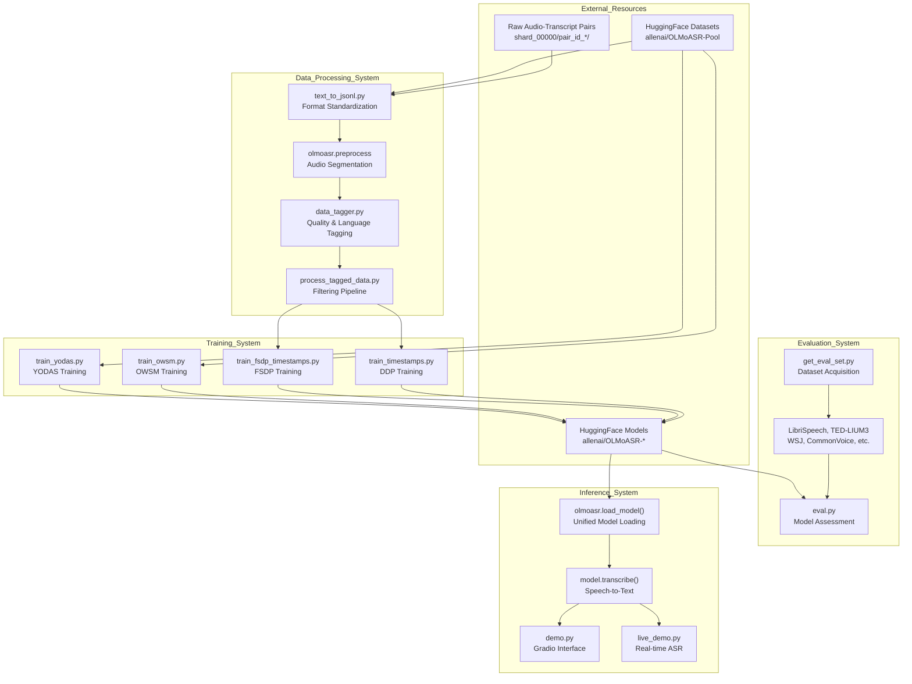
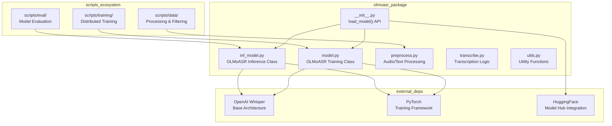
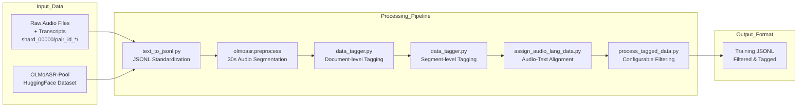

<!-- source: DeepWiki mcp.deepwiki.com · repo allenai/OLMoASR · page 1 Overview · fetched 2026-10-26 -->

# Overview

<details>
<summary>Relevant source files</summary>

The following files were used as context for generating this wiki page:

- [README.md](README.md)
- [tech_report/olmoasr_tech_report.pdf](tech_report/olmoasr_tech_report.pdf)

</details>


This document provides a comprehensive overview of OLMoASR, an open-source Automatic Speech Recognition (ASR) system designed for training robust speech recognition models from web-scale data. It covers the system's architecture, core components, and data flow from raw audio-transcript pairs to deployed models.

For detailed installation instructions, see [Installation & Dependencies](#2.1). For hands-on usage examples, see [Quick Start with Demos](#2.2). For training-specific guidance, see [Model Training](#4).

## What is OLMoASR

OLMoASR is a complete end-to-end ASR training and inference system that processes web-scale audio-transcript data to produce high-quality speech recognition models. The system provides:

- **Data Processing Pipeline**: Transforms raw audio-transcript pairs into training-ready datasets through segmentation, tagging, and filtering
- **Distributed Training**: Supports multiple training strategies including DDP, FSDP, and specialized approaches like OWSM and YODAS
- **Model Variants**: Produces models in multiple sizes (tiny, base, small, medium, large) optimized for different use cases
- **Inference API**: Provides a unified Python API for loading and using trained models
- **Evaluation Suite**: Comprehensive evaluation across multiple benchmark datasets

The system is built on top of OpenAI's Whisper architecture but extends it with improved data processing, training strategies, and deployment capabilities.

**Sources**: [README.md:1-20]()

## System Architecture Overview

OLMoASR follows a modular architecture organized around four main subsystems that work together to transform raw data into production-ready ASR models.

### High-Level System Components



This diagram shows how the four subsystems interact, with data flowing from raw inputs through processing and training to evaluation and deployment. Each component is implemented as specific Python modules and scripts.

**Sources**: [README.md:58-67](), [README.md:98-149]()

### Core Package Architecture



The `olmoasr` package provides the core APIs while the `scripts/` directory contains workflow implementations for data processing, training, and evaluation. The system builds on established frameworks like PyTorch and Whisper while adding specialized functionality.

**Sources**: [README.md:47-56](), [README.md:194-198]()

## Data Processing Pipeline

The data processing pipeline transforms raw audio-transcript pairs into training-ready datasets through a multi-stage process that handles quality control, language identification, and format standardization.

### Data Flow and Processing Stages



Each processing stage adds metadata and quality metrics to the dataset. The final JSONL format contains fields for audio paths, transcripts, timestamps, quality scores, and language identification.

**Data Schema**: The processed data follows a standardized JSONL schema with required fields including `id`, `audio_file`, `subtitle_file`, `seg_text`, `timestamp`, `audio_lang`, `text_lang`, `length`, and optional quality metrics like `edit_dist` and `seg_edit_dist`.

**Sources**: [README.md:58-70](), [README.md:71-95]()

## Training System

The training system supports multiple distributed training strategies and model architectures, with configurations managed through YAML files and execution via `torchrun`.

### Training Strategies and Scripts

| Training Script | Strategy | Use Case |
|-----------------|----------|----------|
| `train_timestamps.py` | DDP (Distributed Data Parallel) | Standard distributed training |
| `train_fsdp_timestamps.py` | FSDP (Fully Sharded Data Parallel) | Large model training with memory optimization |
| `train_owsm.py` | OWSM | Specialized training approach |
| `train_yodas.py` | YODAS | Alternative training methodology |

All training scripts accept common parameters for model configuration, data paths, optimization settings, and distributed training parameters. The system uses `torchrun` for launching distributed training jobs across multiple GPUs and nodes.

**Key Training Parameters**:
- `--model_variant`: Model size (tiny, base, small, medium, large)
- `--samples_dicts_dir`: Path to processed training data
- `--eff_batch_size`: Global batch size across all GPUs
- `--precision`: Training precision (fp16, bf16, fp32)
- `--train_steps`: Total training steps

**Sources**: [README.md:98-142]()

## Model Variants and Performance

OLMoASR produces models in multiple sizes, each trained on a subset of the OLMoASR-Mix dataset. All models support both short-form and long-form speech recognition with sentence-level timestamps.

### Available Model Sizes

| Model Size | Parameters | Short-form Avg WER | Long-form Avg WER |
|------------|------------|-------------------|------------------|
| tiny.en | ~37M | 20.5% | 15.6% |
| base.en | ~72M | 16.6% | 12.9% |
| small.en | ~242M | 13.8% | 11.5% |
| medium.en | ~769M | 12.8% | 11.0% |
| large.en | ~1.5B | 13.0% | 11.4% |
| large.en-v2 | ~1.5B | 12.6% | 11.5% |

Models are distributed through HuggingFace Hub under the `allenai/OLMoASR-*` namespace and can be loaded using the unified `olmoasr.load_model()` API.

**Sources**: [README.md:152-188]()

## Inference and Usage

The inference system provides a unified Python API for loading and using trained models, with support for both file-based and real-time transcription.

### Python API Usage

```python
import olmoasr

# Load model for inference
model = olmoasr.load_model("medium", inference=True)

# Transcribe audio file
result = model.transcribe("audio.mp3")

# Access transcription results
print(result["text"])           # Full transcription
print(result["segments"])       # Timestamped segments
print(result["language"])       # Detected language
```

The API automatically handles model downloading, caching, and format conversion. Models can be loaded from local checkpoints or automatically downloaded from HuggingFace Hub.

### Demo Applications

The system includes two demo applications:
- `demo.py`: Gradio-based web interface for file upload transcription
- `live_demo.py`: Real-time streaming transcription interface

Both applications use the same underlying `olmoasr.load_model()` API and provide user-friendly interfaces for testing model capabilities.

**Sources**: [README.md:189-247]()

## Key File Organization

The codebase follows a clear organizational structure with separation between core package functionality and workflow scripts:

```
olmoasr/                    # Core package
├── __init__.py            # Main API (load_model)
├── model.py               # Training model implementation  
├── inf_model.py           # Inference-optimized model
├── preprocess.py          # Audio/text processing
└── transcribe.py          # Transcription logic

scripts/                   # Workflow implementations
├── data/                  # Data processing scripts
├── training/              # Training configurations
└── eval/                  # Evaluation scripts

configs/                   # Configuration files
└── job_configs/          # Training job configurations
```

This organization enables the core `olmoasr` package to be used independently while providing comprehensive workflow scripts for the complete training pipeline.

**Sources**: [README.md:1-257]()

---

