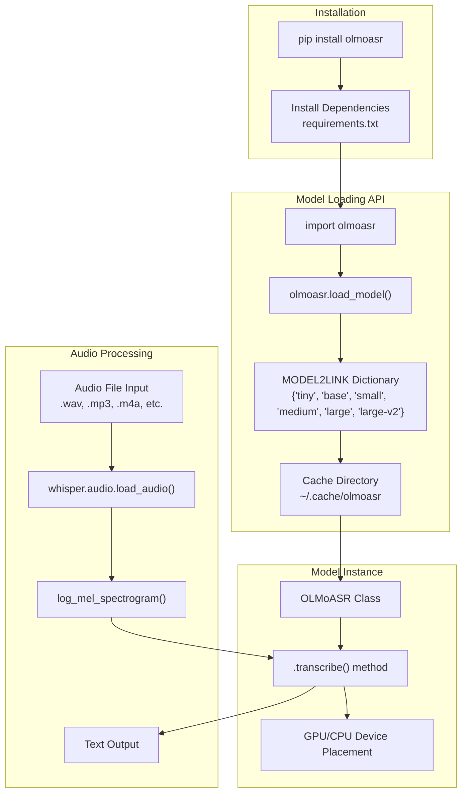
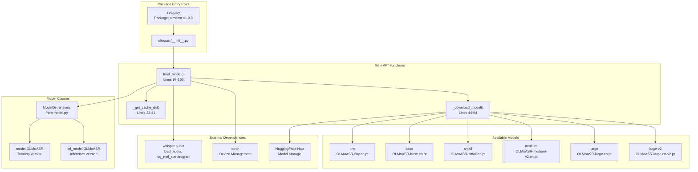

<!-- source: DeepWiki mcp.deepwiki.com · repo allenai/OLMoASR · page 2 Getting Started · fetched 2026-10-26 -->

# Getting Started

Relevant source files

The following files were used as context for generating this wiki page:

- [olmoasr/__init__.py](olmoasr/__init__.py)
- [requirements.txt](requirements.txt)
- [requirements/requirements-data.txt](requirements/requirements-data.txt)
- [requirements/requirements.txt](requirements/requirements.txt)
- [setup.py](setup.py)

This document provides an overview of how to quickly get started with OLMoASR, covering basic installation, model loading, and initial usage patterns. For detailed installation instructions and dependency management, see [Installation & Dependencies](#2.1). For hands-on exploration using the web interface, see [Quick Start with Demos](#2.2).

## Overview

OLMoASR is an open-source Automatic Speech Recognition system that provides pre-trained models for transcribing audio to text. The system offers multiple model sizes and supports both programmatic usage through a Python API and interactive usage through web-based demos.

## User Journey: From Installation to First Transcription

*Sources: [olmoasr/__init__.py:97-166](), [setup.py:16-38]()*

## Core Components and API Structure

*Sources: [olmoasr/__init__.py:1-167](), [setup.py:1-39]()*

## Basic Usage Pattern

The simplest way to use OLMoASR follows this pattern:

1. **Import the package**: `import olmoasr`
2. **Load a model**: `model = olmoasr.load_model("base")`
3. **Transcribe audio**: `result = model.transcribe("audio.wav")`

The `load_model()` function [olmoasr/__init__.py:97-166]() handles model downloading, caching, and device placement automatically. Models are downloaded from HuggingFace Hub URLs defined in `MODEL2LINK` [olmoasr/__init__.py:23-30]() and cached locally in `~/.cache/olmoasr` [olmoasr/__init__.py:33-41]().

## Available Model Sizes

| Model Size | Checkpoint File | Use Case |
|------------|----------------|----------|
| `tiny` | `OLMoASR-tiny.en.pt` | Fast inference, low resource environments |
| `base` | `OLMoASR-base.en.pt` | Balanced speed and accuracy |
| `small` | `OLMoASR-small.en.pt` | Good accuracy, moderate resources |
| `medium` | `OLMoASR-medium-v2.en.pt` | Higher accuracy applications |
| `large` | `OLMoASR-large.en.pt` | Best accuracy, more resources required |
| `large-v2` | `OLMoASR-large.en-v2.pt` | Latest version of large model |

*Sources: [olmoasr/__init__.py:23-30]()*

## Key Dependencies and Requirements

The system requires several core dependencies managed through [requirements.txt:1-29]():

- **PyTorch ecosystem**: `torch`, `torchaudio` for deep learning operations
- **Audio processing**: `librosa`, `pydub` for audio format handling  
- **OpenAI Whisper**: `openai-whisper` for base architecture components
- **HuggingFace**: `transformers`, `huggingface_hub` for model management
- **Data handling**: `datasets`, `pandas`, `numpy` for data processing
- **Web interface**: `gradio` for demo applications

The package is installed as `olmoasr` version 1.0.0 [setup.py:20]() with MIT license [setup.py:21]().

*Sources: [requirements.txt:1-29](), [setup.py:16-38]()*

## Next Steps

After basic setup:

- **Try the demos**: See [Quick Start with Demos](#2.2) to explore OLMoASR capabilities through web interfaces
- **Advanced installation**: See [Installation & Dependencies](#2.1) for development setup and environment configuration  
- **Training models**: See [Model Training](#4) to train custom models on your data
- **Python API**: See [Python API Reference](#6.1) for comprehensive API documentation
- **Evaluation**: See [Model Evaluation](#5) to benchmark model performance

*Sources: [olmoasr/__init__.py:1-167](), [setup.py:1-39]()*

---

