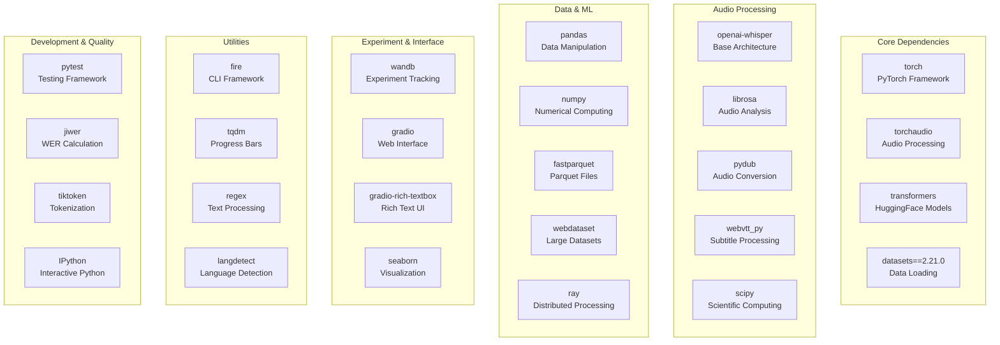
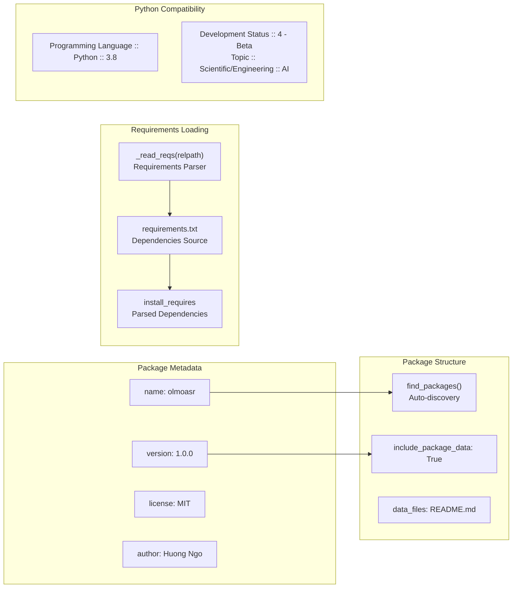
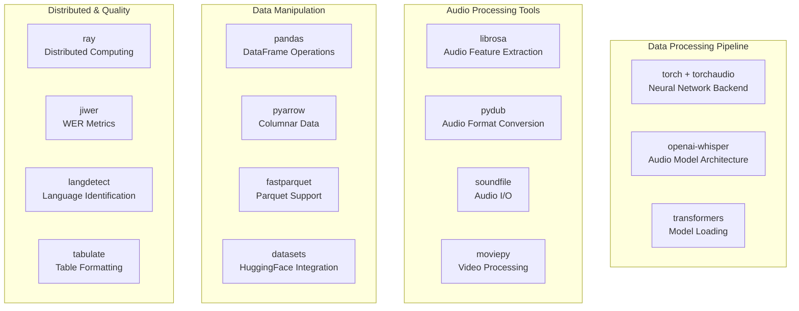

<!-- source: DeepWiki mcp.deepwiki.com · repo allenai/OLMoASR · page 2.1 Installation & Dependencies · fetched 2026-10-26 -->

# Installation & Dependencies

<details>
<summary>Relevant source files</summary>

The following files were used as context for generating this wiki page:

- [HISTORY.md](HISTORY.md)
- [LICENSE](LICENSE)
- [Makefile](Makefile)
- [NOTICES.txt](NOTICES.txt)
- [mypy.ini](mypy.ini)
- [requirements.txt](requirements.txt)
- [requirements/requirements-data.txt](requirements/requirements-data.txt)
- [requirements/requirements.txt](requirements/requirements.txt)
- [setup.py](setup.py)

</details>


This document provides detailed instructions for installing OLMoASR and managing its dependencies. It covers both basic user installation for inference and complete development environment setup for contributing to the project.

For information about using the Python API after installation, see [Python API Reference](#6.1). For development tools and workflows, see [Development Setup & Tools](#7.1).

## System Requirements

OLMoASR requires Python 3.8 or later and has been tested on Linux and macOS systems. The package supports both CPU and GPU execution, with GPU strongly recommended for training workflows.

### Hardware Requirements

| Component | Minimum | Recommended |
|-----------|---------|-------------|
| RAM | 8 GB | 16+ GB |
| Storage | 10 GB free space | 50+ GB for datasets |
| GPU | Not required | CUDA-compatible GPU with 8+ GB VRAM |

Sources: [setup.py:36]()

## Installation Methods

### Standard Installation

The simplest installation method uses pip with the main requirements file:

```bash
pip install -r requirements.txt
```

This installs all core dependencies needed for both inference and basic data processing workflows.

### Development Installation

For contributors and advanced users, use the development installation process defined in the Makefile:

```bash
make install
make install-dev
```

The `make install` command performs these steps:
1. Upgrades pip to the latest version
2. Installs the package in editable mode using `pip install -e .`

Sources: [Makefile:1-3](), [setup.py:16-38]()

## Dependency Architecture

The dependency structure is organized into several categories based on functionality:



Sources: [requirements.txt:1-29]()

## Package Definition Structure

The package is configured through `setup.py` with the following key parameters:



Sources: [setup.py:1-38]()

## Specialized Requirements Files

The project includes multiple requirements files for different use cases:

| File | Purpose | Key Dependencies |
|------|---------|-----------------|
| `requirements.txt` | Main installation | All core dependencies with specific versions |
| `requirements/requirements.txt` | Alternative main | Similar to main but without some optional packages |
| `requirements/requirements-data.txt` | Data processing | Focused on data manipulation and processing tools |

### Data Processing Requirements

The data-specific requirements file includes specialized tools:



Sources: [requirements/requirements-data.txt:1-24]()

## Development Environment Setup

### Make Commands

The Makefile provides standardized commands for development workflow:

| Command | Function | Details |
|---------|----------|---------|
| `make install` | Package installation | Upgrades pip, installs package in editable mode |
| `make install-dev` | Development setup | Installs testing requirements |
| `make lint` | Code quality | Runs mypy and black checkers |
| `make black` | Code formatting | Auto-formats Python code |
| `make test` | Testing | Runs pytest with verbose output |

### Type Checking Configuration

The project uses mypy for static type checking with configuration in `mypy.ini`:

- Target Python version: 3.8
- Missing imports ignored for external libraries
- Global type checking enabled

Sources: [Makefile:1-28](), [mypy.ini:1-6]()

## Installation Verification

After installation, verify the setup by checking key imports and basic functionality:

```python
# Verify core package
import olmoasr

# Verify key dependencies  
import torch
import transformers
import datasets
import gradio

# Check GPU availability (optional)
print(f"CUDA available: {torch.cuda.is_available()}")
```

### Common Installation Issues

| Issue | Symptom | Solution |
|-------|---------|----------|
| PyTorch version mismatch | CUDA errors or slow performance | Install PyTorch for your specific CUDA version |
| Audio library conflicts | Import errors for librosa/pydub | Install system audio libraries (e.g., ffmpeg) |
| Memory errors during installation | pip crashes | Use `--no-cache-dir` flag or increase virtual memory |

Sources: [setup.py:14-30](), [requirements.txt:11-12]()

## License and Third-Party Components

OLMoASR is distributed under the MIT License. The project includes numerous third-party dependencies with various licenses, documented in `NOTICES.txt`. Key license categories include:

- MIT License: Core package and many utilities
- Apache 2.0: HuggingFace components, some audio tools  
- BSD variants: Scientific computing libraries
- Python Software Foundation License: Python ecosystem tools

Sources: [LICENSE:1-22](), [NOTICES.txt:1-100](), [setup.py:21]()

---

