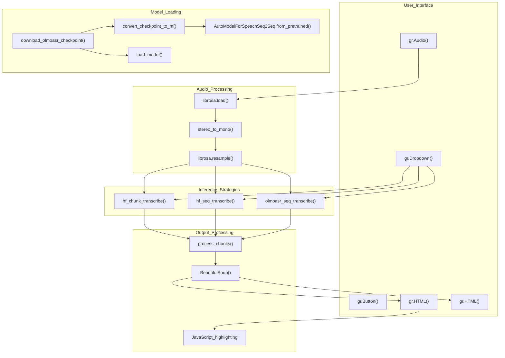
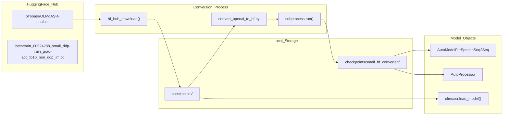
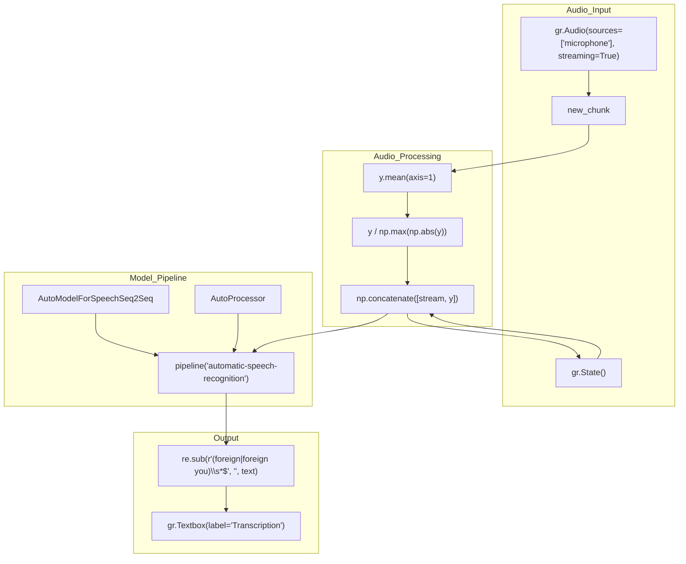
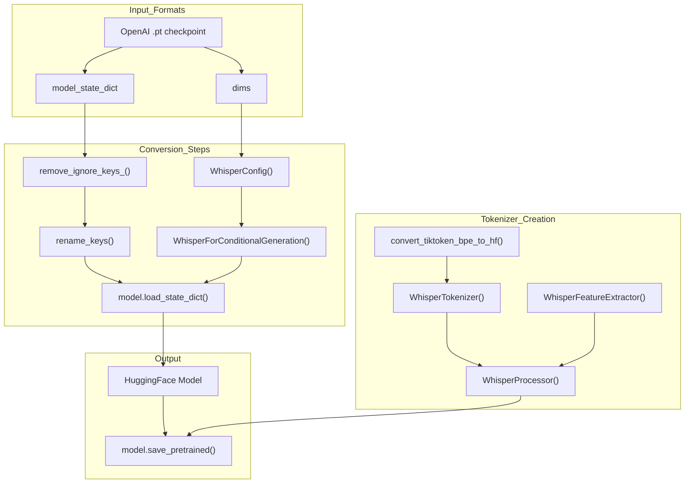

<!-- source: DeepWiki mcp.deepwiki.com · repo allenai/OLMoASR · page 2.2 Quick Start with Demos · fetched 2026-10-26 -->

# Quick Start with Demos

<details>
<summary>Relevant source files</summary>

The following files were used as context for generating this wiki page:

- [demo/convert_openai_to_hf.py](demo/convert_openai_to_hf.py)
- [demo/demo.py](demo/demo.py)
- [demo/live_demo.py](demo/live_demo.py)

</details>


This page provides a hands-on introduction to OLMoASR through interactive demo applications. The demos showcase core ASR capabilities including file-based transcription, real-time streaming, and different inference strategies, allowing users to quickly evaluate model performance without complex setup.

For detailed API usage and Python integration, see [Python API Reference](#6.1). For deployment and production usage, see [Inference & Deployment](#6).

## Demo Applications Overview

OLMoASR includes three demo applications that demonstrate different usage patterns:

| Demo | Purpose | Interface | Key Features |
|------|---------|-----------|--------------|
| **Main Demo** | File upload transcription | Gradio web UI | Multiple inference strategies, timestamp visualization |
| **Live Demo** | Real-time streaming ASR | Gradio web UI | Continuous audio capture, streaming transcription |
| **Conversion Script** | Model format conversion | Command line | OpenAI → HuggingFace format conversion |

## Main Demo Architecture

The primary demo application in [`demo/demo.py`]() provides a comprehensive interface for testing OLMoASR models with uploaded audio files.

### Demo System Flow



**Sources:** [`demo/demo.py:1-544`]()

### Model Initialization System



**Sources:** [`demo/demo.py:25-147`](), [`demo/convert_openai_to_hf.py:1-371`]()

## Running the Main Demo

### Initialization Process

The demo automatically handles model downloading and initialization:

1. **Model Download**: The `download_olmoasr_checkpoint()` function retrieves models from HuggingFace Hub [`demo/demo.py:40-63`]()
2. **Format Conversion**: `convert_checkpoint_to_hf()` converts OpenAI format to HuggingFace format [`demo/demo.py:65-116`]()
3. **Model Loading**: Both HuggingFace and OLMoASR model instances are created [`demo/demo.py:118-147`]()

### Inference Strategies

The demo provides three inference approaches accessible via dropdown selection:

| Strategy | Implementation | Use Case |
|----------|----------------|----------|
| **HuggingFace Chunking** | `hf_chunk_transcribe()` | 30-second chunked processing with overlap handling |
| **HuggingFace Sequential** | `hf_seq_transcribe()` | Sequential processing with timestamp accumulation |
| **OLMoASR Sequential** | `olmoasr_seq_transcribe()` | Native OLMoASR inference with segment output |

### Audio Processing Pipeline

All inference strategies share common audio preprocessing:

```python
# Audio loading and conversion (demo/demo.py:174-180, 209-215, 260-266)
waveform, sample_rate = librosa.load(audio_file, sr=None, mono=False)
waveform = stereo_to_mono(waveform)  # Convert stereo to mono
if sample_rate != 16000:
    waveform = librosa.resample(waveform, orig_sr=sample_rate, target_sr=16000)
```

**Sources:** [`demo/demo.py:152-161`](), [`demo/demo.py:163-304`]()

### Real-time Timestamp Visualization

The demo includes JavaScript-based timestamp synchronization that highlights the current segment being spoken:

```javascript
// Real-time highlighting (demo/demo.py:451-505)
function getTime() {
    // Synchronizes audio playback position with transcript highlighting
    // Updates HTML with highlighted current segment
}
```

**Sources:** [`demo/demo.py:451-506`]()

## Live Demo for Streaming ASR

The live demo in [`demo/live_demo.py`]() provides real-time transcription capabilities using microphone input.

### Live Demo Architecture



**Sources:** [`demo/live_demo.py:1-69`]()

### Key Implementation Details

The live demo uses Gradio's streaming capability with state management:

- **Streaming Handler**: `transcribe(stream, new_chunk)` processes incoming audio chunks [`demo/live_demo.py:31-47`]()
- **State Accumulation**: Audio chunks are concatenated to maintain continuous context [`demo/live_demo.py:41-44`]()
- **Real-time Pipeline**: HuggingFace pipeline processes accumulated audio stream [`demo/live_demo.py:45`]()

**Sources:** [`demo/live_demo.py:31-66`]()

## Model Format Conversion

The conversion script [`demo/convert_openai_to_hf.py`]() handles transformation between OpenAI Whisper and HuggingFace formats.

### Conversion Process Flow



**Sources:** [`demo/convert_openai_to_hf.py:185-251`](), [`demo/convert_openai_to_hf.py:291-327`]()

### Key Conversion Components

The conversion process involves several critical transformations:

- **State Dictionary Mapping**: `WHISPER_MAPPING` dictionary maps OpenAI parameter names to HuggingFace equivalents [`demo/convert_openai_to_hf.py:102-123`]()
- **Configuration Creation**: Model dimensions are extracted and converted to `WhisperConfig` [`demo/convert_openai_to_hf.py:207-223`]()
- **Tokenizer Conversion**: tiktoken BPE is converted to HuggingFace tokenizer format [`demo/convert_openai_to_hf.py:272-327`]()

**Sources:** [`demo/convert_openai_to_hf.py:96-137`](), [`demo/convert_openai_to_hf.py:185-251`](), [`demo/convert_openai_to_hf.py:272-327`]()

## Usage Instructions

### Starting the Main Demo

```bash
python demo/demo.py
```

The demo will:
1. Download the OLMoASR model from HuggingFace Hub
2. Convert it to HuggingFace format if needed
3. Initialize both model variants
4. Launch a Gradio interface accessible via web browser

### Starting the Live Demo

```bash
python demo/live_demo.py
```

This launches a streaming interface that captures microphone input and provides real-time transcription.

### Manual Model Conversion

```bash
python demo/convert_openai_to_hf.py \
    --checkpoint_path path/to/model.pt \
    --pytorch_dump_folder_path output/directory \
    --convert_preprocessor True
```

**Sources:** [`demo/demo.py:543-544`](), [`demo/live_demo.py:66-67`](), [`demo/convert_openai_to_hf.py:330-341`]()

---

