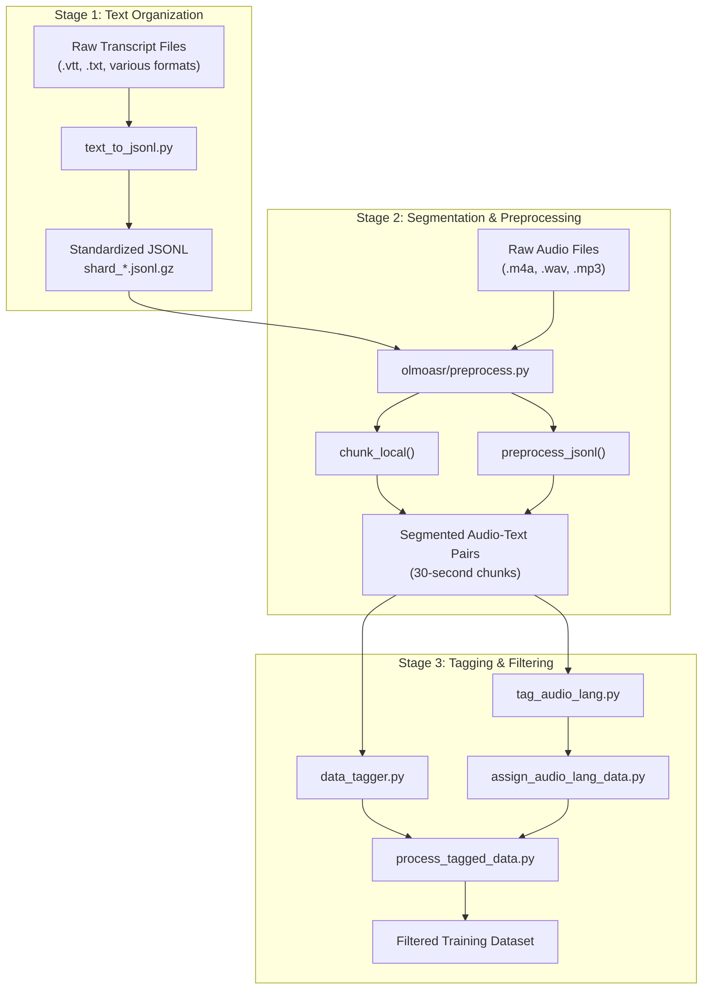
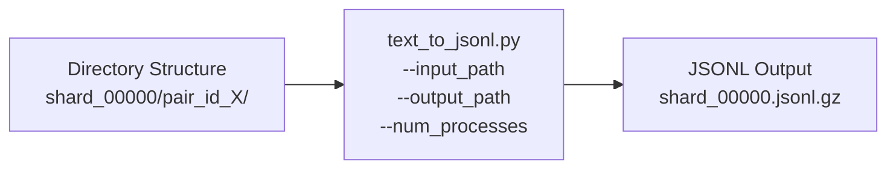
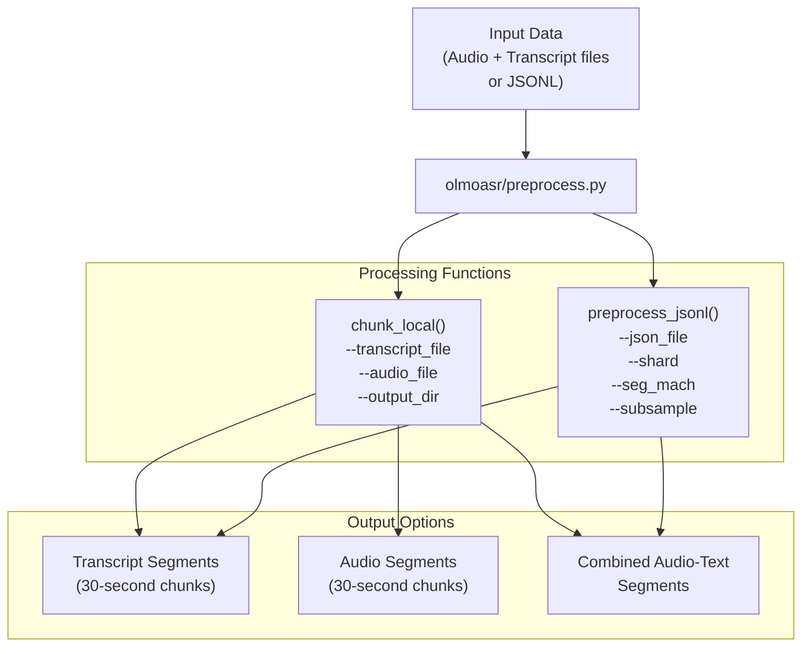
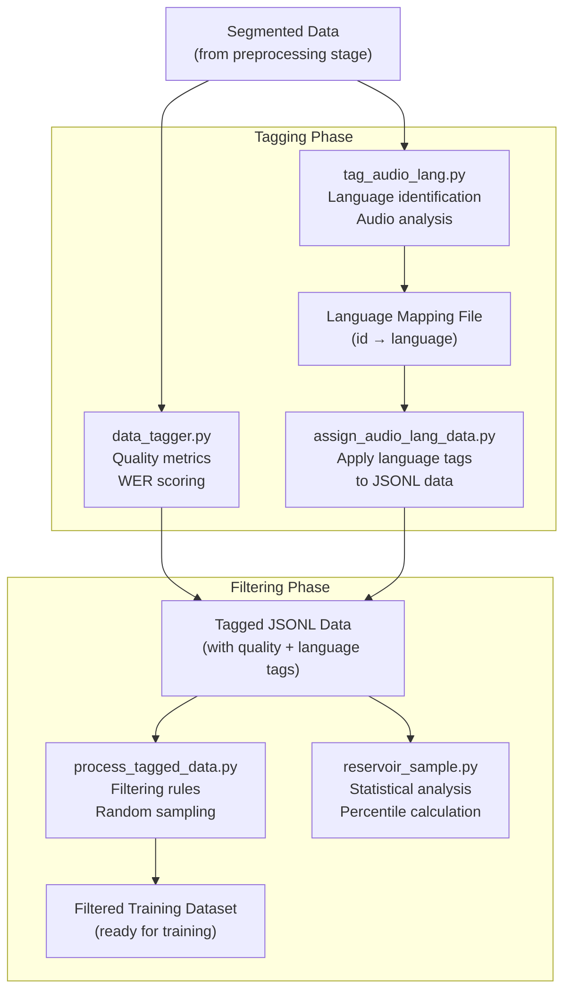

<!-- source: DeepWiki mcp.deepwiki.com · repo allenai/OLMoASR · page 3 Data Processing Pipeline · fetched 2026-10-26 -->

# Data Processing Pipeline

Relevant source files

The following files were used as context for generating this wiki page:

- [configs/job_configs/data/processing/segmentation.sh](configs/job_configs/data/processing/segmentation.sh)
- [configs/job_configs/data/processing/text_to_jsonl.sh](configs/job_configs/data/processing/text_to_jsonl.sh)
- [scripts/README.md](scripts/README.md)

The data processing pipeline transforms raw audio files and transcript pairs into standardized, segmented datasets suitable for ASR model training. This system handles format conversion, temporal segmentation, quality assessment, and filtering to create high-quality training data from diverse input sources.

This document covers the core data transformation stages. For detailed preprocessing and segmentation mechanics, see [Data Preprocessing & Segmentation](#3.1). For quality control and tagging systems, see [Data Tagging & Quality Control](#3.2). For filtering configuration options, see [Filtering Configuration System](#3.3).

## Pipeline Overview

The data processing pipeline consists of three main stages that progressively transform and refine raw audio-transcript pairs into training-ready datasets.

The pipeline processes data through three distinct stages, each with specific responsibilities and outputs. Stage 1 standardizes text formats, Stage 2 performs temporal segmentation, and Stage 3 applies quality control and filtering.

Sources: [scripts/README.md:1-37](), [configs/job_configs/data/processing/segmentation.sh:1-70](), [configs/job_configs/data/processing/text_to_jsonl.sh:1-4]()

## Text Organization Stage

The first stage converts diverse transcript formats into a standardized JSONL structure using the `text_to_jsonl.py` script. This script organizes transcript files from directory structures into compressed JSONL files.

### text_to_jsonl.py Functionality

The script processes transcript files from organized directory structures and creates standardized JSONL output:

| Parameter | Purpose | Example |
|-----------|---------|---------|
| `--input_path` | Source directory containing transcript files | `/path/to/shard_00000` |
| `--output_path` | Target JSONL file (typically compressed) | `/path/to/output.jsonl.gz` |
| `--num_processes` | Parallel processing workers | `10` |

The script handles parallel processing to efficiently convert large directory structures containing thousands of transcript files into manageable JSONL format for downstream processing.

Sources: [scripts/README.md:6](), [configs/job_configs/data/processing/text_to_jsonl.sh:1-4]()

## Segmentation & Preprocessing Stage

The segmentation stage uses `olmoasr/preprocess.py` to chunk audio and transcript data into fixed-duration segments suitable for training. The preprocessing module provides two main functions: `chunk_local()` for local audio/transcript files and `preprocess_jsonl()` for JSONL input data.

### chunk_local() Function

Processes individual audio-transcript pairs from local files:

| Parameter | Purpose | Values |
|-----------|---------|--------|
| `--transcript_file` | Input transcript file path | `.vtt`, `.txt` formats |
| `--audio_file` | Input audio file path | `.m4a`, `.wav`, `.mp3` formats |
| `--output_dir` | Output directory for segments | Directory path |
| `--in_memory` | Memory processing mode | `True`/`False` |
| `--transcript_only` | Process transcripts only | `True`/`False` |
| `--audio_only` | Process audio only | `True`/`False` |

### preprocess_jsonl() Function

Processes JSONL-formatted data with additional options for machine transcription and subsampling:

| Parameter | Purpose | Usage |
|-----------|---------|-------|
| `--json_file` | Input JSONL file | `shard_00000.jsonl.gz` |
| `--shard` | Shard identifier | `00000` |
| `--seg_mach` | Include machine transcriptions | `True`/`False` |
| `--subsample` | Enable subsampling | `True`/`False` |
| `--subsample_size` | Number of samples | `20000` |
| `--only_subsample` | Subsample only (no segmentation) | `True`/`False` |

The segmentation stage creates 30-second chunks from longer audio-transcript pairs, enabling efficient batch training while maintaining temporal alignment between audio and text.

Sources: [scripts/README.md:6](), [configs/job_configs/data/processing/segmentation.sh:1-70]()

## Tagging & Filtering Stage

The final stage applies quality assessment, language identification, and filtering to create curated training datasets. This stage uses multiple specialized scripts working in sequence.

### Tagging Scripts

| Script | Function | Purpose |
|--------|----------|---------|
| `data_tagger.py` | General data tagging | Applies quality metrics and metadata tags |
| `tag_audio_lang.py` | Language identification | Identifies spoken language in audio |
| `assign_audio_lang_data.py` | Language assignment | Maps language tags to JSONL data |

### Filtering & Sampling Scripts

| Script | Function | Purpose |
|--------|----------|---------|
| `process_tagged_data.py` | Data filtering | Executes filtering and random sampling |
| `reservoir_sample.py` | Statistical analysis | Provides percentile information for numerical tags |
| `gen_video_samples.py` | Sample generation | Creates video samples for data assessment |

The tagging and filtering stage ensures data quality through automated assessment of transcription accuracy, language identification, and configurable filtering rules that can be customized based on specific training requirements.

Sources: [scripts/README.md:8-18]()

## Integration & Configuration

The data processing pipeline is controlled through YAML configuration files that specify processing parameters, filtering rules, and output requirements. Configuration examples are provided in the `configs/job_configs/data/` directory structure.

### Configuration Structure

| Directory | Purpose | Contents |
|-----------|---------|----------|
| `configs/job_configs/data/processing/` | Processing configurations | Segmentation and text organization scripts |
| `configs/job_configs/data/filtering/` | Filtering configurations | Tagging and filtering rule definitions |

The pipeline integrates with the broader OLMoASR training system by producing standardized datasets that can be consumed by the training scripts in `scripts/training/`. The processed data maintains consistent format and quality standards across all training approaches (DDP, FSDP, OWSM, YODAS).

Sources: [scripts/README.md:18](), [scripts/README.md:27]()

---

