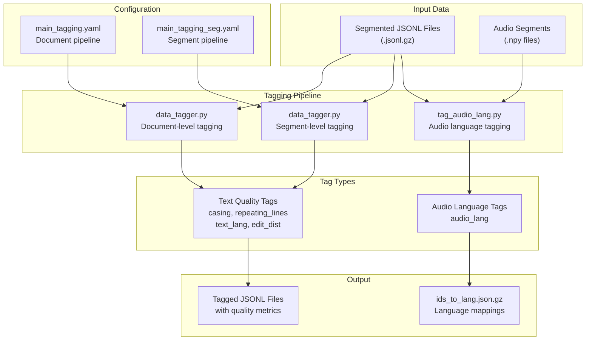
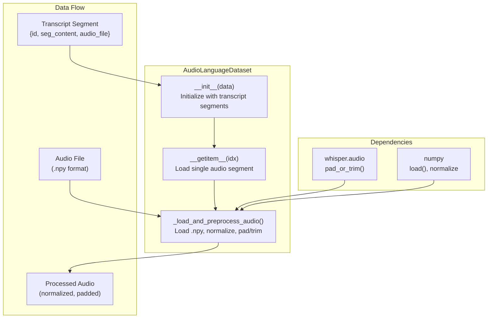
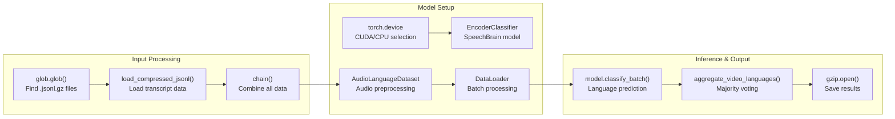
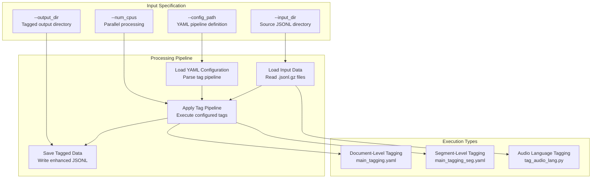

<!-- source: DeepWiki mcp.deepwiki.com · repo allenai/OLMoASR · page 3.2 Data Tagging & Quality Control · fetched 2026-10-26 -->

# Data Tagging & Quality Control

<details>
<summary>Relevant source files</summary>

The following files were used as context for generating this wiki page:

- [configs/data_configs/tagging/main_tagging.yaml](configs/data_configs/tagging/main_tagging.yaml)
- [configs/data_configs/tagging/main_tagging_seg.yaml](configs/data_configs/tagging/main_tagging_seg.yaml)
- [configs/job_configs/data/filtering/tagging.sh](configs/job_configs/data/filtering/tagging.sh)
- [scripts/data/filtering/tag_audio_lang.py](scripts/data/filtering/tag_audio_lang.py)

</details>


This section covers the data tagging system that assigns quality metrics and metadata tags to audio-transcript pairs in the OLMoASR pipeline. The tagging system evaluates content quality, identifies languages, and provides metrics used for subsequent filtering decisions.

For information about the initial data preprocessing and segmentation that occurs before tagging, see [Data Preprocessing & Segmentation](#3.1). For details on how tags are used in filtering configurations, see [Filtering Configuration System](#3.3).

## Tagging System Overview

The OLMoASR tagging system operates on processed audio-transcript data to assign quality metrics and metadata tags. The system supports both document-level and segment-level tagging through configurable YAML pipelines.



Sources: [configs/data_configs/tagging/main_tagging.yaml:1-6](), [configs/data_configs/tagging/main_tagging_seg.yaml:1-3](), [scripts/data/filtering/tag_audio_lang.py:1-412]()

## Audio Language Identification

The audio language identification system uses SpeechBrain models to classify the spoken language in audio segments. This process operates independently of transcript text to provide objective language verification.

### AudioLanguageDataset Class

The `AudioLanguageDataset` class handles loading and preprocessing audio segments for language identification:



Sources: [scripts/data/filtering/tag_audio_lang.py:43-143]()

### Language Identification Process

The language identification process uses a pre-trained SpeechBrain model to classify audio segments:

| Component | Function | Details |
|-----------|----------|---------|
| **Model** | `EncoderClassifier.from_hparams()` | Uses "speechbrain/lang-id-voxlingua107-ecapa" |
| **Processing** | `identify_segment_languages()` | Batch inference on audio segments |
| **Aggregation** | `aggregate_video_languages()` | Majority voting per video ID |
| **Output** | `ids_to_lang.json.gz` | Video ID to language mappings |

The `process_data()` function coordinates the entire audio language identification workflow:



Sources: [scripts/data/filtering/tag_audio_lang.py:259-402]()

## Text-Based Quality Tags

The text-based tagging system applies various quality metrics to transcript content. These tags are configured through YAML pipeline definitions and applied at different granularities.

### Document-Level Tags

Document-level tagging processes entire transcript documents and applies the following tags:

| Tag Type | Purpose | Implementation |
|----------|---------|----------------|
| **casing** | Analyzes text capitalization patterns | Identifies unusual casing issues |
| **repeating_lines** | Detects repetitive content | Flags transcripts with excessive repetition |
| **text_lang** | Identifies transcript language | Text-based language detection |
| **edit_dist** | Calculates edit distance metrics | Measures transcript quality |

### Segment-Level Tags

Segment-level tagging focuses on individual 30-second transcript segments:

| Tag Type | Scope | Configuration |
|----------|-------|---------------|
| **edit_dist** | Per-segment quality | Applied to each audio-transcript segment pair |

### Tag Pipeline Configuration

The tagging pipeline is configured through YAML files that define tag sequences:

**Document-level pipeline** (`main_tagging.yaml`):
```yaml
name: main_tagging
pipeline:
  - tag: casing
  - tag: repeating_lines  
  - tag: text_lang
  - tag: edit_dist
```

**Segment-level pipeline** (`main_tagging_seg.yaml`):
```yaml
name: main_tagging_seg
pipeline:
  - tag: edit_dist
```

Sources: [configs/data_configs/tagging/main_tagging.yaml:1-6](), [configs/data_configs/tagging/main_tagging_seg.yaml:1-3]()

## Tag Application Process

The tagging process is orchestrated through the `data_tagger.py` script, which applies configured tag pipelines to input data directories.

### Execution Workflow



### Typical Usage Pattern

The tagging system is typically executed in sequence for comprehensive data quality assessment:

1. **Document-level tagging**: Applies comprehensive quality tags to full documents
2. **Segment-level tagging**: Adds segment-specific quality metrics  
3. **Audio language tagging**: Provides independent language verification

Example execution sequence:
```bash
# Document-level tagging
python scripts/data/filtering/data_tagger.py \
    --config_path configs/data_configs/tagging/main_tagging.yaml \
    --input_dir /path/to/jsonls_dir \
    --output_dir /path/to/output \
    --num_cpus 10

# Segment-level tagging  
python scripts/data/filtering/data_tagger.py \
    --config_path configs/data_configs/tagging/main_tagging_seg.yaml \
    --input_dir /path/to/jsonls_dir \
    --output_dir /path/to/output \
    --num_cpus 10
```

Sources: [configs/job_configs/data/filtering/tagging.sh:1-15]()

The tagged output data contains the original transcript content enhanced with quality metrics and metadata tags that inform subsequent filtering decisions in the data processing pipeline.

---

