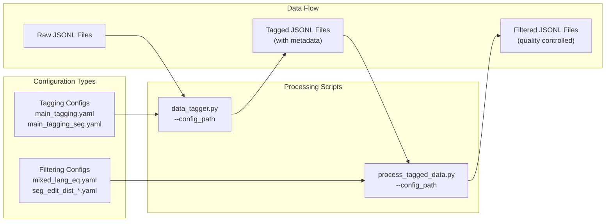
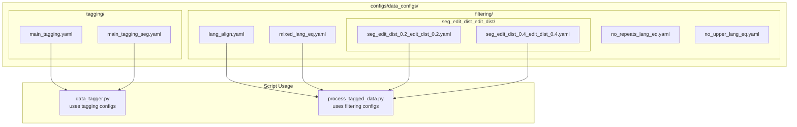

<!-- source: DeepWiki mcp.deepwiki.com · repo allenai/OLMoASR · page 3.3 Filtering Configuration System · fetched 2026-10-26 -->

# Filtering Configuration System

<details>
<summary>Relevant source files</summary>

The following files were used as context for generating this wiki page:

- [configs/data_configs/filtering/lang_align.yaml](configs/data_configs/filtering/lang_align.yaml)
- [configs/data_configs/filtering/mixed_lang_eq.yaml](configs/data_configs/filtering/mixed_lang_eq.yaml)
- [configs/data_configs/filtering/mixed_no_repeats_lang_eq.yaml](configs/data_configs/filtering/mixed_no_repeats_lang_eq.yaml)
- [configs/data_configs/filtering/no_repeats_lang_eq.yaml](configs/data_configs/filtering/no_repeats_lang_eq.yaml)
- [configs/data_configs/filtering/no_upper_lang_eq.yaml](configs/data_configs/filtering/no_upper_lang_eq.yaml)
- [configs/data_configs/filtering/seg_edit_dist_edit_dist/seg_edit_dist_0.2_edit_dist_0.2.yaml](configs/data_configs/filtering/seg_edit_dist_edit_dist/seg_edit_dist_0.2_edit_dist_0.2.yaml)
- [configs/data_configs/filtering/seg_edit_dist_edit_dist/seg_edit_dist_0.4_edit_dist_0.4.yaml](configs/data_configs/filtering/seg_edit_dist_edit_dist/seg_edit_dist_0.4_edit_dist_0.4.yaml)
- [configs/data_configs/tagging/main_tagging.yaml](configs/data_configs/tagging/main_tagging.yaml)
- [configs/data_configs/tagging/main_tagging_seg.yaml](configs/data_configs/tagging/main_tagging_seg.yaml)
- [configs/job_configs/data/filtering/tagging.sh](configs/job_configs/data/filtering/tagging.sh)

</details>


This document covers the YAML-based configuration system that defines data filtering and tagging pipelines in OLMoASR. The configuration system enables flexible, reproducible data quality control through composable filter stages. For information about the actual data processing implementation, see [Data Tagging & Quality Control](#3.2). For the broader data processing context, see [Data Processing Pipeline](#3).

## Configuration Architecture

The filtering configuration system operates through two distinct types of YAML configurations: **tagging configs** that define what metadata to compute for each data sample, and **filtering configs** that define criteria for accepting or rejecting samples based on their computed tags.

### Configuration File Structure

All configuration files follow a consistent YAML structure with a `name` field and a `pipeline` field containing an ordered list of operations:

```yaml
name: config_name
pipeline:
  - tag: tag_name
    parameter: value
  - tag: another_tag
    ref_value: expected_value
```

**Configuration System Flow**


Sources: [configs/data_configs/tagging/main_tagging.yaml:1-6](), [configs/job_configs/data/filtering/tagging.sh:1-14]()

## Tagging Configuration System

Tagging configurations define which metadata fields to compute and attach to data samples. These configs are used by `data_tagger.py` to enrich data with quality metrics and categorical labels.

### Available Tags

| Tag Name | Purpose | Output Type |
|----------|---------|-------------|
| `casing` | Analyzes text capitalization patterns | Categorical (`mixed`, `upper`, `lower`) |
| `repeating_lines` | Detects repetitive text content | Boolean |
| `text_lang` | Identifies text language | Language code (`en`, `es`, etc.) |
| `audio_lang` | Identifies spoken language in audio | Language code (`en`, `es`, etc.) |
| `edit_dist` | Computes edit distance between audio/text | Float (0.0-1.0) |
| `seg_edit_dist` | Edit distance for segmented audio chunks | Float (0.0-1.0) |

### Tagging Pipeline Examples

**Document-level tagging** applies comprehensive analysis to full documents:
```yaml
# main_tagging.yaml
pipeline:
  - tag: casing
  - tag: repeating_lines
  - tag: text_lang
  - tag: edit_dist
```

**Segment-level tagging** focuses on audio-text alignment quality:
```yaml
# main_tagging_seg.yaml
pipeline:
  - tag: edit_dist
```

Sources: [configs/data_configs/tagging/main_tagging.yaml:1-6](), [configs/data_configs/tagging/main_tagging_seg.yaml:1-6]()

## Filtering Configuration System

Filtering configurations define acceptance criteria for data samples based on their computed tags. Each filter stage can specify exact matches (`ref_value`), ranges (`upper_bound`, `lower_bound`), or boolean conditions.

### Filter Parameters

| Parameter | Purpose | Example Usage |
|-----------|---------|---------------|
| `ref_value` | Exact value match or list of acceptable values | `ref_value: en` or `ref_value: [mixed, lower]` |
| `upper_bound` | Maximum threshold for numeric tags | `upper_bound: 0.2` |
| `lower_bound` | Minimum threshold for numeric tags | `lower_bound: 0.1` |
| `inclusive` | Whether bounds are inclusive or exclusive | `inclusive: true` |

### Filtering Pipeline Patterns

**Language Alignment Filter**
```yaml
# lang_align.yaml
pipeline:
  - tag: audio_lang
    ref_value: en
  - tag: text_lang
    ref_value: en
```

**Quality Threshold Filter**
```yaml
# seg_edit_dist_0.2_edit_dist_0.2.yaml
pipeline:
  - tag: edit_dist
    upper_bound: 0.2
    inclusive: true
  - tag: seg_edit_dist
    upper_bound: 0.2
    inclusive: true
```

**Multi-criteria Quality Filter**
```yaml
# mixed_no_repeats_lang_eq.yaml
pipeline:
  - tag: casing
    ref_value: mixed
  - tag: repeating_lines
    ref_value: False
  - tag: audio_lang
    ref_value: en
  - tag: text_lang
    ref_value: en
```

Sources: [configs/data_configs/filtering/lang_align.yaml:1-6](), [configs/data_configs/filtering/seg_edit_dist_edit_dist/seg_edit_dist_0.2_edit_dist_0.2.yaml:1-12](), [configs/data_configs/filtering/mixed_no_repeats_lang_eq.yaml:1-10]()

## Configuration Usage Patterns

### Command Line Integration

The configuration system integrates with data processing scripts through the `--config_path` parameter:

```bash
# Tagging phase
python scripts/data/filtering/data_tagger.py \
    --config_path configs/data_configs/tagging/main_tagging.yaml \
    --input_dir /path/to/jsonls_dir \
    --output_dir /path/to/output \
    --num_cpus 10

# Filtering phase  
python scripts/data/filtering/process_tagged_data.py \
    --config_path configs/data_configs/filtering/lang_align.yaml \
    --input_dir /path/to/tagged_data \
    --output_dir /path/to/filtered_data
```

### Configuration Organization

**Directory Structure for Filter Configs**


Sources: [configs/job_configs/data/filtering/tagging.sh:3-13](), [configs/data_configs/filtering/seg_edit_dist_edit_dist/seg_edit_dist_0.2_edit_dist_0.2.yaml:1-12]()

## Common Configuration Patterns

### Progressive Quality Filtering

Multiple configurations enable progressive quality filtering with different thresholds:

| Configuration | Edit Distance Threshold | Use Case |
|---------------|-------------------------|----------|
| `seg_edit_dist_0.2_edit_dist_0.2.yaml` | ≤ 0.2 | High-quality training data |
| `seg_edit_dist_0.4_edit_dist_0.4.yaml` | ≤ 0.4 | More permissive filtering |

### Text Style Filtering

Configurations can filter based on text characteristics:

| Configuration | Casing Requirements | Repetition Policy | Use Case |
|---------------|--------------------|--------------------|----------|
| `mixed_lang_eq.yaml` | Mixed case only | Any | Proper capitalization |
| `no_upper_lang_eq.yaml` | Mixed or lowercase | No repeats | Exclude shouting text |
| `no_repeats_lang_eq.yaml` | Any | No repeats | Remove repetitive content |

### Language Consistency

All filtering configurations enforce language alignment between audio and text through consistent `audio_lang: en` and `text_lang: en` requirements.

Sources: [configs/data_configs/filtering/mixed_lang_eq.yaml:1-8](), [configs/data_configs/filtering/no_upper_lang_eq.yaml:1-12](), [configs/data_configs/filtering/no_repeats_lang_eq.yaml:1-8]()

---

