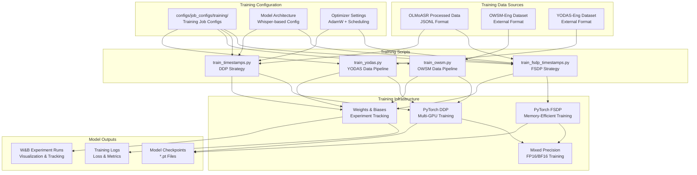
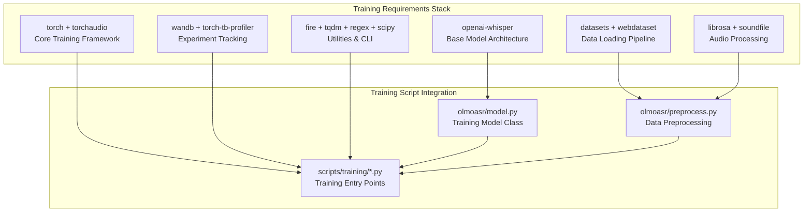
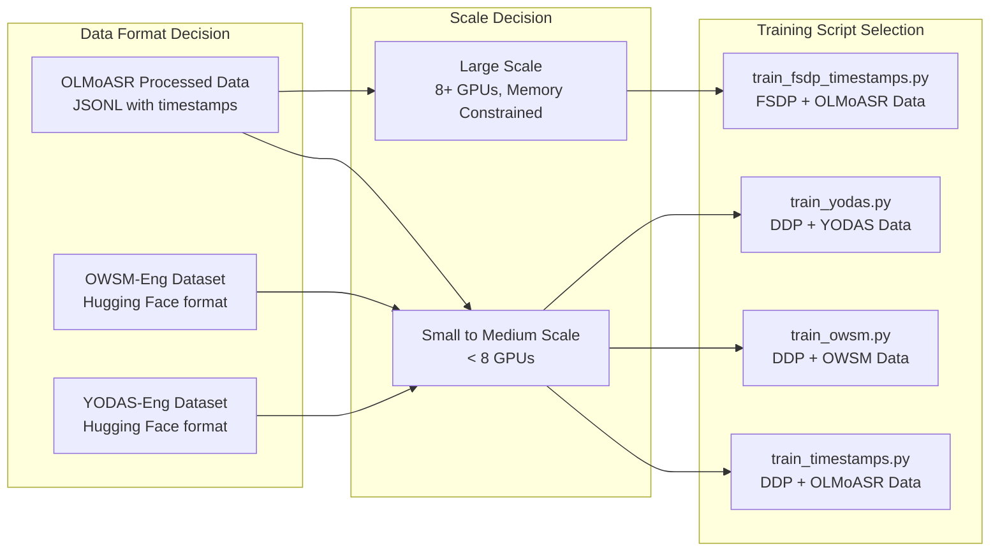
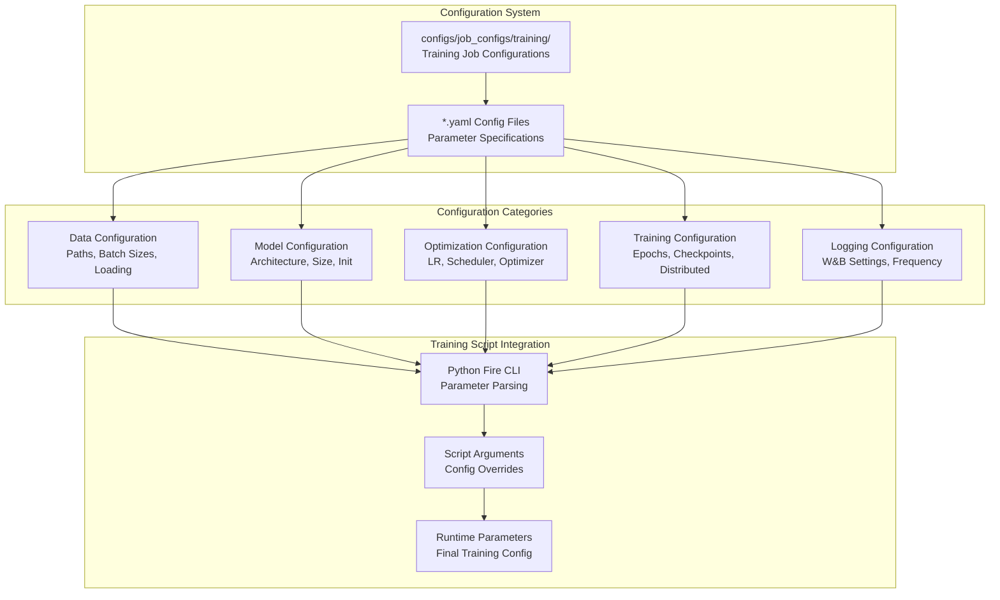
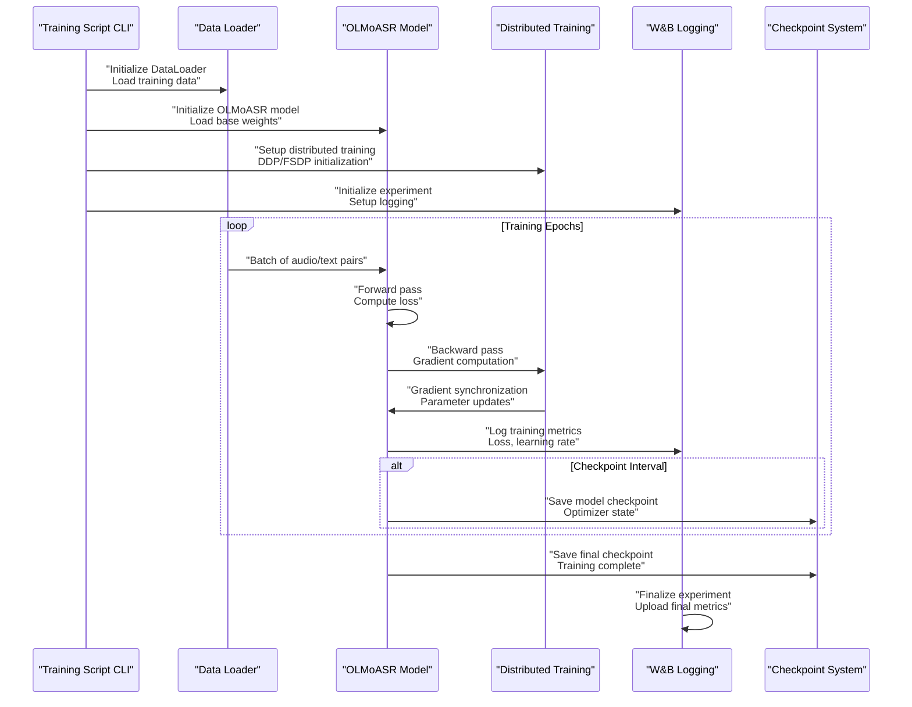

<!-- source: DeepWiki mcp.deepwiki.com · repo allenai/OLMoASR · page 4 Model Training · fetched 2026-10-26 -->

# Model Training

Relevant source files

The following files were used as context for generating this wiki page:

- [requirements/requirements-train.txt](requirements/requirements-train.txt)
- [scripts/README.md](scripts/README.md)

This page covers the complete model training system in OLMoASR, including training environment setup, distributed training strategies, and the various training scripts available. The training system supports multiple approaches for different data types and scales, from small-scale DDP training to large-scale FSDP training with various pre-existing datasets.

For information about setting up the training environment and dependencies, see [Training Environment & Dependencies](#4.1). For details on the specific training scripts and distributed strategies, see [Training Scripts & Distributed Strategies](#4.2). For data preparation before training, see [Data Processing Pipeline](#3).

## Training System Architecture

The OLMoASR training system is designed around multiple training strategies that can handle different scales of data and computational resources. The system provides specialized training scripts for different data formats and training paradigms.

Sources: [scripts/README.md:20-27]()

## Training Dependencies and Environment

The training system requires a comprehensive set of dependencies for deep learning, data processing, audio handling, and experiment tracking. The training-specific requirements are managed separately from the base package requirements.

### Core Training Dependencies

| Category | Dependencies | Purpose |
|----------|--------------|---------|
| Deep Learning | `torch`, `torchaudio` | PyTorch ecosystem for model training |
| Data Processing | `datasets==2.21.0`, `webdataset` | HuggingFace datasets and WebDataset format |
| Audio Processing | `librosa`, `soundfile` | Audio file reading and processing |
| Experiment Tracking | `wandb==0.18.7` | Weights & Biases integration |
| Evaluation | `jiwer` | Word Error Rate calculation |
| Base Model | `openai-whisper` | Whisper model architecture |
| Performance | `torch-tb-profiler`, `ray` | Training profiling and distributed computing |
| Utilities | `fire`, `tqdm`, `regex`, `scipy`, `numpy` | CLI interfaces and utilities |

Sources: [requirements/requirements-train.txt:1-19]()

## Training Script Overview

The OLMoASR system provides four distinct training scripts, each optimized for different training scenarios and data formats. These scripts handle different distributed training strategies and dataset formats.

### Training Script Comparison

| Script | Distributed Strategy | Target Dataset | Key Features |
|--------|---------------------|----------------|--------------|
| `train_fsdp_timestamps.py` | FSDP | OLMoASR processed data | Memory-efficient large model training |
| `train_timestamps.py` | DDP | OLMoASR processed data | Standard multi-GPU training |
| `train_owsm.py` | DDP | OWSM-Eng dataset | Pre-configured for OWSM data format |
| `train_yodas.py` | DDP | YODAS-Eng dataset | Pre-configured for YODAS data format |

Sources: [scripts/README.md:20-27]()

## Training Configuration System

The training system uses a configuration-based approach where job configurations are stored in `configs/job_configs/training/` and specify all training parameters, data paths, and model settings. This allows for reproducible training runs and easy parameter sweeps.

### Configuration Structure

Training configurations typically include:

- **Data Configuration**: Dataset paths, batch sizes, data loading parameters
- **Model Configuration**: Architecture settings, model size, initialization
- **Optimization Configuration**: Learning rate, scheduler, optimizer settings  
- **Training Configuration**: Number of epochs, checkpoint frequency, distributed settings
- **Logging Configuration**: Weights & Biases project settings, logging frequency

Sources: [scripts/README.md:27]()

## Training Process Flow

The training process follows a standardized workflow regardless of the specific training script used. The process involves data loading, model initialization, distributed training setup, and iterative training with checkpointing.

Sources: [scripts/README.md:20-27]()

## Model Checkpointing and Output

The training system generates several types of outputs that capture the trained model state and training progress. These outputs are essential for model deployment, evaluation, and continued training.

### Training Output Types

| Output Type | File Pattern | Purpose |
|-------------|--------------|---------|
| Model Checkpoints | `*.pt` files | Trained model weights and optimizer state |
| Training Logs | Local log files | Detailed training progress and metrics |
| W&B Experiments | Online dashboard | Visualization and experiment tracking |
| Configuration Snapshots | Embedded in checkpoints | Reproducible training parameters |

The checkpoint system is designed to support both inference and continued training scenarios. For model deployment and evaluation workflows, see [Model Evaluation](#5) and [Inference & Deployment](#6).

Sources: [scripts/README.md:20-27](), [scripts/README.md:32-37]()

---

